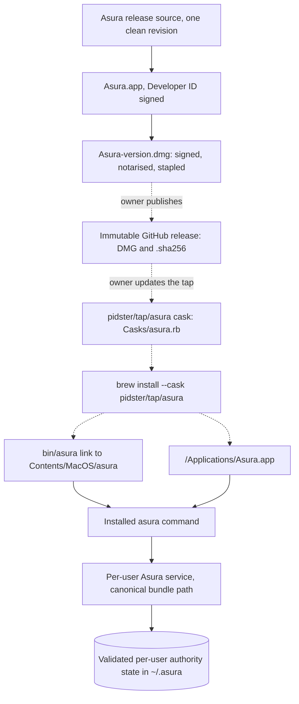

# ADR 0008: Distribute Asura as a signed DMG through a Homebrew cask

Date: 2026-09-25. Amended 2026-11-01 (owner decisions of 2026-10-31 and
2026-11-01): the release is one signed, notarised disk image (DMG), and a
Homebrew cask installs it. The earlier `.tar.gz` archive and the `asura`
formula are removed. Status: selected distribution direction. Nothing is
released yet; the first publication is on hold with the owner.

## Context

The owner selected a standalone `asura` command with a per-user service. The
existing [pidster/homebrew-tap](https://github.com/pidster/homebrew-tap)
installs Wisp through
[`Formula/wisp.rb`](https://github.com/pidster/homebrew-tap/blob/main/Formula/wisp.rb),
which downloads a versioned release archive and checks its SHA-256. The tap
also contains a separate `daimon` formula. These observations describe the
current tap, not an Asura release.

Asura ships as `Asura.app`: the team Keychain store needs a provisioning
profile, and a profile needs an app-like bundle
([release signing, SGQ1](../designs/release-signing.md#owner-decisions)). A
`.tar.gz` cannot be notarised or carry a stapled ticket; a disk image can be
signed, notarised and stapled
([Apple: packaging Mac software](https://developer.apple.com/documentation/xcode/packaging-mac-software-for-distribution)).
Wisp, the sibling project, also ships `Wisp.app` in a signed, notarised DMG
beside its tarball formula.

## Decision

Owner decisions:

- **2026-10-31.** A signed DMG is the primary distribution. Homebrew installs
  it through a cask. Each release has one artifact: the signed, notarised DMG.
  The cask is `Casks/asura.rb` in `pidster/homebrew-tap`. It installs
  `Asura.app` into `/Applications` and links the `asura` command with the cask
  `binary` stanza.
- **2026-11-01.** Confirmed: "DMG distribution is now primary". The first
  releases are signed with the Developer ID Application identity (AD-19).
- The `.tar.gz` archive and the formula are dropped entirely. Nothing is
  released, so there is no backward compatibility, alias or migration.

Asura publishes `Asura-<version>.dmg` and its `.sha256` file as the assets of
an immutable GitHub release in the Asura repository. The `asura` cask in
`pidster/homebrew-tap` names that asset and its exact SHA-256. Homebrew
installs the app and the command link; Asura's own service contract owns
per-user startup, attachment, shutdown and state. The cask does not own the
service lifecycle, does not create `$HOME/.asura/`, and does not remove it.

The [release distribution design](../designs/release-distribution.md) owns the
artifact and cask contract, trust checks, installation, upgrade and recovery.
The [release signing design](../designs/release-signing.md#sg6-dmg-and-cask)
owns the DMG build, its signature, notarisation and the release scripts. The
[standalone service design](../designs/system-architecture.md) owns runtime
arbitration and version negotiation. I9 must qualify the actual signed DMG and
cask before publication. This decision does not authorize publication.

### Distribution ownership

Selected responsibility view. Solid arrows show publication and installation.
Dotted arrows show steps that remain the owner's and have not run. No arrow
shows runtime authority: only the running per-user service can initialize
Asura state.

## Consequences

- The cask must name an immutable versioned asset and its exact digest.
- The DMG must hold every executable and runtime asset that Asura needs on a
  supported host. Installing Asura must not require Xcode or a Rust toolchain.
- A cask upgrade replaces `/Applications/Asura.app` in place while an older
  service may still run. The control protocol rejects a mismatched version
  with `incompatible_protocol`, and the helper identity check rejects a helper
  from another build. The recoverable handover path is deferred until the
  first release (owner, 2026-10-17).
- `brew uninstall --cask asura` removes the app and the link only. It must
  leave the per-user authority files and graph data in `~/.asura` intact.
  Amended 2026-11-02 (owner): `brew uninstall --zap --cask asura` removes all
  of `~/.asura` through `zap trash: "~/.asura"`, which moves it to the Trash.
  Keychain items stay. Until then the cask had no `zap` stanza
  ([zap and `~/.asura`](../designs/release-distribution.md#zap-and-asura)).
- Homebrew quarantines a cask download, so Gatekeeper assesses the installed
  app. The notarised, stapled DMG and the notarised app satisfy it.
- The existing tap is a distribution precedent. It does not establish Asura's
  artifact layout, signature verification or release readiness.
