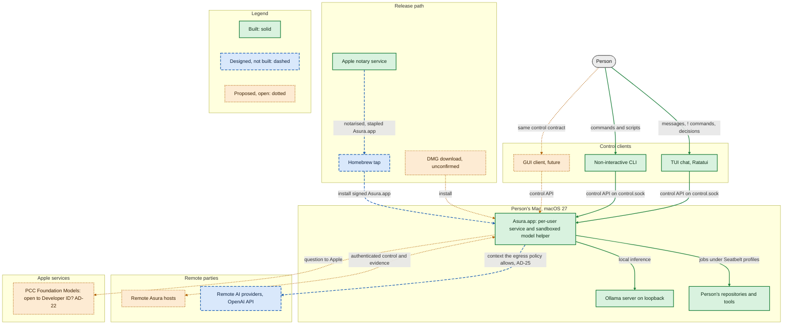
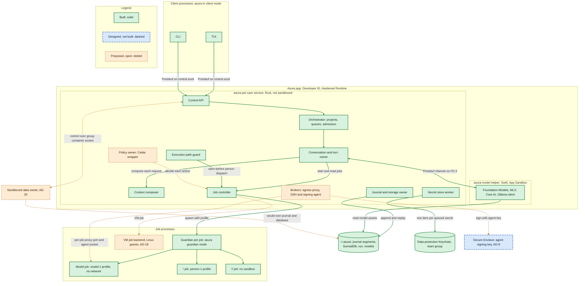
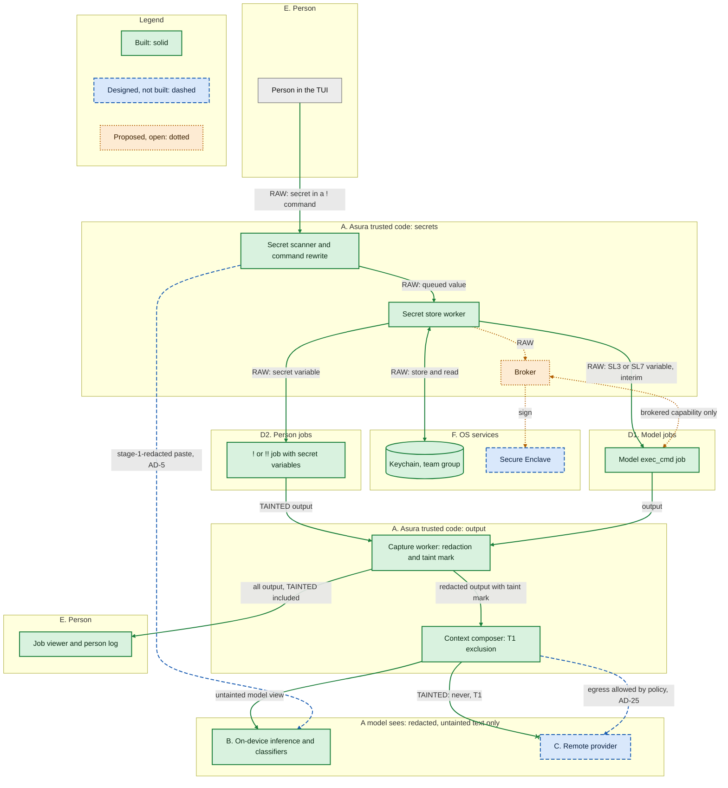
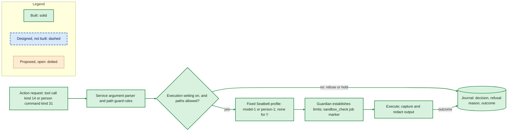
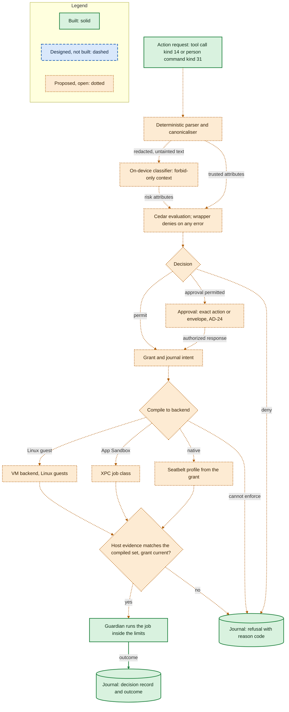
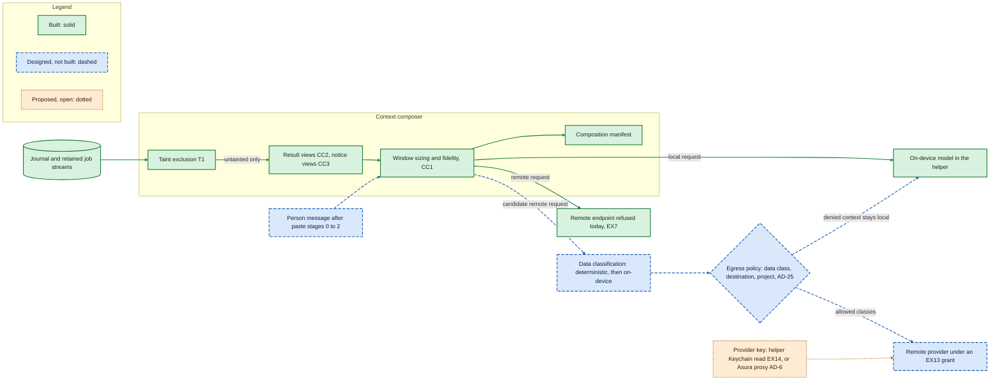
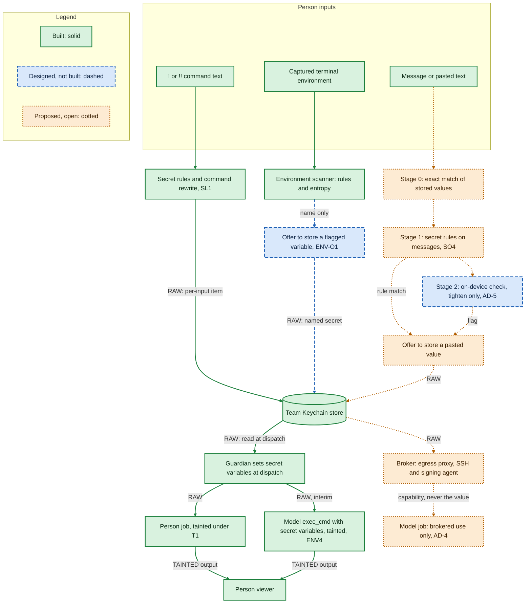

# Intended architecture overview

Status: **Proposed (draft for owner review), 2026-11-01.** This document is an
overview. It shows the intended shape of Asura in six diagrams (diagram 4 has
two views) and marks each
element as built, designed or proposed. It selects nothing and authorizes no
code, probe or spike. The [architecture baseline](../architecture.md) stays the
canonical statement of required behavior. The owner will decide whether these
views replace the baseline's diagrams. Terms are defined in the
[glossary](../glossary.md).

What is fixed: the baseline, the designs linked from each element, and the owner
decisions of 2026-10-31 and 2026-11-01 listed in [inputs](#inputs).

What is open: every element marked **proposed**, and the
[open decisions](#open-decisions-that-affect-the-picture).

## Inputs

This overview combines three kinds of source:

- **Designs on `main`.** Each element links to its governing design in
  [where each element is specified](#where-each-element-is-specified).
- **Owner decisions of 2026-10-31 and 2026-11-01.**
  - AD-5: an on-device model always checks pasted text after the deterministic
    stages, before any remote egress. It may only tighten.
  - AD-7: `!` and `!!` person commands get no network lockdown and keep
    `SSH_AUTH_SOCK` ([person command environment](person-command-environment.md)).
  - AD-9: model jobs sign commits with a separate agent key.
  - AD-25: policy decides context egress to remote models by data class,
    destination and project.
  - The allow-list environment of person commands is built. Taint rule T1 is
    built: a job that received raw secrets has private output, for person and
    model jobs ([taint exclusion hook](context-composer.md#taint-exclusion-hook)).
  - The "Asura sees" and "a model sees" principle, with trust classes A–F and
    flow rules F1–F7, is the selected direction.
  - Developer ID first is a recommendation (AD-19). It is not decided.
- **Proposals not on `main`.** The draft "Assurance and differentiation" design
  (AD-1 to AD-26, differentiators DF1–DF7) and three session research reports
  (secrets, Cedar, distribution, 2026-10-31). They are research inputs. This
  document names them but does not link to them, because they are not in the
  repository.

## How to read the diagrams

Every diagram uses the same three styles. The style does not rely on colour
alone: each status also has its own border line.

| Status | Meaning | Border | Fill |
| --- | --- | --- | --- |
| **Built** | Implemented on `main`, with the evidence its design records | Solid | Green |
| **Designed** | Selected by the owner or by a ready design; not built | Dashed | Blue |
| **Proposed** | An open decision or a research proposal; not selected | Dotted | Amber |

Edges use the same line styles: a solid edge is built, a dashed edge is designed
and a dotted edge is proposed. A grey box with a thin border is outside Asura,
such as the person. An edge that ends in a cross is a flow that a rule forbids.
"Unconfirmed" in a label means that the repository documents do not state the
fact.

## 1. System context

Proposed overview view. Scope: Asura, its people and the outside systems it
uses. Arrows show requests and data flow between parties.

- The TUI and the CLI are built. They are clients of one per-user service
  ([ADR-0005](../decisions/0005-default-ratatui-chat.md),
  [system architecture](system-architecture.md)). The GUI is a baseline
  requirement with no design.
- `Asura.app`, Developer ID signing and notarisation are built
  ([release signing](release-signing.md); probe NT-P1 passed 2026-10-27).
- The Homebrew tap is selected ([ADR-0008](../decisions/0008-homebrew-tap-distribution.md),
  [release distribution](release-distribution.md)). The formula template exists
  (SG4), but no public release exists. No document on `main` names a DMG, so the
  DMG is unconfirmed.
- Local models, including Ollama on loopback, are built
  ([model providers](model-provider-integration.md)). Remote providers are
  refused until the EX13 grant and EX14 credentials exist
  ([execution threat model](execution-threat-model.md)).
- Remote Asura hosts are a baseline requirement with no design.
- Whether Private Cloud Compute serves Developer ID apps is a question for Apple
  (AD-22).

## 2. Processes and deployment on the Mac

Proposed overview view. Scope: the processes, OS facilities and files of one
user's Asura on one Mac. Boxes are processes or stores. Arrows show calls,
spawns and data access.

- One executable, `asura`, runs as the client, the service and the per-job
  guardian. The Swift helper `asura-model` is the second executable
  ([release signing](release-signing.md)).
- The helper runs in the App Sandbox (packet SG2). It talks to the service over
  the Protobuf channel ([Swift/Rust boundary](swift-rust-boundary.md),
  [ADR-0010](../decisions/0010-protobuf-model-channel.md)).
- The job controller, the guardian and the three job profiles are built
  ([tool job controller](tool-job-controller.md),
  [escapee control](escapee-control.md),
  [person command mode](person-command-mode.md)). The path guard is built as
  packet P5 ([execution path guard](execution-path-guard.md)).
- The journal is the [segmented journal](segmented-journal.md). Embedded
  SurrealDB lives under `~/.asura`
  ([user service and configuration](user-service-configuration.md)).
- The secret store uses the team data-protection Keychain (packet SG3,
  [secret store](secret-store.md)).
- The agent signing key is selected (AD-9). Its holder, Rust in the service or a
  small Swift signer, is open (AD-8). The policy owner, the brokers, the
  sandboxed data owner (AD-20) and the VM backend (AD-18) are proposals.

## 3. Trust classes and data flows

Selected direction ("Asura sees" against "a model sees"), with built and
proposed parts. Scope: where raw secret values and tainted output may go. Boxes
are trust classes, not processes. Edge labels start with **RAW** when the flow
carries a raw secret value and with **TAINTED** when it carries output of a job
that received one.

- Raw values stay in classes A, D2, E and F (rule F1). Today a model job can
  also receive raw secret variables (SL3, SL7). Decision ENV4 makes that job
  tainted as an interim rule; AD-4 proposes to forbid it when brokers exist
  ([person command environment](person-command-environment.md)).
- Taint rule T1 is built in the context composer. No model input holds a
  tainted job's output, outcome, counts or durations
  ([taint exclusion hook](context-composer.md#taint-exclusion-hook)). The
  forbidden edge to class C shows the same rule for remote egress.
- The secret scanner, rewrite and capture redaction are built
  ([secret detection](secret-detection.md)). The store is built
  ([secret store](secret-store.md)).
- The AD-5 stage-2 check is selected but not built; no governing design for it
  is on `main`. The remote provider waits for EX13 and EX14.
- The broker (rule F3) is a proposal. The Secure Enclave key for signing is
  selected by AD-9; its holder is open (AD-8).

## 4. Decision and enforcement path for an action

Scope: one effectful action, from request to journal record. Two views split
the path: what is built today, and the proposed policy path that would replace
the fixed envelope. Arrows show control flow. Labels on decision arrows name the
guard. Every refusal ends in a journal record with a reason.

### 4a. Today: the fixed envelope

Built view.

### 4b. Proposed: the policy path

Proposal view. Built elements are the ones that already exist in view 4a.

- Today, model jobs run under the person's execution setting with no prompt per
  command ([execution setting](execution-setting.md)). Person commands pass the
  [execution path guard](execution-path-guard.md). The profiles are fixed
  ([exec_cmd tool](exec-cmd-tool.md), [person command mode](person-command-mode.md)).
- The guardian and its `sandbox_check` job marker are built
  ([escapee control](escapee-control.md)). Tool call records and person command
  records are built ([tool call records](tool-call-records.md)).
- The policy path is the
  [security policy brief](security-policy-brief.md#decision-and-enforcement-boundary)
  extended by the Cedar research. The format and evaluator are open (AD-13).
  The classifier scope and its `unknown` result are open (AD-15, AD-16).
- Envelope approval as a policy change is open (AD-24). Model jobs have no
  approval flow today.
- The XPC job class and the VM backend are only needed for an App Store edition
  or for Linux jobs (AD-18, AD-19, AD-21).

## 5. Context egress and the composer

Mixed view. Scope: how the service builds each model request and what may leave
the Mac. Arrows show data flow. The remote path does not exist today: the
service refuses remote endpoints (EX7).

- The [context composer](context-composer.md) owns composition. Slices CC1, CC2
  and CC3 and the T1 hook are built. The manifest is recomputed from the journal
  and the retained streams (ENV3).
- The journal and job streams are owned by the [segmented journal](segmented-journal.md)
  and the [tool job controller](tool-job-controller.md).
- The egress policy is selected by AD-25 but has no governing design. Cedar is
  its candidate engine; the engine choice is open (AD-13).
- Data classification by deterministic code and the on-device classifiers is
  part of AD-25. Its data classes start from the EX13 list: prompts, history,
  notices, file pages and tool results
  ([execution threat model](execution-threat-model.md)).
- Where the provider key lives is open: EX14 puts it in the helper, and AD-6
  proposes an Asura proxy so that no model process holds a secret.

## 6. Secret delivery

Mixed view. Scope: how a secret value enters Asura and reaches the job that uses
it. Arrows show data flow. Edge labels follow the RAW and TAINTED rule of
[diagram 3](#3-trust-classes-and-data-flows).

- The command rewrite, the per-input Keychain items and the secret variables
  are built ([secret detection](secret-detection.md), [secret store](secret-store.md)).
- The environment scanner and the allow-list environment are built
  ([person command environment](person-command-environment.md)). The offer to
  store a flagged variable as a named secret is selected (ENV-O1, 2026-11-01)
  and is being built; its design is not yet on `main`.
- Secret detection on messages is a follow-up design (SO4). Stage 0, and stage 1
  on messages, are proposals from the secrets research. Stage 2 is selected by
  AD-5; it must run before any remote egress and may only tighten.
- Raw delivery to a model job is interim (ENV4). AD-4 proposes to forbid it and
  give model jobs brokered capabilities only. The broker is a proposal.
- Tainted output goes only to the person (T1, built).

## Where each element is specified

| Element | Status | Owner document | Diagrams |
| --- | --- | --- | --- |
| TUI and CLI clients | Built | [ADR-0005](../decisions/0005-default-ratatui-chat.md), [production command flows](command-flows.md) | 1, 2 |
| GUI client | Proposed | [Architecture baseline](../architecture.md#control-and-execution-boundaries) (requirement only) | 1 |
| Remote Asura hosts | Proposed | [Architecture baseline](../architecture.md#control-and-execution-boundaries) (requirement only) | 1 |
| `Asura.app`, Developer ID, Hardened Runtime, notarisation | Built | [Release signing](release-signing.md) | 1, 2 |
| Homebrew tap | Designed | [ADR-0008](../decisions/0008-homebrew-tap-distribution.md), [release distribution](release-distribution.md) | 1 |
| DMG | Proposed, unconfirmed | No document on `main` | 1 |
| Developer ID only for first releases | Proposed (AD-19) | Distribution research, not on `main` | 1 |
| PCC Foundation Models for Developer ID | Proposed (AD-22) | Distribution research, not on `main` | 1 |
| Per-user service and control API | Built | [System architecture](system-architecture.md), [user service and configuration](user-service-configuration.md) | 1, 2 |
| Orchestrator: projects, queues, admission | Built (task lifecycle not built) | [Conversation admission](conversation-admission.md), [managed input queue](managed-input-queue.md), [core harness](core-harness-brief.md) | 2 |
| Swift model helper, Protobuf channel | Built | [Swift/Rust boundary](swift-rust-boundary.md), [ADR-0009](../decisions/0009-supervised-local-model-helper.md), [ADR-0010](../decisions/0010-protobuf-model-channel.md) | 2 |
| Helper App Sandbox | Built (SG2) | [Release signing](release-signing.md#helper-app-sandbox) | 2 |
| Local models: Foundation Models, MLX, Core AI, Ollama | Built | [Model providers](model-provider-integration.md) | 1, 2, 5 |
| Remote providers | Designed (EX13, EX14); refused today (EX7) | [Execution threat model](execution-threat-model.md), [model providers](model-provider-integration.md) | 1, 3, 5 |
| Job controller, queues and slots | Built | [Tool job controller](tool-job-controller.md) | 2, 4 |
| Guardian and job marker | Built | [Escapee control](escapee-control.md), [exec_cmd tool](exec-cmd-tool.md) | 2, 4 |
| `model-1`, `person-1` profiles and the unsandboxed `!!` job | Built | [Execution threat model](execution-threat-model.md), [person command mode](person-command-mode.md) | 2, 4 |
| Execution setting | Built | [Execution setting](execution-setting.md) | 4 |
| Execution path guard | Built (P5) | [Execution path guard](execution-path-guard.md) | 2, 4 |
| Allow-list environment and environment scanner | Built | [Person command environment](person-command-environment.md) | 6 |
| Named secrets offer (ENV-O1) | Designed, being built | Named secrets design, not yet on `main` | 6 |
| Secret rules, command rewrite, capture redaction | Built | [Secret detection](secret-detection.md) | 3, 6 |
| Secret store, team Keychain | Built (SG3) | [Secret store](secret-store.md), [release signing](release-signing.md#team-keychain-store) | 2, 3, 6 |
| Journal and embedded SurrealDB under `~/.asura` | Built | [Segmented journal](segmented-journal.md), [user service and configuration](user-service-configuration.md#per-user-home-and-hybrid-persistence) | 2, 4, 5 |
| Context composer, CC1–CC3, T1 | Built | [Context composer](context-composer.md) | 3, 5 |
| Trust classes A–F, flow rules F1–F7 | Designed (direction selected) | Assurance draft and secrets research, not on `main` | 3 |
| Paste stage 0, stage 1 on messages | Proposed | [Secret detection](secret-detection.md) SO4; secrets research | 6 |
| Paste stage 2, on-device (AD-5) | Designed, no governing design | Assurance draft, not on `main` | 3, 5, 6 |
| Context egress policy and data classes (AD-25) | Designed, no governing design | Assurance draft; [execution threat model](execution-threat-model.md) EX13 | 5 |
| Policy format and evaluator (Cedar) | Proposed (AD-13) | [Security policy brief](security-policy-brief.md) | 2, 4, 5 |
| Parser, classifier, approval, grant, backend compiler | Proposed | [Security policy brief](security-policy-brief.md#decision-and-enforcement-boundary); Cedar research | 4 |
| XPC job class and VM backend | Proposed (AD-18) | Cedar and distribution research, not on `main` | 2, 4 |
| Brokers: egress proxy, SSH and signing agent | Proposed (AD-4, AD-6, AD-7 for model jobs) | Secrets research, not on `main` | 2, 3, 6 |
| Agent signing key in the Secure Enclave | Designed (AD-9); holder open (AD-8) | Assurance draft, not on `main` | 2, 3 |
| Sandboxed data owner | Proposed (AD-20) | Distribution research, not on `main` | 2 |

## Open decisions that affect the picture

- **AD-13, AD-14:** the policy format and evaluator, and how scopes combine.
  Cedar is the candidate for diagrams 4 and 5.
- **AD-15, AD-16, AD-24:** the classifier scope, its `unknown` result and
  envelope approval. They decide the approval branch in diagram 4.
- **AD-4, AD-6, AD-7 (model jobs), AD-8:** raw delivery to model jobs, the
  provider key holder, the proxy-only network for model jobs and the holder of
  the agent key. They decide the broker in diagrams 2, 3 and 6.
- **AD-18, AD-19, AD-20, AD-21:** the VM backend, Developer ID first, the
  sandboxed data owner and an App Store companion. They decide the process
  layout in diagram 2.
- **AD-22:** whether PCC serves Developer ID apps. It decides one model route.
- **AD-23:** the wording and limits of the "zero model access" claim.
- **SO4:** secret detection on messages, which stage 0 and stage 1 in diagram 6
  need.
- **Governing designs for AD-5 and AD-25.** Both are selected, but no design on
  `main` defines their contracts, failure handling or tests yet.

## Design-process coverage

This document governs no implementation. Behavior, contracts, failure handling,
asynchronous execution and validation belong to the owner document of each
element. Diagrams were rendered with the Mermaid CLI and inspected as images.

Return to the [designs index](README.md).
