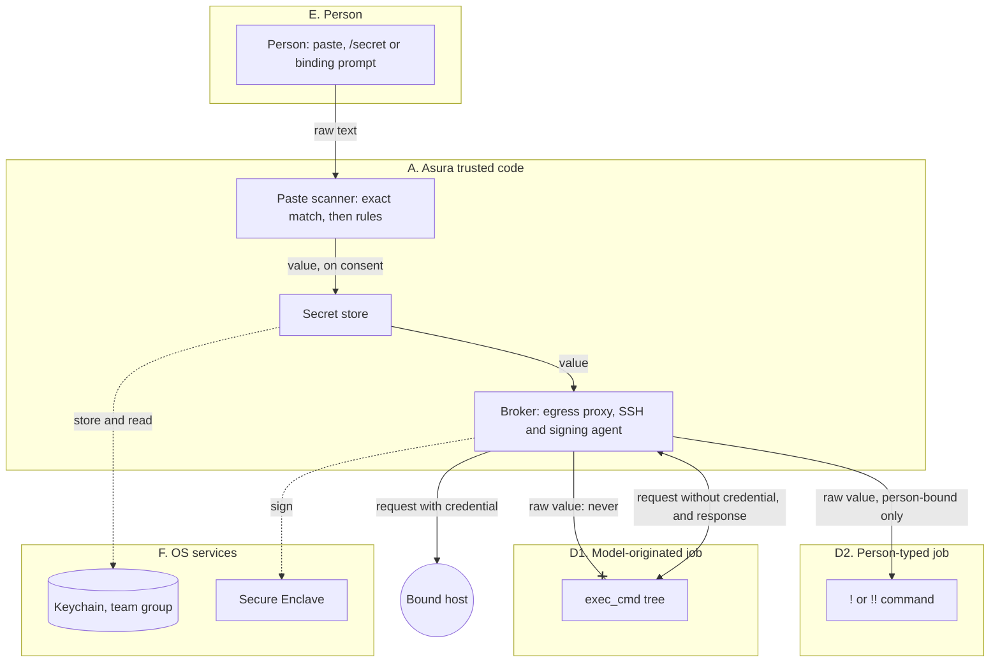
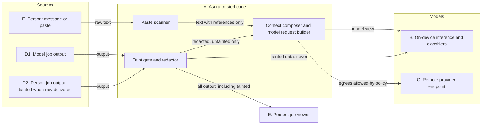
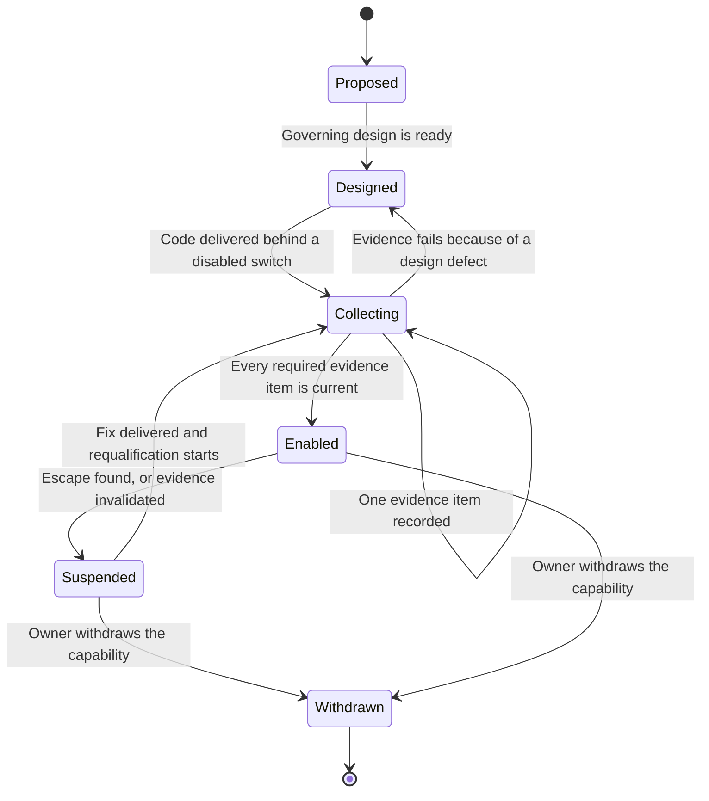
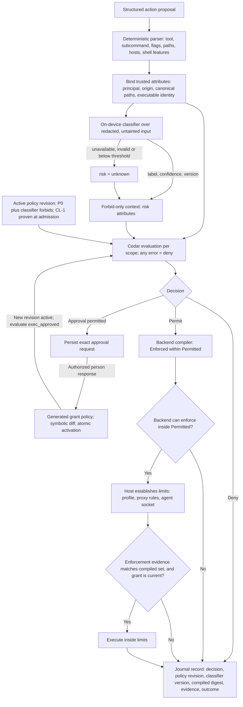

# Assurance and differentiation

Status: **Proposed (draft for owner review), 2026-10-31.** This document
proposes what Asura can do that conventional harnesses cannot, and it sets an
evidence gate for each of those capabilities. It does not select a mechanism. It
also does not authorize code, probes or spikes. Each capability needs its own
governing design under the [design process](../design-process.md) before any
code is written. Terms are defined in the [glossary](../glossary.md).

What is fixed:

- the [architecture rule](../architecture.md#on-device-decisions) that model
  decisions operate inside independently enforced permissions;
- the [security policy brief](security-policy-brief.md) invariants (default
  deny, narrowing only, exact approval binding, decision records);
- the implemented controls named in [current state](#current-state).

What is open: every [differentiator](#the-differentiators), every metric target,
and the [open owner decisions](#open-owner-decisions).

Inputs: three session research reports dated 2026-10-31 (see
[sources](#sources)). They are research, not designs, and they are not stored in
the repository. This document cites them as [R-SEC], [R-CED] and [R-DIST].

Labels in this document follow the [writing standard](../writing-standard.md#status-and-requirements):
**Required behavior**, **Proposed mechanism**, **Open decision** and
**Verified behavior**.

## Purpose

Owner direction (2026-10-31): "We gain by exploiting on-device capabilities, so
if our design is verifiably good, we should be able to do things other harnesses
can't."

Conventional cloud-model harnesses give the person two main choices:

1. **An approval prompt for each action.** The person reads each command and
   approves it. This is safe only while the person reads with care. Many prompts
   cause the person to approve without reading.
2. **A broad sandbox with no further checks.** The agent runs freely inside a
   container or a remote VM. The sandbox limits damage, but nothing checks the
   individual steps, and the context goes to a remote model.

Asura proposes a third choice: **earn autonomy with evidence.** Asura runs on
the person's Mac. It can classify every step on the device, decide with a
verified policy engine, and enforce with OS mechanisms that it can test. When
the evidence for a control exists, Asura can give the agent more autonomy than a
prompt-per-action harness, with stronger limits than a broad sandbox.

This is a proposal. No capability in this document is enabled until its
[evidence gate](#evidence-gate-lifecycle) is met.

### Candid comparison with prior art

Some ideas here are not unique to Asura. [R-SEC] section 4 found that
Anthropic's Claude Code on the web keeps git credentials in a proxy outside the
sandbox. Anthropic's `sandbox-runtime` limits network access to one localhost
proxy port on macOS. Fly.io's `tokenizer` and Deno Sandbox add credentials at
an egress proxy. Asura's claim is therefore not "nobody else brokers secrets".
The proposed difference is the combination:

- classification of every step without sending the step off the device;
- a policy engine with symbolic proofs over the policy text;
- one decision record that joins the policy revision, the classifier version and
  the enforcement evidence;
- control of what context leaves the device, per data class.

## Current state

Verified behavior and selected designs that this document builds on:

| Control | State | Governing design |
| --- | --- | --- |
| Model jobs run in the `model-1` Seatbelt profile, with no network | Implemented; EX-V2 found all network attempts denied | [Execution threat model](execution-threat-model.md) EX2 |
| Model jobs run with no per-command approval, under the person's execution setting | Implemented (EX11) | [Execution setting](execution-setting.md) |
| Remote model endpoints are refused | Implemented; loopback only until EX13 and EX14 exist | [Execution threat model](execution-threat-model.md) EX7 |
| Secrets in commands and output become `$ASURA_SECRET_<n>` placeholders | Implemented (SL1–SL3, SL7) | [Secret detection](secret-detection.md) |
| Queued person secrets are held in the team Keychain store | Implemented (SG3) | [Secret store](secret-store.md), [release signing](release-signing.md) |
| Escapees of sandboxed model jobs are found and stopped | Implemented 2026-10-21 | [Escapee control](escapee-control.md) |
| Developer ID signing, notarisation and stapling | NT-P1 passed 2026-10-27; SG5 recorded 2026-10-29 | [Release signing](release-signing.md) |
| A policy format and evaluator | **Not implemented.** Cedar is a candidate only | [Security policy brief](security-policy-brief.md) |

Today, model jobs already run under a fixed envelope (the `model-1` profile)
with no per-command prompt. The differentiators below propose to make that
envelope variable, provable and visible.

## Trust classes and the "Asura sees / a model sees" principle

Owner goal (2026-10-31, quoted in [R-SEC]): "Secure secret injection should be a
first-class feature that users barely even have to think about, with zero
possibility of the models being able to access the secret."

Owner principle (2026-10-31): distinguish "Asura sees" from "a model sees".
Asura's trusted deterministic code may handle raw values and tainted output. No
model may do so. This includes remote models, on-device models and on-device
classifiers.

### Trust classes

Proposed mechanism, from [R-SEC] section 2.1:

| Class | Members | May hold a raw secret value? | May read tainted output? |
| --- | --- | --- | --- |
| A. Asura trusted code | Service code: secret store worker, broker, egress proxy, SSH and signing agent, taint gate, redactor, paste scanner, policy wrapper, journal writer | Yes, only for the use it brokers | Yes, to redact, to record and to show the person |
| B. On-device models | Inference in the Swift model helper; every on-device classifier | **No** | **No** |
| C. Remote models | Every provider endpoint | **No** | **No** |
| D1. Model-originated jobs | `exec_cmd` jobs that a model proposed, and their descendants | **No**; brokered use only | Not applicable |
| D2. Person-typed jobs | `!` and `!!` jobs | Yes, when the person binds raw delivery | Their own output only |
| E. The person | The person through the TUI or a later GUI | Yes | Yes |
| F. OS services | securityd, Secure Enclave, coreauthd, launchd | Yes, outside Asura's control | Not applicable |

Two consequences need attention:

- The Swift model helper is class B, because it runs model inference. Today
  EX14 plans that the helper reads provider API keys. Under this principle, a
  class B process would hold a secret. [R-SEC] proposes that the helper sends
  provider requests through an Asura proxy that adds the key (decision AD-6).
- A third-party tool inside a job, such as `git` or `cargo`, is class D, even
  when it is trustworthy. A model can steer its configuration and arguments.

### Flow rules

Proposed mechanism, from [R-SEC] section 2.2:

| Rule | Statement |
| --- | --- |
| F1 | A raw secret value moves only among classes A, D2, E and F. |
| F2 | No value that class A derives from a raw secret by a reversible or partial function goes to class B or C. A keyed digest whose key stays in class A may appear in records. |
| F3 | Class D1 receives only brokered capabilities: a proxy endpoint, an agent socket or an opaque placeholder. |
| F4 | The output of a D2 job that received a raw value is tainted. Tainted data and every value computed from it go only to classes A and E. |
| F5 | Text that may contain an unknown secret reaches class B or C only after class A has replaced every known value and every rule match. |
| F6 | Class A may decide, redact and record. It may not ask class B about raw or tainted text. |
| F7 | Policy evaluation is class A. A classifier attribute only narrows a decision. Class A computes it only from untainted, redacted input. |

Taint rules TN1–TN9 ([R-SEC] section 9.2) apply F4 to each surface: job
notices, `job` tool reads, the context composer, classifiers, the journal,
exports, later notices, files and person relays. TN8 is a stated gap: Asura does
not track files that a tainted job writes.

### Trust classes and flows view

Proposal. Two views split the flows at the taint gate. Boxes are trust classes,
not selected processes. Solid arrows carry data that the flow rules allow.
Dotted arrows carry OS calls. Arrows that end in a cross are flows that the
rules forbid; the broker and the taint gate must make them impossible.

#### Secret delivery view

How a secret value moves. The value stays in classes A, D2, E and F (F1). A
model-originated job gets only a brokered capability (F3).

#### Model-bound data view

What may reach a model. Tainted output goes only to the person (F4). Text from
the person reaches a model only after the deterministic stage (F5).

### What "zero model access" can honestly claim

Required behavior (owner goal) compared with what the research can support.
[R-SEC] section 16 proposes this claim:

> A secret that Asura delivers by a broker (the egress proxy, the SSH agent or
> the signing agent) is never present in any process that a model influences,
> and Asura never sends its value, or any value derived from it, to an
> on-device or remote model. A secret that the person delivers raw to a command
> they typed is placed only in that command; Asura never sends that command's
> output, or anything computed from it, to a model.

The owner asked for "zero possibility". The research supports zero model access
**by construction only for brokered delivery**. For raw delivery, the claim
depends on the taint gate. The claim does not cover these cases ([R-SEC]
section 16):

- misuse of a brokered credential inside its binding (the job can **use** it);
- same-user malware, which can connect to the proxy and read raw environments
  (PT-H1);
- a person-typed command that prints, sends or writes the value;
- planted code that a later raw-delivery `!` command runs (PT2);
- files that a tainted job writes and a model reads later (TN8);
- secrets that neither the exact matcher nor the rules detect;
- a value that a model already read from a file;
- OS and dependency defects, and root, kernel or physical access.

Decision AD-23 asks the owner to accept this wording and its limits.

## The differentiators

Each differentiator has the same parts: what it is, why on-device operation and
verified policy enable it, its evidence gate, and its limits. Evidence types
EV-P, EV-E, EV-M and EV-R are defined in [evidence types](#evidence-types).
All seven are proposals.

### DF1. Approval of the envelope, not of each action

**What it is.** The person approves a bounded envelope for a task once: the
folders it may write, the hosts it may reach, the secret bindings it may use, its
budget and its expiry. Inside the envelope, actions run without a prompt.
Outside it, Asura asks, or denies when policy does not permit an approval.

**Why on-device and verified policy enable it.** The envelope is a generated
Cedar grant policy ([R-CED] section 3.7). Before activation, Asura computes a
symbolic difference that lists what the grant newly permits (DF6). The policy
without the grant must still meet every safety property. The backend compiler
enforces only effects inside the permitted set (`Enforced ⊆ Permitted`,
[R-CED] section 5.1). Classifier tightening (DF4) can still move one action from
"run" to "ask" inside the envelope.

**Relation to the security brief.** The brief requires that "user approval must
bind to the exact action, limits and expiry" and that "an authorized policy
change is a separate operation". An envelope is proposed as an authorized
policy change, not a per-action approval. Decision AD-24 asks the owner to
confirm this reading.

**Evidence gate.**

| Evidence | Required content |
| --- | --- |
| EV-P | `check_implies(P_with_grant, S)` for each safety specification `S`; `check_never_errors` on every hard forbid; the symbolic diff shown to the person |
| EV-E | Real attempts at effects just outside the envelope (a neighbour folder, a denied host, an expired grant) are denied by the backend, on supported macOS |
| EV-R | The red-team corpus finds no effect outside the compiled set |

**Limits.** An envelope allows misuse within its limits. A shell command line
cannot be checked by command-level rules alone, because the shell reinterprets
the text; the backend sandbox is the authority for shell text ([R-CED] section
11.2). Model jobs have no approval flow today, so a "requires approval" outcome
for a model job is a new flow (decision AD-15).

### DF2. Policy-controlled context egress to remote models

**What it is.** Asura decides, per request, which context items may leave the
device for which remote model. The decision uses the data class of each item,
the project and the destination. EX13 already requires a destination grant by
data class and project, with file pages and tool results off by default.

**Why on-device and verified policy enable it.** The context composer already
records a composition manifest for each model request. The on-device model can
do triage and summarising locally, so less raw context needs to leave. A policy
over data classes can be proven not to widen with a repository policy file
([R-CED] section 6, "A repository policy never widens network").

**Evidence gate.**

| Evidence | Required content |
| --- | --- |
| EV-P | Proof that no project-scoped or repository policy adds an egress destination or data class |
| EV-E | A capture of every byte sent to a test provider proxy matches the manifest and the grant; items of a denied class are absent |
| EV-R | Canary context items of a denied class never reach the test provider |

**Limits.** Cedar decides by data class. It cannot judge content ([R-CED]
section 5.6). Secret detection stays the owner of content checks. Prior final
answers can quote project content from earlier local turns (EX7 gap). The
research reports do not model an egress action in Cedar; decision AD-25 covers
that.

### DF3. Secrets no model ever sees

**What it is.** A model-originated job uses a credential but never receives its
bytes. Proposed brokers ([R-SEC] sections 6, 7 and 13):

- a loopback reverse proxy that adds an HTTP credential per bound host (mode M1;
  git over HTTPS through `insteadOf`, registries, provider APIs);
- an SSH agent with per-job sockets and destination checks through OpenSSH
  `session-bind@openssh.com`;
- a signing agent for git `SSHSIG` signatures;
- Secure Enclave P-256 keys, which cannot be exported.

Raw values go only to person-typed jobs, and their output is tainted. A git
credential helper is not a broker: `git credential fill` prints the value to
any caller.

**Why on-device and verified policy enable it.** The broker runs in the Asura
service on the same Mac, so the credential never enters a job process. The
Secure Enclave is on the device. Cedar can prove that no policy permits raw
delivery to a model-originated job ([R-SEC] section 11.3). The taint gate can be
a type in the service, so the compiler rejects a tainted value on a model-bound
path ([R-SEC] section 9.3).

"Nearly invisible" for the person ([R-SEC] section 12): the paste scanner offers
to store a detected secret; Asura proposes a binding from its kind; the person
confirms once; later use inside the binding needs no prompt; brokered use needs
no reference in the command.

**Evidence gate.**

| Evidence | Required content |
| --- | --- |
| EV-P | `check_implies` for property R: no model-originated principal is permitted `secret_use` with a raw delivery; `check_never_errors` on the raw-delivery forbid |
| EV-E | Probes PX-1 to PX-6, SSH-1, SSH-2 and SE-1 to SE-3 from [R-SEC] section 18 pass on supported macOS |
| EV-R | The canary sweep T-1: no form of a canary secret (raw, base64, hex, reversed, URL-encoded) appears in any byte sent to class B or C, over all fixtures, for D1 and tainted D2 jobs |

**Limits.** See [what "zero model access" can honestly claim](#what-zero-model-access-can-honestly-claim).
The proof covers the policy text only. Origin labelling, the spawn path, the
broker and the taint gate are trusted code ([R-SEC] section 11.3).

### DF4. Every step watched

**What it is.** An on-device classifier labels every structured action before
policy evaluation. Its output enters Cedar only as context attributes that only
`forbid` policies read. It can add a denial or an approval requirement. It can
never permit.

**Why on-device and verified policy enable it.** A per-step classifier is
practical only when it is fast, private and free to call. On the device, a
trained text classifier is fast (Wisp measured about 0.06 ms per verdict for a
trained maximum-entropy model; the on-device language model took about 1.3 to
2.3 s, [R-CED] section 11.5). Each step stays on the Mac. Cedar lets Asura prove
that the classifier only tightens.

**Invariant CL-1 (proposed, [R-CED] section 11.3).** The active policy with all
classifier policies removed (`P0`) must satisfy every Asura safety property on
its own. The decision with any classifier output is never more permissive than
the decision of `P0`. Admission checks CL-1 with a lint (classifier attributes
appear only in `forbid` policies) and with `check_implies(P, P0)`.

Failure handling ([R-CED] section 11.3): an unavailable helper, an invalid
label or a confidence below the calibrated threshold gives `unknown`. The
research recommends that `unknown` takes the approval branch (decision AD-16).
No fixed time limit ends a slow classifier call under AE-04; the closures are
the person's cancel and the helper's stall bound (decision AD-12).

**Evidence gate.**

| Evidence | Required content |
| --- | --- |
| EV-P | The CL-1 lint and `check_implies(P, P0)` for each request environment, at every admission |
| EV-M | A frozen test set, split by command family, with miss and false-alarm rates and their confidence bounds, for the recorded classifier version |
| EV-E | With the helper stopped or stalled, every covered action takes the `unknown` branch; no action runs with fewer limits |

**Limits.** The proof does not cover host code that uses classifier output
outside Cedar. The classifier must not change the structured action that the
parser produced. `!!` commands have no classifier under PCR22. Wisp's frozen
test set has 29 dangerous commands, too few to bound misses below about 12 %
([R-CED] section 11.5); Asura needs a larger set.

### DF5. Replayable decisions

**What it is.** Every decision record holds what Asura needs to explain and
reproduce it: the policy revision digest, the schema digest, the Cedar and
language versions, the request digest, the determining policy IDs and reason
codes, the classifier task, version, label and threshold, the compiled
constraint digest and the backend evidence ([R-CED] sections 5.5 and 11.6).

**Why on-device and verified policy enable it.** Cedar evaluation has no I/O
and no clock; the host supplies `now` in the context. With the same revision,
entities and context, evaluation gives the same result. The classifier is not
deterministic in general, so Asura records its output and replays the recorded
output. It does not run the model again. All records stay in the local journal.

**Evidence gate.**

| Evidence | Required content |
| --- | --- |
| EV-E | A replay test re-evaluates a recorded corpus of decisions from the journal and gets the same decision and determining policies |
| EV-E | A policy revision that was superseded can still explain an earlier decision (security brief: replacement must not erase the old revision) |

**Limits.** Replay reproduces the decision, not the OS state at enforcement.
New record fields evolve the journal schema in place; the journal format stays 1
and the wire protocol stays 0.1.

### DF6. Policy changes with proofs

**What it is.** Before a policy change activates, Asura shows the person what
the change newly permits. `check_implies(P_new, P_old)` either proves that the
change permits nothing new or returns a counterexample request ([R-CED] section
6). A model may draft a change; the model is never the approver ([R-CED]
section 11.4).

**Why on-device and verified policy enable it.** `cedar-policy-symcc` compiles
policies to SMT and its compiler is modelled and verified in Lean. The check runs
at admission on the Mac, with the cvc5 1.3.1 solver. It is not on the decision
path.

**Evidence gate.**

| Evidence | Required content |
| --- | --- |
| EV-P | The SymCC coverage check (CS-5 in [R-CED]): every feature of the Asura schema is analysable, or the unsupported features are listed and banned from policies |
| EV-E | A change that widens authority is refused or shown with its counterexample; a change that narrows activates; activation is atomic |

**Limits.** One query returns one counterexample, not the full difference.
Asura repeats the query with exclusions to list more. `cedar-policy-symcc` is
pre-1.0 (0.8.0, 2026-10-17), so a solver failure must refuse the change, never
accept it. The packaging of cvc5 is open (decision AD-17).

### DF7. Offline operation and lower cost through local triage

**What it is.** The local model does classification, routing and small tasks.
Asura calls a remote model only when the task needs it. Policy, classification,
brokers and enforcement all work with no network. The architecture already
states that the local model helps the orchestrator decide when a task needs
remote AI.

**Why on-device and verified policy enable it.** Nothing in the decision path
needs a remote service: Cedar has no I/O, and the classifier and the policy
admission checks run locally. A cloud harness needs its remote model for every
step.

**Evidence gate.**

| Evidence | Required content |
| --- | --- |
| EV-E | An end-to-end run with the network off: decisions, classification and person jobs work; remote-only work reports a clear temporary ending |
| EV-M | A measurement of the share of tasks that local triage completes, and of remote token use, against a baseline on the same task set |

**Limits.** The research reports give no measurement of cost savings or local
task completion. This differentiator is a hypothesis until EV-M exists.

## Evidence types

Proposed definitions. A capability may need several types. Each item of evidence
names its environment, date and the versions it covers.

| ID | Type | What it can show | What it cannot show |
| --- | --- | --- | --- |
| EV-P | **Proof**: Cedar SymCC at policy admission | A property holds for the policy text, for every entity store that fits the schema; a change permits nothing new; classifier attributes only tighten (CL-1) | That request attributes are correct; that the backend enforces the decision; anything about code outside Cedar |
| EV-E | **Enforcement test**: real prohibited effects on supported macOS, such as the EX-V probes, the SG-V suites of [release signing](release-signing.md) and the EC cases of [escapee control](escapee-control.md) | The backend denied the tested effects in the tested environment and build | Effects that no test attempted; other OS builds; mock denials prove nothing |
| EV-M | **Model evaluation**: a frozen test set, split by family, with miss and false-alarm rates and confidence bounds | The rate of missed tightening for one classifier version and threshold | Behaviour on inputs unlike the test set; adversarial inputs not in the set; any other version |
| EV-R | **Red-team corpus**: adversarial fixtures run on every release candidate; the pass condition is zero escapes | No known attack in the corpus succeeds | Unknown attacks; a pass is not a proof |

An **escape** is any of these events in a red-team run:

- an effect outside the compiled enforcement set;
- any form of a canary secret in a byte sent to class B or C;
- a tainted datum on a model-bound path;
- a context item of a denied data class at a remote endpoint.

### Proofs cover policy text only

Required behavior for every claim made from EV-P: a proof covers the Cedar
policy text and schema, and nothing else. These components are **trusted code**
outside the proof. Each needs its own unit, integration and end-to-end tests:

| Trusted component | What it must get right | Main test evidence |
| --- | --- | --- |
| Path canonicaliser | Canonical paths through retained directory descriptors; symlinks, hard links, firmlinks, case and Unicode forms | Unit fixtures; race and substitution integration tests |
| Command parser | Named features (tool, subcommand, flags, paths, hosts, shell features); `unparsed` for what it cannot resolve | Parser fuzzing; differential cases against `/bin/sh` |
| Entity loader and origin labelling | The `origin` and project attributes that policies trust | Integration tests from the job controller |
| Backend compiler | `Enforced ⊆ Permitted` for every effect it cannot mediate at run time | Compiled profiles compared with the existing `model-1` and `person-1` profiles; enforcement tests |
| Brokers (proxy, SSH and signing agent) | Injection rules, destination checks, response reflection removal | Probes PX-1 to PX-6, SSH-1, SSH-2; request parser fuzzing |
| Taint gate | No conversion from tainted output to a model-bound type | Compile-time separation; review of the constructor list; canary sweep T-1 |
| Fail-closed wrapper | Any Cedar evaluation error denies, even when Cedar returns `Allow` | Injected error cases; fuzzing of malformed requests (CS-6 in [R-CED]) |

[R-SEC] section 15 estimates that the new trusted code is about 6,000 to 10,000
lines, beside about 5,450 existing lines and large TLS and HTTP dependencies.
Dependency code is part of the trusted code too.

## Evidence gate lifecycle

Proposal. The states belong to one capability (DF1–DF7, or a part of one).
Arrows name the event that moves the capability. "Enabled" means the capability
is available to the person by default. A suspended capability falls back to the
current base behaviour; it never falls back to a wider envelope.

Evidence is invalidated by any of these events: a change to the schema or the
policy vocabulary, a classifier version change, a macOS build change, a
dependency change in trusted code, or a failed red-team run.

Acceptance cases for the lifecycle itself must be defined in the governing
design of each capability. At minimum: a capability with one missing evidence
item stays disabled; a classifier version change suspends DF4 until EV-M is
recorded again; an escape in a red-team run suspends every capability whose
evidence the run covered.

## Decision flow

Proposal, from [R-CED] sections 3.7, 5 and 11.6. One effectful action moves
from top to bottom. Arrows show data or control flow; labels on decision arrows
name the guard. Each "Deny" outcome and each failed check goes to the journal
record with its reason code. The [security policy brief](security-policy-brief.md#decision-and-enforcement-boundary)
remains the canonical decision and enforcement boundary; this view adds the
parser, classifier, compiler and evidence steps.

Asynchronous execution (AE-01 to AE-07): Cedar evaluation is CPU-bound and
synchronous, so it must run on a bounded worker pool, never on an async executor
thread ([R-CED] section 2.6). Cedar has no step counter; Asura's bound on
evaluation is a size bound on policies, entities and context. The classifier
call ends by its reply, the person's cancel or the helper's stall bound, with no
default time limit. The governing designs must give the numeric limits.

## Metrics for the balance

Proposed metrics. They measure the balance between control and autonomy. Every
target is **to set in D0/D3**. Under AE-04, a target is an acceptance criterion,
never a runtime closure.

| ID | Metric | Definition | Target |
| --- | --- | --- | --- |
| M1 | Approvals per task | Person approval prompts per completed task, on a fixed task set | To set in D0/D3 |
| M2 | Unattended completion | Share of tasks in the set that finish with no person prompt | To set in D0/D3 |
| M3 | Escapes | Escapes in each red-team run, as defined in [evidence types](#evidence-types) | **Zero** (required) |
| M4 | Context kept local | Share of composed context bytes, per data class, that stay on the device | To set in D0/D3 |
| M5 | Control overhead | p95 time added by parsing, classification, evaluation, compilation and evidence checks, per action | To set in D0/D3 |

[R-CED] section 10 proposes spike budgets (CS-1 to CS-14), for example classifier
quality on a frozen test set (CS-14). They are report proposals. This document
does not adopt them.

## Distribution stance

Proposed, from [R-DIST] sections 1, 6 and 13.

- **Developer ID first.** Only Developer ID can carry Asura's job model: the
  person's own tools in any repository, per-job `sandbox-exec` profiles and a
  guardian that lists processes. In the App Sandbox, `sandbox-exec` is refused
  (SB-P1), `proc_listpids` is denied (SB-P2), and `xcrun` shims such as
  `/usr/bin/git` refuse to run.
- **Isolation does not need the App Store.** Containers, App Data protection,
  the data-protection Keychain, Secure Enclave keys and launch constraints
  depend on the code signature and the Team ID. A Developer ID app gets them if
  the process that owns the data is sandboxed. [R-DIST] found no data-isolation
  feature that only App Store apps get. [R-DIST] section 11 proposes a sandboxed
  data owner beside the unsandboxed executor; probes IS-1 to IS-6 must run
  before that design.

Future App Store-compatible shapes ([R-DIST] section 9.7), not selected:

| Rank | Shape | Main loss |
| --- | --- | --- |
| 1 | App Store GUI that is a client of the Developer ID service over a socket in a Team ID group container, with standalone value such as remote hosts | Review risk under guideline 4.2.3(i) |
| 2 | App Store app that runs each job in a Linux micro-VM through Virtualization framework and Containerization | No macOS builds in jobs; no person's own tools |
| 3 | App Store thin client for remote execution only | No local execution; no offline use |
| 4 | Native App Sandbox with job-class XPC services and a bundled toolchain | Weak per-job isolation; fragile tools |
| 5 | `NSUserUnixTask` bridge to an unsandboxed runner | High and unknown review risk |

**The PCC Foundation Models question for Apple.** From macOS 27, Apple's Private
Cloud Compute page names App Store, TestFlight and ad hoc distribution for
Foundation Models on PCC. It does not name Developer ID. Asura must ask Apple,
through the PCC entitlement request, whether a Developer ID app is eligible.
No probe can answer the policy part. If PCC is store-only, it is the one App
Store benefit that affects Asura's model routing (decision AD-22).

## Ownership and design-process coverage

This document governs no implementation. It assigns no new component. The
proposed owners below come from [R-SEC] section 14.1 and [R-CED] section 9;
each needs a governing design.

| Concern | Proposed owner | Notes |
| --- | --- | --- |
| Policy evaluation, admission proofs, fail-closed wrapper | Rust policy owner ([security policy brief](security-policy-brief.md)) | No Swift evaluator |
| Classifier | Swift model helper, called through the Rust classifier adapter | Class B; reads only redacted, untainted input |
| Brokers, taint gate, paste scanner | Asura service (class A) | Extends secret detection and the secret store |
| Origin and taint marks | Job controller | Existing owner of job records |
| Enforcement evidence | Host services | Existing guardian and `sandbox_check` evidence |

| Design-process concern | Coverage here |
| --- | --- |
| User behavior, contracts, failure and recovery | Not applicable at this level; each capability design must define them |
| Security | Trust classes, flow rules and claim limits above |
| Asynchronous execution | Constraints in [decision flow](#decision-flow); numeric limits belong to each design |
| Validation | Evidence types and gates above; unit, integration and end-to-end cases belong to each design |
| Decisions | [Open owner decisions](#open-owner-decisions) |

## Open owner decisions

Collected from the three reports and de-duplicated. "Source" names the report
section. Recommendations are the reports' recommendations, not decisions.

| ID | Decision | Report recommendation | Source |
| --- | --- | --- | --- |
| AD-1 | Adopt trust classes A–F and flow rules F1–F7 as the governing rule for secrets | Yes | [R-SEC] §17 OD-1 |
| AD-2 | PC10: may the model read person job streams? | Keep for untainted jobs; refuse for tainted jobs | [R-SEC] §17 OD-2, §3 |
| AD-3 | What may a tainted job's notice carry (PCR13)? | Nothing that the job produced | [R-SEC] §17 OD-3, §9.2 TN1 |
| AD-4 | Forbid raw delivery to model-originated jobs; SL7 becomes a "store and bind?" prompt | Forbid | [R-SEC] §17 OD-4 |
| AD-5 | A stage-2 on-device model over stage-1-redacted paste text? | Only when the destination is a remote model | [R-SEC] §17 OD-5, §12.1 |
| AD-6 | Provider keys through the Asura proxy instead of the helper (changes EX14 and EX8) | Proxy | [R-SEC] §17 OD-6, §6.6 |
| AD-7 | Model job network only to the per-job proxy port when brokers ship; the same for `!`; PC3 `SSH_AUTH_SOCK` pass-through | Model jobs yes; `!` optional per project | [R-SEC] §17 OD-7, §3 |
| AD-8 | Owner of Secure Enclave keys: Rust in the service, or a small class A Swift signer (not the helper) | Either; not the helper | [R-SEC] §17 OD-8 |
| AD-9 | Commit signing by model jobs: person key with Touch ID per use, a separate agent key, or none | Separate agent key | [R-SEC] §17 OD-9 |
| AD-10 | Secret reference syntax | No reference for brokered use; named references in messages; prefixed variables only for raw delivery | [R-SEC] §17 OD-10, §12.2 |
| AD-11 | Files written by tainted `!` jobs: track or accept the limit | Accept and state; revisit with Endpoint Security | [R-SEC] §17 OD-11, §9.4 |
| AD-12 | Time bounds: confirm none by default for the Touch ID wait, the classifier call and SymCC admission checks; closures are cancel, stall and shutdown | Confirm none | [R-SEC] §17 OD-12; [R-CED] §12 item 5, §11.3 |
| AD-13 | Cedar as the D3 format and evaluator candidate, with Rego (regorus) as the comparison on the same corpus | Accept for the spike | [R-CED] §12 item 1 |
| AD-14 | Scope composition: per-scope AND, or forbid-only lower scopes | Both provable; forbid-only is simpler for repository files | [R-CED] §12 item 2, §3.6 |
| AD-15 | Classifier scope: PCR22 excludes `!!`; may a classifier tightening add an approval for model jobs, which have none today; behaviour in non-interactive use | Owner to decide | [R-CED] §12 item 3, §1 |
| AD-16 | `unknown` classifier result: approval, or no tightening | Approval | [R-CED] §12 item 4, §11.3 |
| AD-17 | cvc5 packaging for admission checks: bundled, developer-only or remote | Owner to decide | [R-CED] §12 item 6 |
| AD-18 | A VM backend (Linux guests only) in product scope; includes legal advice on the Xcode licence for guests | Keep as the main App Store-only path if a store edition runs local jobs | [R-CED] §12 item 7; [R-DIST] §9.1, §13 item 4 |
| AD-19 | Developer ID only for the first releases | Yes (high confidence) | [R-DIST] §13 item 1 |
| AD-20 | Goal 3 inside Developer ID: a sandboxed data owner, a group container socket and `NSDataAccessSecurityPolicy`; run IS-1 to IS-6 first | Yes (medium confidence) | [R-DIST] §11, §13 item 2 |
| AD-21 | An App Store companion GUI later (shape 1) | Later and optional | [R-DIST] §13 item 3 |
| AD-22 | Ask Apple whether PCC Foundation Models is available to Developer ID apps | Ask | [R-DIST] §12 item 4, §13 item 5 |
| AD-23 | Accept the "zero model access" claim wording and its stated limits | Adopt | [R-SEC] §16 |
| AD-24 | Treat an envelope approval (DF1) as an authorized policy change, not a per-action approval | This draft proposes yes | This document, DF1; [security policy brief](security-policy-brief.md#proposed-authorization-contract) |
| AD-25 | Model context egress (DF2) as a Cedar action over data classes, destinations and projects under EX13 | This draft proposes yes; no report models it | This document, DF2 |
| AD-26 | Adopt the evidence gate as a release rule: no differentiator is enabled by default without current evidence | This draft proposes yes | This document |

Settled by existing rules, not open: [R-SEC] OD-13 asks to confirm that the wire
protocol stays 0.1 and the journal format stays 1, with schemas evolving in
place. The repository instructions already state this rule.

Conflicts with current decisions that the decisions above must resolve:

- PC10 and PCR13 against the taint rule (AD-2, AD-3);
- EX14 against "no model holds a secret", and EX8's "no proxy" rule (AD-6);
- SL7 against the raw-delivery forbid (AD-4);
- PC3 `SSH_AUTH_SOCK` pass-through against an Asura agent (AD-7);
- PCR22 against a classifier on `!!` (AD-15);
- the brief's exact-action approval binding against envelope approval (AD-24).

## Sources

Session research, 2026-10-31. These reports are not in the repository. They are
research inputs, not designs.

- [R-SEC] "Asura secret injection: use without holding" (brokered secrets, trust
  classes, flow rules, taint, Secure Enclave, the claim and its limits).
- [R-CED] "Cedar as Asura's canonical policy language" (Cedar semantics, SymCC,
  compilation to backends, the classifier combination, CL-1).
- [R-DIST] "Asura distribution: Developer ID, Mac App Store, or both" (App
  Sandbox limits, isolation without the store, App Store shapes, PCC).

Primary sources that this document relies on, as cited by those reports
(accessed 2026-10-31):

- Cedar authorization semantics: <https://docs.cedarpolicy.com/auth/authorization.html>
- Cedar security: <https://docs.cedarpolicy.com/other/security.html>
- `cedar-policy-symcc` README: <https://github.com/cedar-policy/cedar/tree/main/cedar-policy-symcc>
- Cutler et al., "Cedar: A New Language for Expressive, Fast, Safe, and Analyzable Authorization", arXiv 2403.04651: <https://arxiv.org/abs/2403.04651>
- AWS, "Introducing Cedar Analysis" (2025-06-16): <https://aws.amazon.com/blogs/opensource/introducing-cedar-analysis-open-source-tools-for-verifying-authorization-policies>
- OpenSSH `PROTOCOL.agent` (session-bind, restrict-destination): <https://raw.githubusercontent.com/openssh/openssh-portable/master/PROTOCOL.agent>
- Git, `git-credential(1)`: <https://git-scm.com/docs/git-credential>
- Fly.io `tokenizer`: <https://github.com/superfly/tokenizer>
- Deno, "Introducing Deno Sandbox" (2026-02-03): <https://deno.com/blog/introducing-deno-sandbox>
- Anthropic, Claude Code sandboxing (2025-10-20): <https://www.anthropic.com/engineering/claude-code-sandboxing>
- Anthropic `sandbox-runtime`: <https://github.com/anthropic-experimental/sandbox-runtime>
- Apple, Protecting keys with the Secure Enclave: <https://developer.apple.com/documentation/security/protecting-keys-with-the-secure-enclave>
- Apple, Private Cloud Compute for developers: <https://developer.apple.com/private-cloud-compute/>
- Apple, App Review Guidelines: <https://developer.apple.com/app-store/review/guidelines/>
- Apple, Accessing files from the macOS App Sandbox: <https://developer.apple.com/documentation/security/accessing-files-from-the-macos-app-sandbox>
- Apple, WWDC23 10053 "What's new in privacy" (App Data protection): <https://developer.apple.com/videos/play/wwdc2023/10053/>
- Apple Developer Forums 746478, "Running Developer Tools from a Sandboxed App" (DTS, 2024-02): <https://developer.apple.com/forums/thread/746478>
- Apple Containerization: <https://github.com/apple/containerization>

Wisp classifier and secret-rule measurements come from the Wisp repository, as
read by the reports. Wisp is a reference, not Asura evidence.

Return to the [designs index](README.md).
