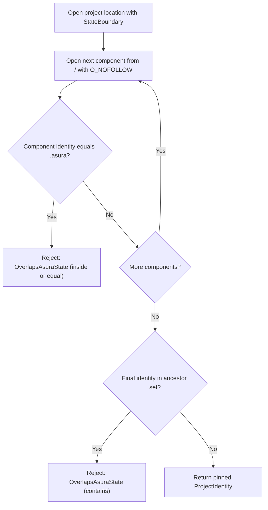
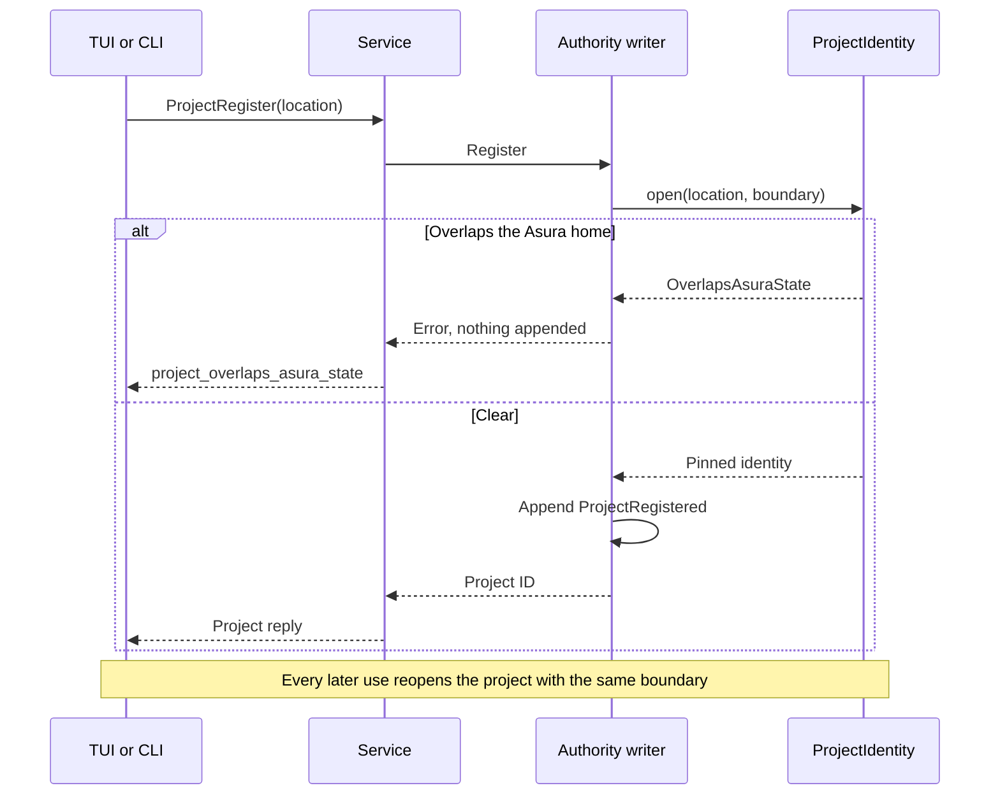
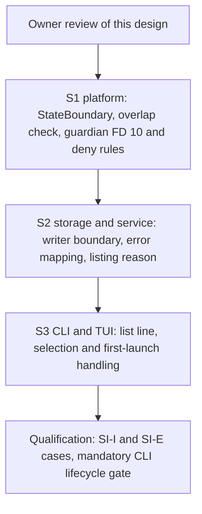

# Asura state isolation

Status: implemented, 2026-10-14. It implements the owner's
[PX3 decision](execution-threat-model.md#person-command-decisions) for the
current model path and closes threat-model finding EX16. The owner approved the
design and its delivery on 2026-10-14. Implementation added the mount-point
source in [Boundary computation](#boundary-computation) and the control
validation rule in [Writer and client behavior](#writer-and-client-behavior)
after probes and code inspection found the gaps they close. Sections still
labelled "Proposed mechanism" describe what was built. Protocol numbering
remains `0.1`; journal format remains `1`.

## Problem

Verified behavior (code inspection, 2026-10-14, commit `26a10fc`):

- Registration accepts any absolute, symlink-free directory.
  `ProjectIdentity::open` (`asura-platform/src/project_identity.rs:14-49`)
  checks spelling and opens each component with `O_NOFOLLOW`. Nothing compares
  the root with the Asura home `~/.asura` (`asura-storage/src/authority/writer/state.rs:1246-1295`).
- The model's exec_cmd profile grants read, write and exec on `(subpath project)`
  (`asura-platform/src/exec_cmd/guardian.rs:108-139`).
- Model file tools read under the pinned project root
  (`asura-service/src/tools.rs:1046-1056`).

So if the person registers `~`, `~/.asura` or a directory inside it, the model
can read and write Asura's journals, configuration, database and logs. The
control socket stays unreachable: the model profile has no network rule.

Verified behavior (live probe with `sandbox-exec`, macOS 27.0, 2026-10-14,
using a scratch file and a reduced copy of the model profile):

| Probe | Result |
| --- | --- |
| Read through `/System/Volumes/Data/…` with only the `/System` read root | Denied. The `/System` root does not expose the data volume. |
| Rule on the `/private/tmp/…` spelling, read through `/System/Volumes/Data/private/tmp/…` | Allowed. Rules match the firmlink-resolved path. |
| `allow`, then `deny` on the same subpath | Denied |
| `deny`, then `allow`; and `allow`, `deny`, `allow` on a literal | Allowed |

The last matching rule wins. A deny of `~/.asura` followed by an allow of the
call's scratch directory therefore works.

## Required behavior

Required behavior (owner, 2026-10-14, PX3 and the EX16 follow-up):

| ID | Rule |
| --- | --- |
| SI1 | Registration rejects a project root that is the Asura home, lies inside it, or contains it. Overlap is decided by directory identity, never by path text. |
| SI2 | A registered project that overlaps the Asura home is unavailable. It stays listed, marked with reason `project_overlaps_asura_state`. Every open fails, so no turn, exec_cmd call or file read can use it. Its journal records are kept. |
| SI3 | Every exec_cmd profile denies reads, writes and execution under the Asura home, except the call's own scratch directory. |
| SI4 | Asura's state and control plane are reachable only through typed, authorized interfaces. No sandboxed process reaches them through the file system or the control socket. |
| SI5 | Protocol stays `0.1`; journal format stays `1`. |

The person execution profile adds its own socket and `~/.asura` denials under
[person command mode](person-command-mode.md). This design changes the model
profile and project identity only.

## Ownership

| Behavior | Canonical owner | Change |
| --- | --- | --- |
| Asura home identity and its ancestors | `asura-platform::runtime::RuntimeDirectory` | New `StateBoundary` value, computed at runtime open |
| Overlap check on open and revalidation | `asura-platform::ProjectIdentity` | Opens take a `StateBoundary` |
| Registration, reopen and listing | Storage authority writer (`writer/state.rs`) | Passes the runtime's boundary; maps the new error |
| exec_cmd setup, file tools and context observation | Conversation owner and context manager in `asura-service` | Carry the runtime's boundary in the execution and context scopes |
| Error code to clients | `asura-service/src/conversation.rs` `storage_error` | New code |
| Reply validation | `asura-control` conversation, sensor and audit validators | Accept the code where the service can send it |
| exec_cmd profile | Guardian (`asura-platform/src/exec_cmd/guardian.rs`) | FD 10, deny rule, second overlap check |
| Display | TUI and CLI project list | Shows the reason |

No second identity check, registry or path normalizer is added.

## Boundary computation

Proposed mechanism. `RuntimeDirectory` computes one `StateBoundary` when it
opens the runtime, in the same blocking context that already opens and checks
the runtime chain. Every holder of the runtime, including the authority writer
and the conversation owner, uses that one value:

- `home`: device and inode of the retained `.asura` directory descriptor.
- `ancestors`: every directory identity that contains the home under some
  spelling. Three sources supply them, and the set is their union:
  1. The opened chain that `RuntimeDirectory` already holds: `/`, each home
     component, and the home directory. Scratch runtimes start at the scratch
     home.
  2. A physical walk with `openat(fd, "..", O_DIRECTORY)` from `.asura` until a
     directory's `..` has its own identity. This adds parents that the spelled
     path skips, such as the parents of a scratch home.
  3. The mount-point chain of the home's volume. `fstatfs` on `.asura` names
     the mount point, `/System/Volumes/Data` for the data volume. Each
     component of that path is opened from `/` with `O_NOFOLLOW`, as
     `ProjectIdentity::open` would open it, and its identity is added.
- The walk stops after 64 levels with `Error::UnsafeRuntime`, which fails the
  runtime open. A deeper chain is not a supported installation.

Verified behavior (probe, macOS 27.0, 2026-10-14) shows why the third source is
needed. The data volume's directories report one identity under both spellings:
`/Users` and `/System/Volumes/Data/Users` are the same inode, and the physical
parent of `/Users` is `/`. But `/System`, `/System/Volumes` and
`/System/Volumes/Data` each report their own identity, which neither the
spelled chain nor the `..` walk visits. Without the third source, a project at
`/System` passes the contains check, and `read_file` reaches the home through
`Volumes/Data/Users/…/.asura`.

The boundary is computed once. The runtime chain is revalidated before use, and
a replaced `.asura` fails that validation first.

## Overlap check

Proposed mechanism. `ProjectIdentity::open(location, &StateBoundary)` keeps its
existing walk from `/` and adds two comparisons:

- **Inside or equal:** any opened component, including the final one, whose
  identity equals `home` rejects. The project is the Asura home or lies inside
  it.
- **Contains:** a final directory whose identity is in `ancestors` rejects. The
  project is an ancestor of the Asura home.

Both reject with a new `Error::OverlapsAsuraState`. `ProjectIdentity` keeps the
boundary, so `validate()` and every reopen apply the same check. The guardian
keeps a crate-private raw open for its own identity pin; the guardian's second
check is below.

Directory hard links are not created on APFS outside Time Machine backups, so
one identity names one directory. A different volume has a different device
and cannot overlap.

### SI-F1: overlap decision

Proposed design. Arrows lead from each check to its result.

## Writer and client behavior

Proposed mechanism:

- **Register:** an overlapping location returns `project_overlaps_asura_state`
  before any record is appended. An exact retry of a request that already
  succeeded for an overlapping project also returns it.
- **Existing registrations (SI2):** `self.project(id)` fails with the new
  error, so every admission, exec_cmd call, file read and project open fails.
  Listing already reports `current` from `self.project(id).is_ok()`
  (`state.rs:1126-1140`). For an overlapping entry, the listed `ProjectReply`
  keeps its registration fields, sets `current = false`, and sets its existing
  `error` field (field 5) to `project_overlaps_asura_state`. A stale entry is
  unchanged: `current = false` and no `error`.
- **Control validation:** today a listed entry must have no `error`
  (`asura-control/src/conversation.rs:403-410`). The validator accepts a listed
  entry carrying exactly this code with `current = false` and valid
  registration fields; any other listed `error` stays invalid. A standalone
  `ProjectReply` keeps its rule that an error reply has no other fields. The
  sensor and audit reply validators add the code to their allowed errors,
  because the service maps the same storage error there. The schema and
  protocol number do not change. Peer effect: a client built before this change
  rejects a listing that contains an overlapping project as invalid; listings
  without one are unchanged. The client and service ship in one binary, so this
  arises only when a service from an older build is still running.
- **Selection:** launch-time auto-selection already skips projects whose
  `current` is false (`asura-cli/src/conversation.rs:279`). Selecting one
  explicitly shows the reason; the draft is kept.
- **Display:** the project list line shows ` [unavailable: contains Asura
  state]` instead of ` [stale]` when the error carries this code. Elsewhere the
  TUI shows the code as it shows other errors today.
- **First launch in the home directory:** the "Use this directory as a project?"
  offer still appears. Accepting returns the new error. The draft is kept, as
  for any failed first registration (`ui.rs:5029`).

### SI-Q1: registration and later use

Proposed design. Solid arrows are calls; dashed arrows are replies.

## exec_cmd profile

Proposed mechanism for SI3:

- The service passes the Asura home as a read-only directory descriptor at FD
  10. The guardian validates it like FD 9: a directory, owned by the effective
  user, mode `0700`, not unlinked.
- The guardian derives its path with the existing `pinned_path` and checks:
  - the scratch path starts with `<asura>/tmp/`;
  - the project path is not the Asura path, does not start with `<asura>/`, and
    the Asura path does not start with `<project>/`. A project of `/` fails the
    last check. This is a second, path-based check inside the guardian. The
    identity check in storage remains the authority.
- The profile appends three rule groups after the existing rules, in this
  order:
  1. `(deny file-read* file-write* process-exec file-map-executable (subpath ASURA))`
  2. The existing scratch allowances again: read, exec and write under
     `(subpath SCRATCH)`.
  3. `(allow file-read-metadata (literal ASURA) (literal ASURA/tmp))`, so path
     resolution to the scratch directory still works. Contents stay denied.
- The last matching rule wins (probe above), so scratch stays usable and the
  rest of the Asura home is denied, including through the
  `/System/Volumes/Data` spelling.

The person profile's extra root descriptors move from FDs 10–16 to FDs 11–17.

## Failure handling

| Case | Result |
| --- | --- |
| Boundary walk fails or exceeds 64 levels | Runtime open fails with `UnsafeRuntime`, as for other runtime validation faults |
| Registration overlaps | `project_overlaps_asura_state`; nothing appended |
| Existing project overlaps | Listed unavailable; every use fails with the same code |
| Project directory replaced by one that overlaps | Revalidation fails with the new code; the project becomes unavailable |
| FD 10 missing, not a directory, or not mode `0700` | The guardian exits before its first notice, as it does for FDs 3–9; the job reports `Protocol`; no process runs |
| Guardian path check fails | Setup fails with `Denied`; no process runs |

No path falls back to running without the deny rule.

## Asynchronous execution

The boundary is computed once, inside `RuntimeDirectory`'s existing blocking
open: at most 64 `openat` and `fstat` calls for the walk, one `fstatfs`, and one
`openat` per mount-point component. Each existing caller of that open, at service
start and in the client's runtime resolver, gains this bounded work in the
context it already runs in. Holders then copy the computed value; no reactor
path computes it. The overlap check adds an integer comparison per
component to an open that already performs one `openat` per component on the
same worker. The guardian's checks run inside job setup, which has no time
bound: it ends on spawn, cancel or a setup fault
([J1-Q4](tool-job-controller.md#j1-timeout-and-setup-budget-removal), replacing the
earlier 2-second setup deadline). No new thread, queue or deadline is needed.

## Validation

Unit tests use fixture identities. Integration tests use scratch homes, the real
writer, real `sandbox-exec` and real processes. End-to-end tests drive the TUI
through `tests/tui_pty.py` against an isolated service.

| ID | Layer | Case | Required result |
| --- | --- | --- | --- |
| SI-U1 | Unit | Boundary from a fixture chain, a physical walk with an extra parent, and a mount chain | Union of all three; 65 levels rejects |
| SI-U2 | Unit | Overlap decision for equal, inside, contains, sibling and other device | First three reject; last two pass |
| SI-U3 | Unit | Profile text | Deny group, then scratch allowances, then metadata literals, in that order; quoting applied |
| SI-U4 | Unit | Guardian path checks for project equal to, inside, above, and beside the Asura path, and project `/` | Only beside passes |
| SI-U5 | Unit | `storage_error` mapping, control validation of listed entries, and project list line | New code; a listed entry with the code and `current = false` is valid, with any other code or `current = true` invalid; `[unavailable: contains Asura state]` |
| SI-I1 | Integration | Register the scratch home, its `.asura`, `.asura/tmp`, the scratch home's parent, `/`, `/System`, `/System/Volumes` and `/System/Volumes/Data` | Each returns `project_overlaps_asura_state`; nothing appended |
| SI-I2 | Integration | Register a sibling of the scratch home and a subdirectory of the scratch home outside `.asura` | Both succeed |
| SI-I3 | Integration | Journal fixture holding a registration of the scratch home | Listed unavailable with the reason; admission, exec_cmd and `read_file` fail with the code |
| SI-I4 | Integration | Model exec_cmd with a valid project: read, write and exec under the Asura home; write and exec in scratch | Asura home denied; scratch works |
| SI-I5 | Integration | Same, through the `/System/Volumes/Data` spelling of the Asura home | Denied |
| SI-I6 | Integration | Guardian started with FD 10 absent, not a directory, with wrong mode, and naming a directory that is not the scratch parent | First three `Protocol`, last `Denied`; no process runs in any case |
| SI-I7 | Integration | Existing exec_cmd tool suite SH-I1 | Still passes |
| SI-I8 | Integration, firmlinked scratch | A scratch home created under `/Users/Shared`; register its `/System/Volumes/Data/Users/Shared/…` spelling and `/System/Volumes/Data/Users/Shared` | Both rejected; proves the overlap check crosses the `/Users` firmlink |
| SI-E1 | End to end | TUI launched in the scratch home; accept the first-launch offer | Error shown; draft kept; no project selected |
| SI-E2 | End to end | Project list containing an overlapping registration | Line shows the unavailable reason; selecting it shows the code |

SI-I8 uses only a scratch home and never touches the account's `~/.asura` or
live service. If `/Users/Shared` is not writable on a test host, SI-I8 is
reported as unverified rather than skipped silently.

## Delivery

### SI-P1: delivery order

Proposed plan. Arrows mean "is a prerequisite of".

Each step delivers its unit and integration tests before the next starts.

## Residual limits

- **Other mounts of the same data.** The boundary covers the spellings of the
  live home: its own path, its physical parents, and the mount-point chain of
  its volume. A different mount that holds a copy of the home, such as a
  mounted Time Machine local snapshot or a disk image, has its own identities.
  A project registered at such a mount passes the overlap check, and the file
  tools could read the copy's older journals and configuration. Not tested.
- **Path-based guardian check.** The guardian compares `F_GETPATH` spellings of
  FDs 7, 9 and 10. It is a second check; the identity check in storage remains
  the authority.

## Alternatives considered

- **Carve `.asura` out of each profile and file tool, and allow any root.**
  Rejected by the owner under PX3: every new tool must remember the carve-out.
- **Path-prefix comparison only.** Rejected: firmlinks give the home a second
  spelling under `/System/Volumes/Data`, which a text check misses.
- **Remove overlapping registrations automatically.** Not available: removal is
  outside the current registration slice. The owner chose unavailable status.
- **Rely on the registration check alone.** Rejected by the owner: the profile
  deny is required defence in depth, and the person profile needs it anyway.

## Design verification

Recorded on 2026-10-14: code facts were checked by read-only inspection at
commit `26a10fc`. The Seatbelt behavior was checked by live `sandbox-exec`
probes on macOS 27.0 against a scratch file only. Diagrams SI-F1, SI-Q1 and
SI-P1 were rendered with the local Mermaid CLI and visually inspected.

Return to the [design index](README.md).
