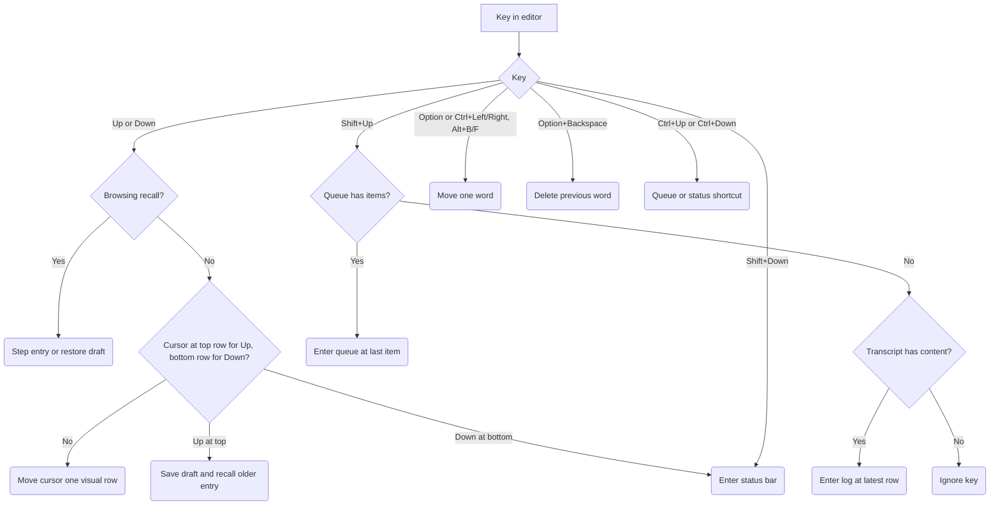
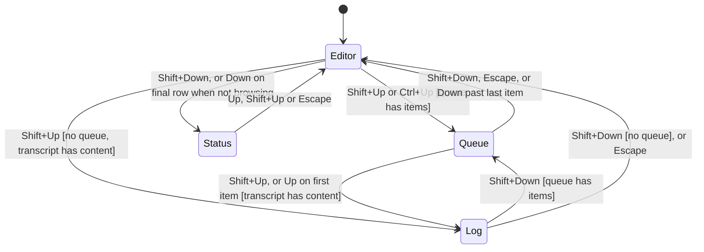

# Composer editor navigation

Status: selected refinement of the [production editor](early-production-status-slice.md#launch-presentation-and-editor).
Implementation and validation are separate from the prototype's undo history.

## Ownership and limits

The application owns focus transitions and key routing. The
[focus chain and draft movement](#focus-chain-and-draft-movement--selected-2026-10-13)
section defines the current routing. It replaces the 2026-09-30 rule that
Shift+Up/Down scroll the conversation history from the editor. Shift+Left/Right
remains editor selection. The editor provides the visual-row boundary through
its existing hard-wrap mapping.

The client owns session-local recall of submitted commands and inputs.
Recall does not submit, execute, persist or change service queue state.
The history stores at most 100 entries and 1 MiB of UTF-8 entry data.
Each entry and the saved unsent draft are limited to the editor's 64 KiB bound.
Oversized entries and whitespace-only entries are ignored. Consecutive exact
duplicates use one entry. Oldest entries are removed to satisfy both limits.

On the first previous action, history saves the unsent draft. Further previous
actions stop at the oldest entry. Next stops after restoring the saved draft.
An explicit edit or submission resets navigation. The edited recalled text then
becomes the new unsent draft on the next previous action.
All operations use bounded in-memory data. There are no I/O calls, workers,
deadlines, permissions or recovery records. Process exit discards recall data.

## Focus chain and draft movement — selected 2026-10-13

Required behavior (owner, 2026-10-13): add row and word movement to the input
box and move focus between the panes around it with Shift+Up/Down. Plain Up
keeps input recall.

The focus chain runs from top to bottom: conversation log, queue, editor and
status bar. The queue is part of the chain only while it has unresolved items.
The log is part of the chain only while the transcript has content.

| Focus | Key | Result |
| --- | --- | --- |
| Editor, browsing recall | Up / Down | Step to the older or newer entry, whatever the cursor row. Down past the newest entry restores the saved draft and ends browsing. |
| Editor, not browsing | Up | Move the cursor up one visual row. On the first visual row, start recall. |
| Editor, not browsing | Down | Move the cursor down one visual row. On the final visual row, enter the status bar. |
| Editor | Shift+Up | Enter the queue at its last item. With no queue, enter the log at the latest row. With neither, do nothing. |
| Editor | Shift+Down | Enter the status bar. |
| Editor | Option or Ctrl+Left/Right, Alt+B/F | Move one word left or right |
| Editor | Option+Backspace | Delete the previous word through the editor's bounded delete path |
| Editor | Ctrl+Up / Ctrl+Down | Unchanged shortcuts to the queue and the status bar |
| Queue | Up on the first item, Shift+Up | Enter the log at the latest row |
| Queue | Down past the last item, Shift+Down, Escape | Return to the editor |
| Log | Up / Down | Scroll one visual row; clamp at the ends |
| Log | Page Up, Page Down, Home, End | Scroll by page or to the ends, as before |
| Log | Shift+Down | Enter the queue at its first item, or the editor when the queue is empty |
| Log | Escape | Return to the editor |
| Status bar | Up, Shift+Up, Escape | Return to the editor, as before |

An explicit edit or submission ends recall browsing. After that, Up and Down
move between rows of the edited text. Ctrl+P and Ctrl+N remain recall aliases
from any row. Leaving the editor keeps the draft, the cursor and any saved
recall draft. Returning to the editor restores them unchanged. The log follows
the latest turn again when focus returns to the editor.

Option+arrow arrives as Alt+arrow, or as Alt+B/F in terminals that send Meta
sequences. Both forms are accepted. Shift with a word key extends the selection.
Word boundaries come from the editor dependency's word movement. Key routing
and editing perform no I/O and allocate no unbounded state.

Key routing (selected design). Arrows show the route the application takes for
one key event in the editor; a rounded node is the result.

Focus chain (selected design). Arrows are key events that move focus; guards
name the condition for each edge.

Recall still uses the storage and limits in
[Ownership and limits](#ownership-and-limits).

## Validation

| Case | Required result |
| --- | --- |
| EN1: wrapped and multiline text | Up recalls input; Down restores recall before entering status from the final visual row. |
| EN2: scrolled editor and resize | Wrapping and resize preserve the final-row status boundary. |
| EN3: Unicode and selection | Shift+Left/Right select Unicode text; Shift+Up/Down move focus and preserve the draft. |
| HN1: recall and restore | Previous/next preserve the exact unsent draft, including multiline Unicode. |
| HN2: explicit edit | Reset makes the edited text the next saved draft. |
| HN3: limits | Entry count, UTF-8 bytes and individual draft bounds hold after repeated insertion. |
| HN4: duplicate and empty inputs | Consecutive exact duplicates and blank inputs do not add entries. |
| HN5: modifier routing | Recall takes precedence over Down-to-status; Ctrl arrows enter queue/status focus. |
| RN1: row movement | In a multiline and a hard-wrapped draft, Up and Down move one visual row and keep the column. Up on the first row starts recall; Down on the final row enters the status bar. |
| RN2: browsing a multiline entry | While browsing, Up and Down step entries from any row. An edit ends browsing, and Up then moves a row. |
| RN3: word movement | Option, Ctrl and Alt+B/F forms move one word over ASCII and multibyte text; Shift extends the selection; Option+Backspace deletes one word within the editor bounds. |
| FN1: focus up | Shift+Up enters the queue's last item, or the log when the queue is empty, and is ignored with neither. Up on the first queue item enters the log. |
| FN2: focus down | Shift+Down steps log to queue to editor, skipping an empty queue; from the editor it enters the status bar. Escape returns to the editor from the log or queue. |
| FN3: log scrolling | With the log focused, Up and Down scroll one visual row and clamp; paging keys keep their behavior. |
| FN4: draft preservation | Any focus round trip keeps the exact draft, cursor, selection and recall state. |

Unit tests verify these pure adapters. The composer integration must also test
key routing, selection, resize and service activity in the actual terminal journey.

## Recorded validation — 2026-09-30

The Down-to-status correction passed all 162 CLI unit tests. Cases cover empty
input, multiline Unicode, hard wrapping, resize and exact draft restoration before
status focus. The real composer PTY journey passed plain Down entry, project and
model selection, draft preservation, recall and owned backend cleanup. The project
fixture selects its named row explicitly; registry order is not name order.
The development CLI and lifecycle fixture were rebuilt. Both changed Mermaid
diagrams were rendered with Mermaid CLI 12.0.0 and visually inspected.
