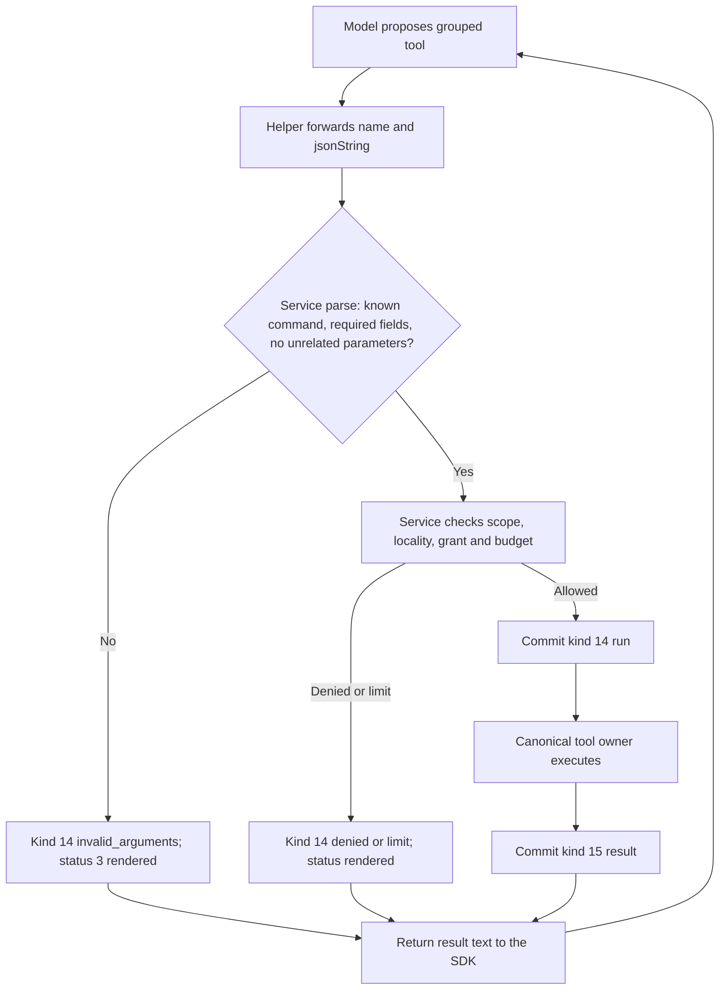

# Consolidated parameterised tools

Status: implemented; validation recorded below, 2026-09-28. Revised
2026-10-18 by [tool call records](tool-call-records.md): the helper no longer
parses or rejects arguments; the service is the only argument parser.

## Public interface and ownership

Expose four model tools through the existing shared native adapter: `project`,
`memory`, `service` and `exec_cmd`. Each grouped tool has a typed command enum and
bounded optional arguments, declared as each tool's generation schema
(`parameters`). Since 2026-10-18 each tool takes its arguments as
`GeneratedContent` and keeps that schema unchanged, so guided generation is
unchanged. `Tool.call` forwards the tool name and `arguments.jsonString` to the
service in a `ToolCall` and returns the service's result text, including the
text of a rejection. The helper does not parse, translate or reject arguments.
Service policy, budgets, journal records and storage ownership remain in their
existing owners. No string command interpreter is added.

| Tool | Commands | Parameters |
| --- | --- | --- |
| project | read_file | path; offset defaults 0; limit defaults 4096 |
| project | list_directory | path defaults . |
| memory | list_notes | after optional; limit defaults 8 |
| memory | get_note | version; offset defaults 0; limit defaults 4096 |
| memory | note_sources | version |
| memory | create_note | body; source_version optional; HM3 activation packet |
| service | status | none |
| service | tools | none |
| service | audit | limit defaults 16 |
| exec_cmd | unchanged | command, cwd |

For example, `memory` receives `{ "command": "get_note", "version": "…" }`.
Command enums carry meaningful names rather than another resource selector when
only one resource type is supported. Note creation follows the
[HM3 activation contract](hybrid-memory-ontology.md#hm3-create-immutable-notes-through-admitted-tools).
Sensor inspection extends this contract when its canonical implementation is ready.
This packet changes model tools, not slash-command syntax. `/tools` lists the same
four tools and their commands; existing `/audit` remains available.

The Rust service registry owns public discovery. Keep its internal operation
metadata separate: durable activity and audit records continue to identify the
exact operation through the kind 14 operation code, such as 7 `get_note`
([operation codes](tool-call-records.md#operation-codes)). Model `ToolCall`
fields 10–19 are removed and reserved (2026-10-18). Protocol stays 0.1 and journal format stays 1.
The helper exposes only grouped names, without duplicate per-operation advertised
tools. The per-operation translators are removed with the helper's parsing. No compatibility with older builds is required (owner, 2026-10-17).

## Validation and failure handling

Required behavior (2026-10-18). The service parses the argument text with its
single parser in `asura-service/src/tools.rs`. It rejects a missing required
argument, a wrong type, a negative or overflowed number, an unknown command and
an extraneous command parameter. Each rejection is a kind 14 `ToolCall` record
with decision `invalid_arguments` and a fault code, and the model receives a
status-3 result such as `invalid_arguments: missing_field`. The model may correct
the call within the turn's eight calls. The service remains the authority for
scope, detailed limits, locality and permission checks. Grouping read and write
operations never grants write access from a read grant. `create_note` requires a
body of 1–16,384 UTF-8 bytes and accepts an optional source version. It rejects
version, after, offset and limit. Read commands reject body and source_version.
The service enforces HM3's separate write grant, verified local destination,
durable record, receipt resolution and publication rules. The helper's fixed
memory correction guidance is removed; the service's rendered text replaces it.

A call that the SDK rejects before `Tool.call` (argument text that is not JSON,
or an unregistered name) does not reach the service on the system model, Core AI
or MLX. It fails the turn with its diagnostic (owner decision 2 of
[tool call records](tool-call-records.md#owner-decisions-2026-10-17)).

Grouping adds no workers, queues, timers or I/O operations. HM3 defines the note
mutation through the existing storage owner. Tool callbacks retain cancellation,
the per-turn eight-call limit and byte budgets; they have no deadline. All local
model classes use the same generated schemas and adapter. Cloud activation is
unchanged. Stored evidence remains untrusted; it cannot select another command or
grant access. An invalid grouped proposal cannot fall back to a shell command.

### Selected command flow

Status: selected design (revised 2026-10-18). Arrows show the call path from the
model to the result; the service makes every decision.

## Required evidence

Unit tests must verify the service parser's command readings, defaults, invalid
combinations and fault codes (TCR-U04, TCR-U05), enum schemas, exactly four advertised tool names, public registry consistency and
unchanged per-operation grants. Shared callback integration must retain existing
local-provider coverage and cancellation behavior. Native system and local Ollama
journeys must call grouped discovery and memory reads with exact committed results.
The post-tool long-response regression must use grouped discovery. Update native
fixture prompts that name replaced public tools. Render and inspect this diagram;
run Rust, Swift, TUI inventory and native tests before claiming completion.

## Recorded validation

The Swift suite passed 74 tests, including grouped defaults, invalid combinations,
exact command enums and four advertised tool names. The Rust CLI, control,
platform and service library suites passed 133, 23, 91 and 115 tests respectively.
The control fixture exporter remained intentionally ignored in that library run.

Native system-model journeys verified grouped discovery, project reads, service
status, memory list/get/sources, project isolation and durable restart replay.
Verified-local Ollama `granite4.1:8b` passed grouped discovery and memory journeys.
Its post-tool response passed the minimum-length and exact final-marker checks.
The fixtures stopped and reaped their service children.

The real CLI lifecycle suite passed, including the TUI `/tools` panel, repeated
commands, draft preservation, service attachment, shutdown and owned-process cleanup.
The Mermaid flow was rendered and visually inspected.

The shared adapter covers all local model classes. These runs do not establish
native CoreAI or MLX qualification for the consolidated interface. Memory mutation
is now implemented under HM3; sensor inspection remains a separate packet.
