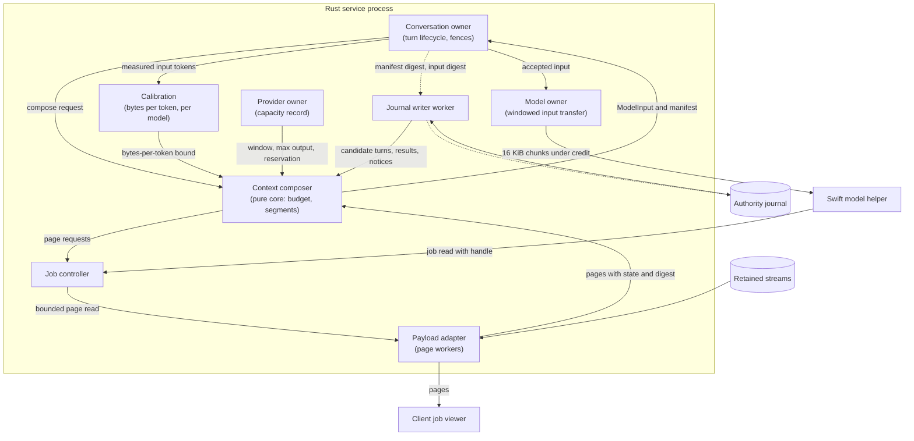
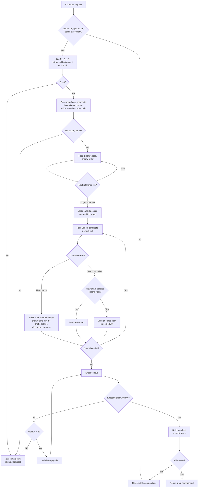
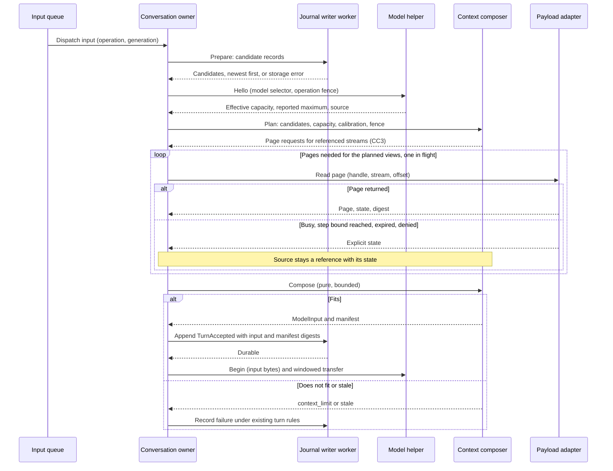
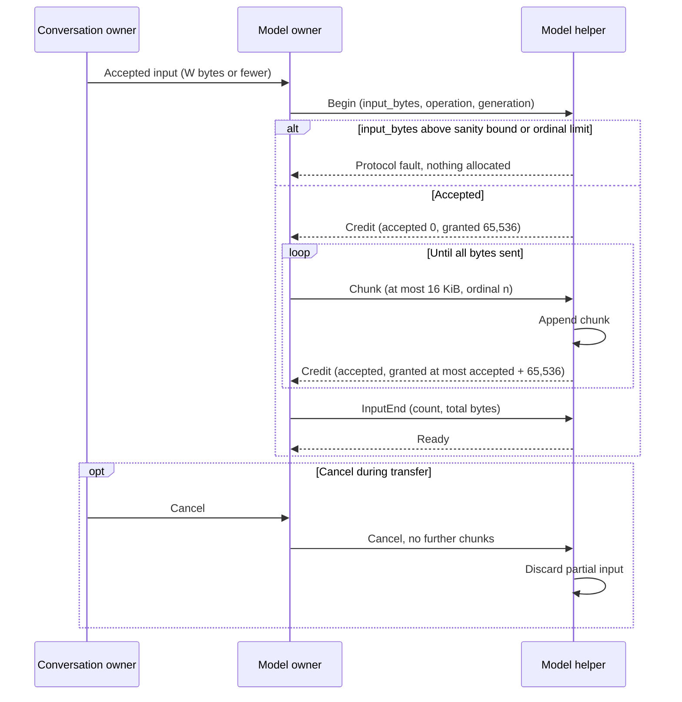
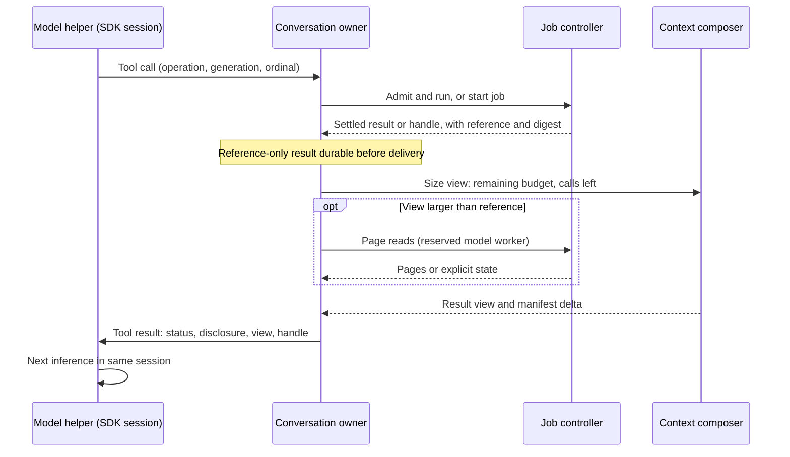
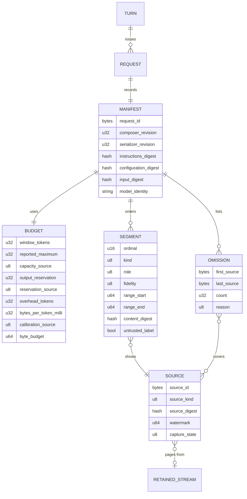
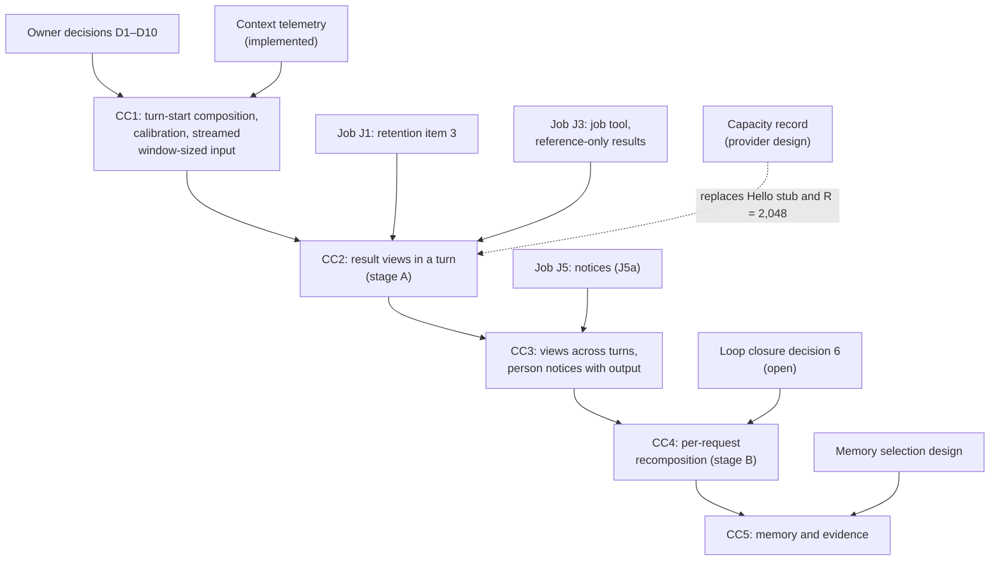

# Context composer

Status: selected design, 2026-10-14; slice **CC1 implemented 2026-10-15**. The
owner resolved decisions D1–D10 and N1; they are recorded in
[owner decisions](#owner-decisions) with the mechanism each one selects. CC2 waits
for tool job packets J1 and J3, CC3 for J5, CC4 for
[loop closure](loop-closure.md#decisions) decision 6, and CC5 for a memory
selection design; see [delivery](#dependencies-and-delivery).
[CC1 implementation details](#cc1-implementation-details) record what code
inspection added. Values marked "proposed" in tables are engineering choices
made under the decisions and remain open to measured revision. Protocol
numbering remains `0.1`; journal format remains `1`.

## Purpose and scope

The context composer decides, for each model request, what the model receives:
instructions, selected conversation history, notices, evidence and the model view
of tool output. Several designs depend on it, but no design defined it. This
document gives the composer one owner, one budget rule and one record of what
was sent.

Terms. "Composer" alone means the chat editor in the TUI (see the
[glossary](../glossary.md)). This document always says **context composer**.
A **segment** is one ordered unit of model input with one source. A **fidelity
level** is how much of a source a segment shows: full, excerpt, reference or
omitted. A **composition manifest** is the immutable record of one composed
request. The glossary defines manifest, context view and effective context.

Objectives:

- Replace the fixed input limits L21, L22 and L27 with a per-request budget taken
  from the model's capacity, and stream input of that size to the helper.
- Give tool output a model view chosen per request from the retained stream.
- Record every composed request so it can be inspected and reconstructed.
- Keep composition asynchronous, bounded and cancellable.

Non-goals: model-generated summaries, semantic retrieval, memory search ranking,
cross-project evidence, remote-provider egress policy, provider prompt-cache
tuning, the tool-loop backstop (L20, L25), capacity probing and the Ollama
context clamp (L26, owned by the provider design). Each has, or
needs, its own design. This design names where each would attach.

## Current behavior

Verified code facts from read-only inspection on 2026-10-14. Line numbers refer
to the working tree at that date.

### Turn-start input

| Fact | Source |
| --- | --- |
| The conversation owner builds model input in `Conversation::prepared`. No other code composes model input. | `rust/crates/asura-service/src/conversation.rs:1802` |
| Instructions are one of two fixed strings. The choice depends only on whether project tools are enabled. No project rules, notes or job notices enter the input. | `conversation.rs:21-22`, `conversation.rs:1839-1845` |
| History is every prior completed turn of the conversation, in generation order. Each turn contributes its accepted prompt and its terminal text. Tool calls and tool results from earlier turns never enter later input. | `conversation.rs:1826-1838`; `asura-storage/src/authority/writer/state.rs:1406-1438` |
| The journal writer selects history on its retained worker during `Prepare`. It fails with `Limit` (reported as `capacity_exhausted`) above 32 prior turns or above 64 KiB of prompt plus terminal text. | `state.rs:1418`, `state.rs:1434`; `conversation.rs:89` |
| The wire check allows at most 32 history entries, a 32 KiB prompt and 64 KiB of input. Each turn adds two entries, so a conversation with 17 to 32 prior turns passes the writer and then fails `encode_input` with `context_limit`. | `asura-control/src/model.rs:13`, `model.rs:491`, `model.rs:507`; `conversation.rs:1851` |
| `TurnAccepted` binds the instruction digest, the encoded input digest, the prior operation IDs and an output reservation of 2,048 tokens. This is the only record of what was sent. | `conversation.rs:1874-1878`; `asura-storage/src/authority/conversation/types.rs:7` |
| The effective capacity arrives in the helper's Hello before durable acceptance. The service fails the turn with `context_limit` only when capacity is not larger than the output reservation. It does not compare capacity with the input size. | `conversation.rs:2862`; `TurnAccepted` is appended at `conversation.rs:3227` |
| When tools are not available, the service replaces the instructions after Hello and recomputes both digests before acceptance. | `conversation.rs:2836-2850` |

### Transfer and helper

| Fact | Source |
| --- | --- |
| The service sends input in 16 KiB chunks under one 64 KiB credit grant. | `asura-service/src/model_owner.rs:668-680` |
| The helper grants exactly one input credit of 65,536 bytes. Output already uses a sliding credit window that the receiver advances. | `Session.swift:213-216`; `Session.swift:280-289`, `Session.swift:433-434`; `Wire.swift:186-191` |
| The helper rejects input above 65,536 bytes and output caps outside 1–2,048 tokens. | `swift/model-helper/Sources/HelperCore/Wire.swift:14`, `Wire.swift:177-179`; `Session.swift:197-199` |
| The service sends `max_response_tokens` equal to the fixed 2,048 reservation. | `model_owner.rs:280` |
| The helper maps instructions, history and prompt into an SDK transcript in that order. | `Backend.swift:150-162`, `Backend.swift:234-235` |
| When a token counter exists (system model), the helper counts the whole input and fails with `contextLimit` when it exceeds capacity minus the output cap. | `Backend.swift:251-258` |
| Within a turn, one SDK `LanguageModelSession` owns the transcript. Tool calls and results are appended by the SDK across up to 64 requests; the service cannot change that transcript. | `Backend.swift:260`; `BoundedToolModel.swift:5-7`, `BoundedToolModel.swift:21` |
| The Ollama backend clamps the effective context to `min(capacity, 8192)` (L26). | `OllamaBackend.swift:130` |

### Tool results within a turn

| Fact | Source |
| --- | --- |
| A tool result may hold at most 16,384 bytes (L21) and a turn at most 65,536 result bytes (L22), across at most 8 calls (L20). | `asura-service/src/tools.rs:8-10`, `tools.rs:474-486` |
| The conversation owner fails or truncates a result that exceeds the remaining capacity, and refuses a call when less than 256 bytes remain (L23). | `conversation.rs:716`, `conversation.rs:769`, `conversation.rs:3287` |
| Result text is stored in the journal `ToolResult` record (L31) and sent to the helper as text. | `conversation.rs:340-395` |

### Consequences

1. A conversation stops working after 16 turns or about 64 KiB of history,
   whichever comes first. The failure is a limit error, not a smaller context.
2. A model with a large context window gets no more input than a small one.
3. Nothing selects or degrades history. The only choices are all or failure.
4. The input record holds digests but not the composition. It cannot say what
   was omitted or why.

## Required behavior

Each row is an owner decision or a selected requirement recorded elsewhere.
"Owner" means the owner selected it on the date shown. Rows marked
**proposed source** come from designs that are still proposals; they are listed
because this design must stay consistent with them, not because they are decided.

| ID | Requirement | Source and status |
| --- | --- | --- |
| CCR1 | Service context assembly owns the model context. The helper only adapts an accepted context to a provider. No client composes model input or reconstructs authorization. | [Conversation projections](conversation-projections.md#required-ownership-and-separation), lines 54-66; owner direction 2026-09-30 |
| CCR2 | One retained stream holds a tool's complete output. The context composer and the person's job viewer read the same stream. | [Tool output views](tool-output-views.md#required-behavior) rule 1; owner 2026-10-13 |
| CCR3 | The model view is what the context composer places in one model request. It chooses that view per request from the model's capacity record and the other content competing for context. No tool defines a fixed preview size. A tool result gives the model a handle and a short disclosure; the model pages the stream for more. | Tool output views rule 2; owner 2026-10-13 |
| CCR4 | The journal holds no tool result text. A result record keeps a payload reference, a digest and a short summary (TV2). | Tool output views rule 3; owner 2026-10-13 |
| CCR5 | L21 (16,384 per result), L22 (65,536 per turn) and L27 (64 KiB input, 32 entries, 32 KiB prompt) move to the context composer. L24 (output reservation) is model-sized. The default page of `read_file` and `get_note` becomes a composer choice; their ceilings stay. Transfer chunking stays fixed. | Tool output views [limit review](tool-output-views.md#limit-review) L21, L22, L24, L27, L37, L42; owner 2026-10-13 |
| CCR6 | Token limits must not be hard-coded. Model capacity comes from configuration, with a configured default or a person-confirmed probe. Bounds come from the model selected at admission. | [Loop closure](loop-closure.md#model-sized-limits) lines 29-49; owner 2026-10-13 |
| CCR7 | No consumer assumes a context window size. A context builder must recheck capacity for its own operation; a prior operation's value does not apply. A missing capacity makes the model unavailable. | [Model context telemetry](model-context-telemetry.md#capacity-discovery-and-collection) lines 10-16, 30-33; implemented requirement |
| CCR8 | Instructions and prompt content keep explicit provenance. Repository text, observations and tool output are evidence and never gain authority. Tool-returned instructions stay untrusted and are never promoted into system instructions. | Conversation projections lines 127-130, 146-149; owner direction 2026-09-30 |
| CCR9 | Prefer a stable prefix: harness instructions, tool definitions, scoped rules; then task state, selected prior turns and evidence; the current request last. Record the actual serialized order. A policy change invalidates the affected prefix. | Conversation projections lines 151-156; owner direction 2026-09-30 |
| CCR10 | Recompose before each new admitted turn. Within a tool loop, recompose only at a settled inference boundary after pending callbacks settle. Preserve tool call and result pairing, the current request, unresolved work, failures and source references. Do not mutate a running SDK transcript behind its owner. | Conversation projections lines 158-164; owner direction 2026-09-30 |
| CCR11 | Retain an immutable composition manifest for each actual request: selected identities and revisions, omitted evidence, summary provenance, instruction and configuration digests, provider and model identity, effective capacity, reserved output and measured counts. Recheck scope and authorization at admission and on later evidence reads. | Conversation projections lines 166-170; owner direction 2026-09-30 |
| CCR12 | The graph must support deterministic reconstruction of the model context by conversation, turn and inference request. Reconstructing a past request and composing a new one are distinct. A missing source or composer revision returns `reconstruction_unavailable`. | [Graph memory evolution](graph-memory-evolution.md#deterministic-thread-context-by-turn) lines 246-318; required 2026-09-30 |
| CCR13 | Every context summary references its exact source: operation, tool ordinal, outcome, capture completeness and digest. It keeps exit status, findings and uncertainty. A reference is not an access grant. A missing original never triggers a rerun. | Conversation projections lines 36-40, 119-130; owner direction 2026-09-30 |
| CCR14 | If content does not fit capacity with the output reservation, select fewer or smaller referenced sources within a bounded number of attempts, then fail with an explicit context limit. Never delete evidence silently. | Conversation projections [context assembly](conversation-projections.md#context-assembly--required-behavior), lines 181-197; required behavior |
| CCR15 | A person command produces a notice on the next turn (command, directory, exit status, counts, handle). The context composer chooses how much output that request shows, wrapped in the untrusted-data label. It may reduce older entries to one line or a count. Each later turn recomposes the entry from the journal. | [Person command mode](person-command-mode.md#person-notice-and-model-view) PCR13 (line 75), PC4; owner 2026-10-14 |
| CCR16 | Until the context composer places output, notice entries and model job results carry no output text; the model reads streams with `job read`. Until the composer replaces it, the 64 KiB input check stays. | Person command mode PC12 and lines 838-845; tool output views line 188; owner 2026-10-14 |
| CCR17 | The model may page beyond the composer's view with `job read`, including person jobs in its conversation. | Person command mode PC10; owner 2026-10-14 |
| CCR18 | Token usage is the sum of request-correlated usage events. Never subtract session counters across a recomposition. | Conversation projections lines 42-47; owner direction 2026-09-30 |
| CCR19 | Wisp's thresholds are not Asura defaults. Measured provider cache reuse and task correctness decide composition policy. Composition archive writes must not be synchronous in service or render paths. | Conversation projections lines 49-52; owner direction 2026-09-30 |
| CCR20 | No background summarizer, unbounded output buffer or additional scheduler is authorized by the projections packets. | Conversation projections lines 222-225; owner direction 2026-09-30 |
| CCR21 | Retained model session history is part of effective context. Use stateless calls or explicitly isolated sessions. | [Architecture](../architecture.md) lines 264-268; required |
| CCR22 | When a job settles with no turn running, the next turn receives a short status notice; no model call starts. The notice is a labelled, service-written block placed before the prompt and bound by the turn input digest. The helper is unchanged. It has no byte cap; its known-size bounds are 8 entries and commands of at most 8,192 bytes. It holds no output and never enters system instructions. The context composer places it once it exists. | [Tool job controller](tool-job-controller.md#purpose-and-selected-decisions) line 44, owner 2026-10-12; [model results](tool-job-controller.md#model-results) lines 574-581, J5a, owner 2026-10-14 |
| CCR23 | Output the model used in the current or previous turn cannot expire, even under quota pressure. | Tool job controller [retained output lifetime](tool-job-controller.md#retained-output-lifetime), lines 667-675; owner 2026-10-13 |
| CCR24 | The execution rules AE-01 to AE-07 apply, including startup, cancellation and shutdown. | [Engineering](../engineering.md#asynchronous-execution-and-recovery); ADR-0006 |
| CCR25 | Protocol stays `0.1` and journal format stays `1`. Schemas may evolve within those numbers. | [Engineering](../engineering.md#wire-protocol-change-authority) |
| CCR26 | No fixed time limit ends work as a closure. Bounds on Asura's own operations, such as the 2-second page read storage step, are wind-down bounds and are recorded separately from closures. | Tool job controller [job closures and wind-down bounds](tool-job-controller.md#job-closures-and-wind-down-bounds), lines 443-470; J2a-1, owner 2026-10-14 |
| CCR27 | Job tools record results with a reference-only result kind. There are no legacy tools: every tool runs as a job (threat model EX4, owner 2026-10-15, superseding R3's "legacy tools keep kind 15 for now"). J1 is retention item 3 (capture, descriptors, text pages); graph projection is deferred. One page-read worker of two is reserved for the model. | Tool job controller R3, G1, R4, J2a-2 (lines 62-86); [retention packet](result-retention-graph-packet.md) line 162; owner 2026-10-14 and 2026-10-15 |

Proposed sources this design must stay consistent with, not decisions:

- A memory search result never becomes model input by itself; selection rechecks
  visibility and instruction authority ([graph memory evolution](graph-memory-evolution.md)
  lines 457-459; proposed).
- Conversation history is not automatically model input; selected messages need
  the same provenance, scope and budget checks as evidence
  ([domain model](domain-model.md#conversations-tasks-and-model-input) line 235; D0 for review).
- The context subsystem owns the context selection manifest
  ([hybrid memory ontology](hybrid-memory-ontology.md#scope-and-selected-placement)
  line 85; proposed).

## Owner decisions

Required behavior (owner, 2026-10-14). Each row states the decision and the
mechanism this design applies for it. The sections below give the detail.

| ID | Decision | Applied mechanism |
| --- | --- | --- |
| D1 | A new `context` module in `asura-service`, called by the conversation owner, replaces the current builder. Its core is pure. Storage keeps no selection policy. | [Ownership](#ownership). The writer's `Prepare` returns candidates and no longer applies the 32-turn and 64 KiB rule. |
| D2 | Bytes per token are learned per model from measured input tokens (context telemetry), with a safety margin. An unmeasured model uses 1 token per byte. | [Token conversion](#token-conversion) |
| D3 | The output reservation is a per-model value in the capacity record, defaulting to `min(maximum output, window ÷ 4)`. Keep 2,048 until the capacity record exists. | `R` in the [budget](#per-request-budget-algorithm) |
| D4 | Stage B (the service owns the request loop and recomposes per request) is the target; stage A (view sizing at the tool callback) comes first. | [Recomposition during tool loops](#recomposition-during-tool-loops). Stage B implies loop closure decision 6, which remains formally open. |
| D5 | The manifest is a payload object with its digest in the journal. Before J1, `TurnAccepted` carries the manifest digest and the composer revision, and, under N1, the budget inputs. | [Composition manifest](#composition-manifest) |
| D6 | History is reduced by mechanical fidelity levels (full, reference, omitted), newest first. Model-written summaries need a separate design. | [Segments and fidelity](#segments-and-fidelity) |
| D7 | "Match the window to the size the model can handle." The input limit is the model's window from its capacity record, converted to bytes by D2. Input streams across fixed 64 KiB frames (tool output views rule 4). The schema and helper change stays within protocol `0.1`. Built in CC1. | `W` in the [budget](#per-request-budget-algorithm); [streamed input transfer](#streamed-input-transfer) |
| D8 | Excerpts are outcome-based: on failure, the `stderr` tail first; on success, the `stdout` head and tail. The rule table is tested. | [Excerpt shape](#excerpt-shape) |
| D9 | Same as job controller J5a: a labelled block before the prompt. | [Notices and context block](#notices-and-the-context-block) |
| D10 | Manifests do not hold output. Expired sources give `reconstruction_unavailable`. The hold list is unchanged. | [Composition manifest](#composition-manifest) |

## Selected mechanism

### Ownership

The existing owner of model input is `Conversation::prepared` in `asura-service`,
supported by the writer's history selection in `asura-storage`. Under D1 the new
`context` module replaces that builder. It is the first code of the "context
subsystem" named by the hybrid ontology and the retention packet. It adds no
process, worker pool or scheduler.

| Responsibility | Owner |
| --- | --- |
| Turn and request lifecycle, generation fences, admission, cancellation | Existing conversation owner (`asura-service/src/conversation.rs`) |
| Composition policy, budget, segment selection, fidelity, manifest content | New `context` module in `asura-service`. Its core is a pure function with no I/O. |
| Token calibration per model | `context` module, fed by the existing telemetry events (`ContextMeasured`) |
| Candidate history and records | Existing journal writer worker. `Prepare` returns candidate records, newest first. |
| Retained stream pages | `asura-storage` payload adapter (J1), through the job controller's page path and its reserved model page-read worker |
| Capacity record | Provider owner (loop closure). Hello's effective capacity remains the per-operation check. |
| Input transfer | Existing model owner (`model_owner.rs`) and helper session, extended with windowed input credit |
| Serialization to the provider and final token check | Supervised Swift helper; it keeps its existing preflight check |
| Manifest persistence | Journal writer for digests; payload adapter for the manifest body after J1 |

The pure core takes typed candidates and a budget and returns ordered segments
and a manifest. All I/O happens before or after it in the conversation owner's
existing asynchronous steps. Deterministic logic is therefore testable without
I/O fakes that duplicate behavior.

#### CC-O1: ownership and data flow

Selected design. Boxes are owners or stores. Solid arrows carry data or
requests. Dashed arrows carry references only (identities and digests, no
content). The helper and clients never read stores directly.

### Inputs

| Input | Source | Used for |
| --- | --- | --- |
| Request identity | Conversation owner | Operation, generation, request ordinal, project and conversation fence |
| Capacity | Capacity record (loop closure) and Hello effective capacity | Window tokens, maximum output tokens, output reservation and their sources. The composer uses the smaller window of the record and Hello and records both. Until the record exists, Hello alone. |
| Calibration | `context` module, from telemetry | Bytes-per-token lower bound per model (D2) |
| Instructions | Fixed harness text today; later scoped rules from their owners | Mandatory prefix with provenance |
| Tool definitions | Helper build, by capability | Counted as fixed overhead `S`; the helper sends them |
| Current prompt | `TurnAccepted.prompt` or queued input | Mandatory, always last |
| History | Journal: prior turns, terminal text, tool intents and results (references after CCR4) | Optional, newest first |
| Notices | Job notices and person notices from journal records (J5) | Mandatory metadata; output is optional |
| Retained streams | Payload adapter pages, by handle and stream | Model views of tool output (CC2 onward) |
| Memory and evidence | Not in scope; a later selection design | Attach point only (CC5) |

### Segments and fidelity

Every segment has a kind, a role, a source identity, a source digest, a byte
range and a fidelity level. Segments are ordered by CCR9: instructions, then
history, then the context block, then the current prompt.

| Fidelity | Content | Example |
| --- | --- | --- |
| Full | The whole source text | A prior turn's prompt and answer |
| Excerpt | Named byte ranges with a disclosure line (tool output only) | `[stdout bytes 0–2047 and 98,304–100,351 of 100,352 shown; job 7f3a…c2]` |
| Reference | One service-written line: identity, outcome, sizes, digest prefix, handle | `[turn 14: shell ran 3 times; answer 1,204 bytes; omitted for space]` |
| Omitted | A count over a contiguous range | `[turns 1–9 omitted: 9 turns, 41 KiB]` |

Rules (D6):

1. A history turn is shown full or as a reference. A prompt never appears
   without its answer. A reference turn is serialized as a pair of labelled
   history entries, so roles keep alternating.
2. A tool call and its result stay paired at every fidelity level.
3. Output text from a tool is always inside the untrusted-data label (CCR8).
   Reference and omitted lines are service-written and carry no tool text.
4. Exit status, failure reason and capture completeness appear at every level
   except omitted (CCR13).
5. Disclosure lines name the handle and the next offset, so the model can page
   (CCR3, CCR17).
6. Fidelity is mechanical. No model call produces a summary (CCR20, D6).

### Notices and the context block

Under D9 (= J5a) the composer serializes one labelled, service-written **context
block** as the leading part of the `ModelInput.prompt` field, before the
person's text. The helper therefore needs no change for it, and the turn input
digest binds it. The block holds, in order: the omitted-range line, job notice
entries and person notice entries. Notice entries carry no output text until
CC3 (PC12); from CC3 the composer may add an output view after an entry, inside
the untrusted-data label. `TurnAccepted.prompt` keeps the person's exact text.

### Token conversion

Required behavior: D2. Selected mechanism:

- The `context` module keeps, per model identity, the measured pairs (encoded
  input bytes, measured input tokens) from `ContextMeasured` events for the same
  operation. The system model and the first Ollama request supply them; CoreAI
  and MLX do not, so they stay on the fallback.
- The bound `k` is the smallest observed bytes-per-token ratio among the last
  16 pairs, multiplied by 0.8 (the safety margin, proposed). It is used only
  after 3 pairs exist (proposed), and it is capped at 8 bytes per token.
- Without enough pairs, `k = 1` (one token per byte, D2 fallback).
- The measured count includes the helper's template and tool definitions, so the
  learned ratio already covers part of `S`; this errs toward a smaller input.
- Calibration is in memory for the service run, like the telemetry it learns
  from, and holds at most 32 models (proposed). After a restart every model
  starts on the fallback. Persisting calibration needs no new authority and can
  follow measured need.
- If the helper's preflight rejects an input with `contextLimit`, the model's
  pairs are cleared and it returns to the fallback.
- The manifest records `k` and its source, so reconstruction never depends on
  the calibration state.

### Per-request budget algorithm

Symbols:

- `E`: window tokens for this operation (the smaller of the capacity record and
  Hello's effective capacity).
- `R`: output reservation tokens (D3). 2,048 until the capacity record exists.
- `S`: fixed overhead tokens for tool definitions, from the helper build's
  measured schema size, converted at one token per byte.
- `B = E − R − S`: input token budget.
- `k`: bytes-per-token lower bound ([token conversion](#token-conversion)).
- `W = B × k`: byte budget for the encoded input (D7). No fixed transport ceiling
  applies; input streams across 64 KiB frames.

Steps:

1. **Fence.** Capture operation, generation, project, policy and configuration
   revisions. Reject if any is stale.
2. **Check capacity.** If `B ≤ 0`, fail with `context_limit`. This generalizes
   the check at `conversation.rs:2862`.
3. **Place mandatory segments.** Instructions, the current prompt, notice
   metadata and, within a tool loop, the current turn's unsettled pairing.
   If they exceed `W`, fail with `context_limit`. The failure names each
   mandatory segment and its size. The current prompt is never truncated.
4. **Pass 1, references.** Walk optional candidates in priority order:
   current-turn tool results, then prior turns newest first, then notice output.
   Give each a reference segment while budget remains. The first candidate that
   does not fit, and every older one, join one omitted range.
5. **Pass 2, upgrades.** Walk the referenced candidates in the same order. Upgrade
   a history turn to full when its full size fits. If it does not fit, the oldest
   shown turns join the omitted range, one at a time, until it fits or no older
   shown turn remains; a turn newer than the one being upgraded is never
   displaced (refined 2026-10-15 during CC1, so the newest turns appear in full
   under a small window, as CC-U3 requires). A turn whose full text is shorter
   than its reference line is shown full from pass 1. For tool output, split the
   remaining budget equally among the outstanding views of the same turn. A view
   whose share is below the excerpt floor stays a reference.
6. **Choose excerpt shape** under D8.
7. **Encode and verify.** Encode the input. If the encoded size exceeds `W`, undo
   the last upgrade and encode again. At most four attempts; then fail with
   `context_limit`.
8. **Record.** Build the manifest, recheck the fence, then hand the input to the
   conversation owner for acceptance.

Ties break by generation, then request ordinal, then tool ordinal, then stream
(`stdout` before `stderr`). No step reads a clock, an environment variable or a
mutable file. Equal inputs therefore produce equal bytes.

#### CC-F1: budget decision flow

Selected design. Arrows are the order of evaluation. Each loop has a numeric
bound. Every failure keeps canonical evidence and the queued input.

### Excerpt shape

Required behavior: D8. The rule table, applied to each tool output view that
reaches excerpt fidelity:

| Outcome | Order of allocation |
| --- | --- |
| Failure: non-zero exit, signal, cancel or capture stop | `stderr` tail first, then `stdout` tail, then `stderr` head |
| Success: exit 0 | `stdout` head and tail in equal parts, then `stderr` tail |
| Running (live job) | Tail of each stream up to the readable watermark, `stderr` first if non-empty |
| Unknown or interrupted (`unverified_prefix`) | As failure, labelled unverified |

Ranges snap to UTF-8 scalar and line boundaries, and the disclosure states the
exact byte ranges shown and the total retained bytes.

### Turn-start composition

The composer runs between the helper's Hello and the `TurnAccepted` append.
Hello already precedes acceptance (`conversation.rs:2808-2865`,
`conversation.rs:3227`), so the window is known before the input is bound. The
writer's `Prepare` reply returns candidates instead of a final history. In CC1
all sources are journal records; from CC3 the conversation owner also requests
retained-stream pages before composition. The accepted record binds the
manifest digest and the input digest.

#### CC-Q1: per-request composition at turn start

Selected design. Solid arrows are requests and replies. Each reply arrives as an
event on the service reactor; nothing waits synchronously. The page loop starts
in CC3.

### Streamed input transfer

Required behavior: D7. Selected mechanism, within protocol `0.1`:

- The input size is `W` for the request, which the capacity and calibration
  determine before admission. It is not a fixed content limit.
- Frames stay 64 KiB and chunks stay 16 KiB (tool output views rule 4, L36).
- The helper grants input credit as a sliding window, as output credit already
  works: `granted − accepted ≤ 65,536`. It advances the grant after it has
  appended each accepted chunk. The service sends while `sent < granted`.
- `Begin.input_bytes` carries the total size. Both peers replace the 65,536 bound
  with a protocol sanity bound of the effective capacity times 8 bytes per token,
  the same cap as `k`. The helper rejects a larger `Begin` before allocating.
  This bound limits a faulty peer's allocation; it is not a content limit.
- The input chunk ordinal stays below 65,536 (`Wire.swift:184`), so one input
  is at most 1 GiB. A `Begin` above that is a protocol fault. The `InputEnd`
  total check (`Wire.swift:191`) follows the `Begin` size instead of 65,536.
- The wire's 32-entry history limit is removed. The composer's segment bound
  (2,048) replaces it as a known-size count. The 32 KiB prompt bound stays,
  because it is the journal's `MAX_PROMPT` record bound for the person's text;
  the context block is added after that check.
- Cancellation during transfer stops sending; the helper discards the partial
  input. A stalled helper leaves the transfer waiting for credit; cancellation
  and helper supervision end it, not a fixed time.

#### CC-Q3: windowed input transfer

Selected design. Solid arrows are protocol messages; the loop is bounded by the
`Begin` size.

### Recomposition during tool loops

Required behavior (CCR10): recompose only at a settled inference boundary and
never mutate a running SDK transcript. Under D4 stage B is the target and stage
A comes first. Today the helper owns the request loop and its transcript
(`BoundedToolModel.swift`, `Backend.swift:260`). Stage B implies
[loop closure decision 6](loop-closure.md#decisions) (the service owns the turn
request loop). That decision remains formally open, so stage B is not ready.

**Stage A, view sizing at the callback (CC2).** The helper keeps its loop. When a
tool call settles, the conversation owner asks the composer for that result's
model view before it sends the result to the helper. The remaining budget is
`W` minus the composed input, minus views already delivered in this turn, minus
measured output so far (from request-correlated usage events, CCR18). The view
receives `remaining ÷ calls left`, where calls left comes from the existing
8-call limit (L20, unchanged). This replaces L21 and L22 without changing the
helper's ownership. Earlier results in the same turn are not reduced; the
transcript only grows.

**Stage B, full recomposition per request (CC4).** The service owns the request
loop. At each settled inference boundary it composes a new `ModelInput` with
the current turn's call and result pairs as segments. Older pairs can degrade
to references. Each request gets its own manifest and request ordinal. The
helper runs each request as a fresh stateless session (CCR21). This needs a
model schema change within protocol `0.1`: history entries that carry tool
calls and results.

#### CC-Q2: tool loop, stage A

Selected design. Solid arrows are messages; the note marks the settled
boundary.

### Interfaces to the job controller and journal

The composer receives references and reads content only through the page path.
It never receives paths or file descriptors.

| Interface | Direction | Content |
| --- | --- | --- |
| Candidate records | Writer → composer | Turn identities, prompts, terminal text, tool intents, result records (legacy kind 15 text, or the reference-only kind with reference, digest, summary, outcome and capture state), job and person notice records |
| Page request | Composer → job controller | Handle or result ID, stream, offset, limit, representation `text` (J1 serves text pages only, R5); uses the reserved model page-read worker |
| Page reply | Job controller → composer | Bytes, source offset, next offset, total retained bytes, state (`live`, `complete`, `unverified_prefix`, `expired`, `busy`, `denied`, …), digest or watermark |
| Manifest digest | Conversation owner → writer | Added to `TurnAccepted` (and to request records in stage B) as additive format-1 fields, with the composer revision |
| Model reference hold | Composer → job controller | Handles shown in this request, so CCR23 holds them for the current and next turn |

A live page binds the job's watermark, not a digest. The manifest therefore
records the SHA-256 of the exact bytes it included, so reconstruction can verify
them after installation changes the page binding.

Until CC2, legacy tool results still carry text in kind 15 records and are not
carried into later turns, as today. CC1 does not change in-turn tool delivery.

### Composition manifest

Required behavior: D5 and D10, satisfying CCR11 and CCR12. The manifest carries
no tool output text (CCR4) and holds no output (D10).

- After J1 the manifest is an immutable payload object; the journal binds its
  digest and the composer revision.
- Before J1 (CC1), `TurnAccepted` carries the manifest digest, the composer
  revision and the four budget inputs `E`, `R`, `S` and `k`, about 16 bytes
  (D5; N1, owner, 2026-10-14). The manifest body is not stored. With the budget
  inputs and the journal sources, a CC1 request can be recomposed exactly.

#### CC-D1: manifest data view

Selected logical view. Lines are identity references with cardinalities; they
are not storage tables.

Reconstruction resolves each segment's source, applies the recorded range and
fidelity with the recorded composer and serializer revisions, and compares the
result with `input_digest`. A missing or expired source, or an unknown revision,
returns `reconstruction_unavailable` (CCR12, D10). Measured input tokens join by
operation identity when the telemetry event arrives; they are never estimated.

### Failure handling

"Queued input kept" means the existing managed queue keeps the input and its
normal redispatch rules apply.

| Case | Result |
| --- | --- |
| Capacity missing, malformed or disagreeing with Hello | `model_unavailable`, as today; no composition |
| `B ≤ 0` or mandatory segments do not fit | `context_limit` with each mandatory size; queued input kept |
| Candidate read fails (writer deadline, repair, busy) | Existing writer error mapping (`storage_timeout`, `authority_repair_required`, `conversation_busy`); no acceptance |
| Page `busy`, storage step bound reached, `expired`, `deleted`, `denied`, `corrupt` | That source stays a reference with its state stated. The turn continues. Never rerun the tool and never substitute a summary for missing content (CCR13). |
| Encoded input still too large after four attempts | `context_limit` |
| Fence changes during composition (steer, cancel, generation, policy) | Discard the composition; no `TurnAccepted`; steer and cancel follow their existing rules |
| Cancellation during page reads or transfer | Stop issuing reads and chunks; stale replies are dropped by generation; release holds |
| `Begin` above the sanity bound | Helper protocol fault; existing helper settlement |
| Restart before acceptance | Nothing durable was written; the queue redispatches under its rules |
| Restart after acceptance | Existing interrupted-turn recovery; the manifest digest is already durable |
| Helper preflight rejects with `contextLimit` | Turn fails `context_limit` as today. The model's calibration returns to the fallback. No automatic retry. |
| Composer revision unknown during reconstruction | `reconstruction_unavailable` |

### Security

- **Scope.** The composer selects only from the request's conversation and
  project. Cross-project evidence is a non-goal; visibility labels grant nothing.
- **Authority.** Notices and tool output enter as evidence with the untrusted
  label. Only harness instructions occupy the instruction slot (CCR8).
- **References.** A handle in a disclosure is not a credential. Every page read
  rechecks current authority (retention page contract).
- **Person commands.** Person notice wording states that the person ran the
  command (PCR13).
- **Egress.** Remote destinations stay restricted today (`conversation.rs:1814`).
  The manifest records the destination. A remote egress view needs the egress
  policy design before the composer serves it.
- **Allocation.** The helper's `Begin` sanity bound prevents a faulty service
  from forcing an unbounded allocation.
- **Sanitization.** Model views use text pages. Invalid UTF-8 and control
  characters are replaced, and the disclosure says so; the retained stream is
  unchanged.

### Operations and telemetry

- The manifest is the audit record of composition. Audit stores its identity and
  digest, never content.
- A client may show "N turns omitted" from the manifest; that presentation needs
  its own client design.
- Telemetry pairs the estimate used with the measured input tokens for the same
  operation, so calibration can be evaluated (CCR18, CCR19).

### Asynchronous execution

The pure core is bounded in-memory work and may run on the reactor. All I/O uses
existing retained workers. No fixed time limit ends composition (CCR26).

| Rule | Application |
| --- | --- |
| AE-01 | The core performs no I/O. Candidate reads, page reads, appends and transfer credits are asynchronous events to the conversation and model owners. Inspect, cancel and typing stay responsive. |
| AE-02 | Blocking calls: journal frame reads and appends (writer worker), payload page reads (page-read workers). Each stays behind its existing retained worker. The composer adds no thread. |
| AE-03 | Limits below. Overload returns `busy` from the page path; the source stays a reference. Input size is the per-request `W`, known before admission. |
| AE-04 | Each page read has the owner's 2-second storage step as a wind-down bound of Asura's own operation; reaching it leaves that source a reference and does not end the turn. Turn cancellation is the cancellation owner. There is no composition-wide or whole-turn time limit. |
| AE-05 | Composition has no external effect before `TurnAccepted`. No retry repeats a tool. Stale replies are rejected by operation and generation. |
| AE-06 | Shutdown closes composition admission with the turn. In-flight page reads settle under the payload adapter's shutdown bound. |
| AE-07 | Validation below runs with stalled storage, saturated page workers, a stalled helper during transfer and cancellation during composition. |

| Boundary | Value |
| --- | --- |
| Concurrent compositions | One per active turn; the service runs one active turn today |
| Candidate set from `Prepare` | The conversation's records, newest first, stopping at `W` bytes of text; the journal's 8 MiB capacity (L30) bounds the total |
| Page reads per composition | One in flight on the reserved model worker; count follows the planned views, at most `⌈view budget ÷ 8 KiB⌉` |
| Pure core work | At most 2,048 segments (proposed), `W` bytes of content, two passes and four encode attempts |
| Excerpt floor | 512 bytes per view (proposed composer policy); below it a view stays a reference |
| Calibration | 16 pairs per model, 32 models, 0.8 margin, 3 pairs before use, cap 8 bytes per token (proposed) |
| Manifest | At most 2,048 segments and 64 omission ranges |
| Input transfer | 64 KiB frames, 16 KiB chunks, credit window 65,536 bytes; `Begin` sanity bound of capacity × 8 bytes |

## Open items

The owner decisions settle D1–D10. One further question arose while applying
them, and the owner resolved it:

**N1 (owner, 2026-10-14).** Before J1, `TurnAccepted` also records the budget
inputs `E`, `R`, `S` and `k` beside the manifest digest and composer revision,
about 16 bytes, so CC1 requests can be reconstructed exactly from journal
sources. Rejected: recording only the digest and revision, which leaves CC1
requests `reconstruction_unavailable`.

Other items stay with their owners: loop closure decision 6 (stage B), the
capacity record's defaults, probe and configuration schema (provider design),
and the removal of the Ollama clamp L26 (provider design). Until that clamp is
removed, an Ollama model's window in CC1 is at most 8,192 tokens.

## Dependencies and delivery

### Dependencies

| Dependency | Needed for | Status for this design |
| --- | --- | --- |
| Capacity record (loop closure, provider design) | `E` and `R` from configuration | Stubbed in CC1 by Hello's effective capacity (implemented) and the 2,048 reservation |
| Context telemetry (`ContextMeasured`) | Calibration (D2) | Implemented for the system model and Ollama's first request |
| J1: retention item 3 (G1) | Model views from retained streams; manifest bodies | Needed by CC2. CC1 does not use it. |
| J3: job tool, reference-only results | Disclosures with handles; reference results | Needed by CC2 |
| J5: job notices (J5a) | Notice entries in the context block | Needed by CC3. CC1 places notices if J5 has delivered them. |
| Loop closure decision 6 | Stage B | Needed by CC4; formally open |
| Memory selection design | Evidence and memory segments | Needed by CC5 |

### CC1 implementation details

Selected 2026-10-15 when CC1 implementation began. Code inspection found that the
slice text above left these points open; they are engineering choices under the
decisions, except item 8, which the owner selected.

1. **Candidates.** `Prepare` returns every completed prior turn of the
   conversation, newest first, with its accepted prompt and terminal text. `W` is
   known only after Hello, so the writer applies no turn-count or byte rule. The
   journal's fixed 8 MiB capacity (L30) bounds the total text.
2. **Composition point.** `prepared` builds the turn without input. The
   composer runs when the helper's Hello reports the model available
   (`ModelEvent::Available`), before `TurnAccepted` is appended. This replaces
   the existing re-encode of the instructions there.
3. **Fence.** Operation, generation, project identity, configuration digest and
   the tools-enabled state. No separate policy revision exists in code; a
   configuration change is the policy change (CC-I9).
4. **Tool overhead `S`.** The helper's Hello gains `tool_schema_bytes` (field
   22): the UTF-8 byte total of the names, descriptions and argument schema text
   of the project tools the helper would declare. The service uses it when tools
   are enabled for the turn, and 0 otherwise, at one token per byte. CC-I13 checks
   both sides agree.
5. **Context block and wire bounds.** The block is the leading part of the
   `ModelInput.prompt` field. The wire check bounds the prompt field only by the
   total input. The 32 KiB `MAX_PROMPT` bound stays on `TurnAccepted.prompt`,
   the person's own text. History entries are at most 2,048 (two per shown turn),
   which replaces the 32-entry check.
6. **Turn record.** A new record kind 21, `TurnAcceptedV2`, is the next free kind
   in delivery order (job controller R3). It carries every `TurnAccepted` field
   plus `omitted_turns` (u32), `manifest_digest`, `composer_revision` (u32) and the
   N1 budget inputs `window_tokens`, `output_reservation`, `overhead_tokens` and
   `bytes_per_token_milli` (u32 each). Its `prior_operations` lists the shown prior
   turns (full or reference), at most 1,024, in generation order. Replay accepts
   both kinds; new turns write kind 21. Replay requires the shown operations to be
   completed turns of the conversation in increasing generation, and the shown
   count plus `omitted_turns` to equal the conversation's completed prior turns.
7. **Manifest digest.** SHA-256 over a deterministic binary encoding owned by the
   `context` module: format byte, composer revision, budget fields, then each
   segment (kind, role, fidelity, source identity, source digest, byte length,
   content digest), then each omission range. The composer revision versions the
   encoding.
8. **Input stall bound (owner, 2026-10-15).** The helper's existing 5-second
   input-phase bound restarts after each accepted chunk. It ends only a transfer
   that makes no progress, as a wind-down bound on a stalled peer; a large input
   never fails for its size.
9. **Transfer bounds.** The stateless wire check allows `Begin.input_bytes` up to
   1 GiB (65,536 chunks of 16 KiB). The helper and the model owner also require it
   to be at most the effective capacity times 8 bytes. Input credit acceptance is
   bounded by the `Begin` size, and `InputEnd` must equal it.
10. **Calibration key.** The configured model selector (`TurnAccepted.model`).
11. **Package assembly.** The schema change regenerates Swift with the locked
    `protoc` 36.2 and `protoc-gen-swift` 1.38.1, regenerates `BuildIdentity`
    (schema digest is the SHA-256 of `model.proto`), rebuilds `asura-model` and
    updates `.build/model-tools/package-identity.txt`, as
    [platform capabilities](platform-capabilities.md) describes.

### Slices

**CC1, implemented 2026-10-15: turn-start composition and window-sized input.**
- The `context` module with the pure core, D6 fidelity and the context block.
- The writer's `Prepare` returns candidates; the 32-turn and 64 KiB rules go.
- Calibration (D2) with the 1-byte fallback.
- `W = B × k` with `R = 2,048` and `E` from Hello.
- Streamed input transfer (D7): windowed input credit, `Begin` sanity bound,
  removal of the 64 KiB input and 32-entry wire checks in Rust and Swift.
- `TurnAccepted` binds the manifest digest, composer revision and budget inputs (D5, N1).
- In-turn tool delivery is unchanged; L21 and L22 stay until CC2.

**CC2, waits for J1 and J3: tool result views within a turn (stage A).** Size
each result at the callback from the remaining budget, replacing L21 and L22.
Uses D8. Manifest bodies become payload objects (D5). Lifts PC12 for model job
results in the same turn.

**CC3, waits for CC2 and J5: tool output views across turns.** Output from
retained streams in notices and history, with model reference holds. Lifts PC12
for person notices.

**CC4, waits for loop closure decision 6: per-request recomposition (stage B).**
Service-owned request loop, per-request manifests, history entries carrying tool
calls and results.

**CC5, waits for a memory selection design: memory and evidence.**

#### CC-P1: delivery dependencies

Selected plan. Arrows mean "is a prerequisite of". Each slice needs its tests
before the next starts.

The dashed edge is optional: the capacity record can land at any slice and
replaces the CC1 stubs when it does.

## Validation

Required coverage. Unit tests use the pure core with fixed candidates.
Integration tests use the real writer, payload adapter and helper over scratch
storage. End-to-end tests use the TUI PTY harness and a real provider.
Environment: macOS 27 development host, the system model and verified local
Ollama.

### Unit

| ID | Slice | Initial state | Trigger | Required result |
| --- | --- | --- | --- | --- |
| CC-U1 | CC1 | Fixed candidates and budget | Compose twice; shuffle candidate order | Identical bytes and manifest |
| CC-U2 | CC1 | Mandatory segments larger than `W` | Compose | `context_limit` naming each mandatory size; prompt untouched |
| CC-U3 | CC1 | 40 prior turns, small budget | Compose | Newest turns full, then references, then one omitted range; no half turn; roles alternate |
| CC-U4 | CC2 | Tool call and result at reference level | Compose | Pair kept together with outcome and exit status |
| CC-U5 | CC2 | Stream larger than the view share | Compose | Excerpt ranges on UTF-8 and line boundaries; disclosure has handle and next offset |
| CC-U6 | CC2 | View share below the floor | Compose | Reference with handle, no output text |
| CC-U7 | CC1 | Encoded size exceeds `W` | Compose | Last upgrade undone; at most four attempts; then `context_limit` |
| CC-U8 | CC1 | Two windows (8,192 and 128,000) | Compose same candidates | Different budgets and fidelity; no hard-coded token value (LC-12) |
| CC-U9 | CC2 | Page states `expired`, `denied`, `busy`, `unverified_prefix` | Compose | Reference with stated state; no rerun, no invented text |
| CC-U10 | CC1 | Notice text and tool output containing instruction-like text | Compose | Text only in the context block or inside the untrusted label; instructions unchanged |
| CC-U11 | CC2 | Manifest from CC-U1 | Reconstruct | Same input digest; missing source gives `reconstruction_unavailable` |
| CC-U12 | CC2 | Stage A, three results, 8-call limit | Size each result | Share equals remaining over calls left; total within `W` |
| CC-U13 | CC1 | Model with no measurements | Compose | `k = 1`; manifest records fallback source |
| CC-U14 | CC1 | Model with 2, then 3, then 20 measured pairs | Compose after each | Fallback until 3 pairs; then smallest ratio of the last 16 times 0.8, capped at 8 |
| CC-U15 | CC1 | Calibrated model | Helper `contextLimit` reported | Pairs cleared; next composition uses `k = 1` |
| CC-U16 | CC1 | Credit ledger states | Grant, send, accept, cancel | Never sends beyond the grant; window at most 65,536; cancel stops sending |
| CC-U17 | CC2 | D8 rule table | Failure, success, running, interrupted outcomes | Allocation order matches the table |
| CC-U18 | CC1 | `Begin` sizes at, above and far above the sanity bound | Helper validation | Accepts at the bound; rejects above it before allocation |

### Integration

| ID | Slice | Initial state | Trigger | Required result |
| --- | --- | --- | --- | --- |
| CC-I1 | CC1 | Conversation with 33 completed turns in a real journal | Submit | Turn accepted with older turns omitted; no `capacity_exhausted` or `context_limit` |
| CC-I2 | CC1 | Real helper with the system model | Submit near the budget | Helper preflight passes; measured input within capacity; manifest records the estimate |
| CC-I3 | CC3 | Payload page worker stalled | Compose with views | Views become references when the storage step bound is reached; Inspect and cancel stay responsive |
| CC-I4 | CC3 | Page workers saturated by viewers | Compose | Reserved model worker used; viewers get `busy`; composition continues |
| CC-I5 | CC1 | Composition in progress | Cancel, then steer | No `TurnAccepted`; stale replies dropped by generation |
| CC-I6 | CC1 | Composition in progress | Kill the service | Restart redispatches the queued input; nothing partial is trusted |
| CC-I7 | CC1 | Accepted turn | Replay the journal | Manifest digest and input digest unchanged; recomposition from the recorded budget inputs (N1) matches |
| CC-I8 | CC3 | Live job stream | Compose, then the job settles and installs | Manifest content digests still verify the bytes shown |
| CC-I9 | CC1 | Project policy changes between compose and accept | Fence recheck | Composition discarded; no acceptance under the old policy |
| CC-I10 | CC1 | Real helper; window allows about 1 MiB of input | Submit a window-sized input | Input streams in 16 KiB chunks across many credit grants; helper reports measured input within capacity; frames never exceed 64 KiB |
| CC-I11 | CC1 | Helper stalls before granting more credit | Cancel the turn | Transfer stops; helper discards input; controls stay responsive |
| CC-I12 | CC1 | Fresh service; Ollama model | Three turns | First compositions use `k = 1`; after three measured turns, `k` comes from calibration; restart returns to `k = 1` |
| CC-I13 | CC1 | Helper build | Cross-language fixture | `S` used by the service equals the helper's measured tool schema size |

### End-to-end

| ID | Slice | Initial state | Trigger | Required result |
| --- | --- | --- | --- | --- |
| CC-E1 | CC1 | TUI, one conversation | 40 turns of real conversation | Every turn answers; the model can still answer about recent turns |
| CC-E2 | CC1 | Two models with different windows | Same conversation on each | Different omitted counts in the manifest; both answer (LC-13) |
| CC-E3 | CC2 | Model runs a command with large output | Turn completes | Answer uses the view; model pages more with `job read` when asked |
| CC-E4 | CC3 | Person runs `!` with large output | Next turn | Notice with the composer's view, labelled as the person's command (PCR13) |
| CC-E5 | CC1 | Composition and transfer while storage or helper stalls | Type and cancel in the TUI | Draft and cancel stay responsive; the turn reports its state truthfully |
| CC-E6 | CC1 | Model whose window exceeds 64 KiB of text | Paste a long document, then ask about its start | Input above 64 KiB is accepted and answered; manifest shows the full document |

### Cross-cutting checks from tool output views

| ID | Check | Layers |
| --- | --- | --- |
| TV1 | A tool result larger than any former fixed limit is retained whole, shown in full to the person, and reaches the model only as the composer's view plus a handle that pages the rest. | Unit CC-U5, CC-U6. Integration: a 1 MiB stream, above every former fixed limit, with manifest ranges checked against the stream. E2E CC-E3, CC-E4 with the job viewer showing all bytes. |
| TV2 | No journal record contains tool output text; each result record's reference and digest match the retained stream. | Unit: the reference-only record encoder has no text field. Integration: scan every journal frame after CC2 cases; compare digests with payloads. E2E: journal scan after CC-E3. Legacy kind 15 tools are outside TV2 until they adopt references. |

Model evaluation: compare task correctness on a fixed multi-turn set before and
after CC1 and CC2, per provider. Mock success does not establish quality (CCR19).

## Alternatives considered

- **Raise the fixed limits.** Larger L21, L22 and L27 values would delay the
  failure. They stay fixed for every model, against CCR6 and D7.
- **Keep composition in the writer.** Rejected by D1: selection policy would live
  in storage and hold the writer during page reads.
- **Model-written summaries now.** Rejected by D6 for now; needs a summarizer
  design and model calls that CCR20 does not authorize.
- **A fixed transport ceiling for input.** Rejected by D7; the window decides.
- **Exact helper token counts before acceptance.** Not chosen (D2): available only
  for the system model and adds a round trip.
- **Provider-side session state** (for example a Responses API conversation).
  The retained state becomes effective context Asura cannot enumerate (CCR21).
- **Fixed preview in every tool result.** Rejected by the owner (tool output
  views rule 2; PC12 rejected an interim fixed tail).

## Design verification

All seven Mermaid diagrams were rendered locally with Mermaid CLI 12.0.0 and
visually inspected on 2026-10-14; CC-F1 was re-rendered and inspected on
2026-10-15 after the pass 2 refinement. Rendering does not validate the
semantics.

CC1 implementation evidence, 2026-10-15, macOS 27 development host:

| Case | Evidence | Result |
| --- | --- | --- |
| CC-U1, U2, U3, U7, U8, U10, U13, U14, U15 | `asura-service` `context::tests` | Pass |
| CC-U16, CC-U18 | `model_owner` sliding-credit and cancel tests; Swift `windowSizedInputUsesSlidingCredit`, `beginAboveCapacityBoundIsRefusedBeforeAllocation`; `asura-control` transfer bound test | Pass |
| CC-I1, CC-I7 | `context::journal_tests`: 40 turns through the real writer, restart, exact recomposition of every turn from the recorded budget inputs | Pass |
| CC-I13 | Swift `toolSchemaBytesCoverDeclaredTools`; the service uses the helper's reported value | Pass (helper side) |
| Kind 21 record | `authority_conversation` round trip and replay accounting | Pass |
| CC-E1 | `tui_pty.py --long-conversation`: 40 real turns with the system model, no `context_limit` or `capacity_exhausted` | Pass |
| Native journey | `tui_pty.py --conversation` with the rebuilt helper package | Pass |
| CC-I2, CC-I5, CC-I6, CC-I9, CC-I11, CC-E5 | Not run as dedicated cases | Unverified |
| CC-I10, CC-I12, CC-E2, CC-E6 | Need a window above 64 KiB or measured Ollama turns. The system model reports 4,096 tokens and the helper clamps Ollama to 8,192 (L26) until the provider design removes the clamp. | Unverified |

The `--long-conversation` journey needs the native model and takes several
minutes, so it is not in the lifecycle Cargo gate.

Return to the [design index](README.md).
