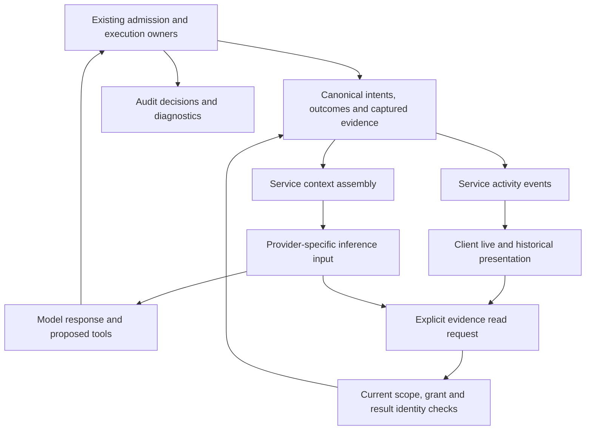
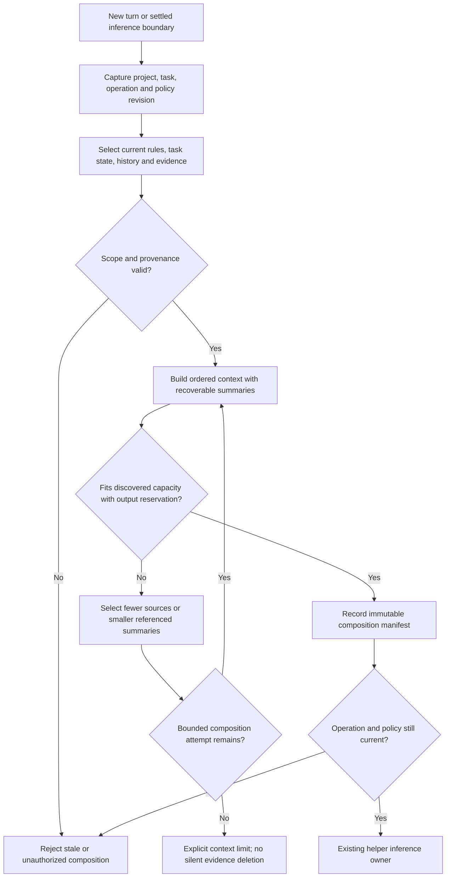

# Conversation evidence, model context and presentation

Status: required direction from the owner's Wisp lessons, 2026-09-30.
The delivery sequence below is proposed. This document does not claim that richer
activity, complete output recovery or context recomposition is implemented.
Existing execution, storage and client owners remain authoritative.

## Current implementation and gaps

The [activity design](response-activity.md) publishes tool names, ordinals, states
and result status. It does not publish arguments, policy timing or result previews.
The service rebuilds model input from accepted prior prompts and terminal response
text. The helper places instructions first, prior messages next and the current
prompt last. This separates fields but does not select relevant evidence or rebuild
context from structured task state. Tool results within one inference session are
not a durable cross-turn context composition strategy.

The [shell tool](shell-tool.md) drains bounded output but retains separate tail
rings. Its durable result is the captured tail, not the complete emitted output.
Full recovery therefore requires new retained output storage. An audit log's
rotation cannot define the lifetime of canonical results.

## Lessons from inspected Wisp code

Read-only inspection on 2026-09-30 examined the current Wisp checkout. No Wisp
build, native inference or cache benchmark was run. These are code observations.

| Source under `harness/Sources/WispCore/` | Lesson for Asura |
| --- | --- |
| `Session/ThreadRecord.swift`, `ContextComposer.swift`, `Agent.swift` | Stable record identities support request projections; reuse a model session only when composition remains equivalent |
| `Session/OutputReference.swift`, `Recall.swift` | Mechanical references can preserve tool, arguments, status, size and first/last lines without another model call; original recovery needs a durable fallback after audit rotation |
| `CLI/ChatEvents.swift`, `ChatActivity.swift` | Live tool and policy feedback is independent of final response text; bounded previews link to an expansion view |
| `Session/Prompting.swift`, `Presentation.swift` | Keep instruction authority explicit; shorten repeated output only in later model context while preserving the person's full response |
| `Session/ContextArchive.swift` | Save inspectable composition manifests; route filesystem work through Asura's isolated storage owner |

Wisp keeps tool results whole within their producing turn and creates bounded
references on later turns. This is a useful initial projection strategy. Asura
must retain exact failure status and source identity even when a preview becomes
shorter. Repeated identical tool calls need distinct call identities, not matching
by tool name and arguments. A missing original must not trigger an automatic rerun.

A static review found a telemetry risk in Wisp's `CLI/ChatLoop.swift` and
`Session/Agent.swift`: usage is sampled before a turn, but materialisation can
replace the model session before the ending sample. Subtracting cumulative values
from different sessions can undercount or clamp the result to zero. This finding
was not reproduced at runtime. Asura must sum request-correlated usage events
instead of subtracting session counters across recomposition.

Wisp's context thresholds, recent-turn counts and summary proportions are experiment
settings, not Asura defaults. Prefix stability is useful, but measured provider cache
reuse and task correctness must decide composition policy. Context archive writes
also cannot be copied as synchronous calls into Asura's service or rendering paths.

## Required ownership and separation

| View | Owner and purpose | Required boundary |
| --- | --- | --- |
| Canonical evidence | Existing authority/storage owners retain accepted inputs, exact tool intent, outcomes, captured results and provenance | A summary or display cannot replace an outcome or grant authority |
| Audit | Existing audit owner records inspectable decisions and diagnostics | Rotation or disabled audit must not erase canonical task evidence |
| Model context | Service context assembly selects authorized evidence for an inference | Explicit composition, scope and capacity; summaries reference originals |
| User presentation | Client projects service events into live and historical activity | Sanitized previews and navigation; no I/O or policy decisions in rendering |

These are distinct responsibilities, not four independent execution schedulers.
The service is the canonical source for operation identity, generation and order.
The helper adapts an accepted context to a provider. The client subscribes through
its existing event worker. No client reconstructs authorization from audit text.

### Projection ownership — required behavior

Arrows identify derivation and read boundaries. They do not grant permission.

## Live tool feedback and turn statistics

Each activity links to conversation, operation, generation and tool ordinal.
Present the public grouped tool command and a bounded argument description, such
as `shell find . -name "*.wisp"`. Show its real policy decision and reason, then
its actual outcome: exit code, captured byte count, duration and optional preview.
A model's assertion that a command is safe must never appear as a policy verdict.
Missing facts stay unknown. This displays actions and outcomes, not private model
reasoning. Preview redaction must not modify the canonical captured result.

Events distinguish proposed, admitted, running, settled and committed states.
The UI may show pending work immediately, but a successful outcome requires its
existing durable settlement. Active activity is expanded; completed activity can
collapse and reopen through existing response navigation. Event replay must not
duplicate rows or let an older generation overwrite current work.

Show turn elapsed time and measured token input/output, for example
`last:42.1s · ↓17,524 ↑739`, where down means input to the model and up means
output from the model. Hints must explain these directions. Turn duration excludes
queue wait; expose queue wait separately when useful. Use monotonic duration during
execution and retain the measured duration at settlement. Cross-restart unfinished
work cannot fabricate a duration from a new monotonic clock.

Token totals sum actual inference requests, including tool continuations. They
are different from context occupancy, which describes a particular request.
Report cached input separately when the provider supplies it. Unknown totals show
unknown, not zero; incomplete provider accounting must remain labelled partial.
Do not use budget reservations or character estimates as measured token IO.

## Recoverable results and bounded summaries

Every context or display summary must reference its exact retained source result,
including operation, tool ordinal, outcome, capture completeness and content digest.
A reference is not a path supplied by the model and is not an access grant.
Recover complete captured results by bounded page reads under current project and
visibility rules. Deleted, expired, unavailable and incomplete captures are explicit
outcomes. Do not rerun an effect to recover a missing result.

A successful command with only retained tails cannot be labelled fully recoverable.
Capture loss, output limits and cancellation must state which bytes were retained.
A context summary must preserve exit/failure status, significant findings, uncertainty
and the retrieval reference. Tool-returned instructions remain untrusted data.
Summary generation must not promote them into system instructions.

Proposed placement: verified immutable result payloads under
`$HOME/.asura/sessions/`, with typed identities, digests, provenance and links in
SurrealDB. Existing authority records retain outcome and reference through the
canonical journal owner. Existing adapter ownership governs writes and publication.
Do not put large output bytes in audit records or graph edges. Write and verify the
payload before publishing a recoverable reference. Crash recovery identifies orphan
payloads and missing referenced payloads without silently repeating the tool.

Retention belongs to canonical result storage, independently of audit rotation.
Garbage collection cannot remove a payload referenced by an active admitted context.
Persisted summaries disclose when their referenced evidence has expired.

## Instructions, prompt and recomposition

Instructions contain harness behavior, tool contracts and currently governing
rules. The prompt contains the current user request and changing task/evidence
content. Both have explicit provenance. Repository text and retrieved observations
are evidence; they do not gain authority by appearing near instructions.

Prefer a stable prefix: harness instructions, stable tool definitions, then stable
scoped rules. Place changing task state, selected prior turns and evidence next,
and the current request last. Provider adapters may need different message shapes;
record the actual serialized order. Stable ordering supports caching, but only
provider measurements establish cache reuse. Policy changes invalidate the relevant
prefix; cache optimization cannot preserve revoked or obsolete instructions.

Recompose before each new admitted turn from current task state, explicit active
instructions, selected history and relevant evidence. During a tool loop, recomposition
may occur only at a settled inference boundary, after pending callbacks settle.
Preserve tool-call/result pairing, current request, unresolved work, failures and
source references. Do not mutate a running SDK transcript behind its execution owner.
This approach avoids mandatory monotonic growth. Condensation is one possible
projection, not the canonical conversation or evidence store.

Retain an immutable composition manifest for each actual request: selected identities
and revisions, omitted evidence, summary provenance, instruction/configuration digests,
provider/model identity, discovered effective capacity, reserved output and available
measured counts. Recheck scope and authorization at admission and later evidence reads.
A summary prepared under an old project or policy cannot silently enter a new context.

The [turn context graph contract](graph-memory-evolution.md#deterministic-thread-context-by-turn)
requires deterministic reconstruction by conversation, turn and inference request.
Graph versions and ordered manifests preserve the past; current graph selection
creates a new context rather than changing historical requests.

### Context assembly — required behavior

Arrows name checks and accepted outputs. Every failure preserves canonical evidence.

## Proposed delivery packets and validation

The [tool job controller](tool-job-controller.md) applies this separation to
long-running tools: the model receives only previews and pages it requests.

Implement these in order; each packet needs its detailed schema and recovery design
before code. Protocol remains 0.1 and journal format remains 1.

1. **Activity and measurements:** extend existing service events and client activity
   rows with truthful argument summaries, policy/outcome data and duration/token IO.
   Reuse existing workers and priority routing. Unit checks cover unknown/partial
   values, sanitization and duplicate/stale events. Service integration and real PTY
   checks show activity before the answer, history expansion and draft responsiveness.
2. **Result retention:** add complete bounded payload capture, immutable references
   and authorized page reads through existing tool and storage owners. Test output
   flood, slow disk, quota exhaustion, cancellation, crash publication, restart,
   retention and cross-project denial. Verify full byte recovery, not only previews.
3. **Context composition:** implement the service-owned composer and immutable
   manifests. Test instruction ordering, changing policy, summary references,
   tool pairing, capacity discovery, bounded selection and cancelled/stale assemblies.
   A real provider journey must recover omitted detail on demand and continue the
   task after recomposition. Cache efficacy requires separately measured provider IO.

Numeric limits remain those of existing paths until a packet selects its extension.
Each packet must name blocking APIs, isolation owner, payload/queue/concurrency limits,
deadlines, cancellation, recovery and shutdown before implementation. No background
summarizer, unbounded output buffer or additional scheduler is authorized here.

## Design verification

Recorded on 2026-09-30: both new diagrams were rendered with Mermaid CLI 12.0.0
and visually inspected. Documentation diff checks passed. This is design evidence;
no Asura implementation or Wisp runtime qualification was performed in this packet.
