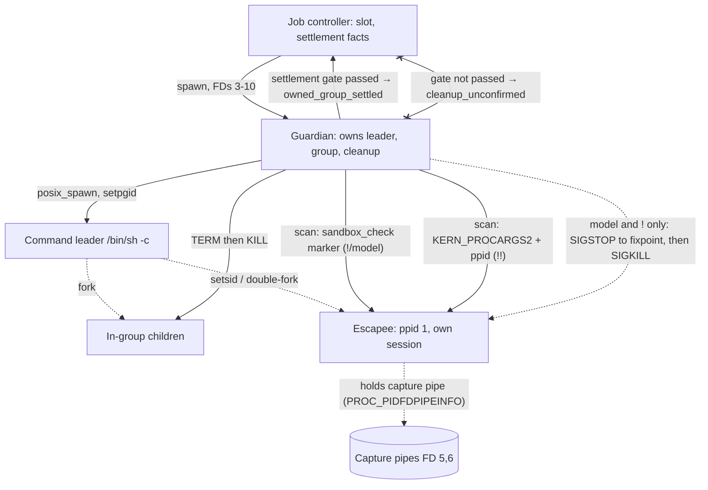
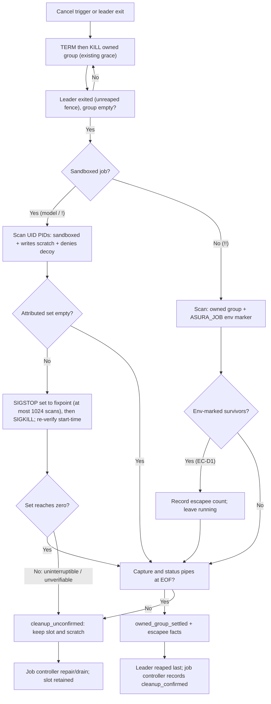
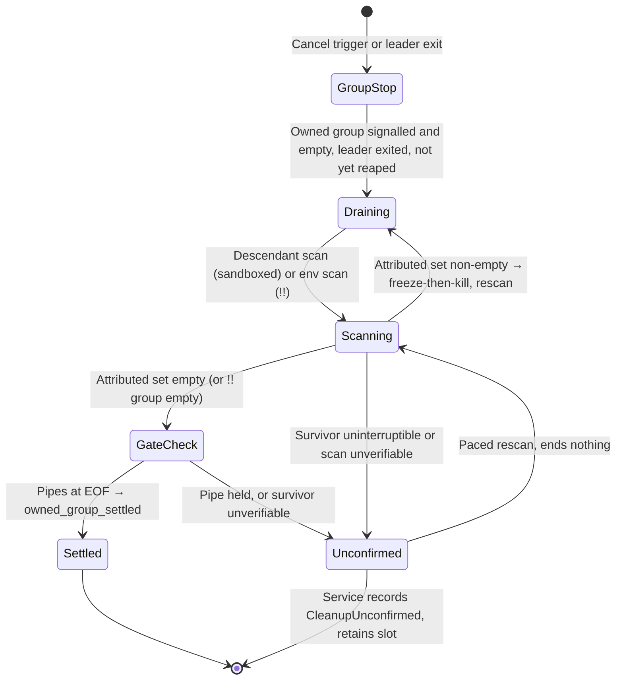

# Escapee detection and termination

Status: design, 2026-10-20; implemented on 2026-10-21 for the model exec_cmd
path (sandboxed model jobs), with the
[implementation evidence](#implementation-evidence-2026-10-21) below. The `!`
and `!!` person-profile parts wait for the person-command packets
([delivery scope](#delivery-scope)). This design resolves the
[execution threat model](execution-threat-model.md#owner-decisions) decision
**EX5** (owner, 2026-10-14): Asura must reliably detect and terminate escapees
before [tool job](tool-job-controller.md#delivery-dependencies) packet J2. It is
the follow-up design that the threat model and the job controller name as a J2
prerequisite. No owner decision remains open: the two product choices it
raised (EC-D1, EC-D2) are decided under existing owner rules; see
[decisions under existing owner rules](#decisions-under-existing-owner-rules).
It also covers the person profiles: the sandboxed `!` profile and
the unsandboxed `!!` profile (threat model PT8, PT13;
[person command mode](person-command-mode.md), profiles `person-1` and
`person-outside-1`). Protocol numbering stays `0.1`; journal format stays `1`
([numbering authority](../engineering.md#wire-protocol-change-authority)). The
guardian status notice is an internal native primitive, not a versioned wire
protocol; this design extends it as packet J2b already does.

Read the [bounded exec_cmd tool](exec-cmd-tool.md#guardian-process-ownership-and-cleanup),
the [tool job controller](tool-job-controller.md) J2 scope, and the
[execution threat model EX5 escape findings](execution-threat-model.md#ex5-escape-findings)
first. This design changes the guardian's cleanup confirmation and what J2
consumes; it adds no new process type, supervisor or scheduler.

## Status labels

| Label | Use in this document |
| --- | --- |
| Required behavior | The EX5 and PT13 outcomes the owner directed; later work must preserve them |
| Selected mechanism | The mechanism this design selects, backed by the recorded [probe evidence](#probe-evidence-macos-27) |
| Decided under existing owner rule | A choice this design applies from an existing owner rule, with its source; see [decisions under existing owner rules](#decisions-under-existing-owner-rules). No open decision remains |

## Objectives, non-goals and dependencies

Required behavior (EX5, owner 2026-10-14). Before J2, the guardian must:

1. **Detect and terminate a `setsid`/new-session escapee.** A descendant that
   leaves the owned process group must still be found and stopped. The group
   signals alone miss it (EX5 finding 2).
2. **Detect and terminate a double-fork escapee**, reparented to `launchd`
   (ppid 1), in or out of the owned group (EX5 finding 1 handles the in-group
   case; this design handles the reparented case).
3. **Terminate a pipe-holding escapee so settlement completes.** A `setsid`
   descendant that keeps the capture pipes open prevents descriptor EOF; the job
   cannot settle and the service enters repair (EX5 finding 5). The holder must
   be found and killed so EOF arrives.
4. **Never confirm cleanup while a descendant lives.** `owned_group_settled`
   must be reported only after no attributable descendant remains, not after the
   owned group alone is empty (EX5 finding 4, the false `cleanup_confirmed`).
5. **Cover the person profiles.** The `!` profile (`person-1`) uses the same
   sandbox-marker mechanism as model jobs. The `!!` profile
   (`person-outside-1`) has no sandbox; this design defines its best-effort
   mechanism and records the residual the owner accepted under
   [EXD-1](execution-threat-model.md#owner-decision-exd-1).

Non-goals: containment of a malicious same-UID actor that kills the guardian
(out of scope under the [D1 choice](threat-model.md#scope-assets-and-actors),
unchanged from the exec_cmd design); network egress control (EX2); a perpetual
service-wide process sweep; changing the owner-approved wind-down bounds; adding
any new time limit (owner, no-default-time-bounds). This design does not select
an async runtime.

Dependencies: the [exec_cmd guardian](exec-cmd-tool.md#guardian-process-ownership-and-cleanup)
(the owner of termination and cleanup confirmation); the
[tool job controller](tool-job-controller.md) J2 (consumes the new settlement
facts); [person command mode](person-command-mode.md) profiles and the
`PersonOutside` guardian path; [asura state isolation](asura-state-isolation.md)
(per-job scratch, FD contract).

## Terms

| Term | Meaning |
| --- | --- |
| Escapee | A command descendant that left the guardian's owned process group, by `setsid`/new session or by double-fork reparenting to `launchd` |
| Job marker | A per-job test that a same-UID scanner evaluates with `sandbox_check` to attribute a sandboxed process to one job: it may write the job's own scratch subpath and may not write the job's decoy path |
| Decoy path | An existing directory that the job's Seatbelt profile does not grant, used to exclude broadly permissive same-UID daemons from the marker |
| Descendant scan | One pass over the caller's UID PIDs that lists attributable descendants of one job |
| Freeze-then-kill | Sending `SIGSTOP` to every attributed descendant to a fixpoint, then `SIGKILL`, so a forking escapee cannot outrun the sweep |
| Settlement gate | The condition that must hold before the guardian reports `owned_group_settled`: leader reaped, owned group empty, capture/status pipes at EOF, and (sandboxed jobs) zero attributed descendants |

## Ownership

The guardian keeps sole ownership of termination and cleanup confirmation. No new
owner is introduced.

| Concern | Owner | Change |
| --- | --- | --- |
| Spawn, process group, wait/reap | exec_cmd guardian (`asura-platform`) | Unchanged |
| Owned-group signalling (TERM then KILL) | Guardian | Unchanged; keeps the 500 ms (model/`!`) and 2 s (`!!`/person) grace |
| Descendant scan and attribution | Guardian | New: `sandbox_check` marker scan (sandboxed jobs); `KERN_PROCARGS2` env-marker plus ppid-chain walk (`!!`) |
| Pipe-holder detection | Guardian | New: `proc_pidfdinfo`/`PROC_PIDFDPIPEINFO` handle match |
| Freeze-then-kill of escapees | Guardian | New: `SIGSTOP` to a fixpoint, then `SIGKILL` |
| Settlement gate and notice | Guardian | Changed: gate adds the descendant scan; notice adds escapee facts |
| Durable settlement facts, `cleanup_confirmed` surfaced to the model and person | Job controller (`asura-service`) | Consumes the new facts; records escapee counts; `cleanup_confirmed` is true only when the gate passed |

Dependency direction: job controller → guardian (via the existing descriptor and
notice contract). The guardian never calls the service.

### EC-O1: component and trust boundaries

Selected design. Solid arrows carry control or data; dashed arrows carry
process effects; an arrow ending in a cross is a killed or gated path. The
scanner and the escapees are same-UID; the sandbox marker, not a trust
boundary, attributes them.

## Selected mechanism

### Attribution: the per-job sandbox marker (model and `!` jobs)

Selected mechanism. A sandboxed job's descendants, however they fork or `setsid`,
stay in the job's Seatbelt profile: Seatbelt membership is inherited at fork and
cannot be dropped, and a child cannot re-apply `sandbox-exec` to escape it
(probe EC-V-NEST). The guardian attributes a candidate PID to its job with
`sandbox_check` (from `libsystem_sandbox`, declared by FFI, no crate dependency):

1. `sandbox_check(pid, NULL, 0) == 1` — the process is sandboxed. This excludes
   every unsandboxed same-UID process in one call (probe EC-V-MARK: 408–420 of
   ~640 UID processes are sandboxed system daemons).
2. `sandbox_check(pid, "file-write-data", SANDBOX_CHECK_FILTER_PATH | SANDBOX_CHECK_NO_REPORT, scratch) == 0` —
   the process **may** write the job's own scratch directory (its FD 9 path).
3. `sandbox_check(pid, "file-write-data", SANDBOX_CHECK_FILTER_PATH | SANDBOX_CHECK_NO_REPORT, decoy) != 0` —
   the process **may not** write the job's decoy path.

A process that passes all three is a descendant of this job and no other. The
decoy excludes broadly permissive daemons: many system daemons return "allowed"
for an arbitrary write path, so test 2 alone matched 15 unrelated daemons in the
probe; adding test 3 reduced the match to exactly the job's own escapee
(probe EC-V-MARK). Two concurrent jobs, each using the other's scratch as its
decoy, attributed only their own escapee and never the other's
(probe EC-V-ISO). The scan over all UID PIDs cost 0.6–7.6 ms (probe EC-V-TIME).

**Marker and decoy paths must exist on disk.** `sandbox_check` with a path
filter returns "denied" for a non-existent path regardless of the profile
(probe EC-V-NX), so a missing marker would match nothing. The guardian uses:

- **Marker** = the job's private scratch directory (FD 9), which the guardian
  created and pinned (`cleanup.rs`), and which only this job's profile grants
  for writing among job profiles.
- **Decoy** = the Asura home `tmp` directory (FD 10 path + `/tmp`), which exists,
  which every job profile denies (`(deny … (subpath asura))`, re-allowing only
  the job's own scratch), and which a broad daemon may write. The guardian
  already holds and pins this descriptor. Using a path no job grants keeps the
  decoy valid for every concurrent job.

The guardian never trusts a path string from the command; marker and decoy come
from its own pinned descriptors (FD 9 and FD 10), as the profile already does.

### Attribution: the `!!` unsandboxed job

Selected mechanism, best-effort. A `!!` command runs with no Seatbelt profile
(EXD-1), so the sandbox marker does not apply: `sandbox_check(pid, NULL, 0)`
returns 0 for its descendants, as for every other process the person started.
The guardian attributes `!!` descendants by two independent signals:

1. **Owned process group** (existing): every in-group member, found with
   `proc_listpids(PROC_PGRP_ONLY, leader_pgid)`, is a descendant.
2. **Job-marker environment variable.** The guardian sets a per-job variable
   `ASURA_JOB_<jobhex>=1` in the `!!` child environment (added beside the EX4
   secret variables, before `exec`). The scan reads each candidate's arguments
   and environment with `sysctl(KERN_PROCARGS2)` — readable for a same-UID
   process on macOS 27 (probe EC-V-ENV) — and matches the variable. This finds a
   `setsid`/double-fork escapee that kept its inherited environment.

An escapee that `exec`s with a scrubbed environment (`env -i …`) and leaves the
group carries neither signal. The guardian cannot reattribute it. This is the
accepted residual under EXD-1: a `!!` command "works like your terminal", where a
deliberately detached, re-`exec`ed background process likewise outlives the shell.
The design states this residual rather than hiding it (PT13).

The guardian does not kill the surviving `!!` descendants it finds. It records
their count as an escapee fact and leaves them running, as the person's terminal
would. This is [EC-D1](#decisions-under-existing-owner-rules), decided under the
existing owner rule for `!!` ("like my terminal", following Wisp; PC13, owner
2026-10-19) and EXD-1. Model and `!` jobs still freeze-then-kill their escapees.

### Pipe-holder detection and settlement

Selected mechanism. A `setsid` escapee that keeps the capture pipes (FD 5, 6)
open prevents EOF, so the job cannot settle (probe EC-V-EOF: before the holder is
killed, a read of the capture pipe returns `EAGAIN`, never EOF; after the holder
is killed, EOF arrives at once). The guardian:

1. Records the pipe handles of its capture write ends at spawn, with
   `proc_pidfdinfo(self, fd5/fd6, PROC_PIDFDPIPEINFO)` → `pipe_handle`.
2. During the scan, for each attributed descendant, lists its FDs
   (`proc_pidinfo(pid, PROC_PIDLISTFDS)`) and, for each pipe FD, compares
   `PROC_PIDFDPIPEINFO` `pipe_handle`/`pipe_peerhandle` to the recorded handles.

A pipe holder is always an attributed descendant (it inherited the pipe), so
terminating the attributed set closes it. Pipe-holder detection is used to prove
the holder is gone and so to decide when EOF should be expected; it is not a
second kill path.

### Termination ordering: freeze-then-kill

Selected mechanism. To defeat a forking escapee that spawns new processes
between the scan and the kill, the guardian terminates in two phases over the
attributed set:

1. **Freeze.** Send `SIGSTOP` to every attributed descendant. Rescan; stop any
   newly appeared descendant. Repeat until a pass finds no un-stopped descendant
   (a fixpoint). A stopped process cannot fork. `SIGKILL` and `SIGSTOP` cannot be
   caught or ignored.
2. **Kill.** Send `SIGKILL` to the frozen set. Rescan; the attributed set must
   reach zero.

Freeze-then-kill terminated a PID-hopping escapee (each generation `setsid`s a
new child and the parent exits) in two freeze rounds and two kill rounds
(probe EC-V-FORK). Kill-only also cleared that fixture because it hops one process
at a time; freeze is kept because it is strictly safer against a parallel forker
and adds only a bounded rescan.

This phase runs **after** the existing owned-group TERM-then-KILL grace, which
gives a cooperative in-group command its chance to exit cleanly on `SIGTERM`.
Escapees have already left the group and the cooperative path, so they receive
`SIGSTOP`/`SIGKILL` without a grace period. The owner-approved grace bounds
(500 ms model/`!`, 2 s `!!`/person) are unchanged and are not applied to escapees.

**PID-reuse safety.** Between listing and signalling, a PID could be reused. The
guardian pins each attributed descendant by `(pid, pbi_start_tvsec,
pbi_start_tvusec, pbi_pgid)` from `PROC_PIDTBSDINFO` (available, probe EC-V-TIME)
and re-reads that tuple immediately before each signal. A changed start time or
pgid means the PID was reused; the guardian does not signal it and rescans. It
never signals a PID whose attribution it has not just re-verified.

### The settlement gate and `cleanup_confirmed`

Required behavior (EX5 finding 4). The guardian reports `owned_group_settled`
(notice kind 2, cleanup bit 1) only when all of these hold:

- the direct leader is reaped (existing);
- the owned process group is empty (`PROC_PGRP_ONLY` returns only the leader
  fence, existing);
- the capture and status descriptors are at EOF (existing, now guaranteed
  because pipe holders are terminated);
- **(sandboxed jobs) the descendant scan returns zero attributed descendants.**

If the scan cannot reach zero — a descendant is stuck in an uninterruptible
kernel wait, or the scan result is unverifiable — the guardian reports
`cleanup_unconfirmed` (kind 4) and retains the slot and scratch, exactly as the
existing unverifiable-cleanup path does. The job controller surfaces
`cleanup_confirmed` to the model and person only on `owned_group_settled`. This
closes the false-confirmation finding: while an escapee lives, the scan is
non-zero, the gate fails, and cleanup is reported unconfirmed.

For `!!` jobs the gate uses the owned group and the pipe EOF only; the env-marker
scan reports and does not kill (EC-D1). A `!!` job therefore confirms cleanup of
its owned group as the person's terminal would, and reports any env-marked
survivors as an escapee fact, not as a cleanup failure.

### EC-F1: detection and termination flow

Selected design. Shows the guardian's cleanup after a cancel trigger or leader
exit. Repetition is bounded by the attributed-set reaching zero (completion) or
by an unverifiable result (`cleanup_unconfirmed`); no time limit ends it.

## Contracts

### Descriptor contract

Unchanged. The guardian uses FDs 3–10 as the
[exec_cmd descriptor contract](exec-cmd-tool.md#descriptor-and-notice-contract)
defines; the marker is FD 9 (scratch) and the decoy is derived from FD 10 (Asura
home `tmp`). The `!!` path has no FD 9 Seatbelt profile but still receives the
same FDs and sets the `ASURA_JOB_<jobhex>` environment variable.

### Guardian status notice extensions

Internal native notice, not a versioned wire protocol (consistent with J2b, which
adds kind 5). This design adds:

| Field | Value | Meaning |
| --- | --- | --- |
| Kind 6 | escapee_report | Emitted once during cleanup when the scan found descendants outside the owned group; `value` = count terminated (sandboxed) or env-marked found (`!!`), bounded to the scan limit |
| Reason 12 | escapee_terminated | On a kind 2 settled notice: the gate passed only after escapees were terminated; exit `value`/`exit_kind` keep the leader's outcome |
| Reason 13 | escapee_unterminated | On a kind 4 cleanup_unconfirmed notice: a descendant could not be verified gone |

The notice budget rises to at most 5 notices and a 192-byte buffer, above the at
most four the guardian emits: spawned, leader-exit (kind 5, J2b), escapee_report
(kind 6), and one terminal notice (settled or cleanup_unconfirmed). At 192 bytes
the sole writer still writes well below the 512-byte `PIPE_BUF`, so valid notices
cannot fill the pipe even if the service never reads. The notice decoder shape rules
(`protocol.rs`) extend to accept kind 6, reasons 12–13 and the person-command
reasons 10–11 together. Changed kinds, duplicate kind 6, out-of-order or trailing
bytes stay protocol faults that initiate cleanup and never prove absence of an
effect.

Order rules (2026-10-21). After kind 1, the guardian may send one kind 4 and
then one kind 6; kind 6 is always the notice immediately before kind 2. The
decoder treats each of these as a protocol fault: kind 6 with a zero value, a
nonzero exit kind or the cleanup bit; a second kind 4 or kind 6; kind 2 with
reason 12 without kind 6 before it; and kind 6 followed by anything but kind 2
with reason 12. Kind 4 accepts reasons 9 and 13. Kind 2 accepts reasons 0–4 and
12. Reasons 10 and 11 stay rejected until the person-command packet adds them.

### What J2 consumes

| Fact | Source | J2 use |
| --- | --- | --- |
| `cleanup_confirmed` true | Kind 2 settled with cleanup bit 1 (gate passed) | The job's settlement records confirmed cleanup; `CleanupUnconfirmed` state is not entered |
| escapee count | Kind 6 value | Recorded in the settlement facts (alongside the J2c pause facts); shown in the job summary and audit as a count, never as process detail |
| `cleanup_unconfirmed` reason 13 | Kind 4 | The job enters `CleanupUnconfirmed`, keeps its slot and scratch, and the controller follows its existing repair/drain path |

The [job lifecycle TJ-S1](tool-job-controller.md#tj-s1-job-lifecycle) is
unchanged in shape: the escapee scan runs inside the existing `Draining →
Finalizing` and `Draining → CleanupUnconfirmed` transitions. The gate decides
which of the two is taken; it adds no new state and no job lifetime.

### State view: cleanup confirmation

Selected design. The guardian's cleanup, inside the controller's `Draining`
state. A requested kill is not a confirmed termination.

### Guardian implementation refinements (2026-10-21)

Selected mechanism. These refinements fix the details that the sections above
leave to the implementation. They apply to the model exec_cmd path that exists
today; the person-profile parts wait for the person-command packets (see
[delivery scope](#delivery-scope)).

**Where the sweep runs.** The guardian runs one escapee sweep on each pass of its
existing 100 ms wait loop, and only when all of these hold: the leader has exited
(observed with `WNOWAIT`), the leader fence is still valid, and `PROC_PGRP_ONLY`
shows only the leader. The guardian reaps the leader only after a sweep reports
the attributed set clear. The leader PID is therefore still allocated while the
guardian signals escapees, and the guardian never signals the leader PID alone.
The guardian excludes its own PID and the leader PID from every scan.

**One sweep.** A sweep has a freeze phase and a kill phase:

1. Freeze: scan, then send `SIGSTOP` to each attributed process whose status is
   not `SSTOP`. Repeat until a scan finds every attributed process stopped. The
   freeze phase runs at most 1024 scans (`FREEZE_ROUND_LIMIT`).
2. Kill: send `SIGKILL` to each process in the frozen set, then scan once more.
   An empty result with no capture-pipe holder clears the gate. A non-empty
   result waits for the next 100 ms pass, which sweeps again.
3. Round cap: when the freeze phase reaches its limit, the guardian still sends
   `SIGKILL` to the attributed set of one more scan. It then reports the sweep
   unverifiable. Killing first is strictly safer than leaving the set running.

Before each `SIGSTOP` or `SIGKILL`, the guardian re-reads `PROC_PIDTBSDINFO`. It
signals the PID only when the start time and pgid still match the scanned tuple.
A changed tuple is skipped, and the next scan decides again.

**Exit between listing and query.** `sandbox_check` returns 1 ("denied", errno 0)
for a PID that does not exist or is a zombie (probe EC-V-GONE). A process that
exits during a scan therefore fails marker test 2 and is not attributed. This is
correct: an exited process cannot write, fork or hold a descriptor. Only a
`sandbox_check` result other than 0 or 1 is unverifiable. `proc_pidinfo` with
`ESRCH` means the process is gone; any other failure is unverifiable. `kill` with
`ESRCH` means gone; any other failure is unverifiable.

**When cleanup is reported unconfirmed.** The guardian sends at most one kind 4
notice. It sends it at once when a sweep is unverifiable (EC-D2), with reason 13.
Otherwise it keeps the existing 2.5 s report point after the first stop signal:
if the gate has not passed by then, it sends kind 4 with reason 13 when the last
sweep left attributed escapees or was unverifiable, and reason 9 in every other
case. After kind 4 the guardian keeps its paced sweeps. A later clear sweep reaps
the leader and sends the late settled notice.

**Escapee count.** The kind 6 value counts the distinct processes, by PID and
start time, that the guardian sent `SIGKILL` to during cleanup. The guardian
keeps at most `kern.maxprocperuid` identities; past that, the count stays at
that limit. When the count is not zero, the guardian sends kind 6 immediately
before the kind 2 settled notice, and the kind 2 reason is 12. A count of zero
sends no kind 6, and the kind 2 reason stays the lease reason (0 or 4).

**Setup.** Before it spawns the command, the guardian derives the marker (FD 9
path) and decoy (FD 10 path plus `/tmp`) and checks that the marker lies inside
the decoy directory. It reads `kern.maxprocperuid` (accepted range 1 to
1,048,576) and allocates the PID buffer. It records the `PROC_PIDFDPIPEINFO`
handle and peer handle of FD 5 and FD 6. A failure in any of these steps sends
the setup-failed notice with reason 6 (`sandbox_unavailable`); no command runs.

**Test-support faults.** With the non-default `test-support` feature, a test may
add one fault argument to the guardian invocation. `group-only` skips the sweep
and reproduces the old group-only check (EC-V-OLD). `undyable` suppresses
`SIGKILL` to escapees, as for a process that cannot be killed (EC-I8).
`unverifiable:<n>` makes the first n sweeps unverifiable (EC-D2). Production
builds do not contain this code, and the service never passes the argument.

### What the current exec_cmd path consumes

Required behavior until J2 replaces this path. The platform `ExecCmdJob` reads
the new notices and the service exec_cmd worker uses them:

| Fact | Platform result | Current use |
| --- | --- | --- |
| Kind 2 settled, no earlier kind 4 | `cleanup_confirmed` true | Scratch is removed and the slot is released, as before |
| Kind 4, reason 9 or 13, then kind 2 (late settlement) | `cleanup_confirmed` false; `cleanup_unconfirmed()` returns the reason | Scratch is removed and the slot is released (AE-05); the result text says `cleanup_confirmed=false` |
| Kind 4 with no later kind 2 | Job not settled; `cleanup_unconfirmed()` returns the reason | Slot and scratch stay held; a cancel trigger leads to the existing L3 repair path |
| Kind 6 value | `escapees` | The kind 15 header line ends with ` escapees=<n>` when n is not zero. It is a number only |

The durable escapee count in the settlement facts (kind 23) and the audit count
belong to J2, as [what J2 consumes](#what-j2-consumes) states.

### Delivery scope

Delivered for the model exec_cmd path (2026-10-21): the sandbox marker and decoy
scan, pipe-holder detection, freeze-then-kill with the PID-reuse re-check, the
settlement gate, notice kind 6 and reasons 12 and 13, and the consumption above.

Left to the person-command packets, which add the person guardian path:

- the `!` profile (`person-1`): it reuses this sweep unchanged once the person
  guardian path exists (EC-E2);
- the `!!` profile: the `ASURA_JOB_<jobhex>` variable, the `KERN_PROCARGS2` scan,
  EC-D1 counting without signals, and its 2 s grace (EC-I9, EC-I10, EC-E4);
- notice reasons 10 and 11 (person stop and kill). The decoder rejects them
  until that packet defines and emits them.

## Failure handling and recovery

| Case | Result |
| --- | --- |
| Escapee found (sandboxed) | Freeze-then-kill; gate waits for the attributed set to reach zero; settlement records the count (kind 6) |
| Pipe-holding escapee | The holder is in the attributed set and is killed; EOF then arrives; settlement proceeds |
| Escapee in an uninterruptible kernel wait (cannot be killed) | Attributed set stays non-empty; `cleanup_unconfirmed` reason 13; slot and scratch retained; paced rescan continues; a later rescan that reaches zero records a late settlement, which never turns an unknown outcome into proof of no effect |
| `sandbox_check` or `proc_pidinfo` returns an error or an over-size/odd buffer | Treated as unverifiable: `cleanup_unconfirmed`, slot retained, even when the group and pipes have settled (EC-D2); the paced rescan clears it when the query recovers; never assume the process is absent |
| PID reused between scan and signal | Start-time/pgid re-check fails; the PID is not signalled; rescan |
| Process exits between the PID listing and its `sandbox_check` | `sandbox_check` returns 1 for an absent or zombie PID (EC-V-GONE); the process is not attributed; this is not an error |
| Freeze phase reaches 1024 scans | `SIGKILL` to the current attributed set, then unverifiable: kind 4 reason 13 once, paced sweeps continue |
| `!!` escapee with scrubbed environment and new session | Not attributable; residual accepted under EXD-1; not a cleanup failure for the owned group |
| Scanner itself is killed (service/guardian death) | Existing lease-EOF path: the guardian on service death still signals the owned group; an already-escaped descendant is the documented residual, unchanged for the no-guardian case |
| Service restart during cleanup | Unchanged: restart never reattaches to a process or signals a journaled PID; interrupted jobs stay listable; a restarted service cannot rediscover a prior job's escapees, because the marker depends on the live job's pinned scratch/decoy descriptors (recorded limit) |

Recovery never respawns a job and never rediscovers escapees by executable name
or a persisted PID after restart, matching the exec_cmd cleanup contract.

## Security

- The scan runs as the same OS user (D1 principal). It reads process metadata and
  sandbox decisions only; it reads no command output and no process memory.
- Attribution is by the job's own pinned descriptors (scratch, Asura home),
  never by a command-supplied string, so a command cannot spoof membership or
  point the scan at another job.
- The marker cannot be dropped by a sandboxed escapee: Seatbelt membership is
  inherited and permanent, and nested `sandbox-exec` is refused inside a profile
  (`sandbox_apply: Operation not permitted`, probe EC-V-NEST). This is why the
  `!` and model paths are reliable and the `!!` path is not.
- `ASURA_JOB_<jobhex>` is not a secret: it is a per-job flag with value `1`, set
  only for `!!`, and carries no authority. It is excluded from the EX4 secret
  variables and from the journal, as the whole `!!` environment is
  ([outside profile environment](person-command-mode.md#outside-profile-environment)).
- Escapee counts in audit are numbers only; no PID, command or path is recorded,
  consistent with person-command audit (PX-V8, PX-V16).

## Asynchronous execution

Maps to [AE-01–AE-07](../engineering.md#asynchronous-execution-and-recovery).
This work runs in the guardian process, which already owns a bounded, nonblocking
wait loop with a 100 ms readiness poll.

| Rule | How this design meets it |
| --- | --- |
| AE-01 | The guardian is not a control or render path. The scan is a bounded, nonblocking metadata pass; it never waits on the command. |
| AE-02 | Blocking calls: `proc_listpids`, `sandbox_check`, `proc_pidinfo`/`proc_pidfdinfo`, `sysctl(KERN_PROCARGS2)`, `kill`. Each is a bounded in-kernel query or signal, isolated in the guardian; none joins a thread or waits on I/O. Measured 0.6–7.6 ms per full UID scan (EC-V-TIME). |
| AE-03 | Numeric bounds in the table below. The UID-PID buffer, FD buffer and procargs buffer are known-size; an over-size or odd result is treated as unverifiable, not retried unboundedly. |
| AE-04 | No time limit ends the work. Closures: the attributed set reaching zero (completion/exhaustion), or an unverifiable result (reported as `cleanup_unconfirmed`, an unknown outcome). The paced rescan is pacing and ends nothing. Cancellation owner is the guardian; lease EOF still stops the owned group. |
| AE-05 | A late settlement after `cleanup_unconfirmed` releases resources but never asserts the earlier unknown outcome was clean. No effect is retried. |
| AE-06 | Shutdown keeps the owner lock while cleanup is unsettled, unchanged. The scan runs inside the existing cleanup wait; it adds no new lifecycle owner. |
| AE-07 | Acceptance cases below require real-process evidence of each escape kind, the pipe-holder EOF, PID-reuse re-check and the `!!` env marker; syntax and header availability are not accepted as proof. |

### Numeric limits

| Resource | Limit | Basis |
| --- | --- | --- |
| UID-PID scan buffer | `kern.maxprocperuid` entries (8000 on the probe host); over-size result → unverifiable | `proc_listpids(PROC_UID_ONLY)`; buffer sized once from `sysctl(kern.maxprocperuid)` at guardian start |
| Owned-group membership buffer | 256 PIDs (existing); overflow → unverifiable | Unchanged exec_cmd limit |
| Per-descendant FD list | `proc_pidinfo` reported size, capped at the process FD limit; over-size → skip pipe check, treat as holder (conservative) | `PROC_PIDLISTFDS` |
| `KERN_PROCARGS2` buffer (`!!`) | `sysctl` reported size, capped at `kern.argmax`; over-size → not env-marked | macOS argmax |
| Freeze fixpoint rounds | Bounded by the attributed-set strictly not growing once all are `SIGSTOP`ed; a configured maximum round count (default 1024) → unverifiable | Prevents an unbounded loop under a pathological forker |
| Marker scan cadence during cleanup | Paced at the existing 100 ms guardian poll | Pacing (AE-04); ends nothing |

No new thread, task or queue is created. No unbounded buffer is allocated for
incoming work.

## Validation

Required test layers. Unit tests use deterministic fixtures and fault injection
with no real processes where possible; integration tests use the real guardian,
real `sandbox-exec` and real escapee fixtures on a macOS 27 host; end-to-end
tests drive a person command and a native-model job through the TUI. Each case
states initial state, trigger and required result.

### Unit

| ID | Case | Required result |
| --- | --- | --- |
| EC-U1 | Settlement gate evaluation | The gate returns settled only when leader reaped, group empty, pipes at EOF and attributed set zero; any false input yields unconfirmed |
| EC-U2 | Notice encode/decode for kind 6 and reasons 12, 13 (with 10, 11) | Round-trips; unknown kind/reason, duplicate kind 6, trailing bytes are protocol faults |
| EC-U3 | PID-reuse re-check | A changed start-time/pgid tuple suppresses the signal; the fixpoint rescans |
| EC-U4 | Freeze fixpoint round cap | Exceeding the configured maximum yields unverifiable, never an infinite loop |
| EC-U5 | Buffer over-size and odd-length results | Each maps to unverifiable (cleanup_unconfirmed), never to "absent" |
| EC-U6 | Marker/decoy derivation | Marker is the pinned FD 9 scratch; decoy is the pinned FD 10 Asura `tmp`; neither comes from command text |

### Integration (real guardian and sandbox, macOS 27)

| ID | Case | Required result |
| --- | --- | --- |
| EC-I1 | `setsid` escapee under the model/`!` profile | Detected by the marker scan, frozen and killed; gate passes; writes to the project stop before `cleanup_confirmed` |
| EC-I2 | Double-fork escapee reparented to ppid 1 | Detected and killed; gate passes |
| EC-I3 | Pipe-holding `setsid` escapee | Before kill, the capture pipe never reaches EOF; after kill, EOF arrives and the job settles (EC-V-EOF) |
| EC-I4 | False `cleanup_confirmed` regression | While the escapee lives, the guardian reports `cleanup_unconfirmed`, not settled (the EX-V5 finding, now a passing gate) |
| EC-I5 | Forking/PID-hopping escapee | Freeze-then-kill reaches zero; no descendant survives the sweep (EC-V-FORK) |
| EC-I6 | Two concurrent jobs | Each job's scan attributes and kills only its own escapee, with the selected Asura `tmp` decoy; the other job's escapee keeps running until its own job settles (EC-V-ISO used each other's scratch as decoy) |
| EC-I7 | Nested `sandbox-exec` attempt by the command | Refused by the OS; the command stays in the job profile; attribution still holds (EC-V-NEST) |
| EC-I8 | Uninterruptible/undyable survivor (injected stuck state) | `cleanup_unconfirmed` reason 13; slot and scratch retained; a later rescan to zero records late settlement without asserting cleanliness |
| EC-I9 | `!!` escapee that kept its environment | Found by the `ASURA_JOB` env-marker scan via `KERN_PROCARGS2`; counted in the kind 6 notice; not signalled; still running after settlement (EC-D1) |
| EC-I10 | `!!` escapee with scrubbed environment and new session | Not attributable; recorded as the EXD-1 residual; the owned group still settles |
| EC-I11 | Scan cost under load | A full UID scan completes within the 100 ms guardian poll with the host's process count (EC-V-TIME) |

### End-to-end (TUI + native model)

| ID | Case | Required result |
| --- | --- | --- |
| EC-E1 | Native-model exec_cmd job spawns a `setsid` escapee | The job settles with `cleanup_confirmed`; the escapee count shows in the job summary; the model sees no surviving effect after settlement |
| EC-E2 | `!` person command spawns a `setsid` escapee | `/jobs` shows the job settled and cleaned; the escapee is gone |
| EC-E3 (EX-V9) | `setsid`, double-fork and pipe-holding escapees under a job | Each is detected and terminated, settlement completes, and cleanup is never reported confirmed while one lives — the threat model's required EX-V9 outcome |
| EC-E4 | `!!` command spawns a detached background process the person wants kept | The process keeps running after the job settles; the job summary shows the escapee count; the model notice and audit mark `outside_sandbox` (EC-D1) |

Environments: macOS 27 development host (recorded build 26A428) with the native
process harness, scratch Asura home and scratch project, the system model and a
verified local Ollama for the model path. Release qualification is not claimed by
these cases.

## Implementation evidence (2026-10-21)

Verified behavior on the macOS 27.0 development host (build 26A428), real
guardian, real `sandbox-exec` and real escapee processes. Code: the escapee
module `asura-platform/src/exec_cmd/escapee.rs` (scan, sweep, gate, libproc
and `sandbox_check` wrappers), the guardian loop in `guardian.rs`, the notice
decoder in `protocol.rs`, the reader in `exec_cmd.rs`, and the service worker
release in `asura-service/src/exec_cmd_worker.rs`. The fixture escapee is
`asura-platform/tests/fixtures/escapee.pl` (Perl, 20 s lifetime, release file).

| Case | Evidence | Result |
| --- | --- | --- |
| EC-U1 | `exec_cmd::escapee::tests::ec_u1_gate_settles_only_when_every_input_holds` | Pass |
| EC-U2 | `exec_cmd::tests::ec_u2_escapee_notice_shapes_round_trip_and_reject_invalid`, `ec_u2_escapee_notice_order_and_settlement_facts`, `ec_u2_escapee_notice_order_faults` | Pass; reasons 10 and 11 are rejected until the person packet |
| EC-U3 | `ec_u3_reused_pid_is_not_signalled`, `ec_u3_gone_before_signal_is_not_signalled` | Pass |
| EC-U4 | `ec_u4_freeze_round_cap_kills_then_reports_unverifiable` | Pass |
| EC-U5 | `ec_u5_faults_and_odd_buffers_are_unverifiable` | Pass |
| EC-U6 | `ec_u6_marker_and_decoy_come_from_pinned_paths` | Pass |
| Sweep units | `sweep_freezes_all_then_kills_and_counts`, `sweep_reaches_a_fixpoint_over_a_forking_escapee`, `undying_escapee_keeps_the_gate_closed`, `tally_counts_distinct_identities_up_to_the_scan_limit`, `sdk_layout_matches_the_recorded_probe`, `real_table_never_attributes_unsandboxed_or_absent_processes` | Pass |
| EC-I1, EC-I2, EC-I3 | `exec_cmd_process` `all_kinds`: one job starts `setsid`, double-fork (ppid 1 recorded) and pipe-holding escapees outside the owned group | Pass: settled with `cleanup_confirmed` true, `escapees=3`, no kind 4, both capture pipes at EOF; no escapee alive and no project write after settlement |
| EC-I4 | `old_group_only_check` (`group-only` fault) and `undying_pipe_holder` | Pass: the old check confirmed cleanup while the escapee lived and wrote the project (EC-V-OLD reproduced); the real gate stayed unsettled while an escapee lived |
| EC-I5 | `forking`: PID-hopping escapee | Pass: the pid file stopped growing at settlement |
| EC-I6 | `concurrent`: two jobs with the selected Asura `tmp` decoy | Pass: job A killed only its escapee; job B's escapee kept writing until job B settled and killed it |
| EC-I7 | `nested_sandbox` | Pass: `sandbox_apply: Operation not permitted`; the later escapee was attributed and killed |
| EC-I8 | `undying_pipe_holder` (`undyable` fault: `SIGKILL` to escapees suppressed) | Pass: kind 4 reason 13, no settlement and no capture EOF while it lived; frozen, so no project write; after the test removed it, a paced sweep settled late with `cleanup_confirmed` false and `escapees=1` |
| EC-D2 | `unverifiable_scan` (`unverifiable:5` fault) | Pass: kind 4 reason 13 although group and pipes settled; late settlement with `cleanup_confirmed` false; scratch removed |
| EC-I11 | `all_kinds`: one real scan from the test process | Pass: 5 processes attributed in about 4.4 ms, below the 100 ms poll |
| EC-E3 (EX-V9), EC-E1 | `asura-service --test capture_flow -- escapees`: real service, Swift helper, guardian and sandbox, scripted loopback model | Pass: kind 15 header ends `cleanup_confirmed=true capture=complete escapees=3`; kind 23 complete with EOF on both streams; no escapee alive and no project write afterwards. A late settlement through the service (`unverifiable:5`) gave `cleanup_confirmed=false`, released the scratch and slot, and the next call ran |

Proof limits:

- EC-I8 uses an injected fault. A real process in an uninterruptible kernel
  wait was not produced on the host.
- EC-E1 and EC-E3 ran with a scripted model through the real helper, not through
  the TUI with a native model. The native exec_cmd journey ran as a regression
  check only; it does not start escapees.
- EC-I9, EC-I10, EC-E2 and EC-E4 belong to the person-command packets.
- The durable escapee count in kind 23 and audit is J2 work.

## Decisions

### Selected approach

The sandbox marker, freeze-then-kill and the settlement gate are selected because
the probe evidence shows them to be reliable for sandboxed jobs on macOS 27, with
no new time bound and a sub-poll cost. Attribution by pinned descriptors keeps the
mechanism inside the guardian's existing ownership and trust model.

### Alternatives considered

- **kqueue `EVFILT_PROC` with `NOTE_FORK`/`NOTE_EXIT`.** Rejected as the primary
  mechanism: `NOTE_TRACK` (follow across forks) is unsupported on macOS since
  10.5 (confirmed in the installed `sys/event.h`), so a fork that the guardian
  has not yet registered a watch for is missed, and a `setsid`/reparented child
  is not delivered against the leader's pgid. A per-PID watch also races the fork.
  The marker scan needs no per-process registration and finds an escapee however
  it was created. kqueue may later reduce scan frequency as an optimization, not
  as the attribution source.
- **ppid-chain walk alone (libproc `proc_listchildpids`/`PROC_PIDTBSDINFO`
  ppid).** Rejected for sandboxed jobs: a `setsid`/double-fork escapee reparents
  to ppid 1, breaking the chain from the leader. The marker does not depend on
  parentage. The ppid walk is retained only as a secondary `!!` signal.
- **Responsible-PID / audit-token signalling
  (`proc_signal_with_audittoken`).** Not needed: same-UID `kill` already reaches
  the descendants, and the audit token adds no attribution the marker lacks.
- **A Seatbelt rule that denies the escape itself** (`setsid`/`setpgid`).
  Rejected: Seatbelt has no such operation on macOS 27 — `(deny process-setsid)`
  and `(deny process-setpgid)` fail to compile with `unbound variable`
  (probe EC-V-SBOP). Prevention of the escape is therefore not available; the
  design detects and terminates instead.
- **Decoy-free marker (write-to-own-scratch only).** Rejected: broadly permissive
  daemons return "allowed" for an arbitrary write path, giving 15 false positives
  in the probe. The decoy removes them.
- **Freeze-then-kill of env-marked `!!` survivors.** Rejected by EC-D1: a `!!`
  command works like the person's terminal, where a deliberately backgrounded
  process (for example `!!brew services start …` or `!!nohup …`) outlives the
  shell. Killing it would break that use. An env-scrubbed escapee would still be
  missed, so killing would not remove the residual either.
- **Perpetual service-wide process sweep.** Rejected as a non-goal: the
  settlement gate catches an escapee before confirming cleanup, so a job's
  escapee is killed at its own cleanup; a standing sweep adds cost and owner
  ambiguity for no additional guarantee.

### Decisions under existing owner rules

Neither choice below is a new owner decision. Each is decided under an existing
owner rule, cited with its source. No owner decision remains open in this design.

**EC-D1. A `!!` command's surviving descendants are left running and counted.**
Decided under existing owner rule: the `!!` rule that a command runs "like my
terminal", following Wisp ([PC13](person-command-mode.md#decisions), owner
2026-10-19), and its accepted exposure
[EXD-1](execution-threat-model.md#owner-decision-exd-1). A terminal leaves a
detached background process running after the shell exits; Wisp does the same.
The guardian records the count of env-marked survivors in the kind 6 notice and
the job summary, and does not signal them. Model and `!` jobs still terminate
their escapees with freeze-then-kill. The env-scrubbed `!!` escapee remains the
stated residual.

**EC-D2. A failed or unverifiable escapee scan reports cleanup unconfirmed.**
Decided under existing owner rule: never present an unknown outcome as success
([AE-04 and the failure-evidence rules](../engineering.md#asynchronous-execution-and-recovery);
the existing exec_cmd rule that "overflow or an unverifiable result means
cleanup_unconfirmed", [guardian cleanup](exec-cmd-tool.md#guardian-process-ownership-and-cleanup)).
When `sandbox_check`, `proc_listpids`, `proc_pidinfo` or `proc_pidfdinfo` fails or
returns an over-size or odd result, the guardian reports `cleanup_unconfirmed`
and the job keeps its slot and scratch, even if the owned group and pipes have
settled. The paced rescan at the existing 100 ms guardian poll clears it when a
scan succeeds with zero attributed descendants. No time bound is added.

## Required follow-up and threat-model updates

- [Execution threat model](execution-threat-model.md): EX5 now links here; EX-V9
  is owned by this design (EC-E3); PT13's mitigation references the `!!`
  mechanism, EC-D1 and the env-scrubbed residual.
- [Tool job controller](tool-job-controller.md): J2 consumes the settlement gate
  and escapee facts; the prerequisite reference points here.
- [Exec_cmd tool](exec-cmd-tool.md): the "documented escape limit" in
  [guardian ownership](exec-cmd-tool.md#guardian-process-ownership-and-cleanup)
  is superseded by this design for sandboxed jobs and reduced to the EXD-1
  residual for `!!`.

## Probe evidence (macOS 27)

Recorded 2026-10-20 on macOS 27.0 build 26A428 (Darwin 27.0.0, arm64,
`kern.maxprocperuid` 8000, ~640 UID processes). Read-only probes used the real
`sandbox-exec` and a Seatbelt profile matching the exec_cmd baseline (system
roots, project, scratch; `(deny default)`). Fixtures were bounded and killed only
by command name after the probe. These are verified behaviors of the mechanisms,
not of Asura's guardian, which was not yet changed then.

| Probe | Result |
| --- | --- |
| EC-V-SBOP | `(deny process-setsid)` and `(deny process-setpgid)` fail to compile (`unbound variable`); Seatbelt cannot prevent the escape on macOS 27 |
| EC-V-NEST | `sandbox-exec` inside a Seatbelt profile returns `sandbox_apply: Operation not permitted`; a sandboxed command cannot re-sandbox to drop its marker |
| EC-V-MARK | `sandbox_check(pid, NULL, 0)` identifies sandboxed processes; write-to-scratch alone matched 15 unrelated daemons; adding the decoy (deny) reduced the match to exactly the job's own `setsid` escapee |
| EC-V-NX | `sandbox_check` with a path filter returns "denied" for a non-existent path regardless of profile; marker and decoy must exist on disk |
| EC-V-ISO | Two concurrent jobs, each using the other's scratch as decoy, attributed only their own escapee |
| EC-V-EOF | A `setsid` escapee holding the capture pipe kept the read at `EAGAIN` (no EOF); after killing only that escapee, EOF arrived at once |
| EC-V-FORK | Freeze-then-kill cleared a PID-hopping `setsid` escapee in 2 freeze and 2 kill rounds; kill-only also cleared this one-at-a-time fixture |
| EC-V-ENV | `sysctl(KERN_PROCARGS2)` exposed a child's `ASURA_JOB` environment variable to a same-UID reader, including a `setsid` grandchild that kept its environment |
| EC-V-TIME | A full UID scan with a path-filtered `sandbox_check` over ~640 processes cost 0.6–7.6 ms; `PROC_PIDTBSDINFO` provided process start time and pgid for PID-reuse re-checks |
| EC-V-GONE | Recorded 2026-10-21: `sandbox_check(pid, NULL, 0)` and the path-filtered check both return 1 with errno 0 for a nonexistent PID and for a zombie; `PROC_PIDTBSDINFO` and `PROC_PIDLISTFDS` fail with `ESRCH` for both. `proc_bsdinfo` is 136 bytes; `pipe_fdinfo` is 184 bytes, with `pipe_handle` at offset 160 and `pipe_peerhandle` at 168; `SANDBOX_CHECK_NO_REPORT` is `0x40000000` |
| EC-V-OLD | The current group-only check (`PROC_PGRP_ONLY`) reported "group-only-leader" true while the `setsid` escapee was alive and still writing the project — reproducing the EX-V5 false `cleanup_confirmed` finding this design closes |

## Design verification

Recorded 2026-10-20: the mechanisms were established by read-only live probes on
macOS 27.0 build 26A428, listed above, and by reading the installed SDK headers
(`sys/event.h`, `sys/proc_info.h`, `libproc.h`) and `libsystem_sandbox` exports.
The guardian, job controller and person-command designs were read at the current
tree. No Asura code or test was changed or run; all evidence is of the OS
mechanisms the design selects, not of an implementation. The implementation
and its tests followed on 2026-10-21; see
[implementation evidence](#implementation-evidence-2026-10-21). Diagrams were rendered
with the local Mermaid CLI and inspected (renderer version recorded with the
check).

Return to the [design index](README.md).
