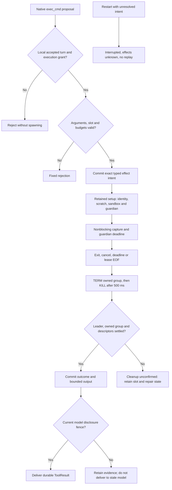
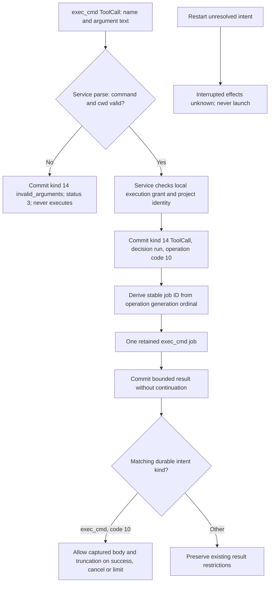
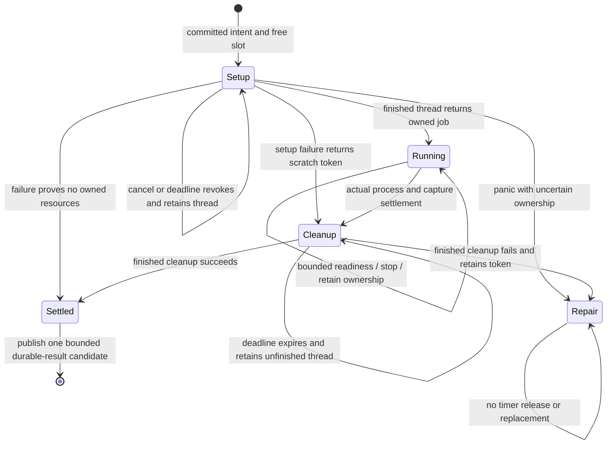
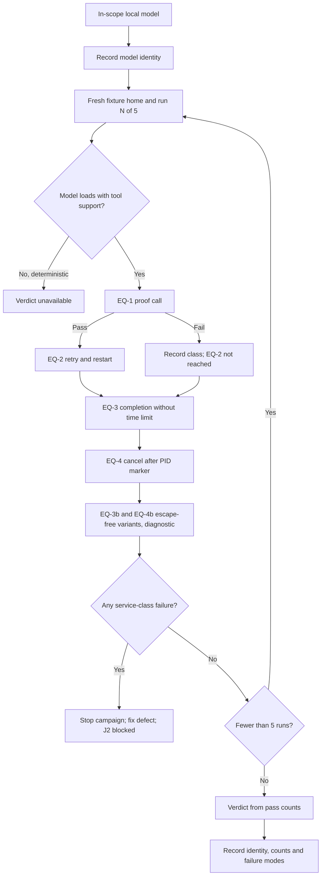

# Bounded noninteractive exec_cmd tool

Status: implemented, with scoped native process and system-model validation on
2026-09-28. The evidence below defines the verified scope. Protocol numbering
remains 0.1 and journal format remains 1. The proposed
[tool job controller](tool-job-controller.md) would run shell commands as
conversation-scoped jobs; until it is implemented, this contract governs.
Tool job packet J1 removes this contract's command timeout and 2-second setup
budget (J1-Q3, J1-Q4, owner, 2026-10-15): a command runs until it ends, the turn
is cancelled or the service shuts down; see
[J1 timeout and setup budget removal](tool-job-controller.md#j1-timeout-and-setup-budget-removal).
Current contract (owner, 2026-10-17): the tool schema has no `timeout_seconds`
argument (model ExecCmd field 3 is reserved). The guardian has no numeric deadline
mode, and status reason 1 (`timeout`) is unassigned. Since 2026-10-18 the durable
intent of every exec_cmd call is the kind 14 `ToolCall` record of
[tool call records](tool-call-records.md): operation code 10, the redacted
argument text holding the rewritten command and cwd, and the decision. Kind 22
ExecCmdIntent is retired (replay returns `UnsupportedFormat`). A kind 14 with
decision `run` is settled by kind 23 and then kind 15. The timeout, setup-budget and kind-16
intent text below records the earlier implemented contract.

Renamed from `shell` to `exec_cmd` (owner, 2026-10-17). Names only; field
numbers, record kinds and formats are unchanged. Model ToolCall field 19, tool
kind 16, record kinds 14, 22 and 23, and audit tool value 9 keep their numbers.

## Scope and existing owners

Expose one native model tool named `exec_cmd`. It runs one noninteractive command
with `/bin/sh -c`, closed stdin, separate bounded stdout/stderr capture and an
explicit exit outcome. It creates no interactive session, PTY, Send/Read interface,
terminal pane, remote delegation or automatic command retry.

The inspected Wisp owners are `WispCore/Tools/RunCommandTool.swift` and
`WispCore/Exec/{CommandRunner,CommandPolicy}.swift`. Reuse their useful command/result
shape, not their default network permission, broad caches or unbounded output
accumulation. Wisp source inspection is not Asura runtime evidence.

| Canonical owner | Responsibility |
| --- | --- |
| Service tool registry and conversation owner | Schema, execution grant, admission, budgets, durable intent/result, cancellation and model delivery |
| Platform process support | Verified descriptors and identities, spawn, sandbox, owned process group, lease guardian, readiness and reap |
| Existing authority writer | Typed exec_cmd intent and result, duplicate detection and recovery projection |
| Swift native tool adapters | Typed arguments and existing service callback only |
| Existing service reactor | Fair readiness dispatch and deadlines; no blocking process or filesystem calls |

Extend `asura-platform` using `startup.rs` checked spawn/file actions,
`model_process.rs` nonblocking pipe/reap patterns, `project_identity.rs` identity
checks, `lifetime.rs` private lease pattern and `git_observer.rs` mandatory sandbox
construction. Those components are reusable primitives; none currently implements
an exec_cmd guardian. Do not copy a complete model owner or add a generic orchestrator.

## Arguments, results and limits

| Argument | Contract |
| --- | --- |
| `command` | Required string, 1–8192 UTF-8 bytes, no NUL; exact bytes passed as the single argument after `-c`. From J3 the service parser also rejects every other control character except tab and newline with fault 14 `invalid_text` ([exec_cmd as a job](tool-job-controller.md#exec_cmd-as-a-job)). When the [secret detection](secret-detection.md#environment-path) rewrite created secret variables, the argument is the guardian's fixed preamble followed by the rewritten command (owner, 2026-10-15). |
| `cwd` | Optional project-relative directory, at most 1024 UTF-8 bytes; absent or `.` means project root; reject absolute paths, NUL and parent traversal |
| `timeout_seconds` | Removed (owner, 2026-10-17). The command has no time limit; it ends on exit, turn cancel or shutdown |

Preserve command bytes without quoting, interpolation or rewriting by another
shell. The shell itself interprets them. Reject invalid native arguments before
spawn; bounded semantic rejections follow the existing rejected-tool path. Private
wire fields require presence and strict unknown-field/direction validation. Root
allocates free schema/tool-kind fields at integration; do not reuse inventory,
audit or pending Memory create allocations.

The existing 200-call turn limit and 16 KiB per-result limit apply (owner,
2026-10-18; [tool call records](tool-call-records.md)). One exec_cmd
job may be live service-wide. It occupies the existing retained tool slot through
setup, execution and cleanup; a second proposal gets Busy. No unbounded pending
exec_cmd queue is introduced.

The exec_cmd replaces the ordinary two-second execution allowance with this explicit
budget: setup has at most 2 seconds; command runtime is at most the selected
timeout, independent of turn age; cleanup has at most 2.5 seconds before it becomes
unconfirmed. Unsettled cleanup may remain retained beyond the command deadline;
it cannot authorize new effects. Authority journal work retains its existing
deadlines.
A timeout is not evidence that execution did not occur.

Capture raw stdout and stderr in separate 8 KiB tail rings,16 KiB total. Track
saturating received-byte counts and whether earlier bytes were overwritten. Drain
at most 16 KiB across both descriptors per reactor dispatch, alternating streams.
Readiness reschedules remaining work without an unconditional poll loop. After a
combined 64 MiB of output, terminate with output_limit; memory must never grow with
cumulative output. Closed stdin is `/dev/null`, not an unconsumed pipe.

Return a fixed textual envelope with outcome, optional exit_code or signal,
stdout_truncated, stderr_truncated, cleanup state, and labelled stdout/stderr.
Keep each rendered stream at most 6144 UTF-8 bytes, taken from the most recent end
of its tail ring so the latest output survives, and fixed metadata at most 512
bytes; the complete ToolResult remains below 16384 bytes. Sanitize terminal escape
and control bytes before text rendering; preserve newline/tab and replace invalid
UTF-8 explicitly. A bounded streaming sanitizer must not retain an unbounded
unfinished escape sequence. Tail loss, replacement or rendering truncation sets
truncated. A result never contains a continuation offset.

A normal nonzero exit is a successfully executed tool with an explicit exit code;
it is not a service failure. Timeout, cancellation and output-limit outcomes map
to the corresponding existing ToolStatus and include bounded captured output under
the exec-cmd-specific durable result contract. Missing sandbox, invalid identity,
spawn failure and absent grant return fixed failure codes without fabricated exit
status. A signalled leader records the signal, not a guessed exit code.

## Authority and confinement

An admitted foreground user turn in a registered project receives a separate
`execute_authorized` grant under this selected exec_cmd policy. This is not derived
from `read_authorized`. Its immutable snapshot binds installation, project identity,
turn operation and generation. Unaccepted input, observations, classifiers,
background reconciliation and remote delegates receive no execution grant.

Only local model providers may propose exec_cmd calls. Apply the existing
supported/enabled native-tool intersection and local destination fence. The verified
local Ollama fence remains mandatory. A registered exec_cmd entry is not evidence
that a provider can call it successfully. EX10 (owner, 2026-10-14) keeps exec_cmd
offered to every local tool-capable model, qualified or not; the
[per-model qualification](#per-model-exec_cmd-qualification-ex10) records which
models call it correctly.

Recheck grant, owner generation, cancellation, project registration and retained
project identity immediately before effect submission. The exec_cmd model cannot
choose another project, environment, executable shell, network policy or write root.
Resolve cwd relative to a retained project directory with no symlink traversal;
check the selected directory identity at spawn. A pathname/cwd check is not the
filesystem access boundary.

The mandatory OS sandbox permits writes only inside the admitted project and a
new private per-job scratch directory below the existing Asura tmp owner. It denies
network access by default, including loopback. It denies reads of account data,
Asura configuration/journals/model assets, personal credentials and other projects
unless those paths are deliberately inside the registered project itself. Do not
claim secret detection inside the user's project. Retained directory/identity
checks prevent a substituted project root from silently widening the grant.

Start with read/execute access to the project, scratch and fixed system executable/
runtime roots needed by `/bin/sh` and ordinary system utilities. System roots are
`/bin`, `/usr/bin`, `/sbin`, `/usr/sbin`, `/usr/lib`, `/usr/share`, `/System` and the
selected system developer directory after validation. Do not grant the whole home,
`/private/var`, arbitrary build caches or all of `/Applications`. Exact Seatbelt
operations and developer-runtime exceptions must be backed by installed-platform
source and real process tests. Missing required support fails closed, with no
unsandboxed fallback or automatic download. Toolchain/cache access outside this
contract requires a subsequent scoped design refinement.

Use a fixed environment: PATH=/usr/bin:/bin:/usr/sbin:/sbin, LC_ALL=C,
LANG=C, HOME and TMPDIR set to private scratch. Unset ENV, BASH_ENV, shell functions,
DYLD variables, service credentials and all inherited variables not on this list.
Do not source personal startup files. Close every inherited descriptor except the
specified stdin/stdout/stderr and guardian-private control endpoints; shell children
must never inherit the service lease writer, service socket, authority descriptors
or guardian status channel. File creation uses umask 077. Scratch is 0700.

## Guardian, process ownership and cleanup

Use a private guardian mode in the packaged Asura executable, selected only by
inherited validated descriptors, not a public CLI feature. The service spawns the
guardian through checked platform actions. The guardian owns the command leader,
its process group and the sole wait/reap responsibility. It remains outside the
command's confined group and receives one inherited lease read endpoint. The service
holds its sole writer; EOF requests cleanup even after abrupt service death.
The hard monotonic job deadline that lived in the guardian was removed (J1-Q3; owner,
2026-10-17); jobs have no lifetime. From J2 the lease also carries the stop bytes `T` and
`K` ([guardian contract additions](tool-job-controller.md#guardian-contract-additions)).

Setup and filesystem operations run in one retained platform setup worker, with a
two-second logical deadline and cancellation checks. Never start a replacement
worker before actual settlement. Steady-state pipe and guardian status readiness
feed the existing reactor through nonblocking descriptors. The guardian uses bounded
readiness/timers and a fixed 192-byte maximum status receive buffer; no generic RPC
server, command dispatcher or model access is added.

On cancellation, expiry, steering, generation invalidation, turn end, output limit
or lease EOF: send TERM to the owned group immediately, then KILL after 500 ms if
needed. Also perform this cleanup when the leader exits but group members or pipe
writers remain. Reaping the leader does not finish cleanup. Wait up to 2 further
seconds for owned-group settlement and descriptor EOF. All group signals use the
still-owned group identity; do not rediscover targets by executable name or a
persisted PID after restart. Retain ownership until signal/reap races are resolved. The installed macOS SDK
exposes waitid/WNOWAIT and proc_listpids/PROC_PGRP_ONLY. The platform packet must
retain the exited leader as a waitable child while signalling/checking its group,
then reap it last. Bound each group-membership inspection to 256 PIDs; overflow or
an unverifiable result means cleanup_unconfirmed. Never send another group signal
after releasing the leader PID fence. Qualify this ordering with actual process
races; header availability alone is not runtime proof.

Report `owned_group_settled` only after the direct leader is reaped, the guardian's
owned group is gone and capture/status descriptors have settled. A bounded cleanup
deadline produces `cleanup_unconfirmed`, retains the slot and prevents replacement
execution. The reactor stays responsive and enters its existing repair/drain path.
A later real settlement may release resources but never changes an unknown command
outcome into proof it had no effects. Root shutdown must keep its owner lock while
its guardian/setup ownership is unsettled.

**Selected engineering boundary:** process groups are not complete descendant
containment. A command can deliberately change session/group or double-fork and
close inherited pipes. The inspected platform has no verified Seatbelt operation
that prevents every such escape (confirmed on macOS 27: `process-setsid` and
`process-setpgid` are not Seatbelt operations). This first runner supports
cooperative build/test commands and guarantees its owned-group cleanup only. If
an escape is observed, report cleanup_unconfirmed. An undetected escaped
descendant is a documented limit; never claim all descendants are absent. For
sandboxed jobs, the [escapee control design](escapee-control.md) (EX5,
2026-10-20) supersedes this limit: it attributes a job's descendants
with a per-job `sandbox_check` marker, terminates them freeze-then-kill, and
gates cleanup confirmation on a zero-descendant scan. It is implemented for the
model exec_cmd path (2026-10-21; see its
[implementation evidence](escapee-control.md#implementation-evidence-2026-10-21)).
The `!!` profile keeps a reduced residual under EXD-1. The guardian protects against service death,
not a malicious same-user actor killing the guardian. Do not invent unsupported
sandbox operations to hide this limit or add a repeated approval gate.

Scratch deletion runs in the retained cleanup owner only after known ownership
settles. An observed escape or uncertain cleanup retains scratch and its identity
for repair; it does not recursively delete paths still in use. Ordinary successful
cleanup removes only validated private job entries. Unknown/kernel-stalled cleanup
retains ownership; a timer never authorizes deletion or owner-lock release.

## Durable intent, result and restart

Commit a typed exec_cmd intent before launching the guardian. It binds operation,
generation, ordinal, project, a stable service-derived job ID, command/cwd digest,
requested/effective timeout and the grant/project identity snapshot. Store bounded
command/cwd data only where the existing private authority retention contract needs
exact duplicate comparison; never put them in audit metadata or diagnostic logs.
The implementation packet must select the exact journal encoding before writing it.

A duplicate live call with identical bytes returns its existing pending/result
state; changed arguments under the same call identity conflict. No retry may spawn
another command. Commit the typed result only after its actual execution/cleanup
outcome is known. Result persistence failure keeps the effect unconfirmed and never
causes another spawn. Delivery to a model also requires current disclosure fences.

On restart, an unresolved exec_cmd intent becomes interrupted/outcome-unconfirmed;
it is never automatically executed again. The old guardian reacts to lease EOF.
Do not reattach or signal by journaled PID. An interrupted result must say effects
may have occurred. A newly started service must not assert old process-tree absence
merely because it acquired the service lock; lease cleanup and the stated descendant
boundary remain separate evidence. Do not promise rollback of files or child effects.

## Concrete platform packet

The owner approved the narrow cleanup helper after the process-supervisor rule was
identified. The Rust rule permits this private lease helper within the existing
platform process owner. It adds no service lifecycle, generic supervisor, daemon,
public shell command or independent policy owner.

### Shared platform interface

Add `asura-platform::exec_cmd` and a narrow module export. The root agent owns private
CLI routing and service integration. `PreparedExecCmd::prepare` runs on the retained
setup worker. Inputs are the validated RuntimeDirectory, retained project identity,
bounded command/cwd, job ID, absolute monotonic deadline and current executable.
It validates/pins cwd, creates private scratch and capture/lease/status pipes, and
returns the prepared owned descriptors. No command is started during preparation.
`PreparedExecCmd::spawn` performs the final identity/cancellation/deadline check and
starts the private guardian through existing checked spawn actions.

`ExecCmdJob` owns the guardian PID, sole lease writer, nonblocking stdout/stderr/status
readers, capture rings and cleanup state. It exposes readiness interests,
`poll(now)`, `next_deadline()`, `stop(reason)`, `result()` and `settled()`. Root retains
this object in the active turn until actual settlement. The existing service has
one active turn; a retained exec_cmd setup/cleanup worker extends that owner. The
file-read executor does not execute commands. Filesystem preparation/deletion remains in
retained workers; poll performs only bounded nonblocking reads, status parsing and
WNOHANG reap. It must not unlink scratch, read directories or block in Drop. After process
settlement, transfer the private scratch cleanup token to a retained cleanup
worker; that worker alone calls the blocking validated cleanup operation.

The guardian entrypoint is `run_guardian` in this same platform module. Root's CLI
recognizes only the fixed private marker `--asura-exec-cmd-guardian` followed by job ID
and command as separate argv elements (the deadline argument was removed on 2026-10-17).
J2 inserts a profile token, `model-1`, between them
([guardian contract additions](tool-job-controller.md#guardian-contract-additions)).
The parser never joins/reinterprets argv. Command size remains 8192 bytes; the total
private argv payload is at most 8704 bytes. No user-supplied executable/profile/env
is accepted. The validated inherited descriptors, not the marker or argv, authorize
this entrypoint. A normal invocation without all private descriptors fails closed.

### Descriptor and notice contract

The service maps only these descriptors into the guardian, with exact type/access
validation before taking ownership:

| FD | Meaning |
| --- | --- |
| 0,1,2 | `/dev/null` for guardian input/output; no user terminal |
| 3 | Read-only nonblocking lease pipe |
| 4 | Write-only nonblocking status pipe |
| 5,6 | Write-only stdout/stderr capture pipes |
| 7 | Read-only admitted project directory |
| 8 | Read-only validated cwd directory |
| 9 | Read-only private scratch directory |

Validate directory owner/mode/identity using existing platform rules. Project and
cwd may be the same retained directory. The service retains matching directory
identities; the guardian derives OS paths from descriptors and revalidates them
immediately before compiling the sandbox and spawning. Reject mismatched types,
access modes, symlinks, unexpected data on the lease or invalid job/deadline args.
A lease is never cloned or inherited by the command. Close all guardian-only FDs
in the command's posix_spawn actions. Command receives only 0=/dev/null,1=capture 5,
2=capture 6. Guardian stdout/stderr never contain command or provider data.

Use a fixed 32-byte native startup/status notice, following the existing bounded
StartupNotice primitive. This is not a public control envelope and introduces no
new version number or RPC service. Encoding is exactly:

| Bytes | Meaning |
| --- | --- |
| 0–3 | ASCII `ASSH` |
| 4 | Kind:1 spawned,2 settled,3 setup_failed,4 cleanup_unconfirmed,5 leader_exited (J2),6 escapee_report ([escapee control](escapee-control.md#guardian-status-notice-extensions)) |
| 5 | Reason:0 none,1 unassigned (former timeout, removed 2026-10-17),2 cancel (lease byte `T`, J2),3 output_limit (unassigned in J2),4 lease_ended,5 spawn_failed,6 sandbox_unavailable,7 identity_invalid,8 protocol_fault,9 cleanup_failed,11 kill (lease byte `K`, J2),12 escapee_terminated (kind 2),13 escapee_unterminated (kind 4) |
| 6 | Exit kind:0 absent,1 exit_code,2 signal |
| 7 | Cleanup:0 unconfirmed,1 owned_group_settled |
| 8–23 | Exact nonzero 16-byte job ID |
| 24–27 | Big-endian u32 exit/signal value; zero when absent |
| 28–31 | Reserved, all zero |

At most five notices are accepted; buffer at most 192 bytes. Spawned has absent
exit, none reason and unconfirmed cleanup. Setup_failed has absent exit, a fixed
failure reason and settled cleanup only if no command exists. Settled has an exit
code 0–255 or signal 1–127 and settled cleanup. Cleanup_unconfirmed never sets the
settled bit. Escapee_report carries the escapee count in bytes 24–27; the
[escapee control design](escapee-control.md#guardian-status-notice-extensions)
fixes its order rules. Unknown values, changed job IDs, duplicate/out-of-order notices,
trailing bytes and partial EOF are protocol faults that initiate cleanup; they
never prove absence of an effect. The sole writer emits at most 160 bytes total into an initially empty private
pipe. This is below the POSIX minimum PIPE_BUF of 512 bytes, so valid notices
cannot fill the pipe even if the service never reads. An unexpected WouldBlock
is a protocol fault that triggers retained cleanup; there is no retry queue. The service must
observe guardian exit and pipe EOF as well as a valid settled notice.

Superseded (J1-Q3; owner, 2026-10-17): the absolute command expiry below no longer
exists; the guardian keeps only its 100 ms poll and the wind-down bounds. The text records
the earlier contract. The guardian and service used platform CLOCK_MONOTONIC nanoseconds for the absolute
command expiry, rejecting overflow, expired values or more than 60 seconds remaining.
No wall clock or cross-process serialization of Rust Instant is used. Root fixes
the deadline before committing the intent, after reserving cleanup inside the
current turn. A delayed intent acknowledgement never resets or extends it. Guardian rechecks it
before spawn and independently while waiting. The guardian checks readiness or its
next deadline at least every 100 ms; it never waits indefinitely for a status write.

### Exact sandbox baseline

Generate the profile from retained validated OS paths using the existing strict
Seatbelt string quoting helper. Never interpolate command text into a profile.
Launch `/usr/bin/sandbox-exec -p PROFILE /bin/sh -c COMMAND`; absence or profile
rejection is a bounded failure, never an unsandboxed retry.

The compiled baseline is `(version 1) (deny default)`, with only process-fork,
process-exec and file-map-executable filtered to the fixed system roots/project/scratch, file-read* filtered
to the same runtime roots, file-write* filtered to project/scratch, sysctl-read,
and literal `/` directory read/test-existence for dyld bootstrap,
and literal `/private/var/select/sh` read for the system-owned `/bin/sh`
selector (installed root-owned symlink to `/bin/bash`), with metadata access
to its three ancestors only, and explicit `/dev/null` read/write plus `/dev/random` and `/dev/urandom` read.
No network operation, unrestricted mach-lookup, no-sandbox exec, home/cache wildcard
or preference-write exception is granted. Inherited output pipes are the only
output channels. Include metadata traversal of ancestor directories only where
required for the selected roots; this does not grant their file contents. The
literal root-directory read exception is required by macOS 27 libignition to
open `/` as its openat root, as documented in the installed dyld-support.sb.
It is not a subpath grant and does not expose other file contents.

Set private umask 077 before spawning. Use only the environment and roots fixed
above. Sandbox denial may make unsupported developer tools fail normally; do not
broaden access until a concrete runtime requirement is reviewed. Qualification
must prove allowed writes and denied outside writes/network with actual children;
profile syntax or inspection alone is not proof of enforcement.

The implementation must qualify installed spawn/group/sandbox behavior before
native model activation. Failed qualification keeps exec_cmd unavailable and reports
the concrete limitation; it does not add another supervisor or approval mechanism.

## Implementation packets and required evidence

This document fixes public behavior and authority. Root reviews the concrete
platform guardian handshake/status schema, exact sandbox profile and journal
encoding before their code. Routine implementation refinement is already authorized.

1. Platform packet: checked guardian spawn/lease, confined command spawn, process
   group state, pipes, bounded capture, deadlines and cleanup. Reuse existing
   primitives and assign any internal executable-mode routing explicitly.
2. Service/storage packet: execution grant, typed intent/result, duplicate/restart
   projection, exec_cmd slot and existing reactor integration. Do not put process
   execution in the file-read worker or create a second conversation loop.
3. Model packet: one canonical registry entry and native schemas through the existing
   service callback across qualified local providers; no direct Swift process calls.

SH-U1: exact argument and wire bounds; timeout arithmetic including cleanup reserve;
separate execution grant; local destination denial; duplicate versus changed call;
ring wrap, stream fairness, invalid UTF-8 and bounded escape sanitization; fixed
result size and truncation; syscall/error and guardian-state transition fixtures.

SH-I1: real scratch commands return separate stdout/stderr and exact zero/nonzero
exit status; stdin is EOF; shell has only the selected environment; project/scratch
writes work and outside writes/network fail. Test symlink and project replacement,
missing sandbox, blocked setup, inherited-descriptor absence, output flood/limit,
TERM-resistant leader and ordinary grandchildren remaining after leader exit.

SH-I2: kill the service after spawn; guardian observes EOF, terminates the ordinary
owned group and exits. Inject failure before intent, before spawn, after spawn,
after exit and before result acknowledgement. Verify no repeated side effect, no
PID-based restart reattachment, explicit unconfirmed outcome, retained cleanup slot
and responsiveness of status/input/cancel under stalled setup or reap.

SH-I3: deliberately escaped-session fixture documents the owned-group limit; for
sandboxed jobs the [escapee control](escapee-control.md#validation) cases
EC-I1–EC-I8 replace that limit with detection and termination. The
test parent explicitly owns and cleans this fixture; it must never leave a daemon.
Do not turn a group-empty assertion into an all-descendant claim. Prove ordinary
owned children absent before scratch deletion and test cleanup-unconfirmed retention.

SH-E1: isolated real service and qualified local model executes a command producing
a unique scratch proof, reports exact exit/output, and demonstrates one durable
intent/result and one effect despite response retry. Verify denial without execution
grant and a real cancel/deadline journey. Root stops/reaps every test child and
reports each provider separately; mocked callbacks do not qualify native inference.
The command deadline was removed on 2026-10-17. The
[per-model qualification](#per-model-exec_cmd-qualification-ex10) defines the
current SH-E1 cases, run count and evidence record for each local model.

## Model wire packet

Model ToolCall field 19 is ExecCmd. ExecCmd fields are required command string 1
and optional cwd string 2. Field 3, the earlier `timeout_seconds`, is removed and
reserved (owner, 2026-10-17). Command is
1–8192 UTF-8 bytes with no NUL. Present cwd is 1–1024 UTF-8 bytes, must be relative,
has no NUL or parent (`..`) component; `.` means the project root. Rust and Swift
strict codecs reject missing command, invalid bounds, forbidden cwd, unknown nested
fields and wrong direction before any effect. The native exec_cmd function has an
optional cwd argument and no timeout argument. It never executes a process in Swift.

The shared private ToolResult permits bounded text and truncation on failure,
but never a continuation offset on failure. The service's durable result owner
permits nonempty failed text/truncation only for a matching exec_cmd intent; other
tool policies remain unchanged. exec_cmd's Swift adapter renders the fixed status
plus bounded service-owned body on failure so cancel/output-limit evidence remains
visible. Other adapters retain their existing failed-result rendering. No new wire
fields or version increment are needed.

SH-U1 includes both-language valid/default/max and missing/zero/oversized/NUL/
traversal/wrong-direction/unknown-field fixtures. Swift adapter tests prove optional
argument defaulting and failure-output delivery through the service callback,
including cancellation and duplicate callback tests for all existing local backend
selectors. Native execution qualification remains SH-E1.

## Durable encoding packet

Superseded (owner, 2026-10-17, and 2026-10-18): the durable intent of an
exec_cmd call is the kind 14 `ToolCall` record of
[tool call records](tool-call-records.md#record-kind-14-toolcall) with
operation code 10; kind 23 settles a call with decision `run` under the
[J1 records](tool-job-controller.md#j1-records-kinds-14-and-23). The old kind 14
`ToolIntent` layout with tool kind 16 and kind 22 `ExecCmdIntent` are retired.
The text below records the earlier encoding.

ToolIntent kind 16 uses the unchanged record layout. Its path contains the exact
command (1–8192 UTF-8 bytes, no NUL), one NUL delimiter, then cwd (1–1024 UTF-8
bytes). Absent cwd normalizes to `.`. Reject NUL, absolute paths and any `..`
component; permit `./subdir`, repeated separators and trailing separators. The
combined payload is at most 9217 bytes. Existing tool kinds retain their 1024-byte
path bound. The platform walks relative descriptors without rewriting the stored
command/cwd bytes or widening the grant.

Offset stores effective runtime milliseconds 1–60000, no greater than limit*1000.
Limit stores requested seconds 1–60, default 30. Existing accepted turn, registered
project and owner records identify the admitted grant. A committed typed exec_cmd
intent is the durable evidence of the canonical service authorization check, never
a restart execution grant. Derive job ID from the first 16 SHA-256 bytes of ASCII
`asura.exec_cmd.job`, one zero byte, operation 16 bytes, generation big-endian u64 and
ordinal big-endian u32. Only if all 16 result bytes are zero, set the final byte to 1.
The exact payload digest is derivable; do not store a duplicate snapshot.

ToolResult layout is unchanged. Structural decode permits truncation for statuses
5,6,7 because the result has no tool kind. Replay permits this only for kind 16,
with no continuation offset. Denied/invalid/unavailable statuses 2,3,4 cannot have
truncation or continuation. Preserve every other tool's result restriction.
exec_cmd body is at most 16384 bytes; there is no per-turn aggregate result limit
(owner, 2026-10-18). An
unresolved intent on restart remains interrupted with effects unknown. Never replay
it automatically or infer rollback from a missing result.

SH-DU1 covers minimum/maximum command/cwd lengths, one NUL delimiter, UTF-8 byte
bounds, traversal/absolute rejection, timeout relation, nonzero IDs, old path bounds
and exact round-trip layout. Job ID tests use fixed vectors, deterministic results
and changes to each input.
SH-DI1 uses real journal replay with an accepted/helper-started turn. It covers
captured timeout/cancel/limit, forbidden continuation, unchanged other-tool rules,
changed arguments under one identity, unresolved owner-restart intent and 16 KiB
per-result bounds. Native no-duplicate effect and cleanup remain SH-I2/E1 service
and platform evidence; codec tests cannot prove them.

### Retained service wrapper and cleanup bounds

Scratch deletion uses retained descriptors, never follows symlinks, and permits
at most 4096 visited entries and 32 directory levels per cleanup attempt. Every
iteration checks cancellation and its absolute deadline. An exhausted bound retains
the cleanup token. No Drop implementation waits, joins, or deletes files.

All fallible guardian spawn preparation precedes posix_spawn. Once spawn succeeds,
the platform always returns the owned ExecCmdJob, including a concurrent cancellation.
A failed preparation returns ExecCmdFailure with its optional retained scratch token.
A poll failure retains the job and initiates lease closure; it never loses process
ownership. Deterministic wrapper tests hold setup/cleanup workers and verify reactor
responsiveness, busy admission, cancellation, late settlement and wake ordering.

## Service wrapper packet

Superseded in part: J1 removed the setup deadline (J1-Q4) and the absolute command
deadline (J1-Q3), and J2 replaces the Repair stage with `CleanupUnconfirmed` for jobs
([J2](tool-job-controller.md#cleanupunconfirmed-and-late-settlement)). The text records the
earlier contract. The service `exec_cmd_worker` owns one retained stage: Setup, Running, Cleanup or
Repair. Setup runs in one thread with a two-second logical deadline. It resolves
the current executable, opens the admitted project and rechecks device/inode,
then calls platform prepare/spawn. The absolute command deadline was fixed before
intent commit; setup and delayed acknowledgement never extend it. Cancellation
revokes setup through its atomic token but does not release the thread slot. A
late returned job receives the pending stop request immediately.

The existing reactor joins only finished threads. A completion guard wakes that
reactor on return or unwind. While Running, the wrapper exposes platform readiness
interests and bounded nonblocking poll calls. It does not perform filesystem
operations there. A platform poll error stops the retained job; it cannot discard
process ownership. A panic with uncertain resources enters Repair.

After platform settlement, the wrapper takes the scratch cleanup token and moves
it to one cleanup thread. The cleanup thread returns both its result and the token.
Successful cleanup permits one ToolResult publication; a failure retains the token
in Repair. Cleanup has a 2.5-second logical deadline. Deadline expiry reports repair
without releasing ownership or starting a replacement. No automatic retry is
selected. A completed failure has no repeating immediate timer. Late successful
cleanup may settle resources, but cannot prove that execution had no effects.

SH-WU1 uses deterministic blocked setup/cleanup fixtures to prove nonblocking poll,
busy admission, deadline cancellation, retained slots and wake-before-thread-exit
ordering. It checks late settlement and failed cleanup without replacement or a
busy timer. These tests do not qualify sandbox execution; SH-I1/I2/E1 remain the
real process and service proof requirements.

## Implementation evidence, 2026-09-28

The platform command owner, retained service worker, durable kind-16 records and
shared native model adapter are integrated. The private cleanup helper is covered
by the owner-approved Rust instruction exception.

- Twelve platform unit tests pass, including lost PID ownership, repeated clock
  failure, replaced project/cwd, strict notices, bounded capture and failed setup.
- The native process harness passes: separate output, nonzero exit, stdin EOF,
  fixed environment, project writes, outside-write and live loopback denial,
  closed private descriptors, deadline/cancellation, TERM resistance, grandchildren,
  output flood, deliberate session escape and parent-exit lease cleanup.
- The real system-model journey passes: exact scratch proof and command record,
  one effect through request retry and restart, timeout/cancel output and independent
  owned-group absence checks. Its service is stopped and reaped.
- The shared contract suites pass: 42 Rust control tests and 57 Swift tests,
  including exported cross-language fixtures and local-adapter callback paths.
- Storage encoding/replay and service grant/worker tests pass. The complete CLI/TUI
  lifecycle harness passes after the audit startup ordering correction.

The escaped-session test demonstrates the documented containment limit; the test
waits for its deliberately escaped process to exit. It does not prove that the
cleanup helper can find arbitrary escaped descendants. Native exec_cmd inference is
qualified for the system model only. Other local adapters remain separately
unqualified for this new tool. No cloud execution is enabled.

### Turn expiry removal — selected 2026-09-30

The [cancellation-driven turn policy](model-provider-integration.md#cancellation-driven-turn-lifetime--selected-2026-09-30)
replaces reduction by a remaining whole-turn duration. A validated exec_cmd request
retains its own 1–60 second duration, default 30. exec_cmd cancellation, cleanup,
process-group enforcement and recovery contracts remain unchanged.

### Threat model review decisions — 2026-10-14

The owner reviewed the [execution threat model](execution-threat-model.md#owner-decisions)
on 2026-10-14 and 2026-10-15. These decisions change this contract. Their
mechanisms need design before code.

- **EX3, developer folder (owner, 2026-10-14).** The model profile must allow
  reads of the selected system developer directory listed in
  [authority and confinement](#authority-and-confinement), so the model can run
  Git. The current profile omits it, and `git init` fails (probe EX-V1,
  2026-10-14). This widens reads to the Xcode toolchain. The directory must be
  resolved and validated as that section requires, and any further Seatbelt
  operation Git needs must be backed by a real process test (threat model
  EX-V11). Ancestor-directory metadata visibility is recorded as a known minor
  leak.
- **EX10, qualification of other providers (owner, 2026-10-14).** exec_cmd stays
  offered to local tool-capable providers. Each needs SH-E1-style
  qualification, reported separately: CoreAI, MLX and Ollama models. This is a
  prerequisite of [tool job](tool-job-controller.md#delivery-dependencies)
  packet J2.
- **EX4 and EX5.** Secret filtering at capture with per-execution command
  secret variables (EX4, owner 2026-10-15) changes this design's fixed
  environment and result text. Escapee detection and termination (EX5, owner
  2026-10-14) replaces the documented escape limit above. Both are recorded in
  the threat model and the job controller and need follow-up designs.

## Per-model exec_cmd qualification (EX10)

Status: selected procedure, 2026-10-20, under owner decision EX10 (2026-10-14).
The cases, model identity, failure classes, evidence record and journey changes
are selected. EXQ-2 to EXQ-5 are settled under existing rules (see
[decisions](#qualification-decisions)). The verdict threshold (EXQ-1) is
5 of 5 (owner, 2026-10-21). Results are recorded in
[qualification results](#qualification-results-2026-10-20).

### Scope and consequence

EX10 requires SH-E1-style qualification of each local tool-capable provider
(CoreAI, MLX and Ollama) before tool job packet J2. A provider contains many
models, and one model's result does not qualify another (MP2-L4 in
[model provider integration](model-provider-integration.md#mp2-provider-validation)).
The unit of qualification is therefore one model identity, and the provider
result is the set of its model results.

A model is in scope when the helper offers it native tools:

| Provider | In scope when |
| --- | --- |
| Ollama | `/api/show` lists `completion` and `tools`, and the daemon is on a loopback endpoint |
| MLX | The loaded configuration has a native `toolCallFormat`, and the model declaration lists `toolCalling` |
| CoreAI | The bundle loads and its native capabilities include tool calling |
| System | Reference baseline only; it was qualified on 2026-09-28 and is rerun at the same commit to separate model failures from journey defects |

Required behavior (EX10): exec_cmd stays offered to every local tool-capable
model, whatever its verdict. This design adds no runtime gate, allow-list or
configuration switch. A verdict is recorded evidence for the person and for J2.
Remote providers stay out of scope: exec_cmd is denied for remote destinations.

Non-goals: prompt-injection behavior (threat model EX-V4), escapee detection
(EX5), downloads of models, and changes to the Ollama daemon. A missing local
model is recorded as a gap, not downloaded.

### Model identity

A verdict applies only to the recorded identity. Each record names:

| Provider | Selector in the journey | Version identity |
| --- | --- | --- |
| Ollama | `ollama:NAME:TAG` through `ASURA_TEST_OLLAMA_MODEL` | Daemon version, 12-hex model ID from `ollama list`, reported context window |
| MLX | `mlx:native-fixture`, copied from `ASURA_TEST_MLX_ASSET` | Source repository and snapshot revision; otherwise the first 16 hex of the SHA-256 of `config.json` |
| CoreAI | `coreai:native-fixture`, copied from `ASURA_TEST_COREAI_ASSET` | Metadata `name`, first 16 hex of `main.hash`, `max_context_length` |
| All | — | Asura commit, `asura-model` SHA-256, macOS build |

A new identity needs a new campaign. These changes also void earlier verdicts
for the affected models: a change to the helper's tool path or provider
adapter, a change to the exec_cmd schema or tool instructions, or a change to a
provider dependency pin.

### Cases

Every case runs through the real service, the real helper and the real model in
an isolated fixture home. The person-facing control surface is the service
control API that the CLI uses. Mocked callbacks do not qualify a model.

**EQ-1 Proof call.**
- Initial state: fresh fixture home, model selected, a registered scratch
  project whose `proof.txt` holds a random 128-bit token.
- Trigger: a queued prompt asks for exactly one exec_cmd call with the fixed
  command `printf x >> effect.txt; cat proof.txt; printf stderr-proof >&2` and
  cwd `.`, then a reply that contains only the token.
- Required result: the turn completes; the answer contains the token; the turn
  lists one exec_cmd with status 1; `effect.txt` is exactly `x`. The journal holds
  one kind 14 call with decision `run`, the exact command and cwd absent or `.`.
  Its result has status 1, the envelope prefix `exit_code=0 ... cleanup_confirmed=true`,
  the token on stdout, `stderr-proof` on stderr, no truncation, at most 16,384
  bytes and no continuation.

**EQ-2 Retry and restart.**
- Initial state: EQ-1 passed.
- Trigger: the same queue request is sent again; the service restarts; the request
  is sent a third time.
- Required result: each send returns the same accepted input and operation. The
  observation after restart equals the first one, apart from live elapsed times,
  which are absent. `effect.txt` stays `x`. The replayed durable result is equal.

**EQ-3 Completion without a time limit.**
- Initial state: service running, same project.
- Trigger: a prompt asks for one exec_cmd call of a command that prints
  `partial-output`, writes its shell PID to `complete.pid`, sleeps 3 seconds and
  writes `complete.pid.late`.
- Required result: the turn completes; the recorded command is exact; the result
  has status 1, `reason=none`, `cleanup_confirmed=true` and `partial-output`. The
  late marker exists. A read-only `kill -0` probe finds the process group absent.

**EQ-4 Cancel.**
- Initial state: service running, same project.
- Trigger: the same command with `cancel.pid` and a 30-second sleep. The journey
  cancels the turn after `cancel.pid` appears.
- Required result: the turn ends cancelled (kind 5). The result has status 6,
  `reason=cancelled`, `cleanup_confirmed=true` and `partial-output`. The late
  marker is absent. The process group is absent.

**EQ-5 Denial without the execution grant.**
- Initial state: a call whose grant lacks `execute_authorized`, or whose
  destination is remote.
- Trigger: authority validation of an exec_cmd call.
- Required result: `Denied` before any effect.
- Evidence: the service unit test
  `exec_cmd_requires_separate_execution_grant_and_never_remote_disclosure`, run
  once per campaign at the same commit. The case is independent of the model: no
  control-surface path creates an accepted project turn without the grant
  (`tool_grant` in `conversation.rs`), and the loopback restriction blocks remote
  destinations. A model therefore cannot pass or fail EQ-5.

**EQ-3b and EQ-4b Escape-free variants (diagnostic).**
- Initial state and trigger: as EQ-3 and EQ-4, with the command
  `printf partial-output; echo $$ > MARKER; sleep N; echo late > MARKER.late`.
  The markers are `complete-plain.pid` and `cancel-plain.pid`. The command has no
  quotes and no backslash escapes.
- Required result: as EQ-3 and EQ-4, including the exact-bytes rule.
- Purpose (EXQ-3): a model that fails EQ-3 or EQ-4 but passes EQ-3b and EQ-4b
  copies commands correctly and fails on escaping or quoting. A model that fails
  both fails on copying. The variants are reported beside the verdict cases; they
  do not change the verdict, so results recorded before they existed stay valid.

### Failure classes

| Class | Meaning | Effect on the campaign |
| --- | --- | --- |
| Model | No call, another tool, a changed command or cwd, a repeated call, or an answer without the token | Counts against the model |
| Provider | The model does not load, reports no tool support, fills its context window, or the helper reports a provider failure | Counts against the model; a deterministic provider failure on the first run makes the model `unavailable` without further runs |
| Service | An invariant fails after the model made the exact call: a second effect, a missing or extra durable record, a wrong status, unconfirmed cleanup, a live process group, or a different replay | A defect. It is not a model verdict; it stops J2 until fixed |
| Harness | The fixture cannot start, attach or stop | Rerun; not counted |

### Waits and loop closure

The journey has no time bound on model work (owner rule: no default time bounds).
It waits for each turn until its terminal event. In EQ-4 it waits until the PID
marker appears or the turn ends; a turn that ends first fails EQ-4 as a model
failure. Polls are pacing at 25 ms and end nothing. The fixture's own operation
bounds (service ready, attach, stop) stay; they bound fixture steps, not model
work. A run that never ends is ended by the operator's cancel or interrupt and
recorded as such.

### Runs and verdict

Each in-scope model gets 5 independent runs. Each run uses a fresh fixture home.
Runs are serial; no two inferences run at once. Each run reports every case as
pass, fail with its class, or not reached. EQ-2 needs EQ-1; EQ-3, EQ-4, EQ-3b
and EQ-4b run even when EQ-1 fails.

Verdict (owner decision EXQ-1, 2026-10-21):

| Verdict | Condition |
| --- | --- |
| Qualified | All 5 runs pass EQ-1 to EQ-4 |
| Unreliable | At least one run passes EQ-1 to EQ-4, but not all 5 |
| Failed | No run passes EQ-1 to EQ-4 |
| Unavailable | A deterministic provider failure prevents the cases |
| Not run | No local copy of the model exists |

J2 consequence (EXQ-2, settled by EX10): the EX10 prerequisite of J2 is the
campaign itself. A failed or unreliable model does not hold J2, because EX10 keeps
exec_cmd offered regardless of the verdict. Only an open service-class defect
holds J2. The 2026-10-20 campaign found none, so the EX10 prerequisite is met.

### Qualification procedure

Selected procedure. Arrows show the order of steps for one model; branch labels
are the results that select the next step.

### Commands

From `rust/`, with the test binary built by
`cargo test --locked -p asura-service --test conversation_flow --no-run`:

| Provider | Command |
| --- | --- |
| System | `conversation_flow --native-exec-cmd-tools` |
| Ollama | `ASURA_TEST_OLLAMA_MODEL=NAME:TAG conversation_flow --native-ollama-exec-cmd-tools` |
| MLX | `ASURA_TEST_MLX_ASSET=DIR conversation_flow --native-mlx-exec-cmd-tools` |
| CoreAI | `ASURA_TEST_COREAI_ASSET=DIR conversation_flow --native-coreai-exec-cmd-tools` |
| EQ-5 | `cargo test -p asura-service --lib exec_cmd_requires_separate_execution_grant` |

Each run prints one `EQ-n PASS`, `EQ-n FAIL class: reason` or
`EQ-2 NOT-REACHED` line per case, then `EQ-3b` and `EQ-4b` lines. It exits
nonzero if any of EQ-1 to EQ-4 fails; the variants do not change the exit
status. The fixture copies MLX and CoreAI assets into its own home and removes
them; it never reads or writes `~/.asura`.

### Validation of the journey

The journey change is test code. It is validated by a system-model run at the
same commit (all cases pass), by a run whose model does not call the tool (the
cases report the model class and the run ends), and by formatting and Clippy.

### Qualification results, 2026-10-20

Verified behavior for the recorded identities only. Environment: macOS build
26A428, 48 GiB host, Ollama 0.40.5 on `127.0.0.1:11434`, Asura commit `e68e4f3`
plus the journey change in this section, `asura-model` SHA-256
`dbbd51e9…9523`. MLX and CoreAI assets were copied from read-only sources into
each fixture home; `~/.asura` was not used. Runs were serial. The first Ollama
campaign ran before two reporting corrections: `model_unavailable` and
`context_limit` were then labelled harness instead of provider, and an EQ-2
that was not reached was labelled a failure. The case logic was unchanged.

No run showed a service-class failure. In every run where the model made the
exact call, the service recorded one durable call and result, made one effect,
replayed it unchanged after restart, completed or cancelled the command with
confirmed cleanup, and left no live process group. EQ-5 passed
(`exec_cmd_requires_separate_execution_grant_and_never_remote_disclosure`, one run).

Counts are runs that passed out of runs made. "All" counts runs that passed
EQ-1 to EQ-4. The verdict uses the EXQ-1 thresholds.

| Provider | Model | Identity | All | EQ-1 | EQ-2 | EQ-3 | EQ-4 | Verdict | Failure modes |
| --- | --- | --- | --- | --- | --- | --- | --- | --- | --- |
| System | system model | macOS 26A428 | 6/7 | 6/7 | 6/6 | 7/7 | 7/7 | Unreliable (reference) | One answer without the token |
| Ollama | `granite4.2:8b` | `f586c02fdecd`, 131,072 | 5/5 | 5/5 | 5/5 | 5/5 | 5/5 | Qualified | — |
| Ollama | `gemma4:12b` | `6114515d63c1`, 262,144 | 5/5 | 5/5 | 5/5 | 5/5 | 5/5 | Qualified | — |
| Ollama | `gemma4:26b` | `001e5dafc3c7`, 262,144 | 5/5 | 5/5 | 5/5 | 5/5 | 5/5 | Qualified | — |
| Ollama | `qwen3.8:27b` | `22130167c4c2`, 262,144 | 5/5 | 5/5 | 5/5 | 5/5 | 5/5 | Qualified | 100–175 s per run |
| Ollama | `ornith:9b` | `a75697c14589`, 262,144 | 5/5 | 5/5 | 5/5 | 5/5 | 5/5 | Qualified | — |
| Ollama | `hf.co/ornith-ai/Ornith-1.5-9B-GGUF:Q4_K_M` | `580b55f1a756`, 262,144 | 5/5 | 5/5 | 5/5 | 5/5 | 5/5 | Qualified | — |
| Ollama | `granite4.1:8b` | `444af1c4b2fe`, 131,072 | 2/5 | 5/5 | 5/5 | 3/5 | 4/5 | Unreliable | Space dropped in `"$$" >` (2); empty generation (1) |
| Ollama | `ministral-3:8b` | `1922accd5827`, 262,144 | 2/5 | 5/5 | 5/5 | 5/5 | 2/5 | Unreliable | `\n` sent as a newline (3) |
| Ollama | `qwen3-coder:latest` | `06c1097efce0`, 262,144 | 1/5 | 5/5 | 5/5 | 1/5 | 2/5 | Unreliable | Parallel second call (`cat complete.pid`) fails the turn (6); empty generation (1) |
| Ollama | `qwen3:1.7b` | `8f68893c685c`, 40,960 | 0/5 | 5/5 | 5/5 | 0/5 | 0/5 | Failed | Quoting changed (6), `$$` lost (2), 5 calls (1), empty generation (1) |
| Ollama | `qwen3:4b-q4_K_M` | `2bfd38a7daaf`, 40,960 | 0/5 | 5/5 | 5/5 | 0/5 | 0/5 | Failed | `"$$"` sent as `"$"` (10) |
| Ollama | `llama3.2:3b` | `a80c4f17acd5`, 131,072 | 0/5 | 3/5 | 3/5 | 0/5 | 0/5 | Failed | No call (8); answer without token (2); `$$` lost (2) |
| Ollama | `ministral-3:14b` | `4760c35aeb9d`, 262,144 | 0/5 | 4/5 | 4/5 | 0/5 | 0/5 | Failed | No call (11) |
| MLX | Qwen3.5-4B-MLX-4bit | `mlx-community` `32f3e8ec` | 5/5 | 5/5 | 5/5 | 5/5 | 5/5 | Qualified | — |
| MLX | granite-4.2-3b-q4-mlx | `ibm-granite` `0c6f39b1` | 5/5 | 5/5 | 5/5 | 5/5 | 5/5 | Qualified | — |
| MLX | Qwen3.5-9B-MLX-4bit | `mlx-community` `938d8919` | 4/5 | 4/5 | 4/4 | 5/5 | 5/5 | Unreliable | Answer without token (1) |
| MLX | LFM2.5-8B-A1B-MLX-4bit | `mlx-community` `146590a4` | 0/5 | 2/5 | 2/2 | 1/5 | 2/5 | Failed | No call (7); command changed (2) |
| MLX | Qwen3-0.6B (bf16) | `Qwen` `c1899de2` | 0/5 | 4/5 | 4/4 | 0/5 | 0/5 | Failed | `$$` lost (10); answer without token (1) |
| MLX | Qwen3-1.7B-4bit | `mlx-community` `3b1b1768` | 0/5 | 5/5 | 5/5 | 0/5 | 0/5 | Failed | `$$` lost (4); `\n` sent as a newline (3); empty generation (2); other escape (1) |
| MLX | Qwen3-4B-4bit | `mlx-community` `4dcb3d10` | 0/5 | 5/5 | 5/5 | 0/5 | 0/5 | Failed | `"$$"` sent as `"$"` (10) |
| MLX | Qwen3-4B (bf16) | `Qwen` `1cfa9a72` | 0/5 | 5/5 | 5/5 | 0/5 | 0/5 | Failed | `"$$"` sent as `"$"` (10) |
| MLX | Falcon-H1-Tiny-Tool-Calling-90M-bf16 | `mlx-community` `5347be53` | — | — | — | — | — | Unavailable | Preparation returns `model_unavailable` (5 of 5) |
| MLX | gemma-4-12B-it-MXFP8 (Osaurus) | `config.json` `1820e760` | — | — | — | — | — | Unavailable | Preparation returns `model_unavailable` (6 of 6) |
| CoreAI | `qwen3_4b_4bit_dynamic` | `main.hash` `14c5d258`, 40,960 | 0/5 | 0/5 | — | 0/5 | 0/5 | Failed | Empty generation in EQ-1 (5); `"$$"` sent as `"$"` (10); about 20 minutes per run |
| CoreAI | `muse_glimmer_30b_decode_int4hu_block32_sym` | `main.hash` `e8d27b8f`, 8,192 | 0/5 | 0/5 | — | 0/5 | 5/5 | Failed | Called the `project` tool in EQ-1 (5); empty generation in EQ-3 (5) |
| CoreAI | `agents_a1_4b_decode_int8hu_block32_sym` | `main.hash` `313bb1e3`, 4,096 | — | — | — | — | — | Unavailable | `context_limit` before generation: the 4,096-token window cannot hold the request (5 of 5) |
| CoreAI | `nemotron_3_nano_4b_decode_int8hu` | `main.hash` `0516a03c`, 4,096 | — | — | — | — | — | Unavailable | `context_limit` before generation (6 of 6) |

Observations:

1. EQ-1 passes for most models. EQ-3 and EQ-4 fail mostly because the model
   changes the command bytes. The command `printf '%s\n' "$$"` contains a
   backslash escape and `$$`. Several models send `\n` as a JSON newline, which
   changes the bytes but not the shell result. All Qwen3 (not Qwen3.5) builds send
   `"$$"` as `"$"` on every provider, which changes the result. Under EXQ-3 both
   remain failures; the [escape-free variants](#variant-check-2026-10-20) show
   which part fails.
2. `qwen3-coder` proposes a second tool call while the first is pending. The
   helper rejected it with `outputLimit` (callback code 103), and the turn
   failed with `helper_failed`. This was defect EXQ-D1 (see
   [decisions](#qualification-decisions)), not a service-invariant failure. It
   was fixed on 2026-10-21; the row above records the runs before the fix.
3. "Empty generation" is the helper diagnostic `generated_content_empty`. The
   turn fails with `helper_failed`; no tool runs.
4. The two unavailable MLX models were not diagnosed further. The fixture home,
   with its service log, is deleted after each run.

Gaps: no local copy exists of the earlier MLX fixture
`LFM2.5-1.2B-Instruct-MLX-4bit` outside `~/.asura`, so it was not run. The
Hugging Face cache entries for Agents-A1-4B, Muse-Glimmer-30B and Nemotron-3-Nano
CoreAI repositories hold no snapshot; the Wisp copies were used instead.
`deepseek-coder-v2` and `nomic-embed-text` do not declare `tools` and are out of
scope. Prompt-injection behavior (EX-V4) was not tested.

### Variant check, 2026-10-20

The EQ-3b and EQ-4b variants were added after the campaign. They ran on the
system model and two Ollama models at the same environment and commit:

| Model | Runs | EQ-1 to EQ-4 (all) | EQ-3 | EQ-4 | EQ-3b | EQ-4b | Reading |
| --- | --- | --- | --- | --- | --- | --- | --- |
| System model | 2 | 2/2 | 2/2 | 2/2 | 2/2 | 2/2 | Variants pass where the escaped commands pass |
| `ministral-3:8b` | 3 | 1/3 | 2/3 | 1/3 | 3/3 | 3/3 | Escaping error: `\n` sent as a newline; copying is correct |
| `qwen3:4b-q4_K_M` | 2 | 0/2 | 0/2 | 0/2 | 2/2 | 2/2 | Escaping and quoting error: `\n` sent as a newline and `"$$"` as `"$"`; unquoted `$$` is copied correctly |

The variants work as designed: they separate escaping errors from copying
errors. The other models were not rerun with the variants.

### Qualification decisions

| ID | Status and source | Content |
| --- | --- | --- |
| EXQ-1 | Owner, 2026-10-21 | All 5 of 5 runs must pass for a model to be qualified; fewer passing runs are unreliable |
| EXQ-2 | Settled by EX10 (owner, 2026-10-14) | The campaign is the J2 prerequisite. Model verdicts do not hold J2, because EX10 keeps exec_cmd offered. Only an open service-class defect holds J2. None is open, so the EX10 prerequisite of J2 is met |
| EXQ-3 | Engineering choice under the [iteration rules](../design-process.md#iteration-and-escalation) | Keep the exact-bytes pass rule. Add the escape-free EQ-3b and EQ-4b variants so escaping errors are told apart from copying errors |
| EXQ-4 | Settled by [model tool execution](model-tool-execution.md#concurrent-callback-busy-reply) (a concurrent callback gets an explicit busy reply) | The helper's turn failure was defect EXQ-D1, fixed 2026-10-21 |
| EXQ-5 | Settled by EX10 | exec_cmd stays offered to models that fail qualification. Proposed follow-up, not decided: show the person the model's recorded verdict when exec_cmd is offered |

**Defect EXQ-D1, fixed 2026-10-21.** Required behavior:
[model tool execution](model-tool-execution.md#concurrent-callback-busy-reply)
says a helper keeps at most one suspended callback and answers a concurrent
callback with an explicit busy reply. Behavior before the fix:
`HelperSession.requestTool` threw `BackendFailure(.outputLimit)` when
`pendingTool` was not nil. `Backend.swift` reported it as `tool_callback 103`
and the turn failed with `helper_failed` (reason 9). Evidence before the fix:
`qwen3-coder:latest` runs 1, 2, 3 and 5 of 2026-10-20 (row above, 6 failed
turns).

Fix: `requestTool` now returns `ToolResult.busy` (status `unavailable`, text
`tool_busy: call_pending; repeat this call after the pending result`). It sends
no `ToolCall` frame and uses no ordinal, so the service writes no record. The
design section linked above defines the reply, its loop closure and its proof
limit. Unit evidence: `concurrentCallbackGetsBusyReplyAndTurnContinues` passes
with the fix and fails against the old guard. The full Swift suite passed
(117 tests).

Native regression, 2026-10-21, after the fix. Environment: macOS build 26A428,
Ollama 0.40.5, `qwen3-coder:latest` `06c1097efce0`, Asura commit `dff2f96` plus
this fix and unrelated uncommitted asura-platform work in the tree,
`asura-model` SHA-256 `01e1188c…2ee2088`. Five serial runs of
`conversation_flow --native-ollama-exec-cmd-tools`:

| All | EQ-1 | EQ-2 | EQ-3 | EQ-4 | EQ-3b | EQ-4b | Failure modes |
| --- | --- | --- | --- | --- | --- | --- | --- |
| 0/5 | 5/5 | 5/5 | 0/5 | 3/5 | 2/5 | 4/5 | 2 or 3 exec_cmd calls where one is required (11) |

No turn failed with `helper_failed`, and the helper wrote no
`asura_model_failure` line. Every failure is model class. The journey reports
the call count as model class only when the turn completed or was cancelled.
The model now makes extra recorded calls instead of ending the turn. Proof
limit: the journey cannot show the busy reply itself, because the service never
receives it. The fixture home is deleted after each run, so the commands of the
extra calls were not inspected. `qwen3-coder:latest` remains below the EXQ-1
threshold.
