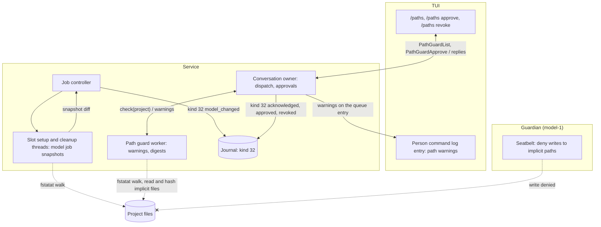
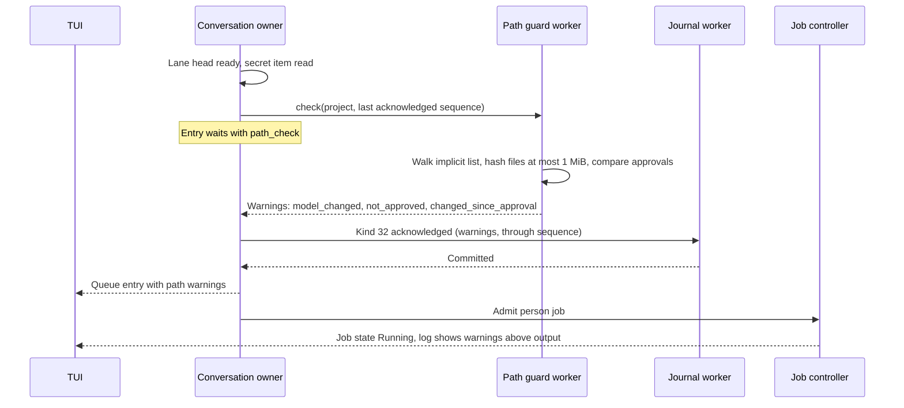
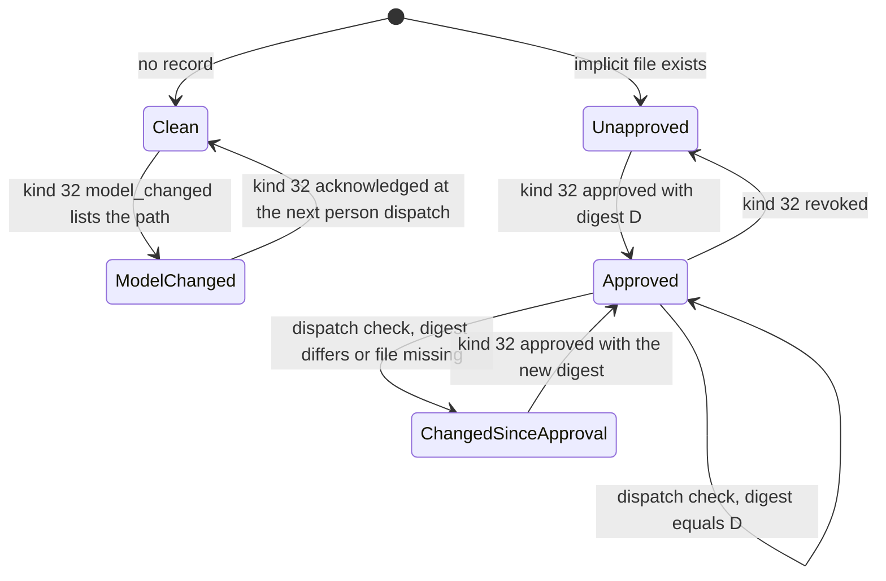
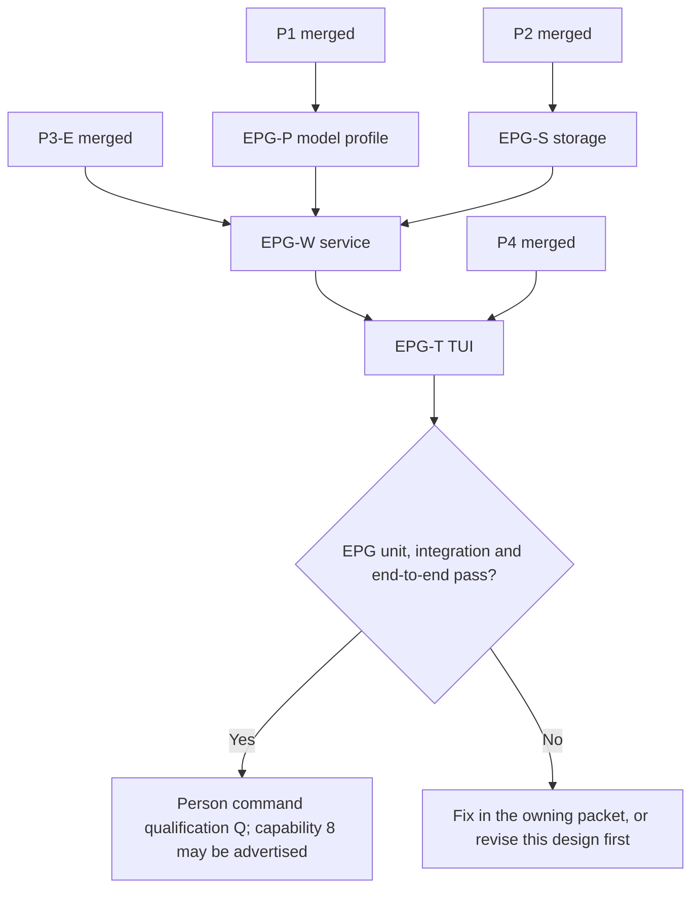

# Execution path guard

Status: ready for implementation, 2026-10-22, as person command packet P5. The
owner directed this design on 2026-10-22 (OD3 in
[person command mode](person-command-mode.md#owner-decisions-of-2026-10-22)):
the PCR18 build and test path warning is its own packet, P4 TUI code may merge
first, and capability 8 is not advertised until P5 passes. The required
behavior comes from owner decisions PX1 and EX1 (2026-10-14, digest re-check
2026-10-15) in the [execution threat model](execution-threat-model.md#person-command-decisions).
Mechanisms marked "selected (engineering)" are engineering choices under the
[iteration rules](../design-process.md#iteration-and-escalation). Nothing here
is implemented. Protocol numbering remains `0.1`; journal format remains `1`.

## Scope

Model-written project content can run later outside the model's control. PX1
splits that content into two classes:

- **Implicit-execution paths** run without the person asking to run project
  code, such as Git hooks. The model may not write them. The person approves
  their content, and Asura re-checks each approved file's digest before a
  person command.
- **Build and test paths** run when the person builds or tests, such as
  `build.rs` or `package.json`. The model may write them. Before a person
  command runs, the person sees which of them the model changed since the
  person's last command.

Objectives:

- Deny model writes to implicit-execution paths.
- Detect which build and test paths each model job changed.
- Before each person command, show what changed and what is not approved.
- Keep approvals and detected changes in the journal, so a restart keeps them.

Non-goals: blocking or confirming a person command (person command mode has no
approval prompt, PX5); checking content for malice; watching the filesystem
continuously; protecting against the person's own edits; paths outside the
project.

Dependencies: [person command mode](person-command-mode.md) (dispatch, queue
entry, log entry), [tool job controller](tool-job-controller.md) (model jobs,
slot setup and cleanup threads), the [exec_cmd guardian](exec-cmd-tool.md)
(model Seatbelt profile), [conversation admission](conversation-admission.md)
(record kinds), and [secret detection](secret-detection.md) (path display
redaction).

## Required behavior

| ID | Rule | Source |
| --- | --- | --- |
| EPG-R1 | The model's exec_cmd profile denies writes to the implicit-execution paths of the project. | PX1 |
| EPG-R2 | A person approves an implicit-execution file's current content. Asura records the file's digest with the approval. | PX1, EX1 |
| EPG-R3 | Before a person command runs, Asura re-checks the digest of each approved implicit-execution file in the project and warns when it changed, or when a file exists that is not approved. | PX1, EX1, PCR18 |
| EPG-R4 | Before a person command runs, the person is warned of each build or test path that a model job changed since the person's last command in that project. | PX1, PCR18 |
| EPG-R5 | A warning never blocks, delays for confirmation, or changes the command. The command runs after the warning is shown. | PX5, person command non-goals |
| EPG-R6 | Warnings, approvals and detected changes hold path names only, display-redacted; never file content. | EX4 |

## Terms

| Term | Meaning |
| --- | --- |
| Implicit-execution path | A project path in the [implicit list](#path-lists) |
| Build or test path | A project path in the [build and test list](#path-lists) |
| Fingerprint | Device, inode, size, modification time in nanoseconds and file type of one path, from `fstatat` without following symlinks |
| Model change | A build or test path whose fingerprint differs between a model job's start and settlement snapshots |
| Acknowledgement | The record that a person command was shown the pending warnings; later commands do not repeat them |
| Path warning | One entry shown before a person command: path and warning kind |

## Ownership

| Behavior | Owner | Change |
| --- | --- | --- |
| Model profile write denial | Platform exec_cmd guardian, `seatbelt()` for `model-1` (`asura-platform/src/exec_cmd/guardian.rs`) | New deny rules |
| Path lists, walk, fingerprints, digests | New module `asura-service::path_guard` (pure lists and walk functions) | New |
| Snapshots around model jobs | Slot setup and cleanup threads (`exec_cmd_worker.rs`), calling `path_guard` | New step |
| Warning computation at person dispatch, approvals | Path guard worker thread, driven by the conversation owner | New |
| Kind 32 records and replay state | Storage authority | New kind |
| `/paths` commands, warning display | TUI | New |

Dependency direction is unchanged: TUI → control client → service → storage
and platform. The guardian never reads the lists' results; it only compiles
fixed deny rules.

### EPG-O1: components and data flow

Selected design. Solid arrows are calls, requests or records; dashed arrows
are filesystem reads. Subgraphs are process boundaries.



## Path lists

Selected (engineering, 2026-10-22). The lists are fixed in code
(`path_guard/lists.rs`); there is no configuration key. The walk starts at the
project root, does not follow symlinks, does not cross mounts, and skips
directories named `.git` (except as listed below), `target`, `node_modules`,
`.build`, `dist` and `build`.

**Implicit-execution list** (PX1 initial list, confirmed):

| Pattern | Depth |
| --- | --- |
| `.git/hooks/` and every file under it | Project root and any nested `.git/hooks/` up to depth 8 |
| `.git/config` | Root and nested repositories up to depth 8 |
| `.gitattributes`, `.gitmodules` | Any depth up to 8 |
| `.envrc` | Any depth up to 8 |
| `.cargo/config`, `.cargo/config.toml` | Any depth up to 8 |

**Build and test list:**

| Class | Patterns | Depth |
| --- | --- | --- |
| Build files | `build.rs`, `Cargo.toml`, `Makefile`, `makefile`, `GNUmakefile`, `*.mk`, `CMakeLists.txt`, `*.cmake`, `package.json`, `Package.swift`, `pyproject.toml`, `setup.py`, `setup.cfg`, `tox.ini`, `noxfile.py`, `justfile`, `Justfile`, `Rakefile`, `Gemfile`, `build.gradle`, `build.gradle.kts`, `settings.gradle`, `settings.gradle.kts`, `gradlew`, `pom.xml`, `go.mod`, `rust-toolchain`, `rust-toolchain.toml` | Up to 4 |
| Test configuration | `conftest.py`, `pytest.ini`, `jest.config.*`, `vitest.config.*` | Up to 4 |
| Test code | Every regular file under a directory named `tests`, `test`, `__tests__` or `spec`, up to 4 levels below it; files named `*_test.go`, `test_*.py`, `*_test.py`, `*.test.js`, `*.test.ts`, `*.spec.js`, `*.spec.ts` | Up to 4 for the directory or file |

Bounds: a walk visits at most 20,000 entries and keeps at most 1,024 build and
test paths and 256 implicit-execution paths, in byte order of the
project-relative path. Paths past a bound are not fingerprinted; the walk
reports `overflow`, and the warning says that changes beyond the bound are not
detected.

## Mechanism

### Model write denial

Selected (engineering). The `model-1` Seatbelt profile adds, after its write
allow rules, `(deny file-write* …)` for the implicit list under the project:
`subpath` filters for `<project>/.git/hooks`, `literal` filters for the
root-level files, and `regex` filters for the nested forms. The project path in
a regex is escaped by a new helper beside `git_observer::quoted` that escapes
every regex metacharacter. A model command that writes such a path gets
`Operation not permitted`. Cost (PX1): model Git operations that write
`.git/config`, such as `git config` or `git remote add`, fail; the model asks
the person, who runs them with `!`.

Implementation notes (EPG-P, 2026-10-23, probed on macOS 27):

- The nested `regex` filter has no depth bound (`([^/]+/)+`): a deny rule
  costs nothing more at any depth. The walk keeps its bound of 8, because
  that bound limits the walk's cost. Seatbelt ignores `{m,n}` repetition, so
  a regex never uses it.
- On a case-insensitive APFS volume Seatbelt matches these filters in any
  letter case (`.ENVRC`, `.GIT/Hooks` are denied); the
  `/System/Volumes/Data` firmlink spelling is denied too.
- **Directory moves.** Seatbelt checks only the old and new path of a moved
  item, not the files inside it. A model can build `d/.envrc` in its job
  scratch and move `d` into the project, or rename `.git` and move in a
  prepared `.git` with its own `hooks/`. The deny rule is therefore a first
  layer; the [check before each person command](#warning-at-person-dispatch) (EPG-R3) is
  the backstop: it finds such a file and warns `not_approved`. Denying writes
  to the `.git` and `.cargo` directories themselves is rejected: it would
  block a model's `git init` and still not stop the first route.

The person profile and the outside profile keep write access: the person
applies a change the model asked for with a `!` command or an editor. That is
the PX1 "proposal the person accepts and Asura applies outside the model's
sandbox": Asura shows the change as unapproved until the person approves it.

### Model change detection

Selected (engineering). For each model-origin job, the slot setup thread takes
a fingerprint snapshot of the build and test list just before spawn, and the
slot cleanup thread takes another after the settled notice. The difference
(added, removed or changed fingerprints) is the job's model change set. The
controller adds it to the job's record outbox as a kind 32 `model_changed`
record after kind 28. A job with no change writes no kind 32.

The window covers the whole job, including time after its turn ended. A change
the person makes during a model job's window is attributed to the model; the
warning then over-reports, which errs toward showing more.

### Approval

Selected (engineering). The person approves with `/paths approve PATH` or
`/paths approve all` (every implicit-execution file currently shown as
unapproved or changed). The path guard worker reads each file, at most 1 MiB,
and computes SHA-256 over its bytes. The owner appends kind 32 `approved` with
the path and digest. `/paths revoke PATH` appends `revoked`. A file larger than
1 MiB cannot be approved; it is always warned as `too_large`.

### Warning at person dispatch

Selected (engineering). When a person command reaches dispatch, after the
secret item read and before the job admission, the conversation owner asks the
path guard worker to check the project. The entry waits with waiting reason
`path_check` until the reply. The worker returns:

| Warning kind | Condition |
| --- | --- |
| 1 `model_changed` | A build or test path in a `model_changed` record after the project's last acknowledgement |
| 2 `not_approved` | An implicit-execution file that exists and has no approval |
| 3 `changed_since_approval` | An implicit-execution file whose digest differs from its approval, or that is missing after approval |
| 4 `too_large` | An implicit-execution file over 1 MiB |
| 5 `overflow` | A walk or snapshot exceeded its bound |

The owner appends kind 32 `acknowledged` with the warnings (at most 16, plus an
overflow count) and the sequence of the last `model_changed` record it covers.
It then admits the job. The warning list reaches the TUI on the queue entry
before the job's spawned state, so the log entry shows it above the output.
The command runs whether or not warnings exist (EPG-R5). Kind 2–4 warnings
repeat before each command until the person approves or revokes; kind 1
warnings appear once.

### EPG-Q1: dispatch with path warnings

Selected design. Solid arrows are requests, calls or records; dashed arrows
are replies.



### EPG-S1: warning state of one path

Selected design. Arrows are records or checks.



## Contracts

### Kind 32: ExecutionPathRecord

Selected (engineering). Allocated after kind 31 in delivery order (R3). A
normal record, not a closure record; a `model_changed` record joins the job's
record outbox after kind 28 and is held with `journal_held` like kind 26 when
the journal is at its quota. Encodings follow the existing codec.

| # | Field | Encoding | Bounds and rule |
| --- | --- | --- | --- |
| 1 | action | u8 | 1 `model_changed`, 2 `acknowledged`, 3 `approved`, 4 `revoked` |
| 2 | project ID | ID | A registered project |
| 3 | reference | ID | Action 1: the job ID of a settled model job. Action 2: the person input ID. Actions 3, 4: the request ID |
| 4 | through sequence | u64 | Action 2: the sequence of the last kind 32 action 1 it covers, or 0. Otherwise 0 |
| 5 | entry count | u8 | 0–16 |
| 6 | entries | count × (u8 kind, u16 length, path) | Path 1–1,024 bytes, project-relative, display-redacted, no NUL, no `..`. Kind: action 1 uses 1; action 2 uses 1–5; actions 3 and 4 hold exactly one entry with kind 0 |
| 7 | overflow | u32 | Entries not listed |
| 8 | digest | 32 bytes | Action 3: SHA-256 of the approved content. Otherwise zero |

Maximum payload 16,510 bytes (1 + 16 + 16 + 8 + 1 + 16 × 1,027 + 4 + 32);
maximum frame 16,694 bytes. Replay keeps per project: the approvals (at most
256 paths, latest record wins), the last acknowledged sequence, and the
`model_changed` sequences after it (at most 64; older ones are covered by the
next acknowledgement). The checkpoint stores this state per project. Replay
rejects action 1 for a job that is not a settled model-origin job, action 2
for an input that is not a kind 31 input, and any bound violation.

### Control messages

Selected (engineering), within protocol `0.1`, part of capability 8:

```proto
// Envelope body fields 69-72, after the person command submit (68).
PathGuardList path_guard_list = 69;       PathGuardReply path_guard_reply = 70;
PathGuardApprove path_guard_approve = 71; // reply: PathGuardReply
PathGuardRevoke path_guard_revoke = 72;   // reply: PathGuardReply

message PathGuardList { optional bytes project_id = 1; }
message PathGuardApprove { optional bytes request_id = 1; optional bytes project_id = 2; optional string path = 3; optional bool all = 4; }
message PathGuardRevoke { optional bytes request_id = 1; optional bytes project_id = 2; optional string path = 3; }
message PathWarning { optional uint32 kind = 1; optional string path = 2; }
message PathGuardReply {
  repeated PathWarning pending = 1;   // what the next person command would show, at most 16
  optional uint32 overflow = 2;
  repeated string approved = 3;       // at most 256 approved paths
  optional string error = 4;          // not_found, path_invalid, too_large, not_implicit, busy, unavailable
}
// ConversationQueueEntry (kind 3): repeated PathWarning path_warnings = 21; optional uint32 path_overflow = 22;
// QueueWaitReason: QUEUE_WAIT_REASON_PATH_CHECK = 15;
// JobDetail: repeated PathWarning path_warnings = 6;  // from the kind 32 acknowledgement
```

`PathGuardApprove` with `all` takes no `path`. A path not in the implicit list
gets `not_implicit`.

### TUI

- The log entry of a person command shows, between the header and the output,
  `⚠ changed by the model since your last command: build.rs, package.json`
  for kind 1, and `⚠ not approved: .git/hooks/pre-commit · /paths approve`,
  `⚠ changed since you approved it: .envrc` for kinds 2 and 3, in alert colour
  `#FF6B6B`. The text marker `⚠` carries the meaning; colour is not the only
  signal. More than 16 entries add `and N more`.
- `/paths` lists pending warnings and approved paths for the selected
  project. `/paths approve PATH`, `/paths approve all` and `/paths revoke PATH`
  send the requests; the reply refreshes the list.
- The restored log reads the warnings from `JobDetail.path_warnings`.

## Failure handling

| Case | Result |
| --- | --- |
| Walk or snapshot exceeds a bound | `overflow` warning; known paths still compared |
| Snapshot fails on a model job (I/O error) | No `model_changed` record; the next person command gets an `overflow` warning naming the job's project |
| File unreadable at approval or check | `changed_since_approval` (cannot verify); approval refused with `unavailable` |
| Path guard worker queue full | The entry waits with `path_check` until the worker accepts; never refused |
| Filesystem stalls during the check | The entry waits; the person can Hold or Drop it; other lanes continue |
| Journal held at quota | `acknowledged` waits with `journal_held`; the command waits with it |
| Restart | Approvals and pending changes replay from kind 32 |
| Project unregistered | Its records stay; replay keeps them until the project's state is dropped |

## Asynchronous execution

| Rule | Application |
| --- | --- |
| AE-01 | The owner and TUI do in-memory work; walks and hashing run on the path guard worker and slot threads. |
| AE-02 | Blocking calls: `openat`, `fstatat`, `getdirentries`, `read` and SHA-256 hashing. Isolation: one retained path guard worker thread; snapshots on the existing slot setup and cleanup threads. |
| AE-03 | Worker queue 8 requests; walk 20,000 entries; 1,024 build and test paths; 256 implicit paths; 1 MiB per hashed file, so at most 256 MiB read per check; 16 listed warnings; 256 approvals per project. |
| AE-04 | No time bound. A check ends on its reply, a Hold or Drop of the waiting entry, or shutdown. A snapshot ends on completion, a slot cancel or shutdown. |
| AE-05 | Records are idempotent by reference: one `model_changed` per job, one `acknowledged` per input, approvals by request ID. |
| AE-06 | Shutdown closes the worker queue; a running walk finishes or is dropped with its waiting entry, which replays as `Held`. |
| AE-07 | EPG-I5 runs a stalled filesystem fixture and measures TUI responsiveness. |

## Security

- The lists and the deny rules come from code, not from the model or the
  project.
- Paths in records are display-redacted with the secret detection display
  rule; a path that holds a secret shows its placeholder.
- No record holds file content. The approval digest is of content the person
  approved; it reveals nothing beyond equality.
- The guard is a warning, not a boundary: a person command still runs changed
  code. The threat model's PT2 residual stands.
- The model deny rule is a first layer only: a directory moved into the project
  carries implicit files past it ([directory moves](#model-write-denial)). The
  dispatch check is the backstop for that case.

## Validation

### Unit

| ID | Case | Required result |
| --- | --- | --- |
| EPG-U1 | List matching over a fixture tree with nested repositories, skipped directories, symlinks and depth limits | Exact path sets; symlinks not followed; skipped directories ignored |
| EPG-U2 | Fingerprint diff: add, remove, change size, change mtime, replace inode | Each path listed once |
| EPG-U3 | Kind 32 codec at every bound and maximum; replay rules | Round trip; each invalid record `Corrupt` |
| EPG-U4 | Warning computation over fixture records and digests | Each kind computed; kind 1 cleared by an acknowledgement; kinds 2–3 repeat |
| EPG-U5 | Model Seatbelt profile generation with a project path holding regex metacharacters | Deny rules present and escaped |
| EPG-U6 | Control codecs for fields 69–72 and the queue entry fields 21–22 | Bounds and errors |

### Integration

| ID | Case | Required result |
| --- | --- | --- |
| EPG-I1 | Real model job writes `.git/hooks/pre-commit`, nested `sub/.git/hooks/x`, `.git/config` and `.envrc` (PX-V2 part) | Each write denied by the OS; project writes elsewhere succeed |
| EPG-I2 | Real model job edits `build.rs` and `package.json`; then a `!` command; then a second `!` command (PX-V9) | First command's entry lists both; second lists none |
| EPG-I3 | Approve `.git/hooks/pre-commit`; change it with `!`; next command (PX-V11) | `changed_since_approval` before the next command |
| EPG-I4 | Restart between a model change and the person command | The warning still appears |
| EPG-I5 | Stalled filesystem fixture during a check | The entry waits with `path_check`; TUI, cancel and other lanes respond within 100 ms |
| EPG-I6 | 1,100 test files | `overflow` warning; the first 1,024 still compared |

### End to end

| ID | Case | Required result |
| --- | --- | --- |
| EPG-E1 | PTY: scripted model edits `build.rs`; type `!cargo build` (PC-E21) | Warning line above the output; the command runs |
| EPG-E2 | PTY: `!git commit` with an approved hook, then the hook changed by `!` | First run no warning; second run `changed since you approved it` |
| EPG-E3 | PTY: `/paths`, `/paths approve all`, `/paths revoke` | List and replies match |

Environments: the macOS 27 host with `sandbox-exec`, scratch Asura home,
scratch HOME and a scratch project.

## Packets

Selected plan. Each packet owns its paths alone; the primary agent integrates.

| Packet | Owned paths | Depends on | Delivers |
| --- | --- | --- | --- |
| EPG-P Model profile | `asura-platform/src/exec_cmd/guardian.rs`, `asura-platform/src/git_observer.rs` (regex helper), `asura-platform/tests/exec_cmd_process.rs` | P1 merged | Deny rules; EPG-U5, EPG-I1 |
| EPG-S Storage | `asura-storage/src/authority/**` and its tests | P2 merged | Kind 32, replay state, checkpoint; EPG-U3 |
| EPG-W Service | `asura-service/src/path_guard.rs`, `asura-service/src/path_guard/*.rs` (new); `asura-service/src/{exec_cmd_worker,job_controller}.rs` and their submodules; `asura-service/src/conversation.rs` and `conversation/*.rs`; `contracts/control/v1/control.proto`; `asura-control/src/*.rs`; `asura-service/tests/path_guard_flow.rs` (new) | EPG-P, EPG-S, P3-E | Lists, walk, snapshots, worker, dispatch check, approvals, control messages; EPG-U1, U2, U4, U6; EPG-I2 to EPG-I6 |
| EPG-T TUI | `asura-cli/src/tui/{ui,mod}.rs`, `asura-cli/src/tui/ui/*.rs`, `asura-cli/tests/tui_pty.py` | EPG-W, P4 | Warning lines, `/paths`; EPG-E1 to EPG-E3 |

### EPG-P1: packet order

Selected plan. Arrows mean "must merge before".



## Decisions

| ID | Decision | Status |
| --- | --- | --- |
| OD3 | The warning is its own packet P5; capability 8 waits for it | Owner, 2026-10-22 |
| EPG-E1 | Approval is a person command `/paths approve`, not a model proposal tool | Selected (engineering) |
| EPG-E2 | Model changes are attributed by fingerprint snapshots around each model job | Selected (engineering) |
| EPG-E3 | Fixed lists in code; no configuration | Selected (engineering) |
| EPG-E4 | One record kind 32 for changes, acknowledgements and approvals | Selected (engineering) |

Alternatives considered:

- **A model tool that proposes a file change for approval.** Rejected for P5:
  it needs a new registry tool, a diff view and an apply path; the person can
  already apply a change with `!`. It may follow as its own design.
- **A confirmation prompt before a warned command.** Rejected by PX5 and the
  person command non-goals.
- **Digesting every build and test file.** Rejected: fingerprints detect
  changes at far lower cost; digests are kept for approvals, where equality of
  content matters.
- **Continuous file watching.** Rejected: it adds a standing worker and
  attributes nothing to the model.

## Design verification

Recorded on 2026-10-22: written from PX1, EX1, PCR18 and OD3. The guardian's
`seatbelt()` and the slot worker structure were read at commit `f6e8cff`.
EPG-O1, EPG-Q1, EPG-S1 and EPG-P1 were rendered with Mermaid CLI 12.0.0 and
inspected. No code or test was run.

Return to the [design index](README.md).
