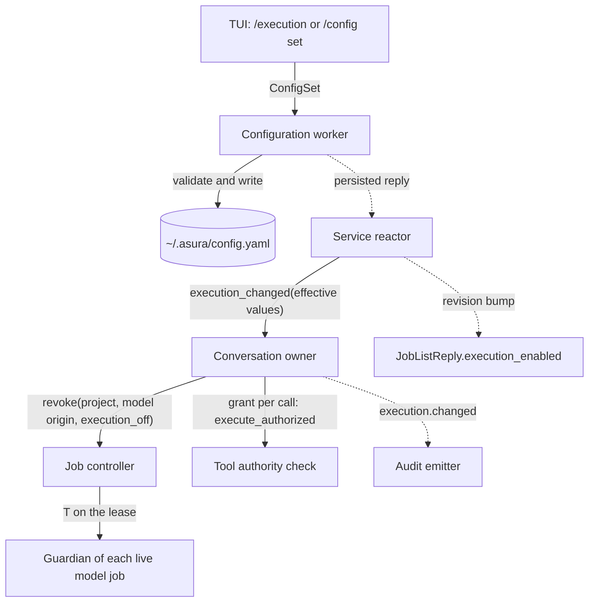
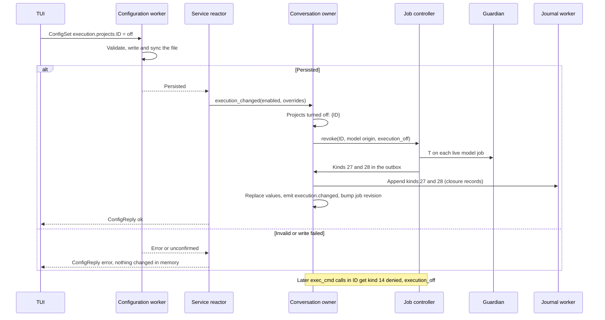
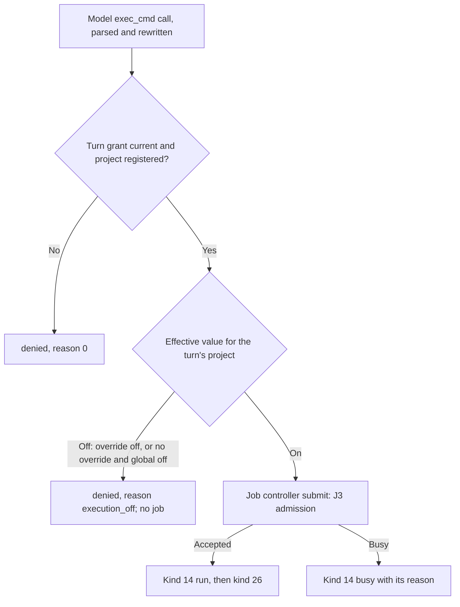
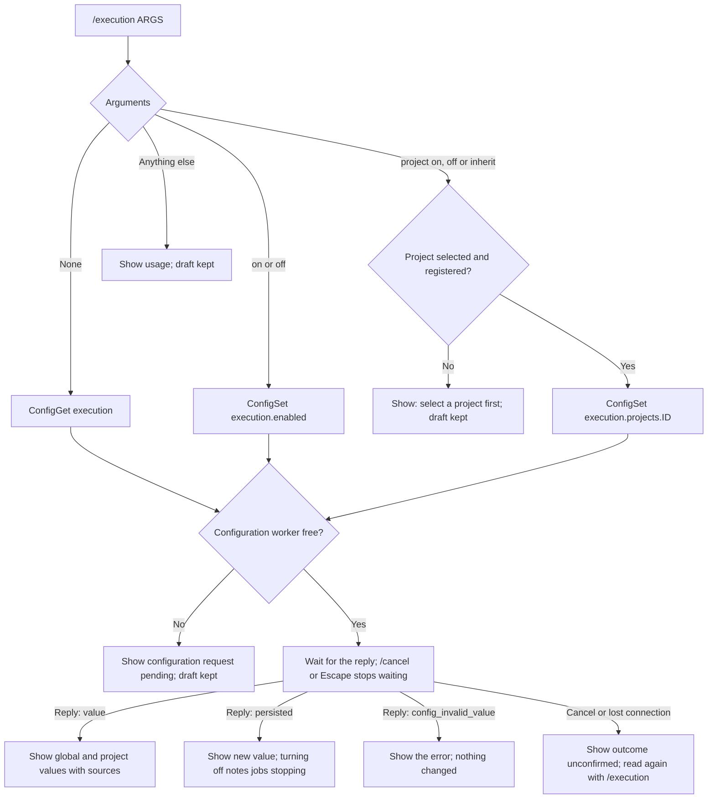

# Execution setting

Status: ready for implementation, 2026-10-22. This design is the follow-up
design that owner decision [EX11](execution-threat-model.md#owner-decisions)
requires. It must be implemented before tool job packets J3 and J4 are enabled
(owner, 2026-10-21, RV1 and EN1). Mechanisms marked "selected (engineering)"
are engineering choices under the
[iteration rules](../design-process.md#iteration-and-escalation), not owner
decisions. Nothing here is implemented. Protocol numbering remains `0.1`;
journal format remains `1`.

## Owner decision

Required behavior (owner, 2026-10-14, EX11): a person execution setting, with a
global default plus a per-project override. The default is on. A change is a
revocation trigger: turning execution off refuses new execution and cancels live
model jobs in scope.

Related owner decisions that this design applies:

- EX12 (owner, 2026-10-14): EX11 is the person's switch for jobs that outlive
  their turn.
- RV1 (owner, 2026-10-21): the setting is designed before J3 is enabled.
- [Tool job controller revocation triggers](tool-job-controller.md#security-and-authority):
  "Person jobs are not affected" by this setting.

## Scope

In scope:

- Two configuration keys: the global default and the per-project overrides.
- The effective value for a project, and the service state that holds it.
- Refusal of new model execution while the effective value is off.
- Revocation of live and queued model jobs when a change turns a project off.
- A TUI command, `/execution`, and the TUI's display of the selected project's value.
- Audit, validation and code packets.

Non-goals:

- Person commands. `!` and `!!` have their own switch for `!!`
  (`personCommands.allowOutsideSandbox`, PCR23). The owner decision names model
  jobs only.
- Read tools. `project`, `memory`, `service` and the `job` commands that read,
  wait, cancel or note are not execution. They stay under `read_authorized`.
- Remote destinations and the destination grant (EX13).
- Per-conversation or per-turn settings.

Dependencies: [configuration commands](config-commands.md) for the keys,
[tool job controller](tool-job-controller.md) for revocation, and
[tool call records](tool-call-records.md) for the refusal record.

## Terms

| Term | Meaning |
| --- | --- |
| Execution | Starting a model tool job that runs a process. Today this is the `exec_cmd` tool. A later tool that starts a process is covered when it adopts the job controller |
| Global default | `execution.enabled`, the value for every project without an override |
| Project override | An entry of `execution.projects` that sets one project to `on` or `off` |
| Effective value | The override for the project if one exists, otherwise the global default |
| Execution change | A persisted configuration set that changes the effective value of at least one project |

## Required behavior

| ID | Rule | Source |
| --- | --- | --- |
| ES-R1 | The effective value is on when no key is set. | EX11 default on |
| ES-R2 | A project override wins over the global default for that project. | EX11 |
| ES-R3 | While the effective value of a project is off, every new model `exec_cmd` call in that project is refused with decision `denied` and reason `execution_off`. Nothing is queued or spawned. | EX11 "refuses new execution" |
| ES-R4 | When a change turns a project's effective value from on to off, every model job of that project that is queued, starting or live is cancelled with reason `execution_off`. | EX11 "cancels live model jobs in scope" |
| ES-R5 | Person jobs are not affected by the setting or by a change. | Job controller revocation table |
| ES-R6 | A change from off to on affects nothing that already ended. New calls are admitted again. | Selected (engineering) |
| ES-R7 | Only the person changes the setting, through configuration commands. No model tool, project file or directory configuration can read or change it. | Architecture: project settings cannot expand security permissions |
| ES-R8 | The model receives a refusal it can act on: the text says that the person turned execution off, and the model must not retry. | Selected (engineering) |

## Ownership

Search for an existing owner found the configuration storage adapter, the
service configuration worker, the conversation owner's tool grant
(`tool_grant`, `asura-service/src/conversation.rs`), the tool authority check
(`validate_authority`, `asura-service/src/tools.rs`) and the job controller's
revocation entry point. This design extends them. It adds no new owner.

| Behavior | Owner | Code |
| --- | --- | --- |
| Key schema, defaults, validation and persistence | Storage configuration adapter | `asura-storage/src/config.rs` |
| Set admission and the persisted reply | Existing configuration worker | `asura-service/src/config_worker.rs` |
| Effective values in memory, refusal of new calls, the revocation call | Conversation owner | `asura-service/src/conversation.rs` |
| The grant flag `execute_authorized` | Conversation owner, from the effective value at each call | `conversation.rs` (`tool_grant`) and `tools.rs` (`validate_authority`) |
| Cancelling model jobs of a project | Job controller | `asura-service/src/job_controller.rs` |
| `execution.changed` audit event | Storage audit schema and the service emitter | `asura-storage/src/audit/types.rs`, `asura-service/src/audit.rs` |
| `/execution` command and the status display | TUI | `asura-cli/src/tui/ui.rs`, `asura-cli/src/tui/config.rs` |

### ES-O1: ownership and data flow

Selected design. Solid arrows are calls or messages; dashed arrows are replies.
The file write is on the existing configuration worker. Every other step is
bounded in-memory work on the service reactor.

## Configuration

Selected (engineering). The keys live in the account's `.asura/config.yaml`,
which only the person can change: the model profile denies `~/.asura`
([state isolation](asura-state-isolation.md)), and project directory
configuration cannot change service-owned settings.

| Key | Type and bounds | Default when absent |
| --- | --- | --- |
| `execution.enabled` | Boolean | `true` (EX11) |
| `execution.projects` | Mapping of at most 1,024 entries. Each key is a project ID as 32 lowercase hexadecimal digits, not all zero. Each value is the string `on` or `off` | Empty mapping |
| `execution.projects.<id>` | Leaf form for one project. Set accepts the string `on`, `off` or `inherit`; `inherit` removes the entry. Get returns `on`, `off` or `inherit` | `inherit` |
| `execution` | Mapping of `enabled` and `projects` | Defaults above |

Rules:

- `execution` is written only when set away from its defaults, as `retention`
  and `jobs` are. `set execution` takes the whole mapping.
- A value outside its type or bounds is `config_invalid_value`. A 1,025th entry
  is `config_invalid_value`. An ID that is not 32 lowercase hexadecimal digits,
  or is all zero, is `config_invalid_value`.
- The storage adapter does not check that a project ID is registered. An entry
  for an unknown project has no effect. The TUI sets entries only for the
  selected, registered project.
- A successful set applies at once, as `journal.quotaBytes` does: the service
  forwards the new effective values to the conversation owner when the
  configuration worker reports the write persisted. A set whose outcome is
  unconfirmed changes nothing in memory; the person sees `unconfirmed` and
  can read the value again.
- At service start the owner reads both keys with the rest of the configuration.
  An invalid file is an error, as today; the service does not run with a guessed
  value.
- `/config` without arguments lists `execution` with its defaults.

The leaf form `execution.projects.<id>` is new for configuration commands: it
is the only key with a variable segment. The configuration key parser accepts
it only under `execution.projects.`, with the ID rules above. Selected
(engineering): a whole-mapping set from two TUIs at once could lose one
person's change; the leaf form removes that race for the common case.

## Service behavior

### Effective value

The conversation owner keeps, in memory, the global default and the override
map (at most 1,024 entries). The effective value of project P is
`projects[P]` when present, otherwise `enabled`. A lookup is a map read on the
reactor (AE-01).

### Refusal of new execution

Selected (engineering). The grant flag `execute_authorized` is computed at each
tool call from the effective value of the turn's project, not once at turn
admission. `tool_grant` takes the effective value as an input. A turn that was
admitted while execution was on is refused as soon as the setting is off.

| Call | Effective value off | Record |
| --- | --- | --- |
| Model `exec_cmd` | Decision `denied`, reason `execution_off`; nothing reaches the job controller | Kind 14 with decision 6 and field 10 reason 1 ([J3 kind 14 changes](tool-job-controller.md#j3-kind-14-changes)) |
| `job` list, status, read, wait, cancel, note | Allowed | As usual |
| `project`, `memory`, `service` | Allowed | As usual |
| Person `!` and `!!` | Allowed (ES-R5) | As usual |

The rendered result text for the model is fixed by the code tables:
`denied: execution_off: the person turned command execution off for this project; do not retry`.
It repeats no model text (TCR-D12).

The job controller checks the effective value once more when it grants a slot to
a model-origin queue head. This check cannot fail in a correct implementation,
because a change revokes queued model jobs in the same reactor step (below). If
it does fail, the controller settles the job `not_started` with reason
`execution_off` and records the inconsistency in the `job.settled` audit event.

### Revocation on change

When the owner receives new effective values, in the same reactor step it:

1. computes the projects whose effective value changed from on to off;
2. for each, calls the controller's `revoke` with scope "project P, model
   origin only" and reason `execution_off`;
3. replaces its in-memory values;
4. emits `execution.changed`;
5. bumps the job revision so that a parked `JobList` returns with the new
   `execution_enabled`.

The controller applies the J2 revocation rule to model-origin jobs only:

| Job state | Effect | Records |
| --- | --- | --- |
| Queued | Entry removed | Kind 27 (requester service) and kind 28 `not_started`, reason `execution_off` |
| Starting | Setup cancel flag | Kind 27, then kind 28 `not_started`, or `cancelled` if it spawned |
| Running, `CapturePaused`, `Stopping`, `Draining` | `T` on the lease if none was sent | Kind 27 if none exists; kind 28 with reason `execution_off` unless an earlier trigger set the reason |
| `CleanupUnconfirmed` | Kind 27 if none exists | Settles later, as J2 describes |
| Settled | Nothing | — |

A model job whose turn is still in its yield window is cancelled the same way.
The starting call's result then reports the job's state with status
`cancelled` ([J3 exec_cmd as a job](tool-job-controller.md#exec_cmd-as-a-job)).

Job reason code 19 `execution_off` is added to the
[job reason table](tool-job-controller.md#job-reason-codes): requester service;
kind 28 outcomes exited, signalled, cancelled and not_started. J3's storage
packet adds it to the codec table.

### ES-Q1: execution change sequence

Selected design. Solid arrows are requests, calls or writes; dashed arrows are
replies, events or notices.

### ES-F1: decision for one model exec_cmd call

Selected design. Arrows are decisions in order. The setting is checked after
the existing secret rewrite and argument parse, and before job admission.

## TUI

Selected (engineering). The `/execution` command reads and sets the keys through
the existing configuration worker. It needs no new control message.

| Command | Effect |
| --- | --- |
| `/execution` | Shows the global default and the selected project's effective value with its source, for example `execution: on (default) · this project: off (project override)` |
| `/execution on`, `/execution off` | Sets `execution.enabled` |
| `/execution project on`, `/execution project off`, `/execution project inherit` | Sets `execution.projects.<selected project ID>` |

After a set that turns the selected project off, the reply line reads
`execution off for <project name>: running model jobs in this project are being stopped · /jobs`.
The TUI does not count the jobs itself; `/jobs` shows them settle.

While the selected project's effective value is off, the status row shows
`exec off`. The TUI learns the value from `JobListReply.execution_enabled`
([J4 control messages](tool-job-controller.md#j4-control-messages)), which its
job worker already keeps parked for the status row, so a change made from
another TUI appears without a new poll. Before the jobs capability exists the
indicator is absent.

### ES-F2: `/execution` command flow

Selected design. This is the command flowchart that the
[engineering standard](../engineering.md#test-execution-and-evidence) requires.
Arrows show validation, dispatch and each outcome.

## Audit

Selected (engineering). One new event. The audit schema number does not change.

| Event `kind` | Emitted when | Details |
| --- | --- | --- |
| `execution.changed` | The owner applies a persisted change | `scope` (`global` or `project`), `project` (project scope only), `from` and `to` (`on`, `off`, `inherit`), `revoked_projects` (count of projects turned off) |

The existing `config.changed` event still records the setting name and outcome.
Revoked jobs appear as `job.cancel_requested` and `job.settled` events with
reason `execution_off`. No event holds a command or path.

## Failure handling

| Case | Result |
| --- | --- |
| Set rejected by validation | `config_invalid_value`; file and memory unchanged |
| Write fails or its outcome is unconfirmed | No in-memory change; no revocation; the person sees the outcome and reads again |
| Change during a model tool call that is already `run` | The running job is revoked like any live job; its result reports the state |
| Change while a model turn waits in a job's yield window | The job is revoked; the starting call's result reports `cancelled` |
| Journal unavailable when revocation fires | The controller already stopped every live job ([journal outage](tool-job-controller.md#journal-outage-hold-and-shutdown)); the change still applies in memory |
| Journal held at its quota | Kinds 27 and 28 are closure records and commit from the job reservation ledger |
| Service restart | The file holds the persisted value; no job survives a restart |
| Hand edit of the file while the service runs | Takes effect at the next start, as for every key; the TUI shows the in-memory value |
| A change and a call in the same reactor step | Order on the reactor decides: a call decided before the change runs and is then revoked; a call after it is refused |

## Security

- **Authority.** The setting narrows the model's execution authority; it never
  widens it. Turning execution on restores the existing grant, which keeps the
  sandbox, scratch, network denial and escapee control unchanged.
- **Who can change it.** Only the local person through the control socket. The
  model's `service` tool is read-only and has no configuration access. Model
  jobs cannot write `~/.asura` (SI3).
- **Trust boundary.** The configuration file is service-owned. A project's own
  files never set it.
- **Residual.** A change made while the service is stopped takes effect at the
  next start. Effects that a revoked job already made are not undone; the kind
  28 record states what is known.

## Asynchronous execution

| Rule | How this design meets it |
| --- | --- |
| AE-01 | The effective-value lookup, refusal and revocation are bounded in-memory work on the reactor. The only I/O is the configuration file write on the existing worker. |
| AE-02 | The blocking calls are the existing configuration worker's `openat`, `write`, `fsync` and rename. No new thread. |
| AE-03 | At most 1,024 overrides. Revocation touches at most the 64 unsettled jobs. The outbox bounds of J2 hold. |
| AE-04 | No time bound. A set ends on the worker's reply, the person's cancel or a lost connection ([client waits](command-flows.md#client-waits-without-time-bounds)). Revocation uses the job controller's closures and wind-down bounds. |
| AE-05 | A set is idempotent by value. Revocation is idempotent per job: a second trigger writes no second kind 27. |
| AE-06 | Shutdown follows the job controller; the setting adds no lifecycle. |
| AE-07 | Validation below runs real guardians and a real configuration file. |

## Validation

Unit tests use the storage configuration fixture and the job controller fixture
slot. Integration tests use the real service, real configuration worker and real
guardians under `sandbox-exec`. End-to-end tests drive the TUI through the PTY
harness with a scripted loopback model.

| ID | Case | Unit | Integration | End-to-end |
| --- | --- | --- | --- | --- |
| ES-01 | Defaults | No key gives on for every project | Fresh installation runs exec_cmd | — |
| ES-02 | Key validation | Bounds, 1,025th entry, bad ID, `inherit` removes, whole-mapping set, leaf get | Set, restart, value kept | — |
| ES-03 | Effective value | Override beats global in all four combinations | — | `/execution` shows each source |
| ES-04 | Refusal | Kind 14 `denied` reason 1 and its rendered text; no submit to the controller | Model call after `/execution project off` is refused; nothing spawned | Scripted model's exec_cmd shows the refusal in the activity row |
| ES-05 | Revocation of live model jobs (EX-V10, TJ-14) | Revoke scope spares person jobs and other projects; queued give `not_started`, live give `T`; one kind 27 | Two running model jobs in project A and one in project B; turning A off stops A's jobs with `execution_off`; B's job continues | PTY: `/execution project off` while a model job runs; `/jobs` shows it settle with `execution_off` |
| ES-06 | Global off | Every project's model jobs revoked | Global off with jobs in two projects | PTY: `/execution off` |
| ES-07 | Off to on | Nothing revoked; next call runs | Call after `/execution on` runs | — |
| ES-08 | Person jobs unaffected (ES-R5) | Revoke scope excludes person origin | Shared with the person-command packets: a `!` job continues | Deferred to the person-command packets |
| ES-09 | Unconfirmed set | No in-memory change | Writer fault injected: memory and jobs unchanged | — |
| ES-10 | Yield window | Revocation during the yield gives the starting call status `cancelled` | Real job in its yield window | — |
| ES-11 | Audit | `execution.changed` fields; no command text | Real emitter order: `config.changed`, `job.cancel_requested`, `execution.changed`, `job.settled` | — |
| ES-12 | Status indicator | `exec off` from `execution_enabled` | Change from a second attachment returns the parked `JobList` | PTY: second TUI shows `exec off` |
| ES-13 | Responsiveness | — | Revocation with 16 live jobs: Inspect within 100 ms | Typing within 100 ms while jobs stop |

Environments: the macOS 27 development host with `sandbox-exec` and a scratch
installation. Release qualification is not claimed.

## Code packets

The setting is delivered inside the J3 and J4 packet plan, so that no file has
two writers ([J3 and J4 code packets](tool-job-controller.md#j3-and-j4-code-packets)):

| Part | Packet | Owned paths |
| --- | --- | --- |
| Keys, leaf form, `execution.changed` type | J34-G configuration and audit schema | `asura-storage/src/config.rs`, `asura-storage/src/audit/{types,mod,tests}.rs` |
| Reason code 19 and kind 14 field 10 reason 1 | J34-S storage records | `asura-storage/src/authority/conversation/{types,codec}.rs` |
| Controller `revoke` scope with origin filter | J34-K controller extensions | `asura-service/src/job_controller.rs`, `job_controller/*.rs` |
| Refusal reason and rendered text in the tool authority check | J3-R tool parsing and result text | `asura-service/src/tools.rs` |
| Owner state, per-call grant, revocation wiring, audit emission | J34-E integration | `asura-service/src/conversation.rs`, `audit.rs`, `config_worker.rs` |
| `/execution` and the status indicator | J4-T TUI | `asura-cli/src/tui/{ui,config,jobs}.rs` |
| User documentation for the keys and command | J34-E | `docs/user/{commands,guide}.md` |

## Decisions

| ID | Decision | Status |
| --- | --- | --- |
| EX11 | Global default plus per-project override, default on; a change revokes | Owner, 2026-10-14 |
| ES-E1 | Store in `config.yaml`, not the journal | Selected (engineering): the setting is a person preference like the other keys, and the configuration path already has persisted-then-apply semantics |
| ES-E2 | Check at each call, not once per turn | Selected (engineering): "refuses new execution" must hold inside a running turn |
| ES-E3 | Execution means model job starts; read tools and `job` commands stay allowed | Selected (engineering), from the owner's wording "execution" and the revocation table |
| ES-E4 | Leaf key `execution.projects.<id>` with `inherit` | Selected (engineering): removes a lost-update race and gives a way to clear an override |
| ES-E5 | Keep the exec_cmd tool declared when off; refuse with a fixed text | Selected (engineering): the helper's tool list is fixed per build and counted in the context overhead `S` |

Alternatives considered:

- **Journal record for the setting.** Durable with the conversation history,
  but it would add a record kind for a person preference and make the value
  depend on replay. Rejected.
- **Snapshot at turn admission.** Simpler, but a long turn would keep running
  commands after the person turned execution off. Rejected by EX11's wording.
- **Hide exec_cmd from the model when off.** Fewer refused calls, but it needs
  a per-turn tool list in the model protocol and changes `S`. Not selected;
  the refusal text tells the model to stop.

## Design verification

Recorded on 2026-10-22: written from the owner decision EX11 and the J2–J5
readiness audit. Code facts were checked by read-only inspection at commit
`53fe73d`: the constant grant flags (`tool_grant`, `conversation.rs`), the
authority check (`validate_authority`, `tools.rs`) and the configuration key
table. ES-O1, ES-Q1, ES-F1 and ES-F2 were rendered with Mermaid CLI and
inspected. No code or test was run.

Return to the [design index](README.md).
