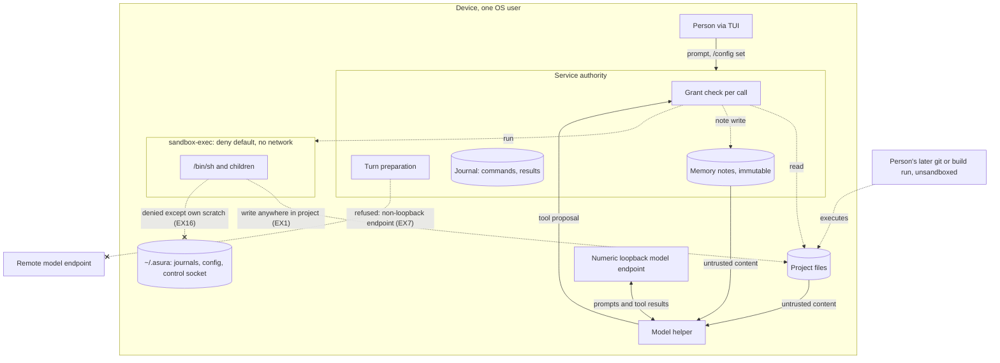
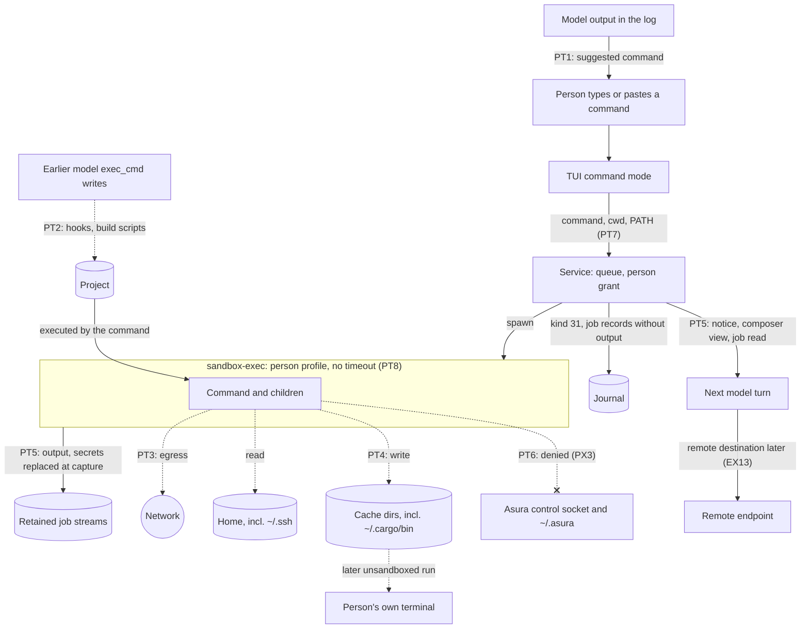
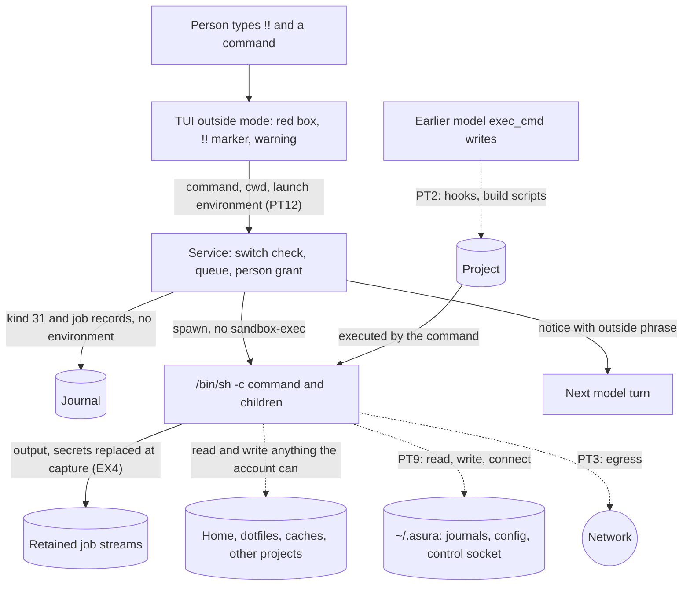

# Execution threat model

Status: reviewed by the owner, 2026-10-14 and 2026-10-15. Proposed on
2026-10-13 because the [architecture](../architecture.md#security-boundaries)
requires a threat model before execution is implemented, and the exec_cmd and memory
write tools shipped without one. The owner reviewed findings EX1–EX16 on
2026-10-14 and revisited EX4, EX7, EX13 and EX15 on 2026-10-15. The owner
approved the [person-typed commands](#person-typed-commands) section on
2026-10-15, with the EX1 and EX4 updates folded in. Protocol numbering remains
`0.1`; journal format remains `1`.

The approval covers:

- the assets, threat sources and trust boundaries below;
- each finding's recorded mitigation and gap, with code citations refreshed at
  commit `7db114d`;
- the [owner decisions](#owner-decisions) for EX1–EX16 and their required
  outcomes;
- the [probe results](#validation) of 2026-10-14 and the cases still unrun;
- the person-typed commands section, with decisions PX1–PX6.

On 2026-10-19 the owner added unsandboxed `!!` person commands. The decision
and its accepted exposure are recorded in
[unsandboxed person commands](#unsandboxed-person-commands) as EXD-1. It
overrides PX3's denial for `!!` commands only.

The approval does not select a mechanism that a decision leaves to a
[follow-up design](#required-follow-up-designs), and it does not claim that any
required outcome is implemented. It completes the review (T1) that gated
[tool job](tool-job-controller.md#delivery-dependencies) packet J2. The EX5
prerequisite was met on 2026-10-21 for sandboxed model jobs
([escapee control evidence](escapee-control.md#implementation-evidence-2026-10-21)),
and the EX10 prerequisite on 2026-10-20
([qualification results](exec-cmd-tool.md#qualification-results-2026-10-20)). Remote
[model providers](model-provider-integration.md) stay refused until the EX13
grant and EX14 credentials are built.

The [D1 threat model](threat-model.md) remains the canonical source for local
bootstrap, project status and the same-UID principal choice. This document
extends it to model-driven effects.

## Scope

In scope:

- **Implemented:** the exec_cmd tool, memory note writes, project and memory reads
  by the model, and numeric-loopback model endpoints. Non-loopback endpoints
  have been refused since 2026-10-13 (EX7).
- **Proposed:** [tool jobs](tool-job-controller.md) and remote providers through
  the OpenAI API specification.
- **Proposed:** person-typed `!` commands; see
  [Person-typed commands](#person-typed-commands).
- **Proposed:** person-typed `!!` commands with no sandbox (owner,
  2026-10-19); see [unsandboxed person commands](#unsandboxed-person-commands).

Out of scope: remote Asura hosts, sensors acting autonomously, plan and task
execution, and network access from model tools. Each needs its own review.

## Assets

| Asset | Required protection |
| --- | --- |
| Project source and repository metadata | Only effects the person's request implies; no persistence that runs outside Asura's confinement |
| Files outside the project | No read or write by tools |
| Secrets in the project or environment | No egress off the device; no stored copy in Asura records (EX4); a queued person command's values only in its Keychain item until it settles or is dropped (EXD-2) |
| Model context and stored memory | Untrusted content never gains instruction priority |
| Conversation content | Leaves the device only to a destination the person chose |
| Host processes | No tool process outlives its bound or escapes confinement |

## Threat sources

| Source | Capability | Trust |
| --- | --- | --- |
| Untrusted content: repository files, tool output, fetched text, memory notes | Embeds instructions that the model may follow (prompt injection) | Untrusted data |
| The model | Proposes any tool call within the offered tools, mistakenly or under injection | Untrusted proposer; the service authorizes |
| Remote endpoint operator or network path | Receives everything sent; can return crafted output | Separate trust boundary |
| Same-UID process | Calls the control API, squats a loopback port, edits state | One principal under the [D1 choice](threat-model.md#scope-assets-and-actors); no resistance claimed |
| The person | Configures endpoints and runs commands | Trusted principal |

## Trust boundaries

Reviewed view of implemented paths at commit `7db114d`. Solid arrows carry data
or proposals. Dashed arrows carry effects. Arrows ending in a cross are refused
or denied paths. Every model proposal crosses the service authorization boundary
before an effect.

## Threats, current mitigations and gaps

"Code" cites implemented behavior at commit `7db114d`. "Gap" is a difference
from a required outcome; probe results are from 2026-10-14. Paths are relative
to `rust/crates/` or `swift/model-helper/Sources/HelperCore/`. The
[owner decisions](#owner-decisions) record the required outcome for each row.

| ID | Threat | Current mitigation (code) | Gap |
| --- | --- | --- | --- |
| EX1 | Injected content leads the model to write a persistent payload, such as a Git hook or build script, that the person later runs outside the sandbox | Writes confined to project and scratch (`asura-platform/src/exec_cmd/guardian.rs:158`; scratch re-allow `:152`). Each call is journaled as tool kind 16 inside ToolIntent (`asura-storage/src/authority/conversation/types.rs:401-412`). | The whole project, including `.git`, is writable. EX-V1 confirmed writes to `.git/hooks` (also nested), `.git/config` `hooksPath`, `Makefile`, `package.json`, `build.rs`, `.envrc` and `.cargo/config.toml`. Nothing separates a source edit from a write that executes later. |
| EX2 | exec_cmd exfiltrates data over the network | Profile has no network rule under `(deny default)` (`guardian.rs:158`) | None found. EX-V2 found TCP, UDP, raw, ICMP and Unix socket attempts denied. |
| EX3 | exec_cmd reads secrets outside the project | Read roots are system roots, project and scratch (`guardian.rs:125-135`). The environment is replaced (`:221-227`). The Asura home arrives at FD 10 (`:66-93`, `:199`), is checked separate from state (`:114-122`, `:203`) and is denied (`:151-156`). | EX-V3 found every outside read denied, including `/private/etc/hosts`, and a clean environment. Ancestor directories of each root allow metadata reads (`:137-149`), so `stat` reveals their names and attributes: a known minor leak. The design lists a developer directory root that the code omits, so `git init` fails. |
| EX4 | Model reads project secrets such as `.env` and they persist in Asura records | Tool results are bounded to 16 KiB (`asura-service/src/tools.rs:9-10`); the journal is local and private | No secret detection. Raw commands are journaled (`types.rs:401-402`) and result text is journaled (`types.rs:415-423`), rendered by `asura-service/src/exec_cmd_worker.rs:400-429` and `asura-platform/src/exec_cmd.rs:49-67`. Tool jobs would retain each job's complete output under a shared quota (J1d, R1). |
| EX5 | A tool process outlives its turn or bound | Own process group; TERM (`guardian.rs:316`), then KILL (`:325`) after 500 ms (`:38`) in the stop loop (`:280-387`). At most 256 members checked (`:400-420`). Unknown cleanup is reported after 2.5 s (`:360-376`). Scratch removal checks identity (`asura-platform/src/exec_cmd/cleanup.rs:86-126`). | Before 2026-10-21, EX-V5 killed same-group escapes, but a `setsid` escapee survived cleanup, wrote the project after settlement, and cleanup reported confirmed while it lived. Fixed on 2026-10-21 for sandboxed model jobs by the [escapee control](escapee-control.md#implementation-evidence-2026-10-21) settlement gate (`asura-platform/src/exec_cmd/escapee.rs`). The `!` and `!!` person paths get it with the person-command packets. See [EX5 escape findings](#ex5-escape-findings). |
| EX6 | Injected content is written to memory and steers later sessions | Notes are labelled untrusted in instructions (`asura-service/src/conversation.rs:21`) and tool descriptions (`tools.rs:33`, `:37`, `:69`; `ToolBridge.swift:124`, `:138`, `:154`, `:233`). Only foreground turns get `memory_write_authorized` (`conversation.rs:206`). Notes are read only on request. | Notes are immutable and cannot be deleted. The person does not review model-written notes, and nothing marks them. |
| EX7 | Conversation content leaves the device | Turn preparation refuses a non-loopback endpoint (`conversation.rs:1814-1819`). `/config set` refuses one (`asura-storage/src/config.rs:296-298`) under one rule (`:401-413`). The helper checks again (`OllamaBackend.swift:19`, `:58`). Tools need numeric loopback with helper attestation, except on-device providers (`asura-service/src/model_owner.rs:828-847`, `:835`; `endpoint_permitted` `:851-856`). | The endpoint grammar still accepts HTTPS hosts (`config.rs:398`), so an existing file can hold one; it loads but is refused at use. Before 2026-10-13 an HTTPS endpoint received instructions, prior prompts, prior final answers and the current prompt (`conversation.rs:1826-1838`). Prior final answers can quote project content from earlier local turns (inference from the history composition, not tested). |
| EX8 | Remote endpoint impersonation or interception | System TLS validation; no redirects, cookies, cache or proxy (`OllamaBackend.swift:134-151`) | No credentials are sent today. Credential storage waits for EX14. |
| EX9 | Same-UID process squats the loopback model port | Same-UID is one principal under D1 | A squatter receives prompts and tool results; accepted under D1, not mitigated |
| EX10 | Execution is enabled for a model not qualified for it | Memory, audit and exec_cmd calls are denied for remote destinations (`tools.rs:365-372`); a remote destination must match the grant (`:374-379`) | The [exec_cmd design](exec-cmd-tool.md#implementation-evidence-2026-09-28) qualifies exec_cmd for the system model only. Code offers exec_cmd to every tool-capable provider (`ToolBridge.swift:77-85`, used at `Backend.swift:250`); project tools are allowed for on-device providers and Ollama (`asura-service/src/model.rs:236-245`). Per-model SH-E1 qualification procedure and 2026-10-20 results: [exec_cmd per-model qualification](exec-cmd-tool.md#per-model-exec_cmd-qualification-ex10). |
| EX11 | The person cannot turn execution off | — | `read_authorized` and `execute_authorized` are constant `true` and `remote_destination` is `None` (`conversation.rs:202-212`, `:211`). Only the build constant `ENABLE_PROJECT_TOOLS` (`:20`) disables tools. |
| EX16 | The model reads or writes Asura's own state: journals, configuration, database and logs under `~/.asura` | Registration and every project open reject overlap with `~/.asura` by directory identity (`asura-platform/src/project_identity.rs:9-98`; `asura-storage/src/authority/writer/state.rs:394`, `:1275`; `conversation.rs:87`). The exec_cmd profile denies `~/.asura` except the call's scratch (`guardian.rs:151-156`). File tools walk each component under the pinned root (`project_identity.rs:176-194`) with `O_NOFOLLOW` (`asura-platform/src/runtime.rs:128-136`). A socket connect from an exec_cmd command returns EPERM (tested 2026-10-14). | Fixed on 2026-10-14 under [Asura state isolation](asura-state-isolation.md) (PX3). Before the fix, at commit `26a10fc`, registration accepted `~/.asura`, a root inside it, or a root containing it such as `~`, and `read_file` reached `.asura/config.yaml`. Copies of the home on other mounts remain a [residual limit](asura-state-isolation.md#residual-limits). |

### EX5 escape findings

Verified behavior (platform layer, real guardian and profile, 2026-10-14), except
where marked as code reading:

1. **Same-group escapes are killed.** A double fork that stays in the owned
   process group is stopped by the group signals.
2. **A `setsid` escapee survives.** It leaves the owned group, so the group
   signals do not reach it. It stays confined: no network, and no read or write
   outside the inherited roots.
3. **It writes the project after settlement.** The escapee keeps the project
   write root and can change project files after the job settles. Later turns
   and person commands can then see changes no live job explains.
4. **Cleanup is falsely confirmed.** The guardian reports `cleanup_confirmed`
   as true while the escapee is alive, because it checks only the owned group.
5. **A pipe-holding escapee blocks settlement** (code reading, not probed). A
   `setsid` escapee that keeps the output pipes open prevents descriptor EOF.
   The job cannot settle, and the service enters repair. Without a fixed job
   lifetime (J2a-1), such a job could hold a slot indefinitely.

Findings 1–5 are closed for sandboxed jobs, and best-effort for `!!`, by the
[escapee control design](escapee-control.md), whose macOS 27 probes of
2026-10-20 reproduced finding 4 (EC-V-OLD) and finding 5 (EC-V-EOF) and verified
the selected mechanisms read-only. The design was implemented for sandboxed model
jobs on 2026-10-21 and verified with real escapees
([implementation evidence](escapee-control.md#implementation-evidence-2026-10-21));
the person paths follow with the person-command packets.

## Proposed capabilities

| ID | Threat | Required outcome before implementation |
| --- | --- | --- |
| EX12 | Tool job effects continue after the turn | Jobs keep the original grant and sandbox, are visible to the person and are cancelled by revocation; see [tool job security](tool-job-controller.md#security-and-authority). Retained output follows EX4. There is no fixed job lifetime (J2a-1); the job slot limit bounds how many run. The client shows a visible notice whenever a job outlives its turn. The EX11 setting is the person's switch. EX5 escapee detection is required before J2. |
| EX13 | Remote provider receives project content and tool results | A grant per endpoint lists the data classes that may leave the device: prompts, history, notices, file pages and tool results. File pages and tool results are off by default. The grant is limited to named projects; an endpoint allowed for one project receives nothing from another. The person sets it through configuration. |
| EX14 | Provider API keys are exposed | One Keychain item per provider, read only by the model helper at request time. The service, journal and configuration hold only the provider name. The D1 credential review runs with this work. |
| EX15 | Remote spend runs away | Per-provider spend ceilings, set by the person and admitted through the [ADR-0003](../decisions/0003-aggregate-budget-admission.md) aggregate budget as an exhaustion closure under [loop closure](loop-closure.md). The client asks the person before a turn whose estimated cost exceeds a set amount. |

## Owner decisions

Each entry gives the decision, the required outcome and where it is applied.
"Follow-up design" names work that must be designed before its code.

1. **EX1 — accept the row (owner, 2026-10-14).** The implicit-execution paths
   are protected under [PX1](#person-command-decisions). The approval flow
   records a digest of each approved file. Asura re-checks that digest before
   it relies on the file, for example before a person `!` command. A later
   change warns again. Applied in PX1 and
   [person command mode](person-command-mode.md#required-behavior) PCR18.
   Follow-up design: approval flow, build-path list and change detection.
2. **EX2 — accept the current state (owner, 2026-10-14).** EX-V2 verified that
   all network access is denied. The owner expects a network proxy with a
   control policy and monitoring later; it is not designed now. Network tests
   are judged by listener checks and EPERM, not by `curl`.
3. **EX3 — accept as mitigated and verified (owner, 2026-10-14).** Ancestor
   folder metadata visibility is recorded as a known minor leak. The model
   profile must allow reads of the developer folder so the model can run Git.
   This matches the developer root in the [exec_cmd design](exec-cmd-tool.md#authority-and-confinement)
   and widens reads to the Xcode toolchain. Applied in the exec_cmd design.
4. **EX4 — filter secrets at capture (owner, 2026-10-15).** First decided on
   2026-10-14, revisited and confirmed on 2026-10-15.
   - All tools use jobs; there are no legacy tools. This supersedes R3's
     "legacy tools keep kind 15" in the
     [job controller](tool-job-controller.md#owner-decisions-of-2026-10-14).
   - Asura detects secrets with Wisp's `SecretScanner` secret rules and
     replaces each with a placeholder, following Wisp's `Redactor` approach.
     One rule covers model tools and person commands. This supersedes PX6's
     "redaction rejected for now". Correction (owner, SD1, 2026-10-15): the
     first write-up said "rules plus a classifier, as Wisp does". Wisp ships no
     secret classifier; ADR 0031 measured one and rejected it. Asura ports the
     rules only; a value-level classifier may be designed later if
     measurement shows the rules miss too much.
   - Output is filtered at capture, before storage. Retained storage, the
     journal, the model and the person's job viewer see placeholders. No stored
     copy holds the secret.
   - Secrets only; personal data is not filtered.
   - A secret detected in a command, from the model or the person, is replaced
     with a variable such as `$ASURA_SECRET_1`. The real value is passed in the
     environment for that one execution only, held in memory and then dropped.
     The log keeps only the variable name. The rewrite follows shell quoting.
     If the command cannot be rewritten safely, Asura refuses it with a reason.
     No variable is reused across commands.
   - **Amended for person commands (owner, 2026-10-20).** "! and !! will use
     the exec_cmd tool function, with sandbox and content filter into the
     journal/secret store." A person command is never refused for a secret.
     The secret goes to the secret store and never to the journal, and the
     command runs. A form the rewrite cannot handle runs through the
     [whole-command variable](secret-detection.md#whole-command-variable)
     (SO5).
   - **Extended to model commands (owner, 2026-10-20).** The same rule covers
     the model's exec_cmd commands: no refusal for a secret the rewrite cannot
     move. Slice SL7 changed the implemented SL3 behavior on 2026-10-20
     ([SL7 implementation](secret-detection.md#sl7-implementation)). Three refusals
     stay because they are not a command-line secret:
     `placeholder_not_available`, `secret_in_cwd` and
     `secret_detection_unavailable`.
   - **Durable store (owner, 2026-10-20, EXD-2).** Person command values wait
     in the macOS Keychain, so held commands resume after a restart. See
     [secret store at rest](#secret-store-at-rest).

   Applied in the job controller (J1 capture path) and person command mode
   (PX6, PT5, PC3). Follow-up design:
   [secret detection and redaction](secret-detection.md), selected on
   2026-10-15 with owner decisions SD1–SD9 and amended by SO5 on 2026-10-20; see also
   [reference: Wisp secret handling](#reference-wisp-secret-handling).
5. **EX5 — find and stop first (owner, 2026-10-14).** Asura must reliably
   detect and terminate escapees before J2: `setsid` and new-session escapes,
   pipe-holding escapees that block settlement, and false
   `cleanup_confirmed`. There is no interim change. Applied as a J2
   prerequisite. Follow-up design:
   [escapee detection and termination](escapee-control.md), 2026-10-20. It
   selects a per-job `sandbox_check` marker to attribute a sandboxed job's
   descendants however they `setsid` or double-fork, freeze-then-kill
   termination, pipe-holder detection for settlement, and a settlement gate that
   confirms cleanup only when no attributed descendant remains. It covers the
   `!!` profile best-effort (owned group plus an `ASURA_JOB` environment marker)
   and states the residual accepted under EXD-1. Owns the EX-V9 case (EC-E3).
   Implemented for sandboxed model jobs on 2026-10-21; the person profiles
   follow with the person-command packets.
6. **EX6 — person deletion and a review mark (owner, 2026-10-14).** The person
   can delete a note: the note is tombstoned, and the journal stays
   append-only. A model-written note carries a visible "model-written,
   unreviewed" mark wherever it is shown, until the person reviews it. Revisit
   a pending-approval step when the context composer adds notes automatically
   (CC5). Applied in the [memory design](hybrid-memory-ontology.md#threat-model-decision-ex6).
   Follow-up design: note deletion and review.
7. **EX7 — loopback only until EX13 and EX14 exist (owner, 2026-10-15).**
   Remote endpoints return only when both the EX13 grant and the EX14 Keychain
   credentials are built. Until then the loopback restriction stays. This
   replaces the provisional "inference only now". Applied in the
   [provider design](model-provider-integration.md#loopback-endpoint-restriction--selected-2026-10-13).
8. **EX8 — accept (owner, 2026-10-14).** Mitigated for credential-free
   endpoints. Credentials wait for EX14.
9. **EX9 — accept as residual risk under D1 (owner, 2026-10-14).**
10. **EX10 — qualify the others (owner, 2026-10-14).** exec_cmd stays offered to
    local tool-capable providers. Each needs SH-E1-style qualification before
    J2: CoreAI, MLX and Ollama models. Applied in the exec_cmd design and as a J2
    prerequisite. The campaign ran on 2026-10-20 and found no service-class
    defect, so the J2 prerequisite is met; model verdicts do not hold J2
    because exec_cmd stays offered (EXQ-2). Procedure, results and decisions
    EXQ-1 to EXQ-5: [exec_cmd qualification](exec-cmd-tool.md#qualification-results-2026-10-20).
11. **EX11 — a person-controlled execution setting (owner, 2026-10-14).** A
    global default plus a per-project override; the default is on. A change is
    a revocation trigger: turning execution off refuses new execution and
    cancels live model jobs in scope. Applied in the job controller revocation
    triggers. Follow-up design: the setting.
12. **EX12 — accept, with a notice (owner, 2026-10-14).** The client shows a
    visible notice whenever a job outlives its turn. EX11 is the person's
    switch. EX5 detection is required before J2. Applied in the job controller.
13. **EX13 — destination grant by data class and project (owner,
    2026-10-15).** First decided on 2026-10-14 and revisited on 2026-10-15.
    The required outcome is in the [table above](#proposed-capabilities).
    Follow-up design: the destination grant.
14. **EX14 — Keychain credentials read by the helper (owner, 2026-10-14).**
    The required outcome is in the [table above](#proposed-capabilities).
    Follow-up design: provider credentials, with the D1 credential review.
15. **EX15 — spend ceilings and a cost confirmation (owner, 2026-10-15).**
    Revisited on 2026-10-15 with the same answer as 2026-10-14. The required
    outcome is in the [table above](#proposed-capabilities). Follow-up design:
    spend ceilings and cost estimation.
16. **EX16 — accept (owner, 2026-10-14).** Mitigated and verified. Copies of
    the home on other mounts remain a recorded residual.

### Reference: Wisp secret handling

Design input only; Wisp source is not Asura evidence. The Wisp repository
(`harness/Sources/WispCore/Condense/` and `training/secrets/`) has three parts.
The [secret detection design](secret-detection.md) reuses the rules, the
marker approach and the data set; it does not reuse a classifier (SD1):

- **Rules.** `SecretScanner` matches shapes that are credentials by construction,
  such as provider key prefixes, private key blocks and URLs with passwords.
  Each rule has a kind and a category, `secret` or `personal`, and rejects
  placeholders such as `${TOKEN}`. It omits generic high-entropy detection
  because lockfiles and build output hold many hashes.
- **Labelled data set, no secret classifier.** The set `training/secrets/`
  labels lines `secret`, `personal` or `none` under the rules in `labels.md`.
  Wisp's only shipped classifier judges personal data. Its secret classifier
  was measured at precision 0.53 and not wired in (ADR 0031). Asura uses the
  set's secret and none lines to measure the ported rules (SD8).
- **Placeholder markers.** `Redactor` replaces each value with a numbered
  marker, `[REDACTED:<kind>#<n>]`, numbered per kind in order of first
  appearance. A reader can tell that two places hold the same value without
  seeing it.

Wisp is Swift. Asura's capture path is Rust, in the platform and service
crates. The [secret detection design](secret-detection.md) defines how the
rules run in the Rust capture path, and how filtering interacts with stream
offsets, digests, chunk boundaries and capture throughput.

## Superseded: conflict with the remote provider gate

On 2026-10-13 the owner required remote providers to wait for this review, while
HTTPS Ollama endpoints already worked for inference without tools. The owner
resolved that conflict the same day by restricting Ollama endpoints to loopback.
EX7 (owner, 2026-10-15) now keeps that restriction until the EX13 grant and
EX14 credentials are built.

## Validation

Each implemented finding needs an adversarial fixture. Unit tests cover grant and
profile decisions. Integration tests use real `sandbox-exec` and real endpoints.
End-to-end tests drive the TUI with a native model where a model is involved.

Probes run on 2026-10-14 exercised the real guardian and profile at the platform
layer. They did not drive a model or the TUI.

| ID | Case | Result |
| --- | --- | --- |
| EX-V1 | exec_cmd writes to `.git/hooks`, a nested `.git/hooks/`, `.git/config` `hooksPath`, `Makefile`, `package.json`, `build.rs`, `.envrc` and `.cargo/config.toml` | Run 2026-10-14. Every write succeeded, confirming the EX1 gap. `git init` failed because the developer folder is denied (EX3). PX-V2 holds the case for the PX1 outcome. |
| EX-V2 | exec_cmd attempts over TCP, UDP, raw sockets, ICMP and Unix sockets, including a stand-in for the control socket. Judge by a listener that receives nothing and by EPERM from the call, not by `curl`, which fails earlier when it cannot read its SSL configuration. | Run 2026-10-14. Every attempt was denied. |
| EX-V3 | exec_cmd reads of home secrets, `/private/var`, `/private/etc/hosts` and other projects | Run 2026-10-14. Every read was denied, and the environment was clean. `stat` of ancestor directories succeeds: the EX3 metadata leak. |
| EX-V4 | A planted instruction in a project file and in a memory note; observe model behavior | Not run. It needs a model qualified for tools (EX10) and the planted fixtures. Results apply to the model tested. |
| EX-V5 | Double-fork, `setsid` and pipe-holding escapes; confirm confinement and cleanup | Run 2026-10-14. Same-group escapes were killed. The `setsid` escapee survived, stayed confined, wrote the project after settlement and left `cleanup_confirmed` true. The pipe-holding case is from code reading. Turned into passing cases on 2026-10-21 by escapee control EC-I1–EC-I4; the old result is kept as the EC-V-OLD regression. |
| EX-V6 | Endpoint request content captured; confirm only granted data classes leave | Not run. It needs a local HTTPS capture server with a test certificate. Under EX13 it becomes the grant check: file pages and tool results absent by default. |
| EX-V7 | Provider switch from local to remote mid-conversation; record which history leaves | Not run. It needs a remote endpoint admitted, which waits for EX13 and EX14 (EX7). |
| EX-V8 | A fixture secret in command output and in a command, for model and person origin | Required, not run. Retained streams, journal, model view and viewer hold placeholders only. The command runs with the real value through one variable, and the log holds only the variable name. A command that cannot be rewritten safely runs through the whole-command variable, from either origin (EX4 amendment, 2026-10-20). Detailed cases are in the [secret detection validation](secret-detection.md#validation). |
| EX-V9 | `setsid`, double-fork and pipe-holding escapees under a job | Run 2026-10-21 for a model exec_cmd job: each escapee was detected and terminated, settlement completed, and cleanup was never reported confirmed while one lived. Owned by the [escapee control design](escapee-control.md) as case EC-E3, at the platform layer and through the real service with a scripted model ([evidence](escapee-control.md#implementation-evidence-2026-10-21)). Not run through the TUI, with a native model, or for person commands. |
| EX-V10 | The EX11 setting turned off globally and for one project | Required, not run. New execution is refused and live model jobs in scope are cancelled with a revocation reason. |
| EX-V11 | Model exec_cmd runs `git status` and `git init` with the developer folder readable | Required, not run. Git runs; reads outside the roots stay denied. |

## Required follow-up designs

Each must be designed before its code. None is selected by this document.

| Design | Source | Gates |
| --- | --- | --- |
| Secret detection and redaction: rules, placeholders, command variables, capture integration. Selected 2026-10-15: [secret detection](secret-detection.md) | EX4, PX6, SD1–SD9 | Job packet J1; person command mode |
| Escapee detection and termination: per-job sandbox marker, freeze-then-kill, settlement gate, `!!` best-effort. Selected 2026-10-20: [escapee control](escapee-control.md) | EX5, PT13 | Job packet J2 — met 2026-10-21 for sandboxed model jobs; person profiles with the person-command packets |
| exec_cmd qualification per local provider (SH-E1 style). Selected and run 2026-10-20: [per-model qualification](exec-cmd-tool.md#per-model-exec_cmd-qualification-ex10) | EX10 | Job packet J2 — met 2026-10-20; verdict threshold EXQ-1 is 5 of 5 (owner, 2026-10-21) |
| Execution setting: global default and per-project override. Designed 2026-10-22: [execution setting](execution-setting.md) | EX11 | Revocation trigger TJ-14; J3 and J4 enablement |
| Job-outlived-turn notice. Designed 2026-10-22 in [J4](tool-job-controller.md#j4-tui) | EX12 | Client job packet J4 |
| Destination grant by data class and project | EX13, EX7 | Remote providers |
| Provider credentials in Keychain, with the D1 credential review | EX14, EX8, EX7 | Remote providers |
| Spend ceilings and cost confirmation | EX15 | Remote providers |
| Note deletion and review mark | EX6 | Memory note changes |
| Approval flow with digest re-check, build-path list and change detection. Designed 2026-10-22: [execution path guard](execution-path-guard.md) | EX1, PX1, OD3 | Person command packet P5; capability 8 waits for it (OD3) |

## Remaining items

1. **Tool adoption of jobs.** EX4 states that all tools use jobs. The job
   controller design still assumes short typed tools stay synchronous. A
   follow-up design must assign how project, memory and service tools adopt
   the controller.
2. **PX4 and the EX13 default.** PX4 gives a remote destination the same person
   notices and `job read` access as a local model. EX13 turns tool results off
   by default. The owner must state whether person job pages count as the tool
   results class before remote providers return.
3. **Network proxy.** EX2 records that a controlled, monitored proxy will
   probably be needed later. No design is started.
4. **Secret rewrite refusal for `!!`.** Resolved by the owner on 2026-10-20
   ([PCO1 resolution](person-command-mode.md#pco1-resolution)): person
   commands are not refused for a secret; see the EX4 amendment.
5. **Durability of the secret store.** Resolved by the owner on 2026-10-20
   (EXD-2): durable, in the macOS Keychain. The owner decided the Keychain
   questions KQ1–KQ3 the same day ([secret store](secret-store.md#owner-decisions)).

## Person-typed commands

Status: approved by the owner on 2026-10-15, with the EX1 and EX4 updates
folded in. The owner resolved PX1–PX6 on 2026-10-14 and updated PX1 and PX6 on
2026-10-15. The owner resolved the [design's](person-command-mode.md) decisions
PC1–PC12 on 2026-10-14; its other mechanisms remain proposals. On 2026-10-13 the
owner decided that a person command runs as a
[tool job](tool-job-controller.md) that retains its complete output, and that
journal records hold references instead of output text
([tool output views](tool-output-views.md)). This section reflects both, with
secrets replaced at capture under EX4.

### What changes

The person, a trusted principal, runs a command through the exec_cmd path with a
person execution profile. The owner fixed its terms on 2026-10-13. Compared
with the model's exec_cmd tool, a person command:

- has network access;
- reads across the person's home, including `~/.ssh`;
- writes the project, `$TMPDIR` and `~/.cargo`, `~/.rustup`, `~/.cache`,
  `~/Library/Caches` and `~/.npm`;
- uses the person's PATH and HOME;
- has no timeout; the person stops it;
- runs as a tool job that retains its complete output, with secrets replaced
  at capture (EX4);
- queues behind model turns, and its outcome reaches the model as a notice.

The sandbox keeps write confinement for a `!` command. Shell configuration,
`~/.ssh` and other dotfiles stay read-only. A `!!` command has no sandbox; see
[unsandboxed person commands](#unsandboxed-person-commands). The person typing a command is the approval; there is
no classifier or prompt. A person command can never do more than the same
command typed in the person's own terminal, which is unsandboxed.

### Person command trust view

Approved view. Solid arrows carry data or requests. Dashed arrows carry effects.
An arrow ending in a cross is a denied path. Labels PT1–PT8 mark where the threats below act.

### Existing threats that apply

| ID | Effect for person commands |
| --- | --- |
| EX1 | Amplified. Model-written hooks and build scripts run when the person types `!git commit` or `!cargo build`. They then run with network, home reads and cache writes. See PT2. |
| EX2 | Changed. Network is allowed by owner decision. See PT3. |
| EX3 | Changed. Home reads are allowed by owner decision. |
| EX4 | Applies, with the same rule as model tools. The job retains each command's complete output under the retention quota, with secrets replaced at capture; journal records hold references, not text. A secret in the command text becomes a per-execution variable. See PT5. |
| EX5 | Applies, with no timeout. The owned-group cleanup is unchanged, and the EX5 escape findings apply. The [escapee control design](escapee-control.md) covers the `!` person profile with the sandbox marker and the `!!` profile best-effort. See PT8. |
| EX7, EX13 | Apply to the model view. The composer may place output with the notice, and the model may page the streams under PC10. Either sends output to the model's destination. See PT5. |
| EX6, EX8, EX9, EX10, EX12 | Not affected. The person command has no memory write, no credentials and no model proposer. |
| EX11 | Does not apply. Each person command is an explicit person action. |

### New threats, mitigations and gaps

"Required" names a control the [design](person-command-mode.md) must deliver.
"Gap" is residual risk that the owner accepted or that a follow-up design closes.

| ID | Threat | Required mitigation | Gap |
| --- | --- | --- | --- |
| PT1 | Injected text in model output persuades the person to run a command, for example by pasting a line that starts with `!` | No UI affordance copies model output into command mode. Recall holds only submitted person text. Command mode is visible: amber box, `!` marker, cwd hint. The log sanitizes control and escape bytes. | A pasted multi-line command still runs every command on one Enter. Under PX5 the composer shows each command and every hidden character before Enter. The splitter is a display pre-pass, not a shell; text it cannot parse is shown unsplit. |
| PT2 | Model-planted project content, such as `.git/hooks` or `build.rs`, runs under the person profile | Write confinement still holds. Writes to shell configuration and dotfiles are denied. Under PX1, model writes to implicit-execution paths need person approval. Asura re-checks each approved file's digest before relying on it, and warns again on a later change. Changed build and test paths are flagged before a person command. | Approved or flagged code can still read `~/.ssh` and send it over the network, as in the person's own terminal. The approval flow and change detection need their follow-up design. |
| PT3 | Exfiltration over the network | None beyond the person's intent. Audit records each command's outcome without content. | Accepted by owner decision for the person's own commands. Combined with PT2 it is the main residual risk. |
| PT4 | A command writes cache directories that run later outside the sandbox: `~/.cargo/bin` is usually on PATH, and `~/.cargo/config.toml` can set a compiler wrapper | Shell configuration and dotfiles stay read-only. | Writable caches allow persistence into later unsandboxed runs. Accepted by the owner under PX2. |
| PT5 | Secrets in output persist in retained job output and reach the model | Under PX6 and EX4, secret detection runs at capture and replaces each secret with a placeholder before storage. Retained streams, journal, the job viewer and the model see placeholders. A secret in the command becomes a per-execution environment variable; the log keeps its name. Retained output is private and local and expires under the job retention rules. The notice labels the action as the person's and any output as untrusted. | Detection can miss a secret, which is then stored and readable until expiry or deletion. Personal data is not filtered. By PX4, a remote destination receives notices and pages as a local model does; see [remaining items](#remaining-items). |
| PT6 | A command, or planted code it runs, reaches Asura's control socket or `~/.asura` and acts as the person | The service accepts command submits only on authenticated control attachments, and the model channel has no such message. Under PX3 every profile denies `~/.asura` and the socket. | Implemented for the model profile on 2026-10-14. The person profile must include the same denial when it is built. |
| PT7 | The client's environment leaks into the service, or a PATH entry runs project-planted binaries | Only PATH and the PC3 allow-list are sent. The service drops empty and relative PATH entries, never adopts the client's PATH into its own environment, and never logs or audits it. HOME comes from the account database. | An absolute PATH entry inside the project, such as a direnv `bin`, still runs project content. Accepted as the person's configuration. |
| PT8 | A command runs unattended: no timeout and the client has gone | Ctrl-C, `/cancel`, `/job cancel` from any TUI and service shutdown stop it. Guardian lease EOF stops it on service death. | By owner decision (PC5) a command keeps running after the TUI exits, as other accepted work does. It stays listed in `/jobs` for any TUI to cancel. Accepted. A `setsid` escapee from a person command is not stopped until the person-command packets add the EX5 sweep to the person guardian path (built for model jobs on 2026-10-21). |

The model cannot forge a person command. It has no control attachment, and its
exec_cmd profile has no network access, so it cannot reach the control socket
(EPERM, tested 2026-10-14). The notice states that the person ran the command
and that the model did not. This prevents the model from treating the person's
action as its own work.

### Sensitive read reporting

Proposed control for PT2 and PT3, directed by the owner on 2026-10-14; not
selected. The section approval does not select it. It detects reads after they
happen and prevents none. PCR8 still allows the reads.

- The person profile marks a fixed list of sensitive paths as allowed with a
  Seatbelt report, for example `(allow file-read* (with report) (subpath …))`.
  Initial list for review: `~/.ssh`, `~/.aws`, `~/.config/gh`, `~/.netrc` and
  `~/Library/Keychains`.
- The service reads the resulting unified-log entries for the job's processes.
  It records an audit event per job with the paths read, never contents.
- The job summary and the log fold state that the command read sensitive
  paths and whether network was allowed.

Gate: unverified. A probe must first show on macOS 27 that `(with report)` is
accepted on an allow rule, that a report entry appears for the read, and that
the service can read that entry without root or a new entitlement. The probe
needs its own short design before it runs. If any check fails, this control is
dropped and the gap stays as written in PT2 and PT3.

Alternatives considered: Endpoint Security file events (need Apple's
entitlement, root and a system extension), `fs_usage` and DTrace (need root;
System Integrity Protection blocks DTrace), and decoy files in the home
directory (Asura would plant files in the person's home, and only decoy reads
are caught).

### Person command validation

| ID | Case |
| --- | --- |
| PX-V1 | Writes to `~/.zshrc`, `~/.ssh/config`, `~/.gitconfig` and `~/.asura` fail; writes to the project, `$TMPDIR`, an existing cache directory and the job's own scratch directory (OD1) succeed |
| PX-V2 | A model exec_cmd write to `.git/hooks/pre-commit`, a nested `.git/hooks/`, `.git/config` and `.envrc` fails; after person approval, the hook runs under `!git commit`; record what it can read, write and reach |
| PX-V9 | The model edits `build.rs` and `package.json`; the next `!cargo build` shows the change warning naming both files; a second command without new model writes shows none |
| PX-V11 | An approved hook changes after approval; the next person command warns again before it runs, and Asura does not rely on the changed file |
| PX-V10 | If sensitive read reporting is selected: `!cat ~/.ssh/known_hosts` fixture produces one audit event naming the path with no contents; a read outside the list produces none |
| PX-V3 | From the model and person profiles: connecting to the control socket, and reading or writing `~/.asura/config.yaml` and a journal, all fail; the profile's own scratch stays writable. Registering `~`, `~/.asura` and `~/.asura/tmp` as projects fails, including through a symlinked spelling. `read_file` cannot reach Asura state. |
| PX-V4 | A client PATH with `.`, an empty entry and a relative entry; a planted `ls` in the project does not run for `!ls` |
| PX-V5 | No client message other than the typed submit creates a person command; the model channel cannot |
| PX-V6 | For `!cat` of a fixture secret, retained streams, journal records, audit events, the viewer and the model view hold a placeholder, not the secret; the notice entry carries the untrusted-data label; any output the model receives comes from the composer's view or a page it requested |
| PX-V12 | `!curl -H "Authorization: Bearer <fixture token>" …` runs with the token through one per-execution variable; the journal and viewer show only the variable name; a single-quoted variant also runs, through the whole-command variable, and no record holds the token (owner, 2026-10-20) |
| PX-V7 | The TUI exits while a command runs: the command continues and a second TUI cancels it; with a TUI-launched backend, exit stops it and no process remains in the owned group |
| PX-V8 | Audit records for person commands contain no command, PATH or output bytes |

The [person command validation mapping](person-command-mode.md#threat-model-validation-mapping)
names the test cases that prove each PX-V case (2026-10-22).

### Person command decisions

1. **PX1 — Planted content under the person profile (PT2).** Selected by the
   owner on 2026-10-14, together with EX1; the digest re-check was added on
   2026-10-15. Run-later paths are split into two kinds.
   - **Implicit-execution paths** run without the person asking to run project
     code. The model's exec_cmd profile denies writes to them, and a change needs
     the person's approval. Initial list, for the approval design to confirm:
     `.git/hooks/` and any nested `.git/hooks/`, `.git/config`,
     `.gitattributes`, `.gitmodules`, `.envrc`, and `.cargo/config` and
     `.cargo/config.toml` in the project. This also protects the person's own
     terminal. Cost: model Git operations that write `.git/config`, such as
     `git config`, `git remote add` and branch tracking, fail and must go
     through approval.
   - **Build and test paths** run when the person builds or tests, such as
     `build.rs`, `Makefile`, `package.json` scripts and test code. The model may
     write them. Before a person command runs, the TUI warns when the model
     changed any of them since the person's last command.
   - **Digest re-check (owner, 2026-10-15, EX1).** The approval flow records a
     digest of each approved file. Asura re-checks it before relying on the
     file, for example before a person `!` command. A later change warns again.
   Seatbelt cannot ask the person mid-command, so approval is a proposal the
   person accepts and Asura applies outside the model's sandbox. The approval
   flow, the build-path list and change detection need their own design.
   Rejected: accepting the risk with documentation only, approval for build
   and test paths too, and denying network while unreviewed model writes
   exist.
2. **PX2 — Cache write roots (PT4).** Selected by the owner on 2026-10-14:
   keep the owner's list unchanged. A person command can already persist
   through project files, so narrower roots remove little risk and break common
   commands such as `cargo install` and toolchain updates. Rejected: denying
   `~/.cargo/bin` and the Cargo configuration files, and allowing only cache
   subdirectories.
3. **PX3 — Asura's own state and control socket (PT6, EX16).** Selected by the
   owner on 2026-10-14, for every execution profile and model tool, not only
   person commands:
   - Project registration rejects a root that is `~/.asura`, lies inside it, or
     contains it, such as the home directory. The check compares retained
     directory identities, not path text. This closes the model's exec_cmd and
     file-tool paths with one owner.
   - Every exec_cmd profile explicitly denies reads, writes and connections under
     `~/.asura`, except the profile's own private scratch directory, which the
     guardian allows by its exact descriptor. The person profile needs this
     because it reads the home directory and has network access. Owner
     decision OD1 (2026-10-22) confirms the exception for the `!` profile: a
     `!` command may write its own empty job scratch directory, so the EX5
     marker attributes its escapees; HOME and `$TMPDIR` stay the person's, and
     the directory is deleted when the job ends
     ([person command mode](person-command-mode.md#owner-decisions-of-2026-10-22)).
   - Asura's state and control plane are reachable only through typed,
     authorized interfaces. The owner expects agent management tools later;
     they will be registry tools with their own grant, an agent principal and
     audit, never shell access to the control socket. Principals other than
     the person on the control API need their own design.
   Cost: the home directory cannot be registered as a project, and `!asura …`
   commands do not work inside Asura. Rejected: allowing any root and carving
   `~/.asura` out of each profile and tool, and protecting the person profile
   only.
4. **PX4 — Notice egress to a non-local model (PT5, EX13).** Selected by the
   owner on 2026-10-14: a remote destination receives the same person notice
   entries and the same `job read` access to person jobs as a local model.
   Person command text and output can therefore leave the device when a remote
   provider is selected. Secrets in that output are already replaced at
   capture (EX4). Non-loopback endpoints are refused until EX13 and EX14 are
   built (EX7), so the decision takes effect only then. How PX4 relates to the
   EX13 tool-results default is a [remaining item](#remaining-items). Rejected:
   withholding output from remote destinations until a destination grant
   covers it, and sending them no notice.
5. **PX5 — Pasted commands (PT1).** Selected by the owner on 2026-10-14: the
   composer shows what will run, with no approval step.
   - A shell-aware splitter, ported from Wisp's `CommandSplitter`, divides the
     command into top-level commands. Each starts with a caret, and a rule
     separates commands ended by newline, `;` or `&`. The hint row counts the
     commands. See [command display](person-command-mode.md#command-display).
   - Hidden characters show as a red block in both composer modes. See
     [composer interactions](composer-interactions.md#hidden-characters--selected-2026-10-14).
   Rejected: a rule per raw line, which misplaces quoted newlines and `a; b`;
   a caret per pipeline and `&&` segment; and a confirmation before
   multi-line commands.
6. **PX6 — Secret-bearing output (PT5, EX4).** Selected by the owner on
   2026-10-14 and updated on 2026-10-15 by EX4. One rule governs model tools
   and person commands: secrets are detected at capture with Wisp's ported
   rules (SD1; no classifier) and replaced with placeholders before storage. Secrets only;
   personal data is not filtered. A secret in a command becomes a
   per-execution variable such as `$ASURA_SECRET_1`. Since 2026-10-20 (EX4
   amendment) a command, from the person or the model, that cannot be
   rewritten safely runs through the whole-command variable instead of being
   refused. A queued person command's values wait in the Keychain (EXD-2). The EX4 decision supersedes the earlier
   acceptance of the risk and the rejection of token redaction. A person-chosen
   private variant may still follow as a later feature. Mechanism:
   [secret detection](secret-detection.md).

### Unsandboxed person commands

Status: owner decision of 2026-10-19 (EXD-1), recorded here with its accepted
exposure. The mechanism is in
[person command mode](person-command-mode.md#outside-mode-in-the-composer)
PCR20–PCR27 and PC13. Nothing is implemented.

#### What changes for `!!`

The person types `!!` and a command. Asura runs it "like my terminal" (owner,
2026-10-19), following Wisp's ADR 0064 amendment:

- `/bin/sh -c COMMAND` with no Seatbelt profile, under the existing guardian;
- the TUI's whole launch environment, unchanged;
- stdin `/dev/null`, no TTY, its own process group, the person stop and kill
  path, and no timeout;
- no confirmation: typing `!!` is the approval;
- a warning line before it runs: `running OUTSIDE the sandbox, as you typed
  it: it may write anywhere you can`;
- the exec_cmd tool function's spawn path, with no sandbox profile (owner,
  2026-10-20);
- a person switch, `personCommands.allowOutsideSandbox`, default `true`;
- audit, kind 31 and the job intent mark it `outside_sandbox` true;
- the model notice adds `, outside the sandbox,`.

A `!` command keeps every approved rule, including the sandbox and PX3.
A `!!` command keeps queueing, retained output, secret filtering at capture and
command rewrite (EX4), journaled records without output, and audit without
command text. The model cannot request or create a `!!` command.

#### Unsandboxed command trust view

Selected view (owner decision EXD-1). Solid arrows carry data or requests.
Dashed arrows carry effects. No arrow is denied: the command has the person's
full authority. Labels name the threats below.

#### PX decisions for `!!`

| Decision | Effect for `!!` |
| --- | --- |
| PX1 | Applies, and matters more. The PCR18 warning for changed build and test paths and the digest re-check of approved implicit-execution files run before a `!!` command as before a `!` command. Planted code now runs with the person's full authority. |
| PX2 | Moot. The cache-list write roots belong to the person profile; a `!!` command writes anywhere. |
| PX3 | Does not hold. Without a sandbox, Asura cannot deny reads, writes or connections under `~/.asura`, or the control socket. Project registration checks still apply, because they do not depend on the sandbox. Accepted under EXD-1. |
| PX4 | Applies unchanged. The `!!` notice and `job read` access follow the same egress rule. |
| PX5 | Applies unchanged. Outside mode shows the split commands and hidden characters as command mode does. |
| PX6 | Applies unchanged. Output is filtered at capture in Asura's capture path, which a `!!` job uses. The command rewrite applies, with the whole-command variable instead of a refusal (EX4 amendment, owner 2026-10-20). The launch environment lives only in the command's Keychain item (EXD-2). |

#### Threats for `!!`

| ID | Threat | Mitigation | Accepted exposure |
| --- | --- | --- | --- |
| PT9 | A `!!` command, or code it runs, changes Asura's state: journals, `config.yaml`, retained output, the control socket. It can turn `personCommands.allowOutsideSandbox` back on, corrupt or append journal files, kill the service, or submit control requests as the person. | None that prevents it. The journal's existing corruption checks detect damaged frames when next read. The switch is read at submit and setup, so a changed file takes effect only through the normal configuration path. | Accepted by the owner, 2026-10-19 (EXD-1), as Wisp accepts the same exposure of `~/.wisp`. The person typed the line; it has the authority of a command typed in their own terminal. |
| PT10 | The person runs `!!` when they meant `!` | Outside mode needs a deliberate second `!` at position 0. The box is red, the marker is `!!`, the hint row says `run OUTSIDE the sandbox`, and the log shows the warning before the command can run. Backspace steps back to `!`. | A person who ignores these signals runs the command unconfined, as in their terminal. |
| PT11 | Model output persuades the person to type `!!` (PT1 for `!!`) | The PT1 controls apply: no copy path from model output into any command mode; recall holds only person text; a message that starts with `!!` is sent as a message and never runs. | As PT1. |
| PT12 | The launch environment holds tokens and reaches the service | The service writes it only to the command's Keychain item (EXD-2), never to the journal, audit, logs or payloads. The item is deleted at settlement or Drop. Output that prints an environment value is filtered at capture. | The environment is at rest in the Keychain while the command waits. A token the scanner misses can be stored in output, as PT5 states. |
| PT13 | An escapee from a `!!` job (EX5) runs on after settlement | The [escapee control design](escapee-control.md#attribution-the--unsandboxed-job) covers the outside profile: the guardian attributes `!!` descendants by the owned process group and a per-job `ASURA_JOB` environment marker read with `KERN_PROCARGS2`. Found survivors are left running and counted, as a terminal leaves them (EC-D1, decided under the existing owner rule PC13 "like my terminal", following Wisp, and EXD-1); model and `!` jobs still kill their escapees. The sandbox marker does not apply because `!!` has no Seatbelt profile. | A `setsid` escapee from `!!` that also scrubs its environment carries no marker and cannot be reattributed. Accepted under EXD-1: a `!!` command has the person's full authority, like a detached background process started in their terminal. |

PT3 (egress) and PT2 (planted content) apply with the sandbox removed. PT4
(cache persistence), PT6 (state denial) and PT7 (PATH sanitizing) do not
protect `!!`: there are no write roots, no denial, and the environment passes
unchanged. PT8 applies unchanged.

#### Owner decision EXD-1

**EXD-1 — Unsandboxed `!!` person commands (owner, 2026-10-19).** The person
can run a typed command with no sandbox by starting it with `!!`. It works like
the person's terminal, following Wisp's ADR 0064 amendment. The owner accepts
that such a command can read, write and connect to anything the person's
account can, including `~/.asura` and the control socket. Asura applies no
mitigation inside the command, because any Seatbelt profile, even
`(allow default)` with one deny, is a sandbox that breaks the work `!!` exists
for, such as Homebrew's own nested `sandbox-exec`. A check of `~/.asura` before
and after the run would detect a change, not prevent it, and is not built.
The protections that stay are outside the command: only the person's typed
`!!` creates one; the switch turns it off; the TUI marks it before it runs;
audit marks it; secrets in output are filtered at capture; and the model is
told the person ran it outside the sandbox. This overrides PCR7's sandbox rule,
"There is no unsandboxed fallback" and PX3 for `!!` only.

#### Unsandboxed command validation

| ID | Case |
| --- | --- |
| PX-V13 | In a scratch Asura home and scratch HOME: `!!` writes a file outside every person-profile root, writes the scratch `config.yaml` and connects to the scratch control socket; each succeeds. The same three from `!` fail. No case touches the account's `~/.asura`. |
| PX-V14 | With the switch `false`, a `!!` submit is refused with the hint to use `!`, and nothing runs or is queued. A queued `!!` command reaching setup after the switch turns off is not started. |
| PX-V15 | For `!!cat` of a fixture secret and a fixture token in the launch environment, retained streams, journal records, audit events, viewer and model view hold placeholders; no record holds any launch environment value. |
| PX-V16 | Audit events for a `!!` job carry `outside_sandbox: true` and no command, cwd, environment or output bytes. |
| PX-V17 | No client message other than the typed submit with `outside_sandbox` creates a `!!` command; a message starting with `!!` never runs; the model channel cannot create one. |

### Secret store at rest

Status: owner decision of 2026-10-20 (EXD-2). The mechanism is the
[secret store design](secret-store.md). Nothing is implemented.

Before this decision, no secret value was at rest anywhere Asura controls.
Now a queued person command's secret values, its whole-command value and a
`!!` command's launch environment are at rest in one macOS Keychain item from
submit until settlement or Drop. Model call values stay in memory.

| ID | Threat | Mitigation | Accepted exposure |
| --- | --- | --- | --- |
| SS-T1 | A same-user process reads the item | Default ACL trusts only the creating binary; other readers get a prompt or, with user interaction off, a refusal (-25293, probe SS-P2 (b), 2026-10-22). | Same-UID is one principal under D1; a process that can prompt the person may still persuade them. Accepted. |
| SS-T2 | The keychain file is copied or backed up | The file is encrypted under the login password. Items never sync. | An attacker with the file and the login password reads the values. Accepted. |
| SS-T3 | An item outlives its command, or another process deletes it early | Delete after settlement or Drop; startup sweep of unreferenced items; one item per input. Probes SS-P2 (c) and SS-P3, 2026-10-22: a same-UID binary with the writer's executable file name deleted an Asura item without a prompt; a binary with another file name got -25244. A denied delete leaves a [stranded item](secret-store.md#stranded-and-unrecognized-items) that each sweep retries and `/status` names. | A failed delete keeps the item until the next sweep. A stranded item stays until a binary named `asura` deletes it or the person deletes it in Keychain Access; it holds the values of a command that can no longer run, and counts toward the 256-item limit. An early deletion by another same-UID process is a denial of service: the command is held with `secrets_lost` and must be entered again. No value is disclosed. Accepted under D1. |
| SS-T7 | An item call reaches the wrong keychain | Probe SS-P2 (d), 2026-10-22: an add against a missing keychain reference wrote to the login keychain. The worker pre-checks the target's status before every call and never calls an item function after a non-zero status ([target pre-check](secret-store.md#target-pre-check)). Tests follow the [testing rules](secret-store.md#testing-rules). | A test that deletes its scratch keychain while the worker runs could race; the rules forbid that order. Production does not delete its target. |
| SS-T4 | An item is replayed into another command | Service and account attributes name the installation and input; the payload binding digest covers project, conversation, input and request digest. | None found. |
| SS-T5 | A Keychain prompt blocks the service | User interaction is disabled for the service process; a would-be prompt fails. | None found. |
| SS-T6 | A `!!` command reads the item | It runs as the person with no sandbox (EXD-1). | Accepted under EXD-1. |
| SS-T8 | Copies of values inside the Security framework outlive Asura's zeroizing | Asura passes values in zeroizing buffers and zeroizes its own copies after spawn. `security-framework` 3.7.0 copies a read result out of a `CFData` that is then released without zeroizing; securityd receives and holds values in its own process. | Values can remain in freed memory of the service process and of securityd until it is reused. Asura cannot clear it. Residual, recorded 2026-10-22; it is inherent in the Keychain store that EXD-2 selected. A same-UID reader of process memory is the same principal under D1. |
| SS-T9 | A same-UID process writes items under Asura's service attribute | The store never reads or deletes an [unrecognized item](secret-store.md#stranded-and-unrecognized-items); a list returns at most 257 results; the item count includes such items and `/status` reports them. | Such items can fill the 256-item limit, so submits that need the Keychain are refused with `secret_store_full`, and one list can hold 257 large attribute sets in memory. Denial of service only. Accepted under D1. |

**EXD-2 — Durable secret store in the Keychain (owner, 2026-10-20).** The
secret store is durable, in the macOS Keychain, so queued commands with
secrets and queued `!!` commands, with their launch environment, resume after
a restart. The owner accepts secret values at rest in the Keychain under the
mitigations above. EX4's rule that no Asura record holds a secret stands: the
Keychain item is not an Asura record, and the journal holds names and
display text only. This supersedes SO2's loss rule.

| ID | Case |
| --- | --- |
| PX-V18 | With a scratch keychain: a queued `!` command with a secret and a queued `!!` command survive a restart and run with their values; raw-byte sweeps of journal, payloads, audit and logs find no value; no item remains after settlement |
| PX-V19 | An item read under another input or installation is rejected; an orphan item is deleted at startup; a locked keychain refuses the submit without a journal record or disk fallback |

## Design verification

Recorded on 2026-10-13: the facts were gathered from the code by a read-only
research pass and spot-checked by the primary. The person-typed commands section
was added the same day from code and design inspection. Both diagrams were
rendered with Mermaid CLI 12.0.0 and inspected.

Recorded on 2026-10-14: a read-only pass refreshed every code citation at commit
`7db114d`. Probes EX-V1, EX-V2, EX-V3 and EX-V5 ran at the platform layer with
the real guardian and profile, as recorded in [validation](#validation). They
did not involve a model or the TUI. EX-V4, EX-V6 and EX-V7 did not run.

Recorded on 2026-10-15: this revision records the owner's review of EX1–EX16
and approval of the person section. The trust boundary diagram was corrected:
non-loopback endpoints are shown as refused, and the `~/.asura` denial is shown.
The person command trust view was updated for capture filtering, kind 31 and
the PX3 denial. Both diagrams were re-rendered with Mermaid CLI 12.0.0 and
inspected. No code or test was run for this revision.

Recorded on 2026-10-19: the owner decided EXD-1. The unsandboxed command
section was added from Wisp's ADR 0049 (as amended) and ADR 0064 and its
`CommandRunner.swift`, read as design input only. The new trust view was
rendered with the local Mermaid CLI and inspected. No code or test was run.

Recorded on 2026-10-20: the owner amended EX4 for person commands (no refusal
for a secret; secrets to the secret store) and stated that `!` and `!!` use the
exec_cmd tool function. PCO1 is resolved. The owner then answered PQ1 (person profile kept)
and PQ2 (durable Keychain store, EXD-2) and extended the no-refusal rule to
model commands. No diagram in this document changed. No code or test was run.

Recorded on 2026-10-21: EX5 escapee control was implemented for sandboxed
model jobs. EX-V9 ran at the platform layer and through the real service with a
scripted model; EX-V5's old result is kept as the EC-V-OLD regression. See the
[escapee control evidence](escapee-control.md#implementation-evidence-2026-10-21).
No diagram in this document changed.

Recorded on 2026-10-22: OD1 recorded under PX3; the approval-flow follow-up
now points to the execution path guard (P5); SS-T1 and SS-T3 updated and
SS-T7 added from the SS1-K probe results; PX-V cases mapped to person command
tests. No diagram changed. No code or test was run.

Recorded on 2026-10-22 (second revision): SS-T3 updated and SS-T8 and SS-T9
added from the SS1-K report and probe SS-P3 of the
[secret store](secret-store.md#probe-results-2026-10-22). No diagram changed.
No product code or test was run.

Return to the [design index](README.md).
