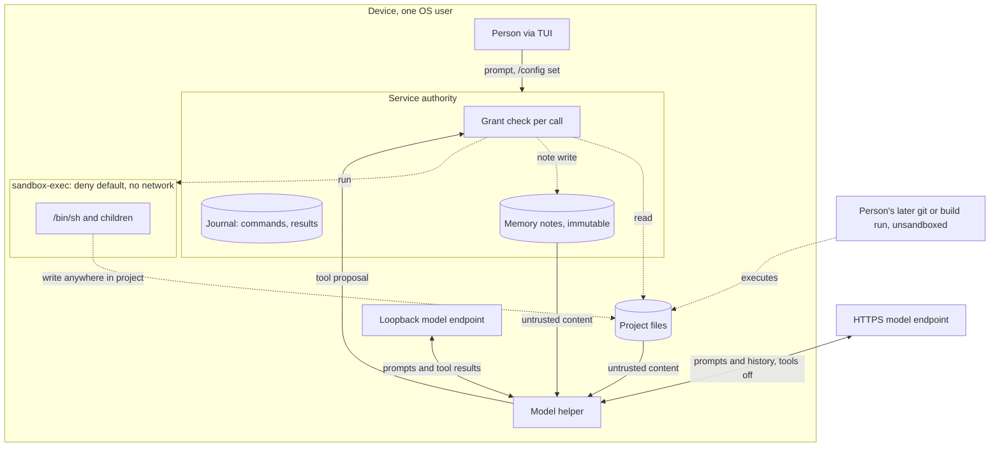
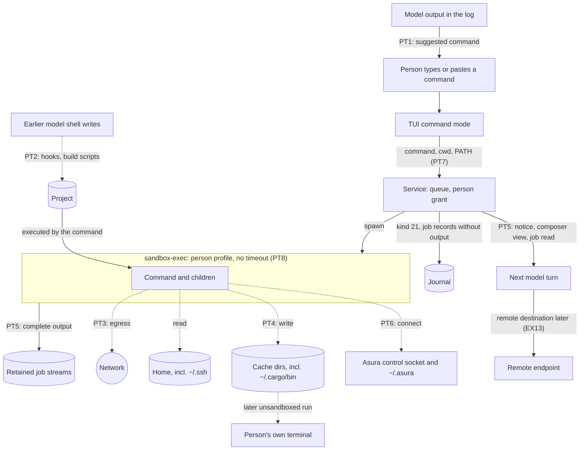

# Execution threat model

Status: proposed threat model, 2026-10-13; not reviewed. The owner directed it on
2026-10-13 because the [architecture](../architecture.md#security-boundaries)
requires a threat model before execution is implemented, and the shell and memory
write tools shipped without one. It assesses implemented behavior against named
threats and records gaps; it selects no new mechanism. Its review gates
[tool job](tool-job-controller.md#delivery-dependencies) packet J2 and remote
[model providers](model-provider-integration.md). Protocol numbering remains `0.1`;
journal format remains `1`.

The [D1 threat model](threat-model.md) remains the canonical source for local
bootstrap, project status and the same-UID principal choice. This document
extends it to model-driven effects.

## Scope

In scope:

- **Implemented:** the shell tool, memory note writes, project and memory reads
  by the model, and model endpoints, including HTTPS Ollama endpoints.
- **Proposed:** [tool jobs](tool-job-controller.md) and remote providers through
  the OpenAI API specification.
- **Proposed:** person-typed `!` commands; see
  [Person-typed commands](#person-typed-commands).

Out of scope: remote Asura hosts, sensors acting autonomously, plan and task
execution, and network access from tools. Each needs its own review.

## Assets

| Asset | Required protection |
| --- | --- |
| Project source and repository metadata | Only effects the person's request implies; no persistence that runs outside Asura's confinement |
| Files outside the project | No read or write by tools |
| Secrets in the project or environment | No egress off the device; minimal persistence in Asura records |
| Model context and stored memory | Untrusted content never gains instruction priority |
| Conversation content | Leaves the device only to a destination the person chose |
| Host processes | No tool process outlives its bound or escapes confinement |

## Threat sources

| Source | Capability | Trust |
| --- | --- | --- |
| Untrusted content: repository files, tool output, fetched text, memory notes | Embeds instructions that the model may follow (prompt injection) | Untrusted data |
| The model | Proposes any tool call within the offered tools, mistakenly or under injection | Untrusted proposer; the service authorizes |
| Remote endpoint operator or network path | Receives everything sent; can return crafted output | Separate trust boundary |
| Same-UID process | Calls the control API, squats a loopback port, edits state | One principal under the [D1 choice](threat-model.md#scope-assets-and-actors); no resistance claimed |
| The person | Configures endpoints and runs commands | Trusted principal |

## Trust boundaries

Proposed view of implemented paths. Solid arrows carry data or proposals; dashed
arrows carry effects. Every model proposal crosses the service authorization
boundary before an effect.

## Threats, current mitigations and gaps

"Code" cites implemented behavior; "Gap" is a difference from a required outcome.

| ID | Threat | Current mitigation (code) | Gap |
| --- | --- | --- | --- |
| EX1 | Injected content leads the model to write a persistent payload, such as a Git hook or build script, that the person later runs outside the sandbox | Writes confined to project and scratch (`asura-platform/src/shell/guardian.rs:108-140`); each call is journaled | The whole project, including `.git`, is writable. No per-command approval exists, by [design](shell-tool.md). Nothing separates a source edit from a write that executes later. |
| EX2 | Shell exfiltrates data over the network | Profile has no network rule under `(deny default)` | None found for the sandboxed process tree |
| EX3 | Shell reads secrets outside the project | Reads limited to system roots, project and scratch; environment replaced (`guardian.rs:170, 197-208`) | Design lists a developer directory root the code omits; this is narrower, not a leak |
| EX4 | Model reads project secrets such as `.env` and they persist in Asura records | Tool results bounded to 16 KiB; journal is local and private | No secret detection, by design. Raw commands and results are journaled (`asura-storage/src/authority/conversation/types.rs:12-15`). Tool jobs would retain up to 64 MiB per job. |
| EX5 | A tool process outlives its turn or bound | Own process group; TERM then KILL; at most 256 members checked (`guardian.rs:292-377`) | A double-forked or new-session process escapes cleanup ([documented limit](shell-tool.md)). It stays inside the inherited sandbox. |
| EX6 | Injected content is written to memory and steers later sessions | Notes labelled untrusted in tool descriptions and instructions (`asura-service/src/conversation.rs:21`); notes are read only on request | Notes are immutable and cannot be deleted; no person review of model-written notes |
| EX7 | Conversation content leaves the device | Tools are disabled unless the endpoint is numeric loopback with helper attestation (`asura-service/src/model_owner.rs`). Since 2026-10-13, non-loopback endpoints are refused; see [the conflict below](#conflict-with-the-remote-provider-gate). | Before that change, an HTTPS endpoint was accepted (`asura-storage/src/config.rs:395`) and receives instructions, prior prompts, prior final answers and the current prompt. Prior final answers can quote project content from earlier local turns (inference from the history composition, not tested). |
| EX8 | Remote endpoint impersonation or interception | System TLS validation; no redirects, cookies, cache or proxy (`OllamaBackend.swift:134-151`) | No credentials are sent today; credential storage is undesigned |
| EX9 | Same-UID process squats the loopback model port | Same-UID is one principal under D1 | A squatter receives prompts and tool results; accepted under D1, not mitigated |
| EX10 | Execution is enabled for a model not qualified for it | Shell is denied for remote destinations (`asura-service/src/tools.rs:356-375`) | Design qualifies shell for the system model only; code offers it to every tool-capable local provider (`ToolBridge.swift:78-84`) |
| EX11 | The person cannot turn execution off | — | `execute_authorized` and `read_authorized` are constant `true` (`conversation.rs:196-206`); only a build constant disables tools |
| EX16 | The model reads or writes Asura's own state: journals, configuration, database and logs under `~/.asura` | The shell profile has no network rule, so it cannot connect to the control socket (inferred from Seatbelt deny-default, not tested). File tools open each path component with `O_NOFOLLOW` under the pinned project root (`asura-platform/src/project_identity.rs:107-120`). | Registration accepts any root that is `~/.asura`, lies inside it, or contains it, such as `~` (`asura-service/src/conversation.rs:1570`; `asura-storage/src/authority/writer/state.rs:1246-1295`; `asura-platform/src/project_identity.rs:14-49`). The profile's `(subpath project)` then grants read and write over `~/.asura`, and `read_file` reaches `.asura/config.yaml`. Fixed by the PX3 decision; designed in [Asura state isolation](asura-state-isolation.md); not implemented. |

## Proposed capabilities

| ID | Threat | Required outcome before implementation |
| --- | --- | --- |
| EX12 | Tool job effects continue after the turn | Jobs keep the original grant and sandbox, have a bounded lifetime, are visible to the person and are cancelled by revocation; see [tool job security](tool-job-controller.md#security-and-authority). Retained output follows EX4. |
| EX13 | Remote provider receives project content and tool results | A destination grant names what may leave the device. Tools that read project content stay off for remote destinations unless a later decision allows them. |
| EX14 | Provider API keys are exposed | Keys live in the OS credential facility, never in configuration, journal, prompts or logs. |
| EX15 | Remote spend runs away | Spend ceilings under [ADR-0003](../decisions/0003-aggregate-budget-admission.md) and [loop closure](loop-closure.md). |

## Conflict with the remote provider gate

The owner required on 2026-10-13 that remote providers wait for this review.
HTTPS Ollama endpoints already worked for inference without tools (EX7). The
owner resolved the conflict the same day: Ollama endpoints are restricted to
loopback until the review. The [provider design](model-provider-integration.md#loopback-endpoint-restriction--selected-2026-10-13)
owns the restriction.

## Validation required

Each implemented finding needs an adversarial fixture. Unit tests cover grant and
profile decisions; integration tests use real `sandbox-exec` and real endpoints;
end-to-end tests drive the TUI with a native model where a model is involved.

| ID | Case |
| --- | --- |
| EX-V1 | Shell writes to `.git/hooks` and a build script; record the result |
| EX-V2 | Shell network attempts by `curl`, `nc` and a raw socket fail |
| EX-V3 | Shell reads of home secrets, `/private/var` and other projects fail |
| EX-V4 | A planted instruction in a project file and in a memory note; observe model behavior |
| EX-V5 | Double-fork and `setsid` escape; confirm the sandbox still confines the escapee |
| EX-V6 | HTTPS endpoint request content captured; confirm no tool results or file pages |
| EX-V7 | Provider switch from local to remote mid-conversation; record which history leaves |

## Open decisions

1. EX1: resolved for implicit-execution paths on 2026-10-14 under
   [PX1](#person-command-decisions): model writes are denied and changes need
   person approval. Build and test paths stay writable, with a warning before
   person commands. The approval flow is not yet designed.
2. EX4: limit what Asura persists from tool results and commands. Under PX6,
   the outcome also applies to person commands.
3. EX6: add memory deletion and person review of model-written notes.
4. EX7: whether and how non-loopback endpoints return after the review.
5. EX10: restrict shell to qualified models, or qualify the others.
6. EX11: add a person-controlled execution setting.

## Person-typed commands

Status: proposed section, 2026-10-13. The owner directed it so that
[person command mode](person-command-mode.md) can be implemented once this
section is approved. The owner resolved its decisions PX1–PX6 on 2026-10-14;
approval of the section as a whole is still pending. Approval of this section
does not approve EX1–EX15 or the open decisions above, except the EX1 and EX16
outcomes that PX1 and PX3 record. The owner resolved the design's decisions
PC1–PC12 on 2026-10-14; its other mechanisms remain proposals.
On 2026-10-13 the owner decided that a person command runs as a
[tool job](tool-job-controller.md) that retains its complete output, and that
journal records hold references instead of output text
([tool output views](tool-output-views.md)). This section reflects both.

### What changes

The person, a trusted principal, runs a command through the shell path with a
person execution profile. The owner fixed its terms on 2026-10-13. Compared
with the model's shell, a person command:

- has network access;
- reads across the person's home, including `~/.ssh`;
- writes the project, `$TMPDIR` and `~/.cargo`, `~/.rustup`, `~/.cache`,
  `~/Library/Caches` and `~/.npm`;
- uses the person's PATH and HOME;
- has no timeout; the person stops it;
- runs as a tool job that retains its complete output;
- queues behind model turns, and its outcome reaches the model as a notice.

The sandbox keeps write confinement. Shell configuration, `~/.ssh` and other
dotfiles stay read-only. The person typing a command is the approval; there is
no classifier or prompt. A person command can never do more than the same
command typed in the person's own terminal, which is unsandboxed.

### Person command trust view

Proposed view. Solid arrows carry data or requests. Dashed arrows carry effects.
Labels PT1–PT8 mark where the threats below act.

### Existing threats that apply

| ID | Effect for person commands |
| --- | --- |
| EX1 | Amplified. Model-written hooks and build scripts run when the person types `!git commit` or `!cargo build`. They then run with network, home reads and cache writes. See PT2. |
| EX2 | Changed. Network is allowed by owner decision. See PT3. |
| EX3 | Changed. Home reads are allowed by owner decision. |
| EX4 | Applies, more widely. The job retains each command's complete output under the retention quota; journal records hold references, not text. The person may print secrets. See PT5. |
| EX5 | Applies, with no timeout. The owned-group cleanup and the documented escape limit are unchanged. See PT8. |
| EX7, EX13 | Apply to the model view. The composer may place output with the notice, and the model may page the streams if PC10 allows. Either sends output to the model's destination. See PT5. |
| EX6, EX8, EX9, EX10, EX12 | Not affected. The person command has no memory write, no credentials and no model proposer. |
| EX11 | Does not apply. Each person command is an explicit person action. |

### New threats, mitigations and gaps

"Required" names a control the [design](person-command-mode.md) must deliver.
"Gap" is residual risk that needs an owner decision.

| ID | Threat | Required mitigation | Gap |
| --- | --- | --- | --- |
| PT1 | Injected text in model output persuades the person to run a command, for example by pasting a line that starts with `!` | No UI affordance copies model output into command mode. Recall holds only submitted person text. Command mode is visible: amber box, `!` marker, cwd hint. The log sanitizes control and escape bytes. | A pasted multi-line command still runs every command on one Enter. Under PX5 the composer shows each command and every hidden character before Enter. The splitter is a display pre-pass, not a shell; text it cannot parse is shown unsplit. |
| PT2 | Model-planted project content, such as `.git/hooks` or `build.rs`, runs under the person profile | Write confinement still holds. Writes to shell configuration and dotfiles are denied. Under PX1, model writes to implicit-execution paths need person approval, and changed build and test paths are flagged before a person command. | Approved or flagged code can still read `~/.ssh` and send it over the network, as in the person's own terminal. The approval flow and change detection are not designed. |
| PT3 | Exfiltration over the network | None beyond the person's intent. Audit records each command's outcome without content. | Accepted by owner decision for the person's own commands. Combined with PT2 it is the main residual risk. |
| PT4 | A command writes cache directories that run later outside the sandbox: `~/.cargo/bin` is usually on PATH, and `~/.cargo/config.toml` can set a compiler wrapper | Shell configuration and dotfiles stay read-only. | Writable caches allow persistence into later unsandboxed runs. Accepted by the owner under PX2. |
| PT5 | Secrets in output persist in retained job output and reach the model | Retained output is private and local, and expires under the job retention rules. Journal records and audit never hold output. The notice labels the action as the person's and any output as untrusted. | No secret detection. Complete output stays readable until it expires or the person deletes it. By PX4, a remote destination receives notices and pages as a local model does. Accepted under PX6 until EX4 decision 2 is made. |
| PT6 | A command, or planted code it runs, reaches Asura's control socket or `~/.asura` and acts as the person | The service accepts command submits only on authenticated control attachments, and the model channel has no such message. The `~/.asura` tree is not writable. | Closed by PX3 once implemented: the profile denies the socket and `~/.asura`. Until then, with network allowed, a command could connect to the socket and read every project's journals. |
| PT7 | The client's environment leaks into the service, or a PATH entry runs project-planted binaries | Only PATH and the PC3 allow-list are sent. The service drops empty and relative PATH entries, never adopts the client's PATH into its own environment, and never logs or audits it. HOME comes from the account database. | An absolute PATH entry inside the project, such as a direnv `bin`, still runs project content. Accepted as the person's configuration. |
| PT8 | A command runs unattended: no timeout and the client has gone | Ctrl-C, `/cancel`, `/job cancel` from any TUI and service shutdown stop it. Guardian lease EOF stops it on service death. | By owner decision (PC5) a command keeps running after the TUI exits, as other accepted work does. It stays listed in `/jobs` for any TUI to cancel. Accepted. |

The model cannot forge a person command. It has no control attachment, and its
shell profile has no network access, so it cannot reach the control socket.
The notice states that the person ran the command and that the model did not.
This prevents the model from treating the person's action as its own work.

### Sensitive read reporting

Proposed control for PT2 and PT3, directed by the owner on 2026-10-14; not
selected. It detects reads after they happen and prevents none. PCR8 still
allows the reads.

- The person profile marks a fixed list of sensitive paths as allowed with a
  Seatbelt report, for example `(allow file-read* (with report) (subpath …))`.
  Initial list for review: `~/.ssh`, `~/.aws`, `~/.config/gh`, `~/.netrc` and
  `~/Library/Keychains`.
- The service reads the resulting unified-log entries for the job's processes.
  It records an audit event per job with the paths read, never contents.
- The job summary and the log fold state that the command read sensitive
  paths and whether network was allowed.

Gate: unverified. A probe must first show on macOS 27 that `(with report)` is
accepted on an allow rule, that a report entry appears for the read, and that
the service can read that entry without root or a new entitlement. The probe
needs its own short design before it runs. If any check fails, this control is
dropped and the gap stays as written in PT2 and PT3.

Alternatives considered: Endpoint Security file events (need Apple's
entitlement, root and a system extension), `fs_usage` and DTrace (need root;
System Integrity Protection blocks DTrace), and decoy files in the home
directory (Asura would plant files in the person's home, and only decoy reads
are caught).

### Person command validation

| ID | Case |
| --- | --- |
| PX-V1 | Writes to `~/.zshrc`, `~/.ssh/config`, `~/.gitconfig` and `~/.asura` fail; writes to the project, `$TMPDIR` and an existing cache directory succeed |
| PX-V2 | A model shell write to `.git/hooks/pre-commit`, a nested `.git/hooks/`, `.git/config` and `.envrc` fails; after person approval, the hook runs under `!git commit`; record what it can read, write and reach |
| PX-V9 | The model edits `build.rs` and `package.json`; the next `!cargo build` shows the change warning naming both files; a second command without new model writes shows none |
| PX-V10 | If sensitive read reporting is selected: `!cat ~/.ssh/known_hosts` fixture produces one audit event naming the path with no contents; a read outside the list produces none |
| PX-V3 | From the model and person profiles: connecting to the control socket, and reading or writing `~/.asura/config.yaml` and a journal, all fail; the profile's own scratch stays writable. Registering `~`, `~/.asura` and `~/.asura/tmp` as projects fails, including through a symlinked spelling. `read_file` cannot reach Asura state. |
| PX-V4 | A client PATH with `.`, an empty entry and a relative entry; a planted `ls` in the project does not run for `!ls` |
| PX-V5 | No client message other than the typed submit creates a person command; the model channel cannot |
| PX-V6 | For `!cat` of a fixture secret, no journal record or audit event holds the secret; the notice entry carries the untrusted-data label; any output the model receives comes from the composer's view or a page it requested |
| PX-V7 | The TUI exits while a command runs: the command continues and a second TUI cancels it; with a TUI-launched backend, exit stops it and no process remains in the owned group |
| PX-V8 | Audit records for person commands contain no command, PATH or output bytes |

### Person command decisions

1. **PX1 — Planted content under the person profile (PT2).** Selected by the
   owner on 2026-10-14, together with EX1 decision 1: run-later paths are split
   into two kinds.
   - **Implicit-execution paths** run without the person asking to run project
     code. The model's shell profile denies writes to them, and a change needs
     the person's approval. Initial list, for the approval design to confirm:
     `.git/hooks/` and any nested `.git/hooks/`, `.git/config`,
     `.gitattributes`, `.gitmodules`, `.envrc`, and `.cargo/config` and
     `.cargo/config.toml` in the project. This also protects the person's own
     terminal. Cost: model Git operations that write `.git/config`, such as
     `git config`, `git remote add` and branch tracking, fail and must go
     through approval.
   - **Build and test paths** run when the person builds or tests, such as
     `build.rs`, `Makefile`, `package.json` scripts and test code. The model may
     write them. Before a person command runs, the TUI warns when the model
     changed any of them since the person's last command.
   Seatbelt cannot ask the person mid-command, so approval is a proposal the
   person accepts and Asura applies outside the model's sandbox. The approval
   flow, the build-path list and change detection need their own design.
   Rejected: accepting the risk with documentation only, approval for build
   and test paths too, and denying network while unreviewed model writes
   exist.
2. **PX2 — Cache write roots (PT4).** Selected by the owner on 2026-10-14:
   keep the owner's list unchanged. A person command can already persist
   through project files, so narrower roots remove little risk and break common
   commands such as `cargo install` and toolchain updates. Rejected: denying
   `~/.cargo/bin` and the Cargo configuration files, and allowing only cache
   subdirectories.
3. **PX3 — Asura's own state and control socket (PT6, EX16).** Selected by the
   owner on 2026-10-14, for every execution profile and model tool, not only
   person commands:
   - Project registration rejects a root that is `~/.asura`, lies inside it, or
     contains it, such as the home directory. The check compares retained
     directory identities, not path text. This closes the model's shell and
     file-tool paths with one owner.
   - Every shell profile explicitly denies reads, writes and connections under
     `~/.asura`, except the profile's own private scratch directory, which the
     guardian allows by its exact descriptor. The person profile needs this
     because it reads the home directory and has network access.
   - Asura's state and control plane are reachable only through typed,
     authorized interfaces. The owner expects agent management tools later;
     they will be registry tools with their own grant, an agent principal and
     audit, never shell access to the control socket. Principals other than
     the person on the control API need their own design.
   Cost: the home directory cannot be registered as a project, and `!asura …`
   commands do not work inside Asura. Rejected: allowing any root and carving
   `~/.asura` out of each profile and tool, and protecting the person profile
   only.
4. **PX4 — Notice egress to a non-local model (PT5, EX13).** Selected by the
   owner on 2026-10-14: a remote destination receives the same person notice
   entries and the same `job read` access to person jobs as a local model.
   Person command text and output can therefore leave the device when a remote
   provider is selected. This is the owner's answer for person job output under
   EX13; the destination grant still governs other tools that read project
   content. Non-loopback endpoints are refused today, so the decision takes
   effect when remote providers return. Rejected: withholding output from
   remote destinations until a destination grant covers it, and sending them
   no notice.
5. **PX5 — Pasted commands (PT1).** Selected by the owner on 2026-10-14: the
   composer shows what will run, with no approval step.
   - A shell-aware splitter, ported from Wisp's `CommandSplitter`, divides the
     command into top-level commands. Each starts with a caret, and a rule
     separates commands ended by newline, `;` or `&`. The hint row counts the
     commands. See [command display](person-command-mode.md#command-display).
   - Hidden characters show as a red block in both composer modes. See
     [composer interactions](composer-interactions.md#hidden-characters--selected-2026-10-14).
   Rejected: a rule per raw line, which misplaces quoted newlines and `a; b`;
   a caret per pipeline and `&&` segment; and a confirmation before
   multi-line commands.
6. **PX6 — Secret-bearing output (PT5, EX4).** Selected by the owner on
   2026-10-14: accept the risk now, and apply the outcome of EX4 open decision
   2 to person commands as well as model tools. One rule governs both. A
   person-chosen private variant may follow as a later feature. Rejected for
   now: a private variant in this design, and token redaction, which catches
   only known formats and gives false assurance.

## Design verification

The facts above were gathered from the code on 2026-10-13 by a read-only research
pass and spot-checked by the primary. No adversarial test was run. The diagram was
rendered locally with Mermaid CLI 12 and inspected. The person-typed commands
section was added on 2026-10-13 from code and design inspection; its diagram was
rendered with Mermaid CLI 12.0.0 and inspected. No adversarial test was run.
