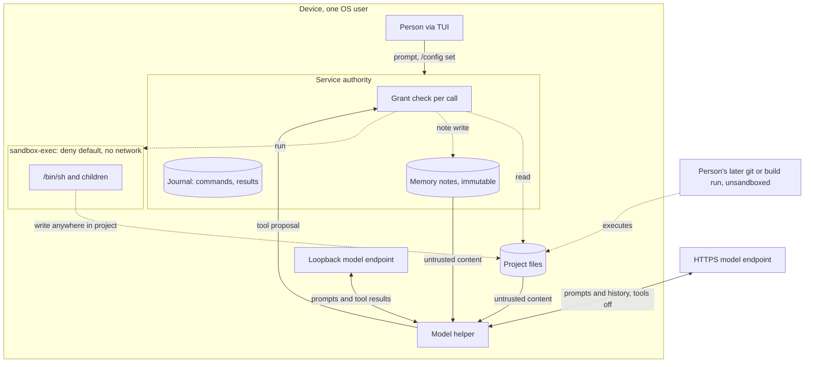

# Execution threat model

Status: proposed threat model, 2026-10-13; not reviewed. The owner directed it on
2026-10-13 because the [architecture](../architecture.md#security-boundaries)
requires a threat model before execution is implemented, and the shell and memory
write tools shipped without one. It assesses implemented behavior against named
threats and records gaps; it selects no new mechanism. Its review gates
[tool job](tool-job-controller.md#delivery-dependencies) packet J2 and remote
[model providers](model-provider-integration.md). Protocol numbering remains `0.1`;
journal format remains `1`.

The [D1 threat model](threat-model.md) remains the canonical source for local
bootstrap, project status and the same-UID principal choice. This document
extends it to model-driven effects.

## Scope

In scope:

- **Implemented:** the shell tool, memory note writes, project and memory reads
  by the model, and model endpoints, including HTTPS Ollama endpoints.
- **Proposed:** [tool jobs](tool-job-controller.md) and remote providers through
  the OpenAI API specification.

Out of scope: remote Asura hosts, sensors acting autonomously, plan and task
execution, and network access from tools. Each needs its own review.

## Assets

| Asset | Required protection |
| --- | --- |
| Project source and repository metadata | Only effects the person's request implies; no persistence that runs outside Asura's confinement |
| Files outside the project | No read or write by tools |
| Secrets in the project or environment | No egress off the device; minimal persistence in Asura records |
| Model context and stored memory | Untrusted content never gains instruction priority |
| Conversation content | Leaves the device only to a destination the person chose |
| Host processes | No tool process outlives its bound or escapes confinement |

## Threat sources

| Source | Capability | Trust |
| --- | --- | --- |
| Untrusted content: repository files, tool output, fetched text, memory notes | Embeds instructions that the model may follow (prompt injection) | Untrusted data |
| The model | Proposes any tool call within the offered tools, mistakenly or under injection | Untrusted proposer; the service authorizes |
| Remote endpoint operator or network path | Receives everything sent; can return crafted output | Separate trust boundary |
| Same-UID process | Calls the control API, squats a loopback port, edits state | One principal under the [D1 choice](threat-model.md#scope-assets-and-actors); no resistance claimed |
| The person | Configures endpoints and runs commands | Trusted principal |

## Trust boundaries

Proposed view of implemented paths. Solid arrows carry data or proposals; dashed
arrows carry effects. Every model proposal crosses the service authorization
boundary before an effect.

## Threats, current mitigations and gaps

"Code" cites implemented behavior; "Gap" is a difference from a required outcome.

| ID | Threat | Current mitigation (code) | Gap |
| --- | --- | --- | --- |
| EX1 | Injected content leads the model to write a persistent payload, such as a Git hook or build script, that the person later runs outside the sandbox | Writes confined to project and scratch (`asura-platform/src/shell/guardian.rs:108-140`); each call is journaled | The whole project, including `.git`, is writable. No per-command approval exists, by [design](shell-tool.md). Nothing separates a source edit from a write that executes later. |
| EX2 | Shell exfiltrates data over the network | Profile has no network rule under `(deny default)` | None found for the sandboxed process tree |
| EX3 | Shell reads secrets outside the project | Reads limited to system roots, project and scratch; environment replaced (`guardian.rs:170, 197-208`) | Design lists a developer directory root the code omits; this is narrower, not a leak |
| EX4 | Model reads project secrets such as `.env` and they persist in Asura records | Tool results bounded to 16 KiB; journal is local and private | No secret detection, by design. Raw commands and results are journaled (`asura-storage/src/authority/conversation/types.rs:12-15`). Tool jobs would retain up to 64 MiB per job. |
| EX5 | A tool process outlives its turn or bound | Own process group; TERM then KILL; at most 256 members checked (`guardian.rs:292-377`) | A double-forked or new-session process escapes cleanup ([documented limit](shell-tool.md)). It stays inside the inherited sandbox. |
| EX6 | Injected content is written to memory and steers later sessions | Notes labelled untrusted in tool descriptions and instructions (`asura-service/src/conversation.rs:21`); notes are read only on request | Notes are immutable and cannot be deleted; no person review of model-written notes |
| EX7 | Conversation content leaves the device | Tools are disabled unless the endpoint is numeric loopback with helper attestation (`asura-service/src/model_owner.rs`). Since 2026-10-13, non-loopback endpoints are refused; see [the conflict below](#conflict-with-the-remote-provider-gate). | Before that change, an HTTPS endpoint was accepted (`asura-storage/src/config.rs:395`) and receives instructions, prior prompts, prior final answers and the current prompt. Prior final answers can quote project content from earlier local turns (inference from the history composition, not tested). |
| EX8 | Remote endpoint impersonation or interception | System TLS validation; no redirects, cookies, cache or proxy (`OllamaBackend.swift:134-151`) | No credentials are sent today; credential storage is undesigned |
| EX9 | Same-UID process squats the loopback model port | Same-UID is one principal under D1 | A squatter receives prompts and tool results; accepted under D1, not mitigated |
| EX10 | Execution is enabled for a model not qualified for it | Shell is denied for remote destinations (`asura-service/src/tools.rs:356-375`) | Design qualifies shell for the system model only; code offers it to every tool-capable local provider (`ToolBridge.swift:78-84`) |
| EX11 | The person cannot turn execution off | — | `execute_authorized` and `read_authorized` are constant `true` (`conversation.rs:196-206`); only a build constant disables tools |

## Proposed capabilities

| ID | Threat | Required outcome before implementation |
| --- | --- | --- |
| EX12 | Tool job effects continue after the turn | Jobs keep the original grant and sandbox, have a bounded lifetime, are visible to the person and are cancelled by revocation; see [tool job security](tool-job-controller.md#security-and-authority). Retained output follows EX4. |
| EX13 | Remote provider receives project content and tool results | A destination grant names what may leave the device. Tools that read project content stay off for remote destinations unless a later decision allows them. |
| EX14 | Provider API keys are exposed | Keys live in the OS credential facility, never in configuration, journal, prompts or logs. |
| EX15 | Remote spend runs away | Spend ceilings under [ADR-0003](../decisions/0003-aggregate-budget-admission.md) and [loop closure](loop-closure.md). |

## Conflict with the remote provider gate

The owner required on 2026-10-13 that remote providers wait for this review.
HTTPS Ollama endpoints already worked for inference without tools (EX7). The
owner resolved the conflict the same day: Ollama endpoints are restricted to
loopback until the review. The [provider design](model-provider-integration.md#loopback-endpoint-restriction--selected-2026-10-13)
owns the restriction.

## Validation required

Each implemented finding needs an adversarial fixture. Unit tests cover grant and
profile decisions; integration tests use real `sandbox-exec` and real endpoints;
end-to-end tests drive the TUI with a native model where a model is involved.

| ID | Case |
| --- | --- |
| EX-V1 | Shell writes to `.git/hooks` and a build script; record the result |
| EX-V2 | Shell network attempts by `curl`, `nc` and a raw socket fail |
| EX-V3 | Shell reads of home secrets, `/private/var` and other projects fail |
| EX-V4 | A planted instruction in a project file and in a memory note; observe model behavior |
| EX-V5 | Double-fork and `setsid` escape; confirm the sandbox still confines the escapee |
| EX-V6 | HTTPS endpoint request content captured; confirm no tool results or file pages |
| EX-V7 | Provider switch from local to remote mid-conversation; record which history leaves |

## Open decisions

1. EX1: restrict shell writes to `.git` and other paths that run later, require
   approval for them, or accept the risk.
2. EX4: limit what Asura persists from tool results and commands.
3. EX6: add memory deletion and person review of model-written notes.
4. EX7: whether and how non-loopback endpoints return after the review.
5. EX10: restrict shell to qualified models, or qualify the others.
6. EX11: add a person-controlled execution setting.

## Design verification

The facts above were gathered from the code on 2026-10-13 by a read-only research
pass and spot-checked by the primary. No adversarial test was run. The diagram was
rendered locally with Mermaid CLI 12 and inspected.
