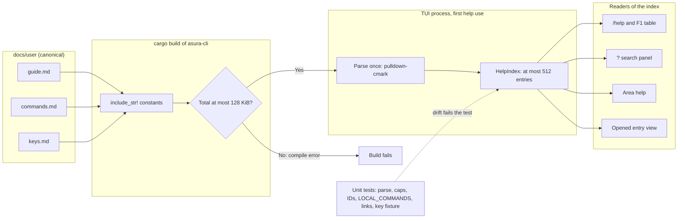
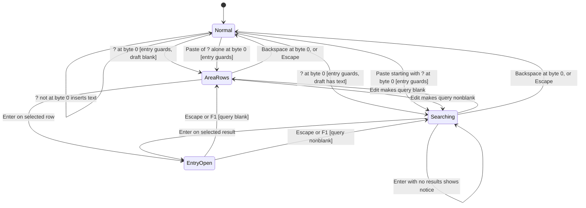
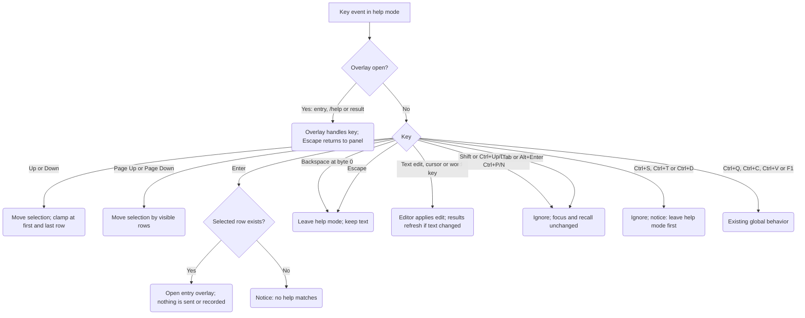
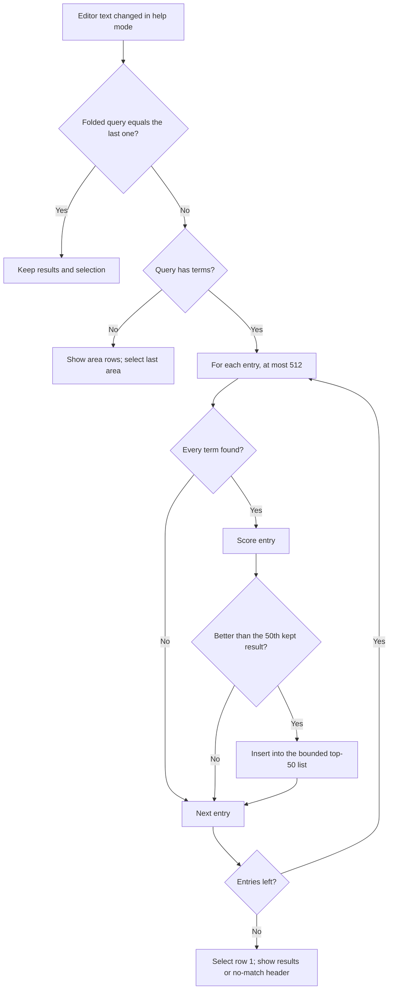

# Help mode

Status: selected design, 2026-10-13; implemented 2026-10-14. The owner decisions
below are required behavior. The owner resolved [HP1–HP6](#resolved-decisions) the
same day. [Implementation notes](#implementation-notes-and-corrections) record where
the delivered code differs from the first text of this design, and
[Verification](#verification-2026-10-14) records the checks that ran. The
[user guide](../user/README.md) describes current behavior and is the single help
source.

Protocol numbering remains 0.1 and journal format remains 1. Help mode adds no
service request, control message, persistence or configuration.

## Scope

Objectives:

- A `?` switch at the start of the input box enters a client-local help mode.
- Search as you type over commands, keys and guide topics, shown in a panel
  directly above the input box.
- Help for the area the person focused last, reached from the box only.
- One help source: the files under `docs/user/`, compiled into the binary and
  read by `/help`, `?` search and area help.

Non-goals:

- The "Ask Asura" model row. It is [deferred](#deferred-ask-asura-row) until a
  dedicated small help model is designed.
- Replacing `/help` or F1. Both stay.
- Generating the hint row from the guide. The hint row remains the composer's
  own short text under [composer interactions](composer-interactions.md#layout-and-interaction).
- The person-run `!` command mode. Its behavior belongs to
  [person command mode](person-command-mode.md). This design states only how the
  two modes must not interfere.
- Help in the noninteractive CLI.

Dependencies: the [focus chain](composer-editor-navigation.md#focus-chain-and-draft-movement--selected-2026-10-13),
the [box styling table](composer-interactions.md#input-styling-and-command-highlighting--selected-2026-10-13),
the bounded editor and recall in [editor navigation](composer-editor-navigation.md#ownership-and-limits),
and the presentation-only Markdown renderer used for model responses.

## Required behavior

Required behavior (owner, 2026-10-13):

1. Typing `?` at cursor position 0 switches the box into help mode when no mode
   is active and no picker is open. The `?` is a switch, not text. A paste that
   begins with `?` at position 0 also enters help mode. A `?` anywhere else is
   ordinary text.
2. Backspace at position 0 leaves help mode and keeps the text.
3. In help mode, the marker becomes `?`. The input box and its half-block strips
   use help indigo `#252D4E`. Text keeps the typed-text style, bold `#E6EDF0`.
   The marker uses glow `#CFF1FF`, bold.
4. Text after `?` filters commands, keys and help topics as the person types.
   Results appear in a panel directly above the box. Up and Down choose a row.
   Enter opens the selected entry.
5. `?` and then Enter on an empty line explains the area the person focused last
   (log, queue, status bar or box) and its keys. This help is reachable only from
   the box.
6. Help lines are not recorded in prompt recall history.
7. One source: the user guide under `docs/user/` covers commands, keys, modes,
   the queue, projects and models. The binary embeds it. `/help`, `?` search and
   area help all read from it. `/help` stays.
8. Help mode is client-local. It makes no service request and no model call. It
   performs no I/O beyond reading content compiled into the binary.
9. A final "Ask Asura: <text>" row is deferred. The panel must allow that row to
   be added later without changing the interaction.

Consequence of rule 1: a conversational message cannot start with `?` typed at
position 0. Under [HP3](#hp3-literal-leading-question-mark), the person types a
leading space; there is no other escape route. The guide must state this.

### Acceptance summary

| ID | Behavior | Observable result |
| --- | --- | --- |
| HA1 | Enter by key | `?` at byte 0 with no selection shows the `?` marker and indigo box; the editor text is unchanged |
| HA2 | Enter by paste | A paste of `?abc` at byte 0 enters help mode with query `abc` |
| HA3 | `?` elsewhere | `a?` and ` ?` are ordinary text; no mode change |
| HA4 | Leave | Backspace at byte 0 restores the normal box with the same text and cursor |
| HA5 | Search | Each edit refreshes the panel; Up/Down select; Enter opens the entry |
| HA6 | Area help | Enter on an empty query opens help for the last focused area |
| HA7 | No recall | Help queries never enter recall; Up/Down never step recall in help mode |
| HA8 | Single source | `/help`, search and area help show text from the embedded guide only |
| HA9 | Local only | No worker request, socket, file or model activity results from help mode |

## Ownership

The Rust TUI client owns help mode completely. No other component participates.

| Owner | Responsibility |
| --- | --- |
| `docs/user/*.md` | Canonical help text, command table and key tables |
| TUI help module (new `tui/help.rs`) | Embedded sources, index build, search, area mapping |
| TUI application (`tui/ui.rs`, `ui/help_mode.rs`, `ui/composer.rs`) | Mode state, key routing, panel and entry rendering, last-area tracking. `ui/help_mode.rs` holds the help-mode state and its routing; `ui.rs` keeps the overlay, `/help` table and layout hooks |
| Editor (`tui/editor.rs`) | Query text editing through its existing bounded paths. It adds two read-only helpers, `at_start` and `prefix(max)`, so the entry guard and search never copy the whole draft |
| Recall history (`tui/history.rs`) | Unchanged; help mode never calls `record`, `previous` or `next` |
| Markdown renderer (`ui/markdown.rs`) | Presentation of an opened entry, reused unchanged |

Dependency direction: the application reads the help module; the help module
reads only compiled constants and `pulldown-cmark`, already a locked dependency
of `asura-cli`. The help module has no dependency on workers, the client crate
or the service. The `/help` overlay stops using the literal `help_table` rows
and renders the index instead.

## Content pipeline

### Content pipeline view

Proposed mechanism. Arrows show build-time inclusion, one-time parsing and
read-only use. Dashed arrows are checks that fail the build or the test run.



### Embedding

Proposed mechanism ([HP1](#hp1-embedding-path)): the help module embeds each file
with `include_str!(concat!(env!("CARGO_MANIFEST_DIR"), "/../../../docs/user/guide.md"))`,
and likewise for `commands.md` and `keys.md`. `README.md` is an index and is
not embedded.

- `include_str!` records each file as a build input, so Cargo rebuilds the
  binary when the guide changes. No build script is needed.
- The path leaves the crate directory. `asura-cli` has `publish = false`, and
  the [release pipeline](release-distribution.md) builds from one clean
  workspace revision, so `cargo package` is not a supported path. A
  `cargo package` attempt fails at compile time rather than shipping without help.
- The binary needs no runtime resource lookup, which avoids the keg relocation
  concern in the release design.
- A compile-time assertion, `const _: () = assert!(TOTAL_LEN <= 131_072);`,
  fails the build if the three files exceed 128 KiB together.

### Guide format contract

Required for files under `docs/user/` (proposed with this design):

| Element | Rule | Index result |
| --- | --- | --- |
| Level-1 heading | Exactly one per file, first block | Topic entry for the file introduction |
| Level-2 and level-3 headings | Unique slug within the file | Topic entry; body runs to the next heading of level 1–3 |
| Command table | Header row exactly `Command`, `Action`; first cell is one code span starting with `/` | One command entry per row |
| Key table | Header row exactly `Key`, `Action`; under a heading that names an area | One key entry per row |
| `(Planned)` in a heading | Marks designed, unimplemented behavior | Entry carries a `Planned` label in results |
| Relative links | Target an embedded file and heading slug | Must resolve to an entry ID |

Other tables, lists and paragraphs are topic body text.

### Entry identity

Proposed mechanism ([HP2](#hp2-entry-ids)): IDs derive from headings and table
cells; they are stable while the headings and cells are unchanged.

| Kind | ID form | Example |
| --- | --- | --- |
| Topic | `<file stem>#<heading slug>` | `guide#use-the-queue` |
| Command | `command:<syntax>` | `command:/project add PATH` |
| Key | `key:<section slug>:<key cell>` | `key:queue-keys:Enter` |

The slug uses the GitHub rule: lowercase, remove punctuation other than `-` and
`_`, and replace each space with `-`. A test enforces uniqueness. Area mapping
and link checks refer to these IDs, so renaming a heading fails a test instead of
silently breaking area help.

### Index structure and limits

| Field | Limit |
| --- | --- |
| Entries | At most 512 |
| Title | At most 120 bytes; command syntax or key cell for table rows |
| Summary | At most 160 bytes; the `Action` cell, or the first sentence of a topic |
| Display body | Byte range into the embedded source, at most 16 KiB per entry |
| Search text | Folded title, area and kind labels, and at most 2 KiB of folded body |
| Total folded text | At most 160 KiB, built once |

The index is built once per process, on first use of `/help`, F1 or help mode,
and kept in a `OnceLock`. Parsing 128 KiB is bounded CPU work with no I/O. The
parser keeps the source as `&'static str` and stores byte ranges, so opening an
entry copies only that entry's Markdown into the renderer.

### Single source for `/help` and command names

Proposed mechanism ([HP4](#hp4-key-drift-guard)):

- `/help` and F1 render the command entries in guide order, then the key entries
  grouped by their section heading. The existing wrapping, scroll and close keys
  stay. The literal `help_table` rows are removed.
- `LOCAL_COMMANDS` stays in code because parsing, Tab completion and command
  highlighting depend on it. A unit test requires that the first word of each
  command row is in `LOCAL_COMMANDS`, and that each `LOCAL_COMMANDS` name has at
  least one command row. Either missing direction fails the test.
- A test fixture lists the key chords each area's router handles. A unit test
  compares it with the guide's key cells for that area after splitting
  `A or B` and `A, B or C`. Router tests use the same fixture, so a routing
  change that omits the guide fails.

## Mode state and transitions

The application holds `help: Option<HelpMode>`. `HelpMode` records the area
captured on entry, the last folded query, at most 50 result rows, the selected
row and the panel's first visible row. The editor holds the query text; the `?`
is never in the editor text.

### Mode switch view

Proposed mechanism over the required switch rules. Arrows are key or paste
events; guards are in brackets. Leaving help mode never changes the editor text.



`AreaRows`, `Searching` and `EntryOpen` together are help mode. With text after
the cursor, the `?` switch makes that text the query. Escape leaves help mode
under [HP5](#hp5-escape-and-tab).

### Entry guards

Help mode starts only when all of these hold:

- The key is `?` with no modifier or Shift only; terminals report `?` either way.
- Focus is the editor; no overlay, picker, paste capture, response browser or log
  focus is active.
- The cursor is at byte 0 of the draft, with an empty selection. Byte 0 means the
  start of the whole draft, not the start of a later row.
- Neither help mode nor `!` command mode is active.

Entering help mode is an explicit edit: it ends recall browsing, as
[HN2](composer-editor-navigation.md#validation) requires for other edits.
A pasted `?` prefix is removed; the editor inserts the remainder at byte 0
through its existing bounded insert. A paste beginning with `?` elsewhere is
ordinary text.

### Leaving

Backspace at byte 0 with an empty selection leaves help mode. The editor text,
cursor and selection stay unchanged; recall is not browsing. A later Backspace
at byte 0 in normal mode does nothing, as before. Leaving help mode clears its
results and restores the queue panel.

### Last-area tracking

Proposed mechanism ([HP6](#hp6-last-focused-area)): the application keeps
`last_area`, one of Box, Queue, Log or Status bar, initially Box.

| Event | `last_area` result |
| --- | --- |
| Focus enters the queue | Queue |
| Focus enters the log, or the response browser opens | Log |
| Focus enters the status bar or one of its lists | Status bar |
| The person submits a message or command from the box | Box |
| Focus returns to the box | Unchanged |

Help mode captures `last_area` on entry. Help mode cannot move focus, so the
captured area stays fixed until the person leaves help mode.

## Key routing in help mode

Help mode routes keys before the focus chain and before recall. Panels and
dialogs that are already open keep all keys, as today. The opened entry is one
such overlay.

### Key routing view

Proposed mechanism. Arrows show the route of one key event while help mode is
active and the box has focus. Rounded nodes are results.



| Key | Result in help mode |
| --- | --- |
| Printable text, Backspace after byte 0, Delete | Edit the query; refresh results; select the first row |
| Left, Right, Home, End, word keys, Ctrl+A, Ctrl+Z, Ctrl+Y | Existing editor behavior; refresh results only if the text changed |
| Up, Down | Select the previous or next row; clamp; never recall, never move focus |
| Page Up, Page Down | Move the selection by the number of visible rows |
| Enter | Open the selected row; with no rows, show "No help matches" |
| Backspace at byte 0 | Leave help mode and keep the text |
| Escape | Leave help mode and keep the text ([HP5](#hp5-escape-and-tab)) |
| Tab | Ignored; no spaces and no completion ([HP5](#hp5-escape-and-tab)) |
| Alt+Enter | Ignored; queries do not gain new rows |
| Shift+Up/Down, Ctrl+Up/Down, F6 | Ignored; help mode keeps focus in the box |
| Ctrl+P, Ctrl+N | Ignored; recall does not run in help mode |
| Ctrl+S, Ctrl+T, Ctrl+D | Ignored with the notice "Leave help mode first" |
| Ctrl+Q, Ctrl+C | Existing exit behavior; a nonempty query counts as a draft |
| Ctrl+V | Existing paste capture; Insert adds to the query |
| F1 | Opens the `/help` overlay; help mode resumes when it closes |

Recall rules: Enter in help mode never calls `submit`, so no query reaches
`History::record`. Up and Down never call `History::previous` or `next`. When
the person leaves help mode, the text becomes an ordinary draft. Recall records
it only if the person later submits it.

A completed service result that arrives during help mode opens its result panel
as today, above the help panel. Escape closes it and help mode continues.

## Search

### Query normalization

1. Take the editor text. Use at most its first 256 bytes, cut at a character
   boundary.
2. Fold it: apply Unicode lowercase with `str::to_lowercase`, then replace
   whitespace, `+`, `·`, `—` and `,` with a space.
3. Split on spaces. Keep at most 8 distinct terms in order.
4. A query with no terms is blank and shows the [area rows](#area-help).

The index applies the same fold to titles, labels and body text. `Shift+Up`
therefore matches the query `shift up`, and `/project` matches command rows.
Asura applies no Unicode normalization form and no accent folding; the guide is
authored in NFC. This limitation is accepted because no normalization crate is a
dependency of `asura-cli`.

### Matching and ranking

An entry matches when every term is a substring of its folded title, labels or
search text. For each term, the entry scores the highest applicable value:

| Where the term occurs | Score |
| --- | --- |
| At the start of a word in the title | 8 |
| Elsewhere in the title | 5 |
| In the kind label or area name | 3 |
| In the body search text only | 1 |

The entry adds 4 when its folded title starts with the whole folded query.
Results sort by score, highest first. Ties go to command, then key, then topic
entries, then guide order. A `Planned` entry sorts after implemented entries with
the same score.

### Search algorithm view

Proposed mechanism. Arrows show one search after a text change. The loop is
bounded by the entry cap.



### Bounds and performance

- Allocation per changed keystroke: one folded query of at most 1 KiB and one
  result list with capacity 50. Selection keys allocate nothing.
- Work per changed keystroke: at most 8 terms over at most 160 KiB of folded
  text. Results refresh only when the folded query changes.
- Performance objective: at most 2 ms per refresh in a release build on the
  reference Apple silicon Mac, and no visible input delay in the PTY journey.
- The search runs on the TUI event loop. It performs no I/O, takes no lock and
  starts no worker.

## Panel layout

The help panel takes the queue panel's position directly above the box and its
top strip. While help mode is active, the queue panel is hidden. If the queue has
unresolved rows, the help header shows their count, so queue state stays visible.

```text
 ? Help · 12 results · 2 queued                     ← header row
 › Command  /project add PATH   Add a folder as a project and select it
   Command  /project list       List projects with their IDs, names and folders
   Key      Queue: Enter        Send the selected message now; ...
   Topic    Projects            A project is a folder that Asura works in.
▄▄▄▄▄▄▄▄▄▄▄▄▄▄▄▄▄▄▄▄▄▄▄▄▄▄▄▄▄▄▄▄▄▄▄▄▄▄▄▄▄▄▄▄▄▄▄▄▄▄▄▄▄▄  ← top strip, help indigo
? proj                                                ← input box, help indigo
▀▀▀▀▀▀▀▀▀▀▀▀▀▀▀▀▀▀▀▀▀▀▀▀▀▀▀▀▀▀▀▀▀▀▀▀▀▀▀▀▀▀▀▀▀▀▀▀▀▀▀▀▀▀
 Projects  path  git  · 4 chars           0% · system  ← status bar
 ↑↓ select · ↵ open · ⌫ at start or Esc leaves help    ← hint row
```

| Element | Rule |
| --- | --- |
| Background | The existing grey-blue panel colour, with one cell of padding |
| Header | `? Help` plus `N results`, `50+ results`, `No matches` or `Area help`; then the queue count when nonzero |
| Row | Kind label, title, summary; `›` marks the selected row in addition to the selection colours |
| Kind labels | `Command`, `Key`, `Topic`, `Area`, `Guide`, and `Planned` for planned topics |
| Key rows | Title is `<area>: <key cell>` |
| Inner width 60 columns or more (terminal width 62 or more) | Label, title and summary, shortened with `…` |
| Inner width below 60 columns | Label and title only |
| Visible rows | At most 8; fewer when space is short |
| Scrolling | The selected row stays visible; the header adds `n/m` when rows are hidden |
| Hint row | `↑↓ select · ↵ open · ⌫ at start or Esc leaves help` |

Height and small terminals:

- The panel needs its header, at least one row and two padding rows. It uses the
  space between the history area's top and the box's top strip, as the queue
  panel does today.
- At 62x16 with a one-row draft, the panel shows four result rows. A buffer test
  pins this value. The composer's strips need an inner width of 60 (terminal width
  62) and a height of 16, so at 60x16 the box has no strips and the panel shows six
  rows.
- When space is too short for padding, the panel drops the padding rows first.
- When even a header and one row do not fit, the panel is hidden. The hint row
  then shows `? <selected title> · ↵ open`. This applies down to the existing
  30x8 minimum, below which the TUI shows only its resize message.
- No size calculation may underflow when the terminal shrinks.

Box styling follows the [composer styling table](composer-interactions.md#input-styling-and-command-highlighting--selected-2026-10-13).
The marker `?` replaces `›` on the first visual row; after the draft scrolls,
no row shows a marker, as in normal mode. Command highlighting does not apply to
the query.

### Opened entry

Enter opens the selected row as an overlay in the existing overlay area above
the box. The overlay renders the entry's Markdown with the response renderer.
Its title row is `Help · <title> · Esc back`, with `· arrows scroll` when the
content exceeds the space. Up, Down, Left and Right scroll as in other result
panels. Escape and F1 close it and return to the help panel with the same query,
results and selection. The overlay performs no editing.

A key row opens its section, such as `keys#queue-keys`, with the row's text
first. A command row opens its table section, with the row first.

## Area help

With a blank query, the panel shows area rows instead of search results:

| Row | Content |
| --- | --- |
| `Area  <captured area> (last used)` | Selected by default; Enter opens it |
| `Area  <each other area>` | In the fixed order Box, Queue, Log, Status bar |
| `Guide  Commands reference` | Opens `commands#commands-reference` |
| `Guide  Keys reference` | Opens `keys#keys-reference` |

Area help opens one overlay that joins the area's guide section and key
sections, in this order:

| Area | Guide section | Key sections |
| --- | --- | --- |
| Box | `guide#input-box`, `guide#write-and-edit-text` | `keys#input-box-keys`, `keys#keys-anywhere` |
| Queue | `guide#queue-panel`, `guide#use-the-queue` | `keys#queue-keys` |
| Log | `guide#conversation-log`, `guide#browse-responses-and-tool-activity` | `keys#conversation-log-keys`, `keys#response-browser-keys` |
| Status bar | `guide#status-bar` | `keys#status-bar-keys`, `keys#project-and-model-list-keys` |

A unit test requires every ID in this table to exist in the index.

## Deferred Ask Asura row

Deferred future work; not part of this delivery. A later design may add one final
row, `Ask Asura: <query>`, to nonblank result lists. Enter on that row would send
the query to a dedicated small help model, possibly an MLX model distilled or
fine-tuned on the help sources. That design must define the model, admission,
egress, cancellation and the result view.

This design keeps the interaction stable for that addition:

- A panel row is an enum with `Entry`, `Area` and `Guide` variants. A future `Ask`
  variant is one more row kind.
- The result cap of 50 excludes the future row, so it is always reachable.
- Up, Down and Enter keep their meaning. The future row's Enter starts a request
  instead of opening an overlay.
- Until that design exists, no code may contain the `Ask` variant, a model
  request or a help-model setting.

## Failure handling

| Failure | Result |
| --- | --- |
| A guide file is missing | `include_str!` fails the build |
| Total guide size exceeds 128 KiB | The compile-time assertion fails the build |
| Malformed format contract, duplicate IDs, entry over its cap, unresolved link | A unit test fails |
| `LOCAL_COMMANDS` and the command table differ | A unit test fails |
| An area ID is missing | A unit test fails |
| Key fixture and key tables differ | A unit test fails |
| Index build fails at runtime | Not reachable for tested content; defensively, help mode shows one row, "Help content unavailable in this build", and `/help` shows the same line; no panic |
| No search matches | Header `No matches`; Enter shows "No help matches"; text is kept |
| Terminal too small | Panel hidden; hint row shows the selected title |
| Query longer than 256 bytes | Search uses the first 256 bytes; the text is kept |

Because the binary embeds the exact content that the tests parse, a tested
build cannot fail to parse at runtime. The defensive path exists so that a parser
regression cannot crash the client.

## Security

- Help mode crosses no trust boundary. The query never leaves the process. It is
  not sent to the service, a model, a log, an audit record or recall history.
- Help content is compiled into the binary. The reader cannot change it at run
  time and it carries no authority.
- Rendering uses the existing literal and Markdown paths, which drop terminal
  control characters, so a guide mistake cannot emit control sequences.
- Mode is visible by more than colour: the `?` marker, the `? Help` header and
  the help hint row identify it.

## Operations

- Configuration: none.
- Telemetry and audit: none. Help mode records no events.
- Resource bounds: 128 KiB embedded source; index at most 512 entries and
  160 KiB folded text; 50 results; 8 visible rows; 256-byte query prefix;
  8 terms.
- Performance objective: at most 2 ms per refresh in release builds; index build
  at most 10 ms once per process.

## Asynchronous execution

| Rule | Mapping |
| --- | --- |
| AE-01 | Search, routing and rendering are bounded in-memory work on the event loop; they wait for nothing |
| AE-02 | No blocking call exists. `include_str!` resolves at compile time; no file, socket or lock is used |
| AE-03 | Limits are in [Operations](#operations); there is no queue or concurrency |
| AE-04 | No deadline is needed; no operation outlives one key event. Cancellation is not applicable |
| AE-05 | No effects exist. Leaving help mode restores ordinary editing; process exit discards the state |
| AE-06 | Startup does no help work. The index builds on first use. Shutdown has nothing to settle |
| AE-07 | Evidence: the work-bound unit check, and PTY journeys with a stalled and an unavailable backend |

Help mode must stay fully usable while the backend is unavailable, stalled or
busy, because it uses no backend.

## Validation

Unit, render and terminal checks are all required. Test IDs are stable.

### Unit checks

| ID | Initial state | Trigger | Required result |
| --- | --- | --- | --- |
| HU1 | Embedded guide | Build index | Succeeds; entries, titles, bodies and folded text are within limits; IDs are unique |
| HU2 | Embedded guide | Compare command rows with `LOCAL_COMMANDS` | Equal sets in both directions |
| HU3 | Embedded guide | Resolve area table and relative links | Every ID exists |
| HU4 | Embedded guide and key fixture | Compare per area | Equal chord sets |
| HU5 | Synthetic guides | Missing header, bad command cell, duplicate slug, oversized entry | Each returns its typed parse error |
| HU6 | Empty draft, box focused | `?` with no modifier and with Shift | Help mode; text empty; recall not browsing |
| HU7 | Draft `abc`, cursor at 0 | `?` | Help mode; query `abc` |
| HU8 | Draft `abc`, cursor at 1; second case with a selection at 0 | `?` | Ordinary text; no mode |
| HU9 | Picker, overlay, capture, log focus, response browser, `!` mode | `?` at 0 | No mode change |
| HU10 | Box at 0 | Paste `?abc`, paste `?`, paste `a?` | Help with `abc`; help with blank query; ordinary text |
| HU11 | Help mode, query `abc`, cursor at 0 | Backspace | Normal mode; text `abc`; cursor 0 |
| HU12 | Help mode | Escape; Tab; Alt+Enter | Leaves with text kept; Tab and Alt+Enter change nothing |
| HU13 | Help mode with 10 results | Up, Down, Page keys | Selection moves and clamps; recall untouched; focus stays in the box |
| HU14 | Help mode; recall has entries | Up on row 0, Ctrl+P, Ctrl+N | No recall step; history unchanged |
| HU15 | Help mode | Enter on a result | Entry overlay opens; `submit` not called; history length unchanged; no worker request flag set |
| HU16 | Help mode | Shift+Up/Down, Ctrl+Up/Down, F6 | Ignored; focus unchanged |
| HU17 | Help mode, nonempty query | Ctrl+S, Ctrl+T, Ctrl+D | Ignored with notice; no queue request; no exit |
| HU18 | Fixed index | Queries `shift up`, `/proj`, `ENTER`, `queue enter`, `zzz` | Expected top entries and order; no-match result |
| HU19 | Query of 300 bytes with 12 words, multibyte at byte 256 | Refresh | First 256 bytes at a character boundary; 8 terms; no panic |
| HU20 | Last-area events | Visit queue, log, status bar; submit | `last_area` follows the tracking table |
| HU21 | Blank query after each area visit | Enter | Opens that area's help; first row marked `(last used)` |
| HU22 | Index at its 512-entry cap | 1,000 refreshes | Result list never exceeds 50; work counter stays within the per-refresh bound |

### Buffer and render checks

| ID | Terminal | Required result |
| --- | --- | --- |
| HR1 | 80x24, help mode | Box and both strips use `#252D4E`; marker `?` in bold `#CFF1FF`; text bold `#E6EDF0` |
| HR2 | 80x24, scrolled multi-row query | No marker on any row, as in normal mode |
| HR3 | 62x16, one-row query | Header and exactly four rows; padding present. At 60x16 the box has no strips and the panel shows six rows |
| HR4 | 59x16, 60x15 and 60x16 | Narrow rows omit summaries; strips follow the existing thresholds. 62x16 shows summaries and strips |
| HR5 | 30x8 | Panel hidden; hint row shows the selected title; no underflow |
| HR6 | Help mode with queued rows | Queue panel hidden; header shows the queued count |
| HR7 | Selected row | `›` prefix and selection colours; unselected rows have neither |
| HR8 | Opened entry, long content | Title row with `Esc back` and `arrows scroll`; scrolling clamps |
| HR9 | `/help` at 80x24 | Table rows equal the index command and key rows, in guide order |
| HR10 | Shrinking from 120x40 to 30x8 during help mode | Every frame renders without panic |

### Terminal journeys

These run in the real PTY suite (`tests/tui_pty.py`) with an isolated home and
owned service, under the existing lifecycle runner.

| ID | Journey | Required result |
| --- | --- | --- |
| HE1 | Type `?`, then `queue` | Panel lists queue entries; Enter opens the queue topic; Escape returns with `queue` kept |
| HE2 | Visit the log of a restored conversation, return, type `?`, Enter | Log help opens and names the log keys |
| HE3 | Type `?abc`, Backspace to byte 0, Backspace again | Normal box with `abc`; Enter then sends `abc` as a message |
| HE4 | Bracketed paste of `?model` | Help mode with query `model` |
| HE5 | In help mode press Enter, then leave and press Up | Recall shows the previous real input, never a help query |
| HE6 | Stop the backend, then use help mode; repeat with a stopped (SIGSTOP) backend. With a running backend, use help mode and compare the service log size | Search, area help and `/help` work and stay responsive; no backend request appears in the service log |
| HE7 | Resize to 62x16, 60x16 and 30x8 in help mode | No crash; layout matches HR3, HR4 and HR5 |

Environment: macOS with Python 3 and PTYs, as the existing journeys require.
Help mode needs no model or provider.

## Resolved decisions

The owner resolved each decision on 2026-10-13. The selected option is used
throughout this document.

### HP1: Embedding path

Selected: `include_str!` from `docs/user/` across the crate boundary. No build
script is added. The CLI rebuilds when a guide file changes. `cargo package` is
unsupported, which the crate's `publish = false` already implies. Rejected: a
guide inside the crate, and a `build.rs` copy.

### HP2: Entry IDs

Selected: IDs derive from heading slugs and table cells. Tests check every
referenced ID and reject collisions. Rejected: explicit HTML comment IDs and a
separate hand-kept index.

### HP3: Literal leading question mark

Selected: no escape route. A message cannot start with `?` typed or pasted at
position 0; the person types a leading space first. Rejected: literal paste
capture, and `??` syntax.

### HP4: Key drift guard

Selected: one test fixture lists each area's routed chords. The guide test and
the router tests both use it, so a mismatch fails a test. Rejected: checking
commands only, and a binding table that drives the router.

### HP5: Escape and Tab

Selected: Escape leaves help mode and keeps the text. Tab is ignored.

### HP6: Last focused area

Selected: the most recent area outside the box, reset to the box when the person
submits from the box. The area rows still list every area.

Two further mechanism choices affect behavior but follow from the owner rules:
focus-moving keys are ignored in help mode, and the queue panel is hidden while
the help panel is shown. Change them only with this document.

## Delivery

One implementation packet, delivered 2026-10-14:

1. Help module: embedding, size assertion, parser, index and HU1–HU5. Done.
2. `/help` from the index; remove the literal rows; HR9. Done.
3. Mode state, entry guards, key routing, last-area tracking; HU6–HU22. Done.
4. Panel, styling, entry overlay and small-terminal behavior; HR1–HR8, HR10. Done.
5. PTY journeys HE1–HE7; update the guide's Planned section to current behavior,
   and the [user documentation index](../user/README.md). Done.

## Implementation notes and corrections

Implemented behavior that differs from, or adds to, the text above. Each item is a
routine refinement under the [iteration rules](../design-process.md#iteration-and-escalation).

| Item | Change | Reason |
| --- | --- | --- |
| Panel thresholds | The summary and strip thresholds use the inner width (terminal width minus the two gutter columns), as the composer's strips already do. HR3 and HE7 use 62x16; 60x16 and 60x15 are narrow | The composer computes `strips` from the inner width; the first text assumed the terminal width. HR4 already listed 60x15 as narrow |
| Code location | Help-mode state and routing live in `ui/help_mode.rs`, not in `ui.rs` | `ui.rs` is already 5,800 lines; the new module keeps the owner boundary in the Ownership table |
| Key fixture scope | The fixture covers the four areas' key sections and the guide's `Help mode keys` section. Keys that help mode ignores (Tab, Option+Enter, Shift or Ctrl with Up or Down, F6, Ctrl+P, Ctrl+N) are described in prose below that table, not in it | The router test requires each fixture chord to change state; an ignored key by definition does not |
| Guide additions | `keys.md` gains a `?` row in the input box keys and a `Help mode keys` section. `guide.md` describes help mode as current behavior. Its heading is `Help mode`, so the ID is `guide#help-mode` | The guide is the single source, so it must document the delivered keys. No guide section is `(Planned)` now; the parser and its test still support the label |
| Topic summary | A topic's summary is its first sentence outside tables. A topic that starts with a table has an empty summary | Table cells make poor sentences, for example `Command Action /help …` |
| No results | The panel shows its header (`No matches`) and no rows; the hint row shows `? No help matches` when the panel is hidden | The design named the header and the notice but not the empty body |
| Panel background | The panel clears its rectangle before it fills it | Without it, status text behind the padding rows shows through |
| `/help` wrapping | The `/help` table wraps by display width and splits a word that is longer than its column | The index contains longer words than the old literal rows, for example `Option+Backspace` in a narrow column |
| `/help` test data | `help_table_wraps_columns_and_scrolls_only_when_needed` now checks the no-scroll case at 80x250 and scrolls to the last guide row, `Open the finish dialog`, instead of the old last row `Close the current panel` | The table now holds every guide command and key row. The test still checks wrapping, width limits and scroll limits |
| HE2 | The journey seeds a restored conversation (`--seed-queue-history`) so the log can be focused without a model | The log cannot take focus without a transcript |
| HE3 | The journey proves the final send by the service holding `abc` as an accepted message (`model_helper_unavailable`) | The fixture has no model helper; the oracle is acceptance, not an answer |

No design rule, protocol message, journal record, persistence or configuration
changed. Protocol stays 0.1 and the journal format stays 1.

## Verification (2026-10-14)

Environment: macOS, Rust 1.98.0, pinned `protoc`, Python 3 with PTYs, isolated
scratch homes under `/private/tmp`. Commands run from the repository root with
`ASURA_PROTOC="$PWD/.build/dev-tools/protoc"`.

| IDs | Where | Result |
| --- | --- | --- |
| HU1, HU3, HU5, HU18, HU19, HU22 and the term and cap checks | `tui/help/tests.rs` | Pass |
| HU2, HU4, HU6–HU17, HU20, HU21, key router test | `tui/ui/help_mode/tests.rs`, `tests/keys.rs` | Pass |
| HR1–HR10 | `tui/ui/help_mode/tests.rs`, and the changed `/help` test in `tui/ui.rs` | Pass |
| HE1–HE7 | `tests/tui_pty.py --help-mode`, run by `tests/lifecycle.rs` | Pass |

Commands:

- `cargo test -p asura-cli --all-features`: 230 unit tests, 3 argument tests and the
  `lifecycle` gate, which includes the `--help-mode` journeys. All pass.
- `cargo fmt --all -- --check` and `cargo clippy --workspace --all-targets
  [--all-features] -- -D warnings`: clean.

Measured work (not the 10 ms and 2 ms reference objectives, which name Apple
silicon release builds): on the development Mac, index build took 0.9 ms and one
eight-term refresh took 11 µs in a release test build. The debug test build took
4.6 ms and 111 µs. A debug-build unit test bounds them at 250 ms and 20 ms to catch
a change in complexity.

Unverified: the 2 ms and 10 ms objectives on the reference machine; visual
correctness in a real terminal emulator (the PTY suite checks text and cursor
output, and the buffer tests check cell styles); the `!` command mode guard
(HU9 lists it, but that mode does not exist yet, so only the other guards are
tested); the Ask Asura row, which is deferred.
