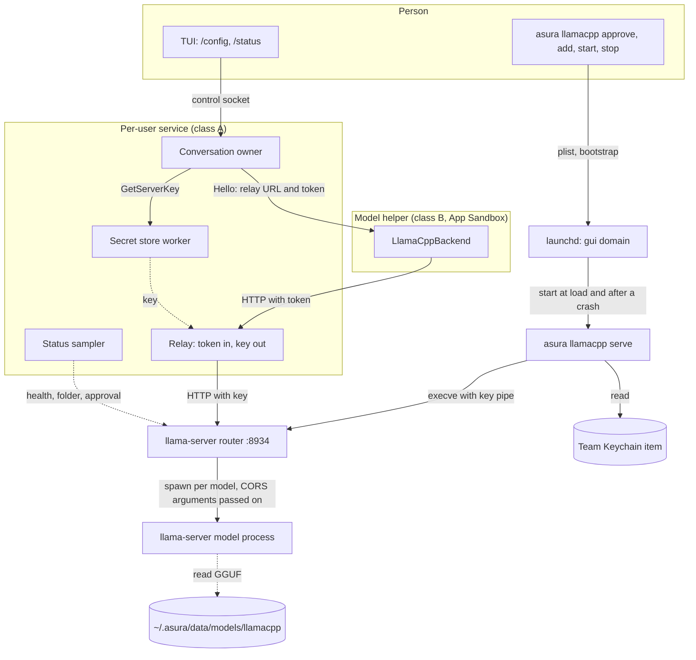
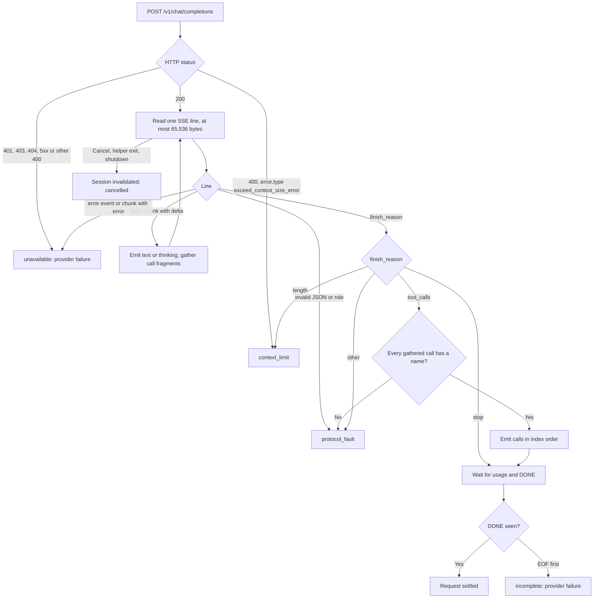
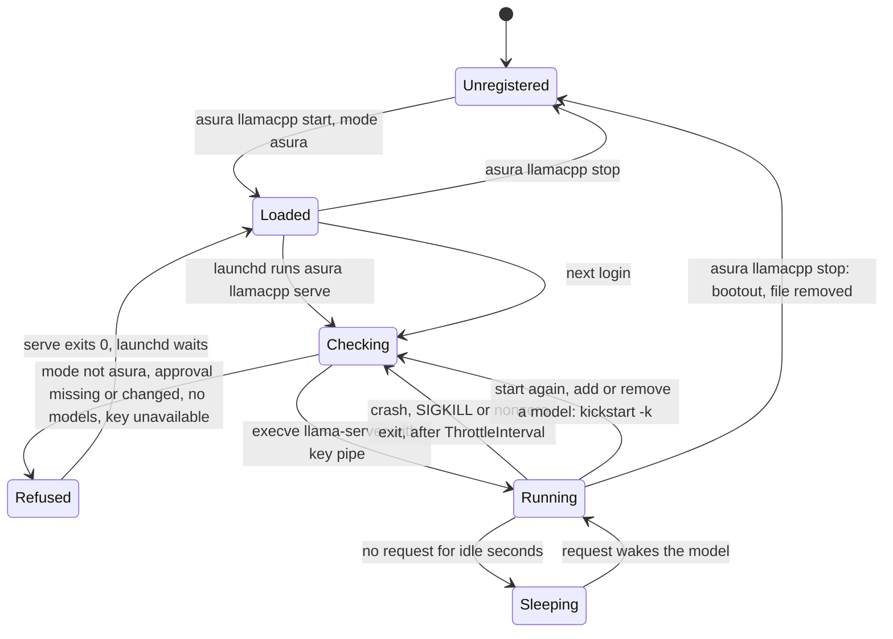
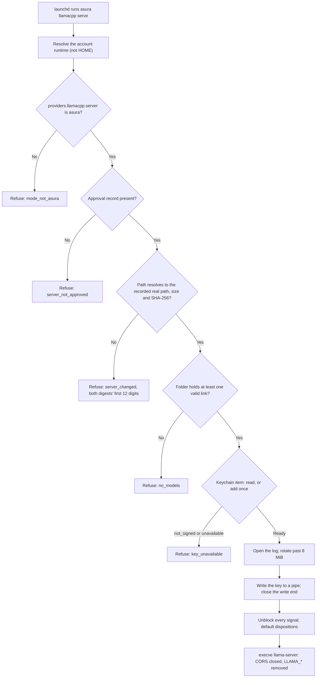
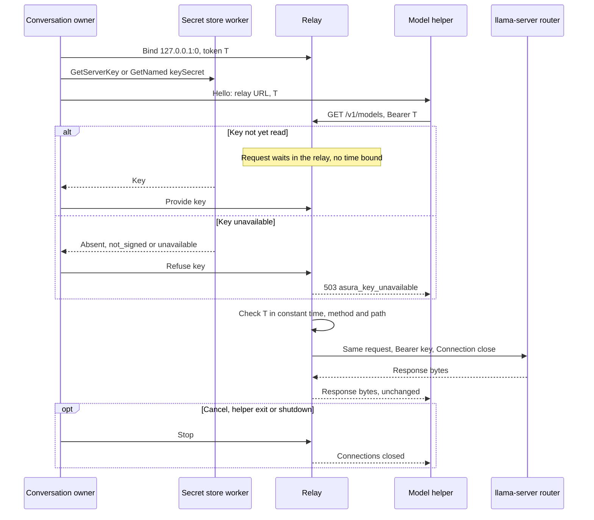
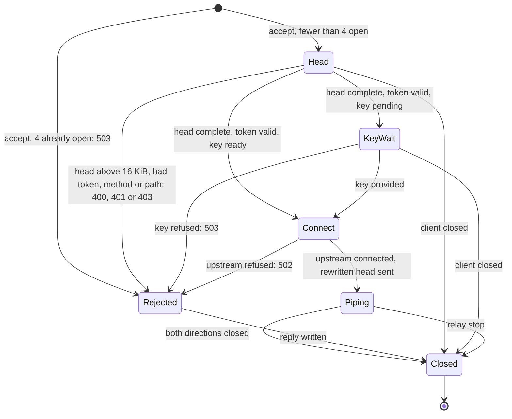
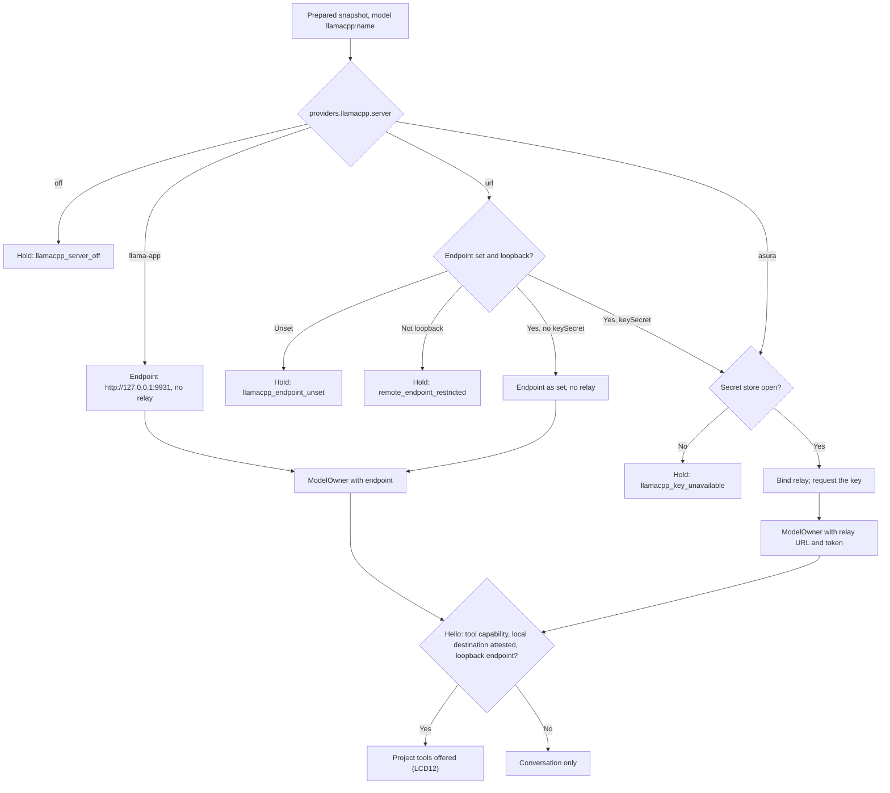
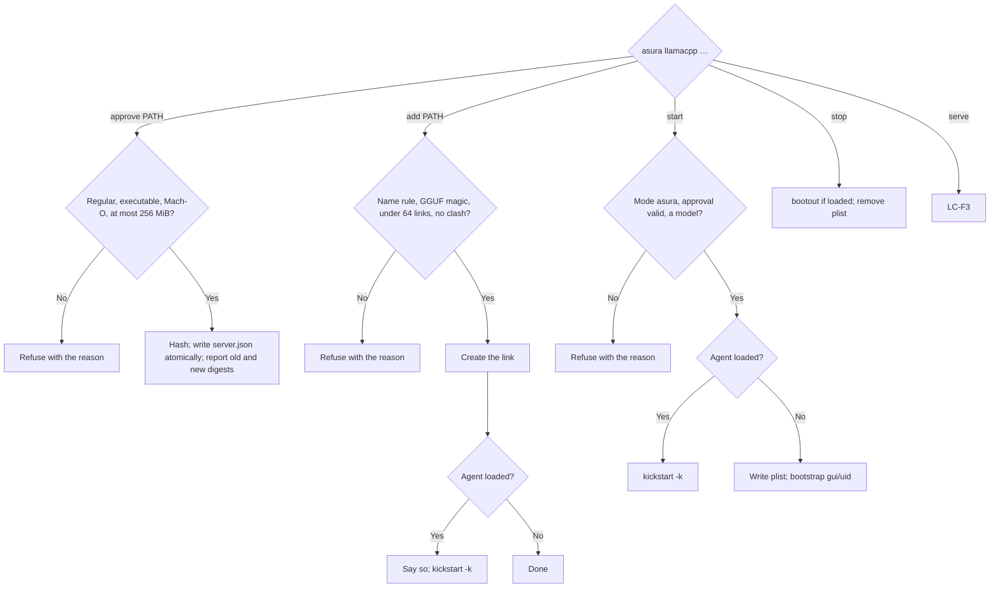

# llama.cpp backend and Asura's llama.cpp server

Status: selected design, 2026-11-02, under the owner decision below;
**implemented 2026-11-02** (packets LC1 to LC5), with the evidence and gaps in
[implementation evidence](#implementation-evidence-2026-11-02). **Revised
2026-11-02** under the owner decisions LCQ1 and LCQ2 and the CORS defect fix
([revision](#revision-2026-11-02-lcq1-lcq2-and-cors)). Protocol
numbering remains `0.1`; journal format remains `1`. The design adds a fifth
provider, `llamacpp`, to the Swift model helper, and a `llama-server` router that
Asura starts through a LaunchAgent. It records the probes that settled the
endpoint, the window, the key path and the server lifecycle. Delivery and
verification are recorded in [delivery](#delivery) and
[verification](#verification).

Owner decision (2026-11-02): "Yes, with Asura's own server". Add a `llamacpp:`
backend, and Asura runs and supervises its own `llama-server` router, like Wisp's
[ADR 0082](#evidence-from-wisp) (a LaunchAgent, a key, a model folder). The
backend can also connect to a server the person runs: Wisp's own on
`127.0.0.1:8933` with its key, Llama.app's on port 9931, or one the person starts.
The key is generated by Asura and stored in the team Keychain store. Asura's
trusted code reads it; no model ever does.

Owner decisions (2026-11-02): LCQ1, "project tools on all llama.cpp servers":
`llama-app` and `url` get project tools as `asura` does. LCQ2, "keep the
LaunchAgents file plus `launchctl`": Asura does not use `SMAppService`.

What is fixed: the endpoint and request shape, the window source, the error
mapping, the four server modes, project tools in every mode that has a server,
the LaunchAgent file and `launchctl` as the server's supervisor, the approved
binary, the model folder, the key path through a service-owned relay, the CORS
settings of Asura's server, the commands and the `/status` lines.

What is open: owner question LCQ3 in [owner questions](#owner-questions): pass
the key to the router in its environment, so that its model processes need it
too. It does not block this scope. Until it is answered, the model processes
behind Asura's router answer without a key
([LT3, LT4](execution-threat-model.md#llamacpp-server)).

## Scope

In scope:

- The `llamacpp:<name>` backend in the helper: discovery, requests, streaming,
  tool calls for stage B, thinking, the capacity record, usage and errors.
- The helper App Sandbox: what the backend needs.
- The server Asura runs: its owner process, binary, model folder, port, key,
  lifecycle, restart, idle memory, logs and failure handling.
- Configuration and commands: how a person approves the binary, adds a model,
  selects a mode, starts and stops the server, and reads its state in `/status`.
- Threats: the new process, the key, the loopback port and same-user processes
  ([execution threat model](execution-threat-model.md#llamacpp-server)).

Non-goals:

- Downloads. Asura never downloads a GGUF file or a `llama-server` binary.
- LM Studio and other OpenAI-compatible servers. The request code is shared in
  shape, but only llama.cpp is qualified.
- Remote endpoints. The [loopback restriction](model-provider-integration.md#loopback-endpoint-restriction--selected-2026-10-13)
  applies to `llamacpp` as to Ollama (EX7).
- Provider keys for remote models (EX14, AD-6). The relay below serves the
  loopback llama.cpp key only; it does not decide AD-6.
- `/models` rows for `llamacpp`. `/models` lists a configured `llamacpp:`
  selector as unchecked (MP3); `asura llamacpp list` lists the folder.

Dependencies: [model provider integration](model-provider-integration.md),
[Swift and Rust boundary](swift-rust-boundary.md),
[context composer CC4](context-composer.md#cc4-service-owned-request-loop-stage-b),
[loop closure probes](loop-closure-probes.md),
[model tool execution](model-tool-execution.md),
[release signing](release-signing.md#helper-app-sandbox),
[secret store](secret-store.md), [named secrets](named-secrets.md),
[execution threat model](execution-threat-model.md),
[ADR-0012](../decisions/0012-llamacpp-server-launchagent.md).

## Evidence

### Evidence from Wisp

Read-only inspection of `/Users/pidster/src/github.com/pidster/wisp` at
`e5c7152`: `docs/backends.md` (llama.cpp and LM Studio, "wisp's own server, end
to end"), `docs/decisions/0082-a-llama-cpp-server-wisp-starts.md`,
`docs/guide/local-models.md` and `docs/measurements.md` ("A llama.cpp router for
wisp's models"). Asura ports the design ideas, not the code:

| Wisp finding | Asura use |
| --- | --- |
| `Ternary-Bonsai-2-9B-Q2_0` (2.6 GB, 65,536-token window) matches `granite4.2:8b` on tools, is a better and twice-as-fast classifier, weaker on small drafts | The reason for the backend; not re-measured here |
| One router, `--models-dir` over a folder of links, loads a model on its first request; `/v1/models` gives each model's `status` | Same router shape ([LCD9](#decisions)) |
| `--api-key-file` holds: a request without the key gets 401 | Re-probed with a pipe instead of a file ([P3](#probes-2026-11-02)) |
| 11.4 GB for the 9B at llama.cpp's defaults (262,144 tokens, 4 slots); about 5 GB at 65,536 tokens and 1 slot; 387 MB asleep after idle | The defaults in [server settings](#server-settings) |
| `KeepAlive` `SuccessfulExit: false`: launchd restarted the router after SIGKILL; `Crashed: true` did not | [LCD14](#decisions) |
| A process started from a Swift concurrency thread keeps its blocked signal mask across `execve`; the router then ignored SIGTERM | The serve step resets the mask ([LC-F3](#lc-f3-serve-start-checks)) |
| The router reads its folder only at start | Adding or removing a model restarts the server |
| Llama.app runs its own router on port 9931 with no key and CORS open to every origin | `llama-app` mode; project tools since LCQ1 ([LCD12](#decisions)); its CORS settings are Llama.app's |

### Installed tools

Recorded 2026-11-02 on this Mac (48 GB, macOS 27):

- `/opt/homebrew/bin/llama-server` links to
  `/opt/homebrew/Cellar/llama.cpp/0.7.0/bin/llama-server`, version `0.7.0`
  (build 11669, commit `620d2225c`), 33,616 bytes, SHA-256 `fd5cb5a7…eabde`. The
  executable loads `libllama` and `libggml*` from its Cellar.
- GGUF files in `~/models`: `Ternary-Bonsai-2-2B-Q2_0.gguf` (546,689,504 bytes),
  `Ternary-Bonsai-2-4B-Q2_0.gguf` (1,212,103,520) and
  `Ternary-Bonsai-2-9B-Q2_0.gguf` (2,556,640,128). No download is needed.
- `~/.asura/data/models` does not exist yet. Wisp's router runs on
  `127.0.0.1:8933`; Llama.app is installed in `/Applications` and was not running.
  Neither was contacted.

### Probes, 2026-11-02

A scratch router ran from `/private/tmp/asura-llama-probe` with the 2B model,
`--models-max 1 --ctx-size 8192 --parallel 1 --sleep-idle-seconds 30 --no-ui
--host 127.0.0.1 --port 18977`, and its key passed as `--api-key-file /dev/fd/3`
from a pipe. It was stopped with SIGTERM afterwards; its model process stopped
with it.

| ID | Question | Result |
| --- | --- | --- |
| P1 | Does the router accept a key from a pipe? | Yes. `GET /v1/models` without the key: 401; with it: 200. No key file exists |
| P2 | Does the router pass the key to a model process? | No. The model process runs with `--host 127.0.0.1 --port <ephemeral>` and no key argument; `GET /v1/models` on its port answers 200 without a key. Wisp's own router shows the same (its 9B process on port 55239 has no key argument) |
| P3 | Window source | `/v1/models` `context_length` is 262,144, the model's training length. `GET /props?model=<name>` gives `default_generation_settings.n_ctx` 8,192, the server's window. `/props?model=` loads the model when it is not loaded |
| P4 | Tool calls with IDs | Streaming `POST /v1/chat/completions` sends `delta.tool_calls[{index, id, type, function{name, arguments}}]` fragments, a 32-character random `id` on the first fragment, then `finish_reason: "tool_calls"` |
| P5 | Tool results | A message `{"role":"tool","tool_call_id":…}` after an assistant message with `tool_calls` is accepted; the reply streams as text with `finish_reason: "stop"` |
| P6 | Thinking | With `chat_template_kwargs.enable_thinking: true`, thinking streams as `delta.reasoning_content`; with `false`, none. `/props` `chat_template` names `enable_thinking`; `chat_template_caps` gives `supports_tool_calls`, `supports_reasoning_effort` and others |
| P7 | Usage | The last chunk has empty `choices` and `usage{prompt_tokens, completion_tokens, prompt_tokens_details.cached_tokens}`; it needs `stream_options.include_usage: true` |
| P8 | Prefix cache | The same request again: `cached_tokens` 310 of 314 |
| P9 | Prompt above the window | HTTP 400 `{"error":{"type":"exceed_context_size_error","n_prompt_tokens":12010,"n_ctx":8192,…}}` |
| P10 | Output fills the window | `finish_reason: "length"` with `prompt_tokens + completion_tokens` equal to `n_ctx` (8,122 + 70 = 8,192) |
| P11 | Unknown model | HTTP 400 `{"error":{"type":"invalid_request_error","message":"model 'nope' not found"}}` |
| P12 | Browser origins | An `OPTIONS` preflight from `Origin: http://evil.example` is answered with that origin and `Access-Control-Allow-Credentials: true`. The router still needs the key; a model process does not |

#### CORS probes, 2026-11-02

A second scratch router ran from `/private/tmp/asura-cors-probe` on port 18978,
with the 2B model linked into a scratch folder, `--models-max 1 --ctx-size 4096
--parallel 1 --no-ui --host 127.0.0.1` and a scratch key file. It ran with an
empty environment except `HOME` and `PATH`, and was stopped with SIGTERM after
each probe. `curl` sent the browser-like requests. A headless Chromium 131
(Puppeteer), on a page served from `http://127.0.0.1:18979`, sent the browser
requests. Wisp's router and Llama.app were not contacted.

| ID | Question | Result |
| --- | --- | --- |
| P13 | Do model processes inherit the router's CORS arguments? | Yes. With `--cors-origins localhost --no-cors-credentials --cors-methods GET,POST --cors-headers Authorization,Content-Type`, the model process command line holds the same four arguments, and its replies carry the same CORS headers |
| P14 | Do model processes inherit the key? | Not from an argument: `--api-key-file` is never passed on, and `api-key-file` in a `--models-preset` `[*]` section is dropped too (the preset's `cors-origins` is passed on). From the environment, yes: with `LLAMA_API_KEY` set for the router, the model process environment holds it, and a request to the model process port without the key gets 401. Requests through the router with the key still succeed |
| P15 | Most restrictive settings | `--cors-origins asura-no-browser-origin --no-cors-credentials --cors-methods GET --cors-headers Content-Type`. The router and the model process send `Access-Control-Allow-Origin: asura-no-browser-origin` and `Access-Control-Allow-Credentials: false` with every reply, whatever the request's `Origin`. A listed value is sent as given. The special value `localhost` reflects `http://localhost:3000` |
| P16 | Does the relay still work? | Yes. Requests without `Origin`, with the key: `GET /v1/models` 200; a streamed `POST /v1/chat/completions` 200 to `data: [DONE]`. The CORS settings do not filter requests: `--cors-methods GET` does not refuse a `POST` |
| P17 | A browser page against the P15 settings | Chromium: a `fetch` of a model process's `/v1/models` and a JSON `POST` both fail (CORS); the router's `/v1/models` fails too. A `mode: "no-cors"` `text/plain` `POST` to the model process is sent and **runs inference** (the log shows one processed task, 16 prompt tokens); the page cannot read the reply. With the default settings, the same page reads the model list (200) and the JSON `POST` reply (200) |
| P18 | Does a sleeping model process keep its port? | Yes. With `--sleep-idle-seconds 3`, the process entered its sleeping state, fell from 797 MB to 154 MB resident, and still listened on its port |

## Decisions

| ID | Decision | Evidence or reason |
| --- | --- | --- |
| LCD1 | The backend uses the OpenAI-compatible `POST /v1/chat/completions` with `stream: true` and `stream_options.include_usage: true`. The native `/completion` endpoint is rejected: Asura would have to apply chat templates and parse tool calls itself | P4–P10 |
| LCD2 | The window is `default_generation_settings.n_ctx` from `GET /props?model=<name>`. Effective and reported capacity are equal, as for Ollama's full window. `/v1/models` `context_length` is never used | P3 |
| LCD3 | Tool call IDs in requests are positional: `call` and five digits, numbered over the whole message list (`call00001` first). Each tool message names the ID of its call. Earlier messages stay byte-stable, so the prefix cache holds (CC4 Q5). The provider's own ID never leaves the helper | P4, P8; Wisp: Mistral templates need nine letters and digits |
| LCD4 | Thinking: a template that names `enable_thinking` gives the controls off and on; `supports_reasoning_effort` adds low, medium and high. Off sends `enable_thinking: false`; on sends `true`; a level sends `true` and `reasoning_effort`. Thinking text is never sent back (CC4 Q3) | P6 |
| LCD5 | Asura's server is a LaunchAgent, `org.pidster.asura.llamacpp`, not a child of the per-user service | [Server owner](#server-owner) |
| LCD6 | The key is 32 random bytes as 64 hex digits in one team Keychain item. The serve step passes it to `llama-server` through a pipe, `--api-key-file /dev/fd/<n>`. It is never in a file, an argument or the environment | P1; [key](#the-key) |
| LCD7 | A service-owned loopback relay adds the key. The helper sends a per-helper relay token, never the key | [key path](#key-path-to-requests) |
| LCD8 | The binary is a path the person approves with `asura llamacpp approve PATH`; the record holds the path, its real path, size and SHA-256. The serve step checks it before every start. The first `llama-server` on `PATH` is never used | Wisp ADR 0082 decision 5 |
| LCD9 | The model folder is `~/.asura/data/models/llamacpp/`, holding links `<name>.gguf` to GGUF files the person adds | Wisp; [model folder](#model-folder) |
| LCD10 | The server listens on `127.0.0.1` only, port 8934 by default: not 8080, 8933 (Wisp), 9931 (llama-server's default and Llama.app's) or 11434 (Ollama); not in `/etc/services` | Installed facts |
| LCD11 | Four modes, `off` (default), `asura`, `llama-app` and `url`, in `providers.llamacpp.server` | Owner |
| LCD12 | Project tools are offered in every mode with a server: `asura`, `llama-app` and `url`. As for Ollama, the service offers them only when the helper attests a local tool destination and the helper's endpoint is a loopback URL. Every route is loopback ([LC-F2](#lc-f2-turn-preparation)) | Owner decision LCQ1, 2026-11-02 |
| LCD13 | Server settings default to Wisp's measured choice: 65,536 tokens, 1 slot, 2 models, 600 s idle sleep, `--no-ui`, and llama.cpp's `LLAMA_*` environment variables removed | Wisp measurements |
| LCD14 | `KeepAlive` is `{SuccessfulExit: false}` with `RunAtLoad` and a `ThrottleInterval` of 30 s. A refusal to start exits 0, so launchd does not loop on it | Wisp trial |
| LCD15 | `asura llamacpp start` writes `~/Library/LaunchAgents/org.pidster.asura.llamacpp.plist` and loads it with `launchctl bootstrap gui/<uid>`; `stop` boots it out and removes the file. Setting the mode does not register anything. `SMAppService` is not used | Explicit person action; owner decision LCQ2, 2026-11-02 |
| LCD16 | The serve plan closes CORS: `--cors-origins asura-no-browser-origin --no-cors-credentials --cors-methods GET --cors-headers Content-Type`. The origin value is not a valid serialised origin, so no page's origin can equal it and no browser can read a reply. The relay sends no `Origin` and needs no CORS | P13, P15–P17; [CORS settings](#cors-settings) |

## Ownership

| Responsibility | Owner | Change |
| --- | --- | --- |
| Provider registry entry `llamacpp` (endpoint-dependent) | `asura-service::model` | New row |
| `llamacpp` request translation, discovery, streaming, errors | Swift helper, new `LlamaCppBackend.swift` | New; selected by `ProviderFactory` |
| Hello field `endpoint_token`, context source 5 | Model schema, `asura-control::model`, `Wire.swift` | Schema change within `0.1` |
| Configuration keys `providers.llamacpp.*` | `asura-storage::config` | New keys and snapshot fields |
| Approval record, model folder links, GGUF and name rules, log rotation | New `asura-storage::llamacpp` | New |
| Server plan (arguments), pipe key, signal reset, `execve` | New `asura-platform::llamacpp` | New; the platform owns process start and signals |
| LaunchAgent file and `launchctl` calls | `asura-platform::llamacpp` | New; behind a runner the tests replace |
| Server key item | `asura-platform::keychain` | New item kind beside input and named items |
| Server key reads in the service | Secret store worker | New request `GetServerKey` |
| Turn preparation by mode; relay lifetime | Conversation owner and `ModelOwner` | New branch |
| Relay | New `asura-service::llamacpp` | New thread per conversation helper |
| `/status` facts | Service observer sampler | New `ServiceObservation` field 9 |
| `asura llamacpp …` commands | `asura-cli` | New; `serve` hidden |
| `/status` lines | Rust TUI | New lines |

Dependency direction is unchanged: CLI → client → service → storage and
platform. The CLI's `llamacpp` commands call storage and platform functions
directly; they do not need the service.

### LC-O1: component view

Selected design. Solid arrows are requests or process starts; dashed arrows are
replies or reads. The dotted boxes are processes outside Asura's build.



## The backend

### Selection and endpoint

`llamacpp:<name>` selects a model by the name the server knows. Under the
router, the name is the GGUF file name without `.gguf` (Wisp probe, P3). Under
`llama-app`, Llama.app names models by repository and quantisation, for example
`llamacpp:ggml-org/gemma-4-E4B-it-GGUF:Q8_0`; the scheme ends at the first colon.
The general selector rule applies: 1 to 1,024 bytes, no whitespace or control
characters.

The helper receives the endpoint and, when a relay is used, the token in Hello.
The endpoint follows the Ollama transport rule: `http` or `https` with host
`127.0.0.1` or `::1`, no credentials, query, fragment or path. Redirects,
cookies, caches, proxies and ambient credentials stay disabled. Requests have no
time limit (owner, 2026-10-16); each ends on its reply, an HTTP or transport
error, cancellation, helper exit or shutdown.

### Discovery

1. `GET /v1/models`. The reply must list an entry whose `id` is the name, or
   whose `aliases` contain it. Otherwise the model is unavailable.
2. `GET /props?model=<percent-encoded name>`. The reply must hold a positive
   integer `default_generation_settings.n_ctx` above 512. The router loads the
   model if it is not loaded; discovery waits for it, with no time limit. A
   single-model server ignores the parameter and answers for its model.
3. Tools: `chat_template_caps.supports_tool_calls` true. Thinking:
   [LCD4](#decisions). Display name: `llamacpp:<name>`.

Each discovery reply is read to 1 MiB and no further; `/props` holds the chat
template, which reached 9,834 bytes in P3. A reply above the bound fails the
model as unavailable.

### Requests

One `POST /v1/chat/completions` per Begin (CC4). The body:

| Field | Value |
| --- | --- |
| `model` | The name |
| `messages` | `system` (instructions), `user`, `assistant` (text, or empty text with `tool_calls`), `tool` (`tool_call_id`, text) |
| `tools` | The declared project tools as `{"type":"function","function":{name, description, parameters}}`, present only with tools enabled |
| `stream`, `stream_options` | `true`, `{"include_usage": true}` |
| `chat_template_kwargs` | `{"enable_thinking": …}` only for a thinking template and a thinking request ([LCD4](#decisions)) |
| `reasoning_effort` | `low`, `medium` or `high` only for a level and `supports_reasoning_effort` |

No `max_tokens` is sent: no Asura output cap (owner, 2026-10-19). The window
bounds output, and `length` means the window is full.
`Authorization: Bearer <64 hex digits of the token>` is sent only when Hello
carried a token.

### Stream and finish

The response is Server-Sent Events: `data: <JSON>` lines, an empty line between
events, and `data: [DONE]`. The adapter keeps one line of at most 65,536 bytes
before decoding. For each chunk:

- `delta.content` text is emitted as response text;
- `delta.reasoning_content` (or `delta.reasoning`) is emitted as thinking only
  for a thinking model;
- `delta.tool_calls` fragments are gathered by `index` (0 to 200): the first
  fragment of an index needs a function name; arguments are concatenated, at
  most 65,536 bytes per call (the service's 64,000-byte rule applies after);
- `finish_reason` ends the choice; `usage` arrives on the last chunk.

#### LC-F1: request outcome

Selected design. Arrows are decisions in order for one request.



An unregistered tool name follows Ollama's path (TCR-D17, CC4): the helper sends
the call for its record, then fails the request with `protocol_fault`. A
`finish_reason` of `stop` with gathered calls emits the calls, as some templates
report `stop` after a call; the stop tool still ends the session.

### Usage and capacity

Usage is provider-reported: `prompt_tokens` and `completion_tokens` of the final
chunk; `cached_tokens` is reported as cached input. Missing usage stays unknown.
`completion_tokens` above `n_ctx` is invalid (`protocol_fault`). Hello reports
context source 5 (`llamacpp`), effective equal to reported capacity, and the
measured input once per request (CC4).

### Error mapping

| Case | Adapter result | Turn result |
| --- | --- | --- |
| Nothing listens, connection refused or reset before a reply | `unavailable` | Hello unavailable: `model_unavailable`; during a request: `internal_error` |
| 401 or 403 (wrong or missing key, relay token refused) | `unavailable` | As above |
| Model not listed, `/props` without `n_ctx` | `unavailable` | `model_unavailable` |
| 400 `exceed_context_size_error` | `BackendFailure(.contextLimit)` | `context_limit` |
| `finish_reason: "length"` | `BackendFailure(.contextLimit)` | `context_limit` |
| Error event, other 4xx or 5xx | `unavailable` | `internal_error` |
| Invalid JSON, wrong role, unnamed call, unknown finish reason | `protocol_fault` | `protocol_fault` |
| EOF before `[DONE]` | `incomplete` | `internal_error` |
| Cancel | Session invalidated | `cancelled` |

The adapter never retries and never truncates. Error bodies are read to 4 KiB,
parsed only for `error.type`, and never logged.

## The helper sandbox

The helper reaches loopback through `com.apple.security.network.client`, which
it already claims for Ollama ([release signing](release-signing.md#what-the-helper-needs)).
The backend reads no file: the router reads the GGUF files, and the relay and the
router are reached over TCP. No other entitlement or exception is needed. The
helper never sees the key, the approval record or the model folder.

## The server Asura runs

### Server owner

Selected (LCD5): a LaunchAgent. The owner named "like Wisp's", and the evidence
supports it:

| Concern | LaunchAgent | Child of the per-user service |
| --- | --- | --- |
| Lifetime | Independent of the service and the TUI | The service may be TUI-owned and stop with its TUI ([system architecture](system-architecture.md#startup-and-endpoint-identity)); each restart reloads models (8.5 s for the 9B from disk, Wisp) |
| Supervisor | launchd restarts after a crash or SIGKILL (Wisp trial) | A second process supervisor in the service, which [the Rust instructions](../../rust/AGENTS.md) forbid |
| Shutdown | No drain: a service stop does not wait on a model server | AE-06 settlement would cover a server with loaded models |
| Cost | A file in `~/Library/LaunchAgents`, and tests must never register one | None outside the service |

The per-user service never starts or stops `llama-server`. It reads the
server's state for `/status` and relays requests to it.

### Server lifecycle

#### LC-S1: server states

Selected design. Arrows are events. Every state ends on its event; none has a
time bound except launchd's 30 s `ThrottleInterval`, which is pacing.



Restart of a model process is the router's: a killed model process loads again
on its next request (Wisp trial). `asura llamacpp start` while loaded restarts
the job with `launchctl kickstart -k`. Adding or removing a model restarts it
when loaded, because the router reads its folder only at start; the command says
so before it acts.

#### LC-F3: serve start checks

Selected design. Arrows are checks in order. Every refusal writes one line to
the log and exits 0.



### Server settings

The serve step runs:

```text
llama-server --models-dir <home>/.asura/data/models/llamacpp
  --models-max <modelsLoaded> --ctx-size <contextLength> --parallel <slots>
  --sleep-idle-seconds <idleSeconds> --no-ui --host 127.0.0.1 --port <port>
  --api-key-file /dev/fd/<n>
  --cors-origins asura-no-browser-origin --no-cors-credentials
  --cors-methods GET --cors-headers Content-Type
```

`idleSeconds` 0 omits `--sleep-idle-seconds` (never sleeps). Every environment
variable whose name starts with `LLAMA_` is removed, so none can change the host,
port or key.

| Key | Default | Range | Cost (Wisp measurements, 9B Bonsai) |
| --- | --- | --- | --- |
| `providers.llamacpp.port` | 8934 | 1,024–65,535 | None |
| `providers.llamacpp.contextLength` | 65,536 | 512–4,194,304 | About 5 GB at 65,536 and one slot; 3.8 GB at 32,768 |
| `providers.llamacpp.slots` | 1 | 1–16 | Each slot costs memory as more context does |
| `providers.llamacpp.modelsLoaded` | 2 | 1–16 | One more model loaded; switching costs 1.4–2.4 s |
| `providers.llamacpp.idleSeconds` | 600 | 0–86,400 | Asleep: about 387 MB; waking takes seconds |

#### CORS settings

Selected (LCD16). CORS tells a browser whether a page may read a reply. It does
not stop a server from acting on a request, and a program that sends no `Origin`
header is not affected by it. The relay sends no `Origin`, so Asura's own
requests do not need CORS (P16). The serve plan passes the most restrictive
values llama.cpp 0.7.0 accepts:

| Argument | Value | Effect |
| --- | --- | --- |
| `--cors-origins` | `asura-no-browser-origin` | Every reply names this value as the allowed origin. It is not a valid origin, so it never equals a page's origin, and the browser withholds every reply. The special value `localhost` is not used: it lets pages on `localhost` read replies |
| `--no-cors-credentials` | None | `Access-Control-Allow-Credentials: false` |
| `--cors-methods` | `GET` | The smallest list. It does not filter requests (P16) |
| `--cors-headers` | `Content-Type` | A page cannot get permission to send `Authorization` |

The router passes these four arguments to each model process it starts (P13),
so the model processes on their ephemeral ports withhold replies from pages too.
The values are fixed in the plan; configuration cannot change them. Every
`LLAMA_*` variable, including `LLAMA_ARG_CORS_*` and `LLAMA_API_KEY`, is removed
from the environment.

What CORS does not close (P17, P18):

- A page can still send a simple request (`GET`, or `POST` with a `text/plain`
  body) without reading its reply. The router refuses it with 401. A model
  process has no key and runs it. The page can make the Mac run inference and
  can disturb the model's prompt cache, but it cannot read the output. To reach
  a model process, the page must find its ephemeral port, for example by trying
  ports. A model process keeps its port from its first load until the router
  unloads it or stops, asleep or not.
- Same-user processes can use the model processes without the key (LT3).

Both gaps need a key on the model processes. llama.cpp 0.7.0 passes a key to
them only through the environment (P14), which [LCD6](#decisions) forbids. That
is owner question LCQ3.

The serve plan does not change servers that Asura does not start. Llama.app's
server and a person's `url` server keep their own CORS settings.

A change to a server setting takes effect at the next start. The setting reply
says so; `asura llamacpp start` restarts a loaded server.

### Binary approval

`asura llamacpp approve PATH` records the approval in
`~/.asura/data/llamacpp/server.json` (directory 0700, file 0600, atomic
replace). The record holds the path as given, the real path it resolves to, the
size and the SHA-256 of the file. The file must be a regular file owned by the
person or root, executable, at most 256 MiB, and begin with a Mach-O magic
number (`0xfeedfacf`, `0xcafebabe`, or their byte-swapped forms). A Homebrew
link stays the link in the path; the real path is recorded beside it.

Before every start the serve step resolves the path again and compares the real
path, size and digest. A mismatch refuses to start and names both digests'
first 12 hex digits and the command that approves again. Every
`brew upgrade llama.cpp` changes the digest, so the person runs `approve` again.
The digest covers the executable only; the libraries it loads from its Cellar
are not checked (Wisp's known limit, kept).

### Model folder

`asura llamacpp add PATH` links a GGUF file into
`~/.asura/data/models/llamacpp/` as `<name>.gguf`, pointing to the file's real
path. The file is never copied or moved. A file is accepted only when:

- its name ends in `.gguf` and its stem is 1 to 64 bytes of `[A-Za-z0-9._-]`,
  not starting with `.`;
- it is a regular file the person can read, at most 1 TiB;
- its first four bytes are `GGUF`;
- no link of that name exists (a name linked to another file is refused);
- the folder holds fewer than 64 links.

`asura llamacpp remove NAME` removes the link only and says where the file
stays. `asura llamacpp list` lists each link with its target's size, or
`broken link` when the target is missing. Under `off`, `llama-app` and `url` the
folder is not read by the backend.

### The key

The serve step reads one team Keychain item: service `org.pidster.asura.llamacpp`,
account `server-key`, data-protection keychain, Asura access group,
`AfterFirstUnlockThisDeviceOnly`, not synchronizable, user interaction off — the
[team Keychain store](release-signing.md#item-contract-changes) contract with
its own service name. If the item is absent, the serve step creates 32 random
bytes, encodes them as 64 lower-case hex digits and adds the item once; a
duplicate from a race is read again. An unsigned or ad hoc build reports
`not_signed` and refuses to start (`key_unavailable`), so Asura's own server
needs a signed build.

The key reaches `llama-server` through a pipe (P1). The serve step writes the
65 bytes (key and newline) into the pipe, which is below `PIPE_BUF`, so the
write cannot block; closes the write end; clears close-on-exec on the read end;
and passes `--api-key-file /dev/fd/<n>`. The key never appears in a file, an
argument, the environment or a log.

#### Key path to requests

Selected (LCD7): a service-owned loopback relay, the AD-6 direction for this
loopback key only. Under the trust classes, the helper is class B and may not
hold a raw secret (F1); the relay is class A service code.

Alternatives considered:

1. Pass the key to the helper in Hello. Rejected: a class B process would hold it.
2. The service makes the HTTP requests and streams results over the private
   channel. Rejected: it duplicates the provider adapter in Rust and changes the
   model protocol's request shape.
3. No key. Rejected: the owner requires one, and the router port is reachable by
   every same-user process. With llama.cpp's default CORS settings (P12), a web
   page could also read its replies.

The relay serves one conversation helper. The conversation owner starts it
before the helper and passes `http://127.0.0.1:<relay port>` and a fresh 32-byte
token in Hello. The token is not derived from the key (F2). The relay ends with
its `ModelOwner`.

#### LC-Q1: request through the relay

Selected design. Solid arrows are requests; dashed arrows are replies.



#### LC-S2: relay connection states

Selected design. Arrows are events on one client connection.



Relay rules:

- Methods and paths: `GET /v1/models`, `GET /props?model=<1–1,024 bytes of
  unreserved or percent-encoded characters>`, `GET /health` and
  `POST /v1/chat/completions`. Anything else is 403.
- Headers: `Authorization` must be `Bearer <64 hex digits>` equal to the token
  (constant-time compare). The relay removes `Authorization`, `Connection`,
  `Keep-Alive`, `Proxy-*` and `Upgrade`, refuses `Transfer-Encoding` and
  `Expect` with 400, and adds `Authorization: Bearer <key>` and
  `Connection: close`. The body and the response pass through unchanged.
- Bounds: 4 connections, a 16 KiB head, a 64 KiB buffer per direction, one
  relay per conversation helper. A full buffer stops reading from its source
  (backpressure); nothing is dropped.
- Upstream: `127.0.0.1:<port>`, connected without blocking.

### Logs

The serve step appends its own lines and `llama-server`'s output to
`~/.asura/logs/llamacpp.log` (0600). At a start past 8 MiB the file moves to
`llamacpp.log.1`, replacing an older one. The log never holds the key; the
router logs request paths, not headers.

## Modes and turn preparation

| Mode | Endpoint the helper uses | Key | Project tools |
| --- | --- | --- | --- |
| `off` (default) | None: `llamacpp:` turns are held with `llamacpp_server_off` | None | No |
| `asura` | The relay, upstream `127.0.0.1:<port>` | Server key item | Yes (LCD12) |
| `llama-app` | `http://127.0.0.1:9931` | None | Yes (LCD12, LCQ1) |
| `url` | `providers.llamacpp.endpoint`, loopback only | Named secret `providers.llamacpp.keySecret` through the relay, if set | Yes (LCD12, LCQ1) |

#### LC-F2: turn preparation

Selected design. Arrows are checks in order in the conversation owner. Each is
pure in-memory work except the relay bind, which is one nonblocking socket call.



The tool check is the Ollama rule, applied in every mode (LCQ1). The helper
reports tool capability and attests a local destination in Hello, and the
helper's endpoint is a loopback URL. The relay URL and the `llama-app` and `url`
endpoints are all loopback.

`ModelOwner` keeps the relay and the key ticket. It polls the ticket on each
reactor step and gives the relay the key or the refusal. When the helper reports
the model unavailable after a key refusal, the turn fails with
`llamacpp_key_unavailable` instead of `model_unavailable`.

## Configuration and commands

Configuration keys, set with `/config set` like every other key:

| Key | Values | Default |
| --- | --- | --- |
| `providers.llamacpp.server` | `off`, `asura`, `llama-app`, `url` | `off` |
| `providers.llamacpp.endpoint` | Loopback URL, the Ollama grammar | Unset; used by `url` only |
| `providers.llamacpp.keySecret` | A secret name ([named secrets](named-secrets.md#naming-rules)) | Unset; used by `url` only |
| Server settings | [Server settings](#server-settings) | As listed |

Commands (person only; the model has no tool that runs them, and model jobs
cannot write `~/.asura` or `~/Library/LaunchAgents`):

| Command | Effect |
| --- | --- |
| `asura llamacpp approve PATH` | Records the binary approval; says what it replaced |
| `asura llamacpp add PATH` | Links a GGUF file; restarts a loaded server |
| `asura llamacpp remove NAME` | Removes a link; restarts a loaded server |
| `asura llamacpp list` | Lists the links |
| `asura llamacpp start` | Requires mode `asura`, an approval and a model; writes the agent file and loads it, or restarts it |
| `asura llamacpp stop` | Boots the agent out and removes its file |
| `asura llamacpp status` | Mode, approval, models, agent state (`launchctl print`), and whether the server answers |
| `asura llamacpp serve` | Hidden; run by launchd only |

Wisp's server: set `providers.llamacpp.server url`, `endpoint
http://127.0.0.1:8933`, store Wisp's key with `/secrets store WISP_LLAMACPP` and
set `keySecret WISP_LLAMACPP`.

#### LC-F4: command flows

Selected design. Arrows are the command steps; every refusal exits with status 1
and changes nothing.



The `launchctl` runs are one-shot child processes of the CLI command; each ends
on the child's exit or the person's interrupt, with no time bound.

### Status

`ServiceObservation` field 9, `LlamaCppStatus`, is sampled with the existing
configuration sample every 30 s and on refresh, on the sampler thread:

| Field | Meaning |
| --- | --- |
| `mode` | 1 off, 2 asura, 3 llama-app, 4 url |
| `port` | The `asura` mode port |
| `approval` | 1 unset, 2 approved, 3 changed, 4 missing (path does not resolve) |
| `model_count` | Valid links in the folder, 0–64 |
| `agent_file` | The agent file exists |
| `answering` | `GET /health` answered 200 (asura, llama-app, url) |

The health check connects without blocking and reads at most 4 KiB; any HTTP
reply counts as answering, because the router answers 401 without the key. It
ends on the reply, an error, sampler cancellation or shutdown; until it ends the
pane keeps the previous value. In `asura` mode each sample hashes the approved
binary (at most 256 MiB; 33,616 bytes for Homebrew 0.7.0) and lists the folder
(at most 64 links), on the sampler thread. `/status` shows, for example:

```text
llama.cpp: asura on 127.0.0.1:8934, answering
llama.cpp binary: approved; 3 models; LaunchAgent file present
```

## Failure handling

| Failure | Behaviour |
| --- | --- |
| Server not running in `asura` mode | Hello unavailable: `model_unavailable`; `/status` says not answering |
| Approval changed after `brew upgrade` | The next start refuses; the running server keeps running until it exits; `/status` says changed |
| Key unavailable (unsigned build, locked before first unlock) | Serve refuses; turns fail `llamacpp_key_unavailable` |
| Relay port bind fails | Turn held with `model_unavailable` |
| Model process killed | The router restarts it on the next request |
| Router killed | launchd restarts it after at most 30 s; a request in flight fails `internal_error` |
| Model load slow | The request waits until reply, cancel, helper exit or shutdown |
| Window full or prompt above it | `context_limit` |

No step retries an effect with an unknown outcome. A failed turn follows the
existing turn failure and queue rules.

## Security

Threats, mitigations and gaps are in the
[execution threat model](execution-threat-model.md#llamacpp-server) (LT1–LT9).
Summary:

- The server is a program Asura did not build, outside every sandbox, kept
  alive by launchd. Only an approved binary with the recorded digest starts.
- The key is in the team Keychain, reaches the server through a pipe and
  reaches requests through the class A relay. No class B or C process holds it.
- The router port is loopback only and needs the key. Model processes behind it
  listen on ephemeral loopback ports without a key (P2): any same-user process
  can use them. Under D1 same-user processes are one principal; model jobs have
  no network.
- The serve plan closes CORS on the router and its model processes (LCD16), so
  no web page can read a reply. A page can still make a model process run
  inference blind (P17). LCQ3 asks whether to close that with an environment key.
- Every mode with a server offers project tools (LCQ1). A same-user process that
  serves the configured port receives the conversation and its tool results
  (LT7, accepted under D1). Its tool calls still pass the service's admission.
- GGUF files are untrusted input to `llama-server`, which parses them outside
  any sandbox. Asura checks the magic and the name only.

## Asynchronous execution

| Rule | Application |
| --- | --- |
| AE-01 | The relay runs on its own thread; the reactor only binds it and passes the key. The status sample runs on the sampler thread. Discovery and requests are cancellable `URLSession` tasks in the helper |
| AE-02 | Blocking calls: the relay's sockets (nonblocking, `poll`), the Keychain read (secret store worker; in the serve step, the one-shot CLI process), file hashing (CLI command, sampler thread), `launchctl` (CLI child process) |
| AE-03 | Relay: 4 connections, 16 KiB head, 64 KiB per direction, one per helper. Helper: 65,536-byte SSE line, 1 MiB discovery, 65,536-byte call arguments, 201 calls. Folder: 64 links. Secret store queue: 16 |
| AE-04 | Every wait ends on its reply, error, cancel, helper exit or shutdown. The relay's key wait ends on the key, the refusal or stop. Stop, the key and the refusal wake the relay's `poll` through a wake pair; its 60 s interval is pacing and ends nothing. No timeout is added |
| AE-05 | No retry. A relay connection carries one request (`Connection: close`). Requests are idempotent reads except chat, whose outcome on a cut connection is unknown and is never retried |
| AE-06 | The relay stops when its `ModelOwner` settles: it closes its listener and connections and its thread exits. The service does not own the server, so its shutdown never waits on it |
| AE-07 | The [validation](#validation) cases below |

## Validation

### Unit

| ID | Case | Layer |
| --- | --- | --- |
| LC-U1 | Settings: loopback rule, name rule | Swift |
| LC-U2 | `/v1/models` and `/props` parsing: name or alias match, `n_ctx` above 512, caps, thinking controls; bounds | Swift |
| LC-U3 | Request body: roles, positional call IDs stable across requests, tool messages, thinking fields, no `max_tokens` | Swift |
| LC-U4 | SSE parser: line bound, fragments by index, argument bound, finish reasons, usage, `[DONE]`, EOF | Swift |
| LC-U5 | Error body: `exceed_context_size_error` is `context_limit`; others unavailable | Swift |
| LC-U6 | Config keys: values, ranges, unset, YAML, snapshot | Rust storage |
| LC-U7 | Approval: Mach-O magic, size, changed digest, missing path | Rust storage |
| LC-U8 | Folder: name rule, GGUF magic, clash, 64-link bound, broken link listing | Rust storage |
| LC-U9 | Server plan: arguments from settings, idle 0, the four fixed CORS arguments (LCD16), `LLAMA_*` removal including `LLAMA_ARG_CORS_*` and `LLAMA_API_KEY`; plist text | Rust platform |
| LC-U10 | Relay head parsing: token compare, paths, header rewrite, refusals | Rust service |
| LC-U11 | Mode resolution at preparation: each hold reason. Tool permission for `llamacpp:` in every mode needs the helper's attestation and a loopback endpoint (LCD12) | Rust service |
| LC-U12 | Hello validation: source 5 only for `llamacpp:`, token only from the service, 32 bytes | Rust control, Swift wire |
| LC-U13 | `/status` lines for each field | Rust TUI |
| LC-U14 | CLI argument parsing for every subcommand | Rust CLI |

### Integration

| ID | Case | Environment |
| --- | --- | --- |
| LC-I1 | Helper session against a fake SSE server: text, thinking, usage, `context_limit` from 400 and from `length`, unavailable from 401 | Swift, loopback fixture |
| LC-I2 | Stage B through the helper: request 1 returns calls with positional IDs; request 2 carries the continuation; earlier messages byte-stable | Swift, loopback fixture |
| LC-I3 | Token header sent when Hello carries one | Swift, loopback fixture |
| LC-I4 | Relay against a fake upstream: key injected, token refused, path refused, key pending then ready, key refused (503), connection bound, stop closes connections, a stalled upstream leaves the stop path responsive | Rust, loopback fixture |
| LC-I5 | Serve plan through the test-only launch path: the real `llama-server` in a scratch home with a pipe key; 401 without the key; SIGTERM stops router and model | Rust, real `llama-server`, scratch home |
| LC-I7 | CORS on the real router (LCD16). After a model loads, the model process command line holds the four CORS arguments and no key. On the router and on the model process, a preflight and a simple `GET` from `Origin: http://evil.example` get no `Access-Control-Allow-Origin` equal to that origin and no `Access-Control-Allow-Credentials: true`. The model process still answers a keyless `GET` with 200: the LCQ3 gap, asserted so that a llama.cpp change shows up | Rust, real `llama-server`, scratch home |
| LC-I6 | Relay against the real router: a chat request through the relay succeeds with the key the relay holds | Rust, real `llama-server` |

### Native and end-to-end

| ID | Case | Environment |
| --- | --- | --- |
| LC-N1 | Helper stage B against the real router with `Ternary-Bonsai-2-2B-Q2_0`: discovery, a tool call, then a text answer from the continuation | Swift, real `llama-server`, scratch folder |
| LC-E1 | `conversation_flow --native-llamacpp`: the real service and helper in `url` mode against a test-started router; a turn completes with the server's window | Rust, real service, helper package, real `llama-server` |
| LC-E2 | `/status` lines through the real service in a scratch home | Rust, real service |
| LC-E3 | `conversation_flow --native-llamacpp-tools`: the real service and helper in `url` mode against a test-started router. The model reads a scratch project file with the `project` tool and answers with its token (LCQ1) | Rust, real service, helper package, real `llama-server` |

Tests never use `~/.asura`, the login keychain or the data-protection keychain,
never register a LaunchAgent and never contact Wisp's server or Llama.app. The
test-only launch path runs the server plan as a child of the test, with a scratch
folder and a scratch key.

Not covered by automated tests: `launchctl` against the person's launchd (no
test may register an agent), the Keychain item in a signed build, and the agent
across login. These are owner checks on a signed build.

## Owner questions

| ID | Question | Default until answered |
| --- | --- | --- |
| LCQ3 | Pass the server key to the router in `LLAMA_API_KEY`, so that its model processes need it too (P14)? This closes blind web-page inference (P17) and same-user use of the model processes (LT3). It breaks LCD6: any same-user process can read a process environment (`ps eww`), whereas the Keychain item is limited to Asura's access group | No. The key stays in the pipe, the model processes answer without a key, and the gap is recorded in LT3 and LT4 |

Answered by the owner on 2026-11-02:

| ID | Question | Decision |
| --- | --- | --- |
| LCQ1 | Should `llama-app` and `url` get project tools? | Yes: "project tools on all llama.cpp servers" ([LCD12](#decisions)) |
| LCQ2 | Register the agent with `SMAppService` from `Asura.app`? | No: "keep the LaunchAgents file plus `launchctl`" ([LCD15](#decisions), [ADR-0012](../decisions/0012-llamacpp-server-launchagent.md)) |

## Delivery

| Packet | Content |
| --- | --- |
| LC1 | Backend, schema field, context source, registry row, config keys, preparation by mode |
| LC2 | Relay and the server key request |
| LC3 | Approval, folder, server plan, serve, start and stop, key item |
| LC4 | `/status` field and lines |
| LC5 | Native tests |

## Verification

All diagrams in this document were rendered with the local Mermaid CLI at
scale 2 into a temporary directory outside the repository and inspected. The
implementation record follows in
[implementation evidence](#implementation-evidence-2026-11-02).

### Implementation evidence, 2026-11-02

macOS 27 (build 26A428), Xcode 27.1, Metal toolchain 32023.921.5; Homebrew
`llama-server` 0.7.0 (build 11669); `Ternary-Bonsai-2-2B-Q2_0.gguf` from
`~/models` (546,689,504 bytes, linked into scratch folders, never copied);
helper from an ad hoc `asura-bundle` package copied beside the test binaries.

| Case | Evidence | Result |
| --- | --- | --- |
| LC-U1 to LC-U5 | Swift `llamacppSettingsKeepTheLoopbackRuleAndTokenSize`, `llamacppDiscoveryUsesTheServerWindowAndDeclaredCaps`, `llamacppMessagesUsePositionalCallIDsAndNeverSendThinking`, `llamacppStreamGathersCallsAndRequiresDone`, `llamacppRefusalsAndFinishReasonsMapToAsuraFailures` | Pass |
| LC-I1 to LC-I3 | Swift helper sessions against `LlamaFixtureServer`: text and window, `context_limit` from 400 and from `length`, 401 unavailable, unlisted model unavailable, stage B with byte-stable earlier messages and `call00001`, the relay token on all three requests | Pass |
| LC-U6 | `config::tests::llamacpp_keys_validate_and_reach_the_snapshot` | Pass |
| LC-U7, LC-U8 | `asura-storage` `llamacpp::tests` (approval, folder, log) | Pass |
| LC-U9 | `asura-platform` `llamacpp::tests` (plan, environment, key pipe, agent file, fake `launchctl`) | Pass |
| LC-U10, LC-U11 | `asura-service` `llamacpp::tests::heads_are_checked_and_rewritten`, `modes_resolve_to_routes_or_hold_reasons`, `only_visible_ascii_keys_reach_a_header` | Pass |
| LC-U12 | `asura-control` `llamacpp_hello_fields_are_checked`, `llamacpp_status_is_bounded`; capacity source 5 accepted in `ModelContext` | Pass |
| LC-U13, LC-U14 | `asura-cli` `llamacpp_status_lines`; `llamacpp_cli::tests` (arguments, every person command in a scratch home with a fake `launchctl`) | Pass |
| LC-I4 | Relay against a fake upstream: key added, token never forwarded, 401, 403, 400, key wait then key, key refusal 503, missing router 502, four stalled connections and a fifth 503, stop closes all | Pass |
| LC-I5, LC-I6 | `native_server_plan_and_relay` (opt-in): the plan through `spawn_for_test`, 401 without the key, no key in `ps`, `/v1/models` and a streamed chat through the relay, SIGTERM leaves no model process | Pass, 1.45 s |
| LC-N1 | `nativeLlamaCppStageBTwoRequests` against a keyless scratch router: window 16,384, tools, thinking off and on; request 1 one `exec_cmd` call, request 2 a 74-byte answer | Pass, 4.6 s |
| LC-E1, LC-E2 | `conversation_flow --native-llamacpp`: `/status` reports `url`, the endpoint and answering; a turn completes in `url` mode with capacity 8,192 (the server's `n_ctx`), 43 measured input tokens and no project tools | Pass |
| `asura` mode through the service: secret store `GetServerKey`, `KeyTicket`, relay in `ModelOwner` | Parts tested (route, relay, real router through the relay); not run end to end, because the key needs a team-signed build's Keychain item and no test may use the data-protection keychain | Unverified end to end |
| LaunchAgent under the person's launchd, `asura llamacpp serve` from launchd, the Keychain item | Not run: no test may register an agent or touch the data-protection keychain | Owner check on a signed build |
| Project tools on Asura's own server through the service | Depends on the row above | Unverified; the helper-level stage B (LC-N1) passes |

A finding during implementation: the control contract's `ModelContext` accepted
capacity sources 1 to 4 only, so the first `--native-llamacpp` run ended with
`service_unavailable` at the client; source 5 is now accepted there as well as
in Hello.

### Revision, 2026-11-02: LCQ1, LCQ2 and CORS

Selected design changes, in the order they are delivered:

| Change | Design | Code owner |
| --- | --- | --- |
| Project tools in `asura`, `llama-app` and `url` (LCQ1) | [LCD12](#decisions), [LC-F2](#lc-f2-turn-preparation) | `asura-service::model_owner` tool destination rule: the Ollama rule (attestation and a loopback endpoint) for `llamacpp:`; `asura-service::llamacpp::Route` loses its `local` flag |
| LaunchAgents file plus `launchctl`, no `SMAppService` (LCQ2) | [LCD15](#decisions), [ADR-0012](../decisions/0012-llamacpp-server-launchagent.md) | No code change |
| CORS closed on Asura's server | [LCD16](#decisions), [CORS settings](#cors-settings) | `asura-platform::llamacpp::ServerPlan::arguments` |

The earlier implementation evidence above records the state before this
revision: its `url` journey asserted no project tools. The revision's evidence
follows in [revision evidence](#revision-evidence-2026-11-02).

#### Revision evidence, 2026-11-02

Same host and tools as the [implementation evidence](#implementation-evidence-2026-11-02);
helper from an ad hoc `asura-bundle` package built from this revision.

| Case | Evidence | Result |
| --- | --- | --- |
| LC-U9 | `asura-platform` `llamacpp::tests::arguments_follow_the_settings`, `every_plan_closes_cors`, `llama_variables_never_reach_the_server` (now with `LLAMA_ARG_CORS_*`) | Pass |
| LC-U11 | `asura-service` `model_owner::tests::llamacpp_tool_permission_in_every_mode_requires_attestation_and_loopback`, `llamacpp::tests::modes_resolve_to_routes_or_hold_reasons` | Pass |
| LC-I5 to LC-I7 | `native_server_plan_and_relay` with the real `llama-server` 0.7.0 and the 2B model: the model process holds the four CORS arguments and no key; preflight and simple `GET` from `http://evil.example` get no matching `Access-Control-Allow-Origin` and no credentials on the router and the model process; router 401, model process 200 (the LCQ3 gap) | Pass, 2.1 s |
| LC-E1 | `conversation_flow --native-llamacpp`: a turn in `url` mode, capacity 8,192; 1,815 measured input tokens, against 43 before LCQ1, because the project tool declarations are now sent | Pass |
| LC-E3 | `conversation_flow --native-llamacpp-tools` with `Ternary-Bonsai-2-2B-Q2_0`: three passes in six runs. The failures were the model's: it sent malformed `read_file` arguments (text in llama.cpp's XML-like parameter form inside `command`), which the service refused as `invalid_arguments`, or answered without the token. With `Ternary-Bonsai-2-4B-Q2_0`: one pass in one run | Path verified; 2B tool quality is unreliable |
| P13 to P18 | Recorded in [CORS probes](#cors-probes-2026-11-02), including the Chromium page | Probe, not automated |

Not verified: `asura` mode end to end through the service (it needs a
team-signed build's Keychain item, as before); the LaunchAgent under the
person's launchd; Safari and other browsers against the CORS settings; and
Chrome's local network access prompts for public pages, which Asura does not
rely on.
