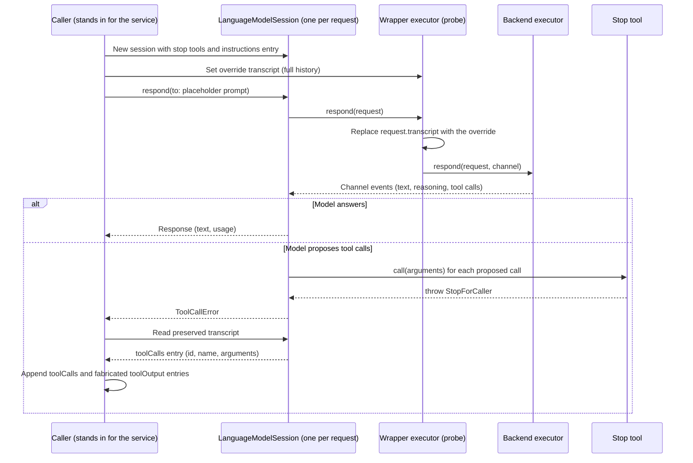
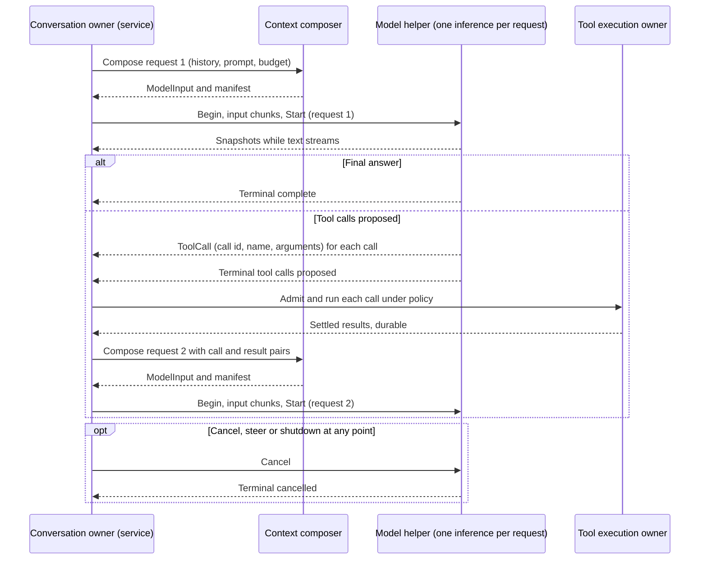
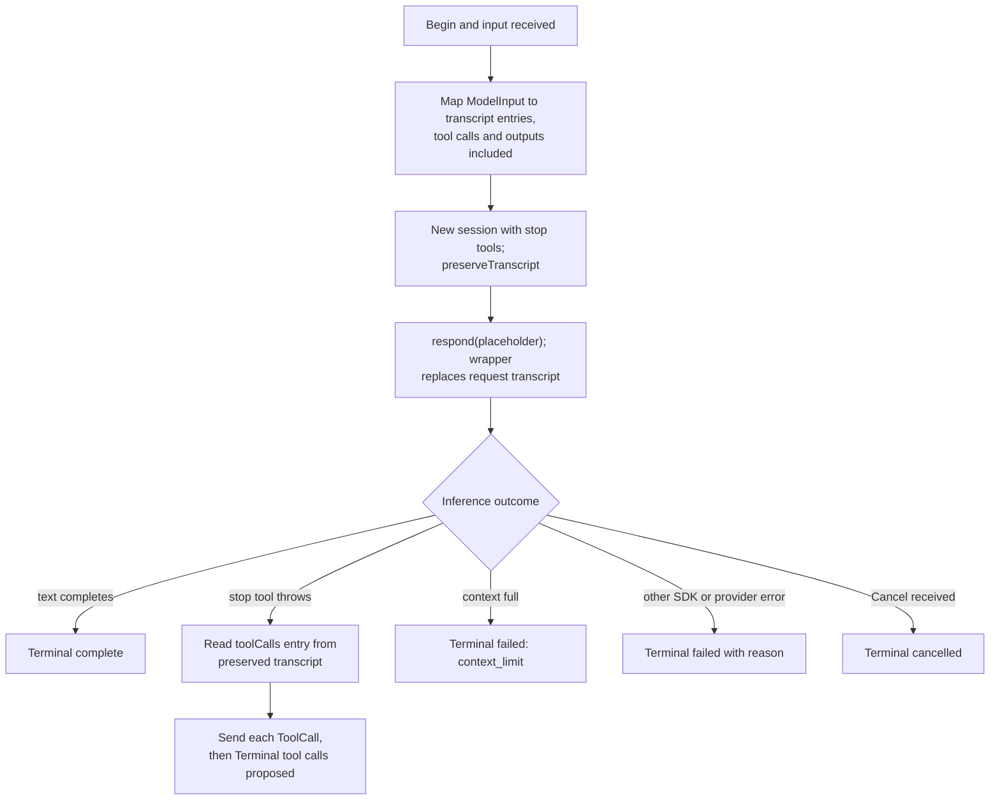

# Loop closure decision 6 probes

Status: probe record, 2026-11-02; the owner adopted stage B on 2026-11-02 on this evidence. It records evidence for
[loop closure decision 6](loop-closure.md#decisions): whether the service can own
the turn request loop (context composer stage B, slice CC4). It selects nothing
and authorizes no code. The owner decides. Protocol numbering remains `0.1`;
journal format remains `1`.

## Question and scope

Owner instruction (2026-11-02): "Probe first." Check Foundation Models (the
system model), MLX, Core AI and Ollama for a service-run tool loop.

Stage B means the service owns the request loop. For each model request it
recomposes the input and sends it to the helper. The helper runs one inference
and returns a final answer or tool calls. It never runs its own tool loop.

For each backend the probes answer five questions:

| ID | Question |
| --- | --- |
| P1 | Can the caller send one request with full history (instructions, prompt, prior turns, tool calls and tool outputs) and no backend session state? |
| P2 | Can the backend return a tool call to the caller instead of running a tool callback? |
| P3 | What does sending full history again cost per request: prompt processing, KV-cache and prefix reuse, latency? |
| P4 | Which features are lost: streaming, structured output, guided generation, thinking? |
| P5 | Does this stay within protocol `0.1`, and which helper wire changes does it need? |

Non-goals: a selected design for CC4, code in the repository, remote providers,
and quality evaluation of the models.

## Method and boundaries

- Read the helper (`Backend.swift`, `BoundedToolModel.swift`, `ToolBridge.swift`,
  `OllamaBackend.swift`, `MLXProvider.swift`, `CoreAIProvider.swift`,
  `Session.swift`), the model schema (`contracts/model/v1/model.proto`) and the
  service model owner (`model_owner.rs`, `conversation.rs`).
- Read the macOS 27 SDK interface of `FoundationModels` (Xcode 27.1, build
  27A9275), Apple's current documentation for `LanguageModelExecutor`, `Tool`
  and `TranscriptErrorHandlingPolicy`, and the pinned package sources:
  `mlx-swift-lm` `c6446cf7` and `coreai-models` `3f109efd`.
- Probe code is outside the repository, in `/private/tmp/claude-501/loop6/`:
  a Swift package (`fmprobe`, the same pins as the helper, built with
  `TOOLCHAINS=com.apple.dt.toolchain.Metal.32023.921.5`) and a Python script
  against local Ollama. No probe has a timeout; Ctrl-C ends a run. No command
  runs: tool output is fabricated, about 160 lines per call.
- Local models only: the system model (8,192-token window), MLX
  `mlx-community/Qwen3-1.7B-4bit` from the local Hugging Face cache, Ollama
  0.40.11 `granite4.1:8b` and `qwen3:1.7b`. No Core AI asset is on this Mac.
- Probes ran while other agents used the GPU (another Ollama model was loaded and
  a `swift-test` run was active). Token counts are exact. Latencies are
  indicative only.

### Probe shapes

Status: probe method, not a product design. The Swift probe wraps the model in
a timing `LanguageModel` whose executor forwards to the real executor, like the
helper's `BoundedToolModel`. Arrows are calls in time order.

Modes per model: `sdk` (today's shape: one session, the SDK runs the loop),
`caller` (the shape above), `recompose` (as `caller`, with every tool output but
the latest replaced by a one-line reference) and `repeat` (one identical
`caller` request sent three times, to detect reuse across requests).

## Results

### Summary by backend

| Backend | P1: full history, no session state | P2: tool call returned | P3: cost of full history | P4: features lost | P5: protocol |
| --- | --- | --- | --- | --- | --- |
| System model | Yes, measured. A fresh session per request accepted a caller transcript with `toolCalls` and `toolOutput` entries and continued correctly. | Yes, measured, with the stop-tool shape. Not a documented SDK mode. | No added cost measured. The SDK's own second request took 52 and 63 s; the same input from the caller took 19 to 30 s. Repeats did not speed up. | None found for streaming, guided generation or tools. Reasoning entries need a decision (Q3). | Within `0.1`; schema changes below |
| MLX | Yes, measured | Yes, measured, including three parallel calls in one response | None. The bridge keeps no KV cache across requests (`cachedTokenCount` 0; repeats 8.6 to 9.2 s). Today's SDK loop already prefills the full transcript. | None found | Within `0.1` |
| Core AI | Yes, from source: the executor tokenizes the whole transcript, tool calls and tool outputs included, on every request | Yes, from source: tool calls leave as channel events, like MLX | From source: the engine keeps a token-prefix KV cache across requests, independent of the session. Append-only history keeps it. Changing earlier history discards it from the first changed token. Not measured. | None found | Within `0.1` |
| Ollama | Yes, measured. `/api/chat` is stateless; the helper's executor already sends full history on every request | Yes, measured. `message.tool_calls[]` carries `id`, `function.name`, `function.arguments` | The server reuses the prompt prefix (`prompt_eval_cached_count`). Append-only: 4,834 of 9,412 tokens cached. Recomposed: 260 of 4,889 cached, yet 12 s instead of 25 s. Identical repeat: 4,775 of 4,776 cached, 50 ms instead of 15.8 s. | None found | Within `0.1` |

### Measured

System model (`SystemLanguageModel.default`, available, 8,192 tokens, tool
calling):

- `caller` mode: step 1 returned one call (`id` a UUID, name `exec_cmd`,
  arguments `{"command": "grep -r \"parse_config\" ."}`) from the preserved
  transcript after the stop tool threw. The wrapper recorded exactly one
  inference per session. Step 2 continued from a transcript that ended in
  `toolOutput`, with no new prompt, and gave the same answer as the SDK loop
  (greedy sampling).
- Request costs with the same 6,648 input tokens: `sdk` request 2 took 63,473 ms
  and 52,393 ms; `caller` step 2 took 29,562 ms and 19,107 ms; `repeat` took
  21 to 32 s each time. Usage reported `cachedTokenCount` 6,647 on several runs,
  with no matching fall in latency. The cause of the slower SDK request is not
  known; the probes do not show a penalty for the caller shape.
- Three sequential calls (`LOOP6_PROMPT` asking for `ls`, `rg` and `wc`):
  `sdk` and `caller` both overflowed the window at the third request
  (13,144 tokens provided, 8,192 allowed). `recompose` finished all four
  requests at 6,857 input tokens. The answer named the wrong file, because the
  probe's crude reference text removed the evidence; recomposition quality is
  the composer's concern.
- Side finding: that overflow surfaced as `GenerativeError`
  (`TokenGenerationInference.DecoderModelError` 3), not as
  `LanguageModelError.contextSizeExceeded`, in both the SDK loop and the caller
  shape. The helper maps only `contextSizeExceeded` to `context_limit`. Inferred,
  not run through the helper: a mid-turn overflow on the system model may be
  reported as an internal error (Q6).

MLX (`Qwen3-1.7B-4bit`, `toolCallFormat` JSON, `.toolCalling` declared):

- `caller` mode returned the call with its id (`call_bc68…`). With the
  three-command prompt the model put three calls in one response. The SDK called
  the stop tool three times and the preserved `toolCalls` entry held all three
  calls with their ids. The caller received all three together.
- `sdk` request 2 took 8,987 ms; `caller` step 2 took 9,103 ms and `recompose`
  7,305 ms for the same 6,064 input tokens. `repeat`: 8,609, 9,204 and 9,248 ms.
- Three parallel calls: `sdk` request 2 had 17,711 input tokens and took
  22,467 ms; `recompose` had 6,237 tokens and took 4,985 ms, with the same answer.
- The SDK transcript in `sdk` mode held an empty `response` entry before the
  `toolCalls` entry (the bridge's metadata entry). The caller history omitted it
  with no visible effect.

Ollama (`/api/chat`, `stream: false`, `truncate: false`, `shift: false`,
temperature 0):

| Run | Request | Prompt tokens | Cached | Prefill ms | Wall ms |
| --- | --- | --- | --- | --- | --- |
| granite4.1:8b, append-only | 2 | 4,804 | 232 | 10,424 | 20,074 |
| granite4.1:8b, append-only | 3 | 9,412 | 4,834 | 25,069 | 28,818 |
| granite4.1:8b, recomposed | 3 | 4,889 | 260 | 12,089 | 16,265 |
| granite4.1:8b, repeat | 1 | 4,776 | 233 | 15,780 | 17,449 |
| granite4.1:8b, repeat | 2 | 4,776 | 4,775 | 50 | 1,321 |
| qwen3:1.7b, repeat | 1 | 5,995 | 198 | 5,408 | 10,530 |
| qwen3:1.7b, repeat | 2 | 5,995 | 5,994 | 28 | 7,134 |

The first tool-call response was:
`{"role":"assistant","content":"","tool_calls":[{"id":"call_tvav52h5","function":{"index":0,"name":"exec_cmd","arguments":{"command":"pwd"}}}]}`
with `done_reason` `stop`.

### Documented

- SDK interface (macOS 27): `LanguageModelExecutorGenerationRequest` has public
  mutable `transcript`, `enabledToolDefinitions`, `schema`, `generationOptions`
  and `contextOptions`, and a public initializer. `Transcript.Entry` has
  `toolCalls` and `toolOutput` cases with public initializers, and `Transcript`
  is `Codable`. `LanguageModelSession.transcriptErrorHandlingPolicy` offers
  `preserveTranscript` and `revertTranscript`.
- `LanguageModelExecutorGenerationChannel.Event` and its actions have no public
  accessors. A caller cannot read executor events without a session, so the
  probe keeps the session as the event reader.
- Every `respond` and `streamResponse` overload takes a prompt. No API continues
  from a transcript that ends in `toolOutput`; the probe's executor wrapper
  replaces the request transcript for that reason.
- `GenerationOptions.toolCallingMode` (`allowed`, `required`, `disallowed`) and
  the dynamic profile hooks (`onToolCall`, `historyTransform`) exist. No option
  makes the session return a tool call instead of calling the tool.
- Apple's `LanguageModelExecutor` page: "When the framework calls
  `respond(to:model:streamingInto:)`, handle converting the transcript into the
  format your model expects" and "The channel finishes when the method returns
  or when an error is thrown." The `Tool` page: "After calling your tool, the
  framework returns the tool's output back to the model for further
  processing." The framework owns the tool loop; returning calls to the caller
  is not a documented mode.
- Ollama 0.40.11 responses carry `tool_calls[].id` and `prompt_eval_cached_count`
  (observed in the responses above).

### From source (pinned packages)

- MLX (`MLXLanguageModel.swift`): each `respond` converts the whole transcript
  to chat messages and renders the prompt again. No KV cache is kept between
  requests. Tool calls are channel events.
- Core AI (`CoreAILanguageModel.swift`): each `respond` tokenizes the whole
  transcript. `toolOutput` becomes a `tool` message with `tool_call_id`.
  Reasoning entries are not sent back. Usage reports `cachedTokenCount` 0. The
  engines (`CoreAIStaticShapeEngine`, `CoreAISequentialEngine`,
  `CoreAIPipelinedEngine`) compare the new tokens with their token history and
  keep the common prefix in the KV cache. A divergence resets the static-shape
  engine fully.
- Helper (`OllamaBackend.swift`): the executor serializes the full transcript to
  `/api/chat` messages on every request and mints call ids
  `<request-uuid>-<ordinal>`. Today's SDK loop therefore already sends full
  history to Ollama on every request.

### Inferred

- Stage B adds no prefill cost over today for any backend while history is
  append-only. Every backend already processes the full transcript per request
  inside the SDK loop; only Ollama and Core AI reuse a prefix, and both do so by
  token prefix, not by session.
- Recomposition that changes earlier history loses prefix reuse on Ollama and
  Core AI from the first changed token. The shorter input can still be cheaper
  (Ollama 12 s against 25 s). On small windows recomposition is what lets the
  turn finish (the system model run).
- Prefix reuse depends on the composer keeping earlier segments byte-stable. A
  composer that degrades older pairs only under budget pressure keeps reuse in
  the common case.
- The busy reply for concurrent callbacks
  ([model tool execution](model-tool-execution.md#concurrent-callback-busy-reply))
  would no longer be needed: all calls of one response reach the service together.
- Retained engine KV caches (Core AI, Ollama) hold only tokens that the request
  itself supplied. They add no effective context beyond the input (CCR21).

## Helper and wire changes

Status: proposal for the owner's decision; not selected. All changes stay in
protocol `0.1` under the [numbering authority](../engineering.md#wire-protocol-change-authority),
changing the schema in place.

| Change | Proposed shape |
| --- | --- |
| History carries tool calls and outputs | `HistoryTurn` gains repeated tool calls (call id, name, argument JSON) for the assistant role, and a tool role with call id, tool name and output text. The helper maps them to `Transcript.Entry.toolCalls` and `toolOutput`. |
| One request per `Begin` | The helper runs one inference and never sends a result into a session. Each request has its own operation and generation, or one turn operation with the existing request ordinal; the owner chooses (Q4). |
| Tool calls returned, not called | The helper sends each proposed call as a `ToolCall` (adding the call id), then `Terminal` with a new outcome or reason meaning "tool calls proposed". `ToolResult` frames to the helper are removed; results arrive in the next request's history. |
| Helper session | The tool loop, `ToolRoundBudget` request admission, the busy reply and the pending-callback slot are removed. `BoundedToolModel` keeps usage observation and gains the transcript override. Tools throw a stop error. |
| Ordinals and limits | The service assigns ordinals and keeps the 200-call record limit; it no longer depends on helper ordinals. |
| Hello | No change. |

### Proposed stage B request loop

Status: proposal derived from the probes. Solid arrows are messages; dashed
arrows are replies. It shows one turn with one tool round.

### Helper request handling

Status: proposal. The flowchart shows one request inside the helper. Each
request ends through a reply, a failure or cancellation; none has a time bound.

## Recommendation

Proceed with stage B for all four backends, with the helper as a one-inference
worker over the existing `FoundationBackend`.

Confidence: high for Ollama and MLX (measured, and both already process the full
transcript per request); medium-high for the system model (measured; it relies
on the stop-tool shape, which Apple does not document); medium for Core AI
(source only; no asset to run).

Reasons:

1. Every backend can take full caller history and hand tool calls back.
2. Append-only history costs nothing extra; recomposition can make a small
   window finish a turn that otherwise overflows.
3. No feature is lost, apart from the reasoning decision in Q3.
4. The changes fit protocol `0.1`, and they remove helper machinery (the busy
   reply, the callback slot and the request admission in `ToolRoundBudget`).

Conditions before CC4 is ready:

- A native regression that fails if a later SDK stops returning the preserved
  `toolCalls` entry after a throwing tool, or stops honouring the transcript
  override.
- A Core AI run with a local asset.
- A composer rule that keeps earlier segments byte-stable unless the budget
  requires a change, to keep prefix reuse.

## Open questions for the owner

1. **Q1, SDK reliance.** The system model, MLX and Core AI paths depend on two
   public but undocumented uses: replacing `request.transcript` in an executor
   wrapper, and a throwing tool with `preserveTranscript`. Accept this with a
   native regression, or wait for an Apple-documented mode?
2. **Q2, Ollama path.** Keep Ollama behind the SDK session like the other
   backends (uniform helper), or drive `/api/chat` directly as a request/reply
   adapter (simpler, no stop-tool shape)?
3. **Q3, reasoning across requests.** Today the system model's reasoning entries
   stay in the SDK transcript within a turn. MLX, Core AI and Ollama never send
   reasoning back. Carry system-model reasoning (text and opaque signature) in
   history, or drop it for all backends?
4. **Q4, operation identity.** One operation and generation per request, or one
   turn operation with request ordinals?
5. **Q5, recomposition policy.** Append-only until budget pressure (keeps Ollama
   and Core AI prefix reuse), or recompose freely each request?
6. **Q6, side finding.** The system model reported a mid-turn window overflow as
   `GenerativeError`, not `contextSizeExceeded`. Should a helper fix to map it
   to `context_limit` proceed now, independent of decision 6?

## Validation and limits

- Measured on one Mac (macOS 27, Xcode 27.1) under GPU contention from other
  agents. Latency figures are indicative; token counts are exact.
- One small prompt family and fabricated tool output. No quality evaluation.
- Core AI evidence is from source only.
- The probes did not run the helper or the service; wire changes are proposals.
- Probe sources and raw outputs: `/private/tmp/claude-501/loop6/` (`fmprobe/`,
  `ollama/loop_probe.py`, `*-run*.txt`, `ollama/*.txt`). They are not tracked.

## Design verification

The Mermaid diagrams in this record were rendered locally with Mermaid CLI and
inspected. Rendering does not validate the semantics; the owner review does.
