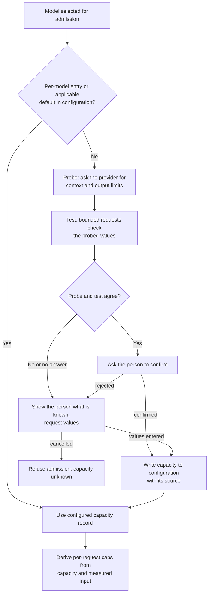
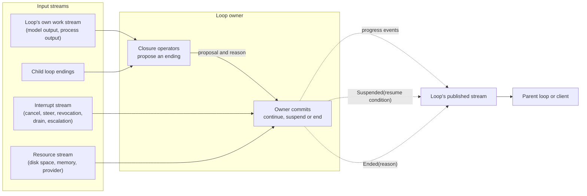
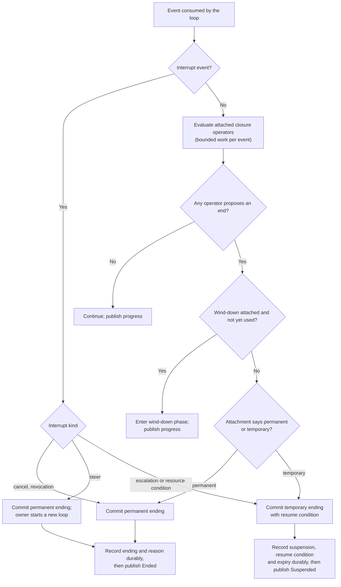
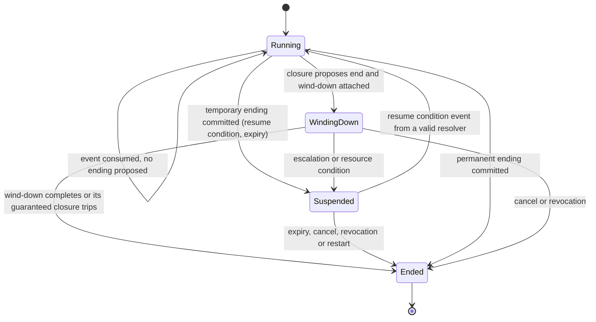
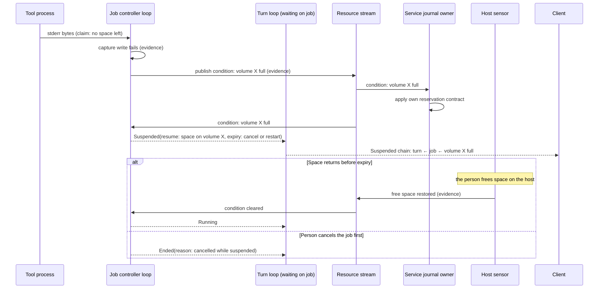

# Loop closure and endings

Status: proposed design, 2026-10-13. The owner confirmed the model in
[Loops as stream owners](#loops-as-stream-owners) and the distinctions it records.
The [AE-04](../engineering.md#asynchronous-execution-and-recovery) rewrite
(owner, 2026-10-15) limits deadline closures and time expiries to owner-approved
cases. The operators, attachment rules and per-loop mapping remain proposals. This design
is not implemented and does not authorize code. It refines how loops apply
[ADR-0006](../decisions/0006-async-event-pipelines.md); it selects no runtime,
queue or store. Protocol numbering remains `0.1`; journal format remains `1`.

## Purpose and scope

Every repeating activity in Asura must decide whether to go again or stop. Today
each loop embeds its own stopping rule. The current model turn loop stops on a
hard-coded output token total, and an exhausted total fails the turn without an
answer. That single number conflates runaway prevention, per-request safety and
spend. The [model-sized limits](#model-sized-limits) requirement removes it.

This design names the primitives that end loops, separates them from interrupts,
and defines permanent and temporary endings. A later per-loop mapping must select
which primitives apply to each loop. That mapping then governs changes to the
[turn usage helper](turn-usage-helper.md), [model tools](model-tool-execution.md)
and the [tool job controller](tool-job-controller.md).

Non-goals: selecting numeric thresholds, moving code between components, changing
the wire schema, and plan or task loops. Each needs the mapping or a later design.

## Model-sized limits

Required behavior (owner, 2026-10-13):

- Token limits must not be hard-coded. The current 2,048-token figures in the
  helper, wire validation and turn budget are implementation, not design input.
  Designs must not rely on them.
- A fixed numeric limit applies only in a **known-size exhaustion closure**: the
  exhausted quantity has a size that Asura knows and fixes, such as its own
  buffers, frame limits, call counts or captured bytes.
- Model token capacity is not fixed. Asura will integrate local and remote models
  through the OpenAI API specification. Each model has its own context window
  and output limits, so token-based closures must take their bound from the
  selected model at admission time.

Required behavior (owner, 2026-10-13):

- Asura supports both the OpenAI Chat Completions and Responses API surfaces.
- Model capacity comes from the configuration file, which ships sensible defaults.
- A configured default is known capacity. A model with no per-model entry uses
  an applicable default without probing.
- When neither a per-model entry nor a default applies, Asura probes the provider,
  tests the result, asks the person to confirm it, then writes it to configuration.

Proposed mechanism: the provider owner resolves a model capacity record before
admission. It holds the context window and maximum output tokens, each with its
source: per-model configuration, configuration default, or person-confirmed probe. The turn
owner derives each request's output cap from that record and the measured input
size. A probed value must not set a bound until the person confirms it.

### Capacity resolution flow

Status: owner-selected steps; mechanisms and limits proposed. Arrows are the
resolution order. The provider design owns probe methods and test limits.

Open decisions for the [model provider design](model-provider-integration.md):

1. The default values, and the rule that decides which models a default applies to.
2. The probe method for each provider, and the bounds and cost of test requests,
   especially for paid remote providers.
3. The configuration file location and schema, under the
   [user-service configuration](user-service-configuration.md) design.

## Loops as stream owners

Required behavior (owner, 2026-10-13): Asura is built on events and streams, and
its loops follow that model.

- A **loop** is an owner that consumes input streams and publishes its own stream.
  A turn consumes model output, tool results and interrupts. A job consumes process
  output, exit status and resource signals. Each publishes progress and endings.
- A **closure** is an ending condition that the loop evaluates over its own
  streams. It is a stream operator, such as a count, timer or predicate.
- An **interrupt** is an event from outside the loop: cancel, steer, revocation,
  drain, escalation or a resource condition. Escalation is an interrupt, not a
  closure. It hands a decision to the person or to an outer loop.
- An **ending** is an event that the loop publishes. A **permanent ending** is
  terminal; later work is a new loop. A **temporary ending** suspends the loop
  with its state and names a resume condition.
- Loops **compose**. A parent subscribes to its children's streams, so nested
  loops form a subscription tree. A shared-resource condition travels on a
  **resource stream** that every dependent loop subscribes to. It does not pass
  upward one level at a time.

### Loop model view

Status: owner-confirmed model. Boxes are owners or streams. Solid arrows carry
events into a consumer. Dashed arrows are ending events published by a loop.

## Closure operators

Proposed mechanism: closures form a small set of stream operators. An operator
observes and proposes; it never commits an ending itself.

| Closure | Operator over the loop's stream | Guarantees an end? | Example |
| --- | --- | --- | --- |
| Exhaustion | Running count or sum reaches a limit | Yes | Request count, bytes captured, paid-provider spend |
| Deadline | A timer event arrives first | Yes, only where the owner approved it | `job wait` optional model time (the wait ends; the job continues); wind-down bounds on Asura's own operation |
| Completion | Predicate on an event: the producer declares it is done | No | Model answer with no tool call |
| Goal predicate | Predicate on external evidence | No | Exit status 0, tests pass, schema valid |
| Stall | The state fingerprint stops changing | Yes, when the state space is finite | Identical call and result, no new job bytes, repeated empty replies |
| Cycle | A repeating pattern in a sliding window | No | A→B→A→B tool calls |
| Diminishing returns | Change per window falls below a threshold | No | Little new evidence per round |

A wind-down is a modifier, not a primitive. Any closure may first propose a soft
phase, such as "answer now without tools", before the hard ending. The current
turn failure without an answer is a hard ending with no wind-down.

Required behavior ([AE-04](../engineering.md#asynchronous-execution-and-recovery), owner, 2026-10-15):
no fixed time limit ends, refuses or fails work by default. A deadline closure
is allowed only where the owner approved it: a wind-down bound on Asura's own
operation that never ends the work it serves, or a wait that yields while the
work continues. Pacing (polls, backoff, heartbeats, refresh cadence) ends nothing
and is not a closure.

Proposed rule: every loop must attach at least one closure that guarantees an
end, from known-size exhaustion or stall. A deadline counts only under the
owner-approved cases above. The cancellation-driven
[turn lifetime](model-provider-integration.md#cancellation-driven-turn-lifetime--selected-2026-09-30)
remains an interrupt, not a deadline; it does not satisfy this rule alone.

### Closure evaluation flow

Status: proposal. The flow runs once for each event the loop consumes. It shows
bounded evaluation, the wind-down branch and the ending decision.

## Permanent and temporary endings

Required behavior (owner, 2026-10-13): endings are either permanent or temporary.

Proposed mechanism: permanence belongs to the attachment of a primitive to a
loop, not to the primitive. Exhausting a paid-provider spend ceiling may suspend
for the person's grant. Exhausting the request ceiling may end the turn.

| Primitive | Usual ending | Temporary when |
| --- | --- | --- |
| Completion, goal predicate, cycle, diminishing returns | Permanent | Not applicable |
| Exhaustion | Permanent | The person or a parent can grant more allowance |
| Deadline (owner-approved only) | Permanent | It is a wait that yields; the loop can resume |
| Stall | Open decision | The loop waits for new input or new output |
| Cancel, revocation | Permanent | Not applicable |
| Steer | Permanent for the current loop | Not applicable; it starts a new loop |
| Escalation | Temporary | Becomes permanent when the person declines |
| Drain or restart | Permanent for running work | Not applicable under the current job contract |

A temporary ending must name four things. Without them it can become a hang.

1. **Resume condition:** the event that resumes the loop.
2. **Resolver:** who can satisfy it, such as the person, a parent or the host.
3. **Retained state:** the durable state that the suspended loop keeps.
4. **Expiry:** the event that makes it permanent, such as cancel, revocation,
   leader exit or restart. A time expiry is allowed only where the owner
   approved it under AE-04; `CapturePaused` has none (owner, 2026-10-14).

### Loop ending states

Status: proposal. Arrows are committed transitions. A proposal from an operator
is not a transition until the owner commits it.

## Composite loops

Required behavior (owner, 2026-10-13): loops may have composite properties.
A job that manages a tool writing log files may need to signal that the file
system is full.

- **Endings propagate as events.** A child's ending reaches its parent as an
  event. The parent's own operators decide what it means. A failed job need not
  end its turn.
- **Temporary endings compose.** A suspended child can suspend its parent. The
  parent's resume condition then includes the child's. Clients must show the
  chain, for example "turn waiting ← job blocked ← disk full on volume X".
- **Resource conditions fan out.** A full volume affects the tool's logs, job
  capture and the service journal at once. The condition is published once on the
  resource stream; each dependent owner reacts under its own contract.
- **Guaranteed endings apply at each level.** A parent's expiry must be able to
  end a suspended child.

Sources of a resource condition differ in trust. This follows the ADR-0006 rule
that tool results and filesystem notifications are untrusted observations.

| Source | Trust | Example |
| --- | --- | --- |
| Tool report | Claim | ENOSPC text in a tool's stderr, or its exit status |
| Asura's own failed operation | Evidence | A capture or journal write fails for lack of space |
| Host sensor | Evidence | A [sensor](sensors.md) reports free space below a threshold |

### Composite resource condition

Status: proposal, illustrating the owner's example. Solid arrows are events;
dashed arrows are published ending or suspension events. For job capture the
owner resolved decision 4 on 2026-10-14: the controller pauses capture, not the
process, and jobs have no lifetime, so only a cancel, revocation or restart
makes the suspension permanent.

## Ownership and ADR-0006 rules

Required behavior (from ADR-0006, applied here):

- **Only owners commit endings.** A closure operator or subscriber can propose.
  It cannot end another owner's loop or satisfy a resume condition for it.
  The orchestrator remains the single owner of turns and budget admission.
- **Arrival order is not authoritative.** Stall and cycle fingerprints must use
  operation identities and revisions, not arrival order. A late duplicate must
  not look like a stall.
- **Coalescing depends on the event class.** Progress counts may coalesce.
  Ending, suspension and resume events must not be lost. A temporary ending must
  be durable before any owner relies on it.
- **Every boundary is bounded.** Suspended loops and their subscriptions need a
  numeric count limit and an expiry event. The mapping must select those values.
  A time expiry needs owner approval under AE-04.

Proposed mechanism: the service owns turn-level loops and their operators. The
model helper produces one stream per request. Today the helper's
`BoundedToolModel.swift` owns the multi-request loop and its hard-coded token
total. Moving that loop is an ownership change that needs its own design.
Separately, `Wire.swift` and `Session.swift` validate `maxResponseTokens` against
a hard-coded range. Model-sized caps therefore need a schema change within
protocol 0.1, with the range taken from the capacity record.

## Current loops

Proposed scope for the per-loop mapping. The current column records implemented
behavior; it is not the target.

| Loop | Owner today | Current closures | Current interrupts |
| --- | --- | --- | --- |
| One model request | Model helper | Exhaustion: hard-coded per-request output cap (to be model-sized) | Cancel, steer |
| Requests within a turn | Model helper | Completion; exhaustion: hard-coded token total (2,048, to be removed) and 64 requests | Cancel, steer |
| Tool calls within a turn | Service | Exhaustion: 8 calls, 16 KiB per result, 64 KiB total | Cancel, steer |
| Tool job (designed, not implemented) | Service | Completion; capture fault. No lifetime deadline (owner, 2026-10-14). Temporary ending `CapturePaused` on quota or ENOSPC, with no time expiry. A stall closure will come from tool-loop trace evidence. `job wait` ends on events or an optional model time. See [job closures](tool-job-controller.md#job-closures-and-wind-down-bounds). | Cancel, person stop and kill, revocation, restart |
| Retry and reconnect | Service and client | Exhaustion: attempt limits | Cancel, drain |

## Failure, security and operations

- **Failure and recovery:** a suspended loop that survives restart must be
  durable; today no loop does. The tool job contract interrupts running jobs on
  restart. The mapping must state, per loop, whether suspension survives restart.
- **Security:** a resume event must come from a resolver that holds authority for
  that loop. A resource condition grants nothing. A suspended job keeps its
  original grant, sandbox and lifetime; suspension never extends authority.
- **Operations:** each attached operator records its reason in the ending event.
  Clients show the reason and any suspension chain. Numeric limits are open.

## Asynchronous execution

| Rule | Application |
| --- | --- |
| AE-01 | Operators perform bounded in-memory work per event; no operator waits on I/O. |
| AE-02 | Operators call no blocking APIs. Resource sensors keep their existing isolation. |
| AE-03 | Fingerprint windows, suspended-loop counts and subscriptions need numeric limits, selected by the mapping. |
| AE-04 | Every temporary ending names the events that end it: cancel, revocation, leader exit or restart. No temporary ending has a time expiry unless the owner approved one (owner, 2026-10-15). An owner-approved wait that yields states whether the work continues. |
| AE-05 | Ending and suspension records are durable before publication. Stale resume events are rejected by generation. |
| AE-06 | Drain converts suspended loops to permanent endings unless their contract says otherwise. |
| AE-07 | Validation below must run under stalled producers and resource exhaustion. |

## Validation required

Status: required coverage for the implementation that adopts this design.

| ID | Behavior | Unit | Integration | End-to-end |
| --- | --- | --- | --- | --- |
| LC-01 | Each operator proposes an ending at its boundary and not before | Yes | | |
| LC-02 | Operators never commit; only the owner publishes an ending | Yes | Yes | |
| LC-03 | Every loop has a guaranteed-ending closure | Yes | | |
| LC-04 | Wind-down produces an answer before the hard ending | | Yes | Yes |
| LC-05 | Stall fingerprints ignore arrival order and duplicates | Yes | | |
| LC-06 | Temporary ending records resume condition, resolver and expiry before publication | Yes | Yes | |
| LC-07 | Expiry ends a suspended loop and its suspended children | | Yes | Yes |
| LC-08 | An unauthorized resume event is rejected | Yes | Yes | |
| LC-09 | One resource condition reaches every dependent owner once | | Yes | |
| LC-10 | Full volume during a job shows the suspension chain and recovers when space returns | | | Yes |
| LC-11 | Drain and restart produce the documented permanent endings | | Yes | Yes |
| LC-12 | Token caps follow the selected model's capacity record; no token limit is hard-coded | Yes | Yes | |
| LC-13 | Two models with different capacities receive different request caps in one installation | | Yes | Yes |

## Decisions

Open decisions for the per-loop mapping:

1. Which closures, interrupts and wind-down apply to each loop in
   [Current loops](#current-loops), and whether each ending is permanent or temporary.
2. Whether permanence is chosen per attachment, as proposed, or fixed per primitive.
3. Whether a stall is permanent or temporary by default.
4. On a resource condition, whether the job controller only observes and signals,
   suspends the process, or stops it. Resolved for job capture by the owner on
   2026-10-14 (R6, J2a-1): quota exhaustion and ENOSPC on Asura's own capture
   writes pause capture (`CapturePaused`) and do not suspend the process; other
   I/O faults and stalls cancel the job. The pause has no time expiry; cancel,
   revocation, leader exit and restart end it. Its pause facts are recorded in
   the settlement, not in separate records, an exemption from the durability rule
   above (J2c). Jobs have no guaranteed-end closure until the stall closure
   exists; the proposed rule that every loop attaches one does not yet hold for
   jobs. Other resource conditions and other loops remain open.
5. Which spend ceilings apply to paid providers under
   [ADR-0003](../decisions/0003-aggregate-budget-admission.md), and whether
   unknown model capacity refuses admission or uses a verified configured value.
6. Whether the service takes ownership of the turn request loop from the helper.

Owner direction (2026-10-13): the closure that guarantees a turn's tool loop
ends is derived from evidence. Asura logs tool-loop traces and builds a
classifier first; see [tool-loop trace evidence](tool-output-views.md#tool-loop-trace-evidence).
The current 8-call and 64-request limits stay until that work selects closures.

Alternatives considered: a single hard-coded per-turn token total (current;
conflates concerns, ignores model size and fails without an answer); closures embedded in each loop's control
flow (no shared vocabulary or composition); escalation as a closure (rejected by
the owner; it is an interrupt).

## Design verification

Mermaid diagrams in this document were rendered locally with Mermaid CLI 12 and
inspected. Rendering does not validate the semantics; the owner review does.
