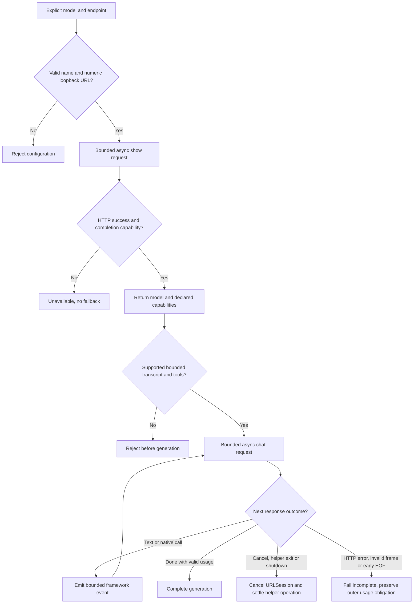
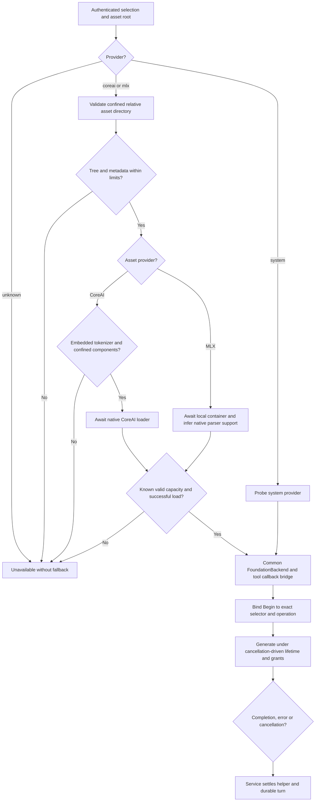
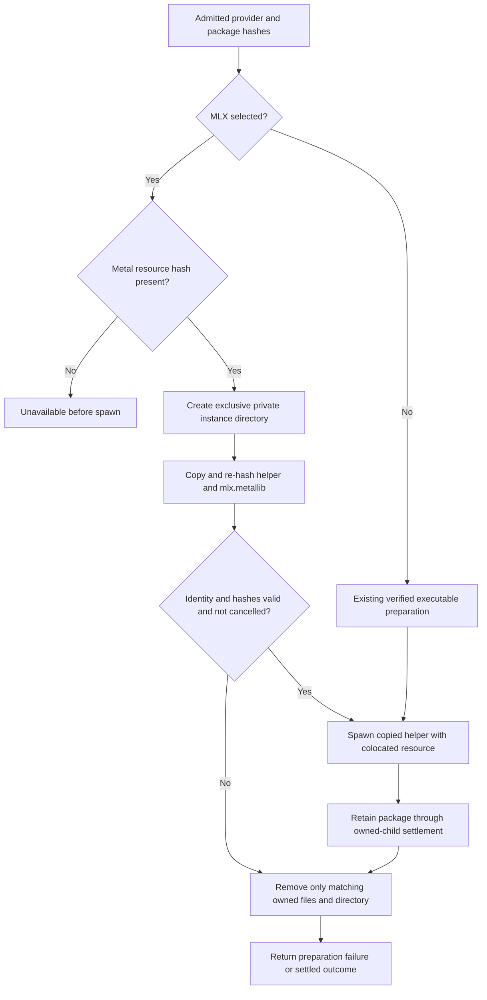
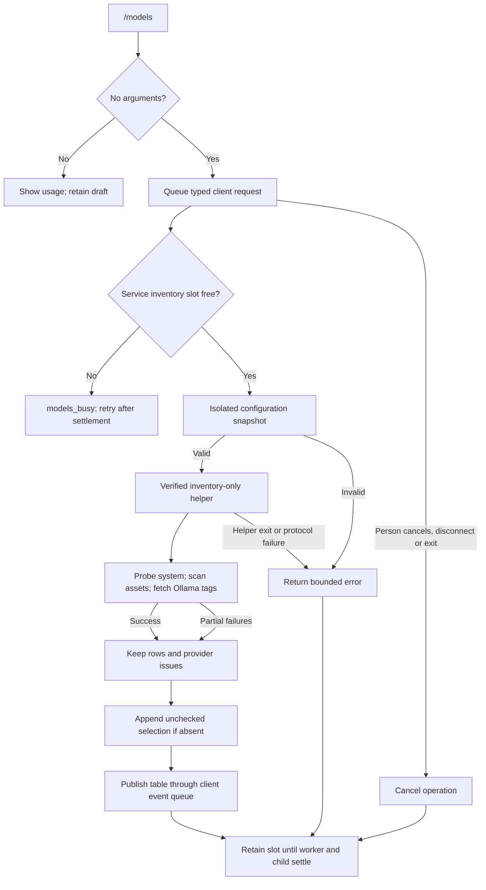
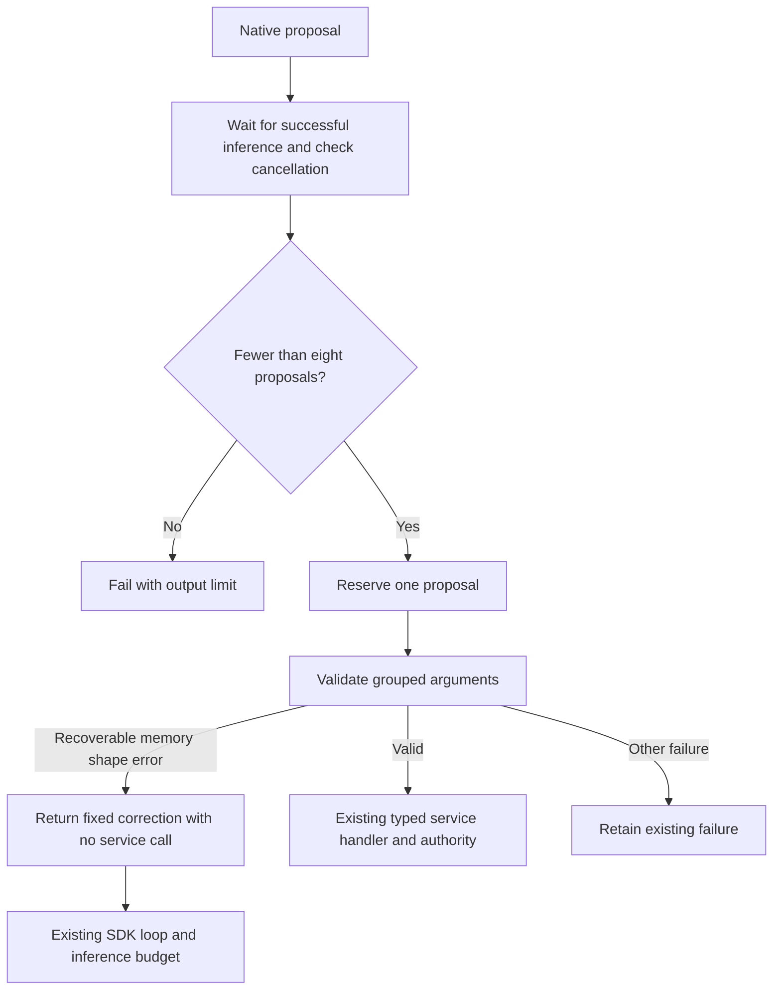
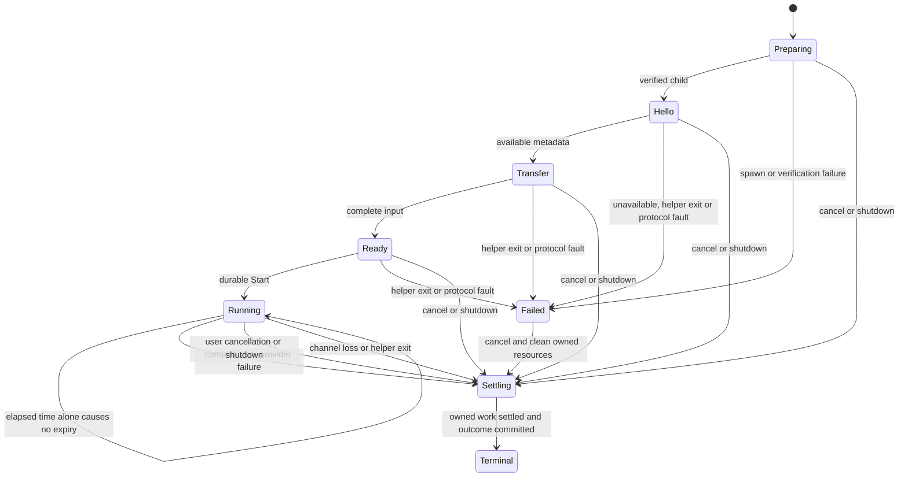
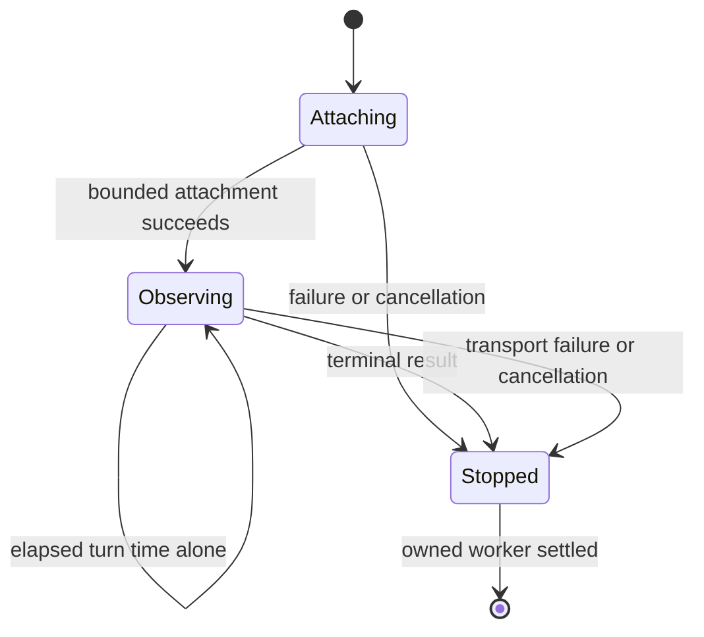
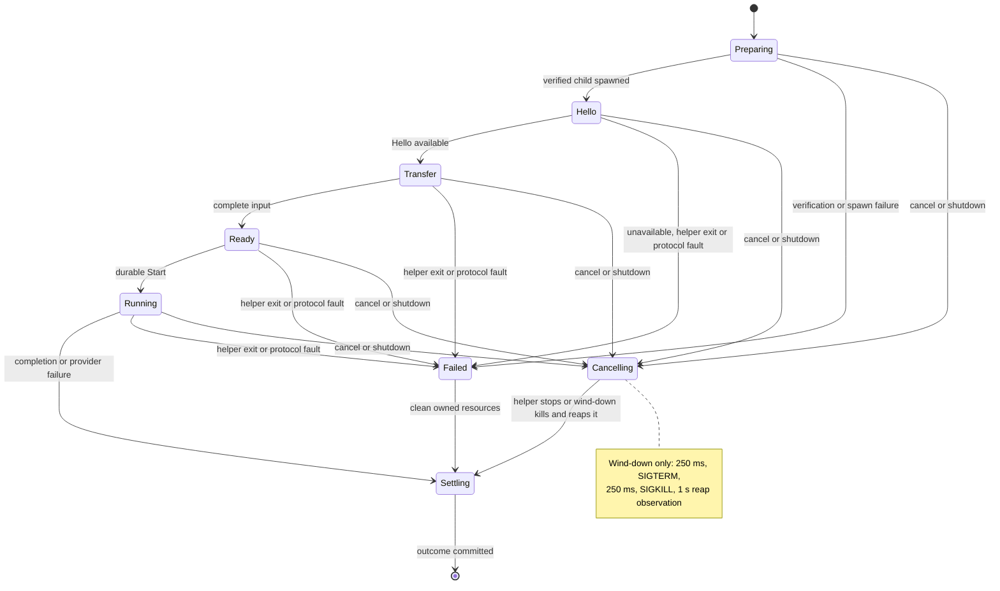
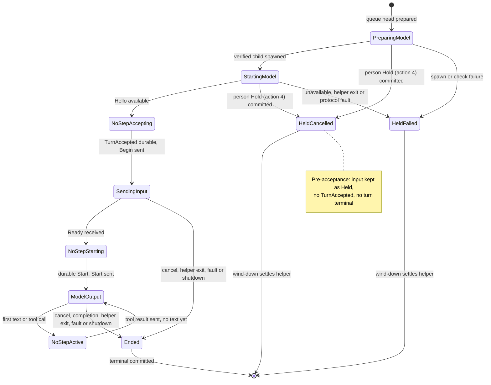
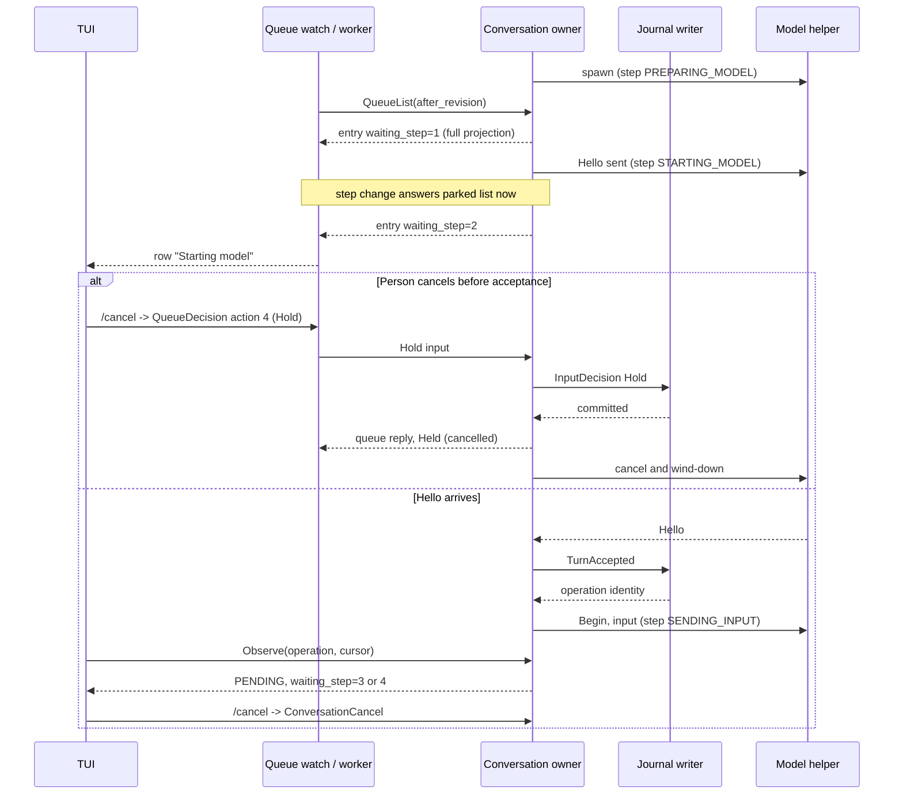

# Model provider integration

Response-budget update, 2026-09-28: the [response activity contract](response-activity.md#response-limits-and-truthful-completion)
supersedes this packet's earlier 512-token budget and 256/128/128 allocations.
New admissions reserve 2,048 tokens. Tool requests are capped at 1,024 tokens first
and 512 thereafter, at most 64 per turn, under the
[turn budget](turn-usage-helper.md#turn-budget-and-request-admission). Historical
512-token journal records retain their recorded accounting. Earlier numerical
examples and validation evidence below describe that earlier packet.

Owner requirement, 2026-10-13: Asura will integrate local and remote models
through the OpenAI API specification. Token limits must not be hard-coded; each
model's context and output capacity sets its token bounds. The 2,048-token
figures above are current implementation to be replaced under
[model-sized limits](loop-closure.md#model-sized-limits). The owner selected both
the Chat Completions and Responses surfaces, capacity in the configuration file
with sensible defaults, and probe, test, person confirmation and configuration
only when neither a per-model entry nor a default applies. This design must
select defaults, probe methods and test bounds. Remote providers must not be
implemented until the reviewed [execution threat model](execution-threat-model.md)
covers remote endpoints, data egress and credentials (owner, 2026-10-13). The
review was completed on 2026-10-15; remote endpoints wait for the
[remote provider prerequisites](#remote-provider-prerequisites--owner-2026-10-15).

Status: MP2 integrated and compiled, with native system, Ollama and MLX checks
recorded below, 2026-09-28. CoreAI now also passes the scoped HM3 native Memory
journey; see the [Memory evidence](hybrid-memory-ontology.md#hm3-implementation-evidence).
Wisp source informed this packet.
MP2 connects selection, prepared configuration, local assets and the shared tool
bridge. The registry resolves all four adapters; runtime availability still depends
on the selected helper and assets. The MP1 sections below record the earlier
contract. MP2 supersedes its inventory and endpoint restrictions where stated.
Provider-specific runtime evidence and its limits are recorded separately below.

Time-limit update (owner, 2026-10-16): the helper handshake, Ollama, Foundation
and inventory waits have no time limit. See
[helper and provider waits without time limits](#helper-and-provider-waits-without-time-limits--owner-2026-10-16).
That section supersedes the time limits stated in earlier sections. Implemented
2026-10-16.

## Scope and evidence

Read-only Wisp inspection used revision
`0111d0743a96bb7c1c7820eba41f9a03a7910f56`, including its working tree.
Relevant sources are `harness/Sources/WispCore/Session/ModelSelection.swift`,
`ModelBackend.swift`, `OllamaModel.swift`, and the CoreAI/MLX backend modules.
The installed macOS 27 FoundationModels Swift interface defines `LanguageModel`,
`LanguageModelExecutor` and async generation-channel events. These are source
observations, not runtime qualification.

Reuse Wisp's provider/name separation, preserved model tags, capability provenance,
structured history and native tool-call conversion. Do not copy synchronous
`Blocking.run` discovery or loading. Do not infer locality from the provider name.
Wisp's generic local-backend label cannot establish that an Ollama URL is local.
Do not parse unlimited NDJSON lines or convert invalid JSON to empty arguments.

The service retains the canonical provider registry in `model.rs`. The Swift
adapter translates provider inference only. Models can be local or remote;
classifiers remain local and cannot use this provider/tool execution path.
The [common tool owner](model-tool-execution.md) owns validation, grants, execution,
results and cancellation. Foundation Models manages inference continuation with
native tool callbacks that await that owner. No adapter executes host tools.

## Delivery and ownership

MP1 owns `model.rs`, a new `OllamaBackend.swift`, and `OllamaBackendTests.swift`.
The tools packet owns helper Session/Wire/Backend and service model-owner wiring.
MP1 exposes a custom Foundation Models language model, so the tools callback bridge
can serve it unchanged when MP2 supplies the admitted selection.

MP1 adds explicit known-provider inventory: system implemented, Ollama adapter
pending wiring, CoreAI and MLX unavailable without installed build dependencies.
Resolution must keep rejecting unconnected providers, without fallback. Existing
configuration may retain their model identifiers; saving a value does not prove
availability or authorize execution.

MP2 must resolve the current Hello-before-Begin selection ordering. The helper
cannot report system availability as evidence for another provider. Selected
provider and endpoint must be sent under the authenticated private channel before
provider discovery. MP2 must bind the admitted configuration snapshot, tool
capabilities and destination to that selection. This is a schema extension at
protocol 0.1, not a protocol number change. Journal format remains 1.

CoreAI and MLX require dependency/package qualification and bounded asset loading
before enablement. Their assets use `$HOME/.asura/data/models/coreai/` and `mlx/`.
Classifier assets remain `$HOME/.asura/data/classifiers/`. MP1 installs/downloads
nothing, changes no user config and never starts an Ollama daemon.

## MP1 adapter contract

The adapter accepts an explicit model name and numeric-loopback HTTP endpoint.
The default is `http://127.0.0.1:11434`. Endpoint parsing rejects credentials,
query, fragment, non-root path, hostnames and non-loopback addresses. HTTP redirects
are refused, proxy use is disabled, and cookies/cache are disabled. This limited
transport cannot authorize a remote endpoint. Loopback transport also does not
prove local inference: a local daemon can forward requests. MP2 must establish
the configured model's inference destination before granting disclosure. Future remote support needs endpoint
identity, TLS/authentication, redirect policy and scoped disclosure grants.

Discovery uses `POST /api/show` with the selected model. A successful result
constructs the model only if `completion` is declared. `tools` maps to native tool
calling; absent capability stays unavailable. Other capabilities remain unsupported
until separately validated. Runtime declarations are not permission grants.

Generation preserves system, user, assistant, tool-call and tool-output roles.
Unknown transcript content fails explicitly rather than being silently omitted.
Tool definitions use the framework's schema. Malformed argument JSON fails.
Structured-output requests fail unsupported in MP1. Native tool proposals retain
request identity and ordinal; the shared callback bridge controls execution.

The adapter streams cumulative text through Foundation Models events. A response
must contain a final `done:true` record; EOF before it is incomplete. An error,
negative usage, oversized frame or unsupported role fails. No partial response
becomes completed history. Usage is provider-reported, never invented as measured.
Missing usage remains unknown at the backend boundary.

### Adapter decision flow

Selected MP1 flow. Arrows name asynchronous operations and terminal outcomes.

## Bounds and failure isolation

MP1 runs only inside the existing supervised helper. No network call runs on the
service reactor or UI. One generation and one network request are active per helper.
The outer service owns cancellation-driven generation and owned-child
termination/reap. Adapter retries are disabled; cancellation invalidates its session.

| Resource | Bound |
| --- | --- |
| Model name | 1 to 1,024 UTF-8 bytes, no whitespace/control |
| Discovery request | 64 KiB response; no time limit (owner, 2026-10-16) |
| Generation request | No time limit: no whole-turn expiry, network inactivity bound or resource bound (owner, 2026-10-16) |
| Encoded request | 256 KiB including transcript and tool schemas |
| NDJSON record | 64 KiB before decoding |
| Total response | 4 MiB |
| Response text | 60 KiB per generation |
| Tool calls | 8 per generation; shared turn budget may be stricter |
| Tool arguments | 16 KiB per call |
| Ollama context request | At most 8,192 tokens, selected after `/api/show` discovery; reported maximum and effective request capacity are separate observations |
| Output request | At most 2,048 tokens, the per-request cap from the turn budget |

Read network bytes incrementally and reject before growing the record buffer beyond
its limit. HTTP error bodies are not logged or retained. Invalid or redirected
responses fail without disclosing to a different endpoint. A request ends on its
reply, an HTTP or transport error, cancellation, helper exit or service shutdown.
Silence alone does not end it. Task cancellation
must invalidate the owned URLSession; helper shutdown remains the final containment
boundary if a dependency does not stop. Numeric bounds do not establish tested
responsiveness; MP2 requires real fault injection before activation.

## Required validation

| ID | Unit | Integration and end-to-end |
| --- | --- | --- |
| MP1-A | Endpoint/name rejection and no fallback inventory | MP2 sends exact admitted endpoint/model through private channel |
| MP1-B | Preserve roles, native tool arguments and capability absence | Isolated loopback server records real request and native callback/result cycle |
| MP1-C | Frame/total/text/call bounds, malformed JSON and missing done | Real oversized/truncated/stalled server response fails without blocked control |
| MP1-D | Usage bounds and unsupported content/schema | Provider usage or unknown usage preserved through service settlement |
| MP1-E | Discovery requires completion and reflects tools declaration | Capability change between discovery/use fails explicitly, no silent tools loss |
| MP2-A | Generation fencing and grant checks | Cancel during connect/stream/tool wait, disconnect/restart, no duplicate execution |
| MP2-B | Destination admission | Real remote adapter only with authorized credentials/egress; absent grant discloses nothing |

MP1 unit tests join the normal Swift test target. Root owns serial compilation,
package identity generation and test execution. MP2 extends the real CLI/TUI journey;
a model substitute cannot establish actual Ollama/native model behavior. All fixture
servers/backends are private and must stop at test completion. Live provider access
is a separate qualification. No result is claimed until root runs the checks.

## MP1 review evidence

The flowchart rendered with Mermaid CLI 12.0.0 and was visually inspected.
Rust formatting and `git diff --check` passed. Compilation and test execution
remain with root; no live provider access occurred.

## MP2 local asset providers

Status: implemented. This section supersedes MP1 inventory states. Runtime
qualification remains provider-specific, as recorded below. Root owns dependency
pins and compilation.
The provider agent owns `model.rs`, `ProviderFactory.swift`, `AssetLocation.swift`,
`CoreAIProvider.swift`, `MLXProvider.swift`, `OllamaBackend.swift` and their tests.
The common tools owner owns `Backend.swift`, `Session.swift` and the shared callback
bridge. The factory returns that common backend; it adds no inference lifecycle.

The service sends the exact model selector before provider discovery. It supplies
an absolute managed `data/models` root for asset providers. The helper never derives
this root from its environment. `coreai:name` and `mlx:name` select a relative path
beneath their respective provider directories. Absolute names, empty components,
`.` and `..` are invalid. The factory never substitutes the system provider.

The helper validates the asset directory before calling a vendor loader. It rejects
symbolic links, nonregular files, paths outside the selected directory and excessive
asset trees. Limits are 8,192 entries, depth 16, 128 GiB aggregate file size and
1 MiB for each metadata JSON read. Regular weights remain memory mapped or streamed
by the vendor. The helper does not copy, repair or download missing assets.
The assets are trusted account-owned model data; changing files during vendor loading
can cause failure. This validation is not a sandbox against another same-user process.

Filesystem inspection and vendor initialization run in one detached helper task.
The service remains the cancellation and process-settlement owner. Cancellation stops
admission; a stalled loader is terminated with its helper. Preparation and Hello,
including provider loading, have no time limit (owner, 2026-10-16). Each step ends
on the next message, helper exit, a protocol fault, cancellation or shutdown, and
the TUI shows the step it waits for. Started generation follows the cancellation-driven
turn lifetime below. There are
no retries or additional helper slots. A model that fails to load reports
unavailable; a slow load stays visibly pending and cancellable. Neither
filesystem reads nor model loading runs on the service reactor or terminal renderer.

CoreAI uses `CoreAILanguageModel` from `coreai-models` revision
`3f109efd54273391f9fd9f5f5b3d8c6e99836d55`. `LanguageBundle.maxContextLength`
provides capacity. An embedded tokenizer is mandatory. The vendor's pretrained
Hugging Face tokenizer fallback is forbidden because it can download implicitly.
All component paths must resolve inside the checked asset tree. The native model's
capabilities establish tool support. Missing or invalid bundles fail unavailable.

MLX uses `mlx-swift-lm` revision
`c6446cf7bfb7cea76408013b614d4b2c530eaa03` with its Foundation Models integration.
The local-directory loader and explicit weights-location closure prevent model
identifier downloads. Tokenizers use `swift-transformers` revision
`c21fdcde390313a6d98d8e33a346f2c3486c3ab0`. The factory loads the container once,
then shares it with the native bridge. The loaded configuration's native
`toolCallFormat` establishes parser support. Missing parser support means no tools;
ordinary model prose cannot become a tool request. Capacity comes from the model's
positive integer `max_position_embeddings`, including `text_config` when present.
Tokenizer sentinel lengths do not establish capacity. Models without a supported
capacity field fail explicitly until their format receives a specific adapter.

Both providers use `FoundationBackend` and the same service-owned tool bridge.
They report the selected model name, effective capacity, reported maximum and
discovery source under the [context telemetry contract](model-context-telemetry.md#capacity-discovery-and-collection). They leave input counts and
usage unknown when the adapter cannot establish an actual measurement. The common
engine enforces response and tool budgets. Vendor generation honors the passed
maximum response tokens. No capability declaration grants host access.

### MP2 provider validation

- MP2-L1 unit: reject absolute/traversing/symlink asset paths, excessive metadata,
  missing capacity, missing tokenizer and unknown provider without fallback.
- MP2-L2 integration: private Hello selects each provider; Begin cannot change it.
  Missing assets return unavailable before inference, with no network download.
- MP2-L3 integration: stalled load remains cancellable through helper containment;
  service status/input events remain responsive and helper is reaped on cancellation.
- MP2-L4 native: installed MLX/CoreAI assets produce a real response and a native
  tool callback through the common service grant/result cycle. Each model needs its
  own recorded evidence; one provider's success does not qualify another.
- MP2-L5 native: output budget, cancellation and missing-tool capability fail
  truthfully. Input context/usage stay unknown if no actual measurement exists.

Initial investigation found installed SDK and cached pinned source for these APIs,
an MLX asset in Wisp's store, and no CoreAI bundle in the inspected standard stores.
Root subsequently copied the MLX asset into an isolated managed root and qualified
its native path. The recorded checks below are the current runtime evidence.

### MP2 Ollama limits

Discovery must return a positive integer model-info key ending in `.context_length`.
Conflicting values use the smallest reported maximum. The request context is the smaller
of that maximum and 8,192 tokens; Hello reports both values and the discovery source.
Missing capacity fails unavailable. `num_predict` comes from the common engine's
current request, between 1 and 2,048, so tool continuations preserve remaining budget.
Stream usage above that request limit fails. Discovery keeps its resource bounds;
the [endpoint configuration contract](#mp2-endpoint-configuration-handoff) governs
local HTTP and remote HTTPS selection.

### Dependency graph review

The helper links the selected provider bridges; provider availability is checked
at runtime. Direct dependencies are pinned in `swift/model-helper/Package.swift`:
SwiftProtobuf (existing), CoreAILM, MLXFoundationModels, MLXHuggingFace, MLXLLM,
MLXLMCommon and Tokenizers. CoreAI adds its shared bundle and tokenizer dependencies.
MLX adds `mlx-swift` (Metal kernels) and SwiftSyntax macro support. Tokenizers adds
its pinned tokenizer/template dependencies. These are vendor inference adapters,
not alternate Asura orchestration or tool owners.

Root reviews the resolved transitive graph and licenses before the dependency
build. Package resolution and Metal resource packaging remain root's serial build
steps. No package was fetched or built by the provider implementation agent.
The cached Wisp graph is source evidence, not Asura's resolved lockfile.

Ollama requests set `truncate:false` and `shift:false`. The current upstream
[ChatRequest contract](https://github.com/ollama/ollama/blob/main/api/types.go)
defines these controls for explicit context overflow failure. Qualification must
verify overflow against the installed daemon; an older daemon might ignore unknown
fields. An encoded-request test alone does not prove the daemon honors this rule.

### MP2 endpoint configuration handoff

The selected optional key is `providers.ollama.endpoint`. The configuration owner
stores it in the same snapshot as `model`. The value is at most 2,048 UTF-8 bytes.
Absence selects `http://127.0.0.1:11434`. HTTP is permitted only for numeric loopback;
HTTPS requires a nonempty host and normal system certificate validation. URLs with
credentials, query, fragment or non-root paths are invalid. Redirects, cookies,
proxy configuration and ambient credentials remain disabled. The adapter sends no
Authorization header. Authenticated providers need a separate credential contract.

The service sends the endpoint from the admitted snapshot in Hello. Endpoint
changes cannot modify an already admitted operation. Selecting an Ollama endpoint
permits its ordinary conversation inference only under service admission. It does
not grant project disclosure. All Ollama selections remain endpoint-dependent,
including loopback daemons that can forward to cloud models. The service denies
project tool results to these selections by default. The owner-selected
[verified local route](model-tool-execution.md#verified-local-ollama-disclosure)
permits tools only after runtime locality checks and enforced local-only routing.
Cloud and unverified routes remain denied. The system/CoreAI/MLX asset providers
keep their separate on-device classification.

The configuration owner must add get/set, YAML dump, invalid URL/type tests and
snapshot-digest coverage. The provider adapter tests HTTP locality, HTTPS acceptance,
credential/path rejection and continued redirect refusal. Integration must show the
exact admitted endpoint reaching the helper without mutating account configuration.

MP2 diagram rendered and visually inspected with local Mermaid CLI. Source files and unit cases are integrated. The recorded checks below supersede
the earlier pending compilation and native-check status.

The storage configuration snapshot carries `model`, `ollama_endpoint`,
`asset_root` and the configuration digest together. The digest covers normalized
configuration, including the endpoint. The writer preserves these fields in its
prepared admission result. The service copies them into the private helper
selection; it does not re-read configuration during launch. The asset root comes
from the retained runtime directory's managed parent path through a pure platform
accessor, with no environment lookup or filesystem operation on the reactor.

The strict YAML tree now permits three mapping levels for `providers.ollama.endpoint`.
It retains duplicate rejection and a three-key bound per mapping. Providers and
Ollama mappings are omitted from default YAML when no endpoint is configured.
The endpoint validator accepts ASCII DNS names or IP literals, with an optional
port from 1 to 65535. It rejects escapes and backslashes to keep Rust and Swift
URL interpretations consistent. Ordinary config get/set continues to use the
existing command flow, atomic file replacement and cancellable worker.

### MP2 resolved dependency review

Root resolved the helper lock graph to 16 pins. Root reviewed the package-root
licenses: CoreAI uses BSD-3-Clause; MLX, EventSource and yyjson use MIT; the other
reviewed packages use Apache-2.0, with Swift exceptions where present. Root found
no binary targets in the package-root manifests. The reviewed MLX CUDA plugin
returns no build commands on macOS. The network-denied helper build and all 26
model-free tests passed on 2026-09-28. Metal resource packaging and native provider
qualification remain separate evidence gates; the missing CoreAI asset limits live proof.

### Verified Metal resource packaging

The MLX loader first searches for `mlx.metallib` beside its loaded executable.
Its compiled fallback is relative `default.metallib`; the build tree is not an
authorized runtime source. Package assembly therefore stages `mlx.metallib` beside
`asura-model` and records its SHA-256 in the service package identity.

Only an MLX selection requires this resource. The existing preparation worker
creates a private unique `model-ID` directory beneath the retained runtime root.
It copies the verified helper as `asura-model` and the verified resource as
`mlx.metallib`. Source files must be regular, owned by the service account and not
group/world writable. Final symlinks are rejected. Bounds are 128 MiB executable
and 64 MiB Metal resource, copied in 64 KiB chunks under the existing preparation
cancellation flag. Both copied inodes are re-read and hashed.

The platform retains both files and the directory through child settlement.
Cleanup unlinks only names whose device/inode match retained descriptors, then
removes only the matching empty directory. It never recursively removes unknown
entries or replaces another process's resources. Failure before spawn cleans
owned files; failure during execution follows existing child termination/reap.
System, CoreAI and Ollama retain executable-only preparation and do not depend on
Metal resource presence. All preparation and cleanup remain isolated from reactors.

Resource tests must prove colocated bytes are visible to the copied helper,
resource absence/hash mismatch fails before spawn, failures remove owned copies,
system preparation requires no resource, and unknown replacement entries survive
cleanup. Root must run relocated native MLX inference to prove Metal loading.

The opt-in `conversation_flow --native-mlx` journey requires `ASURA_TEST_MLX_ASSET`.
The fixture first starts the service and waits for completed initialization. It
then copies that explicitly supplied source into mode-0700 managed model directories,
dereferencing regular-file links. Preexisting data without initialization authority
remains a recovery condition; the fixture must not bypass that protection. It bounds the copy to 8,192 entries,
depth 16 and 128 GiB, never downloads, and deletes only its scratch home.
The journey checks missing assets before admission, real native completion,
private copied Metal bytes, cancellation and post-shutdown resource cleanup.
The fixture's ordinary service guard owns stop/kill/reap on every exit path.

The opt-in `conversation_flow --native-ollama` journey uses an already running
numeric-loopback Ollama daemon. `ASURA_TEST_OLLAMA_MODEL` selects its installed model;
the fixture defaults to `granite4.1:8b`. It writes only scratch Asura configuration,
never starts/stops or modifies the daemon, and submits synthetic text only. It
asserts native completion without project tools, then submits a bounded 30,000-byte
synthetic prompt whose repeated tokens exceed the 8,192-token request window.
Overflow must fail explicitly; a successful shortened response fails qualification.

### Development hashing performance

The integrated helper grew to about 97 MiB. Root measured preparation failure at
2.48 seconds wall time, including 2.10 seconds of user CPU time. The retained
preparation worker reached its two-second deadline before provider discovery.
The installed `sha2` 0.10.9 source selects its software backend on AArch64 unless
its `asm` feature is enabled; the current build enables only `default` and `std`.

The selected correction optimizes only the existing `sha2` package at level 3 in
the development profile. Tests inherit that profile. Dependencies, features,
verification passes, cancellation and deadlines remain unchanged. No stripping
step changes the assembled helper identity. Root must rebuild and re-run native
admission to verify that preparation fits its budget; this change alone is not
performance evidence. The client submit deadline remains three seconds, so
increasing preparation time would also require a coordinated admission contract.
This paragraph records the 2026-09-30 state. The owner later removed the
preparation and client submit time limits (2026-10-16).

Native provider fixtures retain one submit request ID while waiting for prior
helper settlement. They retry only an explicit `conversation_busy` response, for
at most five seconds. Transport errors and uncertain outcomes stop the fixture;
they never allocate a replacement request. Each provider stage annotates errors
so preparation, missing-asset checks, inference and shutdown failures are distinct.

### Recorded provider checks

Root reports 30 Swift model-free tests and 38 cross-language contract cases passed.
Root also reports native system tool execution passed, including status calls and
replay checks. These results do not establish other providers' native behavior.

The native Ollama fixture passed synthetic inference and explicit context-overflow
rejection against the existing Ollama 0.34.4 daemon with `granite4.1:8b`. It exposed
no project tools or project data. This qualifies that daemon/model combination's
observed text and overflow path, not authenticated remote transport or native
remote tool disclosure.

Root reports the native MLX fixture passed with
`LFM2.5-1.2B-Instruct-MLX-4bit`. The fixture verified missing-asset rejection,
private copied Metal resource bytes, real generation, unknown input measurements,
cancellation and owned resource cleanup. Assets were copied into an isolated
managed root. This establishes that model's tested local path, not all MLX model
formats or native tool selection by that model.

Root also reports the baseline native system journey passed durable FIFO queue,
steering and restart recovery with system tools enabled. CoreAI code compiled and
model-free checks passed. The initial asset search missed Wisp's separate export
store; a subsequent lookup found the Qwen3-4B export. With owner authorization,
all seven bundle files were copied to the managed CoreAI model directory and
verified against the original export manifest on 2026-09-28. Its selector is
`coreai:qwen3_4b_4bit_dynamic`. Wisp's recorded inference checks do not establish
native Asura qualification. Root's lint, build and terminal checks remain separate
gates.

### Optional display name bounds

The routing selector remains unchanged through `Hello.selected_model` and
`Begin.model`, up to its existing 1,024-byte limit. The optional `Hello.model_name`
field is presentation metadata, limited to 256 UTF-8 bytes. The helper emits this
field only when the supplied display name is nonempty, within the byte limit and
contains no control characters. Otherwise it omits the field; the client retains
the configured selector. This avoids slicing UTF-8 or silently changing routing.
Tests cover names at and above the multibyte boundary and full selector retention.

## Loopback endpoint restriction — selected 2026-10-13

Required behavior (owner, 2026-10-13): until the
[execution threat model](execution-threat-model.md) is reviewed, the Ollama
endpoint must be a loopback address. This closes finding EX7, where an HTTPS
endpoint sent conversation content off the device. The owner extended it on
2026-10-15 (EX7): the restriction stays until both the EX13 destination grant
and the EX14 Keychain credentials are built. This replaces the provisional
"inference only now".

| Path | Selected behavior |
| --- | --- |
| `/config set providers.ollama.endpoint` | Rejects a non-loopback endpoint with `config_remote_endpoint_restricted`. The file is unchanged. |
| Existing configuration file with a non-loopback endpoint | The file still loads, so other settings keep working. The endpoint stays visible through `/config`. |
| Turn preparation with an Ollama model | Rejects a non-loopback endpoint with `remote_endpoint_restricted` before any helper or network request. A queued input is held with that reason. |
| Model helper Ollama backend | Rejects a non-loopback endpoint as an invalid configuration. This is defense in depth and covers `/models` inventory. |

Loopback means host `127.0.0.1` or `::1`, with scheme `http` or `https`, under the
existing endpoint grammar. Host names, including `localhost`, are not loopback.
The storage configuration owner defines the rule once; the service uses it for
turn preparation and for the existing local tool-destination check. The Swift
helper keeps its own equal check at the transport boundary.

All checks are pure in-memory string validation; none blocks. Removing the
restriction needs the EX13 grant and EX14 credentials built (EX7, owner
2026-10-15). The code comment at `asura-storage/src/config.rs:400-401` still
names the review as the condition and must be updated with that work.

Validation: unit tests cover the rule, configuration set rejection, loading an
existing non-loopback file, turn preparation rejection before helper start, and
Swift backend rejection. The existing service conversation tests and Swift suite
must pass. A TUI journey that sets a remote endpoint and submits a prompt is
required for end-to-end proof.

## Remote provider prerequisites — owner, 2026-10-15

Required behavior from the [threat model decisions](execution-threat-model.md#owner-decisions).
Each item needs its own design before code; none is designed here. Remote
endpoints return only when EX13 and EX14 are built (EX7).

| ID | Required outcome |
| --- | --- |
| EX13 | Owner, 2026-10-15. A grant per endpoint lists the data classes that may leave the device: prompts, history, notices, file pages and tool results. File pages and tool results are off by default. The grant is limited to named projects; an endpoint allowed for one project receives nothing from another. The person sets it through configuration. |
| EX14 | Owner, 2026-10-14. One Keychain item per provider, read only by the model helper at request time. The service, journal and configuration hold only the provider name. The D1 [credential review](threat-model.md) runs with this work. |
| EX15 | Owner, 2026-10-15. Per-provider spend ceilings, set by the person and admitted through the [ADR-0003](../decisions/0003-aggregate-budget-admission.md) aggregate budget as an exhaustion closure under [loop closure](loop-closure.md). The client asks the person before a turn whose estimated cost exceeds a set amount. |
| EX8 | Owner, 2026-10-14. Accepted for credential-free endpoints; credentials wait for EX14. |
| EX10 | Owner, 2026-10-14. exec_cmd stays offered to local tool-capable providers; each needs SH-E1-style [qualification](exec-cmd-tool.md#threat-model-review-decisions--2026-10-14) before tool job packet J2. |

PX4 gives a remote destination the same person notices and `job read` pages as
a local model. Whether those pages fall under the EX13 tool-results class, off
by default, is an open owner question recorded in the
[threat model](execution-threat-model.md#remaining-items).

Validation: threat model cases EX-V6 (only granted classes leave) and EX-V7
(history on a provider switch) must pass before remote endpoints return.

## MP3: model inventory command

Status: implemented and integrated. Local validation passed on 2026-09-28. The owner authorized `/models`.
The command reads one configuration snapshot and lists model candidates. It neither
changes selection nor loads weights, starts inference, downloads assets or starts
an Ollama daemon. Wire numbering remains 0.1 and journal numbering remains 1.

### Inventory ownership and contract

The service owns one inventory operation slot. The control client submits
`ModelsList` and consumes `ModelsReply` through its existing command queue.
The reply contains the configured selector (provider spelling normalized by the
canonical model identifier parser), typed rows, provider issues and an
optional whole-operation error. Each row contains selector, provider, status and
an optional bounded detail. Status values mean available (system SDK probe),
installed (local metadata only), listed (Ollama catalog only), unavailable, or
unchecked. Installed/listed never claims inference qualification. A configured
selector absent from discovery is appended as unchecked with `not_discovered`.
The TUI marks the configured row and shows provider issues below its padded table.
Empty provider directories are a successful empty inventory. Missing provider
roots are empty; inaccessible roots and invalid metadata produce explicit issues.

The service reuses the canonical configuration snapshot reader on one isolated
worker. It then uses the verified `ModelOwner` helper lifecycle for metadata
discovery: preparation, Hello and existing cancellation, kill, reap and private-path
cleanup. The snapshot, preparation and Hello have no time limit (owner, 2026-10-16).
Each ends on its result, helper exit, a protocol fault, cancellation, disconnect or
shutdown. A dedicated Hello flag
selects inventory-only execution. The helper returns inventory in Hello and exits;
Begin, tool grants and generation are forbidden on this path. The helper executes
filesystem discovery in a detached task. A stalled filesystem cannot block the
service reactor or terminal. The inventory slot remains occupied until workers
and the helper actually settle, even after error, cancellation or disconnect.

One inventory helper may coexist with the existing admitted conversation helper.
This is a separate read-only slot with no inference permission, not a second
conversation execution owner. Repeated concurrent inventory commands return
`models_busy`; there is no hidden retry queue or cache. Disconnection cancels the
request. Shutdown cancels discovery and retains service ownership through normal
drain settlement. Read-only retry is safe after settlement; no durable journal
record is needed because the operation has no model or mutation effects.

### Discovery bounds and security

The helper uses the existing system backend availability probe without generation.
It scans only the service-supplied managed `data/models/{coreai,mlx}` roots.
It reads metadata, not weight contents, and rejects symbolic links and special
files. A model directory is identified by the provider's expected metadata file;
metadata parsing does not instantiate vendor models. Traversal stops at each
candidate metadata file; weight and tokenizer subtrees are not scanned. The
installed state proves metadata only. Provider loading retains its separate full
asset validation. Nested directories are
searched to depth four, at most 256 entries per provider. Each metadata file is
at most 64 KiB, and total metadata reads are at most 1 MiB per provider. There are
at most 21 candidate rows per provider, plus one system row (64 total).
Selectors are at most 256 UTF-8 bytes for discovered rows; the configured missing
selector retains the existing 1,024-byte bound. Issue lists have at most four
entries. Strict wire metadata permits 64 helper rows and 65 control rows; other
repeated-message bounds remain unchanged. Unsupported configured selectors remain
visible as an unavailable row with provider `unknown`. Bounds reached produce `inventory_limit`, never a silently complete list.
Provider output is untrusted: controls, invalid selectors and malformed metadata
are rejected. Detail and issue reason strings are fixed codes or bounded sanitized
SDK display names; paths and raw response/error bodies are not returned or logged.

Ollama enumeration uses GET `/api/tags` at the snapshotted configured endpoint.
It reuses endpoint validation and URLSession policy: no redirects, proxy, ambient
credentials, cookies or cache. The request has a 64 KiB incremental response
bound and no time limit (owner, 2026-10-16). It ends on its reply, an error,
cancellation or helper exit; a stalled Ollama row stays pending until then. A provider failure preserves other provider rows.
Listing sends no prompts, project information or filesystem content. Locality is
not inferred from Ollama; catalog presence establishes neither completion/tool
capability nor a local execution destination. No new dependency is introduced.

### MP3 command flow

Selected flow. Arrows show request admission, asynchronous completion and failure.

### MP3 validation

| Case | Unit evidence | Integration and end-to-end evidence |
| --- | --- | --- |
| MP3-A | Codec directions, row limits, status and selector validation | Client/service typed inventory round trip; unchanged protocol numbering |
| MP3-B | Missing, nested, malformed and symlink assets; bounded scans | Scratch asset roots list metadata without model loading or downloads |
| MP3-C | Ollama catalog parse, invalid names and response limits | Private HTTP server: success, error, oversized reply, stall and cancellation |
| MP3-D | Selection marker, missing selection, table formatting and arity | Real service PTY `/models`, scrolling only on overflow, repeated command and quit |
| MP3-E | Cancel retains slot until settlement; late result suppressed | Stalled discovery stays pending without a time limit; Inspect, cancel and exit stay responsive; child and scratch cleanup |

Root owns serial Cargo, Swift and real terminal checks. Model-free tests are
mandatory; listing itself does not require native inference. Optional account
inventory checks disclose no private catalog details in tracked evidence. The MP3 flowchart rendered with local Mermaid CLI 12.0.0 and was visually
inspected.

Verified behavior on macOS arm64, 2026-09-28:

- Swift helper: 39 tests passed, including bounded discovery and HTTP cancellation.
- Rust control tests passed with inventory codec and direction checks.
- Service: 76 unit tests passed.
- CLI: 100 unit tests, argument tests and the isolated lifecycle journeys passed.
- Real service inventory passed with the packaged Swift helper and private fixtures.
  This covered metadata discovery, missing selection, partial failure, busy admission,
  responsive Inspect and child cleanup.
- The real terminal `/models` journey passed with the packaged helper.
  This covered completion, arity, displayed results, repeated requests and exit.

These checks establish inventory behavior. They do not qualify inference for any
listed model. An installed or listed row is not proof that the model can generate.

### Wrapped tool callback diagnostics

For SDK `LanguageModelSession.ToolCallError`, inspect only its public
`underlyingError` type. Keep the existing fixed `tool_callback` diagnostic class.
Use the following closed numeric mapping; never print the tool name, arguments,
error description, userInfo, decoding path or provider text.

| Underlying error | Diagnostic code |
| --- | --- |
| BackendFailure | 100 plus the private protocol Reason value |
| HelperError.protocolFault | 201 |
| HelperError.limit | 202 |
| HelperError.closed | 203 |
| HelperError.unavailable | 204 |
| HelperError.contextLimit | 205 |
| HelperError.timeout | 206 |
| DecodingError | 300 |
| CancellationError | 400 |
| Any other type, including another wrapper | 0 |

Inspect one wrapper only. The diagnostic remains one bounded nonblocking stderr
write. This changes no error outcome, validation or tool authority. Unit tests
cover each mapping, unknown errors and private names/descriptions not appearing.

For grouped memory argument rejection, retain the input-limit failure outcome and
add value-free flags to its internal diagnostic metadata. A wrapped creation
rejection uses `tool_callback` code 1000 plus this bitmask: 1 missing body,
2 oversized body, 4 oversized source, 8 unrelated version present, 16 unrelated
after present, 32 unrelated offset present, 64 unrelated limit present. A read
command containing creation fields uses code 2000 plus flags: 1 body present,
2 source_version present. Codes reveal only failed schema conditions, never field
values, lengths or content. All other input-limit errors retain code 102.
The same guards still reject before the service callback. Unit tests verify each
flag and combined flags, strict rejection and absence of private text. This
instrumentation does not add retries or alter the public tool schema.

### Bounded correction of grouped memory proposals

Native qualification produced a `create_note` proposal without body and with
unrelated version and limit fields. The exported SDK schema confirms body and
source_version permit strings; default nil does not constrain them to null.
Describe each command's permitted fields explicitly in the tool and field guides.

For a decoded grouped memory proposal with these structural faults, return fixed
correction text to the SDK tool loop instead of terminating the conversation.
Do not discard supplied fields, invent a body, dispatch a partial call or contact
the service. Missing/oversized creation fields and creation fields on read commands
receive this feedback. Other errors retain their existing failure behavior.
The feedback states the required body, optional source_version, allowed field
sizes, and the fields that must be omitted. It contains no argument values.

One wrapper around each advertised native tool uses the existing turn-local
ToolRoundBudget. Before adapter validation, it waits for the current inference
result, checks cancellation and reserves one of eight native proposals. Valid
and locally rejected proposals consume this same bound. The service independently
retains its eight admitted-operation limit. Exhaustion records output-limit;
it does not return another correction. The wrapper forwards the original schema,
name and description. It cannot expose an additional tool or grant authority.
The existing inference allocations (1024 first, 512 later, at most 64 requests
under the [turn budget](turn-usage-helper.md#turn-budget-and-request-admission)),
2048 total reservation, callback-waiter bound and output bounds
remain unchanged. No retry
scheduler or extra model dispatch owner is added; the SDK decides whether to
correct its proposal within those limits.

Tests must prove malformed creation followed by a valid creation reaches the host
once, across the SDK loop; repeated correction cannot exceed the 2,048-token turn
budget or eight proposals; failed inference and cancellation cannot return a
correction or invoke the host; and rejected fields remain rejected without their
values appearing in feedback. All four public tool names and schemas stay intact.

## Cancellation-driven turn lifetime — selected 2026-09-30

The owner's instruction removes the fixed 60-second whole-turn expiry. Generation
has no automatic elapsed-time deadline. The canonical conversation owner retains
its one active operation until completion, failure, explicit cancellation, helper
exit, channel loss or service shutdown. No client or adapter owns another scheduler.
A slow or stalled inference remains visibly pending and cancellable; silence alone
is not proof of failure. Cancellation stops tool admission and settles owned work.

This section supersedes earlier whole-turn deadlines in this design, the first
conversation packet and context telemetry. Numeric response, tool-call, byte and
queue limits remain unchanged. Startup preparation, Hello, input transfer and the
Ready-to-Start handoff have no time limit (owner, 2026-10-16); see
[helper and provider waits](#helper-and-provider-waits-without-time-limits--owner-2026-10-16).
The 250 ms helper cancellation and exact-child cleanup stages remain as wind-down
bounds. Tools follow the [tool job controller](tool-job-controller.md); a later
tool does not inherit a time bound from turn startup.

The optional Begin `deadline_remaining_ms` field is omitted by the service. Absence
means cancellation-driven generation. The owner removed the legacy explicit
generation deadline (2026-10-16). The field stays in the 0.1 schema for
compatibility. The service never sends it, and the helper arms no generation or
input-transfer timer, whatever value it receives. The protocol remains 0.1 and
journal format remains 1.

Ollama discovery and generation have no time limit (owner, 2026-10-16); the
60-second network inactivity bound is removed. Foundation requests set no resource
time limit in place of the SDK's seven-day default. Incoming bytes do not claim
model-level progress, and silence does not prove failure. Actual provider
failures remain reported failures. Async dispatch
alone is not proof of dependency health. The service controls and client event
loop remain responsive while inference is pending.

### Turn lifetime — selected design

Validation: unit checks advance a running model beyond the old deadline and verify
no timeout. Each handshake step, held past its former limit with an injected
clock, stays pending and visible, then ends on the next message, helper exit,
protocol fault, cancellation or shutdown. Tool-budget tests
admit a later tool beyond 60 seconds while retaining call/byte and cancellation
limits. Helper tests verify that a supplied `deadline_remaining_ms` arms no timer.
Wind-down stages still escalate on cancellation. Process/PTY checks retain cancellation, disconnect,
shutdown and responsiveness coverage under stalled inference. Native qualification
must demonstrate a turn exceeding 60 seconds without an elapsed-time failure.
Mocks and metadata fixtures do not establish that native result.

The deterministic long-turn process check uses one private loopback Ollama-format
fixture. It sends bounded response chunks over 64 seconds. The real service and
packaged Swift helper must complete that turn, answer Inspect within 100 ms after
60 seconds while inference is still active, and clean up their children. An exact
PID/start-time witness must be absent after shutdown, and private model directories
must be removed. The fixture uses at most four HTTP
connections, 64 KiB request frames, a 120-second server lifetime, one server thread,
nonblocking accept, two-second socket IO deadlines, and cancellable 100 ms waits.
This proves the real transport and owner lifetime, not native model quality.

Terminal diagnostics may record only numeric outcome, reason, revision, chunk and
byte totals, and expected versus received accounting. They must not include text,
prompts, arguments or model responses. Failed fixture runs retain at most 64 KiB
of the isolated service log in a temporary diagnostic artifact.

### Recorded lifetime checks — 2026-09-30

These checks predate the owner's 2026-10-16 removal of the handshake and legacy
generation deadlines; the tests that asserted them were replaced on 2026-10-16.

The matching isolated package passed the 64-second loopback-provider process
journey. The real service and Swift helper completed the full response. Inspect
completed within 100 ms while inference was still active after 61 seconds. The
service exited cleanly; the exact helper PID/start-time witness was absent and
private model directories were removed. The model-free conversation process
journey also passed initialization, project registration, restart, queue and audit
checks, with owned service cleanup.

Swift tests passed 86 cases, including cross-language fixtures, omitted and
explicit generation deadlines, stalled handoffs, cancellation and timer fencing.
Rust control tests passed 29 cases with one optional fixture-export test ignored;
service tests passed 127 cases. Formatting and diff checks passed.

Earlier process attempts exposed an invalid fixture completion record, then an SDK
startup failure and a bounded startup timeout. The corrected fixture passed on a
later run; this does not establish reliable native-provider startup. Installed
native model generation beyond 60 seconds was not requalified. The running account
backend was not restarted or replaced. The matching built package is an isolated
development preview; it is not the active backend.

### Preparation allowance correction — selected 2026-09-30

Superseded (owner, 2026-10-16): preparation has no time limit. It ends on
completion, verification failure, cancellation or shutdown. The record below
explains the former twenty-second allowance.

Actual-package qualification repeatedly expired in Preparing, before any Ollama
request, under the former two-second copy/verification allowance. The owner
retains the same single cancellable preparation worker and private verified
artifacts, with a twenty-second deadline for this boundary. No service handler
waits for preparation. Cancellation checks, retained ownership of stalled filesystem
calls, exact-child settlement and cleanup remain unchanged. This is a startup
boundary; it does not impose a generation lifetime. Unit tests verify preparation
expiry and cancellation; process checks use the full development helper package
and verify successful admission and owned shutdown.

The long-turn fixture has a 120-second total test allowance, accounting for the
separate preparation and handoff bounds. Its server enforces the same total
lifetime during streaming. The 61-second control check and 60-second minimum
generation age are measured after admission, so preparation time cannot satisfy
those inference assertions.

### Client observation and startup budgets — selected 2026-09-30

Partly superseded (owner, 2026-10-16): the model inventory and conversation
admission time budgets below are removed. See
[helper and provider waits](#helper-and-provider-waits-without-time-limits--owner-2026-10-16).

A TUI conversation subscriber has no whole-turn expiry. It stays on the existing
isolated, cancellable observation worker until terminal, explicit cancellation,
client shutdown or a transport/provider failure. Its individual socket requests,
mailbox bounds and slot retention remain unchanged. Removing its former
65-second loop condition does not introduce another subscriber or service
scheduler. The owner later removed client request time limits (2026-10-16): a
stalled transport call ends on its reply, cancellation by the person, disconnect
or client shutdown.

Former budgets (removed 2026-10-16): model inventory allowed two seconds of
configuration, twenty seconds of preparation and five seconds of Hello. Its typed
client request allowed thirty seconds and its TUI worker thirty-five. Direct
conversation admission allowed forty seconds. These requests now wait for their
reply. The person can cancel them, and disconnect or shutdown ends them.

Validation includes existing worker cancellation, deadline, slot-retention and
late-result tests, plus a real socket subscriber test lasting beyond the former
loop deadline (with an injected clock boundary where available). Process checks
use the full verified helper package; inventory waits must allow the complete
preparation allowance rather than expire at the former eight-second test budget.
CLI lifecycle and PTY checks retain input, history, queue and shutdown coverage.

The explicit long-observation PTY regression uses the existing isolated lifecycle
fixture and one private numeric-loopback server. It streams eighteen bounded
records at four-second intervals (72 seconds) and a valid final stop record with
1024 input tokens and 8192 capacity. The real TUI must remain subscribed after
65 seconds, accept a draft during generation, receive COMPLETE and display 12%
input. The server has one thread, at most eight connections, 64 KiB requests,
two-second socket IO deadlines, 120-second lifetime and 100 ms cancellation
checks. The test has a 160-second work budget plus the existing fresh cleanup
budget. All service, helper, PTY supervisor and server resources are owned and
settled; the account runtime is never used. This synthetic provider proves the
real UI event route and response preservation, not native model quality.

### Actual development package validation — recorded 2026-09-30

The matching CLI, model helper, model resources and package identity are installed
in `target/debug`. Validation passed: 91 Swift tests; 295 Rust CLI, client and
service unit tests; the CLI lifecycle suite; native Ollama completion with nonzero
input measurement and explicit context overflow rejection; a 64-second real
service/helper streaming journey with responsive Inspect; and a 72-second real
TUI journey with responsive typing, full response and measured input context.
The long journeys use a synthetic provider, not a native model quality test.
Each process journey stopped and reaped its owned backend and helper. Tests used
private runtime roots and did not change the account runtime or its held inputs.

Repeat the focused process checks with `target/debug/conversation_flow
--native-ollama`, `target/debug/conversation_flow --long-inference`, and
`python3 rust/crates/asura-cli/tests/tui_pty.py target/debug/lifecycle
--long-observation`. The latter two checks verify generation and observation
beyond the former lifetime caps. At that time, preparation and transport time
limits were still enforced; the owner removed them on 2026-10-16.

## Helper and provider waits without time limits — owner, 2026-10-16

Required behavior (owner, 2026-10-16), under
[AE-04](../engineering.md#asynchronous-execution-and-recovery) and
[loop closure](loop-closure.md):

- Helper preparation, Hello (including provider loading and inventory), input
  transfer and the Ready-to-Start handoff have no time limit. The former twenty-
  and five-second limits are removed.
- Each step ends on the next protocol message, helper exit, a protocol fault,
  cancellation or service shutdown. The TUI shows the step that the turn or
  inventory request waits for.
- Generation has no legacy explicit deadline. The service never sends
  `deadline_remaining_ms`; the helper arms no timer from it. The field stays in
  the 0.1 schema.
- Ollama `/api/show`, `/api/chat` and `/api/tags` requests have no time limit.
  Foundation requests set no resource time limit. A request ends on its reply,
  an HTTP or transport error, cancellation, helper exit or shutdown.
- `/models` configuration snapshots have no time limit. The client and TUI wait
  for the reply; the person can cancel, and disconnect or shutdown ends the wait.
- Wind-down bounds remain: 250 ms cooperative cancellation, SIGTERM, 250 ms, then
  SIGKILL; one second of reap observation; the helper's 250 ms final drain. They
  bound Asura's own cleanup after cancellation and never end the work they serve.

Byte, frame, record, row and call limits are known-size bounds and remain.
Cancellation still stops admission and reaches pending work, and a cancelled or
disconnected wait reports whether the operation stopped or has an unknown outcome.

Implementation status (2026-10-16): implemented. `ModelOwner` arms a timer only
for wind-down; `ModelProcess::spawn` takes no deadline; Begin never sends
`deadline_remaining_ms`. The Swift `HelperSession` arms only the 250 ms final
drain and ignores a supplied `deadline_remaining_ms`. The Ollama session sets
request and resource timeouts to infinity; a live probe held one request 65 s
and it completed. The TUI shows the waiting step under
[waiting step display](#waiting-step-display--owner-2026-10-16).

### Helper step waits

Status: owner-selected. Arrows are the events that end each wait. No arrow is a
timer; the dashed note marks wind-down after cancellation.

Validation. Rust: `model_owner` tests `hw01_each_step_waits_without_a_time_limit_until_cancel`
and `hw03_begin_sends_no_generation_deadline`, and the `model_inventory` held
configuration test. Swift (written 2026-10-16, not run in that session because
the Metal toolchain was unavailable): `hw04OllamaRequestsHaveNoTimeLimit`,
`inventoryHTTPStallStaysPendingUntilCancel`,
`suppliedGenerationDeadlineArmsNoTimerAndCancelEndsStall`,
`handshakeArmsNoTimerAndGenerationRemainsCancellable` and
`stalledTransferAndReadyHandoffWaitUntilCancel`. The integration and end-to-end
columns below remain open except where these tests cover them:

| ID | Unit | Integration | End-to-end |
| --- | --- | --- | --- |
| HW-01 | Each step, held past its former limit with an injected clock, stays pending | Stalled fixture helper at each step keeps Inspect and cancel responsive | TUI shows the waiting step and cancels it ([WS-01–WS-04](#validation--waiting-steps)) |
| HW-02 | Helper exit, protocol fault and shutdown end each step with a typed outcome | Real helper killed at each step settles the operation once | Service stop during a stalled step settles the helper |
| HW-03 | A supplied `deadline_remaining_ms` arms no timer | Long generation with the field supplied runs to completion | |
| HW-04 | Ollama show, chat and tags requests have no timeout configuration | Stalled private loopback server stays pending until cancel | `/models` with a stalled Ollama row stays pending until the person cancels |
| HW-05 | Wind-down escalates cancel, SIGTERM and SIGKILL on schedule | Stubborn helper is killed and reaped after cancel | |

### Waiting step display — owner, 2026-10-16

Status: selected design, implemented 2026-10-16; evidence below.

Required behavior (owner, 2026-10-16): with the handshake time limits removed,
the TUI shows which step a turn waits on, such as preparing or starting the
model. A silent helper is then visible, and the person can cancel it. The label
is display only. It never ends work and adds no timer, deadline or timeout.

The **waiting step** is a live projection of the conversation owner's state.
It is never journaled, adds no record kind and changes no version number.
The protocol stays 0.1 and the journal format stays 1. The model helper
protocol is unchanged; the service derives each step from messages it already
sees.

| Value | Name | Owner state | TUI label |
| --- | --- | --- | --- |
| 1 | `PREPARING_MODEL` | `ModelOwner` is `Preparing`: package copy and checks, then the spawn | Preparing model |
| 2 | `STARTING_MODEL` | `Hello`: child spawned; the helper loads the provider and has not sent Hello | Starting model |
| 3 | `SENDING_INPUT` | `Input` after acceptance: credit, chunks and `InputEnd` until `Ready` | Sending input |
| 4 | `MODEL_OUTPUT` | `Running`, no visible text yet and no tool call pending | Waiting for model output |

No step exists in the other states. `Available` before acceptance and `Ready`
before the durable Start wait on the service's own journal write, not on the
helper. A pending tool shows its own row. Visible text shows `Generating`.
After a cancel request or a terminal outcome, the TUI shows the cancel or
terminal state instead.

#### Ownership and delivery

`ModelOwner` reports its helper phase. The conversation owner combines it with
acceptance, cancel, terminal, text and tool state and maps it to the value
above. No client derives a step. Two existing projections carry it:

- **Before acceptance** the turn has no durable operation, so the TUI cannot
  observe it. Steps 1 and 2 occur here. The service puts the step on the queue
  entry of the input being prepared: `ConversationQueueEntry.waiting_step = 15`,
  present only with state 1 (Queued). This follows the live-only
  `hold_reason` precedent.
- **After acceptance** steps 3 and 4 occur. `ConversationEvent.waiting_step = 12`
  is present only on PENDING events.

Both fields use the new `ConversationWaitStep` enum. Field numbers are the next
free numbers in each message under the
[numbering authority](../engineering.md#wire-protocol-change-authority).
Absence means no step is known, and a client shows today's generic `Waiting` or
`Queued`. Older clients ignore the unknown field. Older services never send it.
Stored records are unaffected. Control validation rejects a step on any other
event kind or entry state, and rejects values outside 3–4 on events and 1–2 on
entries.

A step change does not advance the event cursor or the journal revision. The
service therefore answers parked observations promptly when its computed step
changes. A parked `ConversationObserve` for the operation, or a parked queue
list, is answered in that poll. While a pre-acceptance step is live, a queue
list that reaches its existing one-second pacing wait gets a full projection
instead of the empty `pending` stub. This closes the race in which a watcher's
next request arrives just after a change. Both waits are existing pacing; they
end nothing.

#### Cancel during each step

After acceptance, `/cancel` uses the existing durable
[turn cancellation](#cancellation-driven-turn-lifetime--selected-2026-09-30).

Before acceptance, the TUI has no operation to cancel. `/cancel` with no
cancellable conversation, while a queue entry shows a waiting step, sends
`ConversationQueueDecision` action 4 (Hold) for that input. The service accepts
action 4 only for the input it is preparing; any other input gets
`input_not_preparing`. The writer appends the existing `InputDecision` Hold
record, which requires state Queued. The service records the current-owner
hold reason `cancelled`. When that append commits, the owner marks the turn as
held by the person, cancels the helper through the existing wind-down and does
not append `TurnAccepted`. The mark is kept on the turn, not re-read from the
input state: a Resume that commits while the helper still winds down must not
cause a second Hold when the helper settles (WS-03 race). The person sees `Held (cancelled)` and can Resume or
Drop the input. Holding, not dropping, matches how a preparation failure already
holds an input; it keeps the text and is reversible (owner, 2026-10-16: hold,
not drop and no extra Drop key).

Race: the writer serializes Hold and `TurnAccepted`. If acceptance commits
first, the Hold request gets `input_not_preparing`. The TUI then reports
`Turn already started; use /cancel again` and follows the dispatched operation,
where `/cancel` uses turn cancellation. If the Hold commits first, the owner
never appends `TurnAccepted`.

#### Waiting step transitions — selected design

Scope: one turn, from preparation until the step disappears. Arrows name the
message or owner event that ends the current wait. No arrow is a timer.
`NoStep` means the field is absent.

#### Step delivery and pre-acceptance cancel — selected design

Scope: the TUI, its queue and conversation workers, the conversation owner, the
journal writer and the helper. Solid arrows are requests or messages; dashed
arrows are replies.

#### TUI wording and placement

- A queue row with a step reads `>> Starting model · Esc holds · <text>`.
- The status notice for that input reads
  `Input waiting: starting model; Esc holds it`.
- The activity row of an accepted turn reads
  `Activity · Waiting: model output · Esc stops · 0 tools`.
  Without a step it keeps `Waiting`.
- An equal-cursor PENDING heartbeat may change only the step and statistics.
  It never replaces text, tools or kind.

#### Replay, restart and failure

The step is never stored, so replay, restoration and history show no step for a
past turn. A restored TUI that observes a live turn receives its current step.
After a service restart, an interrupted turn has no step. A Queued input is
prepared again and shows its live step. A Held input shows `Held (reason
unavailable)` as before. Helper exit, protocol fault and shutdown end each step
with the outcomes in [helper step waits](#helper-step-waits). Disconnect leaves
the last observed step and the existing `Observation unavailable` state.

#### Bounds, security and asynchronous execution

- AE-01: step computation is a bounded in-memory match on the owner's poll path.
  The TUI renders received values only.
- AE-02: no new blocking call. The Hold append uses the existing writer worker.
- AE-03: parked observations keep their limit of 32. A pre-acceptance step adds
  at most one queue journal read per parked watcher per pacing interval
  (1000 ms). The enum is a fixed four-value field.
- AE-04: no timer is added. Each step ends on the next message, helper exit,
  protocol fault, cancel, Hold or shutdown. The 1000 ms observe and queue waits
  are existing pacing.
- AE-05/06: Hold before acceptance is idempotent by request ID under the
  existing decision replay. Wind-down bounds are unchanged.
- Security: the step carries no prompt, provider or path text. Action 4 targets
  only the input under preparation; it cannot hold arbitrary inputs.

#### Validation — waiting steps

| ID | Unit | Integration | End-to-end |
| --- | --- | --- | --- |
| WS-01 | Each owner phase maps to the step in the table; cancel, terminal, text and pending tool remove it | Real service and helper with a loopback provider holding `/api/show`: the queue entry shows `STARTING_MODEL`; Inspect answers within 100 ms | PTY: the queue row shows `Starting model` |
| WS-02 | Control accepts steps 3–4 only on PENDING events and 1–2 only on Queued entries | Provider holding `/api/chat`: PENDING events show `MODEL_OUTPUT` | PTY: activity shows `Waiting: model output` |
| WS-03 | Action 4 for another input is `input_not_preparing`; Hold commit cancels the helper once and marks the turn | Hold during the stalled Hello: input Held with reason `cancelled`, no operation; an immediate Resume runs the input once | PTY: `/cancel` holds the input and shows `Held (cancelled)`; Resume runs it |
| WS-04 | TUI: equal-cursor heartbeat updates only the step; no step keeps `Waiting` | Cancel during `MODEL_OUTPUT`: terminal Cancelled | PTY: `/cancel` stops the waiting turn and shows `Cancelled` |
| WS-05 | A step change answers parked observations in the same poll | | |

`PREPARING_MODEL` and `SENDING_INPUT` pass in milliseconds with the real helper,
so they have unit evidence only. Holding them in a process test would need a
helper fault hook, which this change does not add. The PTY journey is
deterministic: the loopback server holds each request until the test releases
it, and every wait ends on an observed screen state or the journey's existing
work budget.

#### Recorded waiting step checks — 2026-10-16

Unit: control `waiting_steps_are_bounded_to_pending_events_and_queued_entries`
and the updated queue decision test; service
`ws01_helper_step_tracks_phase_and_cancel_removes_it` and the
`waiting_step_tests` module (WS-01, WS-02, WS-03 twice, WS-05); TUI
`waiting_step_label_follows_heartbeats_and_clears_on_text`,
`preparing_queue_row_names_the_waiting_step_and_cancel_hint` and
`cancel_before_model_admission_holds_the_input_with_a_waiting_step`.
Integration: `conversation_flow` runs `waiting_step_journey` in its default
chain (also `--waiting-steps`) with the real service and Swift helper.
End to end: `tui_pty.py --waiting-steps` runs in the default lifecycle gate
(about 4 s). The PTY journey first exposed the Resume race above; the fix and
the immediate-Resume integration step were added before the recorded pass.
Not covered in a process test: `PREPARING_MODEL` and `SENDING_INPUT` (unit
only), the `/models` inventory wait, and native providers.
