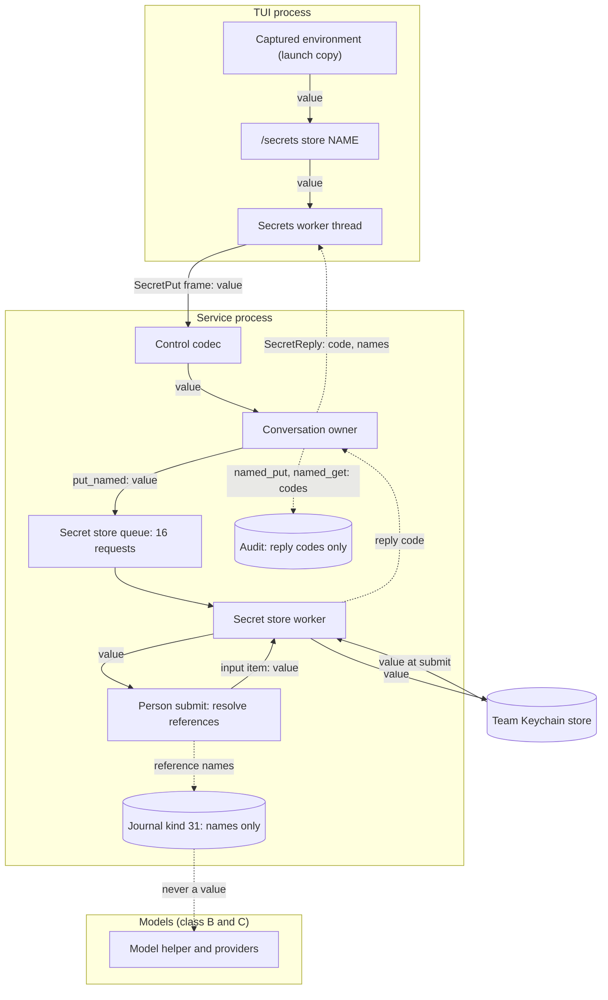
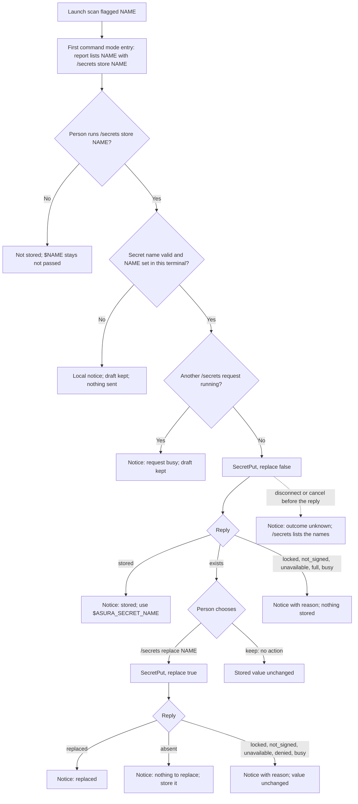
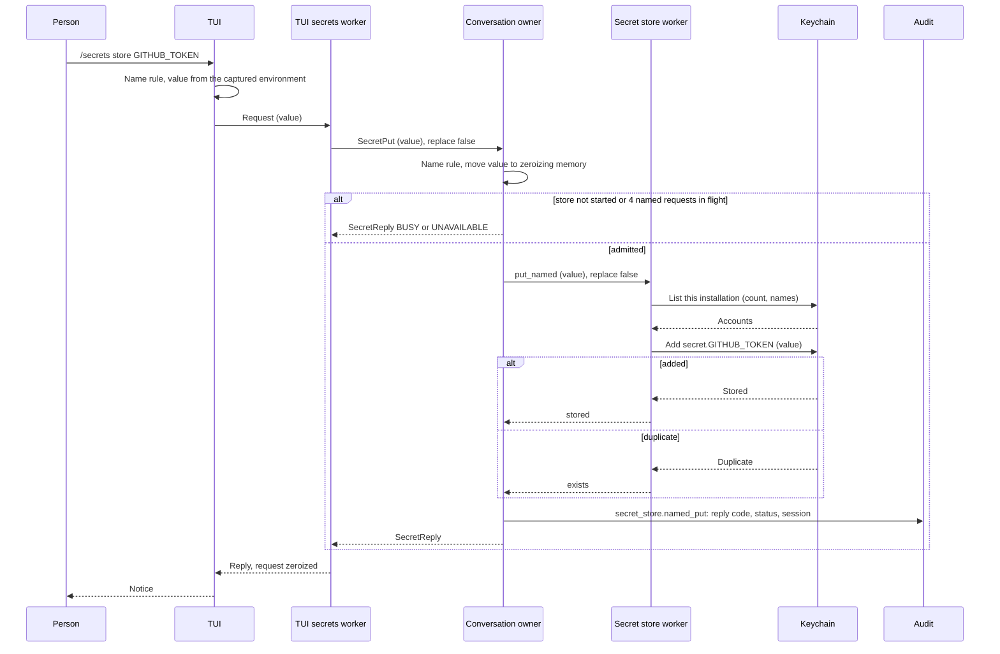
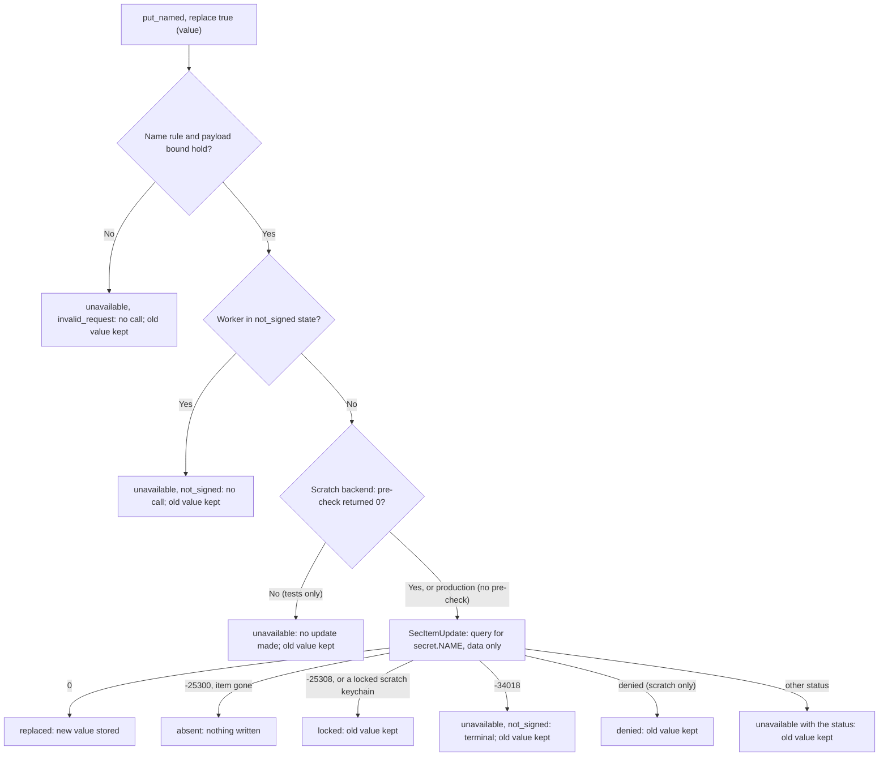
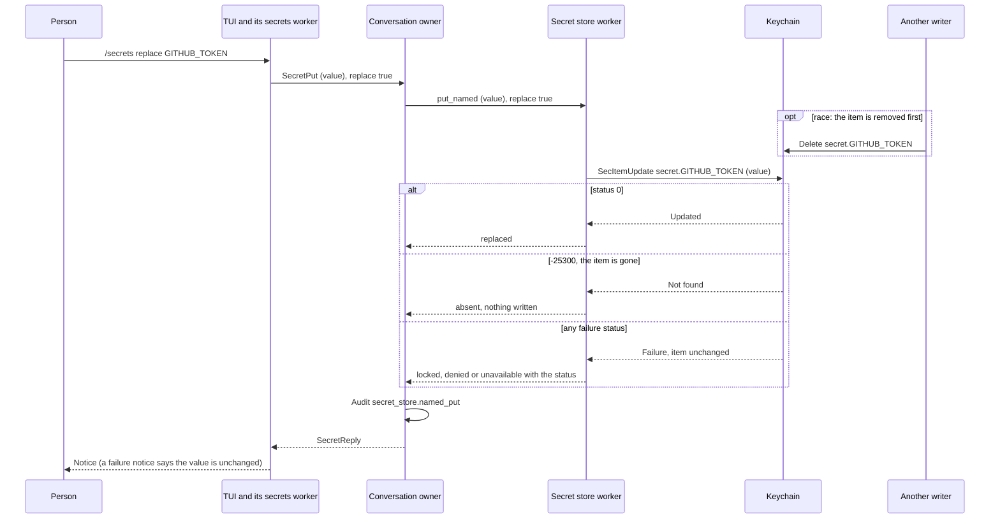
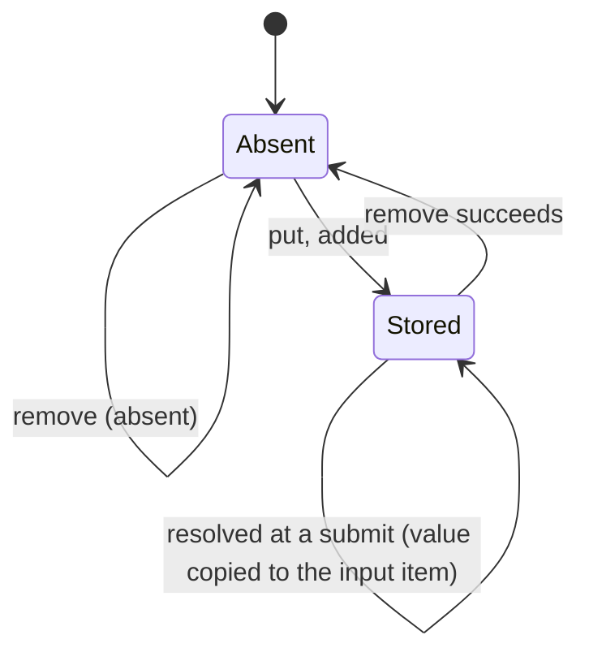
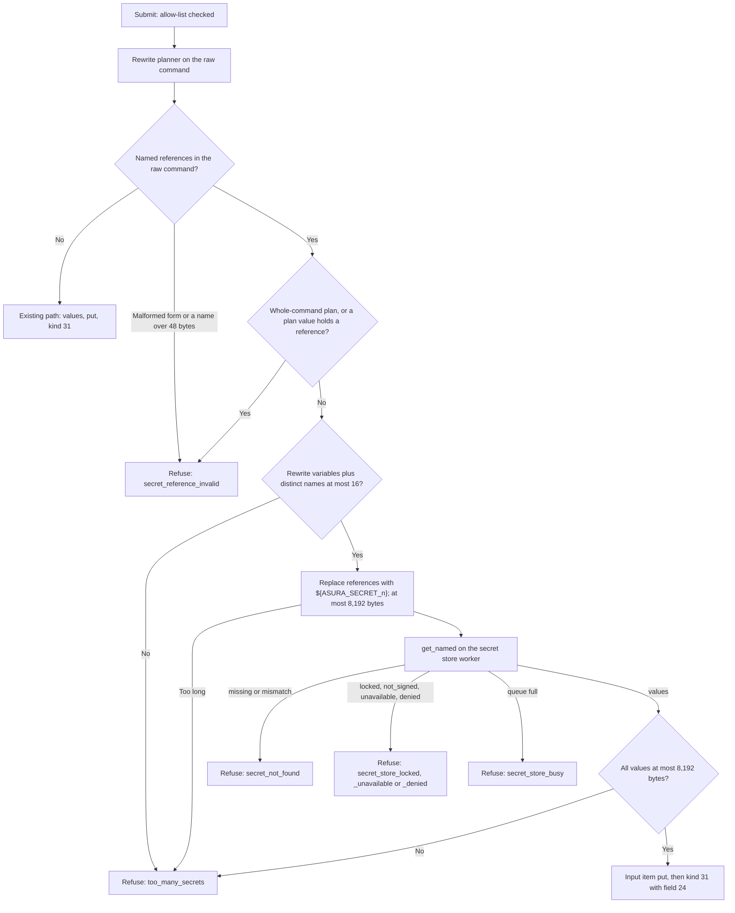
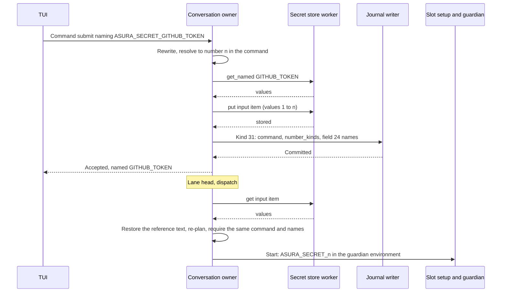

# Named secrets

Status: selected design, 2026-11-01, under the owner's answer to
[ENV-O1](person-command-environment.md#env-o1-the-offer-to-store-a-variable-as-a-secret)
([owner decision](#owner-decision-2026-11-01)). Mechanisms marked "selected
(engineering)" are engineering choices under the
[iteration rules](../design-process.md#iteration-and-escalation). This design
also records the resolution of the secrets study's question OD-10 (AD-10) for
named references in person commands. Protocol numbering remains `0.1`;
journal format remains `1`.

Revision of 2026-11-01, replace in place (selected, engineering): a replace
changes the stored item's data with one `SecItemUpdate` call instead of a
delete then an add, so a failed replace keeps the old value. The reply
`replace_failed` and `SECRET_RESULT_REPLACE_FAILED` (14) are removed; a
replace of a name that is not stored is `absent`. See
[replace in place](#replace-in-place).

## Owner decision (2026-11-01)

| ID | Decision | Applied in |
| --- | --- | --- |
| ENV-O1 | The offer to store a flagged variable creates a **durable named secret**. The person stores a flagged terminal variable, such as `GITHUB_TOKEN`, in the team Keychain store under its name. Later `!` and `!!` commands use it by explicit reference: raw delivery, so the job is tainted under T1. Binding a secret to a host is broker work (AD-4) and is not part of this design | This document; [person command environment](person-command-environment.md#env-o1-the-offer-to-store-a-variable-as-a-secret) |
| AD-10 (named references) | Resolved here as the engineering choice the owner asked for: study option R2, `$ASURA_SECRET_<NAME>`, in `!` and `!!` commands only ([references](#references-in-commands)) | [Secret detection](secret-detection.md#command-rewrite) |

## Scope

Before this design, a secret value reached a person command only when the
person typed it in the command. The rewrite moved it into a per-input
Keychain item until the job settled. A token in the terminal environment,
such as `GITHUB_TOKEN`, was flagged by the
[environment scanner](person-command-environment.md#environment-scanner) and
never passed, and the person had no way to use it without typing it.

Objectives:

- The person stores a flagged terminal variable once, by name, from the
  launch report or with `/secrets store NAME`.
- A later command names it as `$ASURA_SECRET_<NAME>` and receives the value as
  a secret variable.
- The value never passes through a model and never appears in the journal,
  a log, telemetry, an audit event or a model context.
- The person lists and removes named secrets.

Non-goals:

- Host bindings, brokers, the egress proxy and the SSH agent (AD-4).
- Named secrets in model `exec_cmd` calls. A model command never resolves a
  named reference ([model commands](#model-commands)).
- Storing a value that the person types or pastes. The only source in this
  design is the TUI's captured terminal environment.
- Rotation records, expiry and use counts (study section 12.4 and 12.5).
- Stage 0 exact-value matching of stored secrets in output or messages.
  Capture still replaces the value in the job's output, through the
  existing literal path ([security](#security)).

Dependencies: [person command environment](person-command-environment.md),
[person command mode](person-command-mode.md), the
[secret store](secret-store.md), [secret detection](secret-detection.md),
the [context composer taint hook](context-composer.md#taint-exclusion-hook)
and the secrets study (trust classes and flow rules F1 to F7).

## Required behavior

| ID | Rule | Source |
| --- | --- | --- |
| NS-R1 | The launch report offers one store action for each flagged name it lists | ENV1, ENV-O1 |
| NS-R2 | A store copies the value of a captured terminal variable into one named secret item in the secret store, under the variable's name | ENV-O1 |
| NS-R3 | The value travels terminal environment → TUI → control client → service → secret store worker → Keychain, all Asura-trusted code (class A). No model, journal record, log line, audit event, telemetry value, reply or model context holds it | ENV-O1, study F1 |
| NS-R4 | A store never overwrites silently. When the name exists, the reply says so, and the person chooses `/secrets replace NAME` or keeps the stored value | ENV-O1 |
| NS-R5 | A `!` or `!!` command uses a named secret only by explicit reference `$ASURA_SECRET_<NAME>` or `${ASURA_SECRET_<NAME>}`. The service resolves the reference at submit into a secret variable. The job is tainted under T1 | ENV-O1, T1 |
| NS-R6 | A model `exec_cmd` command never resolves a named reference | Study F3, OD-4 |
| NS-R7 | The person lists named secrets by name and removes one by name. No surface shows a value, a prefix, a length or a digest | ENV-O1, study 12.5 |
| NS-R8 | A locked keychain, an unsigned build, a full store and a busy worker each give the person a reason and a next action; nothing falls back to disk | SSR4 |
| NS-R9 | No step has a time bound. Each Keychain call runs on the secret store worker; each wait ends by its reply, a cancel, a disconnect or shutdown | AE-01 to AE-04 |
| NS-R10 | Protocol `0.1` and journal format `1` stay; schemas change in place | Engineering standard |
| NS-R11 | A replace never loses the stored value. It changes the item's data in one Keychain call. When that call fails, the stored value stays and the reply says so. A replace of a name that is not stored stores nothing and says so | ENV-O1, NS-R4 |

## Terms

| Term | Meaning |
| --- | --- |
| Named secret | A durable secret item in the secret store whose account is `secret.<NAME>`. It outlives commands and sessions until the person removes or replaces it |
| Secret name | The name of a named secret: 1–48 bytes of `[A-Za-z_][A-Za-z0-9_]*`, not `COMMAND`. Case matters |
| Named reference | `$ASURA_SECRET_<NAME>` or `${ASURA_SECRET_<NAME>}` in a person command, where `<NAME>` is a secret name |
| Input item | The existing per-input secret item, account `input.<32 hex>` ([secret store](secret-store.md#keychain-item-contract)) |

## Ownership

Selected (engineering). The design adds no process, thread, worker or queue.

| Behavior | Canonical owner | Change |
| --- | --- | --- |
| Secret name rule; named reference parser and resolver (pure) | New module `asura_platform::secrets::named` | New. One rule serves the TUI, the service and the record codec |
| Named item attributes: `NamedKey`, the `secret.` account, listing of named accounts | `asura_platform::keychain` | `Listing` gains `named`; `Keychain` gains `add_named`, `get_named`, `update_named`, `delete_named` over the existing call table |
| Named payload codec, named requests, named counts | Secret store worker (`asura-service::secret_store`) | New requests `put_named`, `get_named`, `delete_named`, `list_named`; the sweep keeps named items |
| `SecretPut`, `SecretList`, `SecretRemove` admission and replies; reference resolution at submit; audit | Conversation owner (`conversation/person_command.rs`, new `conversation/named_secrets.rs`) | New control handlers; a submit stage reads the named values |
| Wire shape | Control crate (`asura-control::secrets`) | New messages, envelope fields 73 to 76; the frame write and read buffers are zeroized |
| Requests from the TUI | Control client (`asura-client`) | `secret_put`, `secret_list`, `secret_remove` |
| Offer, `/secrets` command, hints, env line | Rust TUI (`tui/ui/person.rs`, new `tui/ui/secrets.rs`, new `tui/secrets.rs` worker) | New |
| Kind 31 field 24 | Storage authority codec | New field |

Dependency direction is unchanged: TUI → control client → service → storage
and platform. The control crate checks wire shape only; it has no copy of the
name rule beyond the byte bounds.

### NS-O1: value path and trust boundaries

Selected design. Solid arrows carry a value; dashed arrows carry names or
reply codes only. Subgraphs are processes. Every node on a solid arrow is
Asura-trusted code (study class A) or the person (class E).



No arrow reaches the model subgraph with a value. The job that receives the
value is tainted, so the composer never places its output, counts or exit
status ([taint exclusion hook](context-composer.md#taint-exclusion-hook)).

## The offer

Selected (engineering) presentation of NS-R1, NS-R4 and NS-R7.

### Launch report

The [launch report](person-command-environment.md#person-facing-explanation)
keeps its trigger: once per session, at the first entry into a command mode
after the scan ended. Each listed name is followed by its action:

```text
Not passed to ! and !! commands because they may be secrets: GITHUB_TOKEN (github-token): /secrets store GITHUB_TOKEN; BUILD_SIGNING (high-entropy): /secrets store BUILD_SIGNING. Asura never shows their values. A stored secret reaches a command that names $ASURA_SECRET_<NAME>.
```

A flagged name that is not a valid secret name, for example one longer than
48 bytes, is listed without an action. The report holds at most 8 names, then
`and N more; /secrets lists them`. The report never shows whether a name is
stored: the TUI does not read the store to build it, and a stored name gets
the `exists` reply.

### `/secrets` command

| Command | Effect |
| --- | --- |
| `/secrets` | Opens the text panel "Secrets": the stored names from the service, then each flagged name of this terminal with its kind and its action (`stored`, or `/secrets store NAME`) |
| `/secrets store NAME` | Stores the captured value of terminal variable `NAME` as named secret `NAME` |
| `/secrets replace NAME` | Replaces named secret `NAME` with the captured value of terminal variable `NAME` |
| `/secrets remove NAME` | Removes named secret `NAME` |

`store` and `replace` read the value from the TUI's captured environment
only. A name the terminal does not set is refused locally: "`NAME` is not set
in this terminal". Any captured variable with a valid secret name may be
stored; the flagged ones are offered. Each command keeps the draft until its
reply arrives, and one `/secrets` request runs at a time.

| Reply | Notice |
| --- | --- |
| `stored` | `Stored GITHUB_TOKEN as a named secret. Use $ASURA_SECRET_GITHUB_TOKEN in a ! or !! command.` |
| `replaced` | `Replaced the named secret GITHUB_TOKEN.` |
| `exists` | `A named secret GITHUB_TOKEN exists. Replace it with /secrets replace GITHUB_TOKEN, or keep it.` |
| `removed` | `Removed the named secret GITHUB_TOKEN. Commands already queued keep their copy.` |
| `absent` | `No named secret GITHUB_TOKEN exists.` After `/secrets replace`: `No named secret GITHUB_TOKEN exists to replace. Store it with /secrets store GITHUB_TOKEN.` |
| `locked` | `The Keychain is locked until this Mac is unlocked after start-up. Unlock it, then try again.` |
| `not_signed` | `This Asura build is not signed for the Keychain, so it cannot store secrets.` |
| `unavailable` | `The Keychain is unavailable (OSStatus -N).` |
| `denied` | `macOS denied Asura access to the Keychain item.` (scratch backend only) |
| `full` | `The secret store is full: 64 named secrets or 256 items. Remove one with /secrets remove NAME.` |
| `busy` | `Keychain requests are queued; try again.` |
| `invalid` | `NAME is not a valid secret name: 1 to 48 letters, digits or _, not starting with a digit.` |

After `/secrets replace NAME`, the notice of `locked`, `not_signed`,
`unavailable` and `denied` ends with `The named secret NAME is unchanged.`
For example: `The Keychain is unavailable (OSStatus -25291). The named secret
GITHUB_TOKEN is unchanged.` A `busy` reply never reached the Keychain, so the
value is also unchanged.

"Keep" needs no request: the person does nothing, and the stored value stays.

### NS-F1: offer flow

Selected design. Arrows are the person's actions and the TUI's checks, in
order, for one name.



## Naming rules

Selected (engineering).

- A secret name is 1–48 bytes of `[A-Za-z_][A-Za-z0-9_]*`. The variable
  `ASURA_SECRET_<NAME>` is then at most 61 bytes, a valid shell name.
- `COMMAND` is reserved: `ASURA_SECRET_COMMAND` is the
  [whole-command variable](secret-detection.md#whole-command-variable).
- A name of digits only cannot occur, because the first byte is a letter or
  `_`. `ASURA_SECRET_<digits>` stays the numbered placeholder form.
- Names are case-sensitive. `GITHUB_TOKEN` and `github_token` are two names.
- The stored name equals the terminal variable's name. Renaming is not in
  scope; the person can export the value under another name in the terminal
  that starts the TUI.

## Control API

Selected (engineering) within protocol `0.1`. Envelope fields 73 to 76 are
new. `SecretPut` is the only message that carries a value.

```proto
// Named secrets (named-secrets.md). Only SecretPut carries a value.
message SecretPut {
  optional string name = 1;   // secret name, 1-48 bytes
  optional bytes value = 2;   // 1-4096 bytes; zeroized by both ends after use
  optional bool replace = 3;  // true: replace an existing secret of this name
}
message SecretList {}
message SecretRemove { optional string name = 1; }
message SecretReply {
  optional SecretResult result = 1;
  repeated string names = 2;   // SecretList only: stored names in byte order, at most 64
  optional uint32 status = 3;  // |OSStatus| with UNAVAILABLE, LOCKED or DENIED
}
enum SecretResult {
  SECRET_RESULT_UNSPECIFIED = 0;
  SECRET_RESULT_STORED = 1;
  SECRET_RESULT_REPLACED = 2;
  SECRET_RESULT_EXISTS = 3;
  SECRET_RESULT_REMOVED = 4;
  SECRET_RESULT_ABSENT = 5;
  SECRET_RESULT_LISTED = 6;
  SECRET_RESULT_LOCKED = 7;
  SECRET_RESULT_NOT_SIGNED = 8;
  SECRET_RESULT_UNAVAILABLE = 9;
  SECRET_RESULT_DENIED = 10;
  SECRET_RESULT_FULL = 11;
  SECRET_RESULT_BUSY = 12;
  SECRET_RESULT_INVALID = 13;
  reserved 14;  // SECRET_RESULT_REPLACE_FAILED, removed by replace in place
  reserved "SECRET_RESULT_REPLACE_FAILED";
}
```

| Rule | Check |
| --- | --- |
| `SecretPut` | `name` 1–48 bytes; `value` 1–4,096 bytes; `replace` present |
| `SecretRemove` | `name` 1–48 bytes |
| `SecretReply` | `result` 1–13; `names` only with `LISTED`, at most 64, each 1–48 bytes; `status` only with `LOCKED`, `UNAVAILABLE` or `DENIED` |

The service checks the name rule and answers `INVALID`, so the TUI shows one
reason for every form fault. The control crate checks byte bounds only.

`SecretPut` is a mutation without a journal record: the client waits for the
reply with no response budget; only a cancel or a lost connection ends the
wait, as `OutcomeUnconfirmed`. The TUI never retries it. The person reads the
outcome with `/secrets`.

**Zeroizing.** Selected (engineering), reusing the `zeroize` types that the
secret store already uses:

- The TUI holds the copy for the request in `Zeroizing<Vec<u8>>` and clears
  the request message after the client returns.
- The client writes every frame from a `Zeroizing` buffer; `encode_frame`
  holds its body copy in one. The control crate's `scrub` clears a
  `SecretPut` value in an envelope before the envelope is dropped.
- The service moves the value out of the decoded envelope into
  `Zeroizing<Vec<u8>>` before any other step, and the control codec clears
  consumed frame bytes in its read buffer.
- The secret store worker holds the value in its request in `Zeroizing`, as
  for input items.
- Residual: copies inside prost's decode, the kernel socket buffers and the
  Security framework (SS-T8) are outside Asura's control. Same-UID readers
  are one principal (D1).

### NS-Q1: store from the report

Selected design. Solid arrows are calls or messages; dashed arrows are
replies. Only the arrows labelled "value" carry the value.



The replace request (`replace` true) takes the same path to the worker and
then follows [NS-Q3](#ns-q3-replace-in-place) instead of the list and add.

## Replace in place

Selected (engineering, 2026-11-01). It replaces the earlier delete then add,
whose failed add after the delete lost the secret (`replace_failed`).

The worker serves `put_named` with `replace` true by one call,
`update_named`: `SecItemUpdate` with a query for the named item and an
attribute dictionary that holds only the new data (`kSecValueData`). The
worker makes no listing, no add and no delete for a replace.

- **Query.** The query is the same dictionary as a read or delete of the
  item: class, service, account, and in production the data-protection flag,
  the access group, `kSecAttrSynchronizable` false and
  `kSecUseAuthenticationUI` fail (KC-U1). It never carries `kSecUseKeychain`.
- **Attributes to update.** `kSecValueData` only. The label, the
  accessibility class, the service and the account stay as the add set them.
  The new data is a full named payload with the same binding, because the
  installation and the name do not change.
- **Scratch backend (tests).** The same call through `security-framework`'s
  `update_item`, with a search list that holds only the scratch keychain.
  The target pre-check (`SecKeychainGetStatus` returned 0) runs first in the
  same platform call, as for every scratch item call. A non-zero pre-check
  makes no update.
- **Counts.** A replace never adds an item, so it is never `full` and the
  worker's item count does not change.

Worker replies:

| Platform result | Reply | Stored value afterwards |
| --- | --- | --- |
| `Updated::Changed` (status 0) | `replaced` | The new value |
| `Updated::Absent` (-25300) | `absent` | No item; nothing written |
| `Failure::Locked`, `Denied`, `NotSigned` or `Unavailable` | `locked`, `denied`, `unavailable` (with `not_signed` when -34018) | The old value |
| `Failure::Invalid` (bound or name rule; no call) | `unavailable` with reason `invalid_request` | The old value |

**The item disappears before the update.** Another writer can remove the
item after the person saw `exists` and before the update reaches the
Keychain: `/secrets remove` from another TUI, or another team-signed Asura
process. The update then finds no item and returns -25300. The worker replies
`absent` and writes nothing. It does not add the value: the person asked to
replace a stored secret, and an add would silently undo the other writer's
remove (NS-R4). The person stores the value with `/secrets store NAME` if
they still want it. A replace of a name that was never stored gets the same
reply.

**Failure atomicity.** A failed `SecItemUpdate` returns a non-zero status. The
worker treats the stored data as unchanged, because the call is one Keychain
operation on one item and Asura makes no other call for the replace. Apple's
documentation does not state the atomicity of a failed update. The tests prove
it for failures that the Keychain reports before it writes (a locked scratch
keychain, a gated failure). A failure inside the Keychain after a partial
write was not provoked; that case is a stated proof limit, not a guarantee.

### NS-F3: replace on the worker

Selected design. Arrows lead to the next step; labels are platform results.
Every end is one reply; no path makes a second item call.



### NS-Q3: replace in place

Selected design. Solid arrows are calls or messages; dashed arrows are
replies. Only the arrows labelled "value" carry the value. The optional block
is the race: another writer removes the item between the person's `exists`
reply and the update.



## Named item contract

Selected (engineering). Named items extend the
[secret item contract](secret-store.md#keychain-item-contract); every
attribute not listed here is unchanged (class, data-protection keychain,
access group, synchronizable false, accessibility class, label).

| Property | Value |
| --- | --- |
| Service attribute | `asura.secret-store.<installation ID>`, as for input items |
| Account attribute | `secret.<NAME>` |
| Data | The named payload below, at most 4,131 bytes |

Named payload. All integers are big-endian. The codec rejects unknown
versions, trailing bytes and any bound violation.

| Field | Content |
| --- | --- |
| version | u8, `1` |
| binding | 32 bytes: SHA-256 over ASCII `asura.named-secret`, one zero byte, the installation ID and the name bytes |
| value | u16 length 1–4,096, then the value bytes |

The largest payload is 1 + 32 + 2 + 4,096 = 4,131 bytes, below
`MAX_ITEM_BYTES` (8,307). A payload whose binding does not match its
installation and name is `mismatch`.

**Counts.** The item count includes named items. At most 64 named secrets
exist per installation; a put that would create the 65th, or the 257th item,
is `full`. The 64-name bound keeps the per-command resolution and the list
reply small; the 256-item bound is unchanged.

**Listing.** The platform listing classifies each account: `input.<32 hex>`
is an input item, `secret.<valid name>` is a named item, and any other
account is unrecognized. `Listing` gains `named: Vec<String>`.

**Sweep.** The [startup sweep](secret-store.md#startup-sweep) never deletes a
named item: a named item is not an input and is never an orphan. It counts
named items in `kept`.

### NS-S1: named secret lifecycle

Selected design. Arrows are requests with their outcomes. A replace is one
in-place update on the worker ([replace in place](#replace-in-place)); no
transition of a replace leads from `Stored` to `Absent`.



## References in commands

AD-10 resolution for named references, selected (engineering, 2026-11-01).

**Syntax.** A person command names a stored secret as `$ASURA_SECRET_<NAME>`
or `${ASURA_SECRET_<NAME>}`. This is the study's option R2. It is valid
shell, so a reader sees a variable. It extends the numbered form
`$ASURA_SECRET_<n>`, and the two cannot collide: a secret name starts with a
letter or `_`, a number with a digit. A command that wants the value in a
tool's own variable writes, for example,
`!GITHUB_TOKEN="$ASURA_SECRET_GITHUB_TOKEN" gh pr list`.

The parser reads `$` or `${`, then `ASURA_SECRET_`, then the longest run of
name bytes, as the shell does:

| Form | Result |
| --- | --- |
| `$ASURA_SECRET_<NAME>` or `${ASURA_SECRET_<NAME>}`, `<NAME>` a valid secret name | Named reference |
| `$ASURA_SECRET_<digits>` or `${ASURA_SECRET_<digits>}` | Numbered placeholder: `placeholder_not_available`, as before |
| `$ASURA_SECRET_COMMAND`, `${ASURA_SECRET_COMMAND}` | `placeholder_not_available` |
| `${ASURA_SECRET_<NAME>` followed by any byte other than `}` (an operator form such as `:-`), or a name over 48 bytes | `secret_reference_invalid` |

The parser reads raw bytes and ignores quoting: a reference inside single
quotes is also resolved. Inside single quotes the shell prints the replaced
`${ASURA_SECRET_<n>}` text instead of expanding it, so no value is exposed.

**Resolution.** At submit, after the rewrite, the conversation owner:

1. Runs the rewrite planner on the raw command, as today. Named references
   are not secrets to the rule set: a value that starts with `$` or holds
   `secret` is a placeholder for every rule with the not-placeholder
   predicate. A plan variable whose value holds a named reference is refused
   with `secret_reference_invalid`, because the rewrite would then deliver the
   reference text.
2. Refuses a whole-command plan that holds a named reference
   (`secret_reference_invalid`): the whole-command variable must be the only
   secret variable.
3. Numbers the distinct names by first appearance, after the rewrite's
   numbers: with `k` rewrite variables, names get `k + 1` to `k + m`. More
   than 16 variables in total refuse with `too_many_secrets`.
4. Replaces each reference with `${ASURA_SECRET_<n>}` in the rewritten
   command. A result over 8,192 bytes refuses with `too_many_secrets`.
5. Reads the named values with one `get_named` request. A missing name
   refuses with `secret_not_found`; a Keychain failure refuses with the
   existing `secret_store_*` refusals. Values over 8,192 bytes in total,
   with the rewrite's values, refuse with `too_many_secrets`.
6. Puts all values in the input item (numbers 1 to `k + m`) before kind 31,
   as for any secret (ordering rule 1).

Kind 31 records the replaced command, `number_kinds` with `env-secret` for
each named number, and the names in field 24. The job receives the values as
`ASURA_SECRET_<n>` and is tainted under T1, because `number_kinds` is not
empty.

**Single source of truth.** The named item is the only durable source of a
named value. The input item holds the copy that one queued command uses, from
submit until its job settles, as it does for a value typed in the command.
A replace or remove after submit does not change a queued command: it keeps
the value it was submitted with. Dispatch and a restart read only the input
item, so a held command resumes with no named read.

**Dispatch check.** The existing [dispatch read](secret-store.md#ordering-rules)
restores the raw command from the input item and re-plans it. For a named
number, restore writes the reference `${ASURA_SECRET_<NAME>}` from field 24,
never the value. The owner then repeats steps 1 to 4 on the restored text and
requires the same command, the same numbers and kinds, and the same names.
Any difference is `mismatch`, held with `secrets_lost`.

### Kind 31 field 24

Schemas change in place within format `1`.

| # | Field | Encoding | Bounds and rule |
| --- | --- | --- | --- |
| 24 | named references | u8 count, then entries | 0–16 entries in increasing number: u8 number, u8 name length 1–48, name. Each number is at most the length of `number_kinds`, and its kind is `env-secret`. Numbers are the last `m` numbers; names are distinct and valid; not with field 17 bit 1 |

Field 24 is encoded directly after field 23. The request digest covers it
after field 23. The maximum payload grows by 1 + 16 × 50 = 801 bytes, to
44,943 bytes; the maximum frame is 45,127 bytes, below the 65,536-byte journal
frame.

### Reply facts

`CommandEnvironment` gains field 5:

```proto
repeated string named_secrets = 5; // names of field 24, in number order, at most 16
```

The environment line shows them after the secret variables:

```text
env  Asura HOME … · secret ASURA_SECRET_1 ASURA_SECRET_2 · named GITHUB_TOKEN
```

The not-passed hint for a flagged variable adds the action:
`$GITHUB_TOKEN was not passed: it may be a secret (github-token); store it with /secrets store GITHUB_TOKEN and use $ASURA_SECRET_GITHUB_TOKEN`.

### NS-F2: reference resolution at submit

Selected design. Arrows are the owner's checks in order for one person
command submit. Each refusal keeps the draft and records nothing.



### NS-Q2: submit with a named reference

Selected design. Solid arrows are calls; dashed arrows are replies. Only the
arrows labelled "values" carry values.



### Model commands

A model `exec_cmd` command is never resolved. The model path keeps its
rewrite unchanged: a named reference in a model command is ordinary text, and
the shell expands the unset variable to an empty string. No named read is
made for a model call. This keeps the study's rule F3 (class D1 receives no
raw value) for named secrets, while ENV4 remains the interim rule for values
the model typed itself.

## Failure handling

| Case | Result |
| --- | --- |
| `/secrets store` with a name the terminal does not set, or an invalid name | Local notice; nothing sent |
| Keychain locked at a put | `locked`; nothing changes. A list or remove can still succeed: a locked file keychain lists and deletes (probe SS-P2 (a)); before first unlock the data-protection keychain is unverified (KC-P3) |
| Build not signed for the Keychain | `not_signed`, with no Keychain call after the first `not_signed` (worker terminal state) |
| Keychain unavailable | `unavailable` with the status |
| Scratch keychain denied (tests only) | `denied` |
| 64 named secrets or 256 items | `full` at a put; a replace never adds an item and is never `full` |
| Worker queue full, or 4 named requests in flight in the owner | `busy` |
| Secret store not started (start-time read pending) | `busy` |
| This runtime has no Keychain target | `unavailable` with status 25291 |
| Replace: the update fails | The failure reply (`locked`, `denied`, `unavailable`) with the update's status; the old value stays; the notice says it is unchanged |
| Replace of a name that is not stored | `absent`; nothing written |
| Replace: the item is removed between the person's `exists` reply and the update | The update returns -25300: `absent`; nothing written; the worker does not add the value |
| Disconnect or cancel before a `SecretPut` reply | `OutcomeUnconfirmed`; the request finishes or fails on the worker; `/secrets` shows the result |
| Submit names a missing secret | `secret_not_found`; draft kept; nothing recorded |
| Submit names a secret and the Keychain is locked | `secret_store_locked`; draft kept |
| Named item data does not match its binding | `get_named`: `secret_not_found` at submit, audited `mismatch`; the item stays until the person replaces or removes it |
| Remove while a command that used the name is queued | The queued command keeps its input item copy and runs |
| Restart with a held command that used a name | Resume reads only the input item; no named read |
| Shutdown during a named request | Shutdown does not wait for the worker; the request completes or is lost; a lost put is visible in `/secrets` |

## Audit

Selected (engineering). New events in audit format 1, in place. They carry
reply codes and counts only: never a value, a name, a digest or a payload
size, as the existing `secret_store.*` events.

| Event | Fields | Replies |
| --- | --- | --- |
| `secret_store.named_put` | `reply`, `status`, `session` | `stored`, `replaced`, `exists`, `absent`, `full`, `locked`, `denied`, `unavailable` |
| `secret_store.named_get` | `reply`, `status`, `session`, `count` (names requested, 1–16) | `read`, `missing`, `mismatch`, `locked`, `denied`, `unavailable` |
| `secret_store.named_delete` | `reply`, `status`, `session` | `deleted`, `absent`, `locked`, `denied`, `unavailable` |
| `secret_store.named_list` | `reply`, `status`, `session`, `count` (names listed, 0–64) | `listed`, `locked`, `denied`, `unavailable` |

`status` and `session` follow the existing rule: present with a failure reply
alone. `person_command.refused` gains the reasons `secret_not_found`,
`secret_reference_invalid` and `too_many_secrets`. `QueueRefusal` gains
values 14 `SECRET_NOT_FOUND`, 15 `SECRET_REFERENCE_INVALID` and 16
`TOO_MANY_SECRETS`.

`/status` adds no line: `item_count` already counts named items.

## Security

- **Trust classes.** The value moves only between the person (E), Asura
  services (A), the Keychain (F) and the person's tainted job (D2), as the
  study's rule F1 requires. No class B or C process receives it: the helper
  receives job results through the composer, which excludes tainted jobs.
- **Journal.** Kind 31 holds the replaced command text and the names. Neither
  holds a value.
- **Logs and telemetry.** No log line or diagnostic prints a control
  envelope; the `SecretPut` value never reaches a `Debug` output because the
  service moves it out first and the TUI request type has a debug form
  without the value.
- **Capture.** The job's capture worker receives each value as a literal,
  as for every secret variable (SD3), so an echo of the value shows
  `$ASURA_SECRET_<n>` in the stored output.
- **Model-written references.** A model cannot cause a named read
  ([model commands](#model-commands)). A model can write a project file that
  holds a reference; only a person command that the person types runs it,
  and that is the person's choice (PX3).
- **Residuals.** The tainted job can write the value to a file or send it on
  the network (study 9.4, PT3). Copies inside prost, the kernel and the
  Security framework (SS-T8). Same-user readers of the job's process
  environment (PT-H1).

## Asynchronous execution

| Call | Owner and isolation | Bound and closure |
| --- | --- | --- |
| `SecItemAdd`, `SecItemCopyMatching`, `SecItemUpdate`, `SecItemDelete` for named items | Secret store worker thread | The existing 16-request queue; one call at a time; a replace is one update; no time bound; ends by its reply |
| Named requests in the owner | Conversation owner on the reactor | At most 4 in flight, then `busy`; each ends by its worker reply or shutdown |
| `/secrets` request in the TUI | New TUI secrets worker thread, one per TUI process | One request at a time; the client waits with no response budget; ends by reply, TUI exit cancel or disconnect |
| Reference parse and resolve | Conversation owner on the reactor | At most 8,192 bytes of command; bounded in-memory work |
| `get_named` at submit | Secret store worker | At most 16 names, 4,096 bytes each; one request |

No step adds a time limit (AE-04). A blocked submit waits with its brief
reason under the per-agent queue rule (AQ1).

## Validation

Tests use synthetic tokens built at run time, scratch keychains created
through the Security framework fixtures (`--create-scratch-keychain` and the
others in `asura-cli/tests/lifecycle.rs`), scratch Asura homes and fixture
account homes. No test runs the `security` command or reaches the login or
data-protection keychain.

### Unit

| ID | Initial state and trigger | Required result |
| --- | --- | --- |
| NS-U1 | Secret name rule at 0, 1, 48 and 49 bytes; a leading digit; `COMMAND`; a hyphen | Valid only at 1–48 bytes of the name form, never `COMMAND` |
| NS-U2 | Reference parser: both forms, a numbered placeholder, `COMMAND`, `${ASURA_SECRET_X:-y}`, a 49-byte name, a name followed by a name byte, single quotes | Named references with their names; numbered and `COMMAND` left to the placeholder refusal; the operator form and the long name invalid |
| NS-U3 | Resolver: two references to one name and one to another after 2 rewrite variables; 15 rewrite variables and 2 names; a result over 8,192 bytes | Numbers 3 and 4 by first appearance; `too_many_secrets`; `too_many_secrets` |
| NS-U4 | Platform listing over accounts `input.<hex>`, `secret.GITHUB_TOKEN`, `secret.1BAD`, `other` | One input, one named, two unrecognized |
| NS-U5 | Named payload codec at 1 and 4,096 value bytes, 4,097, a wrong binding, trailing bytes | Round trip; each fault rejected or `mismatch` |
| NS-U6 | Worker over a scripted port: put new, put existing, put at 64 named, remove, list, get of two names with one missing, `not_signed` | `stored`, `exists`, `full`, `removed`, the names, missing, `not_signed` with no port call afterwards |
| NS-U7 | Sweep over a listing with named items and an empty live set | Named items kept and counted; never deleted |
| NS-U8 | Control codec: `SecretPut` with value 0 and 4,097 bytes, a name of 49 bytes; `SecretReply` with names and a non-list result; `scrub` | Each rejected; a valid set round-trips; `scrub` leaves no value byte |
| NS-U9 | Kind 31 field 24: bounds, order, a number past `number_kinds`, a kind other than `env-secret`, with the whole-command bit; the digest | Exact round trip; each fault `Corrupt`; the digest changes with field 24 |
| NS-U10 | Owner submit with a reference: found, missing, locked, busy, with a whole-command plan | Kind 31 with field 24 and the input item values; `secret_not_found`; `secret_store_locked`; `secret_store_busy`; `secret_reference_invalid` |
| NS-U11 | Dispatch re-plan of a record with field 24 | Same command and names accepted; a changed name or number is `mismatch` |
| NS-U12 | TUI: report with flagged names, one name over 48 bytes; `/secrets` parse; each reply notice, for store and for replace; the env line with named secrets; the flagged hint | One action per valid name; the long name without one; each notice exact, the replace failures ending with the unchanged sentence and the replace `absent` naming the store command; `named GITHUB_TOKEN` on the env line; the hint names the store action |
| NS-U13 | Audit: the four new events with each reply, including `absent` for `named_put`; a status on a success reply; the removed `replace_failed`; a name field | Valid events round-trip; the faults are invalid |
| NS-U14 | Worker over a scripted port that keeps the named data it accepted: replace of a stored name; replace whose update fails with `locked`, then with `unavailable` -25291; replace whose update finds no item (removed after the check); replace at 64 names and 256 items | `replaced` and the new data, with one `update_named` and no list, add or delete; each failure reply with its status, the old data still stored and no add or delete; `absent` with nothing stored and no add; `replaced`, never `full` |
| NS-U15 | Platform: `update_named` with the recording `Calls` fixture, scratch and data-protection tables: status 0, -25300, -25293 with the lock bit clear, -34018, -25291; a non-zero pre-check; an invalid name; data of 0 and 8,308 bytes. KC-U1 for the update dictionaries | `Changed`, `Absent`, `Locked`, `NotSigned`, `Unavailable`; scratch: a status call before every update and no update after a non-zero pre-check; `Invalid` with no call. The query sets the data-protection flag, the group, synchronizable false, UI fail, class, service and account, and no `kSecUseKeychain`; the attribute dictionary holds `kSecValueData` only |

### Integration

| ID | Initial state and trigger | Required result |
| --- | --- | --- |
| NS-I1 | Real service and worker on a scratch keychain; `SecretPut` of a synthetic token, `SecretList`, `SecretPut` again, replace with another token and back, replace of a name not stored, `SecretRemove`, `SecretRemove` again | `stored`, the name listed, `exists`, `replaced` twice, `absent` with no new item, `removed`, `absent`; the scratch keychain holds a `secret.` item only between the put and the remove |
| NS-I2 | Locked scratch keychain; `SecretPut`, a replace of the stored name with another token, and `SecretList`; unlocked; then NS-I4's command | `locked` for the put and the replace; the list still answers `listed`, because a locked file keychain lists attributes (probe SS-P2 (a)); the command prints the digest of the value stored before the locked replace |
| NS-I3 | Gated port holds the worker; 17 requests; then release | `busy` before the worker; the reactor answers other requests |
| NS-I4 | A stored token; `!printf %s "$ASURA_SECRET_PE_TOKEN" \| shasum -a 256` and the same as `!!` | Each job receives the value (the digest matches); kind 31 field 24 names the secret; the job is tainted; the input item is deleted after settlement; the named item remains |
| NS-I5 | A command that names a secret that does not exist | `secret_not_found`; nothing recorded |
| NS-I6 | Restart with a held command that used a named secret, after `SecretRemove` | Resume runs it with the submitted value; no named read |
| NS-I7 | Sweep: the startup sweep with a stored named secret and no live inputs | The named item stays |
| NS-I9 | Worker layer on a scratch keychain (`tests/secret_store.rs`, gated port): store a named value; replace; a gated update failure; a locked update; an update held at the gate while the test removes the item through its own handle, then released | `replaced` and the new data read back; the gate records list and add for the store and one update alone for each replace; the gated failure and `locked` replies each keep the previous data; the held replace answers `absent` and no item exists afterwards |
| NS-I8 | Value sweep: after NS-I4 and a scripted model turn that runs `job read` of the tainted job and receives a notice | No chat request the model received, no journal frame, no audit line, no service log line and no payload file holds the token, its SHA-256 hex digest or its base64 form |

### End to end

| ID | Initial state and trigger | Required result |
| --- | --- | --- |
| NS-E1 | PTY journey, TUI launched with a synthetic `PE_TOKEN` variable that the scanner flags; enter `!` | The report names `PE_TOKEN` with `/secrets store PE_TOKEN` and no value |
| NS-E2 | Same TUI: `/secrets store PE_TOKEN`; `/secrets store PE_TOKEN` again; `/secrets replace PE_TOKEN`; the scratch keychain locked, `/secrets replace PE_TOKEN`, unlocked; `/secrets` | `Stored…`; `…exists. Replace it with /secrets replace PE_TOKEN, or keep it.`; `Replaced…`; the locked notice ending `The named secret PE_TOKEN is unchanged.`; the panel lists `PE_TOKEN` as stored |
| NS-E3 | `!printf %s "$ASURA_SECRET_PE_TOKEN" \| shasum -a 256` | The env line shows `named PE_TOKEN`; the output is the token's digest; the screen shows no token |
| NS-E4 | `/secrets remove PE_TOKEN`; the same command again; `/secrets replace PE_TOKEN` | `Removed…`; the command is refused with the `secret_not_found` text and the draft is kept; `No named secret PE_TOKEN exists to replace. Store it with /secrets store PE_TOKEN.` |
| NS-E5 | The whole journey, then a raw-byte sweep of the scratch home (journal, payloads, logs, audit, configuration) | No byte sequence of the token is found |

Every `--person-*` PTY journey keeps passing; PE-E1 checks the new report
text.

## Decisions and alternatives

- **Resolve at submit into the input item** (selected). The input item is the
  existing source for one command's values; dispatch and restart stay
  unchanged, and the guardian, capture and taint code are reused. Rejected:
  resolve at dispatch from the named item, which would give dispatch a second
  read path and make a queued command fail after a remove; and pass
  `ASURA_SECRET_<NAME>` to the guardian by name, which would change the
  guardian's variable rules, its preamble and capture numbering.
- **R2 syntax** (selected). Rejected: R1 tokens (`⟨secret:NAME⟩`), which are
  not shell and need a second parser in the TUI; a bare `$NAME`, which would
  silently turn a terminal variable reference into raw delivery and so is not
  explicit.
- **Value source: the captured environment only.** A typed or pasted value
  needs the paste scanner and a prompt that keeps the value off the screen;
  both are later work (study 12.1).
- **Replace in place by `SecItemUpdate`** (selected, revision of
  2026-11-01). One call changes the data; a failure keeps the old value.
  Rejected: delete then add, the first delivery, whose failed add after the
  delete lost the secret (`replace_failed`); and add under a temporary
  account, then delete and rename, which needs three calls and still has a
  window, because the Keychain has no rename.
- **A replace of a missing name is `absent`** (selected). Rejected: add the
  value. A replace that finds no item would then undo a concurrent remove
  without saying so (NS-R4), and a replace would need the listing and the
  `full` check again.
- **No name in audit events.** The existing secret store events carry no
  name; a name could itself say what the person holds.

## Delivery

One packet, NS, after this design: platform name rule, resolver and named
keychain calls; worker requests and codec; control messages; owner handlers,
submit stage and dispatch check; kind 31 field 24; audit events; client
calls; TUI offer, `/secrets`, hints and env line; the tests above; user
documentation in [commands](../user/commands.md).

## Design verification

Recorded on 2026-11-01: written from the code at `2c7e1a7`
(`asura_platform::keychain`, `asura_service::secret_store`,
`conversation/person_command.rs`, the TUI `person.rs`, the control
`conversation.rs` and `path_guard.rs`, the client) and the secrets study of
2026-10-31. Diagrams NS-O1, NS-F1, NS-Q1, NS-S1, NS-F2 and NS-Q2 were rendered
with the local Mermaid CLI at scale 2 into a temporary directory outside the
repository and inspected.

### Implementation verification (2026-11-01)

Implemented behavior, verified on macOS 27.0 with the debug build, a
scratch keychain made through the Security framework and the ad hoc model
helper:

| Case | Evidence | Result |
| --- | --- | --- |
| NS-U1 to NS-U3 | `asura_platform::secrets::named` tests | Pass |
| NS-U4 | `keychain::tests::ns_u4_listing_classifies_named_items` | Pass |
| NS-U5 to NS-U7 | `secret_store::tests::ns_u5..ns_u7` (scripted port) | Pass |
| NS-U8 | `asura_control::secrets::tests::ns_u8_secret_messages` | Pass |
| NS-U9 | `codec::tests::ns_u9_kind_31_named_references` and the payload bound test | Pass |
| NS-U10 | `person_command::tests::ns_u10_named_reference_refusals` (owner without a Keychain: invalid form, whole-command plan, too many, no store). The found, missing and locked outcomes are proved by NS-I1 to NS-I5 | Pass |
| NS-U11 | `person_command::tests::ns_u11_named_references_replan` | Pass |
| NS-U12 | `tui::ui::secrets::tests::ns_u12_secrets_command` and PE-U13 | Pass |
| NS-U13 | `audit::tests::ns_u13_named_secret_events` | Pass |
| NS-I1, NS-I2, NS-I4 to NS-I8 | `person_command_flow named` | Pass. NS-I6 is checked as a remove after submit, without a restart; the restart path of a held command uses the input item alone and is SS-I2's |
| NS-E1 to NS-E5 | PTY journey `--person-named` | Pass |

Not delivered or not verified:

- NS-I3 (17 requests against a gated worker) is not built: the gate seam
  works only for an in-process service, and the person command fixture runs
  the service as a child. The owner's four-request bound and the worker's
  16-request bound are covered by code review only.
- The data-protection keychain (team Keychain store) is not exercised by
  `cargo test` (SSR6); the signed qualification run covers it.
- The replace window (delete then add) is unit-tested with a scripted port;
  a real add failure after the delete was not provoked. Superseded by
  [replace in place](#replace-in-place), which removes the window.

Return to the [design index](README.md).
