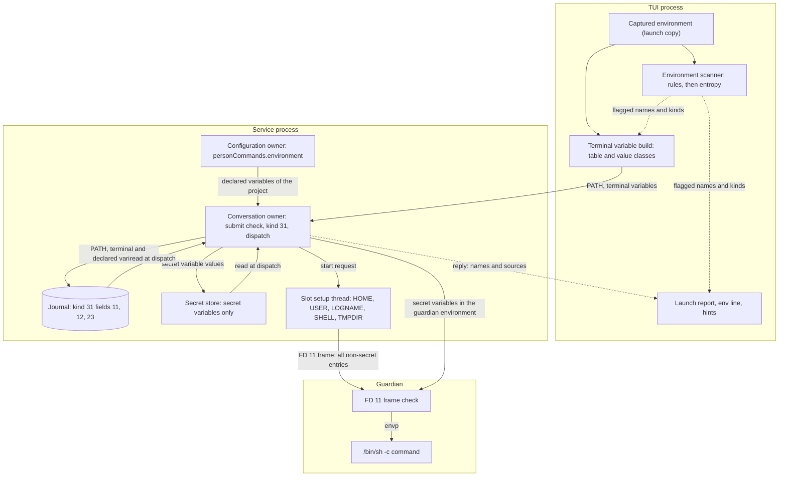
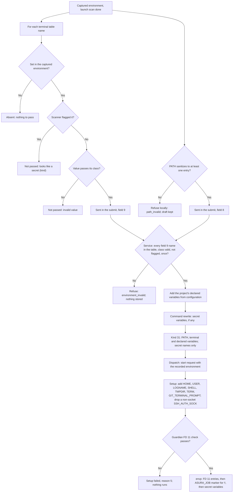
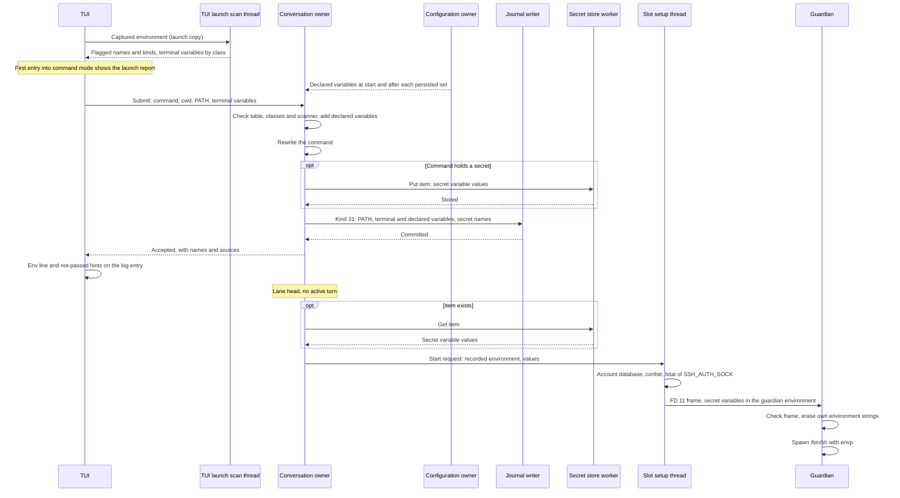
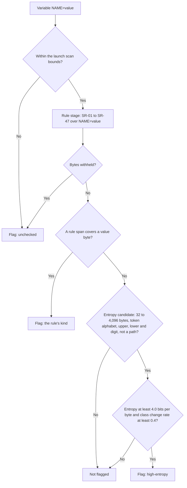

# Person command environment

Status: selected design, 2026-10-31, under the owner's decisions of that date
([owner decisions](#owner-decisions-2026-10-31)). It replaces the PC3
allow-list of `!` commands and the PCR21 launch environment of `!!` commands in
[person command mode](person-command-mode.md). Mechanisms marked "selected
(engineering)" are engineering choices under the
[iteration rules](../design-process.md#iteration-and-escalation). One open
decision remains, [ENV-O1](#env-o1-the-offer-to-store-a-variable-as-a-secret):
what the offer to store a flagged variable as a secret creates. It does not
block the rest of this design; the offer action is not built until the owner
answers. Protocol numbering remains `0.1`; journal format remains `1`.

## Owner decisions (2026-10-31)

| ID | Decision | Applied in |
| --- | --- | --- |
| ENV1 | Asura builds the environment of `!` and `!!` commands. It does not pass the person's captured shell environment. The environment is a fixed base list, toolchain variables, per-project declared non-secret variables in project configuration, and secrets only by explicit reference: a stored secret variable, which is raw delivery and makes the job tainted under T1. Shell variables not on the list are not passed. A deterministic secret scanner (rules and entropy, no model) checks the captured shell environment. Flagged names are reported to the person, by name only and never by value, with an offer to store them as a secret. The person sees which variables a command got, by name and source, and "variable X was not passed" hints. Remove the captured launch environment from the secret item contract and the code, with no compatibility | This document; [person command mode](person-command-mode.md#owner-revision-of-2026-10-31-allow-list-environment); [secret store](secret-store.md#payload) |
| ENV2 | Decide whether `!!` keeps any difference from `!` beyond the sandbox, and record it | [`!` and `!!`](#-and--differences) |
| ENV3 | The single-source-of-truth rule wins over context composer D5: manifests are recomputed from the journal and the retained streams, not stored as payload objects. Build nothing for it | [Context composer](context-composer.md#composition-manifest) |
| AD-7 (person commands) | `!` commands are the person's own commands; the person can run them in a terminal outside Asura, so locking the network down inside Asura gains nothing. `!` and `!!` get no network lockdown or proxy restriction. PC3 stays: `SSH_AUTH_SOCK` is passed, as an explicit allow-list entry. The proxy-only network for model jobs is a separate decision for the broker work; not built here | [Base list](#base-list); [person command mode](person-command-mode.md#scope) |
| ENV4 | A model `exec_cmd` that receives SL3 or SL7 secret variables is tainted under T1, exactly like a person command. This is interim: the later broker work (AD-4) forbids raw delivery to model jobs | [Context composer](context-composer.md#taint-exclusion-hook); [tool job controller](tool-job-controller.md#model-jobs-with-secret-variables-2026-10-31) |

## Scope

The person types a command after `!` or `!!`. Before this design, a `!`
command received a fixed allow-list (PC3) and a `!!` command received the TUI's
whole launch environment, which the service kept in the command's Keychain
item. The whole environment commonly holds tokens such as `GITHUB_TOKEN`, and
any same-user process can read a process environment (PT-H1 in the
[execution threat model](execution-threat-model.md)). This design gives both
modes one environment that Asura builds from named sources.

Objectives:

- Pass the variables that normal developer work needs, and no others.
- Keep secret values out of commands unless the person names them, and taint
  those jobs.
- Tell the person what a command received and why a variable was missing,
  without showing a value.
- Store no environment in the Keychain. Record the non-secret environment in
  kind 31, so a held command resumes after a restart with no Keychain call.

Non-goals:

- A named, durable secret library, a reference syntax for it, or brokered
  delivery. These are [ENV-O1](#env-o1-the-offer-to-store-a-variable-as-a-secret)
  and the broker work (AD-4).
- A change to the model's `exec_cmd` environment (`model-1`).
- A change to the `!` Seatbelt profile. A toolchain variable that names a
  directory outside the person profile's read roots is passed, and the OS
  then denies the access, as for any absent root.
- Scanning files, dotfiles or the login shell's configuration.

Dependencies: [person command mode](person-command-mode.md), the
[secret detection](secret-detection.md) rule set, the
[secret store](secret-store.md), [configuration commands](config-commands.md)
and the [taint exclusion hook](context-composer.md#taint-exclusion-hook).

## Required behavior

| ID | Rule | Source |
| --- | --- | --- |
| PE-R1 | Asura builds the environment of every `!` and `!!` command from four sources: the base list, the toolchain list, the project's declared variables and the command's secret variables. A name in none of these sources is absent. The captured terminal environment is never passed whole | ENV1 |
| PE-R2 | The base list is fixed ([base list](#base-list)). Asura sets some names itself; the others come from the TUI's environment, checked by value class | ENV1 |
| PE-R3 | The toolchain list is fixed ([toolchain list](#toolchain-list)). Each value comes from the TUI's environment, checked by value class | ENV1 |
| PE-R4 | Declared variables are names and values in the person's configuration, one mapping per project. They are non-secret: a value the scanner flags is refused when it is set | ENV1 |
| PE-R5 | A secret value reaches a command only as a secret variable: `$ASURA_SECRET_<n>` or `ASURA_SECRET_COMMAND`, from the existing command rewrite and its Keychain item. Such a job is tainted (T1) | ENV1 |
| PE-R6 | A deterministic scanner (rules and entropy, no model) checks every variable of the TUI's captured environment. A flagged variable is never passed, even when its name is listed | ENV1 |
| PE-R7 | The TUI reports flagged variables by name and kind, never by value. The report offers to store a flagged variable as a secret; the mechanism of that offer is open ([ENV-O1](#env-o1-the-offer-to-store-a-variable-as-a-secret)) | ENV1 |
| PE-R8 | The person sees which variables a command received, by name and source, never by value | ENV1 |
| PE-R9 | When a command names `$X` and the terminal sets `X` but the command did not receive it, the TUI shows "`$X` was not passed" with the reason | ENV1 |
| PE-R10 | A `!!` command receives the same environment as a `!` command, plus the job marker `ASURA_JOB_<jobhex>=1` | ENV2 |
| PE-R11 | No Keychain item holds an environment. Kind 31 records the non-secret environment. Schemas change in place; protocol `0.1` and journal format `1` stay | ENV1 |
| PE-R12 | No step has a time bound. Every scan and build is bounded in-memory work on a worker or a bounded step on the reactor (AE-01 to AE-04) | Engineering standard |

PE-R1 to PE-R11 supersede PCR8's PATH rule for `!!`, PCR21's "receives the
TUI's environment as read at TUI launch, unchanged", PC3, OD4 and the outside
profile environment section of [person command mode](person-command-mode.md).
The PATH sanitizer (PC2) and the account database source of HOME now apply to
both modes.

## Terms

| Term | Meaning |
| --- | --- |
| Captured environment | The TUI's own process environment, copied once at launch, in memory only |
| Allow-list environment | The environment Asura builds for one person command from the four sources of PE-R1 |
| Terminal variable | A base or toolchain variable whose value comes from the captured environment |
| Declared variable | A name and value in `personCommands.environment.<project ID>` |
| Flagged variable | A captured variable that the environment scanner reports as a possible secret |
| Name code | The 1-based index of a terminal variable in the [terminal table](#terminal-table), used in kind 31 and on the wire |

## Ownership

Selected (engineering). The design adds no process, thread pool or queue.

| Behavior | Canonical owner | Change |
| --- | --- | --- |
| The allow-list: name tables, value classes, declared-name rules, bounds, the build of terminal variables from a captured environment | New module `asura_platform::exec_cmd::environment` | New. One table serves the TUI, the service, the kind 31 codec, the configuration owner and the guardian |
| Environment scanner: rule stage and entropy stage | New module `asura_platform::secrets::environment`, over the existing rule set | New. The existing [rule set](secret-detection.md#rule-set) is the rule stage; no second rule table |
| Capture, scan and report at launch; explanation line; hints | Rust TUI (`asura-cli/src/tui/ui/person.rs`) | The launch copy stays; a launch scan thread is new |
| Declared variables | Configuration owner (`asura-storage/src/config.rs`) | New key `personCommands.environment` |
| Submit validation, kind 31 environment, the reply's environment facts, dispatch | Conversation owner (`asura-service/src/conversation/person_command.rs`) | The launch environment and its Keychain write are removed |
| Kind 31 fields 11, 12 and 23 | Storage authority codec | Field 12 widened, field 23 new |
| Service-set names, FD 11 frame, child environment | `asura_platform::exec_cmd::person` and the guardian | One environment form for both person profiles |
| Secret variables | [Secret detection](secret-detection.md#environment-path) and the [secret store](secret-store.md) | Unchanged, except that the item no longer holds an environment |

Dependency direction is unchanged: TUI → control client → service → storage
and platform. The control crate checks wire shape only; it has no copy of the
name tables.

### PE-O1: environment sources and data flow

Selected design. Solid arrows carry names and values; dashed arrows carry
names only. Subgraphs are processes. Values never reach a journal record,
an audit event or a reply, except the non-secret values that kind 31 records.



## The allow-list

### Base list

Selected (engineering) under ENV1. "Asura" means the slot setup thread sets
the value; "terminal" means the TUI supplies it from the captured environment.

| Name | Source | Value |
| --- | --- | --- |
| `PATH` | Terminal | Sanitized under PC2: at most 4,096 bytes and 64 entries; empty and relative entries dropped. No entry left refuses the submit with `path_invalid` |
| `HOME` | Asura | Account database home (`getpwuid_r`) |
| `USER`, `LOGNAME` | Asura | Account database name |
| `SHELL` | Asura | Account database login shell, when it is an absolute path of at most 1,024 bytes; otherwise absent |
| `TMPDIR` | Asura | `confstr(_CS_DARWIN_USER_TEMP_DIR)` |
| `TERM` | Asura | Fixed `dumb`: output goes to a pipe, never a terminal |
| `GIT_TERMINAL_PROMPT` | Asura | Fixed `0`: no TTY can answer a prompt |
| `LANG`, `LC_ALL`, `LC_COLLATE`, `LC_CTYPE`, `LC_MESSAGES`, `LC_MONETARY`, `LC_NUMERIC`, `LC_TIME` | Terminal | Locale class |
| `TZ` | Terminal | Word class |
| `SSH_AUTH_SOCK` | Terminal | Socket class; the setup thread drops it when `lstat` does not show a socket |
| `XDG_CONFIG_HOME`, `XDG_CACHE_HOME`, `XDG_DATA_HOME`, `XDG_STATE_HOME` | Terminal | Path class |

The XDG names are listed because Git, `gh` and many other tools read their
configuration through them.

`SSH_AUTH_SOCK` is an explicit entry (owner, 2026-10-31, AD-7 for person
commands, which keeps PC3). A person command is the person's own command,
which the person could run in a terminal outside Asura with the same agent,
so withholding the agent socket inside Asura gains nothing; passing it lets
`git push`, `ssh` and signing with keys in the person's agent work. The same
decision gives `!` and `!!` no network lockdown or proxy restriction. The
broker study's concern about the person's own agent applies to model jobs,
whose proxy-only network is a separate decision for the later broker work.

### Toolchain list

Selected (engineering) under ENV1. Each value comes from the terminal.

| Toolchain | Names and classes |
| --- | --- |
| Rust | `CARGO_HOME` (path), `RUSTUP_HOME` (path), `RUSTUP_TOOLCHAIN` (word), `CARGO_TARGET_DIR` (path) |
| Apple developer tools | `DEVELOPER_DIR` (path), `SDKROOT` (path), `TOOLCHAINS` (word) |
| Homebrew | `HOMEBREW_PREFIX`, `HOMEBREW_CELLAR`, `HOMEBREW_REPOSITORY` (path) |
| Go | `GOPATH` (path list), `GOROOT`, `GOMODCACHE`, `GOCACHE` (path) |
| Node.js | `NVM_DIR`, `VOLTA_HOME`, `PNPM_HOME`, `BUN_INSTALL` (path) |
| Python | `PYENV_ROOT`, `VIRTUAL_ENV`, `CONDA_PREFIX` (path) |
| Java | `JAVA_HOME` (path) |
| Ruby | `RBENV_ROOT`, `GEM_HOME` (path), `GEM_PATH` (path list) |

Values that change behavior without naming a location, such as `RUSTFLAGS`,
`GOFLAGS` or `NODE_OPTIONS`, are not listed. A project that needs one declares
it.

### Terminal table

The base terminal names and the toolchain names form one table. Its order
gives the name code. Codes 1 to 9 keep the PC3 codes, so kind 31 keeps their
meaning.

| Codes | Names |
| --- | --- |
| 1–8 | `LANG`, `LC_ALL`, `LC_COLLATE`, `LC_CTYPE`, `LC_MESSAGES`, `LC_MONETARY`, `LC_NUMERIC`, `LC_TIME` |
| 9 | `SSH_AUTH_SOCK` |
| 10 | `TZ` |
| 11–14 | `XDG_CONFIG_HOME`, `XDG_CACHE_HOME`, `XDG_DATA_HOME`, `XDG_STATE_HOME` |
| 15–18 | `CARGO_HOME`, `RUSTUP_HOME`, `RUSTUP_TOOLCHAIN`, `CARGO_TARGET_DIR` |
| 19–21 | `DEVELOPER_DIR`, `SDKROOT`, `TOOLCHAINS` |
| 22–24 | `HOMEBREW_PREFIX`, `HOMEBREW_CELLAR`, `HOMEBREW_REPOSITORY` |
| 25–28 | `GOPATH`, `GOROOT`, `GOMODCACHE`, `GOCACHE` |
| 29–32 | `NVM_DIR`, `VOLTA_HOME`, `PNPM_HOME`, `BUN_INSTALL` |
| 33–35 | `PYENV_ROOT`, `VIRTUAL_ENV`, `CONDA_PREFIX` |
| 36 | `JAVA_HOME` |
| 37–39 | `RBENV_ROOT`, `GEM_HOME`, `GEM_PATH` |

Codes 1 to 14 are base names; codes 15 to 39 are toolchain names. Adding a
name appends a code; a removed code is never reused.

### Value classes

| Class | Rule |
| --- | --- |
| Locale | 1–64 bytes of ASCII letters, digits, `_`, `-`, `.` and `@` |
| Word | 1–128 bytes of ASCII letters, digits, `_`, `-`, `.`, `@`, `+`, `:` and `/` |
| Path | 1–512 bytes of UTF-8 with no NUL and no control character, starting with `/` |
| Path list | 1–2,048 bytes of UTF-8 with no NUL and no control character; at most 64 entries separated by `:`; every entry starts with `/` |
| Socket | 1–103 bytes, starting with `/`, no NUL (a `sun_path` holds 104 bytes with its NUL) |

A terminal value that fails its class is not passed; the command still runs.
`PATH` is the exception: its sanitizer drops bad entries, and an empty result
refuses the submit with `path_invalid`, as before. The largest terminal
values total 17,895 bytes: 8 locales of 64, one socket of 103, 3 words of 128,
25 paths of 512 and 2 path lists of 2,048.

### Declared variables

Selected (engineering) under ENV1. The configuration key
`personCommands.environment` maps a project ID (32 lowercase hexadecimal
digits) to a mapping of names to values.

```yaml
personCommands:
  environment:
    0123456789abcdef0123456789abcdef:
      RUST_LOG: debug
      DATABASE_URL_FILE: /Users/me/dev/db.url
```

| Rule | Bound |
| --- | --- |
| Projects with declarations | At most 256 |
| Variables per project | At most 32 |
| Name | 1–64 bytes, `[A-Za-z_][A-Za-z0-9_]*`; not a base, Asura-set or toolchain name; not starting with `ASURA_` |
| Value | 1–1,024 bytes of UTF-8 with no NUL and no control character; the environment scanner must not flag it |
| Names and values of one project | At most 4,096 bytes together |

The leaf `personCommands.environment.<project ID>` sets a project's whole
mapping; `{}` removes it. `set personCommands` takes the whole mapping, as
for `allowOutsideSandbox`. A flagged value refuses the set with the token
`config_secret_value`, which names no variable and no value. A
configuration file whose declared value the scanner flags is invalid, as for
any invalid value, so a hand-edited file cannot add a secret either.

The configuration owner is the person's account configuration, not a file in
the project. A model can write project files; it cannot change the person's
configuration ([PX3](execution-threat-model.md#person-typed-commands)). A
declared variable therefore never comes from text that a model wrote.

Declared values are fixed copies. They do not follow the terminal. This keeps
one source for each value: the configuration, read by the service, recorded
in kind 31.

### Secret variables

Unchanged from [secret detection](secret-detection.md#environment-path): a
secret detected in the command becomes `ASURA_SECRET_<n>`, or the whole raw
command becomes `ASURA_SECRET_COMMAND`. The values travel in the command's
Keychain item and the guardian's own environment, never in FD 11. The
guardian preamble makes each one an unexported shell variable. Such a job is
tainted under T1 ([taint source 1](context-composer.md#taint-exclusion-hook)).

This is the "stored secret variable" of ENV1. No other secret source exists
until ENV-O1 is answered.

### Name sets and precedence

The four sources are disjoint by construction:

- Asura-set names, terminal table names, declared names and the reserved
  prefixes `ASURA_SECRET_` and `ASURA_JOB_` never overlap. The configuration
  owner refuses a declared name that would overlap.
- A name appears at most once in the built environment. No source overrides
  another.

### PE-F1: environment build flow

Selected design. Arrows show the order of checks for one command, from the
captured environment to the child's `envp`. Each "not passed" ending keeps
the command running without that variable.



### PE-Q1: submit to spawn

Selected design. Solid arrows are calls or messages; dashed arrows are
replies. Only the arrows labelled "values" carry secret values.



## Environment scanner

Selected (engineering) under ENV1. The scanner is deterministic: it uses no
model and no classifier. It never logs, stores or displays a value; its
result holds names and kinds only.

The search for an existing owner found the ported Wisp rules in
`asura_platform::secrets` (SR-01 to SR-47, rule-set revision 1). Wisp's
`SecretScanner` has no entropy rule (ADR 0031 rejects generic entropy for tool
output). The scanner therefore reuses the existing rules unchanged and adds an
entropy stage that applies only to environment values, where lockfiles and
build output do not occur.

**Rule stage.** For one variable the scanner forms the text `NAME=value` and
runs the existing rule set over it in whole-buffer mode. A span that covers
any byte of the value flags the variable with the span's kind. This stage
covers known token prefixes (for example `ghp_`, `AKIA`, `sk-ant-`, `xoxb-`),
private keys, URLs with passwords and SR-32 `env-secret`: a name holding
`KEY`, `SECRET`, `TOKEN` or `PASSWORD` with a value that is not a placeholder
and not code. A value that the rule stage cannot check, because it withholds
bytes, flags the variable as `unchecked`.

**Entropy stage.** It runs only when the rule stage finds nothing. A value is
a candidate when all of these hold:

- it is 32 to 4,096 bytes long;
- every byte is an ASCII letter, a digit, `+`, `/`, `=`, `_` or `-`;
- it has at least one uppercase letter, one lowercase letter and one digit;
- it does not start with `/`.

A candidate is flagged `high-entropy` when both of these hold:

- its Shannon entropy over bytes is at least 4.0 bits per byte;
- its class change rate is at least 0.4: of the adjacent byte pairs, at least
  40 % change class among uppercase letter, lowercase letter, digit and other.

The second test separates random tokens from long names. A simulation of
20,000 random base62 tokens of 32 bytes (2026-10-31) found entropy of about
4.5 and a class change rate of at least 0.42 for 99 % of them; 99.9 % passed
both tests. Mixed-case names such as `AsuraDevelopmentBuildConfiguration2026`
reach entropy 4.36 but change class at a rate of only 0.22, so the entropy
test alone would flag them. Paths, path lists, dotted identifiers, UUIDs and
hexadecimal digests fail the candidate tests. The thresholds are proposed
values; measurement PE-M1 revisits them.

**Bounds.** The launch scan checks at most 1,024 variables and 1 MiB of names
and values. Variables beyond either bound are reported as `unchecked` and are
never passed. A value over 4,096 bytes is never an entropy candidate; the
rule stage still scans it. The terminal classes are far below these bounds.

### PE-F2: scanner decision

Selected design. Arrows are the scanner's checks in order for one variable.



## Person-facing explanation

Required behavior PE-R7 to PE-R9. Selected (engineering) presentation.

**Launch report.** The TUI shows the report in its notice line, once per
session, the first time the person enters command or outside mode after the
scan ended, when the scan flagged at least one variable:

```text
Not passed to ! and !! commands because they may be secrets: GITHUB_TOKEN (github-token), OPENAI_API_KEY (openai-key), BUILD_SIGNING (high-entropy). Asura never shows their values.
```

The list holds at most 8 names, then `and N more`. When the launch scan has
not finished, the report waits until it does. The offer to store a flagged
variable as a secret is added to this report once ENV-O1 is answered.

**Environment line.** The accepted reply of a command submit carries the
names the command will receive, with their sources
([reply facts](#reply-facts)). The TUI adds one line under the log entry
header, before any output:

```text
env  Asura HOME USER LOGNAME SHELL TMPDIR TERM GIT_TERMINAL_PROMPT · terminal PATH LANG SSH_AUTH_SOCK · toolchain CARGO_HOME RUSTUP_HOME · project RUST_LOG · secret ASURA_SECRET_1
```

A `!!` entry adds `· job ASURA_JOB_<handle>`. The line follows the stripe and
the `!!` warning, and wraps at the log width.
It names the variables Asura set up for the command; the setup thread can
still drop `SSH_AUTH_SOCK` and `SHELL` when they do not qualify, as the base
list states.

**Not-passed hints.** When the reply arrives, the TUI scans the command text
for `$NAME` and `${NAME}`. For each name that the captured environment sets,
that the command does not receive, and that the shell does not set itself
(`PWD`, `OLDPWD`, `SHLVL`, `_`, `IFS`, `PPID`, `OPTIND`, `LINENO`, `RANDOM`,
`SECONDS`), the entry shows one hint line, at most 4:

| Reason | Hint |
| --- | --- |
| Flagged | `$GITHUB_TOKEN was not passed: it may be a secret (github-token)` |
| Not listed | `$JAVA_OPTS was not passed: it is not on the list; declare it in personCommands.environment.<project ID>` |
| Invalid value | `$GOPATH was not passed: its value is not a valid path list` |

Hints never show a value. A command that reads a variable without naming it,
such as `gh` reading `GITHUB_TOKEN`, gets no hint; the environment line shows
what it received.

### ENV-O1: the offer to store a variable as a secret

Open decision for the owner. ENV1 asks for an offer to store a flagged
variable as a secret. Today a "stored secret variable" exists only per
command: the person types the value in the command, and the rewrite stores it
in that command's Keychain item until the job settles. No durable, named
secret exists that a later command could reference, and the reference syntax
is the broker study's open question OD-10. The offer needs one of:

| Option | What "store" creates | Consequence |
| --- | --- | --- |
| A | A session approval: for this TUI session, a command that names `$NAME` receives the flagged variable as a secret variable, through its Keychain item | Small. The value still comes from the terminal; nothing outlives the session; each such job is tainted |
| B | A durable named secret in the team Keychain, referenced as `$ASURA_SECRET_<NAME>` (study option R2) or a token (R1) | Larger: a new item class, `/secret` commands, a reference syntax and lifetime rules; overlaps the broker work (AD-4) |
| C | No store; the report tells the person to type the value in the command | Nothing new; the value appears on the person's screen while typed |

Built now: the report, without the store action. Recommendation: A, because it
needs no new durable store and keeps the broker decisions open.

## `!` and `!!` differences

Decision ENV2, selected (engineering) under the owner's instruction to decide
and record it. A `!!` command receives the same allow-list environment as a
`!` command. The single environment difference is the job marker
`ASURA_JOB_<jobhex>=1`, which the guardian appends for `!!` because survivor
attribution needs it ([escapee control](escapee-control.md#attribution-the--unsandboxed-job)).
A `!` job is attributed through its scratch marker instead.

The other differences are the sandbox and its consequences, unchanged:
profile `person-outside-1` with no Seatbelt profile and no root descriptors,
the PCR22 warning, the `allowOutsideSandbox` switch, survivors left running
(PQ3, OD2, EC-D1) and the path-change hold (PCR18). A `!!` command no longer
needs the Keychain unless its command holds a secret.

Rejected: keeping the whole launch environment for `!!` "like my terminal".
It would keep a second, larger environment source with tokens in the Keychain
and in a process environment that same-user processes can read (PT-H1), which
ENV1 removes. A person who needs another variable in `!!` declares it.

## Contracts

### Control API

Selected (engineering) within protocol `0.1`. Schemas change in place.

`ConversationQueueCommandSubmit`:

| Field | Change |
| --- | --- |
| 8 `search_path` | Both modes. The client PATH, at most 4,096 bytes |
| 9 `environment` | Both modes. Terminal variables only: names from the terminal table, each at most once. Wire shape: at most 39 entries (the table's size), names 1–64 bytes, values at most 4,096 bytes |
| 11 `launch_environment` | Removed; `reserved 11`. The `LaunchVariable` message is removed |

`QueueRefusal` value 3 `ENVIRONMENT_TOO_LARGE` is removed (`reserved 3`): a
built environment cannot exceed its bounds. `ENVIRONMENT_INVALID` remains for
a field 9 entry that is not in the table, fails its class, is flagged or
repeats a name. Its text becomes "This command's environment could not be
built (a variable has an invalid value)." The client's local environment
refusal is removed; the control crate's `environment_refusal` function is
removed with it.

The submit stays within one control frame: 9,343 fixed bytes, 4,099 for field
8, and at most 39 field 9 entries. Each entry costs at most 8 bytes of tags
and lengths (entry tag and 2-byte length, name tag and length, value tag and
2-byte length). The 39 names total 404 bytes and the values at most 17,895
bytes, so field 9 is at most 18,611 bytes. The total is at most 32,053 bytes,
below the 65,536-byte envelope body.

#### Reply facts

`ConversationQueueReply` gains field 11:

```proto
// The environment names of an accepted command submit (never values).
message CommandEnvironment {
  optional uint64 terminal_names = 1;  // bit (code - 1) per terminal table name passed
  repeated string project_names = 2;   // declared names, at most 32
  optional uint32 secret_variables = 3; // count of ASURA_SECRET_<n>, 0-16
  optional bool secret_command = 4;    // ASURA_SECRET_COMMAND
}
optional CommandEnvironment command_environment = 11;
```

The service sets it only on an accepted reply of a command submit, from the
kind 31 record it committed or found. The codec allows it only with
`accepted_input_id`; bits above 39 are invalid; names follow the declared-name
rule; `secret_variables` and `secret_command` are not both set. The Asura-set
names are fixed and are not listed.

### Kind 31 fields

Schemas change in place within format `1`.

| # | Field | Encoding | Bounds and rule |
| --- | --- | --- | --- |
| 11 | search path | string | 1–4,096 bytes, sanitized; both modes |
| 12 | terminal variables | u8 count, then entries | 0–39 entries in increasing name code: u8 name code 1–39, u16 value length, value. Each value passes its class. Both modes |
| 23 | declared variables | u8 count, then entries | 0–32 entries in increasing name byte order: u8 name length 1–64, name, u16 value length 1–1,024, value. Names follow the declared-name rule; names and values total at most 4,096 bytes |

Field 23 is encoded directly after field 12, so the record and the request
digest share one encoding. The request digest covers fields 11, 12 and 23,
each in its field encoding, in that order after cwd. The maximum payload is 44,142 bytes: the former
22,570, less 634 for the former field 12, plus 18,013 for field 12
(1 + 39 × 3 + 17,895) and 4,193 for field 23 (1 + 32 × 3 + 4,096). The
maximum frame is 44,326 bytes, below the 65,536-byte journal frame.

A secret item exists exactly when field 14 is not 0 or field 17 bit 1 is set.
Field 7 bit 1 (`!!`) no longer implies an item.

### FD 11 frame

The frame layout is unchanged; its bounds and checks change for both person
profiles.

- At most 128 entries; names 1–64 bytes; names and values at most 40,960
  bytes. The largest frame is 41,743 bytes (4 + 1 + 8 + 2 + 128 × 6 + 40,960).
- Every name matches `[A-Za-z_][A-Za-z0-9_]*`, appears once, and does not start
  with `ASURA_SECRET_` or `ASURA_JOB_`.
- `PATH`, `HOME` and `TMPDIR` are present for both profiles.
- A terminal table name's value passes its class.
- `person-1` has its root table; `person-outside-1` has none.

The guardian runs the same check function as the setup thread. A failure is
setup-failed reason 5; no command runs.

### Secret item

The [secret store payload](secret-store.md#payload) loses its launch
environment section. Flag bit 1 is no longer defined and must be 0. The
largest payload becomes 8,307 bytes, and `MAX_ITEM_BYTES` follows it.

## Failure handling

| Case | Result |
| --- | --- |
| A terminal value fails its class | Not passed; the command runs; a hint names it when the command references it |
| A terminal variable is flagged | Not passed; the launch report names it; a hint names it when referenced |
| Launch scan not finished at Enter | The TUI keeps the draft with "Checking this terminal's environment; press Enter again". The scan is bounded in-memory work and normally ends before the first command |
| Rule set self-check failed in the TUI | Every terminal variable counts as unchecked: only `PATH` is sent. The report says detection is unavailable. The service refuses the command with `secret_detection_unavailable`, as before |
| No PATH entry left | Refused locally and by the service with `path_invalid`; draft kept |
| A field 9 entry not in the table, invalid, flagged or repeated | `environment_invalid`; nothing queued or stored |
| Declared variables not yet read at service start | The submit waits, as for the outside switch, until the start-time read ends |
| A declared value is flagged at `/config set` | `config_secret_value`; nothing changes |
| Configuration changes after a command is queued | The queued command keeps the declared variables recorded in its kind 31 |
| `SSH_AUTH_SOCK` does not name a socket at setup | Dropped; the command runs |
| No login shell in the account database | `SHELL` absent; the command runs |
| Restart with a queued `!!` command without secrets | Held; Resume runs it with the recorded environment and no Keychain call |
| FD 11 frame fails the guardian check | Setup failed, reason 5; not started |

## Security

The [execution threat model](execution-threat-model.md#person-typed-commands)
stays canonical. This design changes these points:

- **Fewer secrets in processes.** A token in the terminal environment no
  longer reaches any person job unless the person types it in a command, so
  PT-H1 exposes only secret variables that the person chose. The previous
  `!!` path stored the whole environment in the Keychain and gave it to the
  job and its children.
- **Journal content.** Kind 31 records PATH, terminal values and declared
  values. These are non-secret by construction: listed names with checked
  classes, flagged values removed, and declared values refused when flagged.
  Detection is best effort (SR8): an undetected secret in a listed or declared
  value is recorded. This residual replaces the larger one of the whole
  launch environment.
- **Declared variables come from the person.** Only the person's
  configuration declares them. A model cannot add one.
- **No value in reports.** Reports, hints, replies, audit events and logs carry
  names and kinds only. The scanner's result type has no value field.
- **`DYLD_*` and similar names** are never on the lists; a person may declare
  one. FD 11 entries apply only to the final `/bin/sh` spawn, so they never act
  on the guardian, and SIP removes `DYLD_*` for `/bin/sh`.

## Asynchronous execution

| Call | Owner and isolation | Bound and closure |
| --- | --- | --- |
| Rule set compile and launch scan | TUI launch scan thread, one per TUI process | At most 1,024 variables and 1 MiB; ends on completion; the TUI exit does not wait for it |
| Terminal variable build at Enter | TUI render loop, in memory | At most 39 variables, 17,895 bytes |
| Hint scan of the command text | TUI, on the reply | At most 8,192 bytes of command, 4 hints |
| Submit check of field 9 | Conversation owner on the reactor, with the ready rule set | At most 39 values and 17,895 bytes; bounded, as the 8,192-byte command rewrite on the same step |
| Declared value scan at `/config set` and at file read | Configuration worker thread | At most 32 values of 1,024 bytes per project |
| Start-time read of declared variables | The existing start-time read thread | One file read; no time bound; ends on reply or shutdown |
| `getpwuid_r`, `confstr`, `lstat` | Slot setup thread | As before (J1-Q4): no time bound; ends on completion, cancel or fault |

No new queue is added. A blocked dispatch waits with its brief reason under
the per-agent queue rule (AQ1). No step has a time limit (AE-04).

## Validation

Unit tests use synthetic tokens only, built at run time from fixed prefixes
and generated bytes; no real token appears in a fixture. Every test that
starts a service uses a scratch Asura home, a fixture account home and, when a
Keychain is needed, a scratch keychain created through the Security framework.
No test runs the `security` command, reads `~/.asura` or touches the login or
data-protection keychain.

### Unit

| ID | Initial state and trigger | Required result |
| --- | --- | --- |
| PE-U1 | The terminal table and the Asura-set list | 39 unique names with codes 1–39 in table order; codes 1–9 equal PC3; no name overlaps an Asura-set name or a reserved prefix |
| PE-U2 | Each value class at, below and above its bounds; control characters; relative path-list entries | Each boundary accepted or refused as the class table states |
| PE-U3 | Build from a synthetic captured environment with listed, unlisted, invalid and flagged variables | Only listed, valid, unflagged names are sent, in code order; each other name has its reason; no value appears in any reason or debug text |
| PE-U4 | Rule stage with synthetic tokens of several kinds, an `env-secret` name and a placeholder value | Each token flags with its kind; the placeholder does not; the finding holds no value |
| PE-U5 | Entropy stage with a synthetic 32-byte random mixed token, 31 bytes, a long mixed-case name with digits, paths, path lists, UUIDs, hex digests, dotted toolchain identifiers, long mixed-case names and `LS_COLORS`-like text | Only the random token of at least 32 bytes flags `high-entropy` |
| PE-U6 | Launch scan with 1,025 variables and with 1 MiB plus one byte | The excess variables are `unchecked` and never sent |
| PE-U7 | `personCommands.environment` get, set and file read: valid mapping, `{}`, each invalid name, each invalid value, 33 variables, 4,097 bytes, 257 projects, a synthetic token value | Round trip; `{}` removes; each invalid form `config_invalid_value`; the token `config_secret_value`, with no value in the error |
| PE-U8 | Kind 31 codec: field 12 at each class bound with codes 1–39; field 23 at its bounds; order and duplicate faults; the 44,142-byte maximum payload; digest order | Exact round trip; each fault `Corrupt`; the digest changes with each of fields 11, 12 and 23 |
| PE-U9 | Submit codec: field 11 present; 65 environment entries; an oversized name or value; reply field 11 without `accepted_input_id`, with bit 39 set, with both secret facts | Each rejected; a valid reply round-trips |
| PE-U10 | Conversation owner submit: a name outside the table, a flagged value, a repeated name; declared variables in the cache; a `!!` submit without a secret | `environment_invalid` for each fault; kind 31 holds the declared variables; no item for the `!!` submit; the reply's facts equal kind 31 |
| PE-U11 | FD 11 check for both profiles: a declared name, a reserved name, a bad name form, a terminal value failing its class, missing HOME | Accepted, then setup-failed reason 5 for each fault, for both profiles |
| PE-U12 | Secret item codec with flag bit 1 set; a payload of 8,308 bytes | Each is `mismatch`; the largest valid payload is 8,307 bytes |
| PE-U13 | TUI: reply facts with each source; a command naming `$X`, `${Y}`, `$PWD` and five unpassed names; a launch scan with flagged names | Env line lists names by source; at most 4 hints with their reasons, none for `PWD`; the report lists names and kinds once, on the first mode entry |
| PE-U14 | Guardian envp for the same inputs under `person-1` and `person-outside-1` | Identical entries, except the `ASURA_JOB_<jobhex>=1` marker for `person-outside-1` |

### Integration

| ID | Initial state and trigger | Required result |
| --- | --- | --- |
| PE-I1 | Real service, journal and scratch keychain; a fixture captured environment with a listed toolchain variable, an unlisted marker, a synthetic token variable and a declared project variable; `!env` and `!!env` | Both outputs hold exactly the Asura-set names, the listed variable and the declared variable, plus the job marker for `!!`; neither holds the unlisted marker or the token; no Keychain item exists for either; no journal frame, audit line or payload holds the token |
| PE-I2 | `/config set` of a declared variable with a synthetic token, then with a plain value; then a `!` command; then a restart with a held command and a configuration change | Token refused with `config_secret_value`; the plain value reaches the command; the resumed command runs with the variables recorded in its kind 31, not the changed configuration |
| PE-I3 | `!!` with a synthetic token in its command | The item holds only the secret variable; the job is tainted; the command received the value |
| PE-I4 | Restart with a queued `!!` command without a secret | Held; Resume runs it with no Keychain call |

### End to end

| ID | Initial state and trigger | Required result |
| --- | --- | --- |
| PE-E1 | PTY journey: TUI launched with a synthetic token variable and an unlisted variable; type `!`, then `!env`, then `!echo "$UNLISTED"` | The launch report names the token variable and its kind, never the value; the env line lists names by source; `env` output holds neither variable; the second entry shows the not-listed hint |
| PE-E2 | PTY journey: `/config set personCommands.environment.<project> {PE_DECLARED: on}`; `!!env` | The output holds `PE_DECLARED=on` and the job marker and no unlisted variable; the env line shows `project PE_DECLARED` |

Existing cases change: PC-U29 becomes PE-U3 and PE-U10; PC-U41, PC-U49 and
PC-U50 use the new bounds; PC-I23 checks that `!!` sees the account HOME and a
sanitized PATH, not a fixture marker; PC-I28 has no launch environment token;
PC-I32's `!!` command needs no item unless it holds a secret; PC-I38 declares
`DYLD_INSERT_LIBRARIES` for its project instead of passing it in a launch
environment.

### Measurement

| ID | Measure | Acceptance |
| --- | --- | --- |
| PE-M1 | Entropy stage over the Wisp `none` lines and a set of synthetic environment fixtures typical of macOS terminals | No listed or typical terminal value flagged; revisit the 32-byte, 4.0-bit and 0.4 rate thresholds if any is |

## Delivery

One packet, PE, delivered with this design: the platform table and scanner,
the configuration key, the kind 31 and wire changes, the service and TUI
changes, the secret item change and the tests above. It needs no other packet.

## Alternatives considered

- **Keep the whole launch environment for `!!`.** Rejected under ENV1 and
  ENV2; see [`!` and `!!`](#-and--differences).
- **Declared names that pass terminal values.** The TUI would need the
  configuration before each submit, and a stale copy could send a value that
  the configuration no longer allows. Rejected for fixed values in the
  configuration, which the service reads alone.
- **Declarations in a project file.** A model can write project files, so it
  could add variables. Rejected.
- **A generic entropy rule for all output.** Rejected by ADR 0031 and SD1 for
  tool output; the entropy stage here applies to environment values only.

## Design verification

Recorded on 2026-10-31: the current code was read at commit `f56eb29`:
`asura-platform/src/exec_cmd/person.rs`, `asura-platform/src/secrets.rs` and
its `stream.rs` whole-buffer helper, `asura-control/src/conversation.rs`
(`person` module), `asura-service/src/conversation/person_command.rs`, the
TUI `person.rs`, `asura-storage/src/config.rs` and the kind 31 codec. Wisp's
`SecretScanner.swift` was read at commit `825bd3e` as design input; it has no
entropy rule. Diagrams PE-O1, PE-F1, PE-Q1 and PE-F2 were rendered with the
local Mermaid CLI at scale 2 into a temporary directory and inspected.

### Implementation verification (2026-10-31)

Implemented behavior, verified on macOS with the debug build:

| Check | Result |
| --- | --- |
| `cargo fmt --all --check`; `cargo clippy` with `-D warnings`, with and without `--all-features` | Pass |
| `cargo test --workspace --all-features --no-fail-fast --locked` | Pass, except `--path-guard` inside the `lifecycle` suite in the first run (Esc reached the log while a held `!!make` started under load); the `lifecycle` suite rerun alone passed, with all PTY journeys |
| PE-U1 to PE-U14, PE-I1 to PE-I4, CC-I18, CC-I19 | Pass |
| PTY journeys `--person-commands`, `--person-outside` (PE-E1, PE-E2), `--person-model`, `--person-restart`, `--person-secrets`, `--path-guard`, `--context-views` (CC-E8), `--job-notices` | Pass |
| `conversation_flow --native-exec-cmd-tools` (system model) | Pass, one run |
| After the runs: `security list-keychains -d user` | The login keychain only |

The `--person-*` journeys create their keychains through the lifecycle
fixture's Security framework path (`--create-scratch-keychain`, with
`--lock-scratch-keychain`, `--unlock-scratch-keychain` and
`--scratch-keychain-services`); they run no `security` command.

The PTY harness presses Enter again while the TUI shows "Checking this
terminal's environment; press Enter again", because a debug build's launch
scan can outlast the first keypress under load.

Not verified: the store-as-secret offer (ENV-O1 is open, so no store action
exists); toolchain names other than those a fixture sets; a terminal whose
values exceed the class bounds in a real session.

Return to the [design index](README.md).
