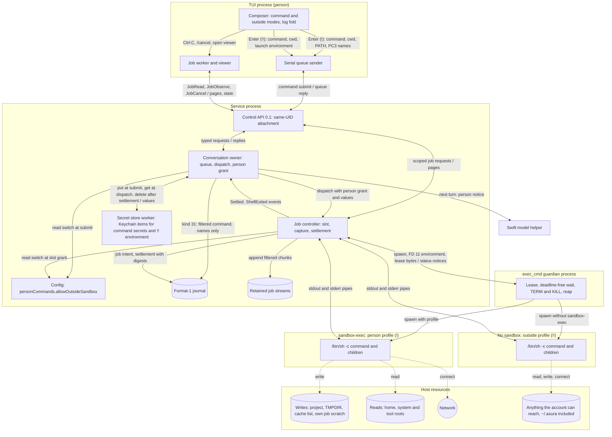
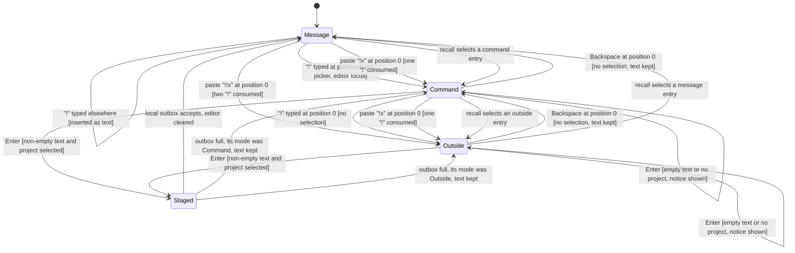
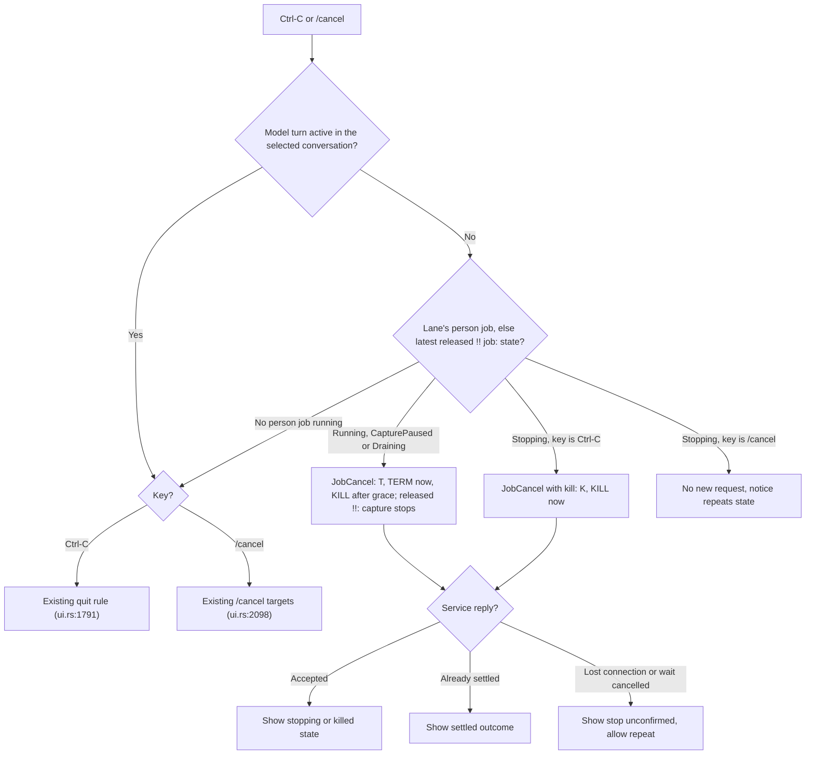
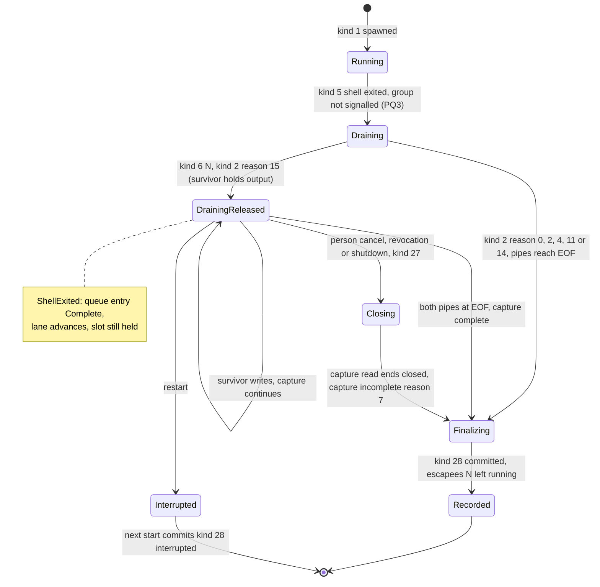
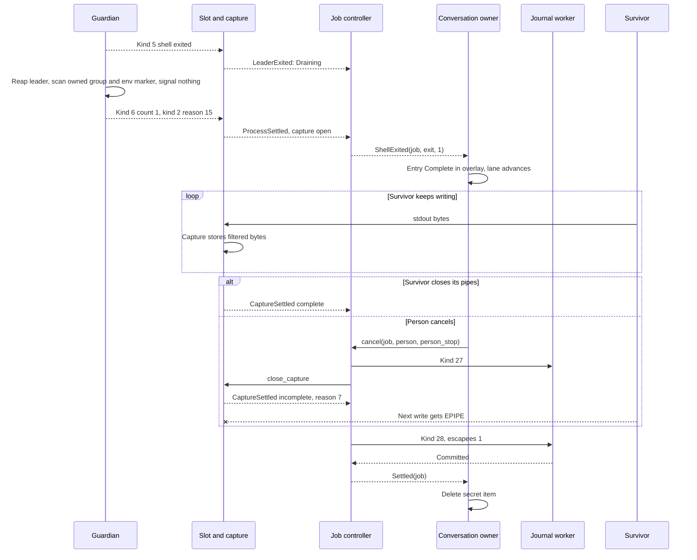
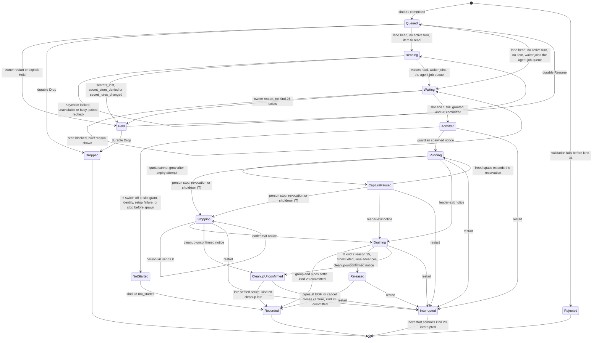
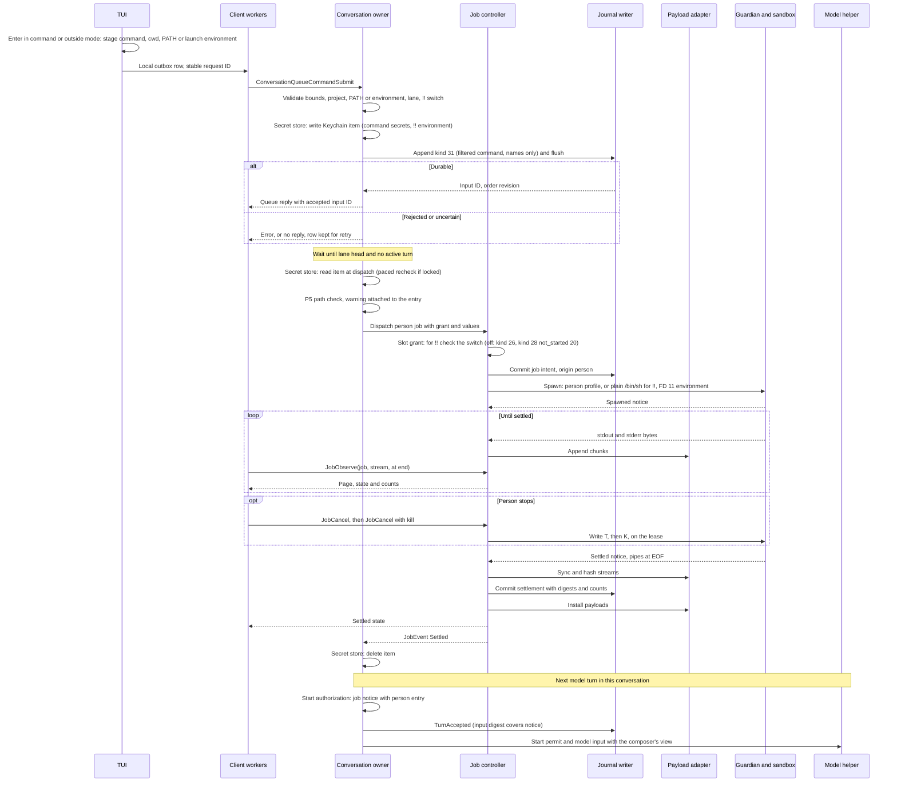
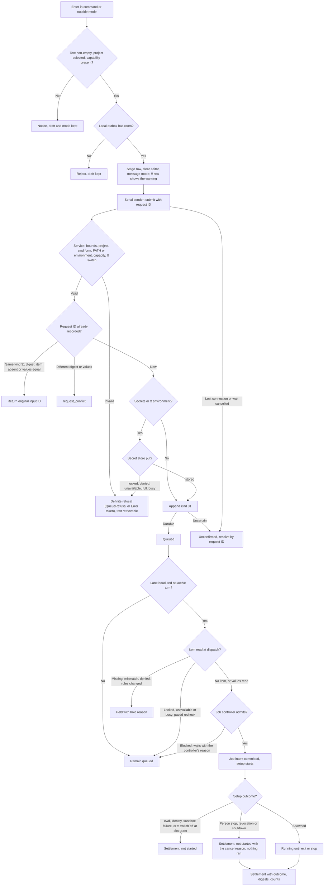
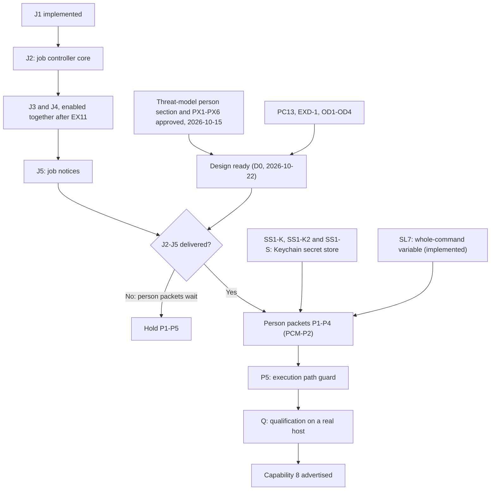
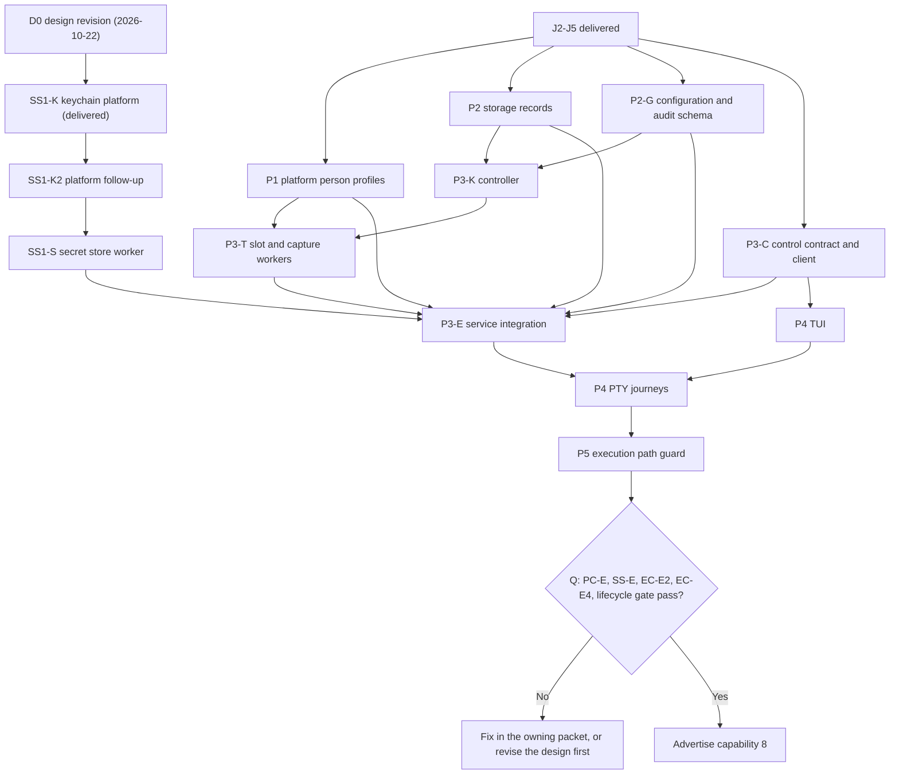

# Person command mode

Status: proposed design, 2026-10-13, rewritten the same day on the
[tool job controller](tool-job-controller.md). The owner selected the required
behavior below and resolved [decisions](#decisions) PC1–PC12 on 2026-10-14;
those are fixed. Other mechanisms marked "Proposed mechanism" remain proposals
for review. The owner approved the
[person-typed commands section](execution-threat-model.md#person-typed-commands)
of the execution threat model, with its decisions PX1–PX6, on 2026-10-15. The
same review (EX4, owner 2026-10-15) adds secret filtering at capture and
per-execution secret variables, recorded in [threat model updates](#threat-model-updates-of-2026-10-15).
Implementation waits for the job packets: J1 is implemented; J2 is in code
(packets J2-A, J2-B and J2-G merged); J3, J4 and J5 are ready designs. The
person packets also wait for SS1 ([secret store](secret-store.md)) and SL7.
Nothing here is implemented. Protocol numbering remains `0.1`; journal format
remains `1`.

Revision of 2026-10-22: the person command and secret store readiness audit
of 2026-10-22 is resolved in this design and the linked designs; see
[audit resolution](#readiness-audit-resolution-2026-10-22). It records owner
decisions OD1 (`!` job scratch), OD2 (`!!` survivors keep their job draining)
and OD3 (the build and test path warning as packet P5), and OD4, decided under
the no-protocol-change rule (the `!!` launch environment bound); see
[owner decisions of 2026-10-22](#owner-decisions-of-2026-10-22). With this
revision the design is ready for implementation in the
[packet split](#packet-split), behind the job packets and SS1. Capability 8
(`CAPABILITY_PERSON_COMMAND`) is not advertised until P5 passes (OD3).

Owner decision of 2026-10-19 ([PC13](#decisions)): a person can also type `!!`
to run a command with no sandbox, "like my terminal", following Wisp's
ADR 0064 amendment. This overrides PCR7's "The Seatbelt sandbox stays" and
"There is no unsandboxed fallback" for `!!` only; a `!` command keeps every
approved rule. The threat model records the accepted exposure in
[EXD-1](execution-threat-model.md#unsandboxed-person-commands). Delivery order
(owner, 2026-10-19): job packets J2–J5 first, then `!` and `!!` on top.

Owner decision of 2026-10-20 ([PC14](#decisions)): `!` and `!!` both run
through the exec_cmd tool function, `!` with a sandbox and `!!` without. A
secret in a person command goes to the secret store, never the journal, and
the command runs; it is never refused for a secret. This resolves
[PCO1](#pco1-resolution). The owner then answered PQ1 and PQ2 and extended
the rule to model commands ([PC15](#decisions)): `!` keeps the person profile,
and the secret store is durable in the macOS Keychain
([secret store](secret-store.md)), so held commands with secrets and held `!!`
commands resume after a restart. The owner decided its Keychain questions
KQ1–KQ3 the same day.

## Scope

A person can type `!` at the start of the composer to switch it to command mode.
Enter then queues the text as a noninteractive shell command in the selected
project. When its turn in the queue comes, the command runs as a
[tool job](tool-job-controller.md) with a person execution profile. The job
retains the command's complete output. The person sees it in the conversation
log and the job viewer. The model receives a notice on its next turn.

A second `!` typed at the start in command mode switches to unsandboxed command
mode, shown as `!!`. Enter then queues an unsandboxed person command. It runs
like a command typed in the person's own terminal: `/bin/sh -c` with no
Seatbelt profile and the TUI's environment. Everything else is the same as for
`!`: the queue, the tool job, retention, secret filtering, the log, the viewer
and the notice.

Objectives:

- Run a person-typed command without leaving the TUI.
- For `!`, keep Seatbelt write confinement while allowing the person's
  toolchains, network and home reads.
- For `!!`, run the command as the person's terminal would, for work the
  sandbox refuses, such as `brew upgrade`, `cargo install` and `rustup update`.
- Order person commands with model turns through the
  [managed input queue](managed-input-queue.md).
- Retain the command's complete output once, as job output, and record a
  reference to it.
- Tell the model what the person did, labelled as the person's action.

Non-goals: interactive stdin, a PTY, a persistent shell session, `!cd` that
persists, remote hosts, automatic retry, an approval prompt, and any change to
the model's exec_cmd tool contract or execution profile. The model never
requests `!!`, and no model tool gains an outside-sandbox argument; Wisp's
model-requested, person-approved run (ADR 0064 items 1–9) is not adopted.
Detection of an outer sandbox around the service, as Wisp's nesting probe does,
is not adopted.

Dependencies:

- [Tool job controller](tool-job-controller.md): slots, retained streams,
  settlement, client job API, job viewer and job notices.
- [Tool output views](tool-output-views.md): one retained stream, separate person
  and model views, journal references.
- [exec_cmd tool](exec-cmd-tool.md): platform guardian, sandbox and process group.
- [Managed input queue](managed-input-queue.md) and
  [conversation admission](conversation-admission.md): lane order, format-1
  records and history.
- [Composer interactions](composer-interactions.md#input-styling-and-command-highlighting--selected-2026-10-13)
  for mode presentation, and [editor navigation](composer-editor-navigation.md)
  for recall.

The [help mode](help-mode.md) design owns the `?` mode.

## Required behavior

Required behavior (owner, 2026-10-13). Later designs must preserve these rules.
IDs are stable references for tests. PCR13–PCR15 were amended on 2026-10-13 by
two owner decisions: a `!` command is a tool job, and the
[tool output views](tool-output-views.md#required-behavior) principles apply.

| ID | Rule |
| --- | --- |
| PCR1 | `!` typed at cursor position 0, outside command mode and with no picker open, switches to command mode. The `!` is not inserted as text. |
| PCR2 | A paste that begins with `!` at cursor position 0 also enters command mode. The leading `!` is consumed; the rest becomes the command. |
| PCR3 | `!` at any other position is ordinary text. |
| PCR4 | Backspace at position 0 leaves command mode and keeps the text. The prompt marker becomes `!` in command mode. |
| PCR5 | In command mode the whole input box, including its half-block strips, uses command amber `#E8B577`. The marker and text are bold black `#000000`. A sent command's log line is a stripe in `#745A3C` with light text. |
| PCR6 | A `!` command runs as a tool job with a person execution profile. It is a special case of the exec_cmd tool's execution path, not of the model's tool contract. Amended on 2026-10-20 (PC14): `!` and `!!` both run through the exec_cmd tool function, the same `asura-platform::exec_cmd` request, guardian and spawn path as the model's exec_cmd tool; `!` with a sandbox, `!!` without. |
| PCR7 | For a `!` command the Seatbelt sandbox stays, and network access is allowed. Amended on 2026-10-19 (PC13): a `!!` command runs with no sandbox under PCR21. |
| PCR8 | The command receives the person's PATH and HOME, not the model's fixed PATH and scratch HOME. Reads are allowed across the person's home, including `~/.ssh`. |
| PCR9 | The working directory is the TUI launch directory when it is inside the selected project; otherwise it is the project root. Each command runs in its own shell; `!cd` does not persist. |
| PCR10 | Writes are allowed only to the project, `$TMPDIR` and the fixed cache list `~/.cargo`, `~/.rustup`, `~/.cache`, `~/Library/Caches`, `~/.npm`. Shell configuration files, `~/.ssh` and other dotfiles remain read-only. Amended on 2026-10-22 (OD1): the command may also write its own empty Asura-private job scratch directory, so the escapee marker works for `!` as for model jobs. HOME and `$TMPDIR` stay the person's. The directory is deleted when the job ends. The command reaches it only by its path: no variable names it, and a `!` command cannot list `~/.asura/tmp`. |
| PCR11 | A person command has no timeout. Ctrl-C while it runs sends TERM to its process group, then KILL after a grace period of 2 s (PC8). A second Ctrl-C kills at once. `/cancel` also stops it. With nothing running, Ctrl-C keeps its current quit behavior. |
| PCR12 | A person command queues behind a running model turn in the existing managed input queue. It runs when its turn comes, so the model never sees the workspace change mid-turn. |
| PCR13 | On the next turn the model receives a notice: command, directory, exit status, line and byte counts, and the job handle. The context composer chooses how much output that request shows ([model view](tool-output-views.md#required-behavior)). The wording says the person ran it, not the model. |
| PCR14 | The job retains the complete output of both streams, under the job controller's retention quota and expiry. Journal records hold a payload reference, digests and a summary, never output text. |
| PCR15 | The log shows the output folded, with the darker amber stripe. It shows the last lines and offers a key to see the rest. The job viewer pages through all retained output. |
| PCR16 | `!` commands share the prompt recall history. Recalling one restores command mode. Help `?` entries are not recorded. |
| PCR17 | Protocol stays `0.1`; journal format stays `1`. Schemas may evolve under [numbering authority](../engineering.md#wire-protocol-change-authority). |
| PCR18 | Before a person command runs, the TUI warns when the model changed build or test paths since the person's last command (PX1, owner 2026-10-14). Asura also re-checks the recorded digest of each approved implicit-execution file before relying on it, and warns again when it changed (PX1, EX1, owner 2026-10-15). Amended on 2026-10-23 (owner, "Hold only for !!"): a `!!` command with a build or test path change waits until the person confirms it; a `!` command warns and runs. Amended on 2026-10-22 (OD3): the [execution path guard](execution-path-guard.md) design is canonical for the warning, the path lists, approvals and their storage; it is delivered as packet P5. P4 TUI code may merge before P5, but capability 8 is not advertised until P5 passes. |
| PCR19 | Secrets in output are detected at capture and replaced with placeholders before storage; the journal, retained streams, viewer and model see placeholders. Secrets only. A secret in the command becomes a per-execution variable such as `$ASURA_SECRET_1`, passed in the environment for that one execution and then dropped; the log keeps only its name. Amended on 2026-10-20 (PC14): a person command is never refused for a secret. A form the rewrite cannot handle safely runs through the whole-command variable: the raw command goes to the secret store, and the journal holds `eval "$ASURA_SECRET_COMMAND"` and a display-only filtered copy (PX6, EX4, SO5). Mechanism: [secret detection](secret-detection.md#whole-command-variable), slice SL5. |

Required behavior (owner, 2026-10-19, PC13) for `!!`. PCR1–PCR19 apply to `!!`
except where a rule below replaces them.

| ID | Rule |
| --- | --- |
| PCR20 | `!` typed at cursor position 0 in command mode, with no selection, switches to outside mode. The prompt marker becomes `!!`. In outside mode `!` is always text. A paste at position 0 steps up one mode for each leading `!`, at most two: `!!x` pasted into an empty message box gives outside mode with text `x`, and `!!!x` gives outside mode with text `!x`. A paste of `! !x` gives command mode with text ` !x`, which runs sandboxed. Backspace at position 0 with no selection steps back one mode, from outside mode to command mode, and keeps the text. |
| PCR21 | A `!!` command runs as a person job with the outside profile: `/bin/sh -c COMMAND` with no Seatbelt profile, under the existing guardian. It receives the TUI's environment as read at TUI launch, unchanged, plus the per-job marker `ASURA_JOB_<jobhex>=1` and any EX4 secret variables. Stdin is `/dev/null`; there is no TTY. It runs in its own process group. Stop, kill and the absent timeout follow PCR11. PCR8 and PCR10 do not apply: the command reads and writes whatever the person's account can. |
| PCR28 | Owner, 2026-10-22 (OD2). When a `!!` command's shell has exited but a survivor, detached or still in the shell's process group (PQ3, decided under PC13), holds its stdout or stderr, the job stays `Draining` and capture continues, so Asura never causes the survivor's EPIPE. The command's queue entry completes and its lane advances. The job stays live in `/jobs` as `shell exited · N background processes writing`. It settles when the survivor closes the pipes, or when the person cancels it. A cancel stops capture and settles the job; it does not kill the survivor (EC-D1), which may then get EPIPE on its next write. See [`!!` survivors](#outside-survivors-and-lane-release). |
| PCR22 | Typing `!!` is the approval. There is no confirmation, classifier or prompt. Before the command runs, its log entry shows `running OUTSIDE the sandbox, as you typed it: it may write anywhere you can` in alert colour `#FF6B6B`, bold. |
| PCR23 | The configuration key `personCommands.allowOutsideSandbox`, default `true`, enables `!!`. When it is `false`, the service refuses a `!!` command with `outside_sandbox_off` and the hint "type it after a single ! to run it in the sandbox". Only the person sets the key, through [configuration commands](config-commands.md). |
| PCR24 | The model notice for a `!!` command is the PCR13 notice with the phrase `, outside the sandbox,` added. The model cannot request, create or cancel a `!!` command; it has no path to typed input. |
| PCR25 | Audit events, kind 31 and the job intent mark every `!!` command with `outside_sandbox` true. |
| PCR26 | Outside mode has its own colours. The box and strips use outside red `#D27068`; the marker `!!` and text are bold black `#000000`. A sent `!!` command's log line is a stripe in `#693834` with light text. The `!!` text marker carries the meaning, so colour is not the only signal. |
| PCR27 | These `!` rules stay for `!!` because Asura is stricter than Wisp there, and "like my terminal" does not remove them: queueing behind model turns (PCR12), retained output and journal references (PCR14), secret filtering at capture and command rewrite (PCR19), the build and test path warning (PCR18), the working directory rule (PCR9), recall (PCR16) and command display (PX5). |

These decisions amend the [exec_cmd tool](exec-cmd-tool.md) for person origin only.
That design said toolchain and cache access "requires a subsequent scoped design
refinement"; this document is that refinement. The model's profile, timeout,
environment and grant are unchanged.

## Terms

| Term | Meaning |
| --- | --- |
| Person command | One command the person submits in command mode. It is a queue entry, then at most one tool job. |
| Person job | The tool job that runs a person command. Its origin is the person, not a model turn. |
| Command mode | Composer state in which Enter submits a person command instead of a conversational message |
| Outside mode | Composer state, marker `!!`, in which Enter submits an unsandboxed person command |
| Unsandboxed person command | A person command typed in outside mode; it runs with the outside profile. Also called a `!!` command |
| Person execution profile | Sandbox, environment, working directory and stop rules for a person job |
| Person profile | The sandboxed person execution profile for a `!` command, profile ID `person-1` |
| Outside profile | The unsandboxed person execution profile for a `!!` command, profile ID `person-outside-1` |
| Model execution profile | The existing [exec_cmd tool](exec-cmd-tool.md#authority-and-confinement) profile |
| Person notice | The job notice entry for a settled person job, labelled as the person's action |

## Ownership

Required behavior: reuse the existing owners. Add no second process supervisor,
scheduler, queue, payload store or journal.

| Behavior | Canonical owner | Change |
| --- | --- | --- |
| Mode switch, styling, recall, Ctrl-C mapping, log fold | Rust TUI (`asura-cli/src/tui`) | New composer modes (command and outside) and log entry |
| Launch environment for `!!` | Rust TUI, read once at launch | New in-memory copy |
| `personCommands.allowOutsideSandbox` | Configuration owner ([config commands](config-commands.md)) | New key |
| Job viewer, job list and cancel | TUI job worker and viewer from job packet J4 | Kill escalation |
| Submit transport | Existing serial queue sender | New typed request |
| Validation, queue order, dispatch, person grant, lane release, waiting reasons | Rust conversation owner (`asura-service/src/conversation.rs`) | New queue entry kind; lane release on the controller's `ShellExited` event (OD2) |
| Durable values for queued commands | [Secret store](secret-store.md) worker over `asura-platform::keychain`; the conversation owner writes at submit, reads at dispatch, and deletes on `JobEvent::Settled`, Drop or rejection | New (PC15) |
| Job slot, setup, capture, retention, settlement, cancel | Job controller from J2 | Person origin: no yield window, no deadline, kill escalation, waiter in the main agent's job queue (J2); the `!!` switch check at slot grant; `ShellExited` and survivor-held capture for `!!` (OD2) |
| Spawn, sandbox, guardian, process group | `asura-platform::exec_cmd` | Person and outside profile tokens and profiles, the person environment descriptor and root descriptors (P1). The no-deadline mode (J1) and the stop-control bytes (J2) already exist |
| Retained streams and pages | Payload adapter from J1 | None |
| Durable records and replay | Storage authority writer (`asura-storage/src/authority`) | Format-1 kind 31 `PersonCommandQueued`; person-origin replay of the J2 kind 26 |
| Notice composition | Job notices from J5 ([notice text](tool-job-controller.md#notice-text) is canonical) | None beyond J5's person entry |
| Build and test path warning, approvals | [Execution path guard](execution-path-guard.md) (P5) | New |
| Model view of output | Context composer; until it exists, model `job read` (PC12) | None here |
| Model input | Swift model helper | None. The notice arrives as prompt and history text. |
| Audit | Existing audit emitter | Origin on job audit events |

Dependency direction is unchanged: TUI → control client → service → storage and
platform. The helper never sees a person command request, and it has no path to
create one.

### PCM-O1: component and trust boundaries

Proposed design. A one-way solid arrow is a request or data flow. A two-way
arrow carries requests downward and replies or events back; its label
names both, separated by `/`. Dashed arrows are effects. Subgraphs are process
or sandbox boundaries; `NS` is a process boundary only, with no sandbox. The
guardian spawns exactly one of the two shells for a job: the sandboxed shell
for `!`, the unsandboxed shell for `!!`.



## User behavior

### Command mode in the composer

Required behavior: PCR1–PCR5 and PCR16. Proposed mechanism for the remaining
details:

- The TUI keeps a `mode` beside the editor draft: `Message` or `Command`.
  The editor text never contains the leading `!`.
- In command mode the slash-command picker never opens and `/` and `?` are
  ordinary text. Active-command highlighting is off.
- Backspace at position 0 with a selection deletes the selection first. Only
  Backspace at position 0 with no selection leaves the mode.
- The hint row shows `↵ run in <cwd> · ⌫ at start: message`. `<cwd>` is the
  project-relative directory, or the project name for the root. The full key
  list stays in `/help`.
- Enter with empty or whitespace-only text sends nothing and shows "Type a
  command". The mode stays.
- Enter with no selected project sends nothing. The notice says "Select a
  project to run commands". Draft and mode stay.
- Ctrl+J inserts a newline. `/bin/sh -c` runs every line.
- A successful local stage clears the editor and returns it to message mode.
  This follows Wisp, as the owner's "like Wisp" entry and exit rule requires.
- Recall entries store the text and its mode. Recalling a command entry
  restores command mode; recalling a message restores message mode. The saved
  unsent draft also keeps its mode. `?` help entries are never recorded.
- The queue panel shows a queued command as `>> ! <excerpt>`. The `!` text
  prefix carries the meaning; colour is not the only signal.

### Outside mode in the composer

Required behavior: PCR20, PCR22, PCR23 and PCR26. Proposed mechanism for the
remaining details, following Wisp's `wisp-tui` outside mode:

- The TUI's `mode` gains a third value, `Outside`. The editor text never
  contains the leading `!!`.
- Every command mode rule above applies in outside mode: no picker, `/` and
  `?` as text, the Backspace selection rule, the empty-text and no-project
  notices, Ctrl+J, staging, recall and command display.
- In command mode, `!` typed at position 0 with no selection enters outside
  mode and keeps the text. With a selection at position 0, `!` replaces the
  selection as text. Elsewhere `!` is text, as before.
- Backspace at position 0 with no selection steps back one mode: outside mode
  to command mode, command mode to message mode. The text stays.
- A paste at position 0 consumes each leading `!` while the mode can step up:
  from message mode at most two, from command mode at most one. A space ends
  the stepping. In outside mode a paste is text.
- Enter with empty text shows "Type a command", as in command mode. Nothing is
  sent or audited. This is Asura's form of Wisp's "nothing to run" note for a
  bare `!!`.
- The hint row shows `↵ run OUTSIDE the sandbox in <cwd> · ⌫ at start: sandboxed`.
- The queue panel shows a queued `!!` command as `>> !! <excerpt>`.
- Recall entries store `Outside` as their mode, and recalling one restores
  outside mode.
- In outside mode, the hidden-character mark is a full block `█` in bold black
  `#000000`, because hidden-mark red `#B3261E` does not contrast with
  `#D27068`. The hint row still counts hidden characters.
- In outside mode the command display draws its caret `›` and rule `─` in
  `#693834`.
- `/help` lists `!COMMAND` and `!!COMMAND`.

Text in message mode that starts with `!!` is a message, not a command. Asura
sends a message and a command as different typed requests, so a message can
never run. Wisp's rule that moves such text into outside mode for a second
Enter is therefore not needed. Text in command mode that starts with `!` runs
sandboxed as that text, as Wisp's `! !x` does.

When the service refuses a `!!` submit with `outside_sandbox_off`, the TUI shows
"Running outside the sandbox is turned off (personCommands.allowOutsideSandbox
is false). Type it after a single ! to run it in the sandbox." The draft and
outside mode stay.

Outside mode colours are taken from Wisp's palette (`OUTSIDE`, `OUTSIDE_SENT`,
`EMBER`). Wisp records them as a first proposal; the owner may choose others
from renders. The TUI defines them once as named composer roles.

### Command display

Required behavior (owner, 2026-10-14,
[PX5](execution-threat-model.md#person-command-decisions)): in command mode the
composer shows each top-level command that `/bin/sh` will run. Proposed
mechanism:

- One canonical splitter, `asura-platform::exec_cmd::split`, ported from Wisp's
  `CommandSplitter`. It is a pure function with no I/O. It understands single
  and double quotes, backslash escapes, backslash-newline continuation, `$(…)`,
  backticks, `( … )` subshells, and the operators `;`, `&`, `&&`, `||`, `|` and
  newline. It is a display pre-pass, not a shell, and grants no authority.
- A top-level command ends at an unquoted newline, `;` or `&` outside any
  substitution or subshell. A chain joined by `&&`, `||` or `|` is one command.
- Each top-level command's first visual row shows an amber caret `›` in the
  gutter. The first command's row shows the `!` marker instead. A thin rule `─`
  in `#745A3C` separates consecutive commands. Continuation rows, from a
  backslash-newline or a newline inside quotes or a substitution, show no
  caret.
- Text the splitter cannot parse, such as an unclosed quote or heredoc, shows
  as one block with the hint `not split`. The splitter never guesses.
- With more than one command, the hint row adds `N commands will run`.
- The split runs on each draft change and is cached with the draft. Rendering
  reads the cache and performs no parsing. The splitter's input is bounded by
  the 8192-byte command limit.
- Hidden characters follow
  [composer interactions](composer-interactions.md#hidden-characters--selected-2026-10-14).

### PCM-T1: composer mode switch

Proposed design for PCR1–PCR4, PCR16 and PCR20. Arrows are key or paste
events with guards. "Position 0" means the editor cursor is before the first
character. `Staged` remembers the mode it came from; "its mode" in the outbox
full arrows means that mode. Recall moves between any two modes; the diagram
shows recall arrows into each mode once, from the mode most likely to precede it.



A `!!` submit that the service refuses, for example with `outside_sandbox_off`,
returns the row's text to the editor in outside mode under the existing
outbox rejection rule.

### Running, stopping and Ctrl-C

Required behavior: PCR11. Proposed mechanism:

- While the selected conversation's person job is `Running`, `CapturePaused`
  or `Draining`, the first Ctrl-C sends `JobCancel` for that job. The
  controller sends TERM, then KILL 2 s later (PC8). The hint shows `stopping · Ctrl-C again kills`.
- While it is `Stopping`, a second Ctrl-C sends `JobCancel` with `kill` set. The
  controller sends KILL at once.
- Neither press quits the TUI. After the job settles, Ctrl-C returns to the
  existing rule at `ui.rs:1791-1798`: quit when the editor and outbox are empty,
  otherwise open the exit confirmation.
- `/cancel` in message mode stops a running person job, like the first Ctrl-C.
  A repeated `/cancel` is idempotent; it never escalates to kill. Command mode
  treats `/cancel` as shell text.
- A person job is dispatched only from the head of its main agent's input
  lane while that agent has no active model turn, and the lane does not advance
  until the job settles. The one exception is a `!!` job whose shell has
  exited while a survivor holds its output (OD2,
  [`!!` survivors](#outside-survivors-and-lane-release)): its lane advances and
  the job keeps draining. `/cancel` and Ctrl-C have one target in the
  selected conversation at a time: the lane's running person job, else the
  most recent released `!!` job of that conversation while no model turn is
  active there. While a model turn is active, Ctrl-C and `/cancel` keep their
  turn behavior, and the person stops a released `!!` job with
  `/job cancel ID` or from `/jobs`. Blocked commands wait with a brief reason
  ([queue integration](#queue-integration)); none is refused for being blocked.
- With a person command queued but not dispatched, Ctrl-C keeps the quit rule.
  Queued and running commands continue after the TUI exits (PC5). When the TUI
  launched the backend, the exit confirmation counts them and states that
  they will stop, as the job controller requires for live jobs.
- The status row shows `running <excerpt> · 42 s · Ctrl-C stops it`. The TUI
  computes the elapsed time from the job's start time in the last job state it
  received and its existing status-row redraw. `JobObserve` has no hold time:
  it returns on new output, a state change, settlement, detach or cancel
  ([job closures](tool-job-controller.md#job-closures-and-wind-down-bounds)).
- A paused capture shows `paused: output quota full · Ctrl-C stops it`.

Model jobs that outlive their turn are not targets of these keys. The person
cancels them with `/job cancel ID` under the job controller.

A `!!` job uses the same keys, requests, grace and kill path as a `!` job.
The status row reads `running OUTSIDE the sandbox <excerpt> · 42 s · Ctrl-C stops it`.
A released `!!` job (OD2) shows `shell exited · 1 background process writing ·
/job cancel <handle> stops capture` in the status row while it drains; with
no attributed survivor the text reads `shell exited · output still open`.

### PCM-F2: Ctrl-C and stop routing

Proposed design. Arrows show the key routing decision and the request sent.



### Person view: log and job viewer

Required behavior: PCR15 and the person view of
[tool output views](tool-output-views.md#required-behavior). These are display
rules. They do not limit what is retained or what the model can read.

Proposed mechanism:

- The log entry header is a stripe in `#745A3C` with light text `#E6EDF0`:
  `! <command first line>`. A multi-line command shows `(+N lines)`.
- A `!!` entry's header is a stripe in `#693834` with light text `#E6EDF0`:
  `!! <command first line>`. The next line is the PCR22 warning in `#FF6B6B`,
  bold. The TUI draws the warning when it stages the row, so it is visible
  before the command can run. The warning stays on the entry after settlement
  and in restored history.
- The body shows the last 8 lines of retained output. Stdout lines come first,
  then stderr lines under a `stderr` label. More lines fold behind
  `▸ N more lines`.
- The TUI job worker fetches the body with one `JobRead` per stream at the end
  of the stream. The page start snaps to a UTF-8 boundary under the job
  controller's page contract. Rendering reads only the cached page.
- While the job runs, the fold updates live (PC6). The job worker keeps one
  `JobObserve` in flight per job, as PC6 selects. With `at_end` set and no
  stream named, the reply carries the end page of each stream, not the page
  after the last one seen, so a flood skips ahead instead of
  falling behind. The reply replaces the cached fold and marks the view dirty.
  Pacing comes only from flow control: the long-poll returns when new bytes
  arrive or the job's state changes, and the render loop already holds a
  redraw while terminal output is pending (`tui/mod.rs:320-326`). There is no
  refresh timer and no hold time.
- In log focus, Enter or Space on the entry opens the job viewer at the end of
  stdout (PC11). Escape returns to the log. The fold never expands inline.
- The footer is `↳ exit 0 · 4 lines · 1.2 s · src/ui`. Other outcomes read
  `↳ stopped by you (signal 15)`, `↳ killed by you (signal 9)`,
  `↳ stopped: service shutdown`,
  `↳ interrupted: service restarted; effects unknown`, or
  `↳ not started: <reason>`. A released `!!` job (OD2) shows
  `↳ shell exited 0 · 2 background processes writing` until it settles; after
  settlement it reads `↳ exit 0 · 2 background processes left running`, and
  after a cancel `↳ exit 0 · output capture stopped by you · 2 background
  processes left running`.
- A capture that stopped early shows `output kept: first N of M bytes` and the
  reason, as the job viewer does. Expired output shows `output expired` with
  the job's summary.
- Rendering uses the existing `literal` sanitization. It performs no I/O.

The job viewer, `/jobs` and `/job ID` work for person jobs exactly as for model
jobs. A person job's row in `/jobs` shows `!` before its command summary, or
`!!` for an unsandboxed person command.

## Execution profiles

### Profile comparison

The model column describes the model profile as J1 implements it and J3
designs it; it links the governing designs instead of citing changing line
numbers (corrected 2026-10-22). The person and outside columns are required
behavior where marked PCR, otherwise a selected mechanism.

| Property | Model profile (`model-1`) | Person profile (`!`, `person-1`) | Outside profile (`!!`, `person-outside-1`) |
| --- | --- | --- | --- |
| Origin and grant | Admitted turn's `execute_authorized` grant, under the [execution setting](execution-setting.md) (EX11) | Person command grant; see [authority](#authority-and-grant) | Person command grant with `outside_sandbox` true (PCR25) |
| Shell | `/usr/bin/sandbox-exec -p PROFILE /bin/sh -c COMMAND` | Same | `/bin/sh -c COMMAND` with no `sandbox-exec` (PCR21) |
| Seatbelt base | `(deny default)` | `(deny default)` with wider explicit roots (PC1) | None |
| Exec and read roots | `/bin`, `/usr/bin`, `/sbin`, `/usr/sbin`, `/usr/lib`, `/usr/share`, `/System`, project, scratch | Model roots, plus home (PCR8), `$TMPDIR`, cache list, the fixed system roots and the developer directory ([person profile](#person-seatbelt-profile)) | Anything the account can read (PCR21) |
| Write roots | Project and private job scratch | Project, `$TMPDIR`, existing cache-list directories (PCR10), private job scratch (OD1) | Anything the account can write, `~/.asura` included (PCR21, [EXD-1](execution-threat-model.md#unsandboxed-person-commands)) |
| Network | None | Allowed (PCR7); `~/.asura` and the control socket denied (PX3) | Allowed; the control socket is reachable |
| PATH | `/usr/bin:/bin:/usr/sbin:/sbin` | The TUI's PATH, sent with each submit and sanitized (PCR8, PC2) | The TUI launch environment's PATH, unchanged |
| HOME | Private job scratch | Account home (PCR8) | The TUI launch environment's HOME, unchanged |
| TMPDIR | Private job scratch | The person's per-user temporary directory (PCR10) | The TUI launch environment's TMPDIR, unchanged |
| Other variables | `LC_ALL=C`, `LANG=C`; EX4 secret variables | Fixed allow-list plus the SSH agent socket (PC3) and EX4 secret variables | The whole TUI launch environment, `ASURA_JOB_<jobhex>=1` and EX4 secret variables; see [outside environment](#outside-profile-environment) |
| Environment transport | Fixed in the guardian; secret variables in the guardian's own environment | [Person environment descriptor](#platform-changes) FD 11, applied only to the final `/bin/sh` spawn; secret variables as for the model | Same as person |
| Working directory | Model-chosen project-relative `cwd`, default root | Launch directory if inside the project, else root (PCR9) | Same as person (PCR9) |
| Stdin, TTY | `/dev/null`; no TTY | Same | Same |
| Command bounds | 1–8192 UTF-8 bytes, no NUL | Same | Same |
| Time limit | None for the job ([J1-Q4](tool-job-controller.md#j1-timeout-and-setup-budget-removal)); J3's `yield_seconds` ends only the starting call's wait | None (PCR11) | None (PCR11) |
| Stop | Model or client cancel, turn end before handle delivery, revocation, shutdown, lease EOF; group stopped at leader exit | Person stop and kill, revocation, shutdown, lease EOF; group stopped at leader exit | Same as person, but the group is not stopped at shell exit (PQ3); after shell exit (OD2) a cancel stops capture only |
| TERM to KILL grace | 500 ms ([guardian profiles](tool-job-controller.md#guardian-contract-additions)) | 2 s (PC8) | 2 s (PC8) |
| Cleanup confirmation | Unconfirmed 2.5 s after the first stop signal (L3) | Same | Same; the gate needs only the owned group ([escapee control](escapee-control.md#the-settlement-gate-and-cleanup_confirmed)) |
| Escapees | Frozen and killed (EX5) | Frozen and killed, through the job scratch marker (OD1) | Counted and left running (EC-D1), together with in-group background processes (PQ3) |
| Output | Retained streams under the job controller (J1, J2) | Same (PCR14) | Same; capture continues after shell exit while a survivor holds a pipe (OD2) |
| Output growth | Job retention quota with growing reservation, expiry and `CapturePaused` | Same | Same |
| Concurrency | Job slots per agent and service (AQ1) | Same; one person job per main-agent lane (PC9) | Same |
| Durable record | Kind 14, then kinds 26–29 (J2, J3) | Kind 31, then kinds 26–28 with person origin | Same as person, with the outside flag; no environment journaled |
| Model disclosure | Kind 29 result in the same turn; J5 notice | J5 person notice on the next turn; output by the composer's view, or by `job read` until the composer exists (PC12) | Same as person; notice adds `, outside the sandbox,` (PCR24) |
| Audit | Job audit events, profile `model-1` | Job audit events with origin `person`, profile `person-1` | Same, profile `person-outside-1`, `outside_sandbox` true |

### Environment and how PATH and HOME reach the service

Verified behavior (code inspection, 2026-10-13): the service process is spawned
with only `LANG=C` and `LC_ALL=C` (`asura-platform/src/startup.rs:311-312`). It
has no PATH or HOME of its own. A service started by one terminal also serves
later TUIs from other shells. The service therefore cannot supply the person's
PATH from its own environment.

Proposed mechanism; the source of PATH was selected in PC2:

1. The TUI reads `PATH` from its own environment once at launch. This is an
   in-memory read.
2. Each command submit carries that PATH. The request digest covers it.
3. The service sanitizes it: at most 4096 bytes and 64 entries; no NUL; it
   drops empty and relative entries, because they resolve against the project
   directory. It keeps the remaining order. An empty result rejects the submit
   with `path_invalid`.
4. Kind 31 stores the sanitized PATH, so a held command can resume after a
   restart without a client resupplying it.
5. The setup worker resolves HOME from the account database with the existing
   `account_home` lookup (`asura-platform/src/runtime.rs:255`). The client never
   supplies HOME. This prevents a client from pointing HOME at another tree.
6. The setup worker resolves `$TMPDIR` with `confstr(_CS_DARWIN_USER_TEMP_DIR)`.
7. The service never adopts the client's PATH into its own environment. It
   never logs PATH or writes it to audit.

Other variables (PC3, selected):

| Variable | Source and check |
| --- | --- |
| `TMPDIR` | Setup worker, as above |
| `USER`, `LOGNAME` | Setup worker, from the account database entry that supplies HOME |
| `TERM` | Fixed `dumb` |
| `GIT_TERMINAL_PROMPT` | Fixed `0` |
| `LANG`, `LC_ALL`, `LC_COLLATE`, `LC_CTYPE`, `LC_MESSAGES`, `LC_MONETARY`, `LC_NUMERIC`, `LC_TIME` | Client, when set; each value at most 64 bytes of ASCII letters, digits, `_`, `-`, `.` and `@` |
| `SSH_AUTH_SOCK` | Client, when set; an absolute path of at most 103 bytes with no NUL. The setup worker checks with `lstat` that it names a socket; otherwise the variable is dropped and the command still runs. |
| `ASURA_SECRET_<n>` | Service only, never the client. Set when EX4 secret detection rewrites the command (PCR19): the real value, held in memory for that one execution, then dropped. Never journaled, audited or reused across commands. The [secret detection design](secret-detection.md#environment-path) defines the bounds: n is 1–16, values total at most 8192 bytes, and a guardian preamble stops child processes inheriting them. |

The client sends only names from this table, excluding the service-set
`ASURA_SECRET_<n>` variables. The service rejects any other client name with
`environment_invalid`. Every other inherited variable is absent, as in
the model profile. The guardian still closes every inherited descriptor.

### Outside profile environment

Required behavior: PCR21. A `!!` command receives the environment the person's
terminal gave the TUI, as Wisp passes its own `environ`. Wisp runs in the
person's terminal, so its environment is that terminal's. Asura's service has no
such environment (`startup.rs:311-312`), so the TUI supplies it. Selected
mechanism (revised 2026-10-22):

1. The TUI copies its whole environment once at launch, in memory, beside
   the PATH it already reads. A `!!` submit carries that copy. The TUI never
   writes it to disk or a log.
2. The service checks only form, not content: each name is 1–1,024 bytes with
   no `=` and no NUL; each value has no NUL; at most 1,024 entries; names and
   values total at most 40,960 bytes (OD4,
   [frame bound](#submit-frame-bound)). A larger environment refuses the
   submit with `environment_too_large`; the draft and mode stay. Duplicate
   names, any name that starts with `ASURA_SECRET_` (the numbered variables
   and `ASURA_SECRET_COMMAND`) and any name that starts with `ASURA_JOB_`
   refuse with `environment_invalid`, because the service sets those names.
3. The service does not sanitize PATH, resolve HOME or TMPDIR, or apply the
   PC3 allow-list. The person's terminal does none of these.
4. The service writes the environment, with any command secrets, to the
   input's Keychain item in the [secret store](secret-store.md) before kind
   31 (PC15). Kind 31, job records, audit and logs never hold it, because a
   terminal environment commonly holds tokens and EX4 forbids a stored copy of
   a secret in Asura records. Dispatch reads the item and moves the values
   into the job admission. The conversation owner deletes the item after the
   job's settlement, a Drop or a rejected append.
5. An exact retry compares a keyed digest of the environment with the one in
   the item; a different environment under the same request ID conflicts.
   When the item no longer exists, the kind 31 request digest alone decides
   ([secret store ordering rule 6](secret-store.md#ordering-rules)).
6. After a restart the queued `!!` command is `Held` (MQ07R). Resume moves it
   back to `Queued` without a Keychain call. Dispatch reads its item and runs
   it with the stored environment. A missing or mismatched item holds it with
   `secrets_lost`; a denied read holds it with `secret_store_denied`; a locked
   or unavailable Keychain leaves it waiting at the lane head with a paced
   recheck ([secret store failures](secret-store.md#failure-handling)). Every
   `!!` command needs the Keychain, because it always has an environment.
7. The slot setup worker sends the validated entries to the guardian through
   the [person environment descriptor](#platform-changes) (FD 11). The
   guardian never adopts them into its own environment: they apply only to the
   final `/bin/sh` spawn, so `DYLD_*`, `Malloc*` and similar variables never
   affect the Asura binary. The guardian appends `ASURA_JOB_<jobhex>=1`, where
   `<jobhex>` is the 32 lowercase hexadecimal digits of the job ID, and then
   the EX4 secret variables from its own environment. The secret detection
   preamble and guardian erasure apply unchanged. The guardian still closes
   every inherited descriptor; those descriptors are Asura's, not the
   terminal's.

The environment is the TUI's at launch, not at Enter. Unlike an interactive
shell, `!!export X=1` does not change later commands, because each command runs
in its own shell (PCR9). One Keychain item holds at most 55,413 bytes, and
an installation has at most 256 items ([item contract](secret-store.md#keychain-item-contract)).

#### Submit frame bound

Decided on 2026-10-22 under the no-protocol-change rule (OD4): the frame stays
64 KiB, so the environment bound is recomputed to fit one control frame with
the largest command. The envelope body is limited to 65,536 bytes
(`MAX_FRAME_BYTES`, `asura-control/src/lib.rs:12`); the 12-byte frame header
is outside it.

| Part | Worst-case bytes |
| --- | --- |
| Envelope fields 1–3: two 16-byte IDs (18 each) and the request counter (11) | 47 |
| Envelope body tag for field 68 (2) and its length (3) | 5 |
| Submit fields 1–3: three 16-byte IDs | 54 |
| Field 4 expected generation | 11 |
| Fields 5 and 10 flags | 4 |
| Field 6 command: tag, 2-byte length, 8,192 bytes | 8,195 |
| Field 7 cwd: tag, 2-byte length, 1,024 bytes | 1,027 |
| Fixed total | 9,343 |
| Room for field 11 entries | 56,193 |

Each `LaunchVariable` entry costs at most 11 bytes beyond its name and value:
the entry tag (1) and length (at most 3), the name tag (1) and length (at most
2), and the value tag (1) and length (at most 3). With 1,024 entries the
headers cost at most 11,264 bytes. The bound of 40,960 bytes of names and
values therefore gives at most 52,224 bytes of entries, 3,969 bytes below the
room. A `!` submit is far smaller: PATH 4,096 bytes and 9 PC3 entries.

Codec test PC-U49 encodes a submit at every maximum together: 8,192-byte
command, 1,024-byte cwd, maximal IDs and counter, 1,024 entries whose names
and values total exactly 40,960 bytes with the largest varint lengths, and
checks that the envelope body is at most 65,536 bytes. It then checks that
1,025 entries and 40,961 bytes each refuse with `environment_too_large`.

### Working directory

Required behavior: PCR9. Proposed mechanism:

- The TUI computes the directory with its existing `context_directory` rule
  (`ui.rs:1413`): the launch directory when it starts with the project root,
  otherwise the root. It sends the project-relative path, `.` for the root.
- The path follows the exec_cmd tool's `cwd` contract: 1–1024 bytes, relative,
  no NUL and no `..` component.
- The service resolves it under the retained project descriptor with no symlink
  traversal, as the model profile does. A launch directory reached through a
  symlinked component therefore fails.
- That failure settles the job as not started with `cwd_unavailable`. The
  service never falls back to the root silently, because a command such as
  `rm -rf build` must not run in a directory the person did not see.
- The directory is fixed when the command is staged. Kind 31 records it.

### Person Seatbelt profile

PC1 selected the base: the profile keeps `(deny default)` and adds rules.
The rule details below are selected (engineering, revised 2026-10-22). The
guardian generates the profile from fixed literals and validated descriptor
paths with the existing quoting helper (`git_observer::quoted`). Command text
and client paths never enter the profile.

| Rule | Content |
| --- | --- |
| Base | `(version 1) (deny default)` |
| Process | `process-fork`; `process-exec` and `file-map-executable` under every read root |
| Reads | Model roots; the fixed system roots `/Library`, `/Applications`, `/opt/homebrew`, `/usr/local` and `/private/etc`; the literals `/var/db/xcode_select_link`, `/private/var/db/xcode_select_link` and `/private/var/select/developer_dir` (xcode-select on macOS 27 reads it); metadata of the literals `/var`, `/etc` and `/tmp` (without `/etc` Git fails on `/etc/gitconfig` and curl exits 77; without `/var` xcode-select fails, PC-P1); the home, `$TMPDIR`, developer directory and cache root descriptors; the existing `/`, `/private/var/select/sh` and `/dev` literals |
| Writes | Project; `$TMPDIR`; each cache-list directory that exists; the job's own private scratch directory (FD 9, OD1); `/dev/null` |
| Network | `(allow network*)`, then a deny for the Asura control socket (PX3) |
| Services | `sysctl-read`; no `mach-lookup` (probe [PC-P1](#pc-p1-mach-service-probe) found an empty list) |
| Excluded | Writes to home outside the cache list, `~/.ssh` and dotfiles; reads, writes and connections under `~/.asura` (PX3), except the job's own scratch directory, which the profile re-allows by its exact descriptor path, as the model profile does |

The fixed system roots are literals compiled into the guardian, like the model
roots. They are system paths, not client input, so they need no descriptor. A
fixed root that does not exist is omitted from the profile. The variable roots
come from the setup worker as directory descriptors:

| Role | Source | Required |
| --- | --- | --- |
| 1 home | `account_home` from the account database (`runtime.rs:255`) | Yes; missing fails setup with `sandbox_unavailable` |
| 2 `$TMPDIR` | `confstr(_CS_DARWIN_USER_TEMP_DIR)` | Yes |
| 3 developer directory | See below | No |
| 4 cache | Each existing directory of the PCR10 cache list under the home | No; at most 5 |

Developer directory selection (selected, engineering): the setup worker reads
the symlink `/var/db/xcode_select_link` with `readlink`, as `xcode-select -p`
does, and runs no process. If the link is absent, it uses
`/Library/Developer/CommandLineTools` when that directory exists. A target
inside `/Applications` or `/Library` is already covered by a fixed root and
gets no descriptor. Any other existing absolute target is sent as role 3. A
missing or relative target is omitted; the command still runs, and tools that
need the developer directory fail with the OS denial, as for any absent root.

The job scratch directory (OD1) is the per-job private scratch that the
guardian already receives at FD 9 for every profile. For `!` it is writable
and empty at spawn. HOME and `TMPDIR` stay the person's (PCR8, PCR10), so a
command writes there only when it names the path. The directory makes the
escapee marker work: `sandbox_check` attributes a process to the job when it
may write the scratch and may not write the decoy, the Asura home `tmp`
directory ([escapee control](escapee-control.md#attribution-the-per-job-sandbox-marker-model-and--jobs)).
The slot cleanup thread deletes the directory when the job ends, as for model
jobs.

Missing cache directories are omitted. The service does not create them. A
cache directory that resolves outside the home directory is omitted. A missing
required root fails setup with `sandbox_unavailable`. A `!` command has no
unsandboxed fallback: it never becomes a `!!` command. Only the person's
explicit `!!` runs without a profile (PC13).

The outside profile has no Seatbelt profile, no root descriptors and no
`~/.asura` denial. The guardian runs `/bin/sh -c COMMAND` directly, after the
same lease, process group, descriptor and identity checks as for the other
profiles. A missing `/usr/bin/sandbox-exec` does not affect it. If the service
itself runs inside an outer sandbox, a `!!` command stays inside that sandbox;
Asura does not detect this.

#### PC-P1: mach service probe

Required step of packet P1 before its profile code merges (selected,
engineering, 2026-10-22). The probe fixes the `mach-lookup` list from
observed denials; the design does not invent it.

1. Build the person profile with no `mach-lookup` rule and with
   `(deny mach-lookup (with report))`.
2. On the macOS 27 host, in a scratch HOME copy with real Git, curl and Cargo
   configuration, run: `git ls-remote https://github.com/git/git HEAD`,
   `git status` in a scratch repository, `curl -sI https://example.com`,
   `cargo search serde --limit 1` with a scratch `CARGO_HOME`, `ssh-add -l`
   against a fixture agent, `xcrun --find clang`, and `/usr/bin/git --version`
   through the developer shim.
3. Collect each denied service name from the sandbox violation log
   (`log show --predicate 'sender == "Sandbox"'`) for the probe's PIDs.
4. Add a name to the allow list only when a step above fails without it and
   the name is not excluded below. Record each name with the step that needed
   it in this section.
5. Excluded names, never allowed: LaunchServices (`com.apple.coreservices.launchservicesd`,
   `com.apple.lsd.*`), `com.apple.securityd` and `com.apple.SecurityServer`
   (Keychain, the PC1 accepted cost), `com.apple.pasteboard.1`, any
   `com.apple.xpc.launchd.*` domain service, and any service that can start
   an unsandboxed process on the caller's behalf.
6. Re-run steps 2 and 3 with the final list: every step passes. Remaining
   denials that no step needed are recorded here, not allowed (amended
   2026-10-23: rule 4 forbids adding a name no step needs).

The guardian embeds the final list as fixed literals. A change to it needs a
new probe record here.

**Probe record (P1, 2026-10-23).** macOS 27.0 (26A428). Person profile with
`(deny mach-lookup)` and no allow; scratch HOME with copies of `.gitconfig` and
`.config/git`; scratch `CARGO_HOME` with `config.toml`; a fixture ssh-agent with
one fixture key; `~/.rustup` added as a read root so the toolchain Cargo runs.
Every step of rule 2 passed with no `mach-lookup` allowed. **Final allow list:
empty.** Residual denials, from launchd "denied lookup" lines (the Sandbox
sender logged none), needed by no step and none excluded:
`com.apple.bsd.dirhelper` (Git, xcrun), `com.apple.logd`,
`com.apple.system.notification_center`,
`com.apple.system.opendirectoryd.libinfo` and `.membership`,
`com.apple.SystemConfiguration.configd` (Cargo, curl, git-remote-http),
`com.apple.CoreServices.coreservicesd` and
`com.apple.DiskArbitration.diskarbitrationd` (Cargo). The probe also found
the read literals added to the Reads row above.

### Authority and grant

Proposed mechanism. A person command has no turn, so it cannot use the turn's
`tools::Grant` (`tools.rs:359-365`) or a turn's job grant snapshot. The
conversation owner builds a separate person command grant at dispatch:

| Input | Check |
| --- | --- |
| Principal | The request arrived on an authenticated control attachment. The peer is the same OS user under the [D1 choice](threat-model.md#scope-assets-and-actors). |
| Origin | The request is a typed command submit. The model channel has no such message, so the helper cannot create one. |
| Project | Registered and current; retained device and inode match at setup and at spawn |
| Lane | The input is the eligible lane head and its conversation has no active model turn |
| Owner generation | Current; a held input from an earlier owner needs explicit Resume |
| Outside switch | For `!!` only: `personCommands.allowOutsideSandbox` is `true` at submit, and again when the job controller grants the slot ([switch check](#outside-switch-check)) |

The grant snapshot binds installation, project identity, input ID, job ID,
owner generation and profile ID: `person-1` for `!`, `person-outside-1` for
`!!`. The profile ID comes from the `outside_sandbox` flag in kind 31, never
from a later request. The job intent records it before spawn. It authorizes exactly one spawn. It is not derived from
`execute_authorized`, and the EX11 constant does not apply to it. The job
controller's revocation triggers apply to person jobs unchanged.

Background reconciliation, sensors, classifiers and the model never create
person commands. The TUI never copies model output into command mode, and its
recall records only text the person submitted. After a person job exists, the
model may list, inspect, read and wait on it, but not cancel it (PC10). This
holds for `!!` jobs too.

#### Outside switch check

Selected (engineering, 2026-10-22), replacing "read at launch only". The
switch is checked at two points and never while the command runs:

1. **Submit.** The conversation owner reads the configuration owner's current
   value. `false` refuses the submit with `outside_sandbox_off`; nothing is
   queued, stored or journaled.
2. **Slot grant.** When the job controller grants a slot to a `!!` waiter, it
   reads the current value before it calls `SlotPort::start`, as J34-K checks
   the EX11 setting at slot grant for model jobs. The person grant, the slot,
   the 1 MiB reservation and kind 26 are taken as for any person start. With
   `false`, the controller starts no setup and settles the job as kind 28
   `not_started` with reason 20 `outside_sandbox_off`, then releases the slot.
   Nothing runs. The secret item is deleted on that settlement.

Turning the switch off does not stop a running `!!` command; the person stops
it with Ctrl-C, `/cancel` or `/job cancel`. The EX11 execution setting governs
model execution and does not affect person jobs.

## Contracts

### Job controller amendments

Proposed mechanism. A person job is a tool job with these differences. J2
delivers their controller parts
([J2 scope](tool-job-controller.md#j2-scope)); the person packets add the
profiles, kind 31, the submit path and the `!!` lane release.

| Job controller rule | Person job |
| --- | --- |
| Started by a model `exec_cmd` call with a yield window | Started by dispatch of a kind 31 queue entry; no yield window and no starting ToolResult. Until a slot is granted it is an in-memory waiter in the main agent's job queue, and kind 26 is written only at the grant |
| Handle delivery is the starting call's ToolResult | No handle delivery step. The client knows the job ID at queue acceptance, because it derives from the input ID. |
| No job lifetime for any job (owner, 2026-10-14, J2a-1) | No deadline (PCR11). Closures are person stop and kill, revocation and shutdown; a client disconnect is not one (PC5). |
| `CapturePaused` has no time expiry for any job (owner, 2026-10-14) | A paused person job waits for freed space, a person stop or another cancel trigger |
| Cancel: TERM, then KILL | Adds `kill`: KILL at once (lease byte `K`). A kill request after a stop request escalates. |
| Execution profile from the turn's grant | Person or outside profile and person grant |
| Setup builds a sandbox profile | The outside profile builds none. The controller checks `personCommands.allowOutsideSandbox` at slot grant ([switch check](#outside-switch-check)). The values arrive in the start request from the dispatch read |
| Job intent binds operation, generation and ordinal | Kind 26 binds origin 2 (person) and the input ID instead |
| Live jobs: 2 per agent, 4 per service (AQ1) | A person job counts toward the main agent of its conversation and the service; no slot is reserved for it |
| Model `job` commands cover the conversation's jobs | `list`, `status`, `read` and `wait` cover person jobs; `cancel` returns `not_permitted` (PC10, selected) |
| The lane waits for settlement | Same, except a `!!` job releases its lane on `ShellExited` (OD2, [`!!` survivors](#outside-survivors-and-lane-release)) |

### Control API additions

Selected (engineering, revised 2026-10-22) within protocol `0.1`. The submit
is envelope body field 68, the next unused number after the job controller's
J4 messages 57–67 (R3, owner, 2026-10-14). The capability enum gains value 8,
`CAPABILITY_PERSON_COMMAND`, after `CAPABILITY_JOBS` (7).

Enablement (OD3): the service lists capability 8 in `HelloReply` only when J3
and J4 are enabled and packets P1–P5 have passed their validation. Until then
a TUI keeps command and outside modes, but Enter shows "Commands are not
enabled in this service" and keeps the draft. This is an enablement gate, not
version compatibility: no compatibility with older builds is required.

```proto
// Person-typed `!` or `!!` command, queued in a conversation lane.
message ConversationQueueCommandSubmit {
  optional bytes request_id = 1;
  optional bytes project_id = 2;
  optional bytes conversation_id = 3;
  optional uint64 expected_generation = 4;
  optional bool new_conversation = 5;
  optional string command = 6;      // 1-8192 UTF-8 bytes, no NUL
  optional string cwd = 7;          // project-relative, "." for root, 1-1024 bytes
  optional string search_path = 8;  // `!` only: client PATH, at most 4096 bytes
  repeated PersonEnvironment environment = 9;  // `!` only: PC3 client names, at most 9
  optional bool outside_sandbox = 10;          // true for a `!!` command
  repeated LaunchVariable launch_environment = 11;  // `!!` only: at most 1,024 entries, 40,960 bytes
}
message PersonEnvironment { optional string name = 1; optional string value = 2; }
message LaunchVariable { optional bytes name = 1; optional bytes value = 2; }
```

Field rules: with `outside_sandbox` absent or false, `launch_environment` must be
empty and fields 8 and 9 follow the `!` rules. With `outside_sandbox` true,
fields 8 and 9 must be absent and `launch_environment` follows the
[outside environment](#outside-profile-environment) bounds; it may be empty.
Any other combination refuses with `environment_invalid`. `LaunchVariable`
uses bytes because a terminal environment need not be UTF-8; the codec checks
the outside environment bounds only. Codecs apply strict presence, size,
direction and unknown-field validation before admission, as for every 0.1
message.

Job messages. J4 already carries everything the person path needs:
`JobCancel.kill`, `JobObserve.at_end`, and `JobEntry.origin`,
`outside_sandbox` and `input_id`. The person packets add `JobEntry` fields
28 `left_running` and 29 `shell_exited` for OD2; the
[J4 control messages](tool-job-controller.md#j4-control-messages) are their one
definition.

Queue messages:

- `ConversationQueueCommandSubmit` returns the existing
  `ConversationQueueReply` with `accepted_input_id`, as
  `ConversationQueueSubmit` does. The client derives the job ID from it.
- `ConversationQueueEntry.kind` gains value 3, person command. `text` carries
  the command as recorded (the rewrite, or the display-only copy for the
  whole-command variable). Field 15 is `waiting_step`, so the new fields start
  at 16:

```proto
// ConversationQueueEntry, new fields (kind 3 only).
optional string command_cwd = 16;             // kind 31 cwd
optional bool command_outside_sandbox = 17;   // true for `!!`
optional QueueWaitReason waiting_reason = 18; // live, Queued only; never journaled
optional string waiting_text = 19;            // brief text with live numbers, at most 128 bytes
optional bool command_filtered = 20;          // display-only copy of a whole-command input

enum QueueWaitReason {
  QUEUE_WAIT_REASON_UNSPECIFIED = 0;
  // 1-9 equal the J2 block reasons, in the order of the start-condition table:
  // recovering, journal_unavailable, journal_held, payload_unavailable,
  // agent_slots, service_slots, pending_installs, quota, disk_space.
  QUEUE_WAIT_REASON_MODEL_TURN = 10;          // "waiting: model turn running"
  QUEUE_WAIT_REASON_KEYCHAIN_LOCKED = 11;     // "waiting: Keychain locked"
  QUEUE_WAIT_REASON_KEYCHAIN_UNAVAILABLE = 12;// "waiting: Keychain unavailable"
  QUEUE_WAIT_REASON_KEYCHAIN_BUSY = 13;       // "waiting: Keychain requests queued"
  QUEUE_WAIT_REASON_HELD_HEAD = 14;           // "waiting: an earlier input is held"
  // 15 PATH_CHECK and entry fields 21-22 are added by P5 (execution-path-guard.md).
}
```

  Values 1–9 are named in the proto as
  `QUEUE_WAIT_REASON_RECOVERING = 1` through `QUEUE_WAIT_REASON_DISK_SPACE = 9`.
  The codec allows fields 16–20 only on kind 3, `waiting_reason` and
  `waiting_text` only together and only in state 1 (Queued).
- `ConversationQueueReply` gains a typed refusal for the person submit:

```proto
// ConversationQueueReply, new fields.
optional QueueRefusal refusal = 9;     // a definite refusal; nothing was queued or stored
optional uint32 refusal_status = 10;   // with SECRET_STORE_UNAVAILABLE: |OSStatus|

enum QueueRefusal {
  QUEUE_REFUSAL_UNSPECIFIED = 0;
  QUEUE_REFUSAL_OUTSIDE_SANDBOX_OFF = 1;
  QUEUE_REFUSAL_ENVIRONMENT_INVALID = 2;
  QUEUE_REFUSAL_ENVIRONMENT_TOO_LARGE = 3;
  QUEUE_REFUSAL_PATH_INVALID = 4;
  QUEUE_REFUSAL_CWD_INVALID = 5;
  QUEUE_REFUSAL_SECRET_STORE_LOCKED = 6;
  QUEUE_REFUSAL_SECRET_STORE_DENIED = 7;
  QUEUE_REFUSAL_SECRET_STORE_UNAVAILABLE = 8;
  QUEUE_REFUSAL_SECRET_STORE_FULL = 9;
  QUEUE_REFUSAL_SECRET_STORE_BUSY = 10;
  QUEUE_REFUSAL_SECRET_IN_CWD = 11;
  QUEUE_REFUSAL_PLACEHOLDER_NOT_AVAILABLE = 12;
  QUEUE_REFUSAL_SECRET_DETECTION_UNAVAILABLE = 13;
}
```

  A refusal reply carries `request_id` and `refusal`, and no entries or
  `accepted_input_id`. The codec rejects a reply with both `refusal` and
  `accepted_input_id`. Validation that the kind 18 submit already reports as
  an `Error` token, such as `stale_generation`, `conversation_busy` (16
  unresolved inputs), `request_conflict` and `Draining`, keeps that form for
  both submits; the refusal field holds only the person-command reasons above.
- Hold reasons. The existing `hold_reason` string gains `paths_changed` (a
  `!!` command held for confirmation of a build or test path change, owner
  2026-10-23, [execution path guard](execution-path-guard.md#warning-at-person-dispatch)),
  `secrets_lost`,
  `secret_store_denied` and `secret_rules_changed` for kind 3 entries. Each is
  a current-owner diagnostic, as today.
- `ConversationHistoryEntry` gains `optional bytes person_command_input_id = 5`.
  The restored log reads the job's state and fold through the job API. A
  person entry has the input ID, `accepted_frame` (its kind 26 frame, the
  dispatch, as a turn's accepted frame is its `TurnAccepted`), and
  `generation` (the generation it was queued against, 0 before the first
  turn, at most the reply's), and has no `operation_id` or `kind`. A command
  dropped before it ran is not listed, as for a dropped message. The writer's
  history read merges the active turn, `T` turn entries and `p` person entries
  (index tag `p`, [segmented journal](segmented-journal.md), from the delta and
  the runs; a `p` entry is written at the kind 26, so the delta already holds
  recent dispatches), newest accepted sequence first, at most 8. The
  `before_accepted_frame` cursor must name an `A` turn of this conversation or
  a `p` entry at exactly that sequence, otherwise the read is `invalid`; turns
  below it are found by a binary search over `T` (at most 64 lookups), so a page
  is bounded work. With no conversation named, the read returns the project's
  latest-turn conversation, except that the project's newest conversation (its
  last `K` entry) is returned when it is at generation 0 and its newest `p`
  entry is later than the latest turn. An older person-only conversation behind
  a newer generation-0 conversation is not selected; finding it would need a
  project-keyed person index (P3-E3). A history
  reply may carry generation 0 only when every entry is a person entry: a
  conversation that so far holds only person commands.

Codec rules (P3-C, 2026-10-23):

- A kind 3 queue entry carries `target_generation` and no
  `target_operation_id`, and has no `operation_id` or `generation` in any
  state, because a person command runs as a job, not an operation. It requires
  `command_cwd` and `command_outside_sandbox`; `waiting_step` is not allowed;
  `command_filtered` appears only as true; `waiting_text` is 1–128 bytes with no
  control characters.
- A refusal reply has `full_text = false`, and `pending` and `stale_order` are
  not true. `refusal_status` is present and nonzero exactly when the refusal is
  `secret_store_unavailable`.
- `JobEntry` fields 28 `left_running` and 29 `shell_exited` appear only on a
  person job with `outside_sandbox = true`: `left_running` only in `DRAINING` or
  `SETTLED`, `shell_exited` only as true and only in `DRAINING`.
- `SecretStoreStatus` fields are optional; counts are at most 257. Fields 4
  and 6 (stranded items) are reserved since SG3.
- One owner checks the environment form: `asura_control::person::environment_refusal`
  (size first: more than 1,024 entries or 40,960 bytes is
  `environment_too_large`; any other form fault is `environment_invalid`). The
  client applies it before sending and answers a refused environment locally,
  so an environment too large for one frame still gets its refusal; the service
  applies the same function at submit. The wire limit of `launch_environment`
  is the frame bound (32,768 entries), so a count above 1,024 is a refusal, not
  a wire fault.

TUI texts for refusals:

| Refusal | Text |
| --- | --- |
| `outside_sandbox_off` | "Running outside the sandbox is turned off (personCommands.allowOutsideSandbox is false). Type it after a single ! to run it in the sandbox." |
| `environment_invalid` | "This terminal's environment cannot be passed to a command (invalid or reserved variable name)." |
| `environment_too_large` | "This terminal's environment is too large to pass to a command (at most 1,024 variables and 40 KiB)." |
| `path_invalid` | "PATH has no usable absolute entry." |
| `cwd_invalid` | "The working directory cannot be used for commands." |
| `secret_store_*` | The [secret store](secret-store.md#failure-handling) texts; `secret_store_busy` reads "The Keychain is busy. Press Enter again." |
| `secret_in_cwd`, `placeholder_not_available`, `secret_detection_unavailable` | The [secret detection](secret-detection.md#refusal) texts |

Each refusal returns the row's text to the editor in its mode under the
existing outbox rejection rule.

### Queue integration

Selected (engineering, revised 2026-10-22). A person command is a lane entry
under the [managed queue](managed-input-queue.md). These rules differ from
kind-18 messages:

- Kind 31 replaces kind 18 for the enqueue. It may allocate a new conversation
  with `new_conversation`, under the same rules.
- A person command never advances the conversation generation. It never creates
  `TurnAccepted`.
- Reorder (kind 19), Hold, Resume and Drop (kind 13) accept a person command
  input ID with the same checks as kind 18. Resume makes no Keychain call.
- `Send now` on a person command row is rejected when a model turn is active. A
  person command cannot steer. When idle, it moves the row to the front, as for
  kind 18.
- At dispatch the owner requires the lane head and no active model turn in the
  conversation. For an input with a secret item it reads the item; a locked,
  unavailable or busy Keychain leaves the input waiting with its reason and a
  paced recheck ([secret store failures](secret-store.md#failure-handling)).
  It then asks the job controller to admit the job.
- Queues, lanes and slots are per agent (owner, 2026-10-21, AQ1). The input
  lane is the main agent's lane. Blocked work waits with a brief reason that
  names what blocks it; it is never refused for being blocked. The reason
  reaches the client as `waiting_reason` and `waiting_text` on the queue entry
  ([control API](#control-api-additions)). While a model turn is active the
  head shows `waiting: model turn running`. When the controller cannot start
  the job, the command stays at the lane head as a waiter in the main agent's
  job queue, with the controller's
  [blocking reason](tool-job-controller.md#start-conditions-and-blocking-reasons),
  for example `waiting: 2 of 2 jobs running for this agent`. It starts when the
  condition clears; no timer retries it. Only the controller's known-size queue
  bounds return `busy` (`queue_full`, `jobs_full`); the command then stays
  queued at the lane head and dispatch tries again on the next wake event.
- The lane does not advance until the person job settles, except for a `!!`
  job released by OD2 ([`!!` survivors](#outside-survivors-and-lane-release)).
  A message queued after a command therefore starts a turn that sees the
  command's outcome, except after a released `!!` job, whose entry follows in
  the first notice after it settles.
- A queued person command counts toward the 16 unresolved inputs across all
  projects that the [managed queue](managed-input-queue.md#admission-and-delivery--selected-design)
  defines.
- After restart, an undispatched person command is `Held`, as MQ07R requires.
  It never runs again without explicit Resume. Resume returns it to `Queued`;
  dispatch reads its item and runs it, or holds it with `secrets_lost`,
  `secret_store_denied` or `secret_rules_changed`.
- A `!!` command queues, reorders, holds and drops exactly as a `!` command.
- The order revision advances on kind 31, and on dispatch through kind 26.

Queue states of a kind 3 entry, derived from records with one in-memory
overlay:

| Source | Entry state |
| --- | --- |
| Kind 31 committed | 1 Queued |
| Owner restart without kind 26, or explicit Hold, or a dispatch hold reason | 2 Held |
| Kind 26 committed | 3 Running |
| Kind 28 outcome exited or signalled | 4 Complete |
| Kind 28 outcome cancelled, not_started or interrupted | 5 Failed |
| `ShellExited` for a `!!` job (OD2), in memory only | 4 Complete; the job stays live |
| Kind 13 Drop | 6 Dropped |

The overlay is not journaled. After a restart the released job has no kind 28,
so start-time recovery writes `interrupted`, and the entry becomes 5 Failed.

### Outside survivors and lane release

Required behavior (owner, 2026-10-22, OD2; PCR28). The owner asked whether the
job can handle a detached survivor that keeps a `!!` command's output open.
It can: the job keeps draining after the shell exits, and only the queue moves
on. Selected mechanism:

1. **Guardian.** For `person-outside-1` the guardian sends kind 5 when the
   shell exits. It does not signal the owned group at shell exit (PQ3,
   decided under PC13). It reaps the leader, then scans the owned group and
   the env marker for survivors
   ([escapee control](escapee-control.md#attribution-the--unsandboxed-job)):
   every live process still in the group and every env-marked escapee is a
   survivor. It does not wait for capture EOF and does not signal survivors
   (EC-D1). It
   sends kind 6 with the survivor count when the count is at least 1, then
   kind 2 with reason 14 `escapees_left_running` when no survivor holds a
   capture pipe, or reason 15 `escapees_hold_output` when at least one does.
   With no survivor it sends kind 2 with its lease reason. Then it exits.
2. **Controller.** On a kind 2 for a `!!` job, the job stays in `Draining`
   while the capture pipes are open. With reason 15 the controller emits
   `JobEvent::ShellExited(job, exit, survivors)` at once. Capture continues;
   the slot stays held and counts toward the live limits, and a blocked start
   names it, for example
   `waiting: 2 of 2 jobs running for this agent (1 shell exited, output open)`.
3. **Lane.** On `ShellExited` the conversation owner marks the entry Complete
   in its in-memory overlay and advances the lane. Later inputs dispatch under
   the normal rules.
4. **Settlement on EOF.** When both capture pipes reach EOF, the capture
   worker seals as usual, and kind 28 records the leader's exit as outcome
   `exited` or `signalled`, reason 0, cleanup 1, escapees N (left running for
   this profile) and capture `complete`.
5. **Settlement on cancel.** A person cancel (`/job cancel`, Ctrl-C under the
   [routing rule](#running-stopping-and-ctrl-c), or the viewer), a revocation
   or shutdown in this state writes kind 27 as usual. The guardian has already
   exited, so no lease byte is written. The slot closes its capture read ends
   (`SlotPort::close_capture`). The capture worker seals the stored bytes with
   capture state `incomplete` and capture reason 7 `closed_after_cancel`.
   Kind 28 records outcome `exited` or `signalled` with the trigger's reason
   (a trigger after the leader exited). The survivor is not killed; its next
   write to the closed pipe gets EPIPE or `SIGPIPE`. The TUI and the job
   viewer say so: `output capture stopped; 1 background process left running`.
   Every trigger in this state closes capture, not only these three: a quota,
   `ENOSPC` or capture-fault trigger also calls `close_capture` once, because
   discarding would leave the job open while survivors write (P3-K,
   2026-10-23). A trigger that arrives after kind 5 but before the reason 15
   notice closes capture when that notice arrives. The capture reason is 7
   unless the trigger is a fault: a quota, `ENOSPC` or capture-fault trigger
   records its own capture reason (P3-T).
5a. **Stop before shell exit, then reason 15.** A person stop written while
   the shell still ran ends with outcome `cancelled`. If the guardian then
   reports reason 15, the controller closes capture as in step 5 so the
   survivors cannot hold the job open, and records capture reason 5
   `discarded_after_cancel`: capture reason 7 is valid only with outcome
   `exited` or `signalled` (P2 codec and PR3).
6. **Restart.** Pipes are lost with the service. Start-time recovery writes
   kind 28 `interrupted`, as for any unsettled job. The owner calls the
   controller's `recover_profiles(unsettled, outside)`, where `outside(input)`
   reads field 7 bit 1 of the input's kind 31 from replay, so an interrupted
   `!!` job's `job.settled` carries `outside_sandbox: true`; the flag has one
   source, the kind 31 record.
7. **Without an attributed holder.** A survivor that scrubbed its environment
   and left the group (the EXD-1 residual) is not attributed, so the guardian
   sends no reason 15. The lane then waits for capture EOF, as for any job.
   The person can cancel the job, which closes capture and releases the lane.

The model sees a released job in the next turn's J5 live-job line, and its
person entry in the first notice after it settles. J5 composes notices from
journal records only, so the released state, which has no record, is not
shown in a notice; the model can read it with `job status`.

Consistency check (2026-10-22). The same release is not adopted for `!` or
for model jobs:

- `!` kills its escapees with freeze-then-kill (EX5), so its kind 2 arrives
  only when no attributed process holds a capture pipe, and EOF follows at
  once. Releasing the lane at kind 2 would let the next turn start before kind
  28 commits and so miss the PCR13 notice. `!` keeps lane release at
  settlement.
- Model jobs never hold a lane: the turn ends at handle delivery (J3) and the
  job continues on its own. Nothing is released.

### PCM-S2: `!!` shell exit with a survivor

Selected design. Arrows are notices, events or requests with guards. The
dashed note marks the queue effect, which is separate from the job's state.



### PCM-Q2: survivor-held output and lane release

Selected design. Solid arrows are notices, events, calls or records; dashed
arrows are replies.



### Durable records

Selected (engineering, 2026-10-22): one format-1 record kind, plus person
origin on the job records that J2 allocates (kinds 26–28,
[J2 records](tool-job-controller.md#j2-records-kinds-26-27-and-28)).
Required behavior (owner, 2026-10-14, R3): kinds are allocated in delivery
order. J3 takes kind 29 and J4 kind 30, and no other designed packet takes a
kind before the person packets, so `PersonCommandQueued` (PCQ) is allocated
kind 31. The [admission table](conversation-admission.md#format-1-and-record-kinds)
lists it.

ToolIntent kind 14 cannot hold a person command: its `operation`, `generation`
and `ordinal` bind it to an admitted turn, and replay attaches it to that
operation's tool list. Reusing it with a sentinel operation would reinterpret
an existing kind by value, which the admission contract forbids.

#### Kind 31: PersonCommandQueued

Encodings follow the existing codec: big-endian integers, 16-byte IDs, 32-byte
digests, strings as a 4-byte length then UTF-8, flags as bits of one byte. Any
other value is `Corrupt`. Fields 14–22 hold the secret detection facts and
mirror kind 14 fields 15–23 ([kind 14](tool-call-records.md#record-kind-14-toolcall)),
as SL5 requires.

| # | Field | Encoding | Bounds and rule |
| --- | --- | --- | --- |
| 1 | request ID | ID | Not zero |
| 2 | request digest | digest | As defined below |
| 3 | input ID | ID | Not zero; unused |
| 4 | project ID | ID | A registered project |
| 5 | conversation ID | ID | As kind 18 |
| 6 | expected generation | u64 | 0 with bit 0 of field 7; otherwise the conversation's generation |
| 7 | queue flags | u8 | Bit 0 new conversation; bit 1 outside sandbox (`!!`); other bits 0 |
| 8 | command | string | 1–8,192 bytes, no NUL. The rewrite, or exactly `eval "$ASURA_SECRET_COMMAND"` when field 17 bit 1 is set. Never a secret value |
| 9 | display command | string | Empty unless field 17 bit 1; then 1–8,192 bytes of display-redacted text, cut at 8,192 with field 17 bit 0 |
| 10 | cwd | string | 1–1,024 bytes, the PCR9 rules |
| 11 | search path | string | `!`: 1–4,096 bytes, sanitized. `!!`: empty |
| 12 | client environment | u8 count, then entries | `!`: 0–9 entries in increasing name code: u8 name code (1 `LANG`, 2 `LC_ALL`, 3 `LC_COLLATE`, 4 `LC_CTYPE`, 5 `LC_MESSAGES`, 6 `LC_MONETARY`, 7 `LC_NUMERIC`, 8 `LC_TIME`, 9 `SSH_AUTH_SOCK`), u8 value length, value (codes 1–8: 1–64 bytes of the PC3 characters; code 9: 1–103 bytes, absolute). `!!`: count 0 |
| 13 | initial order revision | u64 | As kind 18 |
| 14 | number count | u16 | 0–16 for a rewrite; 0–256 with field 17 bit 1 (kind 14 field 15) |
| 15 | number kinds | count × u8 | Entry i is the secret kind (1–33) of `$ASURA_SECRET_<i>` (kind 14 field 16) |
| 16 | unnumbered | u32 | Kind 14 field 17 |
| 17 | command flags | u8 | Bit 0 display text cut; bit 1 whole-command variable; other bits 0 (kind 14 field 20) |
| 18 | rule-set revision | u32 | Not 0: a submit with detection unavailable is refused (kind 14 field 18) |
| 19 | rule-set digest | digest | Of that revision (kind 14 field 19) |
| 20 | fallback reason | u8 | 0 unless field 17 bit 1; then the rewrite's refusal code, not 1, 12 or 14 (kind 14 field 21) |
| 21 | fallback kind | u8 | 0 or a secret kind 1–33 (kind 14 field 22) |
| 22 | fallback word | u16 | 0, or the 1-based word index 1–4,096 (kind 14 field 23) |

The maximum payload is 22,570 bytes: 105 bytes of IDs, digest, generation and
flags; 8,196 for the command; 8,196 for the display text; 1,028 for the cwd;
4,100 for the search path; 634 for the client environment (1 + 8 × 66 + 105);
8 for the order revision; and 303 for fields 14–22 (2 + 256 + 4 + 1 + 4 + 32 +
1 + 1 + 2). The maximum frame is 22,754 bytes, below the 65,536-byte journal
frame. These are decode upper bounds: fields 8 and 9 cannot both be full in a
valid record, so the largest valid record is smaller. PC-U20 tests the bound
and the reachable maxima (P2, 2026-10-23).

A secret item exists exactly when field 14 is not 0, field 17 bit 1 is set or
field 7 bit 1 is set. Replay does not check the Keychain; dispatch does.

The request digest is SHA-256 over: the kind number 31 (u8), project ID,
conversation ID (the zero ID when field 7 bit 0 asks for a new conversation,
because the service picks a fresh ID on each try and an exact retry must still
match), expected generation, queue flags, command, display command,
cwd, search path and client environment, each in its field encoding, in that
order. An exact retry returns the original input ID; changed fields under the
same request ID conflict. The secret values and the `!!` launch environment
are compared by the keyed digest in the Keychain item instead
([secret store ordering rule 6](secret-store.md#ordering-rules)).

Ledger and checkpoint. Kind 31 is a normal record, not a closure record, and
holds no reservation after it commits, as kind 18 does. The checkpoint lists
an unresolved kind 31 input by its frame locator, as it lists kind 18 inputs,
and replay rebuilds the entry from that frame. A person job's kinds 26–28 use
the J2 job reservation ledger from kind 26. Index entries for person jobs are
the job entries of J2 and J4 (`W`, `X`, `L`, `M`, `Y`, `U`, `E`) with origin
2; their command source locator is the kind 31 frame, which `JobFacts` reads
for the command and cwd.

Kind 26 for a person job keeps the J2 layout: origin 2, agent 0, the input ID
and the J4 intent time. No root-set digest is added (selected, engineering,
2026-10-22): the setup worker resolves the roots from the account database
and the filesystem at setup, they are not part of the grant, and no replay
rule would read a stored digest.

#### Job records for person jobs

| Record | Person-origin content |
| --- | --- |
| Kind 26 `JobIntent` | Origin 2, agent 0, the input ID, intent time. Job ID, profile ID (from field 7 bit 1), project, cwd, grant and reservations are derived |
| Kind 27 `JobCancelRequested` | Requester 3 `person` or 4 `service`; reason; kill flag only with `person_kill` |
| Kind 28 `JobSettled` | The J2 layout. For profile `person-outside-1`, field 8 counts survivors left running; otherwise it counts escapees killed. The profile is derived, so no second field records it |

The [job controller](tool-job-controller.md#j2-records-kinds-26-27-and-28) is
the one source of these layouts. No record holds output text (PCR14).

Settlement outcomes for a person job use the job controller's outcomes with
these reasons:

| Outcome | Reasons |
| --- | --- |
| Exited | Exit code; after a trigger that came after shell exit, that trigger's reason |
| Signalled | Signal number, when no stop was requested |
| Cancelled | 4 `person_stop`, 5 `person_kill`, 6 `identity_changed`, 7 `shutdown`, 8 `capture_fault` |
| Not started | A cancel before spawn (its cancel reason), 12 `cwd_unavailable`, 13 `project_changed`, 14 `sandbox_unavailable`, 15 `spawn_failed`, 16–18, and 20 `outside_sandbox_off` (`!!` only, at slot grant) |
| Interrupted | 11 `restart`; effects unknown |

Reason code 20 `outside_sandbox_off` is in the
[job reason table](tool-job-controller.md#job-reason-codes). Packet J34-G
added it to the audit enum and packet J34-S to the journal codec (recorded
2026-10-22); P2 no longer adds it, and P3-K is its first producer.

Audit and profile notes (recorded 2026-10-22 from packet J2-G): the audit
`JobProfile` value has only `model-1`; packet P1 adds `person-1` and
`person-outside-1`, and the person packets add `outside_sandbox` to
`job.started`, `job.cancel_requested` and `job.settled` (PCR25).

The job ID uses the one [job identity](tool-job-controller.md#job-identity)
derivation: SHA-256 over ASCII `asura.job`, one zero byte, origin byte 2 and
the input ID, cut to 16 bytes. Payload IDs derive from the job ID with the one
[payload ID](tool-job-controller.md#job-identity) derivation.

#### Replay rules for person commands

P2 replaces J2 rule JR2 with these rules (implemented 2026-10-23, branch `p2`). Each broken rule is `Corrupt`.

| ID | Rule |
| --- | --- |
| PR1 | Kind 31 follows the kind 18 rules for request, input, conversation, generation and order revision, and its own field rules above |
| PR2 | A person-origin kind 26 names a kind 31 input that is the lane head, not dropped and without an earlier kind 26, and no model turn dispatched from that lane is running. The service also refuses a person dispatch while any model turn of the conversation is active, including one started by a direct submit; replay checks only what the lane records. A person kind 26 moves the lane round-robin position (`last_dispatched_lane`) as any dispatch does |
| PR3 | Kind 26 has no profile field, so the profile shows only at settlement: kind 28 reason 20 `outside_sandbox_off` or capture reason 7 requires a person job whose kind 31 has field 7 bit 1 set |
| PR4 | A later dispatch from the same lane (a `TurnAccepted` or a person-origin kind 26) requires every earlier person input of that lane to have a kind 26 or a kind 13 Drop. It does not require their kind 28, because a released `!!` job (OD2) may still be live |
| PR5 | Kind 13 Drop of a kind 31 input is accepted only before its kind 26 |
| PR6 | A kind 31 without a kind 26 replays as `Held` under a later owner generation |
| PR7 | The stored command text (field 8, or field 9 when field 17 bit 1 is set) passes the kind 14 placeholder check (TCR-D4), so P3-E rewrites with `rewrite_exec_cmd_call_with`, which refuses typed placeholders |

Kinds 26–28 otherwise replay under the job controller's rules. At start the
service writes kind 28 `interrupted` for a kind 26 without a settlement. It
never relaunches the job. A command still waiting for a slot has no kind 26
and replays as `Held`. Replay rejects any kind it does not recognize; public
inspection must not skip unsupported kinds. No compatibility with older
binaries is required (owner, 2026-10-17).

### Platform changes

Selected (engineering, revised 2026-10-22) inside `asura-platform::exec_cmd`.
No new process type or supervisor is added.

| Change | Detail |
| --- | --- |
| Profile selection | `ExecCmdRequest::profile` and the guardian argv profile token exist from J2 with `model-1` only ([guardian contract additions](tool-job-controller.md#guardian-contract-additions)). P1 adds the unit variants `Profile::Person1` and `Profile::PersonOutside1` (`Profile` stays `Copy`), with tokens `person-1` and `person-outside-1`, and `PreparedExecCmd::prepare_person(runtime, project, request, PersonSetup, cancel)`; `PersonSetup::sandboxed` (blocking, on the setup thread) or `PersonSetup::outside` builds the setup, and a setup that does not match the profile is `Invalid`. Validated descriptors still authorize the entrypoint. |
| No-deadline mode | Done in J1: the guardian has no deadline argument or mode (owner, 2026-10-17). It keeps its 100 ms lease poll. Every other existing check stays for all profiles. |
| Stop control | Delivered by J2 for every profile: `T` starts TERM and the profile's grace timer; `K` sends KILL at once. EOF still means service loss. At most 2 bytes are written, below `PIPE_BUF`. |
| Grace | Selected by the profile token: `person-1` and `person-outside-1` 2 s (PC8); `model-1` keeps 500 ms. |
| Notice reasons | Delivered by J2 for every profile: kind 2 reason 2 `cancel` for a `T` stop and 11 `kill` for `K`. P1 adds kind 2 reasons 14 `escapees_left_running` and 15 `escapees_hold_output`, valid only for `person-outside-1` ([escapee control](escapee-control.md#guardian-status-notice-extensions)). The controller, not the guardian, records `person_stop` or `person_kill`. |
| Person environment descriptor | FD 11 for both person profiles; see below. The guardian's own environment still accepts only `ASURA_SECRET_*` entries |
| Child environment | Person: the FD 11 entries (sanitized PATH, account HOME, `TMPDIR`, `USER`, `LOGNAME`, `TERM=dumb`, `GIT_TERMINAL_PROMPT=0`, PC3 variables), then EX4 secret variables. Outside: the FD 11 entries (the launch environment as sent), then `ASURA_JOB_<jobhex>=1`, then EX4 secret variables. Model: unchanged |
| Root descriptors | Person: FDs 12–19 for the variable roots of the [person profile](#person-seatbelt-profile), in the order the FD 11 root table lists; validated like FDs 7–9 (directory, opened with no-follow), with effective-UID ownership required for roles 1, 2 and 4 only, because the developer directory (role 3) may be root-owned. A failed check is setup reason 7 `denied`. Outside: none |
| Job scratch | FD 9, as for every profile. `person-1` grants it for writing (OD1) and uses it as the escapee marker; `person-outside-1` does not use it |
| Outside spawn | For `PersonOutside` the guardian spawns `/bin/sh -c COMMAND` without `sandbox-exec` and compiles no profile. Lease, process group, descriptor closing, stop bytes, grace and reaping are the person profile's |
| Outside settlement | The `!!` gate: leader reaped; no group stop at shell exit (PQ3, decided under PC13); then the owned-group and env-marker scan, kind 6 and kind 2 reason 14 or 15; no wait for capture EOF (OD2). A cancel before shell exit still sends TERM, then KILL after 2 s |

**Person environment descriptor (FD 11).** Selected (engineering, 2026-10-22).
The service needs to pass up to 47,119 bytes of environment that the guardian
must not adopt. A descriptor keeps them out of the guardian's own environment,
so variables such as `DYLD_INSERT_LIBRARIES` or `MallocStackLogging` in a
terminal environment never act on the Asura binary. They apply only to the
final `/bin/sh` spawn through `posix_spawn`'s `envp`. The secret values keep
the reviewed environment path ([secret detection](secret-detection.md#environment-path)),
whose rejection of a descriptor for secret values is unchanged.

- FD 11 is the read end of a pipe, `O_RDONLY`, owned by the caller's UID.
  `descriptors()` validates it as a FIFO for the person tokens; for `model-1`
  FD 11 must be absent.
- The slot setup thread writes one frame to the write end, nonblocking, and
  polls it for writability. Between polls it checks the slot's setup cancel
  flag at the guardian's 100 ms pacing; on cancel it closes the write end. The
  frame ends on completion, on guardian exit (`EPIPE`; the service ignores
  `SIGPIPE`), or on cancel. No time bound applies.
- The guardian reads the whole frame before any other setup step, then closes
  FD 11. A short frame, a frame over the bound, trailing bytes, or a failed
  entry check sends the setup-failed notice with reason 5 (`invalid`); no
  command runs. The controller records `not_started` with the cancel reason
  when a cancel caused it, otherwise `setup_failed`.
- Frame: u32 length of the rest; u8 root count 0–8 and one role byte per root
  descriptor (1 home, 2 `$TMPDIR`, 3 developer directory, 4 cache; roles 1 and
  2 exactly once and first for `person-1`; count 0 for `person-outside-1`);
  u16 entry count 0–1,024; each entry u16 name length 1–1,024, name, u32 value
  length, value. Names and values total at most 40,960 bytes, so the frame is
  at most 47,119 bytes (4 + 1 + 8 + 2 + 1,024 × 6 + 40,960).
- Guardian entry checks: no NUL in a name or value, no `=` in a name, no
  duplicate name, and no name that starts with `ASURA_SECRET_` or `ASURA_JOB_`.
  For `person-1` the names must be exactly the PC3 set listed in
  [environment](#environment-and-how-path-and-home-reach-the-service), with
  PATH, HOME and `TMPDIR` present. For `person-outside-1` any other name is
  allowed.
- The guardian zeroizes the frame buffer after the spawn, as it does for the
  secret entries.

Output capture, line counts and retention belong to the job controller and the
payload adapter. The platform's 8 KiB tail rings and rendered text do not apply
to jobs.

### Service changes

Proposed mechanism:

- The conversation owner validates the submit, commits kind 31, orders the lane
  and dispatches the person job to the job controller with the person grant.
- The job controller owns the slot, setup, capture, settlement and cancel. Its
  slot worker accepts a person launch as well as a model launch.
- The capture worker counts newline bytes per stream in the stored, redacted
  bytes, and kind 28 records the counts (J2).
- The person command does not use `tools::validate_authority` or a turn's tool
  budget.
- The person notice is a job notice entry that J5 composes when the next turn's
  input is composed, before kind 21
  ([J5 binding point](tool-job-controller.md#binding-point)).
- The conversation owner makes every secret store call: `put` at submit,
  `get` at dispatch, and `delete` on `JobEvent::Settled` for a person job, on
  Drop and on a rejected append ([secret store](secret-store.md#ownership)).
- The conversation owner publishes each waiting head's `waiting_reason` and
  `waiting_text`, and advances a lane on `JobEvent::ShellExited` (OD2).
- Before it admits a person job, the conversation owner runs the P5 check of
  the [execution path guard](execution-path-guard.md) and attaches its warning
  to the entry; the check never blocks the command.

### PCM-S1: person command lifecycle

Proposed design. Arrows show triggering events with guards. The queue states
come first. After dispatch the job follows the
[job lifecycle TJ-S1](tool-job-controller.md#tj-s1-job-lifecycle), with
the person differences shown here, revised 2026-10-22 for J2 and the
readiness audit. `Stopping` records a requested stop; the completed effect is
a later settlement. `Reading` is the dispatch read of the secret item.
`Waiting` is the in-memory waiter of the main agent's job queue; it writes no
record. `Released` is a `!!` job whose lane advanced while it drains (OD2).



### PCM-Q1: submit, queue, run, view and notice

Proposed design. Solid arrows are requests or calls. Dashed arrows are replies
after a durable commit, or data delivered on request. The `alt` block shows
failure branches.



### PCM-F1: command submit flow

Proposed design. This is the command flowchart that the engineering standard
requires. Arrows show validation, dispatch and each outcome.



## Person notice and model view

Required behavior: PCR13, PCR24, and the model view of
[tool output views](tool-output-views.md#required-behavior). Until the context
composer exists, the model gets no output with the notice and pages the
streams with `job read` (PC12, selected).

The person notice is the entry for a person job in the job controller's job
notice. The job controller's J5 design is the one source of its selection,
labels, text and fidelity; this design does not restate them (corrected
2026-10-22):

- [Notice selection](tool-job-controller.md#notice-selection): the jobs, of
  either origin, that settled after the previous turn's notice cursor, at most
  8 with an overflow line.
- [Notice text](tool-job-controller.md#notice-text): the person label, the
  `, outside the sandbox,` phrase for `!!` (PCR24), the `command`, `directory`,
  `result`, `output` and `job` lines, and the untrusted-data header.
- [Outcome text](tool-job-controller.md#model-result-text): the person column,
  including reason 20 `running outside the sandbox is turned off` and the
  survivors left running by a `!!` job.

Person-specific rules that J5 applies:

- `command` holds the whole command as recorded in kind 31: the rewritten
  command, or the display-only filtered copy when the whole-command variable
  ran it (PC14). It is at most 8,192 bytes.
- A released `!!` job (OD2) has no entry until it settles. Until then the J5
  live-job line counts it.
- The kind 21 input digest binds the notice, so replay reconstructs the same
  turn input. `TurnAccepted.prompt` keeps the person's exact text. The model
  helper needs no change.
- The context composer chooses, per request, whether to place output from the
  retained streams after the entry, how much, and from which part. Output it
  places is wrapped in the same untrusted-data label. It may reduce older
  entries to the J5 reference form (PC4). No size in this design limits the
  notice.

## Failure handling and recovery

Proposed mechanism unless marked otherwise. "Effects unknown" means the
command may have changed files.

| Case | Result |
| --- | --- |
| No project selected | TUI rejects locally; nothing is sent; draft and mode kept |
| Launch directory outside the project | The TUI sends `.`; the command runs at the root (PCR9) |
| Launch directory unreachable without symlink traversal | Not started, `cwd_unavailable`; nothing runs |
| Project unregistered or replaced before start | Not started, `project_changed` |
| Sandbox missing or profile rejected | Not started, `sandbox_unavailable`; no unsandboxed retry. A `!!` command does not use the sandbox and is unaffected |
| `!!` submit with `personCommands.allowOutsideSandbox` false | Refused with `outside_sandbox_off` and the hint to use `!`; nothing is queued; draft and outside mode kept |
| Switch turned off while a `!!` command is queued | The controller reads it at slot grant; kind 28 not started, reason 20 `outside_sandbox_off`; nothing runs; the item is deleted |
| Switch turned off while a `!!` command runs | The command continues; the person stops it (the switch is checked at submit and slot grant only) |
| `!!` launch environment over the bounds | Refused with `environment_too_large` or `environment_invalid`; draft and mode kept |
| Service restart with a queued `!!` command or a queued command with secrets | `Held`; Resume returns it to `Queued` with no Keychain call; dispatch reads the item and runs it (PC15). A missing or mismatched item holds it with `secrets_lost`, a denied read with `secret_store_denied`; a locked or unavailable Keychain leaves it waiting with a paced recheck |
| Keychain locked, denied, unavailable, full or busy at submit | Refused with the matching `secret_store_*` refusal; draft and mode kept; nothing journaled; never a disk fallback |
| `!!` shell exits while a detached survivor holds its output | The job stays `Draining` and keeps capturing; the lane advances; `/jobs` shows `shell exited · N background processes writing` (OD2) |
| Person cancels a released `!!` job | Kind 27; capture read ends close; kind 28 with capture `incomplete`, reason 7; the survivor keeps running and may get EPIPE on its next write |
| Restart while a released `!!` job drains | Kind 28 `interrupted` at the next start; the survivor is not signalled |
| Command secret in a form the rewrite cannot handle | The command runs through the whole-command variable (PC14, SO5); the journal holds the display-only filtered copy |
| Guardian or shell spawn fails | Not started, `spawn_failed` |
| Setup is slow | Setup has no time bound ([J1-Q4](tool-job-controller.md#j1-timeout-and-setup-budget-removal), owner, 2026-10-16). It ends on spawn, a cancel or a setup fault. A cancel before spawn records not started with its cancel reason; nothing runs. The slot stays retained until the worker finishes |
| Job slot or quota unavailable at dispatch | The command waits at the lane head in the main agent's job queue with the controller's brief reason (AQ1); it starts when the condition clears |
| Quota cannot grow while running | Expiry first, then `CapturePaused`; the person sees the reason and can stop the command |
| Command writes outside its roots | `!`: the OS denies it; the command sees `Operation not permitted`; the outcome is its own exit status. `!!`: the write succeeds, as in the person's terminal |
| `!!` command changes `~/.asura`, signals the service or uses the control socket | No mitigation; the effect is the person's own (EXD-1). A changed journal or configuration is handled by the existing corruption and validation paths when next read |
| Person stop | TERM to the group, KILL 2 s later; cancelled, `person_stop` |
| Person kill | KILL at once; cancelled, `person_kill` |
| Cleanup not confirmed | `CleanupUnconfirmed` keeps the slot and writes no settlement until a late settled notice or restart; no replacement runs ([J2](tool-job-controller.md#cleanupunconfirmed-and-late-settlement)) |
| Service crash or kill while running | Guardian sees lease EOF and stops the group. Recovery records `Interrupted`; the staging bytes stay as an unverified prefix. Never relaunched. |
| Service restart with queued commands | Commands become `Held`; explicit Resume needed |
| Client disconnects or exits | The command continues; any TUI can view or cancel it; a TUI-launched backend's exit stops it through shutdown (PC5) |
| Queue Drop before start | Kind 13 Drop; nothing runs |
| Duplicate submit after a lost reply | The same request ID returns the original input ID; one command only |
| Stop request lost | TUI shows stop unconfirmed; the person can repeat; stop is idempotent |
| Job intent append uncertain | Scheduling fences; nothing spawns until resolved |
| Settlement append fails | The journal is unavailable: the controller stops live jobs and starts none; staged output stays; the next start writes `interrupted`; no second spawn |
| Storage stalls while running | Backpressure only: pipe reads stop and the command's writes block; nothing is lost and nothing is cancelled (J1-Q1). After a person stop, capture that has not settled 2.5 s later is recorded `unconfirmed` |
| Service shutdown while running | Admission closes; the job is cancelled with `shutdown`; shutdown keeps its owner lock until settlement |

## Asynchronous execution

This section maps the design to [AE-01–AE-07](../engineering.md#asynchronous-execution-and-recovery).
The job controller's own mapping applies to the job; this section covers what
the person path adds.

### Potentially blocking calls

| Call | Owner and isolation | Limit |
| --- | --- | --- |
| Read PATH at TUI launch | TUI startup, in memory | 4096 bytes |
| Copy the launch environment | TUI startup, in memory | The process environment, already in memory; the submit bound is 1,024 entries and 40,960 bytes |
| Secret store `put`, `get`, `delete` | Secret store worker thread ([secret store](secret-store.md#asynchronous-execution)) | 16 queued requests, then refusal or a wait with `keychain_busy`; no time bound |
| FD 11 environment frame write | Job slot setup thread, nonblocking writes polled at 100 ms pacing with the setup cancel check | At most 47,119 bytes; ends on completion, guardian exit or cancel |
| `readlink` of `/var/db/xcode_select_link` | Job slot setup thread | One call; no time bound; ends on reply |
| Submit RPC | Existing serial queue sender; one in flight | No time bound; ends on the reply, the person's cancel or a lost connection ([client waits](command-flows.md#client-waits-without-time-bounds), owner, 2026-10-16) |
| `JobRead`, `JobObserve`, `JobCancel` | TUI job worker from J4 | No time bound, as for submit. An observe returns on new output, a state change, settlement, detach or cancel; it has no hold time |
| Journal append and flush | Existing eight-slot journal worker | No time bound ([J1-0](conversation-admission.md#journal-step-j1-0-journal-waits-without-a-time-bound)); 8-slot queue, then `busy` |
| `getpwuid_r`, `confstr`, open and stat of roots (at most 8 root descriptors) | Job slot setup worker | No time bound ([J1-Q4](tool-job-controller.md#j1-timeout-and-setup-budget-removal)); ends on completion, cancel or a setup fault |
| `current_exe`, project identity, profile, guardian spawn | Job slot setup worker | Same as above |
| Pipe reads and staging writes | Job controller and payload workers | Job controller limits |
| Guardian wait, signals, reap | Guardian process | 100 ms poll, existing |

No new thread pool, scheduler or unbounded queue is added. The render and key
paths perform no I/O.

### Numeric limits

Each limit below is a known-size bound on an input or a resource. None limits
how much output is retained or shown to the model.

| Resource | Limit |
| --- | --- |
| Running person jobs | 1 per main-agent lane, plus released `!!` jobs that drain (OD2); all counted in the controller's 2 per agent and 4 per service (AQ1) |
| Queued inputs including commands | 16 unresolved across all projects ([managed queue](managed-input-queue.md#admission-and-delivery--selected-design)) |
| Local outbox | 16 rows, existing |
| Command | 1–8192 UTF-8 bytes |
| cwd | 1–1024 bytes |
| PATH | 4096 bytes, 64 entries |
| PC3 client environment | 9 names; values 64 bytes, socket path 103 bytes |
| `!!` launch environment | 1,024 entries; names 1–1,024 bytes; names and values 40,960 bytes in total, so the submit fits one 64 KiB control frame ([frame bound](#submit-frame-bound)) |
| FD 11 environment frame | 47,119 bytes; at most 8 root descriptors (FDs 12–19) |
| Kind 31 | 22,570-byte payload, 22,754-byte frame |
| Secret store items | One per person command with values; at most 55,413 bytes each and 256 per installation ([secret store](secret-store.md)) |
| Keychain locked recheck | Paced 1, 1, 2, 3, 5, 8 s …, at most 60 s apart; ends nothing |
| Output retention | The job controller's quota and expiry |
| Log fold | 8 lines displayed; one page per stream fetched |
| Viewers and pending reads | The job controller's client viewer limits |

### Deadlines and cancellation

| Stage | Deadline | Cancellation owner |
| --- | --- | --- |
| Setup | None ([J1-Q4](tool-job-controller.md#j1-timeout-and-setup-budget-removal)) | Job slot worker: cancel, revocation, shutdown |
| Command runtime | None (PCR11) | The person through stop and kill; revocation; shutdown; lease EOF |
| Capture pause | None | Freed space resumes; the same cancellation owners end it |
| Stop grace | 2 s (PC8), a wind-down bound after the person's stop | Guardian |
| Released `!!` drain (OD2) | None | Survivor EOF; person cancel; revocation; shutdown; restart |
| Dispatch read of a locked Keychain | None; paced recheck only | Person Drop or Hold; shutdown |
| Cleanup after the first stop signal (L3) | 2.5 s before unconfirmed, a wind-down bound | Guardian and job controller |

AE-04 requires every wait and every piece of work to end through a
[loop-closure](loop-closure.md) condition, with a cancellation owner at each
blocking boundary. No fixed time limit ends work by default (owner, 2026-10-15).
The cancellation owners above are those closures. The stop grace is a wind-down
bound: it starts only after the person asked to stop. The L3 cleanup bound is
also a wind-down bound: it acts only after a closure has fired and only decides
when cleanup is reported unconfirmed (owner, 2026-10-21, WB1).

### Recovery and lifecycle

- AE-05: no relaunch after an unknown outcome. Exact request IDs make submit
  idempotent. Cancel is idempotent per job.
- AE-06: shutdown closes admission, cancels a running person job, waits for
  settlement and keeps the owner lock while ownership is unsettled.
- Overload: a full input queue returns a definite `busy`. A blocked controller
  start leaves the command queued with its reason. Control and cancel keep
  reserved capacity.
- Stalled dependency: a stalled journal, setup or storage leaves the TUI
  responsive. Ctrl-C still sends cancel requests, and quit stays available.

## Security

The [person-typed commands section](execution-threat-model.md#person-typed-commands)
of the execution threat model is canonical for threats and mitigations. This
design implements its required controls:

- Only an authenticated control attachment can submit; the model channel cannot.
- Write confinement holds for every `!` command; a `!` command never falls
  back to running without the sandbox.
- A `!!` command has no confinement, by owner decision PC13. Only the person's
  typed `!!` in outside mode creates one; the model channel, sensors, recall of
  model text and `!` commands cannot. The switch `personCommands.allowOutsideSandbox`
  turns it off. The threat model records the accepted exposure, including
  `~/.asura` and the control socket ([EXD-1](execution-threat-model.md#unsandboxed-person-commands)).
- For `!`, PATH loses empty and relative entries, and HOME comes from the
  account database, not the client. For `!!`, the launch environment passes
  unchanged and is never stored.
- The notice labels the action as the person's and the output as untrusted.
- Journal records and audit never contain output. Audit never contains the
  command or PATH.
- PX1–PX6 decisions apply; the owner approved them with the section on
  2026-10-15.
- Secrets are replaced at capture, and command secrets pass only through
  per-execution variables (PCR19).

## Audit and telemetry

Selected (engineering, revised 2026-10-22). Person jobs use the job
controller's [audit events](tool-job-controller.md#j2-audit-events)
`job.queued`, `job.started`, `job.cancel_requested` and `job.settled`, with
origin `person`, the input ID and profile `person-1` or `person-outside-1`.
Each of these events for a `!!` job also carries `outside_sandbox: true`
(PCR25), as Wisp's `command.outcome` does. `job.settled` for a `!!` job counts
survivors left running in `escapees`.

No queue audit event exists today, so packet P2-G adds two events to the audit
schema (`asura-storage/src/audit/types.rs`). The audit schema number does not
change.

| Event `kind` | Emitted when | Details |
| --- | --- | --- |
| `person_command.queued` | Kind 31 commits | `project`, `conversation`, `input`, `request`, `outside_sandbox`, `secret_item` (true when a Keychain item exists) |
| `person_command.refused` | A submit gets a `QueueRefusal`, or an `Error` token after the codec accepted it | `project`, `request`, `outside_sandbox`, `reason` (the refusal or token name) |

A refused `!!` submit is the `person_command.refused` event with
`outside_sandbox: true`. No event contains command text, cwd, PATH,
environment, a secret value or output.

Schema rules (P2-G, 2026-10-23):

- `outside_sandbox` on the job events and the two person events is written
  only when true; an explicit `false` or `null` is malformed, so each record
  has one encoding. `job.queued` with the flag requires origin `person`;
  `job.started` uses profile `model-1` for a model job, `person-1` for a person
  job without the flag and `person-outside-1` exactly when it is set;
  `job.settled` with reason 20 requires the flag.
- `reason` of `person_command.refused` is a closed set, `PersonCommandRefusal`:
  the 13 `QueueRefusal` names and the submit error tokens `stale_generation`,
  `conversation_busy`, `request_conflict`, `service_draining`,
  `project_unknown`, `project_stale`, `project_overlaps_asura_state`,
  `installation_not_initialized`, `authority_repair_required`,
  `outcome_unconfirmed`, `capacity_exhausted`, `cancelled`, `invalid_request`,
  `storage_unavailable`, `journal_quota` and `journal_disk_space`. P3-E maps its
  submit outcomes to this enum with an exhaustive match, so every refusal has a
  name; a new submit error needs a new member, never a fallback. The writer
  errors `AlreadyInitialized` and `ModelUnavailable` cannot occur for
  `QueuePersonCommand`; their match arms name `invalid_request` and are
  unreachable by construction (P3-E).
- The project audit read (`AuditRead`, `/audit`) does not show the two
  `person_command.*` events. It shows the person job's `job.*` events (entry
  kinds 4–7) as for a model job; the person events stay in the audit log file
  for review there.

## Validation

Detailed acceptance cases. Each row names its initial state, trigger and
required result. Unit tests use deterministic fixtures. Integration tests use
real `sandbox-exec`, real processes, the real journal and the real payload
adapter in private scratch homes. End-to-end tests drive the real TUI through
`tests/tui_pty.py` against an isolated service. No test uses the account's live
service. No test touches the account's `~/.asura`: `!!` tests run with a scratch
HOME in the TUI launch environment and a scratch Asura home, because a `!!`
command can write anywhere the test account can. The job controller's TJ cases cover the shared job machinery; these
cases cover the person path.

### Unit

| ID | Initial state and trigger | Required result |
| --- | --- | --- |
| PC-U1 | Empty editor; type `!` | Command mode; editor empty; marker `!` |
| PC-U2 | Text `abc`, cursor at 0; type `!` | Command mode with text `abc` |
| PC-U3 | Text `ab`, cursor at 1; type `!` | Text `a!b`; message mode |
| PC-U4 | Slash picker open; type `!` at 0 | Text inserted; mode unchanged |
| PC-U5 | Empty editor; paste `!ls -l` | Command mode; text `ls -l` |
| PC-U6 | Text `ls`, cursor at 1; paste `!x` | Text inserted; mode unchanged |
| PC-U7 | Command mode, text `ls`, cursor at 0; Backspace | Message mode; text `ls` |
| PC-U8 | Command mode, selection at 0; Backspace | Selection deleted; mode stays |
| PC-U9 | Command mode; Enter with empty or blank text | Nothing staged; notice; mode stays |
| PC-U10 | No project; Enter in command mode | Nothing staged; notice; draft kept |
| PC-U11 | Command mode; Enter stages | Editor cleared; message mode; outbox row has kind command |
| PC-U12 | Recall holds a command and a message; step both ways | Each restores its own mode; saved draft keeps its mode |
| PC-U13 | `?` entry submitted | Not recorded in recall |
| PC-U14 | Buffer render in command mode | Box and strips `#E8B577`; marker and text bold `#000000` |
| PC-U15 | Cached end pages holding 30 lines | Last 8 lines shown; `▸ 22 more lines`; stripe `#745A3C`; Enter and Space open the job viewer at the end of stdout |
| PC-U16 | Running person job; Ctrl-C, Ctrl-C | `JobCancel`, then `JobCancel` with kill; TUI does not quit |
| PC-U17 | No person job running; Ctrl-C | Existing quit or exit-confirm result |
| PC-U18 | Running person job; `/cancel` twice | One cancel request; no kill |
| PC-U19 | PATH with empty, relative, NUL and oversized entries | Empty and relative entries dropped; NUL or oversize rejects |
| PC-U30 | Splitter table: quotes, escapes, continuation, `$(…)`, backticks, subshells, each operator, unclosed quote, heredoc | Top-level commands match the fixture; unparseable input returns one unsplit block |
| PC-U31 | Draft `make; rm -rf build`, then `echo "a⏎b"`, then `cmd \⏎ --flag`, then three lines | Two carets and one rule; one command; one command; three carets, two rules and `3 commands will run` |
| PC-U29 | Environment with an unlisted name, a bad `LANG` value, a relative or 104-byte `SSH_AUTH_SOCK` | Unlisted name and bad values reject with `environment_invalid`; service-sourced names never come from the client |
| PC-U20 | Kind 31 codec at every field bound and the 22,570-byte maximum payload (22,754-byte frame); each invalid field; person-origin job records | Exact round trip; each invalid form `Corrupt`; digest order; job ID vectors; no output or environment field |
| PC-U21 | Replay PR1–PR7: person job intent without kind 31, for a dropped input, for a non-head input, with a mismatched profile; a later lane dispatch before an earlier person input's kind 26; a Drop after kind 26; a later dispatch after a kind 26 with no kind 28 | Each invalid order rejects the stream; the last is accepted (OD2) |
| PC-U22 | J5 person notice entry for each outcome, reason 20, survivors left running and each capture state (shared with J5T-06) | J5 labels exact; counts and handle present; no output text |
| PC-U23 | Dispatch with controller `busy` for slot, then quota | Command stays queued at the head with each reason; retried on free |
| PC-U24 | Guardian lease bytes `T`, `K`, EOF, unknown byte | TERM plus grace; KILL now; lease end; an unknown byte is handled as EOF (reason 4), as in the J2 contract |
| PC-U25 | Person profile generation from fixture roots | Write rules only for project, TMPDIR and existing caches; network rule present; no command text in profile |
| PC-U26 | Lane with a running person job, then a queued message | The message waits until settlement |
| PC-U28 | Running job; fixture observer delivers 1000 replies at once, then none | At most one observe in flight per job; the fold shows the last end page; no timer drives redraws |
| PC-U27 | Conversation idle but with a live model job; another conversation's turn active; command at lane head | The command dispatches; the model job and the other turn continue |
| PC-U32 | Command mode, text `ls`, cursor at 0, no selection; type `!` | Outside mode; text `ls`; marker `!!` |
| PC-U33 | Outside mode, cursor at 0; type `!` | Text `!ls`; outside mode stays |
| PC-U34 | Outside mode, text `ls`, cursor at 0; Backspace, Backspace | Command mode, then message mode; text `ls` each time |
| PC-U35 | Empty message box; paste `!!x`, `!!!x`, `! !x`, `!x`; command mode at 0, paste `!x` | Outside `x`; outside `!x`; command ` !x`; command `x`; outside `x` |
| PC-U36 | Outside mode; Enter with empty text | Nothing staged or sent; "Type a command"; mode stays |
| PC-U37 | Message mode with text `!!ls` (typed after a space, space deleted); Enter | A message submit, never a command submit |
| PC-U38 | Buffer render in outside mode, with a hidden character | Box and strips `#D27068`; marker `!!` and text bold `#000000`; hidden mark black `█`; hint row reads `run OUTSIDE the sandbox` and counts the hidden character |
| PC-U39 | Staged `!!` row and settled `!!` entry | Header stripe `#693834` with `!! <command>`; the PCR22 warning line in `#FF6B6B` bold on both; queue panel `>> !! <excerpt>`; `/jobs` row `!!` |
| PC-U40 | Recall holds a message, a `!` command and a `!!` command; step through | Each restores its own mode |
| PC-U41 | Submit codec: `outside_sandbox` with fields 8 or 9 present; without it and a launch environment; duplicate names; a name with `=`; a NUL value; `ASURA_SECRET_1`, `ASURA_SECRET_COMMAND`, `ASURA_JOB_x`; 1,025 entries; 40,961 bytes; a non-UTF-8 value | Each invalid form refuses with `environment_invalid` or `environment_too_large`; the non-UTF-8 value is accepted |
| PC-U42 | Kind 31 codec with the outside flag; replay of a person job intent whose profile ID disagrees with the flag | Round trip holds no environment field; mismatch rejects the stream |
| PC-U43 | Switch `false` at submit; `true` at submit then `false` at slot grant; `false` after spawn | `outside_sandbox_off` refusal; kind 26 then kind 28 `not_started` reason 20 with no setup and the slot released; the running job continues |
| PC-U44 | Person notice for a `!!` job | First label line includes `, outside the sandbox,`; other lines as PC-U22 |
| PC-U45 | Audit events for a `!!` job's start, cancel and settlement, and for a refused `!!` submit | Each carries `outside_sandbox: true`; none carries command, cwd, environment or output |
| PC-U46 | Guardian argument building for `PersonOutside` | argv is `/bin/sh -c COMMAND` with no `sandbox-exec` and no profile; envp is the FD 11 launch environment, then `ASURA_JOB_<jobhex>=1` with the job's 32 hex digits, then the secret variables; the preamble is present when secret variables exist; the guardian's own environment holds no launch entry |
| PC-U48 | `!` and `!!` submits with a single-quoted token, a token in `sh -c "…"`, and 17 tokens (PC14) | Each is accepted, not refused; kind 31 holds `eval "$ASURA_SECRET_COMMAND"`, the variable name and the display-only text; no record or reply holds a token |
| PC-U49 | Submit at every maximum together ([frame bound](#submit-frame-bound)) | Envelope body at most 65,536 bytes; 1,025 entries and 40,961 bytes refuse with `environment_too_large` |
| PC-U50 | FD 11 frame codec in the guardian: each bound, a short frame, trailing bytes, a `person-1` frame with a non-PC3 name or without HOME, a role table with home missing, 9 roots | Exact parse; each invalid form gives setup-failed reason 5; no command runs |
| PC-U51 | Person profile generation with a scratch directory, a developer directory outside the fixed roots, one inside `/Applications`, and a missing cache | Scratch write rule present (OD1); developer descriptor only for the outside target; missing cache omitted; no command or client text in the profile |
| PC-U52 | Developer directory selection: link to `/Applications/Xcode.app/…`, link to `/opt/dev`, no link with and without `/Library/Developer/CommandLineTools`, relative link | No descriptor; role 3 descriptor; CommandLineTools covered by `/Library`, or omitted; omitted |
| PC-U53 | Controller with a `!!` fixture slot: kind 5, kind 6 count 2, kind 2 reason 15, then capture EOF; same then person cancel; same with reason 14 | `ShellExited` emitted once for reason 15 and never for 14; job `Draining` with slot held; EOF settles `exited`, capture `complete`, escapees 2; cancel writes kind 27, calls `close_capture`, settles capture `incomplete` reason 7 |
| PC-U54 | Conversation owner overlay: `ShellExited` with a queued message behind | Entry state 4 Complete; the message dispatches; restart without kind 28 gives Failed after recovery |
| PC-U55 | Queue codec: fields 16–20 on kind 3 only; `waiting_reason` without text; outside state 1; reply with `refusal` and `accepted_input_id` | Each invalid form rejected; every `QueueWaitReason` and `QueueRefusal` value round-trips |
| PC-U56 | Waiting reasons at the lane head: model turn, each J2 block reason, Keychain locked, unavailable and busy | `waiting_reason` and `waiting_text` match; locked recheck paced 1, 1, 2, 3, 5 … s up to 60 s on a fixture clock; Send now rechecks at once |
| PC-U57 | Dispatch read outcomes: `missing`, `mismatch`, `denied`, rule-set revision changed | Held with `secrets_lost` (mismatched item deleted), `secret_store_denied`, `secret_rules_changed`; nothing runs |
| PC-U58 | Audit events `person_command.queued` and `person_command.refused` for `!` and `!!` | Fields as listed; `outside_sandbox` true for `!!`; no command, cwd, PATH, environment or value |
| PC-U59 | Ctrl-C routing with a released `!!` job: no model turn; a model turn active | `JobCancel` for the released job; existing turn behavior |

### Integration

| ID | Initial state and trigger | Required result |
| --- | --- | --- |
| PC-I1 | Real service, journal and payload adapter; submit `echo hi` | Kind 31, then person-origin job intent and settlement; exit 0; retained stdout `hi\n`; line count 1; digest matches the stream |
| PC-I2 | Person profile; write to project, TMPDIR and `~/.cargo` fixture | Writes succeed |
| PC-I3 | Person profile; write `~/.zshrc`, `~/.ssh/x`, `~/other` | Each write is denied by the OS |
| PC-I4 | Person profile; read `~/.ssh/known_hosts` fixture and `~/.gitconfig` | Reads succeed |
| PC-I5 | Person profile; loopback HTTP fixture and DNS lookup | Connections succeed |
| PC-I22 | Fixture SSH agent socket in `SSH_AUTH_SOCK`; `ssh-add -l`, then the variable pointing at a regular file | The agent answers through the sandbox; a non-socket path is dropped and the command runs without it |
| PC-I6 | Model profile after this change | SH-I1 still passes: network and outside writes denied |
| PC-I7 | Command ignoring TERM; cancel | KILL 2 s after TERM, not before; cancelled, `person_stop`; group settled |
| PC-I8 | Same command; cancel then kill | KILL sent at once; cancelled, `person_kill` |
| PC-I9 | Command runs 90 s | No deadline stop; finishes normally |
| PC-I10 | Kill the service while running | Guardian stops the group; recovery records `Interrupted`; no relaunch |
| PC-I11 | Restart with a queued command | Command `Held`; Resume runs it once |
| PC-I12 | Model turn active; submit a command | Command waits; runs after the terminal commit |
| PC-I13 | Command settled; next model turn, then a later turn | Notice entry present in both inputs, recomposed from the journal; digests stable across replay |
| PC-I14 | Symlinked launch subdirectory | Not started, `cwd_unavailable`; nothing runs |
| PC-I15 | Sandbox executable unavailable fixture | Not started, `sandbox_unavailable` |
| PC-I16 | Stalled setup, stalled journal and stalled storage | Status, cancel and quit stay responsive |
| PC-I17 | Exact retry and changed retry of one request ID | One input; conflict on change |
| PC-I18 | Submitting client disconnects while a command runs and another is queued | Both continue; the queued one runs at its turn; a second client lists and cancels them |
| PC-I19 | Command writes 100 MiB across both streams within quota | Both streams retained whole; byte and line counts exact; no journal record holds output bytes (TV1, TV2) |
| PC-I20 | Quota held full by pinned output; command floods stdout | Expiry attempted, then `CapturePaused`; no bytes dropped; cancel ends it |
| PC-I21 | Model turn after a person job | Model `list`, `status`, `read` and `wait` succeed on it; `cancel` returns `not_permitted` and the job keeps running |
| PC-I23 | Real service in a scratch Asura home; TUI-side launch environment fixture with scratch `HOME`, `TMPDIR` and a marker variable; `!!` writes a file in a scratch directory outside every person-profile root, and `!` tries the same write | The `!!` write succeeds; the `!` write is denied; the `!!` command sees the marker variable, the fixture HOME and PATH unchanged, stdin at EOF and no TTY |
| PC-I24 | `!!` command ignoring TERM; Ctrl-C, then Ctrl-C | Same results as PC-I7 and PC-I8; group settled |
| PC-I25 | `!!` runs 90 s | No deadline stop; finishes normally |
| PC-I26 | Kill the service while a `!!` command runs | Guardian stops the group; recovery records `Interrupted`; no relaunch |
| PC-I27 | Model turn active; submit a `!!` command | Waits in the queue; runs after the terminal commit |
| PC-I28 | `!!` prints a fixture secret and receives a fixture token in its command; launch environment holds a fixture token | Retained streams, journal, viewer and model view hold placeholders; the command runs with the real value through one variable; no journal frame, audit line or payload contains the environment token |
| PC-I29 | `!!` with `/usr/bin/sandbox-exec` made unavailable through the test seam | The `!!` command runs; a `!` command is not started with `sandbox_unavailable` |
| PC-I30 | `!!` writes the scratch Asura home's `config.yaml` and connects to the scratch control socket | Both succeed, confirming the EXD-1 exposure; no test touches the account's `~/.asura` |
| PC-I31 | Switch set to `false` through `/config set` on a real service | A new `!!` submit is refused; a `!` submit runs; setting it back to `true` lets `!!` run |
| PC-I32 | Restart with a queued `!!` command, a queued `!` command with a secret and a queued `!` command without, all in a scratch keychain; Resume each; then delete one item outside Asura and Resume | Real service and journal. Each resumes and runs with its stored values, read at dispatch; the one whose item was deleted is held at dispatch with `secrets_lost`; Drop succeeds |
| PC-I33 | `!!` runs a writer fixture (Perl, in the style of `asura-platform/tests/fixtures/escapee.pl`; macOS has no `setsid` command) that forks, calls `POSIX::setsid`, keeps stdout, and prints `tick 0` to `tick 4` one second apart; the shell exits 0 at once; a message is queued behind it | The shell exits; kind 6 count 1 and kind 2 reason 15 arrive; the lane advances and the message's turn starts while the job is `Draining`; all five `tick` lines are retained; the job settles `exited` 0 with capture `complete` and escapees 1 on the survivor's EOF; the survivor was never signalled |
| PC-I34 | Same survivor writing forever; person cancels the released job | Kind 27; capture `incomplete`, reason 7; kind 28 `exited` 0 with reason 4 `person_stop`; the survivor is still alive and its next write fails with EPIPE (fixture records it); the slot is released |
| PC-I35 | Same survivor; service killed while the job drains | Next start writes `interrupted`; the survivor is not signalled by the restarted service |
| PC-I40 | `!!sh -c 'nohup sh -c "for i in 1 2 3 4 5; do echo n \$i; sleep 1; done" &'` (stays in the shell's group, no new session); then the same command with `!` (PQ3) | `!!`: the shell exits; kind 6 count 1 and kind 2 reason 15; the background process is never signalled, all five lines are captured, the lane advances at shell exit, and the job settles on EOF with escapees 1. `!`: the group is stopped at shell exit; at most the first line is captured; the job settles without survivors |
| PC-I36 | `!` command starts the new-session escapee fixture that writes to `$TMPDIR` (OD1, EC-E2 integration) | The escapee is attributed through the job scratch marker, frozen and killed; the job settles with `cleanup_confirmed`; a write to the job scratch from the command succeeds; the scratch is deleted after settlement |
| PC-I37 | PC-P1 mach probe steps with the final list (network steps run with `ASURA_TEST_NETWORK=1`) | Each step passes; remaining denials are recorded, not asserted |
| PC-I38 | `!!` launch environment holding `DYLD_INSERT_LIBRARIES` naming a fixture library that writes a marker file when loaded | An ordinary launch variable reaches the `/bin/sh` child; the guardian process never loads the library (no marker from the guardian PID); a control run of an unsigned fixture binary does load it. SIP removes `DYLD_*` for protected binaries such as `/bin/sh`, so the child cannot see that variable. This run stays unsigned; the signed case PC-I38-S and probes HR-P1 and HR-P2 belong to [release signing](release-signing.md#dyld_-and-pc-i38) |
| PC-I39 | Model exec_cmd job and `!` job in one project; `/execution project off` (ES-08) | The model job stops with `execution_off`; the `!` job continues and settles normally |

### End to end

| ID | Initial state and trigger | Required result |
| --- | --- | --- |
| PC-E1 | TUI in a project subdirectory; type `!pwd`, Enter | Log shows the subdirectory; amber stripe; exit 0 |
| PC-E2 | TUI launched outside the project; `!pwd` | Output is the project root |
| PC-E3 | `!sleep 600`; Ctrl-C | Stopped by you; TUI still running; second run then Ctrl-C twice kills |
| PC-E4 | Model turn running; `!git status` | Queue row `>> ! git status`; runs after the turn |
| PC-E5 | Command, then a message to a deterministic model fixture | Fixture receives the notice entry before the prompt |
| PC-E6 | Up after a command | Command mode restored with the text |
| PC-E7 | Long output; Enter on the log entry | Job viewer opens at the end of stdout; Home reaches byte 0; Tab reaches stderr; Escape returns to the log |
| PC-E8 | Relaunch after commands | History shows settled command entries with their folds |
| PC-E9 | TUI-launched backend; quit with a running and a queued command | Exit confirmation counts both and says they will stop; after relaunch the running one is cancelled with `shutdown` |
| PC-E10 | `/jobs` after a command | The person job is listed with `!` and opens in the viewer |
| PC-E12 | Paste a three-line command containing U+202E | The `!` marker on the first row, two carets and two rules (P4 command view); a red block where U+202E is; hint counts commands and hidden characters; the command runs with the original bytes |
| PC-E11 | `!yes \| head -c 50000000` | The fold keeps showing the newest lines while running; TUI input stays responsive |
| PC-E13 | Type `!`, `!`, then `touch <outside fixture path>/made` (the literal path: a `!` command gets only the PC3 variables, so a variable would be empty in PC-E14), Enter, with the fixture directory outside every person-profile root | Box turns `#D27068` with marker `!!`; the log shows `!! touch …`, then the warning line before output; the file exists; exit 0 |
| PC-E14 | Same command after one Backspace at position 0 | Amber command mode; the `!` run reports `Operation not permitted`; the file does not exist |
| PC-E15 | `personCommands.allowOutsideSandbox` false; type `!!ls`, Enter | The refusal message names the key and suggests `!`; draft and outside mode kept |
| PC-E16 | `!!sleep 600`; Ctrl-C; then `!!sleep 600`; Ctrl-C twice | Stopped by you; killed by you; TUI still running |
| PC-E17 | `!!` command, then a message to a deterministic model fixture | Fixture receives the notice entry with `, outside the sandbox,` before the prompt |
| PC-E18 | `!!` runs an in-group background writer printing `bg 1` to `bg 5` (PQ3; a new-session Perl survivor is a platform binary and is not attributed, so its count would be 0), then a message to a deterministic model fixture (EC-E4) | The log shows `↳ shell exited 0 · 1 background process writing`; the message's turn runs at once; the fold later shows `bg 5`; the entry then reads `↳ exit 0 · 1 background process left running`; the next turn's notice has the entry |
| PC-E19 | Same with an endless survivor; Ctrl-C after the turn ends | The released job settles with `output capture stopped by you`; the TUI stays responsive |
| PC-E20 | `!` command that starts the new-session escapee fixture (EC-E2) | `/jobs` shows the job settled `exit 0`, not `cleanup unconfirmed` (`JobEntry` carries no cleanup state or escapee count); the escapee wrote its beat and PID files, its PID is gone, and no process remains |
| PC-E21 | Model edits `build.rs`, then `!cargo build` (P5, PX-V9) | The log entry shows the path warning before output; the command runs |

Required environments: macOS 27 host with `sandbox-exec`, real Git, curl and
Cargo for PC1 qualification and probe PC-P1. A passing mock does not prove OS
enforcement. The `!!` integration and end-to-end cases need the same host;
PC-I23 and PC-E14 prove both that `!` stays confined and that `!!` does not.
Every case that touches the Keychain uses a scratch keychain under the
[secret store testing rules](secret-store.md#testing-rules); every case uses an
isolated Asura home and scratch HOME, never `~/.asura` or the login keychain.

### Threat model validation mapping

Each [person command validation](execution-threat-model.md#person-command-validation)
and [unsandboxed command validation](execution-threat-model.md#unsandboxed-command-validation)
case maps to the cases that prove it (2026-10-22):

| Threat case | Proved by |
| --- | --- |
| PX-V1 | PC-I2, PC-I3, PC-I36 (own scratch writable) |
| PX-V2, PX-V9, PX-V11 | [Execution path guard](execution-path-guard.md#validation) EPG cases; PC-E21 |
| PX-V3 | PC-I3, PC-I30 contrast, asura-state-isolation cases |
| PX-V4 | PC-U19, PC-I1 with a planted `ls` |
| PX-V5, PX-V17 | PC-U37, PC-U55, J4T-01 direction checks |
| PX-V6, PX-V15 | PC-I28, SS-I1 |
| PX-V7 | PC-I18, PC-E9 |
| PX-V8, PX-V16 | PC-U45, PC-U58 |
| PX-V10 | Not selected; no case |
| PX-V12 | PC-U48, SDE-03 |
| PX-V13 | PC-I23, PC-I30 |
| PX-V14 | PC-U43, PC-I31 |
| PX-V18, PX-V19 | PC-I32, SS-I2, SS-I6, SS-U2 |
| EC-I9, EC-I10, EC-I13, EC-E2, EC-E4 | PC-I33, PC-I36, PC-I40, PC-E18, PC-E20; EC-I9, EC-I10 and EC-I13 run in P1 and P3-E |
| ES-08 | PC-I39 |
| J5T-06 (end to end) | PC-E5, PC-E17, PC-E18 |

## Delivery

### PCM-P1: delivery order

Selected plan, revised 2026-10-22. Arrows mean "is a prerequisite of".
Required order (owner, 2026-10-19): job packets J2–J5 are delivered before any
person command packet, and `!!` is built on the `!` packets, not before them.
Capability 8 is advertised only after P5 passes (owner, 2026-10-22, OD3).



Each packet delivers its unit and integration tests before the next starts.
J2 already delivers the lease bytes, the profile token mechanism and the
person origin at the controller; P1 and P2 add only the person-specific parts.
Each packet carries its `!` and `!!` parts together; the `!!` parts are small
additions to the same owners.

### P3-E service record

Implemented 2026-10-23 (branch `p3-e`). Rules settled from its report:

- **Dispatch behind a released job.** The writer's `PrepareInput` accepts an
  input that the replay rule `input_ready` accepts (PR2 and PR4: earlier person
  inputs need only their kind 26) with no active turn, instead of requiring the
  lane head from `ready_input`. A message behind a released `!!` job then
  dispatches. The released set stays an owner overlay; the writer needs none
  of it (P3-E2).
- **History.** The writer's history read returns person entries (kind 31
  inputs with their accepted frame and queued generation), so the owner fills
  field 5 (P3-E2).
- **One source.** The service does not copy the platform's command cut or the
  kind 31 validation: P3-E2 makes the platform `cut_command` public and uses
  it. Secret variables are rebuilt at dispatch by putting the stored values
  back into the stored rewrite and planning again with the running rule set; a
  mismatch holds the input with `secrets_lost`.
- **Queue rules.** A project holds one pending new conversation at a time
  (the kind 18 rule under PR1), so a new-conversation `!` submit waits while a
  person command is queued in a generation-0 conversation, and is refused
  `conversation_busy`. A person command under dispatch counts as "under
  preparation" for Hold, Drop and Resume.
- **Survivor counts.** A `!!` survivor count includes the survivor's own
  children (a background shell's current `sleep`), so PC-I40 asserts at least
  1. A new-session survivor that runs a platform binary is not attributed
  ([escapee residual](escapee-control.md)); fixtures use the test binary.
- **Seams.** Test-support builds read scratch-home files:
  `secret-store-keychain` (scratch keychain path and password; without it a
  test runtime has no store, so no test can reach the login keychain) and
  `person-command-hold-append`. The `person-command-capability` seam was
  removed when Q passed and capability 8 became always advertised.

### P4 TUI record

Implemented 2026-10-23 (branch `p4`), unit tested with fixtures; the PTY
journeys follow P3-E. Choices made in P4 and accepted:

- **Command view.** In `!` and `!!` modes the composer draws its own view from
  the cached split: each top-level command starts a row, a rule row separates
  commands, and a hidden character is one `█` cell (`#B3261E` in `!`, black in
  `!!`). The editor still holds the text and handles every key; it renders into
  a scratch buffer the size of the visible composer, so per-frame work stays
  within the composer bound. Carets and rules use `#745A3C` (`!`) or `#693834`
  (`!!`), because an amber caret would not show on the amber box.
  Message-mode hidden marks belong to the composer interactions owner.
- **Splitter.** The display uses `asura_platform::exec_cmd::split::analyze`.
  Any heredoc, and text over 8,192 bytes, is "not split". The TUI finds
  backslash-newline itself, because `analyze` reports it as a separator.
- **Hint order.** The command count, "not split" and the hidden-character count
  come before the `⌫` part, so a narrow row keeps them. In message mode the
  running, stopping and released status text replaces the editor hint.
- **Keys.** Esc does not stop a person job; `/cancel` and Ctrl-C do. A second
  Ctrl-C kills; a repeated `/cancel` never escalates. Ctrl+J inserts a newline,
  Ctrl+T queues, and Ctrl+S says a command cannot steer. In log focus, Enter or
  Space opens the lowest person entry in view.
- **Capability.** Enter in a command mode needs capability 8, read per epoch;
  without it the TUI shows "Commands are not enabled in this service" and keeps
  the draft. The queue sender checks it again before sending.
- **Recall.** An entry's mode is kept as a control-character prefix in the
  recall history, so the history store is unchanged.
- **Live fold.** At most 4 fold slots: one `JobRead` per stream, then one
  `JobObserve` with `at_end` in flight; each reply replaces the unread one; no
  timer. A fold that gets `not_found` shows "waiting for its turn in the queue"
  and reads again when the queue shows the command started.
- **Refusal notices.** A refusal shows its whole text in the header notice,
  wrapped to the terminal width; it is never cut to half the width (P4-E
  finding: at 80 to 120 columns the cut text lost the configuration key). A
  notice that fits in half the width stays beside the header; a wider one wraps
  on rows below the header, and the band, the lifecycle lines, the history and
  the overlay move down. It takes at most `max(2, height / 3)` rows so the
  composer keeps its place; a longer notice ends in `…` (P4-F).
- **Draining exit.** A released `!!` entry shows the shell's exit:
  `↳ shell exited 0 · 1 background process writing`. The controller keeps the
  kind 5 exit in `JobView` while draining, and `JobEntry` carries `exit_kind`
  and `exit_value` in `DRAINING` for a released job.
- **Byte totals.** `JobEntry` has no total-written byte count, so an
  early-stopped capture shows "output kept: first N" without "of M".
- **PC-U44** (the `, outside the sandbox,` notice label) is covered in
  `context/job_notice_tests.rs`: the TUI never composes the model notice.

Texts the earlier sections did not give word for word:

| Case | Text |
| --- | --- |
| `secret_store_unavailable` | "The Keychain is unavailable (OSStatus -N). Press Enter again later."; for N 34018 (SG3, `not_signed`): "This Asura build is not signed for the Keychain." |
| `secret_store_locked` | "The Keychain is locked until this Mac is unlocked after start-up. Unlock it, then press Enter again." (SG3) |
| `secret_store_full` | "The Keychain holds the most Asura items (256); wait for queued commands to finish." |
| `secret_in_cwd` | "Command refused: the working directory holds a secret." (the reply has no rule kind) |
| Exit confirmation | "N commands are queued or running; they stop when the service stops." |
| Accepted | "Command queued", or "Command " followed by the entry's `waiting_text` |

### Q qualification evidence

Run on 2026-10-23 (packet Q, branch `q-qual` at `b4eb122`). Host: Mac16,6
(Apple M4 Max), macOS 27.0 (26A428), Rust 1.98.0, Python 3.15.0, real
`sandbox-exec`, Git, curl and Cargo. Every run used an isolated Asura home, a
scratch HOME and a scratch keychain named through the `secret-store-keychain`
seam. `security list-keychains -d user` showed only the login keychain before
and after the runs; no `escapee.pl` process remained. The host was shared
with other work (load average about 12).

Commands, from the repository root with
`ASURA_PROTOC=.build/dev-tools/protoc`:

- Build: `cargo test --workspace --all-features --locked --no-run`.
- Each selector twice in a row:
  `python3 rust/crates/asura-cli/tests/tui_pty.py target/debug/deps/lifecycle-HASH SELECTOR`.
- Gate: `cargo test -p asura-cli --all-features --locked --test lifecycle`.
- Workspace: `cargo test --workspace --all-features --locked --no-fail-fast`.

End-to-end results. "Runs" counts the passing runs; the selector runs were
two in a row, and the gate ran each selector once more.

| Case | Selector or method | Runs | Result |
| --- | --- | --- | --- |
| PC-E1, PC-E6, PC-E7, PC-E10, PC-E12 | `--person-commands` | 2 + gate | Pass |
| PC-E2, PC-E3, PC-E11, PC-E13 to PC-E16 | `--person-outside` | 2 + gate | Pass |
| PC-E4, PC-E5, PC-E17, PC-E18, PC-E19 | `--person-model` | 2 + gate | Pass; no PENDING line (`PENDING_P3E2` is false) |
| PC-E8, PC-E9, PC-E20 | `--person-restart` | 2 + gate | Pass |
| SS-E1, SS-E2 | `--person-secrets` | 2 + gate | Pass |
| EPG-E1 to EPG-E4, PC-E21 | `--path-guard` | 2 + gate | Pass; the journey runs `cat build.rs`, because its PATH has no Cargo |
| PC-E21 with `!cargo build` | By hand, PTY driver outside the tree | 2 | Pass: the warning row comes first, then the output; Cargo built the fixture crate (a toolchain clone in the fixture account's `.rustup`) |
| EC-E2 | PC-E20 | 2 + gate | Pass |
| EC-E4 | PC-E18 (survivor, lane release), PC-E17 (notice label), PC-U45 (audit flag) | 2 + gate | Pass |
| SDE-03 | By hand, PTY driver outside the tree | 2 | Pass: double-quoted, single-quoted and `!!` bearer tokens reached a loopback fixture; log headers, `/jobs` and the viewer show `$ASURA_SECRET_1`; the single-quoted run is journaled as `eval "$ASURA_SECRET_COMMAND"`; no file in the scratch home holds a token; no Keychain item remains |
| CLI lifecycle gate | `--test lifecycle` | 1 of 2 | Run 1 failed in `--segmented-journal` (`service stop` hit the fixture CLI deadline); that selector then passed 3 times alone, and run 2 of the gate passed |
| Workspace | `--workspace --no-fail-fast` | 1 failure | `person_command_flow` `basic` (PC-I1) failed once; it then passed 3 times alone |

The workspace failure is a test race, not a product fault. `basic` reads the
audit log just after the changed retry's `request_conflict` reply. The
service appends `person_command.refused` asynchronously; the retained home
held it as sequence 6, written 2 ms after the job settled. Proposed fix, in
the P3-E test: wait for the event, as `wait_for` does for records, before the
assertion. The SDE-03 driver also showed that the `Pending local` queue row
shows the typed command, token included, until the service receipt. This
follows the [secret detection trust boundaries](secret-detection.md): the
draft and the outbox hold the raw command. From the settled entry on, after a
full redraw, the TUI drew no token.

Threat model mapping, with the test that ran for each row:

| Threat case | Covered by (file, case) | Gap |
| --- | --- | --- |
| PX-V1 | `asura-platform/tests/exec_cmd_process.rs` PC-I2, PC-I3; `asura-service/tests/person_command_flow.rs` `profile` (PC-I2 to PC-I5, PC-I36) | None |
| PX-V2, PX-V9, PX-V11 | `exec_cmd_process.rs` EPG-I1; `asura-service/tests/path_guard_flow.rs` `model_change`, `approval`; `--path-guard` (EPG-E1 to EPG-E4); PC-E21 by hand | None |
| PX-V3 | `exec_cmd_process.rs` PC-I4 (`~/.asura` read denied), PC-I5 (socket denied); `person_command_flow.rs` `outside_profile` (PC-I30 contrast); `--state-isolation` | None |
| PX-V4 | `person_command_tests.rs` `path_sanitizer` (PC-U19) | No automated case plants an `ls` (PC-I1 does not). Run by hand twice: client PATH `.::bin:…`, a planted `ls` in the project; `!ls` ran `/bin/ls` and the planted file did not run |
| PX-V5, PX-V17 | `tui/ui/person.rs` message-mode `!!ls` tests (PC-U37); `asura-control/src/conversation.rs` (PC-U55); `asura-control/tests/jobs.rs` and `asura-client` (J4T-01) | None |
| PX-V6, PX-V15 | `person_command_flow.rs` `secrets` (PC-I28, SS-I1); SDE-03 by hand | None |
| PX-V7 | `person_command_flow.rs` `stall` (PC-I18); `--person-restart` (PC-E9) | None |
| PX-V8, PX-V16 | `asura-storage/src/audit/tests.rs` PC-U45, PC-U58 | None |
| PX-V10 | Not selected | No case, by design |
| PX-V12 | `person_command_flow.rs` `secrets` (whole-command form); SDE-03 by hand | PC-U48 has no test labelled with its ID; `secrets` and SDE-03 cover its single-quoted and in-command token forms, not the 17-token and `sh -c "…"` forms |
| PX-V13 | `person_command_flow.rs` `outside_profile` (PC-I23, PC-I30); `--person-outside` (PC-E13, PC-E14) | None |
| PX-V14 | `job_controller/tests.rs` (PC-U43); `person_command_flow.rs` `refusals` (PC-I31); `--person-outside` (PC-E15) | None |
| PX-V18, PX-V19 | `person_command_flow.rs` `restart` (PC-I32, SS-I2), `lost` (SS-I6), `locked`, `orphan`; `secret_store/tests.rs` (SS-U2); `--person-secrets` | None |
| EC-I9, EC-I10, EC-I13, EC-E2, EC-E4 | `exec_cmd_process.rs` EC-I9, EC-I10; `person_command_flow.rs` `survivors` (PC-I33, PC-I34, PC-I40); `--person-restart` (PC-E20); `--person-model` (PC-E18) | EC-I13 has no platform-layer test labelled with its ID; PC-I40 covers it through the service |
| ES-08 | `person_command_flow.rs` `model` (PC-I39) | None |
| J5T-06 (end to end) | `--person-model` (PC-E5, PC-E17, PC-E18) | None |

Residuals named by this design:

| Residual | Record or test | Status |
| --- | --- | --- |
| PC-P1 remaining mach-lookup denials | PC-I37 records them; P1 probe record above | Recorded, not asserted, as designed |
| EXD-1 exposure: `!!` reaches Asura state | PC-I30 confirms it | Accepted (EXD-1) |
| EXD-1: a `!!` survivor that scrubs its environment and leaves the group is not attributed (PT13) | No test; the lane waits for capture EOF and person cancel ends it (PC-I34) | Accepted (EXD-1) |
| A new-session survivor that runs a platform binary is not attributed ([escapee residual](escapee-control.md)) | PC-E18 uses an in-group writer for this reason | Accepted |
| SS-T8 copies of values inside the Security framework | No test possible | Accepted (EXD-3) |

Gaps that remain: PC-U48 and EC-I13 have no tests labelled with their IDs, and
PX-V4's planted `ls` has no automated case. The design does not mark these
cases end to end, so their by-hand coverage above does not close the gap.

Capability 8 (OD3). Every required case passed, so the service now lists
`CAPABILITY_PERSON_COMMAND` in each Hello reply. The test-support seam
`person-command-capability` named in the [P3-E record](#p3-e-service-record)
is removed; PC-I1 asserts the capability with no seam. After the change,
each person selector passed twice more, the lifecycle gate passed once, and
the workspace run passed with no failure.

### Packet split

Selected plan (2026-10-22). Each code packet owns its paths alone while it
runs; no two packets edit one file at the same time. Each delivers its unit
and integration tests and runs `cargo test` for its crates before it hands
over. The primary agent integrates, inspects each result, and makes design
and user-documentation updates; code agents do not edit `docs/`. Every test
uses an isolated Asura home, a scratch HOME and a scratch keychain; no test
reads or writes `~/.asura` or the login keychain.

| Packet | Owned paths | Depends on | Delivers |
| --- | --- | --- | --- |
| D0 Design | `docs/designs/{person-command-mode,secret-store,escapee-control,secret-detection,tool-job-controller,conversation-admission,config-commands,execution-threat-model,managed-input-queue,execution-path-guard,response-text-transfer,thinking-level,tool-call-records,README}.md`, `docs/glossary.md` | Audit of 2026-10-22 | This revision; no code |
| SS1-K Keychain platform | `asura-platform/src/keychain.rs` and `asura-platform/src/keychain/*.rs` (new); the `mod keychain;` line of `asura-platform/src/lib.rs`; `asura-platform/src/bin/keychain_fixture.rs` (new, test-support binary); `asura-platform/tests/keychain.rs` (new); `asura-platform/Cargo.toml`; `Cargo.lock` | D0 | Delivered 2026-10-22 (`1641dc1`, `f5aa762`): SS-P2 re-run R1–R5; `Target`, pre-check, status mapping, the three wrappers, user-interaction guard, fixture binary; SS-U3, SS-U7 (platform part), SS-U9 |
| SS1-K2 Keychain platform follow-up | `asura-platform/src/keychain.rs`; `asura-platform/src/keychain/tests.rs`; `asura-platform/src/bin/keychain_fixture.rs` | SS1-K | List bound of 257 with `Listing.truncated`; `scratch::fixture_main()` and `scratch::add_account` ([SS1-K2](secret-store.md#ss1-k2-platform-follow-up)); SS-K2-1 |
| SS1-S Secret store worker | `asura-service/src/secret_store.rs` and `asura-service/src/secret_store/*.rs` (new); the `mod secret_store;` line of `asura-service/src/lib.rs`; `asura-service/src/bin/secret_store_fixture.rs` (new, test-support binary); the `[[bin]]` and `[[test]]` entries for them in `asura-service/Cargo.toml`; `asura-service/tests/secret_store_worker.rs` (new) | SS1-K2 | Queue, worker, `KeychainPort` and gated port, payload codec, binding, sweep, stranded and unrecognized counts, counts API; SS-U1, SS-U2, SS-U4 to SS-U8, SS-U10, SS-U11, SS-W1 to SS-W10 |
| P1 Platform person profiles | `asura-platform/src/exec_cmd.rs`; `asura-platform/src/exec_cmd/{guardian,protocol,spawn,escapee,tests}.rs`; `asura-platform/src/exec_cmd/person.rs` (new: roots, developer directory, FD 11 frame); `asura-platform/tests/exec_cmd_process.rs`; `asura-platform/tests/fixtures/` (new fixtures) | J5 delivered | Tokens `person-1` and `person-outside-1`, FD 11 and FDs 12–19, person Seatbelt profile, job scratch write (OD1), `!!` gate, env-marker scan, kind 2 reasons 14 and 15, `ASURA_JOB_<jobhex>`, PC-P1 probe record (reported to D0); PC-U24, PC-U25, PC-U46, PC-U50 to PC-U52; PC-I2 to PC-I5, PC-I22, PC-I29, PC-I37, PC-I38 at the platform layer; EC-I9, EC-I10 |
| P2 Storage records | `asura-storage/src/authority/**`; `asura-storage/tests/{authority_conversation,authority_replay,journal_writer,segmented_journal}.rs` | J5 delivered | Kind 31, PR1–PR7 replacing JR2, the `QueuePersonCommand` writer command (the caller chooses the input and conversation IDs, because the secret store item binds them before the append), the `JobCommand` command source for listings, `JobFacts` and the notice, kind 28 capture reason 7 (reason 20 is already in the codec from J34-S), checkpoint and index entries for kind 31, `JobFacts` from kind 31; PC-U20, PC-U21, PC-U42 |
| P2-G Configuration and audit schema | `asura-storage/src/config.rs`; `asura-storage/src/audit/{types,mod,tests}.rs` | J5 delivered | `personCommands.allowOutsideSandbox`; audit profiles `person-1` and `person-outside-1`; `outside_sandbox` fields; `person_command.queued` and `person_command.refused`; `Setting::for_config_key` entry; PC-U45, PC-U58 (unit) |
| P3-C Control contract and client | `contracts/control/v1/control.proto`; `asura-control/src/{lib,wire,conversation,jobs}.rs`; `asura-client/src/lib.rs` | J5 delivered | Field 68, capability 8, `LaunchVariable`, queue entry fields 16–20, `QueueWaitReason`, `QueueRefusal`, reply fields 9–10, history field 5, `JobEntry` fields 28–29, `ServiceObservation` field 8; PC-U41, PC-U49, PC-U55 |
| P3-K Controller | `asura-service/src/job_controller.rs`; `asura-service/src/job_controller/*.rs` | P2, P2-G | `Profile::Person1` and `PersonOutside1`, switch check at slot grant, reason 20, `ShellExited`, released `Draining`, `close_capture` on cancel; PC-U23, PC-U43 (controller part), PC-U53 |
| P3-T Slot and capture workers | `asura-service/src/exec_cmd_worker.rs`; `asura-service/src/exec_cmd_worker/tests.rs`; `asura-service/src/capture_worker.rs`; `asura-service/tests/capture_worker.rs` | P1, P3-K | Person start with the FD 11 writer and root resolution, kind 2 reasons 14 and 15 to slot events, `SlotPort::close_capture`, capture reason 7; PC-I33 to PC-I35 at the worker layer |
| P3-E Service integration | `asura-service/src/conversation.rs`; `asura-service/src/conversation/*.rs` (new `person_command.rs`); `asura-service/src/job_control.rs` and `job_control/tests.rs` (`JobEntry` fields 28 and 29 and `outside_sandbox` from the new `JobView` fields `profile`, `shell_exited` and `left_running`); in `job_controller.rs` and `job_controller/port.rs`, `person: Option<PersonLaunch>` on `StartRequest`, `Body` and `SlotStart`, carried through submit, grant and the held start, with `exec_cmd_worker::start_job` passing it to `start_job_with`; `test_support::Job` gains `profile`, `person` and a close-on-release option so `tests/capture_worker.rs` gets real-guardian PC-I33 and PC-I34 cases; the `ReadRecord` kind list in `asura-storage/src/authority/writer/state.rs` (add kind 31 if P3-E reads it); `asura-service/src/{lib,audit,config_worker,service_observer,test_support}.rs`; `asura-service/tests/person_command_flow.rs` (new) | SS1-S, P1, P2, P2-G, P3-C, P3-K, P3-T, SL7 | Submit validation, SL5 rewrite at submit, item put, get and delete, kind 31 append, dispatch with person grant, overlay and lane release, waiting reasons, refusals, audit emission, observer field 8; PC-U26, PC-U27, PC-U54, PC-U56, PC-U57; PC-I1 to PC-I39 except the TUI parts; SS-I1 to SS-I11; SDI-10; EC-I9, EC-I10 through the service |
| P4 TUI | `asura-cli/src/tui/{ui,mod,config,jobs,queue,observation,conversation,editor}.rs` (`editor.rs`: read-only cursor and selection byte accessors for the command view; `queue.rs`: the serial queue sender's `Request::Command`; `observation.rs`: `ServiceObservation` field 8 to the status details; `conversation.rs`: person entries restored from history field 5); `asura-cli/src/tui/ui/*.rs`; `asura-cli/tests/tui_pty.py` (person journeys) | P3-C; P3-E for the PTY journeys | Three composer modes, splitter display, staging, refusal texts, Ctrl-C routing, log fold, released-job status, recall, `/help`, the `/status` secret store notices ([secret store operations](secret-store.md#operations-and-audit)); PC-U1 to PC-U19, PC-U28 to PC-U40, PC-U44, PC-U59; PC-E1 to PC-E20 with a fixture service until Q |
| P5 Execution path guard | The [execution path guard packets](execution-path-guard.md#packets) EPG-S, EPG-W, EPG-P and EPG-T | P3-E, P4 | PCR18; PC-E21 |
| Q Qualification | No code paths; evidence in this design | P1 to P5 | Every PC-E, SS-E, EC-E2 and EC-E4 case on the macOS 27 host; the CLI lifecycle gate; the PTY journeys; the threat model mapping; then capability 8 is advertised |

SL5 has no separate packet: its submit rewrite and Keychain use land in P3-E,
its kind 31 fields in P2, and its end-to-end case SDE-03 in Q.

### PCM-P2: person packet order

Selected plan. Arrows mean "must merge before". Packets in one row may run in
parallel because their paths are disjoint.



## Decisions

The owner resolved each decision on 2026-10-14, except PC7, which earlier owner
decisions resolved on 2026-10-13, PC13, resolved on 2026-10-19, and PC14,
resolved on 2026-10-20. Each entry records the rejected options.

1. **PC1 — Seatbelt base and read roots.** Selected by the owner on 2026-10-14:
   keep `(deny default)`; add home, `$TMPDIR`, `/Library`, `/Applications`,
   `/opt/homebrew`, `/usr/local`, `/private/etc` and the developer directory as
   read and exec roots; add a fixed `mach-lookup` list qualified by real runs.
   Reads stay explicit. Accepted cost: Keychain-backed HTTPS credential helpers
   may fail. Rejected: Wisp's `(allow default)` profile, which reads the whole
   disk, and deny-default files with all `mach-lookup` and IPC allowed. Both
   rejected options reach Mach services such as LaunchServices, which can
   start unsandboxed processes and escape write confinement.
2. **PC2 — Source of PATH.** Selected by the owner on 2026-10-14: the TUI
   sends its PATH with each submit, and the service sanitizes it as
   [described above](#environment-and-how-path-and-home-reach-the-service).
   The service has no PATH today (`startup.rs:311-312`) and serves many
   terminals. Rejected: a PATH captured at service start, and reading PATH from
   the person's login shell, which runs dotfiles outside the sandbox and can
   block.
3. **PC3 — Additional environment variables.** Selected by the owner on
   2026-10-14: the fixed allow-list in
   [the environment section](#environment-and-how-path-and-home-reach-the-service)
   plus a validated `SSH_AUTH_SOCK`, so `git push` with passphrase keys in the
   agent works. Rejected: the allow-list without the agent socket, and the
   client's full environment, which would pass tokens such as `GITHUB_TOKEN` to
   every command and the journal. Amended on 2026-10-15 by EX4: the allow-list
   also admits the service-set per-execution secret variables (PCR19), as the
   [secret detection design](secret-detection.md#environment-path) defines.
4. **PC4 — Notice entries in later turns.** Selected by the owner on
   2026-10-14: each later turn's input recomposes the entry from the journal,
   and the composer chooses its detail, down to one line, like any other
   history. Until the composer exists, later turns carry the whole entry, which
   holds no output under PC12. Rejected: next-turn-only entries, and a fixed
   one-line reference.
5. **PC5 — Client detach.** Selected by the owner on 2026-10-14: commands
   continue when the submitting TUI goes away, as accepted turns and model jobs
   do. The admission rule "A disconnect does not cancel accepted work" applies
   without exception. A running command stays visible in `/jobs` from any TUI
   and stops on person cancel, revocation or shutdown. A backend that the TUI
   launched exits with it, so that exit stops the command through shutdown.
   No client session or heartbeat is needed. Rejected: cancelling after 5 s
   without a heartbeat, and cancelling on any disconnect.
6. **PC6 — Live log fold.** Selected by the owner on 2026-10-14: the fold
   updates live while the job runs, with no time-based refresh limit. Pacing
   comes from flow control: one `JobObserve` in flight per job, and the render
   loop's existing coalescing (`tui/mod.rs:320-326`). Rejected: a fixed refresh
   rate, which would stand in for that flow control, and a fold that appears
   only after settlement.
7. **PC7 — Cumulative output limit.** Resolved on 2026-10-13 by the owner's
   decision that `!` is a tool job and by [tool output views](tool-output-views.md)
   L16: the job controller's retention quota, growing reservation, expiry and
   `CapturePaused` apply. There is no separate limit.
8. **PC8 — Stop grace period.** Selected by the owner on 2026-10-14: 2 s, as
   in Wisp. Builds need time to clean up, and a second Ctrl-C kills at once.
   Rejected: 500 ms and 5 s.
9. **PC9 — Other work while a person job runs.** Selected by the owner on
   2026-10-14: dispatch needs only the lane head, no active turn in its
   conversation and a free controller slot. Model jobs that outlived their
   turn, and other conversations' turns and jobs, continue. PCR12 protects the
   model's turn, which this does. Rejected: waiting for the conversation's live
   model jobs, and a service-wide exclusive slot.
10. **PC10 — Model access to person jobs.** Selected by the owner on
    2026-10-14: the model's `job list`, `status`, `read` and `wait` cover person
    jobs in its conversation. `cancel` of a person job returns `not_permitted`.
    Reading lets the model page beyond the composer's view; stopping the
    person's command stays with the person. Rejected: model cancel of person
    jobs, and notice-only access without stream reads.
11. **PC11 — Expand key in the log.** Selected by the owner on 2026-10-14:
    Enter or Space on the entry opens the job viewer at the end of stdout. The
    log keeps the 8-line fold. Output can be very large, the viewer already
    pages it, and job activity rows open it the same way. Rejected: inline
    expansion in the log.
12. **PC12 — Model view before the context composer exists.** Selected by the
    owner on 2026-10-14: until the composer places output, the notice entry
    carries no output text, and the model reads the streams with `job read`
    under PC10. Model job results use the same interim rule. Rejected: waiting
    for the composer before shipping `!`, and an interim fixed output tail.

13. **PC13 — Unsandboxed `!!` commands.** Selected by the owner on
    2026-10-19: `!!` runs a person-typed command with no sandbox, "like my
    terminal", following Wisp (ADR 0049 as amended, ADR 0064). This overrides
    PCR7's sandbox rule and "There is no unsandboxed fallback" for `!!` only.
    The design applies it as PCR20–PCR27. Taken from Wisp: the parsing, plain
    `/bin/sh -c` with the inherited environment, stdin `/dev/null`, no TTY, own
    process group, the same stop and kill path, no timeout, no confirmation,
    the warning line, the operator switch with default `true`, the audit mark,
    the notice phrase, distinct composer colours and the accepted exposure of
    the tool's own home. Kept from Asura, where Asura is stricter: queueing
    behind model turns, journaled records without output, retained output,
    secret filtering at capture and command rewrite, and audit without command
    text. Mechanisms chosen here under that decision: the TUI supplies its
    launch environment because the service has none; the environment goes to
    the secret store (since PC15 durable, so a held `!!` command resumes after
    a restart); the switch is checked at submit and at setup, not while running.
    Rejected by the owner's instruction: a model-requested outside run.

14. **PC14 — Both modes use the exec_cmd tool function; command secrets
    never refuse.** Selected by the owner on 2026-10-20: "! and !! will use the
    exec_cmd tool function, with sandbox and content filter into the
    journal/secret store." Confirmed meaning:
    - `!` and `!!` run through the existing exec_cmd tool function: the
      `asura-platform::exec_cmd` request, guardian and spawn path that the
      model's exec_cmd tool uses, adopted onto jobs by J3. No second execution
      path is added. `!` runs with a sandbox; `!!` runs without one.
    - A secret in the command line is filtered: it moves into the secret
      store, the journal never holds it, and the command runs. There is no
      refusal for a secret, for `!` or `!!`. Safe forms keep the SD7 and SO1
      rewrite; every other form uses the
      [whole-command variable](secret-detection.md#whole-command-variable)
      (secret detection SO5).
    This resolves PCO1. Neither option A (refuse) nor option B (keep the raw
    command in memory beside a redacted journal copy) was selected as written:
    the raw values go to the secret store, and the journal holds the filtered
    command. It amends PCR6 and PCR19.

    Applied reading of "with sandbox": the design already defines the person
    profile as a variant of the exec_cmd tool function (`ExecCmdRequest`
    `profile: Model | Person(PersonRoots) | PersonOutside`, PCR6). `!`
    therefore keeps the person profile with PC1's roots, network and home
    reads, as an exec_cmd profile. The owner confirmed this reading on
    2026-10-20 (PC15, answer to PQ1).
    Amended the same day (PC15): the same no-refusal rule covers the model's
    exec_cmd commands (secret detection SO5, slice SL7).

15. **PC15 — Owner answers of 2026-10-20.**
    - **PQ1: A.** `!` keeps the person profile, a profile variant of the
      exec_cmd tool function. PC1, PCR7, PCR8 and PCR10 stand.
    - **PQ2: B.** The secret store is durable, in the macOS Keychain. A queued
      command with secrets and a queued `!!` command, with its launch
      environment, resume after a restart. The [secret store](secret-store.md)
      design is canonical. This supersedes SO2's loss rule; `secrets_lost`
      remains only for a missing or mismatched item.

### Owner decisions of 2026-10-22

| ID | Decision | Source |
| --- | --- | --- |
| OD1 | A `!` command may write to its own empty Asura-private job scratch directory, so the EX5 `sandbox_check` marker works for `!` as for model jobs. HOME and `$TMPDIR` are unchanged. The directory is deleted when the job ends. Applied in PCR10, the [person profile](#person-seatbelt-profile), PX3 and [escapee control](escapee-control.md) | Owner |
| OD2 | When a `!!` command's shell and owned group have exited but a detached survivor still holds its output, the job stays `Draining` and capture continues, so Asura never causes the survivor's EPIPE. The queue entry completes and the lane advances. The job stays live in `/jobs` with the survivor count. It settles on the survivor's EOF, or on a person cancel, which stops capture without killing the survivor. It keeps its slot; restart settles it `interrupted`. Applied in PCR28 and [`!!` survivors](#outside-survivors-and-lane-release) | Owner ("commands run inside a Job, can't the Job handle this?") |
| OD3 | The PCR18 build and test path warning is designed now as its own packet P5, in the [execution path guard](execution-path-guard.md). P4 TUI code may merge, but capability 8 is not advertised until P5 passes | Owner |
| OD4 | A too-large `!!` launch environment is refused with `environment_too_large` at a bound that fits one 64 KiB control frame with the largest command: 1,024 variables and 40,960 bytes ([frame bound](#submit-frame-bound)) | Decided under the no-protocol-change rule |

Engineering choices of the same revision, each marked "selected
(engineering)" where it is specified: the FD 11 environment descriptor; the
`ASURA_SECRET_` and `ASURA_JOB_` name refusal; the kind 31 codec; queue entry
fields 16–20, `QueueWaitReason` and `QueueRefusal`; the switch check at slot
grant with reason 20; item deletion by the conversation owner on
`JobEvent::Settled`; whole-command literals re-planned at dispatch; the
`person_command.*` audit events; the paced Keychain recheck; the service status
item count; SS1's worker-layer cases; the scratch keychain seam; dispatch-only
item reads; the exact retry rule after deletion; the 2 s person grace in every
document; and no lane release for `!` or model jobs.

### PQ3: in-group background processes of a `!!` command

Decided on 2026-10-22 under existing owner rule PC13 ("like my terminal",
owner, 2026-10-19). For profile `person-outside-1` only, the guardian does not
stop the owned process group when the shell exits. A process still in the
shell's group, such as `!!nohup server &`, is a survivor exactly like a
detached one: counted in kind 6, left running (EC-D1), and it keeps the job
draining while it holds the output (OD2); the lane advances at shell exit.
`!` and model jobs keep stopping the group at leader exit (J2b). The TERM to
KILL grace still applies to a cancel of a `!!` job before its shell exits.

### PCO1 resolution

PCO1 asked whether a `!!` command whose secret cannot be rewritten safely is
refused, as EX4 then required. The owner answered on 2026-10-20 (PC14): it is
not refused, for `!` or `!!`. Its secret goes to the secret store and the
command runs. On the same day the owner extended this to model commands.

### Owner questions of 2026-10-20

Answered by the owner on 2026-10-20; see PC15. PQ1: `!` keeps the person
profile. PQ2: the secret store is durable, in the Keychain. Open questions
about the Keychain itself were decided in the [secret store design](secret-store.md#owner-decisions).

### Threat model updates of 2026-10-15

The owner approved the threat model's person section on 2026-10-15 and updated
two of its decisions:

- **PX1 (EX1):** the approval flow records a digest of each approved file and
  re-checks it before Asura relies on it, for example before a person `!`
  command. A later change warns again. See PCR18.
- **PX6 (EX4):** secret detection with Wisp's ported rules (SD1 corrected
  "rules plus a classifier"; no classifier), at capture,
  replacing each secret with a placeholder; secrets only; command secrets as
  per-execution variables. This supersedes "accept the risk now". See PCR19
  and PC3.

Kind 31 lets a held command resume after restart. Since PC15 its secret
values and `!!` launch environment wait in a Keychain item, so it resumes
with them ([secret store](secret-store.md)).

Required follow-up designs: secret detection and redaction (delivered before
J1), and the approval flow with change detection, now the
[execution path guard](execution-path-guard.md) (P5, OD3). Validation adds
threat model cases PX-V6, PX-V11 and PX-V12.

## Readiness audit resolution (2026-10-22)

Each finding of the person command and secret store readiness audit of
2026-10-22 and where it is resolved. Secret store items 19–22 are resolved in
the [secret store](secret-store.md#readiness-audit-resolution-2026-10-22).

| # | Finding | Resolution |
| --- | --- | --- |
| 1 | `!!` launch environment transport to the guardian undefined | [FD 11 person environment descriptor](#platform-changes), applied only to the final `/bin/sh` spawn |
| 2 | `!` cannot use the escapee marker | OD1: job scratch writable; [person profile](#person-seatbelt-profile) |
| 3 | `!!` notices contradict order rule 4; kind 28 field 8 ambiguous | Kind 2 reasons 14 and 15 after kind 6 ([escapee control](escapee-control.md#guardian-status-notice-extensions)); field 8 meaning derived from the profile ([job records](#job-records-for-person-jobs)) |
| 4 | `!!` survivor holding stdout never settles | OD2: [`!!` survivors](#outside-survivors-and-lane-release); in-group background processes survive too (PQ3, decided under PC13) |
| 5 | Person roots not descriptors; developer directory; mach list | Fixed system roots as literals, role descriptors FDs 12–19, developer directory rule, probe [PC-P1](#pc-p1-mach-service-probe) |
| 6 | Reserved names; `ASURA_JOB_<hex>`; PC-U46 | [Outside environment](#outside-profile-environment) step 2 and 7; PC-U41, PC-U46 |
| 7 | Kind 31 codec, ledger, index, queue-state mapping, root-set digest | [Kind 31](#kind-31-personcommandqueued), [queue states](#queue-integration); no root-set digest |
| 8 | Reason 20 not wired | Kind 28 not_started reasons, `JobEntry.reason` 0–20 and J3 text in the [job controller](tool-job-controller.md#job-reason-codes); [admission](conversation-admission.md#format-1-and-record-kinds) lists kind 31 |
| 9 | Queue entry field collision with `waiting_step` | Fields 16–20 ([control API](#control-api-additions)) |
| 10 | No wire field for the waiting reason | `waiting_reason`, `waiting_text` |
| 11 | Refusal reasons have no wire form; `secret_store_busy` missing | `QueueRefusal` in reply field 9 |
| 12 | `!!` submit does not fit one frame | OD4, [frame bound](#submit-frame-bound), PC-U49 |
| 13 | Switch recheck undefined | [Switch check](#outside-switch-check) at submit and slot grant |
| 14 | Who deletes the Keychain item | Conversation owner on `JobEvent::Settled` |
| 15 | Whole-command literals not in the item | Re-planned at dispatch ([secret store rule 4](secret-store.md#ordering-rules)) |
| 16 | Refused-`!!` audit event; no queue audit event | `person_command.queued` and `person_command.refused` ([audit](#audit-and-telemetry)) |
| 17 | PCR18 has no design | OD3: [execution path guard](execution-path-guard.md), packet P5 |
| 18 | Stale TUI line cites | `ui.rs:1413`, `ui.rs:1791-1798`, `ui.rs:2098`, `tui/mod.rs:320-326` |
| — | `!` grace 500 ms in escapee control | 2 s for both person profiles everywhere |
| — | Resume reads the item | Resume makes no Keychain call; dispatch reads |
| — | Exact `!!` retry after item deletion | [Secret store rule 6](secret-store.md#ordering-rules) |
| — | Unresolved-input limit | 16 across all projects, linked to the managed queue |
| — | Stale J4 text in the control API | Replaced by a link to J4 and the new `JobEntry` fields |
| — | Stale "already exists" stop bytes, status line, composer and notice text | Ownership row, status block and [person notice](#person-notice-and-model-view) link J5 |
| — | Stale model-profile column and cites | [Profile comparison](#profile-comparison) rewritten; `runtime.rs:255`, `startup.rs:311-312`, `asura-control/src/lib.rs:12` |
| — | Grammar of the Resume bullet | Rewritten in [queue integration](#queue-integration) |
| — | PC-U47 is an integration case | Moved to PC-I32 |
| — | Missing rows ES-08, EC-I9, EC-I10, EC-E2, EC-E4, J5T-06 end to end | PC-I33 to PC-I39, PC-E18 to PC-E21 and the [threat model mapping](#threat-model-validation-mapping) |
| — | Capability gating wording | Enablement gate, not compatibility ([control API](#control-api-additions)) |

## Alternatives considered

- **Run person commands outside the queue.** Rejected by PCR12: the model must
  not see the workspace change mid-turn.
- **Reuse ToolIntent kind 14 with a synthetic turn.** Rejected: it would
  reinterpret an existing record by value and mix person and model evidence.
- **Unsandboxed person commands for `!`.** Rejected by PCR7. The owner
  selected unsandboxed commands for `!!` only on 2026-10-19 (PC13).
- **A model-requested run outside the sandbox, approved by the person.** Wisp
  ADR 0064 items 1–9. Not adopted: the owner asked for person-typed `!!` only.
- **Journal the `!!` environment so a held command can resume.** Rejected: a
  terminal environment commonly holds tokens, and EX4 forbids a stored copy of
  a secret.
- **Send only PATH and the PC3 names for `!!`.** Rejected: the owner asked for
  terminal behavior, and Wisp passes its whole environment.
- **Keep the model profile for person commands.** Rejected: toolchains, Git
  and network would fail, which defeats the feature.
- **Run person commands on the exec_cmd tool's retained worker, outside the job
  controller.** The first draft of this design. Rejected by the owner on
  2026-10-13: it kept only an 8 KiB tail per stream, so full output was lost.

## Design verification

Recorded on 2026-10-13: code facts were checked by read-only inspection of the
working tree at commit `2f721d4` and rechecked at `e12224a`. The file and line
citations refer to that tree. No code or test was run. Wisp ADR 0049 and
`CommandRunner.swift` were read as design input only; they are not Asura
evidence. Diagrams PCM-O1, PCM-T1, PCM-F2, PCM-S1, PCM-Q1, PCM-F1 and PCM-P1
were rendered with the local Mermaid CLI and visually inspected. On 2026-10-14
the owner resolved PC1–PC12; the affected diagrams were re-rendered and
inspected again. On 2026-10-15 the owner approved the threat model's person
section and updated PX1 and PX6; PCR18, PCR19, PC3 and PCM-P1 changed. PCM-P1
was re-rendered with Mermaid CLI 12.0.0 and inspected. No code or test was run.

Recorded on 2026-10-19: PC13 added the `!!` outside mode. Wisp's ADR 0049 (as
amended), ADR 0064, `ChatInput.swift`, `CommandRunner.swift`, `ChatEvents.swift`,
`OutputReference.swift` and `tools/wisp-tui/src/palette.rs` were read as design
input; they are not Asura evidence. The control frame limit was read from
`asura-control/src/lib.rs:11`. Diagrams PCM-O1, PCM-T1, PCM-S1, PCM-Q1, PCM-F1
and PCM-P1 changed; they were rendered with the local Mermaid CLI and visually
inspected. No code or test was run.

Recorded on 2026-10-20: PC14 recorded; PCO1 resolved; PQ1 and PQ2 added,
then answered (PC15) the same day.
PCM-O1 and PCM-Q1 gained the secret store and were re-rendered with Mermaid
CLI 12.0.0 and inspected. No code or test was run.

Recorded on 2026-10-22: aligned with the job controller's J2 design. Lanes,
queues and slots are per agent and blocked commands wait with a brief reason
(owner, 2026-10-21, AQ1); the J2 record layouts, job ID and audit events are
linked rather than restated; stale text on the deadline argument, lease bytes,
notice reasons, the 1 s observe hold, storage stalls and the L3 classification
was corrected. PCM-F1, PCM-F2, PCM-S1 and PCM-P1 changed and were rendered
with Mermaid CLI 12.0.0 and inspected. No code or test was run.

Recorded on 2026-10-22 (second revision): the readiness audit of 2026-10-22
was resolved with owner decisions OD1–OD3 and OD4 under the no-protocol-change
rule; OD2 was recorded as the owner's own decision after the owner's question
"commands run inside a Job, can't the Job handle this?". Code facts were read
at commit `f6e8cff`: the guardian environment and descriptor checks
(`guardian.rs`), the frame limit (`asura-control/src/lib.rs:12`), the queue
messages and `ServiceObservation` in `control.proto`, and the TUI cites above.
The frame bound arithmetic was computed by hand from the Protobuf encoding
rules; PC-U49 must confirm it in code. PCM-O1, PCM-F2, PCM-S1, PCM-S2,
PCM-Q1, PCM-Q2, PCM-F1, PCM-P1 and PCM-P2 changed or are new; they were
rendered with Mermaid CLI 12.0.0 and inspected. No code or test was run.

Recorded on 2026-10-22 (third revision): the packet table and PCM-P2 gained
SS1-K2, marked SS1-K delivered and extended SS1-S and P4 for the
[SS1-K gap resolution](secret-store.md#ss1-k-gap-resolution-2026-10-22). The
Keychain payload bound of 55,413 bytes uses the OD4 environment bound of
1,024 entries and 40,960 bytes, as the secret store's arithmetic shows. PCM-P2
was rendered with Mermaid CLI and inspected. No code or test was run.

Return to the [design index](README.md).
