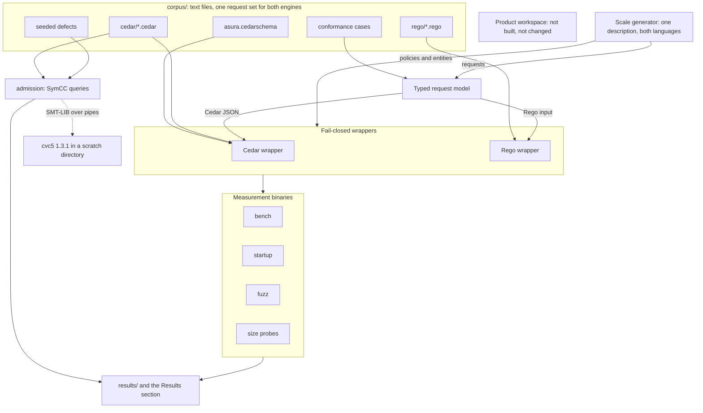
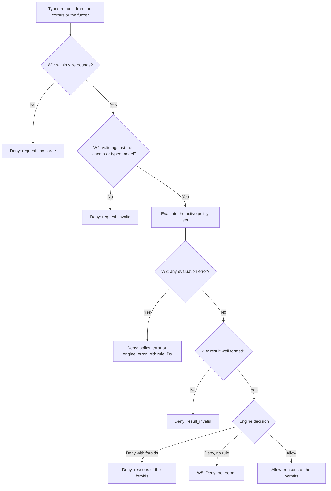
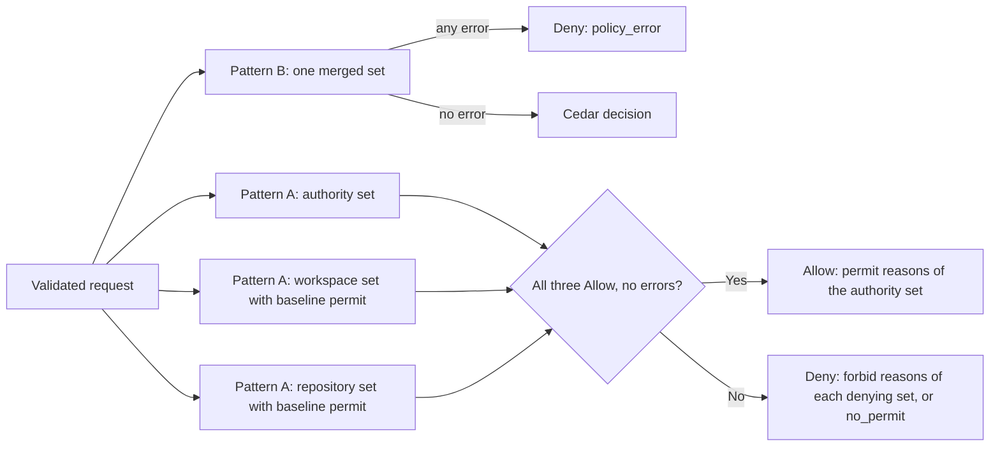
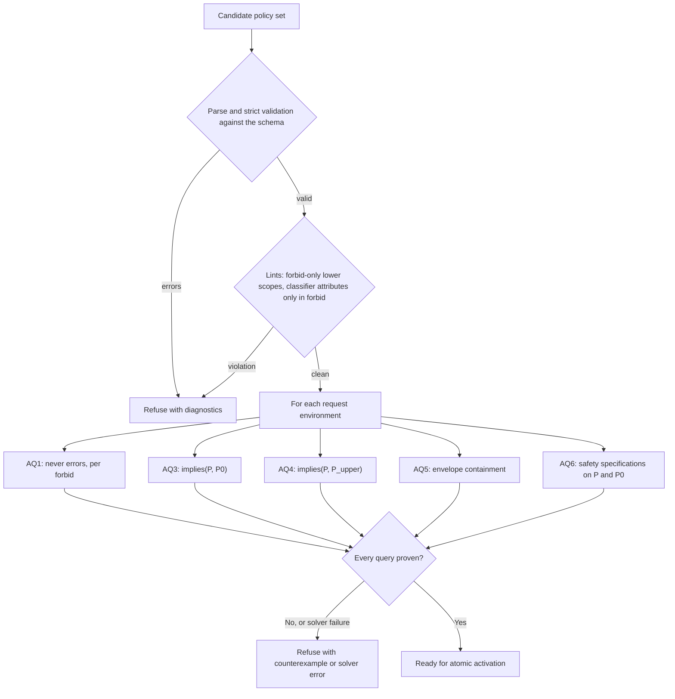
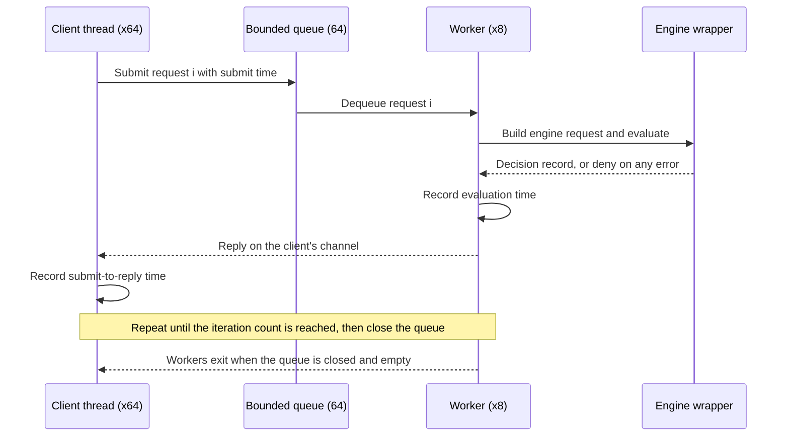
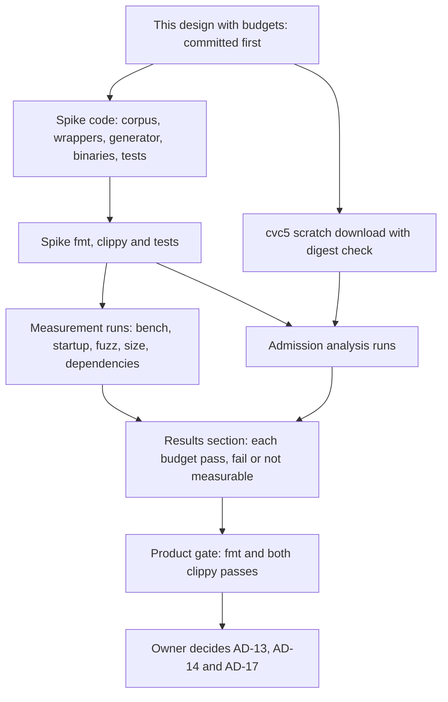

# Policy engine spike: Cedar and Rego on one corpus

Status: ready design for an executable evaluation spike, 2026-11-03; spike
run and [results](#results) recorded the same day. Budgets were set in this
document **before** any measurement and were not changed afterwards. The spike code lives in
[`experiments/policy-engine-spike/`](../../experiments/policy-engine-spike/).
[Results](#results) record the measured outcome against these budgets.

This design answers the security policy brief's requirement that "any
executable evaluation spike needs its own scoped ready design"
([format and evaluator evaluation](security-policy-brief.md#format-and-evaluator-evaluation)).
It is the comparison that owner decision AD-13 recommends ("accept Cedar for
the spike, with Rego as the comparison", [owner decisions](assurance-and-differentiation.md#owner-decisions)).
Owner direction of 2026-11-03: "Publish 0.0.1, then Cedar." The spike gives
evidence. **It does not select the engine.** The owner selects.

Protocol numbering stays `0.1`; journal format stays `1`. The spike changes no
product code, no product crate and no product configuration.

## Question and scope

**Question.** On one representative Asura corpus, how do Cedar
(`cedar-policy`, with `cedar-policy-symcc` and cvc5 for analysis) and Rego
(`regorus`) compare on expressive coverage, strict error handling, determinism,
schema validation, explainability, Rust embedding, dependency and licence
posture, build size, startup, latency under concurrency, and admission-time
analysis?

Objectives:

- Express the controls of the [execution threat model](execution-threat-model.md)
  and the [person command environment](person-command-environment.md) in both
  languages: paths, commands, network, secrets, the person-command allow-list,
  envelopes (AD-24), egress by data class (AD-25), classifier risk (CL-1) and
  scope narrowing.
- Wrap each engine in the same fail-closed contract and test it.
- Measure each budget in [measurements and budgets](#measurements-and-budgets)
  and report pass, fail, or not measurable with the reason.
- Give evidence for owner decisions AD-13 (engine), AD-14 (scope composition)
  and AD-17 (cvc5 packaging).

Non-goals:

- No engine selection, no D3 decision record and no `security-policy.md`.
- No product code, product crate dependency or product configuration change.
- No compilation to Seatbelt or other backends (research CS-7, CS-8), no proxy
  (CS-9), no SBPL network probe (CS-10), no TPE residuals (CS-11) and no
  classifier model (CS-13, CS-14). Each needs its own design; the
  [research items not covered](#research-items-not-covered) table gives reasons.
- No canonicaliser, command parser or entity loader. The corpus supplies
  canonical paths, derived command features and entities directly. These remain
  trusted code outside any proof ([proofs cover policy text only](assurance-and-differentiation.md#proofs-cover-policy-text-only)).
- No Swift component. Both engines are Rust crates; Swift needs neither.

Dependencies: the [security policy brief](security-policy-brief.md), the
[assurance and differentiation](assurance-and-differentiation.md) design
(AD-13 to AD-17, AD-24, AD-25, CL-1, the decision flow and the evidence types)
and the Cedar research report of 2026-10-31 ([R-CED] in the assurance design).

### Versions

The research of 2026-10-31 found `cedar-policy` 4.14.0, `cedar-policy-symcc`
0.8.0 and `regorus` 0.14.0. Crates.io listed newer patch releases on 2026-11-03.
The spike pins the current releases exactly:

| Component | Pinned version | Licence (crate metadata) | Role |
| --- | --- | --- | --- |
| `cedar-policy` | `=4.14.1` | Apache-2.0 | Cedar evaluator, schema and validator |
| `cedar-policy-symcc` | `=0.8.1` (requires `cedar-policy =4.14.1`) | Apache-2.0 | Symbolic compiler for admission analysis |
| cvc5 | 1.3.1, macOS arm64 static, non-GPL build | BSD-3-Clause | SMT solver that SymCC calls |
| `regorus` | `=0.14.1`, default features off; `arc`, `std`, `net` on | MIT AND Apache-2.0 AND BSD-3-Clause | Rego interpreter |

The `regorus` feature set keeps the built-ins that the corpus needs (`net`
for CIDR checks) and leaves out `http`, `time`, `uuid`, `glob` and the other
`full-opa` groups. The [determinism](#measurements-and-budgets) measurement
checks which built-ins remain reachable.

## Ownership and location

| Element | Owner | Location |
| --- | --- | --- |
| Corpus: schema, policies, requests, seeded defects | Spike | `experiments/policy-engine-spike/corpus/` |
| Typed request model and both encoders | Spike library | `experiments/policy-engine-spike/src/` |
| Fail-closed wrappers, one per engine | Spike library | `experiments/policy-engine-spike/src/` |
| Scale corpus generator | Spike library | `experiments/policy-engine-spike/src/` |
| Measurement binaries | Spike | `experiments/policy-engine-spike/src/bin/` |
| Tests | Spike | `experiments/policy-engine-spike/tests/` |
| Recorded results | This design | [Results](#results); raw summaries in `experiments/policy-engine-spike/results/` |

The spike follows the `experiments/` convention of the
[TUI experiment](../../experiments/tui-chat/AGENTS.md). Its `Cargo.toml` holds its
own empty `[workspace]` table, so Cargo treats it as a separate workspace. The
root `Cargo.toml` is not changed, and the product workspace never builds the
spike. The spike pins its direct dependencies exactly and commits its
`Cargo.lock`. `unsafe_code` is forbidden. Build output stays in the spike's
ignored `target/` directory.

No product component owns a policy evaluator today
([current state](assurance-and-differentiation.md#current-state)). The spike
creates no product owner. If the owner selects an engine, the canonical Rust
policy component is designed in D3, and nothing in the spike becomes product
code without that design.

### PES-C1: spike components and boundaries

Selected design. Boxes are spike modules or external tools. Solid arrows carry
data; the dotted arrow is a child process. An arrow into a group goes to every
member of the group. No arrow enters or leaves the product workspace.



## Corpus

### Spike assumptions

These assumptions shape the corpus. They are spike choices, not product
decisions. D3 decides the product vocabulary.

| ID | Assumption | Reason |
| --- | --- | --- |
| PES-A1 | Five scopes: installation, user, task, workspace and repository. Installation and user policies may permit and forbid. Task policies are generated envelope and approval grants (permits). Workspace and repository policies are forbid-only | Matches the brief's scopes and the research's pattern 2 (forbid-only lower scopes). AD-14 stays open; [composition](#scope-composition) measures both patterns |
| PES-A2 | Commands reach policy as derived features: tool, subcommand, flags, shell features, parse class and environment names by source. No positional `argv` in either language | Cedar has no ordered list; the research requires derived features. Rego could index `argv`, but the comparison uses the same features |
| PES-A3 | Paths are canonical and arrive with a class (`ordinary`, `implicit_exec`, `build_test`, `asura_state`) and their ancestors | The canonicaliser and the path guard own these facts. Cedar uses the entity hierarchy; Rego uses host-computed ancestor lists |
| PES-A4 | Time enters as a context value: a Cedar `datetime` and a Rego integer of milliseconds since the epoch | Neither engine reads a clock in the corpus. This keeps evaluation deterministic |
| PES-A5 | Network attributes: the resource is a `Domain` when a host was named, otherwise an `Address`. The connected IP, port and the `via_proxy` flag are context | Without per-request entities the store need not change per connection. DNS rebinding is checked on the connected IP |
| PES-A6 | Classifier output is the optional context attribute `risk`. Only policies annotated `@classifier` read it, and they are all `forbid` | CL-1. A model job without `risk` is treated as `unknown` (AD-16) |
| PES-A7 | Environment names arrive by source: `env_terminal` (from the terminal table) and `env_declared` (from the project's declared variables). Secret variables arrive as a count and a reference flag | Matches the disjoint sources of [PE-R1](person-command-environment.md#required-behavior). Cedar cannot take a set union, so the sources stay separate in both languages |

### Schema

Cedar schema, `corpus/asura.cedarschema`. Rego has no equivalent; the Rego
wrapper validates its input with Asura's typed request model instead
([wrapper contract](#fail-closed-wrapper-contract)).

```cedar
namespace Asura {
  // Closed vocabularies
  entity Origin enum ["model", "person_typed"];
  entity Profile enum ["model-1", "person-1", "person-outside-1"];
  entity PathClass enum ["ordinary", "implicit_exec", "build_test", "asura_state"];
  entity Parse enum ["simple", "compound", "unparsed"];
  entity Risk enum ["safe", "moderate", "dangerous", "unknown"];
  entity Delivery enum ["raw", "brokered"];
  entity DataClass enum ["prompt", "history", "notice", "file_page", "tool_result"];

  // Principals and resources
  entity Path in [Path] = { class: PathClass };
  entity Project = { root: Path, declared_env: Set<String> };
  entity Task = { project: Project };
  entity Job = {
    origin: Origin,
    profile: Profile,
    project: Project,
    task: Task,
    scratch: Path,
    cache_roots: Set<Path>,
  };
  entity Executable = { tool: String };
  entity Domain in [Domain];
  entity Address;
  entity Secret = { project: Project };
  entity Destination = { remote: Bool };

  type Command = {
    parse: Parse,
    subcommand: String,
    flags: Set<String>,
    shell_features: Set<String>,
    env_terminal: Set<String>,
    env_declared: Set<String>,
    secret_vars: Long,
    secret_reference: Bool,
  };
  type ExecContext = {
    now: datetime,
    request_digest: String,
    command: Command,
    outside_switch: Bool,
    risk?: Risk,
  };
  type WriteContext = { now: datetime };
  type ConnectContext = { now: datetime, ip: ipaddr, port: Long, via_proxy: Bool };
  type SecretContext = { now: datetime, delivery: Delivery };
  type EgressContext = { now: datetime, data_class: DataClass, tainted: Bool };

  action exec_any;
  action exec, exec_request_approval, exec_approved in [exec_any]
    appliesTo { principal: [Job], resource: [Executable], context: ExecContext };
  action write appliesTo { principal: [Job], resource: [Path], context: WriteContext };
  action connect appliesTo { principal: [Job], resource: [Domain, Address], context: ConnectContext };
  action secret_use appliesTo { principal: [Job], resource: [Secret], context: SecretContext };
  action egress appliesTo { principal: [Task], resource: [Destination], context: EgressContext };
}
```

Rego input and data shape. The same typed request produces both forms.

| Part | Cedar | Rego |
| --- | --- | --- |
| Principal, resource | Entity UIDs such as `Asura::Job::"j-studio-model"` | `{"type": "Job", "id": "j-studio-model"}` |
| Action | `Asura::Action::"write"` | `"write"` |
| Entity attributes | Shared `Entities` store, validated against the schema, transitive closure computed | `data.entities.<kind>[id]`, with an `ancestors` array for paths and domains |
| Time | `now: datetime("2026-11-03T12:00:00Z")` | `now_ms: 1793707200000` |
| Enumerations | Enum entity UIDs, such as `Asura::Risk::"dangerous"` | Strings, such as `"dangerous"` |
| IP address | `ip("140.82.113.3")` | `"140.82.113.3"`, checked with `net.cidr_contains` |

### Core policies, side by side

The core corpus has 38 hand-written policies in each language. Each family
shows the Cedar text and the Rego text for the same rules. The policy files
in `corpus/` hold exactly this text. Synthetic paths use the home directory
`/Users/person`.

Rego helper package, used by every Rego family:

```rego
package asura.lib

import rego.v1

job := data.entities.jobs[input.principal.id] if input.principal.type == "Job"

task := data.entities.tasks[input.principal.id] if input.principal.type == "Task"

executable := data.entities.executables[input.resource.id] if input.resource.type == "Executable"

exec_any := {"exec", "exec_request_approval", "exec_approved"}

# Reflexive and transitive containment over host-computed ancestors.
path_in(p, root) if p == root

path_in(p, root) if root in data.entities.paths[p].ancestors

domain_in(d, root) if d == root

domain_in(d, root) if root in data.entities.domains[d].ancestors

path_class(p) := data.entities.paths[p].class
```

#### Family 1: paths (EX1, PX1, PX2, PX3, EX16)

```cedar
@id("inst.model.write") @scope("installation") @reason("write_project_or_scratch")
permit (principal is Asura::Job, action == Asura::Action::"write", resource is Asura::Path)
when { principal.profile == Asura::Profile::"model-1" &&
       (resource in principal.project.root || resource in principal.scratch) };

@id("inst.person.write") @scope("installation") @reason("person_write_roots")
permit (principal is Asura::Job, action == Asura::Action::"write", resource is Asura::Path)
when { principal.profile == Asura::Profile::"person-1" &&
       (resource in principal.project.root || resource in principal.scratch ||
        resource in principal.cache_roots) };

@id("inst.hard.implicit_exec") @scope("installation") @reason("implicit_exec_path")
forbid (principal is Asura::Job, action == Asura::Action::"write", resource is Asura::Path)
when { principal.origin == Asura::Origin::"model" &&
       resource.class == Asura::PathClass::"implicit_exec" };

@id("inst.hard.asura_state") @scope("installation") @reason("asura_state")
forbid (principal is Asura::Job, action == Asura::Action::"write", resource is Asura::Path)
when { resource.class == Asura::PathClass::"asura_state" && !(resource in principal.scratch) };
```

```rego
permit contains {"id": "inst.model.write", "reason": "write_project_or_scratch"} if {
	input.action == "write"
	input.resource.type == "Path"
	lib.job.profile == "model-1"
	some root in [data.entities.projects[lib.job.project].root, lib.job.scratch]
	lib.path_in(input.resource.id, root)
}

permit contains {"id": "inst.person.write", "reason": "person_write_roots"} if {
	input.action == "write"
	input.resource.type == "Path"
	lib.job.profile == "person-1"
	roots := {data.entities.projects[lib.job.project].root, lib.job.scratch} | {r | some r in lib.job.cache_roots}
	some root in roots
	lib.path_in(input.resource.id, root)
}

deny contains {"id": "inst.hard.implicit_exec", "reason": "implicit_exec_path"} if {
	input.action == "write"
	lib.job.origin == "model"
	lib.path_class(input.resource.id) == "implicit_exec"
}

deny contains {"id": "inst.hard.asura_state", "reason": "asura_state"} if {
	input.action == "write"
	input.principal.type == "Job"
	lib.path_class(input.resource.id) == "asura_state"
	not lib.path_in(input.resource.id, lib.job.scratch)
}
```

#### Family 2: model commands (model-1, PX5, model secret reference)

```cedar
@id("inst.model.exec") @scope("installation") @reason("model_exec")
permit (principal is Asura::Job, action == Asura::Action::"exec", resource is Asura::Executable)
when { principal.profile == Asura::Profile::"model-1" };

@id("inst.model.exec_approval") @scope("installation") @reason("model_exec_approval_offered")
permit (principal is Asura::Job, action == Asura::Action::"exec_request_approval", resource is Asura::Executable)
when { principal.origin == Asura::Origin::"model" };

@id("inst.hard.model_privilege") @scope("installation") @reason("privilege_escalation")
forbid (principal is Asura::Job, action in Asura::Action::"exec_any", resource is Asura::Executable)
when { principal.origin == Asura::Origin::"model" && ["sudo", "su", "doas"].contains(resource.tool) };

@id("inst.hard.model_secret_reference") @scope("installation") @reason("model_secret_reference")
forbid (principal is Asura::Job, action in Asura::Action::"exec_any", resource is Asura::Executable)
when { principal.origin == Asura::Origin::"model" && context.command.secret_reference };

@id("inst.model.env_clean") @scope("installation") @reason("model_env_not_clean")
forbid (principal is Asura::Job, action in Asura::Action::"exec_any", resource is Asura::Executable)
when { principal.origin == Asura::Origin::"model" &&
       !(context.command.env_terminal.isEmpty() && context.command.env_declared.isEmpty()) };

@id("inst.model.shell_features") @scope("installation") @reason("shell_feature_needs_approval")
forbid (principal is Asura::Job, action == Asura::Action::"exec", resource is Asura::Executable)
when { principal.origin == Asura::Origin::"model" &&
       (context.command.parse == Asura::Parse::"unparsed" ||
        context.command.shell_features.containsAny(["eval", "pipe_to_interpreter", "command_substitution_word"])) };

@id("inst.model.git_push") @scope("installation") @reason("git_push_needs_approval")
forbid (principal is Asura::Job, action == Asura::Action::"exec", resource is Asura::Executable)
when { principal.origin == Asura::Origin::"model" && resource.tool == "git" &&
       context.command.subcommand == "push" };

@id("inst.model.git_force") @scope("installation") @reason("git_force_needs_approval")
forbid (principal is Asura::Job, action == Asura::Action::"exec", resource is Asura::Executable)
when { principal.origin == Asura::Origin::"model" && resource.tool == "git" &&
       context.command.flags.containsAny(["--force", "-f", "--force-with-lease"]) };

@id("inst.model.publish") @scope("installation") @reason("publish_needs_approval")
forbid (principal is Asura::Job, action == Asura::Action::"exec", resource is Asura::Executable)
when { principal.origin == Asura::Origin::"model" && ["cargo", "npm"].contains(resource.tool) &&
       context.command.subcommand like "publish*" };
```

```rego
permit contains {"id": "inst.model.exec", "reason": "model_exec"} if {
	input.action == "exec"
	input.resource.type == "Executable"
	lib.job.profile == "model-1"
}

permit contains {"id": "inst.model.exec_approval", "reason": "model_exec_approval_offered"} if {
	input.action == "exec_request_approval"
	input.resource.type == "Executable"
	lib.job.origin == "model"
}

deny contains {"id": "inst.hard.model_privilege", "reason": "privilege_escalation"} if {
	input.action in lib.exec_any
	lib.job.origin == "model"
	lib.executable.tool in {"sudo", "su", "doas"}
}

deny contains {"id": "inst.hard.model_secret_reference", "reason": "model_secret_reference"} if {
	input.action in lib.exec_any
	lib.job.origin == "model"
	input.context.command.secret_reference == true
}

deny contains {"id": "inst.model.env_clean", "reason": "model_env_not_clean"} if {
	input.action in lib.exec_any
	lib.job.origin == "model"
	count(input.context.command.env_terminal) + count(input.context.command.env_declared) > 0
}

deny contains {"id": "inst.model.shell_features", "reason": "shell_feature_needs_approval"} if {
	input.action == "exec"
	lib.job.origin == "model"
	input.context.command.parse == "unparsed"
}

deny contains {"id": "inst.model.shell_features", "reason": "shell_feature_needs_approval"} if {
	input.action == "exec"
	lib.job.origin == "model"
	some f in input.context.command.shell_features
	f in {"eval", "pipe_to_interpreter", "command_substitution_word"}
}

deny contains {"id": "inst.model.git_push", "reason": "git_push_needs_approval"} if {
	input.action == "exec"
	lib.job.origin == "model"
	lib.executable.tool == "git"
	input.context.command.subcommand == "push"
}

deny contains {"id": "inst.model.git_force", "reason": "git_force_needs_approval"} if {
	input.action == "exec"
	lib.job.origin == "model"
	lib.executable.tool == "git"
	some f in input.context.command.flags
	f in {"--force", "-f", "--force-with-lease"}
}

deny contains {"id": "inst.model.publish", "reason": "publish_needs_approval"} if {
	input.action == "exec"
	lib.job.origin == "model"
	lib.executable.tool in {"cargo", "npm"}
	startswith(input.context.command.subcommand, "publish")
}
```

#### Family 3: person commands and the allow-list (PE-R1 to PE-R5, PCR21)

The terminal allow-list is the [terminal table](person-command-environment.md#terminal-table)
plus `PATH`: 40 names. Asura-set names (`HOME`, `USER` and the others) never
come from the terminal, so they are not in `env_terminal`.

```cedar
@id("inst.person.exec") @scope("installation") @reason("person_exec")
permit (principal is Asura::Job, action == Asura::Action::"exec", resource is Asura::Executable)
when { principal.origin == Asura::Origin::"person_typed" &&
       principal.profile == Asura::Profile::"person-1" };

@id("inst.person.exec_outside") @scope("installation") @reason("person_exec_outside")
permit (principal is Asura::Job, action == Asura::Action::"exec", resource is Asura::Executable)
when { principal.origin == Asura::Origin::"person_typed" &&
       principal.profile == Asura::Profile::"person-outside-1" && context.outside_switch };

@id("inst.person.env_terminal") @scope("installation") @reason("env_not_allow_listed")
forbid (principal is Asura::Job, action in Asura::Action::"exec_any", resource is Asura::Executable)
when { principal.origin == Asura::Origin::"person_typed" &&
       !["PATH", "LANG", "LC_ALL", "LC_COLLATE", "LC_CTYPE", "LC_MESSAGES", "LC_MONETARY",
         "LC_NUMERIC", "LC_TIME", "SSH_AUTH_SOCK", "TZ", "XDG_CONFIG_HOME", "XDG_CACHE_HOME",
         "XDG_DATA_HOME", "XDG_STATE_HOME", "CARGO_HOME", "RUSTUP_HOME", "RUSTUP_TOOLCHAIN",
         "CARGO_TARGET_DIR", "DEVELOPER_DIR", "SDKROOT", "TOOLCHAINS", "HOMEBREW_PREFIX",
         "HOMEBREW_CELLAR", "HOMEBREW_REPOSITORY", "GOPATH", "GOROOT", "GOMODCACHE", "GOCACHE",
         "NVM_DIR", "VOLTA_HOME", "PNPM_HOME", "BUN_INSTALL", "PYENV_ROOT", "VIRTUAL_ENV",
         "CONDA_PREFIX", "JAVA_HOME", "RBENV_ROOT", "GEM_HOME", "GEM_PATH"]
         .containsAll(context.command.env_terminal) };

@id("inst.person.env_declared") @scope("installation") @reason("env_not_declared")
forbid (principal is Asura::Job, action in Asura::Action::"exec_any", resource is Asura::Executable)
when { principal.origin == Asura::Origin::"person_typed" &&
       !principal.project.declared_env.containsAll(context.command.env_declared) };
```

```rego
terminal_allow := {
	"PATH", "LANG", "LC_ALL", "LC_COLLATE", "LC_CTYPE", "LC_MESSAGES", "LC_MONETARY",
	"LC_NUMERIC", "LC_TIME", "SSH_AUTH_SOCK", "TZ", "XDG_CONFIG_HOME", "XDG_CACHE_HOME",
	"XDG_DATA_HOME", "XDG_STATE_HOME", "CARGO_HOME", "RUSTUP_HOME", "RUSTUP_TOOLCHAIN",
	"CARGO_TARGET_DIR", "DEVELOPER_DIR", "SDKROOT", "TOOLCHAINS", "HOMEBREW_PREFIX",
	"HOMEBREW_CELLAR", "HOMEBREW_REPOSITORY", "GOPATH", "GOROOT", "GOMODCACHE", "GOCACHE",
	"NVM_DIR", "VOLTA_HOME", "PNPM_HOME", "BUN_INSTALL", "PYENV_ROOT", "VIRTUAL_ENV",
	"CONDA_PREFIX", "JAVA_HOME", "RBENV_ROOT", "GEM_HOME", "GEM_PATH",
}

permit contains {"id": "inst.person.exec", "reason": "person_exec"} if {
	input.action == "exec"
	input.resource.type == "Executable"
	lib.job.origin == "person_typed"
	lib.job.profile == "person-1"
}

permit contains {"id": "inst.person.exec_outside", "reason": "person_exec_outside"} if {
	input.action == "exec"
	input.resource.type == "Executable"
	lib.job.origin == "person_typed"
	lib.job.profile == "person-outside-1"
	input.context.outside_switch == true
}

deny contains {"id": "inst.person.env_terminal", "reason": "env_not_allow_listed"} if {
	input.action in lib.exec_any
	lib.job.origin == "person_typed"
	some n in input.context.command.env_terminal
	not n in terminal_allow
}

deny contains {"id": "inst.person.env_declared", "reason": "env_not_declared"} if {
	input.action in lib.exec_any
	lib.job.origin == "person_typed"
	declared := {x | some x in data.entities.projects[lib.job.project].declared_env}
	some n in input.context.command.env_declared
	not n in declared
}
```

#### Family 4: network by host, IP range and port (EX2, AD-7, PES-A5)

```cedar
@id("inst.person.net") @scope("installation") @reason("person_network")
permit (principal is Asura::Job, action == Asura::Action::"connect", resource)
when { principal.origin == Asura::Origin::"person_typed" };

@id("inst.hard.model_unmediated_net") @scope("installation") @reason("model_network_unmediated")
forbid (principal is Asura::Job, action == Asura::Action::"connect", resource)
when { principal.origin == Asura::Origin::"model" && !context.via_proxy };

@id("inst.hard.model_local_address") @scope("installation") @reason("model_network_local_address")
forbid (principal is Asura::Job, action == Asura::Action::"connect", resource)
when { principal.origin == Asura::Origin::"model" &&
       (context.ip.isLoopback() || context.ip.isInRange(ip("169.254.0.0/16"))) };
```

```rego
permit contains {"id": "inst.person.net", "reason": "person_network"} if {
	input.action == "connect"
	lib.job.origin == "person_typed"
}

deny contains {"id": "inst.hard.model_unmediated_net", "reason": "model_network_unmediated"} if {
	input.action == "connect"
	lib.job.origin == "model"
	input.context.via_proxy == false
}

deny contains {"id": "inst.hard.model_local_address", "reason": "model_network_local_address"} if {
	input.action == "connect"
	lib.job.origin == "model"
	some cidr in {"127.0.0.0/8", "::1/128", "169.254.0.0/16"}
	net.cidr_contains(cidr, input.context.ip)
}
```

#### Family 5: secrets, raw and brokered (F3, DF3 property R, PE-R5)

```cedar
@id("inst.person.secret") @scope("installation") @reason("person_secret_use")
permit (principal is Asura::Job, action == Asura::Action::"secret_use", resource is Asura::Secret)
when { principal.origin == Asura::Origin::"person_typed" && resource.project == principal.project };

@id("inst.hard.model_raw_secret") @scope("installation") @reason("model_raw_secret")
forbid (principal is Asura::Job, action == Asura::Action::"secret_use", resource is Asura::Secret)
when { principal.origin == Asura::Origin::"model" && context.delivery == Asura::Delivery::"raw" };

@id("inst.hard.secret_other_project") @scope("installation") @reason("secret_other_project")
forbid (principal is Asura::Job, action == Asura::Action::"secret_use", resource is Asura::Secret)
when { resource.project != principal.project };
```

```rego
permit contains {"id": "inst.person.secret", "reason": "person_secret_use"} if {
	input.action == "secret_use"
	lib.job.origin == "person_typed"
	data.entities.secrets[input.resource.id].project == lib.job.project
}

deny contains {"id": "inst.hard.model_raw_secret", "reason": "model_raw_secret"} if {
	input.action == "secret_use"
	lib.job.origin == "model"
	input.context.delivery == "raw"
}

deny contains {"id": "inst.hard.secret_other_project", "reason": "secret_other_project"} if {
	input.action == "secret_use"
	data.entities.secrets[input.resource.id].project != lib.job.project
}
```

#### Family 6: egress by data class (EX13, AD-25, F4)

```cedar
@id("inst.egress.local") @scope("installation") @reason("egress_local")
permit (principal is Asura::Task, action == Asura::Action::"egress", resource is Asura::Destination)
when { !resource.remote };

@id("inst.hard.egress_tainted") @scope("installation") @reason("egress_tainted")
forbid (principal is Asura::Task, action == Asura::Action::"egress", resource is Asura::Destination)
when { context.tainted };

@id("user.egress.studio.anthropic") @scope("user") @reason("egress_grant")
permit (principal is Asura::Task, action == Asura::Action::"egress", resource == Asura::Destination::"anthropic")
when { principal.project == Asura::Project::"studio" &&
       [Asura::DataClass::"prompt", Asura::DataClass::"history", Asura::DataClass::"notice"].contains(context.data_class) };

@id("user.egress.observatory.anthropic") @scope("user") @reason("egress_grant")
permit (principal is Asura::Task, action == Asura::Action::"egress", resource == Asura::Destination::"anthropic")
when { principal.project == Asura::Project::"observatory" &&
       [Asura::DataClass::"prompt", Asura::DataClass::"history"].contains(context.data_class) };
```

```rego
permit contains {"id": "inst.egress.local", "reason": "egress_local"} if {
	input.action == "egress"
	data.entities.destinations[input.resource.id].remote == false
}

deny contains {"id": "inst.hard.egress_tainted", "reason": "egress_tainted"} if {
	input.action == "egress"
	input.context.tainted == true
}

# package asura.user
permit contains {"id": "user.egress.studio.anthropic", "reason": "egress_grant"} if {
	input.action == "egress"
	input.resource.id == "anthropic"
	lib.task.project == "studio"
	input.context.data_class in {"prompt", "history", "notice"}
}

permit contains {"id": "user.egress.observatory.anthropic", "reason": "egress_grant"} if {
	input.action == "egress"
	input.resource.id == "anthropic"
	lib.task.project == "observatory"
	input.context.data_class in {"prompt", "history"}
}
```

#### Family 7: classifier risk, forbid-only (CL-1, AD-15, AD-16, PCR22)

```cedar
@id("clf.dangerous") @scope("installation") @classifier("risk") @reason("classifier_dangerous")
forbid (principal is Asura::Job, action == Asura::Action::"exec", resource is Asura::Executable)
when { principal.origin == Asura::Origin::"model" && context has risk &&
       context.risk == Asura::Risk::"dangerous" };

@id("clf.unknown") @scope("installation") @classifier("risk") @reason("classifier_unknown")
forbid (principal is Asura::Job, action == Asura::Action::"exec", resource is Asura::Executable)
when { principal.origin == Asura::Origin::"model" && context has risk &&
       context.risk == Asura::Risk::"unknown" };

@id("clf.absent") @scope("installation") @classifier("risk") @reason("classifier_unknown")
forbid (principal is Asura::Job, action == Asura::Action::"exec", resource is Asura::Executable)
when { principal.origin == Asura::Origin::"model" && !(context has risk) };
```

```rego
# package asura.classifier
deny contains {"id": "clf.dangerous", "reason": "classifier_dangerous"} if {
	input.action == "exec"
	lib.job.origin == "model"
	input.context.risk == "dangerous"
}

deny contains {"id": "clf.unknown", "reason": "classifier_unknown"} if {
	input.action == "exec"
	lib.job.origin == "model"
	input.context.risk == "unknown"
}

deny contains {"id": "clf.absent", "reason": "classifier_unknown"} if {
	input.action == "exec"
	lib.job.origin == "model"
	not input.context.risk
}
```

The classifier forbids target `exec` only. A model job with a `dangerous` or
`unknown` label may still use `exec_request_approval`, so the label moves the
action to the approval step (AD-15). `!!` and `!` jobs have origin
`person_typed`, so no classifier policy reads them (PCR22).

#### Family 8: scope narrowing, envelopes and approvals (AD-14, AD-24, DF1)

User scope narrows writes; workspace and repository scopes are forbid-only.
Task scope holds generated grants.

```cedar
// user.cedar
@id("user.forbid.ssh_dir") @scope("user") @reason("user_write_limit")
forbid (principal is Asura::Job, action == Asura::Action::"write", resource is Asura::Path)
when { resource in Asura::Path::"/Users/person/.ssh" };

// workspace.cedar
@id("ws.studio.vendor") @scope("workspace") @reason("workspace_write_limit")
forbid (principal is Asura::Job, action == Asura::Action::"write", resource is Asura::Path)
when { principal.origin == Asura::Origin::"model" &&
       resource in Asura::Path::"/Users/person/src/studio/vendor" };

@id("ws.observatory.no_remote_history") @scope("workspace") @reason("workspace_egress_limit")
forbid (principal is Asura::Task, action == Asura::Action::"egress", resource is Asura::Destination)
when { principal.project == Asura::Project::"observatory" && resource.remote &&
       context.data_class == Asura::DataClass::"history" };

// repository.cedar
@id("repo.studio.net") @scope("repository") @reason("repository_network_limit")
forbid (principal is Asura::Job, action == Asura::Action::"connect", resource)
when { principal.origin == Asura::Origin::"model" &&
       principal.project == Asura::Project::"studio" }
unless { (resource in Asura::Domain::"github.com" && context.port == 443) ||
         (context.ip.isInRange(ip("140.82.112.0/20")) && context.port == 22) };

// task.cedar: envelope of task t-studio-1 (AD-24) and one exact approval
@id("env.t-studio-1.write") @scope("task") @envelope("t-studio-1") @reason("envelope_write")
permit (principal is Asura::Job, action == Asura::Action::"write", resource is Asura::Path)
when { principal.task == Asura::Task::"t-studio-1" &&
       resource in Asura::Path::"/Users/person/src/shared/out" &&
       context.now < datetime("2026-11-03T18:00:00Z") };

@id("env.t-studio-1.net") @scope("task") @envelope("t-studio-1") @reason("envelope_network")
permit (principal is Asura::Job, action == Asura::Action::"connect", resource)
when { principal.task == Asura::Task::"t-studio-1" &&
       ((resource in Asura::Domain::"github.com" && context.port == 443) ||
        (context.ip.isInRange(ip("140.82.112.0/20")) && context.port == 22)) &&
       context.now < datetime("2026-11-03T18:00:00Z") };

@id("env.t-studio-1.secret") @scope("task") @envelope("t-studio-1") @reason("envelope_secret")
permit (principal is Asura::Job, action == Asura::Action::"secret_use", resource is Asura::Secret)
when { principal.task == Asura::Task::"t-studio-1" &&
       resource == Asura::Secret::"gh_token" &&
       context.delivery == Asura::Delivery::"brokered" &&
       context.now < datetime("2026-11-03T18:00:00Z") };

@id("grant.a1") @scope("task") @reason("approved_by_person")
permit (principal == Asura::Job::"j-studio-model", action == Asura::Action::"exec_approved",
        resource == Asura::Executable::"/usr/bin/git")
when { context.request_digest == "sha256:4f1c0d2a" &&
       context.now < datetime("2026-11-03T18:00:00Z") };
```

```rego
# package asura.user
deny contains {"id": "user.forbid.ssh_dir", "reason": "user_write_limit"} if {
	input.action == "write"
	lib.path_in(input.resource.id, "/Users/person/.ssh")
}

# package asura.workspace
deny contains {"id": "ws.studio.vendor", "reason": "workspace_write_limit"} if {
	input.action == "write"
	lib.job.origin == "model"
	lib.path_in(input.resource.id, "/Users/person/src/studio/vendor")
}

deny contains {"id": "ws.observatory.no_remote_history", "reason": "workspace_egress_limit"} if {
	input.action == "egress"
	lib.task.project == "observatory"
	data.entities.destinations[input.resource.id].remote == true
	input.context.data_class == "history"
}

# package asura.repository
deny contains {"id": "repo.studio.net", "reason": "repository_network_limit"} if {
	input.action == "connect"
	lib.job.origin == "model"
	lib.job.project == "studio"
	not studio_net_allowed
}

studio_net_allowed if {
	input.resource.type == "Domain"
	lib.domain_in(input.resource.id, "github.com")
	input.context.port == 443
}

studio_net_allowed if {
	net.cidr_contains("140.82.112.0/20", input.context.ip)
	input.context.port == 22
}

# package asura.task
permit contains {"id": "env.t-studio-1.write", "reason": "envelope_write"} if {
	input.action == "write"
	lib.job.task == "t-studio-1"
	lib.path_in(input.resource.id, "/Users/person/src/shared/out")
	input.context.now_ms < 1793728800000
}

permit contains {"id": "env.t-studio-1.net", "reason": "envelope_network"} if {
	input.action == "connect"
	lib.job.task == "t-studio-1"
	t_studio_1_endpoint
	input.context.now_ms < 1793728800000
}

t_studio_1_endpoint if {
	input.resource.type == "Domain"
	lib.domain_in(input.resource.id, "github.com")
	input.context.port == 443
}

t_studio_1_endpoint if {
	net.cidr_contains("140.82.112.0/20", input.context.ip)
	input.context.port == 22
}

permit contains {"id": "env.t-studio-1.secret", "reason": "envelope_secret"} if {
	input.action == "secret_use"
	lib.job.task == "t-studio-1"
	input.resource.id == "gh_token"
	input.context.delivery == "brokered"
	input.context.now_ms < 1793728800000
}

permit contains {"id": "grant.a1", "reason": "approved_by_person"} if {
	input.action == "exec_approved"
	input.principal.id == "j-studio-model"
	input.resource.id == "/usr/bin/git"
	input.context.request_digest == "sha256:4f1c0d2a"
	input.context.now_ms < 1793728800000
}
```

#### Rego decision combiner

Cedar applies default deny and forbid precedence by its semantics. Rego needs a
combiner that the author writes. It reads `permit` only from the installation,
user and task packages, and `deny` from every package.

```rego
package asura.decision

import rego.v1

denies contains d if some d in data.asura.installation.deny
denies contains d if some d in data.asura.classifier.deny
denies contains d if some d in data.asura.user.deny
denies contains d if some d in data.asura.workspace.deny
denies contains d if some d in data.asura.repository.deny

permits contains p if some p in data.asura.installation.permit
permits contains p if some p in data.asura.user.permit
permits contains p if some p in data.asura.task.permit

result := {"allow": false, "rules": denies} if count(denies) > 0

result := {"allow": true, "rules": permits} if {
	count(denies) == 0
	count(permits) > 0
}

result := {"allow": false, "rules": set()} if {
	count(denies) == 0
	count(permits) == 0
}
```

The Rego wrapper also refuses a workspace or repository module whose
`package` line is not exactly `asura.workspace` or `asura.repository`.
Without that check, a repository module could declare `package
asura.installation` and add a `permit`, because Rego merges rules of the same
package from different modules.

### Scale corpus

The research proposed 200 static policies, 50 generated grants, 10,000
entities and 1,000 requests. A deterministic generator (fixed seed, no
external randomness) emits the scale corpus as Cedar text, Rego text, Cedar
entity JSON, the Rego data document and typed requests. One Rust description
produces both languages, so the two encodings cannot drift.

| Part | Count | Shape |
| --- | --- | --- |
| Synthetic projects | 40 (`p000` to `p039`) | Root `/Users/person/src/pNNN` with `src`, `vendor`, `docs`, `.git/hooks` |
| Installation forbids per tool | 50 | Model `exec` of `tool-NN` needs approval |
| User egress grants | 40 | One per project to `remote-a`, with 1 to 3 data classes |
| Workspace forbids | 40 | Model writes under `pNNN/vendor` |
| Repository forbids | 40 | Model `connect` for project `pNNN` only to `orgNN.example:443` |
| Envelope grants | 50 | 25 envelopes, each a write grant and a network grant with an expiry |
| Entities | at least 10,000 | Paths (about 9,000), domains, executables, tasks, jobs, secrets, destinations |
| Requests | 1,000 | Writes, commands, connections, secret use and egress across the projects |

With the 38 core policies (34 static, 4 grants) the corpus has 204 static policies and 54 grants
(258 in total) in each language. The core corpus entities add the `studio`,
`observatory` and `shared` trees.

### Conformance cases

Each case gives the expected decision and the determining rule IDs. Both
engines must give the same decision. Rule IDs must match too, except where the
table names an engine difference. The full cases are in
`corpus/conformance.json`. Every request has `now` = 2026-11-03T12:00:00Z
unless the case says otherwise. Job names: `j-studio-model` (model-1, task
`t-studio-1`, which has the envelope), `j-studio-model-2` (model-1, task
`t-studio-2`, no envelope), `j-studio-person` (person-1), `j-studio-outside`
(person-outside-1) and `j-obs-model` (model-1, project `observatory`).

| ID | Request | Expected | Determining rules |
| --- | --- | --- | --- |
| PW1 | `j-studio-model` writes `studio/src/main.rs` | Allow | `inst.model.write` |
| PW2 | `j-studio-model` writes a file in its scratch directory | Allow | `inst.model.write` |
| PW3 | `j-studio-model` writes `/etc/hosts` | Deny | none (`no_permit`) |
| PW4 | `j-studio-model` writes `studio/.git/hooks/pre-commit` | Deny | `inst.hard.implicit_exec` |
| PW5 | `j-studio-model` writes `~/.asura/config.yaml` | Deny | `inst.hard.asura_state` |
| PW6 | `j-studio-person` writes `studio/.git/hooks/pre-commit` | Allow | `inst.person.write` |
| PW7 | `j-studio-person` writes `~/.cargo/registry/index` | Allow | `inst.person.write` |
| PW8 | `j-studio-model` writes `studio/vendor/lib.rs` | Deny | `ws.studio.vendor` |
| PW9 | `j-studio-person` writes `studio/vendor/lib.rs` | Allow | `inst.person.write` |
| PW10 | `j-studio-model` writes `shared/out/report.md` | Allow | `env.t-studio-1.write` |
| PW11 | `j-studio-model-2` writes `shared/out/report.md` | Deny | none (`no_permit`) |
| PW12 | `j-studio-person` writes `~/.ssh/config` | Deny | `user.forbid.ssh_dir` |
| PW13 | `j-studio-model` writes a path missing from the entity store | Deny | Cedar: `policy_error` from `inst.hard.implicit_exec` and `inst.hard.asura_state`; Rego: `no_permit` |
| PW14 | PW10 with `now` = 2026-11-04T00:00:00Z | Deny | none (`no_permit`) |
| PC1 | Model `exec` of `git status`, risk `safe` | Allow | `inst.model.exec` |
| PC2 | Model `exec` of `git push`, risk `safe` | Deny | `inst.model.git_push` |
| PC3 | Model `exec_request_approval` of `git push` | Allow | `inst.model.exec_approval` |
| PC4 | Model `exec` of `git push --force`, risk `safe` | Deny | `inst.model.git_push`, `inst.model.git_force` |
| PC5 | Model `exec` of `sudo`, risk `safe` | Deny | `inst.hard.model_privilege` |
| PC6 | Model `exec_request_approval` of `sudo` | Deny | `inst.hard.model_privilege` |
| PC7 | Model `exec` of `sh` with shell feature `eval`, risk `safe` | Deny | `inst.model.shell_features` |
| PC8 | Model `exec` of `sh` with parse `unparsed`, risk `safe` | Deny | `inst.model.shell_features` |
| PC9 | Model `exec` of `cargo publish`, risk `safe` | Deny | `inst.model.publish` |
| PC10 | Model `exec` of `git status` with a secret reference, risk `safe` | Deny | `inst.hard.model_secret_reference` |
| PC11 | Model `exec` of `git status` with terminal variable `PATH`, risk `safe` | Deny | `inst.model.env_clean` |
| PC12 | Person `exec` of `git push` with `PATH`, `LANG`, `SSH_AUTH_SOCK` | Allow | `inst.person.exec` |
| PC13 | Person `exec` with terminal variable `AWS_SECRET_ACCESS_KEY` | Deny | `inst.person.env_terminal` |
| PC14 | Person `exec` with declared `RUST_LOG` in `studio` | Allow | `inst.person.exec` |
| PC15 | Person `exec` with declared `DATABASE_URL`, not declared | Deny | `inst.person.env_declared` |
| PC16 | `!!` job `exec` with the outside switch on | Allow | `inst.person.exec_outside` |
| PC17 | `!!` job `exec` with the outside switch off | Deny | none (`no_permit`) |
| PC18 | Model `exec_approved` of `git push`, digest `sha256:4f1c0d2a` | Allow | `grant.a1` |
| PC19 | Model `exec_approved` of `git push`, another digest | Deny | none (`no_permit`) |
| PC20 | Person `exec` of `sudo` | Allow | `inst.person.exec` |
| PC21 | Person `exec` with one secret variable | Allow | `inst.person.exec` |
| PK1 | Model `exec` of `git status`, risk `dangerous` | Deny | `clf.dangerous` |
| PK2 | Model `exec` of `git status`, risk `unknown` | Deny | `clf.unknown` |
| PK3 | Model `exec` of `git status`, no risk | Deny | `clf.absent` |
| PK4 | Model `exec_request_approval` of `git status`, risk `dangerous` | Allow | `inst.model.exec_approval` |
| PK5 | Person `exec` of `git status`, no risk | Allow | `inst.person.exec` |
| PK6 | PC18 with risk `dangerous` | Allow | `grant.a1` |
| PN1 | `j-studio-model` connects `github.com:443` through the proxy | Allow | `env.t-studio-1.net` |
| PN2 | PN1 without the proxy | Deny | `inst.hard.model_unmediated_net` |
| PN3 | `j-studio-model` connects `api.github.com:443` through the proxy | Allow | `env.t-studio-1.net` |
| PN4 | `j-studio-model` connects `evil.com:443` through the proxy | Deny | `repo.studio.net` |
| PN5 | `j-studio-model` connects address `140.82.113.3:22` through the proxy | Allow | `env.t-studio-1.net` |
| PN6 | `j-studio-model` connects address `10.0.0.5:22` through the proxy | Deny | `repo.studio.net` |
| PN7 | `j-studio-model` connects `github.com:443`, connected IP `127.0.0.1`, through the proxy | Deny | `inst.hard.model_local_address` |
| PN8 | Person connects `evil.com:80` | Allow | `inst.person.net` |
| PN9 | `j-studio-model-2` connects `github.com:443` through the proxy | Deny | none (`no_permit`) |
| PN10 | `j-obs-model` connects `github.com:443` through the proxy | Deny | none (`no_permit`) |
| PS1 | `j-studio-model` uses `gh_token`, brokered | Allow | `env.t-studio-1.secret` |
| PS2 | `j-studio-model` uses `gh_token`, raw | Deny | `inst.hard.model_raw_secret` |
| PS3 | Person uses `gh_token`, raw | Allow | `inst.person.secret` |
| PS4 | Person in `studio` uses `obs_key` | Deny | `inst.hard.secret_other_project` |
| PS5 | `j-studio-model-2` uses `gh_token`, brokered | Deny | none (`no_permit`) |
| PE1 | Task `t-studio-1` sends a prompt to `anthropic` | Allow | `user.egress.studio.anthropic` |
| PE2 | Task `t-studio-1` sends a file page to `anthropic` | Deny | none (`no_permit`) |
| PE3 | PE1 with tainted data | Deny | `inst.hard.egress_tainted` |
| PE4 | Task `t-studio-1` sends a tool result to `local-mlx` | Allow | `inst.egress.local` |
| PE5 | Task `t-obs-1` sends a prompt to `anthropic` | Allow | `user.egress.observatory.anthropic` |
| PE6 | Task `t-obs-1` sends history to `local-mlx` | Allow | `inst.egress.local` |
| PE7 | PE4 with tainted data | Deny | `inst.hard.egress_tainted` |
| PE8 | Task `t-obs-1` sends history to `anthropic` | Deny | `ws.observatory.no_remote_history` |

PW13 shows the error discipline. Cedar raises an error on `resource.class`
for a missing entity; both forbids are skipped, and only the wrapper turns the
response into a deny. Rego treats the missing data as undefined: no rule
fires, so the result is the default deny. The decision agrees here only
because no permit matched. The [fail-closed cases](#fail-closed-wrapper-contract)
test the dangerous variant.

## Fail-closed wrapper contract

Both wrappers implement one contract. The decision record has: `allow`, the
reason codes, the determining rule IDs, and an error class when the wrapper
denied because of an error. The contract is the one that the brief requires:
"unknown required fields, incompatible versions, evaluation errors and
exceeded evaluation limits cannot become permission to execute".

| Rule | Cedar wrapper | Rego wrapper |
| --- | --- | --- |
| W1: input bounds | Before evaluation: request JSON at most 16 KiB, each string at most 1,024 bytes, each set at most 64 elements, nesting depth at most 8 | Same bounds |
| W2: schema | `Context::from_json_value` and `Request::new` with the schema; a failure denies with `request_invalid` | Typed deserialisation into the spike's request model with unknown fields refused; a failure denies with `request_invalid` |
| W3: evaluation error | Any entry in `Response::diagnostics().errors()` denies with `policy_error` and the erroring policy IDs, even when Cedar says `Allow` | Any `Err` from `eval_rule` denies with `engine_error` |
| W4: result shape | Not applicable: the decision is a typed enum | An undefined result, a missing or non-Boolean `allow` or a missing rule set denies with `result_invalid` |
| W5: default deny | No determining policy gives reason `no_permit` | The empty rule set gives `no_permit` |
| W6: reasons | Reason and ID from the `@reason` and `@id` annotations of the determining policies | Reason and ID from each rule object |
| W7: strict built-ins | Not applicable: Cedar has no I/O or clock | `set_strict_builtin_errors(true)`; no execution timer (no default time bound) |

The size bounds of W1 are known-size closures (AE-04). Neither wrapper sets a
time limit.

### PES-F1: fail-closed decision flow

Selected design for the spike wrappers. Arrows show the order of checks for one
request. Every failed check ends in a deny with a stated reason; no path from a
failure reaches Allow.



### Injected error cases

These cases add test-only policies or data to an otherwise permitted request.
Each must deny through the wrapper. The raw engine result is recorded beside
it.

| ID | Engine | Injection | Raw engine result expected | Wrapper |
| --- | --- | --- | --- | --- |
| FE1 | Cedar | A forbid reads `principal.project.root` and the project entity is missing | Allow, with an error (forbid skipped) | Deny, `policy_error` |
| FE2 | Cedar | A forbid adds `9223372036854775807` to `context.command.secret_vars` | Allow, with an overflow error | Deny, `policy_error` |
| FE3 | Cedar | A forbid reads `resource.tool` and the executable entity is missing | Allow, with an error | Deny, `policy_error` |
| FE4 | Cedar | A forbid calls `context.now.offset(duration("9223372036854775807ms"))` | Allow, with an extension error | Deny, `policy_error` |
| FE5 | Rego | A deny rule calls `net.cidr_contains` with an invalid CIDR | Engine error with strict built-ins | Deny, `engine_error` |
| FE6 | Rego | Two modules give `result` two different values | Conflict error | Deny, `engine_error` |
| FE7 | Rego | A deny rule reads a data entity that is missing | Undefined: the deny does not fire, so Allow | Allow: the wrapper cannot see it |
| FE8 | Rego | A deny rule divides by zero | Engine error | Deny, `engine_error` |
| FE9 | Rego | The combiner is replaced by a module with no `result` | Undefined | Deny, `result_invalid` |

FE7 is expected to allow. It is the Rego counterpart of the Cedar error-skip
finding, but no error reaches the host. A Rego deny rule must be written in
fail-safe polarity, or Asura must prove the data complete before evaluation.
The spike counts it as an unenforced convention
([PES-M2](#measurements-and-budgets)).

## Scope composition

AD-14 is open: per-scope AND (research pattern 1) or forbid-only lower scopes
(pattern 2). The spike evaluates both for Cedar on the same requests.

- **Pattern B (merged, forbid-only lower scopes).** One policy set holds every
  scope. Admission refuses a `permit` in a workspace or repository file. One
  evaluation per request.
- **Pattern A (per-scope AND).** Three sets: the authority set (installation,
  user and task), the workspace set and the repository set. Each lower set
  holds its forbids and one baseline `permit (principal, action, resource)`.
  The decision is Allow only if all three sets allow without error. Three
  evaluations per request.

The Rego combiner is pattern B by construction: it reads only `deny` from the
lower packages.

### PES-F2: composition patterns

Proposal under evaluation. Arrows show evaluation order; labels name the
condition.



The differential tests require identical decisions from both patterns on all
conformance and scale requests. Reason sets must match too, except that a
default deny in pattern A comes from the authority set.

## Admission analysis

Analysis runs at admission, never on the decision path. Each query uses
`cedar-policy-symcc` with `LocalSolver::cvc5()` and runs once for each
request environment that `Schema::request_envs` lists. A query has no time
limit (AE-04). Its closures are the solver's reply or the operator's cancel.
A query that fails or returns `unknown` is a refusal, never a pass.

| ID | Query | Policy sets | Pass condition |
| --- | --- | --- | --- |
| AQ1 | `check_never_errors` | Each `forbid` policy of the corpus, alone | Proven in every environment where the policy applies |
| AQ2 | CL-1 lint | Every policy, through `Policy::to_json` | `context.risk` appears only in policies with effect `forbid` and annotation `@classifier` |
| AQ3 | CL-1 proof `check_implies(P, P0)` | `P` = full corpus; `P0` = `P` without `@classifier` policies | Holds for every environment |
| AQ4 | Scope narrowing `check_implies(P, P_upper)` | `P_upper` = `P` without workspace and repository policies | Holds for every environment |
| AQ5 | Envelope containment `check_implies(P0 + E, P0 + S_E)` | `E` = one envelope's grants; `S_E` = permit any request of that envelope's task before its expiry | Holds for each of the 26 envelopes |
| AQ6 | Safety specifications `check_implies(P, S_k)` | `S_k` = permit all, then forbid one property: raw secret to a model, model write to `implicit_exec`, write to `asura_state` outside scratch, unmediated or local-address model network, tainted egress, model privilege tools | Holds for `P` and for `P0` |
| AQ7 | Change difference `check_implies(P_new, P_old)` | One narrowing change, one widening change | Narrowing holds; widening returns a counterexample |
| AQ8 | Seeded violations | A classifier `permit ... unless { context.risk == ... }`; a repository `permit`; an envelope without its task condition | Lint or proof refuses each; proofs return a counterexample |
| AQ9 | Coverage probes | One probe policy each for `like`, `ipaddr`, `datetime`, `duration`, `decimal`, enum entities, entity tags, set operators and `has` | Compiles and analyses, or is listed as unsupported |

The Rego side has no equivalent analyser. The spike records AQ1 and AQ3 to
AQ8 as not measurable for Rego. For AQ2 it records whether the
`regorus` AST JSON can support the same lint.

### PES-F3: admission analysis flow

Proposal measured by the spike. Arrows show the order of checks for one
candidate policy set; labels name the outcome.



## Measurements and budgets

Every budget below was set on 2026-11-03, before any measurement. Under AE-04
these are acceptance criteria, never runtime closures. Each budget applies to
both engines unless the row says otherwise. Hardware: Apple M4 Max, 16 cores,
48 GiB, macOS 27.0 (26A428), Rust 1.98.0. A result is **pass**, **fail**, or
**not measurable** with the reason.

| ID | Measurement | Budget | Justification | Method |
| --- | --- | --- | --- | --- |
| PES-M1 | Expressive coverage | 8 of 8 control families expressed; 100 % of the 64 conformance cases give the expected decision and rule IDs | The corpus is the controls that exist or are decided; missing one means the language cannot carry a current rule | Conformance test through each wrapper |
| PES-M2 | Unenforced conventions | 0 conventions whose violation can widen a decision and that neither the wrapper nor an admission check enforces | A rule that only the author's discipline keeps safe is a defect waiting to happen; the brief requires default deny and error denial as properties | Count from the corpus encodings and the injected cases |
| PES-M3 | Injected runtime errors | 100 % of the applicable FE cases deny through the wrapper | Brief: an evaluation error cannot become permission (research CS-6) | Fail-closed tests |
| PES-M4 | Malformed-request fuzz | 1,000,000 malformed variants of permitted requests per engine; 0 allows through the wrapper | CS-6 as proposed; each variant breaks the schema, so any allow is a wrapper defect | `fuzz` binary; raw-engine allows recorded beside it |
| PES-M5 | Determinism | 100 % identical decisions and reasons over 100 repetitions of every corpus request, on 8 threads, with fresh engine instances and in 2 separate processes; 0 nondeterministic built-ins reachable | DF5 needs replayable decisions | Determinism test; built-in probe |
| PES-M6 | Schema validation | 100 % of corpus policies valid in strict mode; 12 of 12 seeded policy defects refused before activation | A typo that silently disables a forbid is a widening; the brief requires schema checks | Seeded defect test |
| PES-M7 | Explainability | 100 % of decisions carry a stable reason code and rule ID that match the case; default deny gives `no_permit`; wrapper errors give their error class | Brief: stable reason codes and rule identifiers to all clients | Conformance and fail-closed tests |
| PES-M8 | Dependencies and licences | Decision path: at most 100 crates in the dependency closure; 100 % permissive licences (MIT, Apache-2.0, BSD-2-Clause, BSD-3-Clause, ISC, Zlib, Unicode-3.0, Unicode-DFS-2016, CC0-1.0, Unlicense, BSL-1.0); 0 async runtime, network or process crates. Admission tool: at most 150 crates, same licence rule | Dependency code is trusted code ([assurance design](assurance-and-differentiation.md#proofs-cover-policy-text-only)); the product lock has 542 packages, so 100 is a bounded addition | `cargo metadata` and `cargo tree` on probe binaries |
| PES-M9 | Build size | At most 4 MiB added to a stripped release binary | CS-3; the bundle ships several binaries | Size probes: baseline, Cedar, Rego |
| PES-M10 | Startup | Cold load of the whole corpus (schema, 258 policies, strict validation, 10,000 entities, first decision): median at most 100 ms over 10 runs; peak resident memory at most 64 MiB | CS-2; service start must stay responsive (AE-06) | `startup` binary under `/usr/bin/time -l` |
| PES-M11 | Evaluation latency | Per request, measured in the worker (request construction, validation, evaluation, wrapper and reasons): p50 at most 50 µs, p95 at most 200 µs, p99 at most 1 ms, with 64 concurrent requests on 8 workers. Applies to Cedar pattern B, Cedar pattern A and Rego | CS-1; a decision precedes every effect and must be invisible next to a tool call | `bench` binary |
| PES-M12 | End-to-end latency | Submit to reply: p99 at most 1 ms with 64 closed-loop clients on 8 workers | CS-1 and CS-9 (a proxy decision adds at most 1 ms) | `bench` binary |
| PES-M13 | Analysis time per query | Median at most 2 s; p95 at most 20 s; the slowest query recorded | CS-4; admission must not dominate a policy change | `admission` binary |
| PES-M14 | Analysis coverage | 100 % of the features that the corpus uses are analysable; each unsupported probe feature listed | CS-5; an unanalysable feature must be banned from policies | AQ9 |
| PES-M15 | Never-errors proofs | 100 % of corpus forbids proven never to error | Required by the fail-closed rule: a forbid that can error can be skipped | AQ1 |
| PES-M16 | Classifier monotonicity | Lint: 0 violations in the corpus and the seeded violation refused; proof: AQ3 holds in every environment and the seeded classifier permit gives a counterexample | CL-1 | AQ2, AQ3, AQ8 |
| PES-M17 | Scope narrowing | AQ4 holds; the seeded repository permit is refused by the lint and shown by a counterexample; patterns A and B agree on 100 % of requests | Brief: a less trusted scope can only narrow; AD-14 evidence | AQ4, AQ8, differential test |
| PES-M18 | Envelope containment | 26 of 26 envelopes proven contained; every AQ6 property holds with them; the seeded bad envelope refused with a counterexample; per-envelope proof set median at most 5 s and slowest at most 30 s | AD-24: proof before activation; the person waits once per task | AQ5, AQ6, AQ8 |
| PES-M19 | Cross-engine agreement | 100 % of the 1,000 scale requests give the same decision and rule IDs in both engines | Shows that the two encodings express the same corpus, so the other measurements compare like with like | Differential test |

PES-M13 to PES-M18 need an analyser. If Rego has none, those rows are
**not measurable** for Rego, and that result counts against the criterion
"analysis" in the comparison.

### Latency harness

The `bench` binary measures PES-M11 and PES-M12. It uses only the standard
library: threads and a bounded channel.

| Bound | Value | Reason |
| --- | --- | --- |
| Worker threads | 8 | Half of the 16 cores; a policy pool must leave room for the service |
| Queue capacity | 64 | Equals the offered concurrency, so admission never blocks a client indefinitely |
| Clients | 64 closed-loop threads, one request in flight each | The concurrency of CS-1 |
| Warm-up | 1,000 requests per client, not recorded | Removes first-use effects |
| Measured | 10,000 requests per client (640,000 per run) | Iteration count, not wall time, ends the run |
| Workload | Round robin over the 64 conformance and 1,000 scale requests | Mix of permit, forbid, default deny and error cases |

Each engine instance is built once. Cedar shares one `PolicySet`, one
`Schema` and one `Entities` across workers. Each Rego worker owns a clone of
one prepared `regorus::Engine`.

### PES-S1: latency harness sequence

Selected design. Solid arrows are calls or messages; dashed arrows are
replies. The loop runs for a fixed number of iterations.



## Asynchronous execution

The spike is a measurement harness, not product code. It still follows AE-01
to AE-07 where they apply.

| Rule | Spike behavior |
| --- | --- |
| AE-01, AE-02 | Evaluation is CPU-bound and synchronous in both engines. The harness runs it only on the 8 worker threads. The SymCC compiler is `async` and runs on a current-thread Tokio runtime in the `admission` binary only; cvc5 is a child process |
| AE-03 | Worker count 8, queue 64, clients 64, request bounds of W1, corpus counts fixed by the generator |
| AE-04 | Benchmark loops end by iteration count. A cvc5 query ends by the solver's reply or by the operator's cancel. No wall-clock deadline exists in the spike |
| AE-05 | No effects. Runs are repeatable from the committed corpus and seed |
| AE-06 | Shutdown closes the queue and joins the workers. The cvc5 child exits when its standard input closes at the end of the `admission` process ([deviation](#deviations-from-the-design)) |
| AE-07 | The measurements themselves are the runtime evidence for the spike's scope. They are not evidence for a product component |

Product implication, for D3: both engines need a bounded worker pool for
evaluation. Neither engine offers a step counter. `regorus` offers an
execution timer, but Asura must not use it by default (AE-04).

## Downloads and installed tools

- Crates come through Cargo from crates.io, pinned exactly, with the lockfile
  committed.
- **cvc5 (approved here).** The spike uses one scratch download:
  `cvc5-macOS-arm64-static.zip` of release `cvc5-1.3.1` from
  `https://github.com/cvc5/cvc5/releases/tag/cvc5-1.3.1`, 35,012,495 bytes,
  SHA-256 `a0e7f5b03b1bc4284fbfff7cdfb08c704801701cf7ece83a13f8a505e7581215`.
  The digest is the one that the GitHub release API publishes for the asset.
  It detects corruption and a later replacement of the asset; it does not
  authenticate the release itself. The archive is unpacked into a new, empty
  scratch directory outside the repository. Nothing is installed system-wide,
  and no Homebrew formula is used. A digest mismatch stops the SymCC part of
  the spike; PES-M13 to PES-M18 then become not measurable.
- The `CVC5` environment variable names the binary for the `admission`
  binary and its test. The path is not recorded in tracked files.

## Security

- The corpus is synthetic. No real path, host, secret or project is read.
- The spike does not read `~/.asura`, the Keychain or any configuration.
- The spike opens no network connection at run time. Cargo and the one cvc5
  download use the network at build time only.
- cvc5 reads only the SMT-LIB text that SymCC writes to its standard input.
- The spike proves nothing about canonicalisation, the command parser, the
  entity loader or backend enforcement. Those stay trusted code with their own
  tests ([proofs cover policy text only](assurance-and-differentiation.md#proofs-cover-policy-text-only)).

## Validation

| Layer | Evidence | Where |
| --- | --- | --- |
| Unit | W1 bounds; reason extraction; `no_permit`; error mapping; the CL-1 lint walker; percentile arithmetic; generator determinism (same seed, same digest) | `src/` unit tests |
| Integration | Conformance (PES-M1, PES-M7) for each engine and both Cedar patterns; injected errors FE1 to FE9 (PES-M3); seeded schema defects (PES-M6); determinism (PES-M5); cross-engine and cross-pattern agreement (PES-M17, PES-M19) | `tests/` |
| Integration with the solver | AQ1 to AQ9 against real cvc5 1.3.1. The test fails when `CVC5` is not set; a missing solver is a gap, never a pass | `tests/admission.rs` and the `admission` binary |
| End to end | Not applicable: the spike has no product surface, control client or agent. The measurement binaries, run over the whole corpus, are the spike's complete runs | `results/` |

Check commands, run from `experiments/policy-engine-spike/`:

```sh
cargo fmt --all --check
cargo clippy --locked --all-targets -- -D warnings
cargo test --locked --release
CVC5=<scratch path>/bin/cvc5 cargo test --locked --release --test admission
cargo run --locked --release --bin bench
cargo run --locked --release --bin fuzz
CVC5=<scratch path>/bin/cvc5 cargo run --locked --release --bin admission
```

The product gate confirms that the product is untouched: `cargo fmt --all
--check` and `cargo clippy --workspace --all-targets --locked -- -D warnings`,
with and without `--all-features`, at the repository root.

## Stopping conditions and what the result decides

The spike stops and reports when any of these happens:

- A pinned crate does not build or its API cannot express a wrapper rule. The
  affected engine's remaining rows become not measurable.
- The cvc5 digest does not match, or the solver will not run. PES-M13 to
  PES-M18 become not measurable.
- A measurement would need a product code change, a product dependency, a
  change to `~/.asura`, a Keychain operation or a system-wide installation.
- A permission is denied. The spike does not work around it.
- A finding needs an owner decision. The spike records it and does not decide.

The spike is complete when every row of the budget table has a result of pass,
fail, or not measurable with its reason, and the [results](#results) give a
recommendation with a stated confidence.

What the result decides and what it does not:

| Owner decision | Evidence the spike gives | Not decided by the spike |
| --- | --- | --- |
| AD-13: engine for D3 | Budget results for both engines; the conventions count; the analysis results | The selection itself |
| AD-14: scope composition | Latency of patterns A and B; AQ4 and the seeded repository permit; agreement of the two patterns | The selection itself |
| AD-17: cvc5 packaging | Binary size, licence, the invocation model and the analysis times | Bundled, developer-only or remote |
| D3 vocabulary | A working schema and corpus as input | The product schema, the entity loader and the parser |

### PES-D1: spike delivery

Selected plan. Arrows are dependencies; each box finishes before the boxes it
points to start.



## Research items not covered

| Research item | Reason it is outside this spike |
| --- | --- |
| CS-7 compilation to Seatbelt, CS-8 uniformity proofs | Needs the backend compiler design and the existing `model-1` and `person-1` profiles as targets; engine-independent |
| CS-9 proxy decision overhead | Needs the proxy; PES-M12 gives the decision part |
| CS-10 SBPL network filter probe | An OS probe, not an engine comparison |
| CS-11 TPE residual translation | Experimental API with no semver guarantee; the engine choice does not depend on it |
| CS-13, CS-14 classifier latency and quality | Need the classifier model and a frozen test set (DF4 evidence EV-M) |

## Decisions and alternatives

- **Selected: one typed request model with two encoders.** Alternative: a
  separate request corpus per language. Rejected because the comparison would
  then measure two corpora.
- **Selected: generated scale corpus from one description.** Alternative:
  hand-written scale policies. Rejected because drift between the languages
  would be likely and hard to detect.
- **Selected: `regorus` for Rego.** Alternatives: OPA through Go (cgo or a
  separate process) or OPA Wasm. Rejected for the spike because both add a Go
  or Wasm runtime to a Rust service; the research found `regorus` the only
  native Rust Rego engine. The results note this as a limit of the comparison.
- **Selected: separate spike workspace.** Alternative: a member of the product
  workspace. Rejected because the product lock and gate must stay untouched.

Open owner decisions: AD-13, AD-14 and AD-17. The spike informs them; it does
not resolve them.

## Results

Verified behavior, 2026-11-03. Environment: Apple M4 Max, 16 cores, 48 GiB,
macOS 27.0 (26A428), Rust 1.98.0. Versions: `cedar-policy` 4.14.1,
`cedar-policy-symcc` 0.8.1, cvc5 1.3.1 (macOS arm64 static, digest checked),
`regorus` 0.14.1 with `arc`, `std` and `net`. The budgets above were not
changed. Raw outputs are in
[`experiments/policy-engine-spike/results/`](../../experiments/policy-engine-spike/results/).

Measurement limit: the host was shared. The load average was 5.5 to 8 during
the latency runs. A single-threaded breakdown (below) gives the engine cost
without the harness, and it agrees with the concurrent figures.

### Budget results

| ID | Cedar | Rego |
| --- | --- | --- |
| PES-M1 Expressive coverage | **Pass.** 8 of 8 families; 64 of 64 cases, in patterns A and B | **Pass.** 8 of 8 families; 64 of 64 cases |
| PES-M2 Unenforced conventions | **Pass.** 0. Error denial is a wrapper rule; forbid-only lower scopes and classifier-only-in-forbid are admission lints with proofs | **Fail.** 2: deny rules must be written in fail-safe polarity, because missing data is undefined, not an error (FE7); and a mistyped field or literal silently disables a rule (PES-M6). The package-name check and the combiner's result shape are enforced |
| PES-M3 Injected runtime errors | **Pass.** 4 of 4 deny with `policy_error` and the erroring policy ID. Cedar alone returned Allow in all 4 (the error-skip finding, confirmed) | **Fail.** 4 of 5: FE5, FE6 and FE8 deny with `engine_error`; FE9 is refused at load; FE7 allows, and no error reaches the wrapper |
| PES-M4 Malformed-request fuzz | **Pass.** 0 allows in 1,000,000. Without the wrapper: 571,269 allows | **Pass.** 0 allows in 1,000,000. Without the wrapper: 679,054 allows |
| PES-M5 Determinism | **Pass.** 0 mismatches in 331,968 evaluations (all three engines and patterns; 104 repetitions; 8 threads; fresh instances); the same digest in 2 processes; the language has no clock or random function | **Fail.** Decisions are deterministic (same evidence), but `rand.intn` is reachable with the designed feature set (`std` registers it). `time.now_ns`, `http.send`, `opa.runtime` and `uuid.rfc4122` are absent |
| PES-M6 Schema validation | **Fail, 11 of 12.** The corpus is valid in strict mode. SD7 (a resource compared with an entity of another type) passes validation with the warning "policy is impossible"; 12 of 12 if Asura refuses on validator warnings | **Fail, 0 of 12.** Every defect loads. When a request reaches the rule, SD8 and SD12 deny with `engine_error`; the other 10 rules never fire, so the forbid is silently lost |
| PES-M7 Explainability | **Pass.** Every decision carries the expected rule IDs and reason codes; errors name the erroring policies | **Pass.** Same codes as Cedar for every case. An `engine_error` names no rule |
| PES-M8 Dependencies and licences | **Pass.** 67 crates besides the root; all permissive; no runtime or network crate. Admission tool (with `cedar-policy-symcc` and Tokio): 81 crates, all permissive | **Pass.** 45 crates besides the root; all permissive; no runtime or network crate |
| PES-M9 Build size | **Fail.** +6.89 MiB stripped (+5.10 MiB with fat LTO on the build before the diagnostic variant) | **Pass.** +1.38 MiB stripped (+1.09 MiB with fat LTO) |
| PES-M10 Startup | **Fail.** Median 136 ms (133 to 145); peak memory 116 to 121 MiB. Entities dominate: parsing, schema checking and closure of 10,325 entities took 95 ms; schema 1.5 ms, policies 5.7 ms, strict validation 3.1 ms | **Pass.** Median 20.3 ms (19.9 to 22.1); peak memory 42 to 43 MiB |
| PES-M11 Evaluation latency | **Fail.** Pattern B: p50 345 µs, p95 724 µs, p99 984 µs. Pattern A: p50 344 µs, p95 714 µs, p99 971 µs. Only p99 meets its budget | **Fail.** p50 663 µs, p95 1,203 µs, p99 1,358 µs |
| PES-M12 End-to-end latency | **Fail.** p99 3,988 µs (B), 3,909 µs (A); 20,693 decisions per second | **Fail.** p99 6,784 µs; 10,946 decisions per second |
| PES-M13 Analysis time per query | **Pass.** 429 queries: median 2.1 ms, p95 61.9 ms; slowest 373.7 ms (AQ7, the widening change) | **Not measurable.** No analyser exists for Rego |
| PES-M14 Analysis coverage | **Pass.** Every corpus feature analysed. Probes: `like`, `ipaddr`, `datetime`, `duration` with `offset`, `decimal`, enum entities, entity tags, set operators, `has` and `in` on entity sets all analysable; none unsupported | **Not measurable** |
| PES-M15 Never-errors proofs | **Pass.** 206 of 206 queries (153 forbids, each in its applicable environments). Seeded overflow forbids (FE2 and FE4 shapes) are refuted. Limit: the FE1 shape (an attribute of an entity missing at run time) is proven never to error, because the analysis assumes a well-formed entity store. The runtime wrapper rule W3 stays necessary | **Not measurable** |
| PES-M16 Classifier monotonicity | **Pass.** Lint: 0 violations; the seeded classifier permit is refused. AQ3 holds in 8 of 8 environments; the seeded permit gives a counterexample. The research's pitfall policy (`permit ... unless { context.risk == ... }`) is already refused by strict validation, because `risk` is optional and unguarded | **Not measurable** for the proof. A lint over the AST was not built |
| PES-M17 Scope narrowing | **Pass.** AQ4 holds in 8 of 8 environments; the seeded repository permit is refused by the lint and shown by a counterexample; patterns A and B agree on 1,064 of 1,064 requests | **Partly measurable.** The package-name check refuses a lower-scope module that names another package; no proof exists |
| PES-M18 Envelope containment | **Pass.** 26 of 26 envelopes contained (79 queries); 105 safety queries hold with each envelope; the seeded envelope without its task condition gives a counterexample. Per-envelope proof set: median 387 ms, slowest 402 ms | **Not measurable** |
| PES-M19 Cross-engine agreement | **Pass.** 1,000 of 1,000 scale requests give the same decision and rule IDs in both engines (356 allowed) | Same result |

### Latency diagnosis

These are diagnostic variants, not designed measurements. They explain the
PES-M11 and PES-M12 failures and show what D3 could change. They do not change
any result above.

| Variant | Evaluation p50 / p95 / p99 | End-to-end p99 | Decisions per second |
| --- | --- | --- | --- |
| Cedar pattern B, one shared engine (designed) | 345 / 724 / 984 µs | 3,988 µs | 20,693 |
| Cedar, the merged set partitioned by action, shared | 153 / 507 / 640 µs | 2,320 µs | 38,487 |
| Cedar pattern B, one engine per worker | 147 / 202 / 216 µs | 1,361 µs | 52,211 |
| Cedar, partitioned by action, one engine per worker | 76 / 129 / 142 µs | 921 µs | 99,160 |
| Rego, one engine per worker (designed: a clone per worker) | 426 / 716 / 757 µs | 4,371 µs | 17,018 |

Single-threaded cost per decision, mean over 21,280 decisions: Cedar 127 µs.
Of this, 103 µs is `is_authorized` over the 258 policies (18 µs over the 38
core policies), 17.7 µs is context validation against the schema, and 2.5 µs
is request validation. Rego costs 402 µs, of which 392 µs is evaluation.

Findings:

- Cedar evaluates every policy in the set for every request. Cost grows with
  the policy count. Partitioning the set by action is exact (the conformance
  and differential tests show identical decisions) and halves the work.
- Sharing one Cedar `PolicySet` and `Entities` across 8 threads costs about
  2.5 times the single-threaded time. Per-worker copies remove this. The cause
  was not isolated; contention on shared reference counts is the likely
  explanation (inference, not verified).
- With both changes, Cedar meets the p95, p99 and end-to-end budgets but not
  the p50 budget of 50 µs. No Rego variant came near the budgets.

### Recommendation

**Recommendation: Cedar for D3, with Rego not selected. Confidence: about 75 %
(medium-high).** The owner decides (AD-13).

Reasons:

- The decisive differences are on the safety properties that the brief
  requires, not on speed. With the same wrapper, Rego lost a forbid silently in
  10 of 12 seeded typos and on missing data (FE7). Cedar refused 11 of 12 typos
  at validation and flagged the twelfth. Its errors are visible to the wrapper,
  so the wrapper can deny them.
- Cedar's admission analysis worked on the whole corpus and was fast: CL-1,
  scope narrowing, 26 envelope containments, 6 safety properties and change
  differences, each with counterexamples, in milliseconds per query. DF1, DF3,
  DF4 and DF6 depend on this evidence, and Rego has no equivalent.
- Both engines fail closed through the wrapper on a million malformed
  requests, and both carry the same reason codes.

Costs that D3 must resolve if Cedar is selected:

- **Latency (PES-M11, PES-M12).** As designed, Cedar fails. Partitioning by
  action and per-worker engines bring p99 to 142 µs and end-to-end p99 to
  921 µs; p50 stays at 76 µs against a 50 µs budget. D3 must either adopt
  those mechanisms and remeasure, or the owner must revisit the budget.
- **Startup and memory (PES-M10).** Loading 10,325 validated entities
  dominates. D3 should load per-request entity slices or validate the store
  once, and remeasure. The peak memory figure includes the corpus generator
  (Rego's 42 MiB run carries the same generator).
- **Size (PES-M9).** +6.9 MiB stripped, or +5.1 MiB with fat LTO. The owner
  may accept it or revisit the budget.
- **Trusted code outside the proof.** SymCC assumes a well-formed entity store,
  so the entity loader, the canonicaliser and the command parser stay trusted
  code; the wrapper must keep deny-on-error (W3).
- **Validator warnings.** Asura should refuse a policy bundle with validator
  warnings, so impossible policies (SD7) are refused.

What lowers confidence: the latency gap on the designed configuration; the
pre-1.0 status of `cedar-policy-symcc`; and a comparison limited to `regorus`
(OPA itself, through Go or Wasm, was not measured). Rego remains better for
startup and size and has a mature partial evaluation, which this spike did not
use.

### Owner decisions needed

| Decision | Evidence from this spike |
| --- | --- |
| AD-13: engine | The budget results and recommendation above |
| AD-14: scope composition | Patterns A and B gave identical decisions on 1,064 requests and the same latency (A's lower-scope sets are small). Both are provable: the forbid-only lint plus AQ4 for B; per-set evaluation for A. B needs one evaluation and one set; A names the denying scope directly. Neither changes the engine choice |
| AD-17: cvc5 packaging | The analysis is fast enough for interactive envelope approval (387 ms per envelope). The binary is 21.1 MB (a 35.0 MB archive), not signed by Asura, BSD-3-Clause, and links GMP statically (LGPL-3.0); it links the system C++ library dynamically. Bundling it means signing it and meeting the LGPL obligations; a developer-only or remote option avoids that but removes DF1 and DF6 on the person's Mac |
| Budgets | PES-M9 to PES-M12 failed for Cedar as designed. If Cedar is selected, the owner decides whether D3 must meet them with the mechanisms above or whether they change |

### Deviations from the design

- Versions: the research found 4.14.0, 0.8.0 and 0.14.0; the spike pinned the
  current patch releases 4.14.1, 0.8.1 and 0.14.1 (recorded in
  [versions](#versions) before measurement).
- Diagnostic additions, not in the original method: the action-partitioned
  Cedar variant (`Pattern::BSliced`), per-worker engine variants, and the
  `breakdown` and `cedar-phases` timings. Tests show the partitioned variant
  gives identical decisions.
- FE9: `regorus` refuses an undefined decision rule when the bundle is
  prepared, so FE9 is refused at load instead of `result_invalid`. Both are
  fail-closed.
- AE-06: `cedar-policy-symcc` does not kill cvc5 on drop. The solver exits
  when its standard input closes at the end of the `admission` process.
- AQ1 also runs three seeded forbids that can error, to show that the
  never-errors query detects errors (the overflow shapes are refuted).
