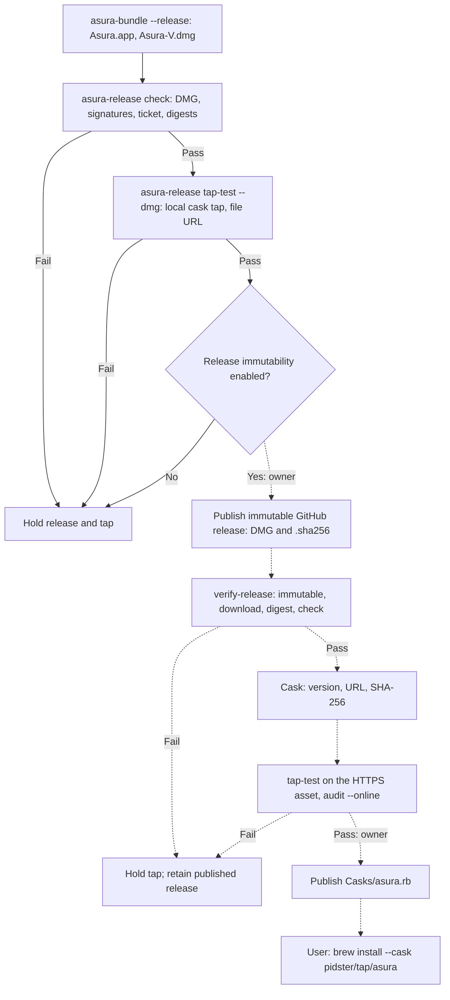
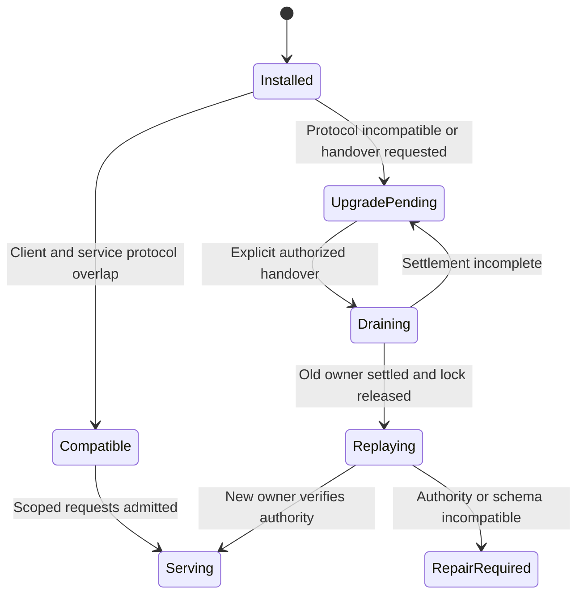

# D7 release distribution: a signed DMG and a Homebrew cask

Status: selected D7/I9 distribution design.
[ADR-0008](../decisions/0008-homebrew-tap-distribution.md) (amended
2026-11-01) selects one signed, notarised DMG per release, installed by the
`asura` cask in `pidster/homebrew-tap` (owner, 2026-10-31; confirmed
2026-11-01). The `.tar.gz` archive and the `asura` formula are removed;
nothing was released, so no migration exists. The
[release signing design](release-signing.md) owns signing, the Hardened
Runtime, notarisation, the `Asura.app` layout and the release scripts. Its
packet SG4 (2026-10-28) selected the release checks and the owner's
publication steps; packet SG6 (2026-11-01) replaces the archive with the DMG
and the formula with the cask ([SG6](release-signing.md#sg6-dmg-and-cask)).
Packet SG5 (2026-10-29) ran HD5, HD8 and the local HD9 checks on a notarised
formula keg; SG6 repeats them for the cask
([SG6 delivery](release-signing.md#sg6-delivery)). HD1, HD6, HD11 and HD13
remain open; HD12's precondition holds (immutable releases enabled on
`pidster/asura`, 2026-11-01). Publication is on hold with the owner.
Upgrade, handover and migration sections are deferred until the first release
(owner, 2026-10-17). Before that release, no compatibility with older builds
or data is required. Live build-mismatch detection stays in force: a control
protocol mismatch reports `incompatible_protocol`, and the service checks the
helper's exact `build_id` and `schema_digest`.

The [system architecture](system-architecture.md) owns standalone service
startup and protocol negotiation. The [authority recovery design](persistence-recovery.md)
owns durable state and schema migration. This design owns the distribution
artifact, cask behavior and installation/upgrade validation. The sibling
project Wisp ships `Wisp.app` in a signed, notarised DMG
([Wisp ADR 0072](https://github.com/pidster/wisp/blob/main/docs/decisions/0072-a-dmg-and-a-declared-layout.md))
and a tarball formula. That is reference behavior, not Asura
implementation; Asura uses a cask and must test its actual DMG contents
against its own manifest.

## Artifact and cask contract

Required behavior. Each release produces one artifact for the supported
architecture and macOS floor: `Asura-<version>.dmg`, with its
`Asura-<version>.dmg.sha256` checksum file beside it. For the first release
the host is Apple silicon with macOS 27 or later. The DMG holds `Asura.app`,
which contains the `asura` command and every runtime library, helper,
resource and metadata file that its CLI, TUI and per-user service need
([bundle layout](release-signing.md#bundle-layout)). The release must state
the exact minimum OS, architecture, protocol range and authority schema
range. Installing the app into `/Applications` must not leave a runtime
dependency on a build-tree path or on the developer's machine.
The first Rust and Swift LSP adapters use identity-checked installed toolchains;
the Asura artifact does not include those language servers. If a toolchain is
absent or mismatched, Asura reports that LSP capability unavailable and retains
ordinary source inspection. I9 must test both the qualified-toolchain and
missing-toolchain paths from an installed app.

The `asura` cask (`Casks/asura.rb` in `pidster/homebrew-tap`) must:

- name the versioned, immutable Asura GitHub release asset and its exact
  SHA-256;
- declare `depends_on arch: :arm64` and the macOS floor
  (`depends_on macos: :golden_gate`, macOS 27 or later);
- install `Asura.app` into `/Applications` (`app "Asura.app"`) and link the
  command with `binary "#{appdir}/Asura.app/Contents/MacOS/asura"`, so that
  `$(brew --prefix)/bin/asura` resolves to the bundle executable;
- have no `preflight`, `postflight`, `uninstall` or `zap` stanza. The cask
  must not launch the service, initialize `.asura`, migrate authority, or
  delete user data in install, upgrade or uninstall.

`zap` and `~/.asura` (open owner decision, default "keep"). `brew uninstall
--cask asura` removes only `/Applications/Asura.app` and the `bin/asura` link.
Without a `zap` stanza, `brew uninstall --zap` removes nothing more. Until the
owner decides otherwise, no cask stanza removes `~/.asura` or any file in the
account home.

A cask has no `test` block. The offline package and resource check that a
formula test gave therefore moves into the release scripts
([SG6 tap test](release-signing.md#local-tap-test)): after a scripted cask
install, `codesign --verify --deep --strict` of `/Applications/Asura.app`, the
helper, `metallib` and Hub bundle digests against `model-package.json`, and
`bin/asura --version`. `--version` opens no service, socket, log or Keychain
(HD8). The helper is never started; it claims the App Sandbox.

A digest verifies the downloaded bytes; I9 must separately verify the code
signature and notarisation contract. Homebrew quarantines a cask download
(`Cask::Download#quarantine`, Homebrew 7.0.11), so Gatekeeper assesses the
installed app; the stapled DMG and the notarised app inside it must satisfy
that assessment. The cask update is published only after the artifact and the
fresh-install test pass. The canonical release version in every binary, DMG
name, GitHub tag and cask must match. The prospective install command is
`brew install --cask pidster/tap/asura`;
[Homebrew tap trust](https://docs.brew.sh/Tap-Trust#installing-from-a-tap)
grants trust to that cask rather than requiring whole-tap trust.

### Release promotion contract

Required behavior. The release operator starts from one reviewed, clean
source revision and a version not already tagged. A dry run executes the local
preflight, build, DMG packing, package inspection and smoke checks without
changing a tag, GitHub release or tap. The release pipeline records the source
revision, locked dependencies, toolchains, the DMG name, its checksum, the
notary submission and the signature verification results. It checks that all
expected executables and resources are present and that no private path,
credential, model weight or undeclared binary is packaged.

Before release, the repository must enable
[GitHub release immutability](https://docs.github.com/en/code-security/how-tos/secure-your-supply-chain/establish-provenance-and-integrity/prevent-release-changes).
`pidster/asura` has it enabled (`gh api repos/pidster/asura/immutable-releases`:
`{"enabled":true}`, 2026-11-01). The operator prepares a draft with exactly
the DMG and its `.sha256`, then publishes it and verifies that the release is
marked immutable. GitHub documents that this locks the associated tag and
assets after publication; the cask checksum still verifies the downloaded
bytes independently. If immutability is unavailable before publication, the
release stops. If publication succeeds but its immutability or downloaded
bytes cannot be verified, the published release remains visible, but the tap
update stops. A corrected artifact needs a new version and tag; the operator
must not replace the published bytes. The operator verifies the downloaded
DMG against the local digest and signature before making the tap change. The
cask is generated from that qualified version and digest. Its audit, the
cask install test and a clean-host installation against the published asset
must pass before the tap commit is published. A failure after the release
exists holds the tap update and retains the tap's prior state (no `asura`
cask for the first release). [SG6](release-signing.md#sg6-dmg-and-cask)
specifies the script (`tools/release/asura-release`), the required checks,
the signing identity and the publication permissions (owner only, SGQ9).

### Publication path

Selected release view. Solid arrows show artifact promotion and the checks
that run on the owner's Mac before publication. Dashed arrows show the owner's
publication steps and the checks after them; none has run. Labels show a check
result. The tap update follows artifact qualification; it does not build Asura.

## Service lifecycle across Homebrew operations

Installing the command does not create an Asura installation. First launch
attaches to an existing service or starts one under the selected per-user
contract. The service writer initializes a verified runtime-only root once
under [conversation admission](conversation-admission.md#automatic-initialization-and-explicit-registration-workflow);
partial or conflicting state requires repair. Homebrew itself is not a service
supervisor, and the cask has no stanza that starts or stops the service.

Deferred until the first release (owner, 2026-10-17): the upgrade, handover, downgrade and migration rules in the
rest of this section and the upgrade admission state below. They describe the
intended release behavior; they are not current requirements.

An upgrade may make a new client executable available while the old service
continues running. The client and service must exchange a bounded, stable
maintenance handshake before any stateful request. It identifies the service
build, compatible control-protocol range, authority-schema version, owner
generation and lifecycle state. The first release must define this minimum
handshake so future clients can report incompatibility without interpreting
unknown control frames. An incompatible client reports UpgradePending without
changing state. A compatible client may continue through the old service and
must identify which service version supplied its results.
Before requesting handover, the new client checks the advertised authority
schema against its reader and any explicitly designed migration. It refuses
handover when it cannot safely open the current state.

An explicit authorized handover request names the observed owner generation
and has a stable request ID. The old service rejects a stale generation. Its
orchestrator serializes a drain barrier with task and action admission: no new
work passes the barrier, and one durable frame records the drain and the set of
already accepted work. Status and cancellation remain available under their
normal control contract. It acknowledges the drain only after that frame is
committed. It then settles or durably records existing tasks, closes the
endpoint and releases the owner lock last. The new executable can replay authority only
after it acquires the same lock and verifies its own schema compatibility. A
live failed or incomplete drain leaves the old owner serving recovery and
control. If the old process crashes, the next lock winner replays the drain
frame and all prior accepted requests before admission; it does not assume a
successful handover. Neither case may create a second owner. D2-D3 must define the exact maintenance
frame, drain result and settled-task criteria before implementation.

Neither a cask stanza nor a client version mismatch may kill the active
service, discard a task, start a competing owner or migrate data implicitly.
An authority migration needs its own recorded operation and compatibility
decision. It cannot be inferred from a replaced `/Applications/Asura.app` or an updated
`bin/asura` link.

If installation or cask publication fails, the prior published DMG and cask
remain the rollback reference; a cask upgrade may already have replaced the
local `/Applications/Asura.app`. An older executable must reject an authority
schema it cannot read; a binary downgrade cannot silently restore older
authority files. `brew uninstall --cask asura` removes `/Applications/Asura.app` and the
`bin/asura` link, not `.asura`, the runtime guard or external SurrealDB. After uninstall, a running service may
still exist; D2/I9 must select and validate the user-facing shutdown and
reinstall behavior before release.

A cask upgrade (`brew upgrade --cask asura`) replaces `/Applications/Asura.app`
in place; it keeps no old version. An old service can therefore outlive the
executable, helper and resources from which it started, while the same
canonical path now holds another build. It must not assume that the path still
holds its own build, and it must not re-exec it to hand over: a re-exec would
start the new build. Before each helper/resource-dependent action, the service
checks that the required versioned resource remains available and authentic. The private Rust–Swift model channel requires the service's exact packaged
helper-build and protocol identities. This differs from the client-to-service
control handshake, which may accept a compatible protocol range. An old
service cannot substitute the newly installed helper when its matching app is
replaced or removed; it keeps control available and reports model work unavailable
until a valid matching helper returns or service handover completes.
If a required resource is unavailable, the service rejects new dependent work. It resolves
accepted work through the
[common failure-settlement contract](core-harness-brief.md#common-failure-and-deadline-contract):
a proved unstarted action can complete with a typed missing-resource failure,
while an action with an
uncertain external effect remains in reconciliation until its effect is known.
The service keeps status, cancellation and handover responsive. A newly
installed client starts its own
verified executable only after the old owner releases the lock. D2 must select
how long-running operations retain their resources and how to settle effects
if a path disappears mid-operation; the design cannot claim seamless active
work across a cask upgrade or uninstall until those cases pass.

### Upgrade admission state

Proposed state view, deferred until the first release (owner, 2026-10-17). Arrows show version and
handover outcomes. A client never infers that an installed binary replaced a
live service.

## Qualification gates

| ID | Scenario | Required evidence |
| --- | --- | --- |
| HD1 | Clean supported macOS host installs from the tap | `brew install --cask pidster/tap/asura` resolves the exact qualified DMG; `/Applications/Asura.app` passes the signature, ticket, Gatekeeper and resource checks; `bin/asura --version` prints the version; the install creates no Asura state. |
| HD2 | Unsupported architecture or macOS | The cask (`depends_on`) or the binary rejects before service or authority creation. |
| HD3 | Upgrade while an old service has active work | Deferred until the first release (owner, 2026-10-17). New client negotiates compatibility or reports UpgradePending; the drain barrier accounts for every accepted request before handover. |
| HD4 | Service crash during handover | Deferred until the first release (owner, 2026-10-17). Sole-owner recovery replays original requests and tasks before new admission. |
| HD5 | Cask or download digest failure | `brew install --cask` fails with a checksum error; no `/Applications/Asura.app`, no `bin/asura` link and no installed cask remain; `.asura` and the bound graph are unchanged. |
| HD6 | Uninstall then reinstall | `brew uninstall --cask asura` removes the app and the link only; user data in `~/.asura` persists; a compatible reinstall reopens the original installation only after binding verification. |
| HD7 | Older binary after authority schema migration | Deferred until the first release (owner, 2026-10-17). It rejects the unknown schema and does not write or roll back state. |
| HD8 | The cask install check runs on an account with existing Asura state | `bin/asura --version` creates no socket, service or authority write. |
| HD9 | The DMG holds several executables and runtime resources | The DMG manifest, the exact shared build and private-protocol identities, the signatures, and executable resource lookup from `/Applications/Asura.app/Contents/Resources` pass without build-tree paths. |
| HD10 | Release dry run or prepublication check fails | No tag, release asset or tap commit is changed; the tap stays in its prior state. |
| HD11 | A cask upgrade replaces, or an uninstall removes, `/Applications/Asura.app` while its service runs | Deferred until the first release (owner, 2026-10-17) with the handover. The old owner neither re-execs the canonical path (now another build or absent) nor dispatches with a changed or missing helper; accepted effects reconcile, controls respond and the new owner waits for the lock. |
| HD12 | GitHub release immutability is disabled or unverified | The release gate stops before tap publication; a checksum alone does not satisfy immutable-asset availability. |
| HD13 | Remote asset or clean-install check fails after release publication | The published release remains, the tap stays in its prior state, and any corrected artifact gets a new version. |
| HD14 | Installed service finds a helper from another package build or private protocol | It rejects before model content, never substitutes a helper from a replaced app, reaps any spawned mismatch and reports model unavailability while control remains usable. Unit identity checks, installed-artifact integration and CLI end-to-end evidence. |

D7 must map each case to unit checks for version/admission decisions,
integration checks for real DMG, cask and service interactions, and
end-to-end checks on clean supported hosts. I9 must record commands, host
versions, signing identity, DMG digest, notary submission and observed
results. [SG-V11](release-signing.md#validation) maps HD1, HD5, HD8, HD9,
HD10, HD12 and HD13 to the release scripts and their checks. The
distribution design remains open for the handover until D2-D3 define exact
service handover and I9 has run on a clean host.
