# Release signing, team Keychain store and helper sandbox (I9)

Naming note: EXD-3 named its Secure Enclave replacement "option C". That item
stays open for later study (SGQ8). The secret store's move to the team
data-protection Keychain is called the **team Keychain store** here; it is a
separate step and does not close EXD-3 option C.

Status: selected design, 2026-10-23. The owner answered the nine signing
questions SGQ1–SGQ9 on 2026-10-23 ([owner decisions](#owner-decisions)). No
code, test, signature, notarisation or Keychain call was made to write this
design. Protocol numbering stays `0.1`; journal format stays `1`.
The owner revised SGQ2 on 2026-10-27: the reverse-DNS prefix is now
`org.pidster` ([owner decisions](#owner-decisions)).
Packet SG1 delivered the package script and the bundle resource lookup on
2026-10-23 ([SG1 delivery](#sg1-delivery)); it signed ad hoc only. Packet SG2
delivered the helper App Sandbox entitlements and the SG-V5 checks on
2026-10-23 ([SG2 delivery](#sg2-delivery)), also ad hoc only.
The owner's Mac ran probes KC-P1, KC-P2 and KC-P4 on 2026-10-27; KC-P3 was
skipped ([KC probe results](#kc-probe-results-2026-10-27)). The results
changed the team Keychain store: every call names the access group, which the
service reads from its own entitlements, and every Keychain error records its
status and the session state as field evidence. Packet SG3 is ready.

What is fixed:

- the bundle layout, bundle IDs and access group (SGQ1, SGQ2);
- signing of development bundles (SGQ3) and release bundles;
- team Keychain store: the secret store moves to the team data-protection
  Keychain with the Asura access group, with a clean switch (SGQ4–SGQ6);
- the helper App Sandbox rule (SGQ7) and the owner-only signing operator
  (SGQ9);
- the `swift-transformers` Hub resource bundle defect and its fix packet
  ([BN1](#bn1-hub-resource-bundle-defect)).

What is open:

- the probe results in [probes](#probes). Packets that depend on a probe are
  not ready until the probe result is recorded here
  ([readiness](#packet-readiness)). KC-P3 (SSH and before first unlock) was
  not run; the `locked` mapping of -25308 stays unverified until KC-P3 runs or
  field evidence ([F3](#keychain-field-evidence)) settles it;
- the Secure Enclave design item, kept open for later study (SGQ8,
  [Secure Enclave](#secure-enclave-open-item)).

This design owns the signing and notarisation contract that
[release distribution](release-distribution.md) leaves open. Packet SG3
replaces the file-based login keychain mechanism of the
[secret store](secret-store.md) under KQ1 and EXD-3.

## Scope

In scope:

- Signing identities, Hardened Runtime and entitlements for every shipped
  executable; notarisation and stapling; where signing and notary credentials
  live; development builds compared with release builds.
- Whether the Rust service runs in the App Sandbox (selected: no, D-S1).
- Whether the Swift model helper runs in the App Sandbox (selected: yes if
  probes HS-P1 to HS-P7 pass, SGQ7).
- team Keychain store: the data-protection keychain with a keychain access
  group. This covers the switch from the login keychain, stranded items and
  test isolation.
- The effect of the Hardened Runtime on `DYLD_*` (PC-I38), on `mlx.metallib`
  and on SwiftPM resource bundles.
- The Hub resource bundle defect BN-P1 and its fix packet BN1.

Non-goals:

- Upgrade, handover and migration between releases. These are deferred until
  the first release (owner, 2026-10-17).
- Provider credentials (EX14). This design records only how they depend on the
  helper sandbox.
- Mac App Store distribution and TestFlight.
- A signing service in CI (SGQ9).
- A Secure Enclave key design (SGQ8: open, later study).

Dependencies: [release distribution](release-distribution.md),
[ADR-0008](../decisions/0008-homebrew-tap-distribution.md),
[ADR-0009](../decisions/0009-supervised-local-model-helper.md),
[secret store](secret-store.md),
[execution threat model](execution-threat-model.md),
[exec_cmd tool](exec-cmd-tool.md),
[escapee control](escapee-control.md),
[person command mode](person-command-mode.md),
[model provider integration](model-provider-integration.md#verified-metal-resource-packaging),
[platform capabilities](platform-capabilities.md#minimal-helper-package-and-identity).

## Current state

Read from the repository on 2026-10-23.

| Fact | Source |
| --- | --- |
| One Rust executable, `asura`, is the CLI, the TUI, the service and the exec_cmd guardian. The service is a re-exec of the canonical `current_exe` (`spawn_service_inner`). The guardian is the same file, run with the first argument `--asura-exec-cmd-guardian`. | `asura-platform/src/startup.rs:252`, `asura-service/src/exec_cmd_worker.rs:971`, `asura-cli/src/app.rs:395` |
| One Swift executable, `asura-model` (SwiftPM product of `swift/model-helper`). The service finds it beside its own canonical executable. | `asura-service/src/model_owner.rs:240-244` |
| Before spawn, the platform copies the helper (and `mlx.metallib` for MLX) into a new `model-<hex>` directory under `~/.asura/run/`. It checks the SHA-256 of each copy and runs the copy. The helper's environment is only `LANG=C` and `LC_ALL=C`. | `asura-platform/src/model_process.rs:255-300, 386-405` |
| `asura-service/build.rs` embeds the helper SHA-256 (and the optional `metallib` SHA-256) from `.build/model-tools/package-identity.txt` into the Rust binary at compile time. | `asura-service/build.rs` |
| The development package `.build/current-package/` holds `asura-model`, `mlx.metallib`, `model-package.json` and `identity-input.json`. No packaging or signing script exists in the repository. Step 5 of the helper README names a manual "root build owner" assembly. | `swift/model-helper/README.md` |
| `otool -L` (read-only) of the packaged `asura-model` and of the previous `asura` lists only `/System/Library/...` frameworks and `/usr/lib/...` libraries. No third-party dynamic library is loaded. | Local inspection, 2026-10-23 |
| MLX on Apple platforms excludes `backend/cpu/compiled.cpp`, the only `dlopen` of compiled code in MLX. GPU kernels come from `mlx.metallib`, found first beside the running executable. | `mlx-swift/Package.swift:182-184`, `backend/metal/device.cpp:90-160` |
| `swift-transformers` `Hub` reads `Bundle.module` when a model's tokenizer configuration has no `tokenizer_class` and the model has a `model_type`. The generated accessor calls `fatalError` when `swift-transformers_Hub.bundle` is not beside the executable. The development package does not contain this bundle. | `Hub.swift` (`tokenizerConfig`, `fallbackTokenizerConfig`); generated `resource_bundle_accessor.swift` |
| `swift-transformers_Hub.bundle` from the build holds 7 files in 44 KiB: `Info.plist`, the build's `_CodeSignature` files, and `Resources/gpt2_tokenizer_config.json` and `Resources/t5_tokenizer_config.json`. | Local inspection of `target/debug/swift-transformers_Hub.bundle`, 2026-10-23 |
| Test and fixture executables: `keychain_fixture`, `secret_store_fixture`, `asura-toolchain-bootstrap`, `examples/tcr_p1`, every Cargo test binary, and the Swift test bundle. | `rust/crates/*/src/bin`, `Cargo.toml` |
| Before SG3, the secret store used the file-based login keychain. The SS-P3 probe found that read access follows the writer's cdhash and delete access follows the executable file name. | [secret store](secret-store.md#stranded-and-unrecognized-items) |

## Requirements

Required behavior.

| ID | Requirement | Source |
| --- | --- | --- |
| RS1 | Each release must contain signed executables that the macOS notary service accepts. Notarisation requires the Hardened Runtime. | [Apple: Hardened Runtime](https://developer.apple.com/documentation/security/hardened-runtime) ("To upload a macOS app to be notarized, you must enable the Hardened Runtime capability"); ADR-0008; release-distribution HD1, HD9 |
| RS2 | An executable must claim only the entitlements that it needs. A false Boolean entitlement must be omitted. | Apple Hardened Runtime page |
| RS3 | Signing keys and notary credentials must never be in the repository, in test inputs, or in any file that a test reads. No test signs with a real identity. | AGENTS.md (credentials stay out of tracked files) |
| RS4 | A queued person command's values must stay in the macOS Keychain. The team Keychain store uses the data-protection keychain with `kSecAttrAccessibleAfterFirstUnlockThisDeviceOnly` and the Asura access group. | KQ1, SO6, EXD-2, SGQ4 |
| RS5 | Tests must never read, write or delete items in the person's keychains. Only the signed qualification run writes data-protection items, under a separate test access group, and it must leave that group empty. | SSR6, SGQ6 |
| RS6 | `!!` commands must run with no sandbox. `!` and model jobs must run under per-job `sandbox-exec` profiles. The escapee scan must keep working. | EXD-1, PCR21, EX5 |
| RS7 | No backward compatibility with unreleased builds or data. | Owner, 2026-10-17; SGQ5 |
| RS8 | Every blocking call must have an isolation owner, numeric limits and a loop-closure ending. No default time bound. | AE-01 to AE-07; owner, 2026-10-15 |
| RS9 | The helper identity check (exact `build_id`, `schema_digest`, helper and `metallib` SHA-256) must stay. | release-distribution; HD14 |
| RS10 | Only the owner signs and notarises, on the owner's Mac, for the first release. CI holds no signing secret. | SGQ9 |

## Terms

| Term | Meaning |
| --- | --- |
| Developer ID Application | The Apple certificate type for code that is distributed outside the Mac App Store |
| Hardened Runtime | The code-signing flag `runtime`. It turns on library validation and ignores `DYLD_*`, unless an exception entitlement allows them |
| Restricted entitlement | An entitlement that a provisioning profile must authorise, such as `keychain-access-groups` ([TN3125](https://developer.apple.com/documentation/technotes/tn3125-inside-code-signing-provisioning-profiles)) |
| App-like bundle | A directory `Asura.app/Contents/{Info.plist, MacOS/, Resources/, embedded.provisionprofile}`. It holds a command-line executable so that a profile can be embedded |
| Data-protection keychain | The per-user keychain that `SecItem` calls reach with `kSecUseDataProtectionKeychain = true`. Its access control is keychain access groups ([TN3137](https://developer.apple.com/documentation/technotes/tn3137-on-mac-keychains)) |
| Asura access group | `<TeamID>.org.pidster.asura` (SGQ2). The test access group is `<TeamID>.org.pidster.asura.test` (SGQ6) |
| Team Keychain store | The secret store on the data-protection keychain with the Asura access group, replacing the file-based login keychain (SGQ4, SGQ8) |
| Qualification bundle | A test `Asura.app` that the owner signs with the test access group, used only by the signed qualification run (SGQ6) |

## Owner decisions

Answered by the owner on 2026-10-23. Each decision is required behavior for
the packets below.

| ID | Question | Decision (owner, 2026-10-23) |
| --- | --- | --- |
| SGQ1 | Can the released `asura` command live in `Asura.app/Contents/MacOS/asura`, with Homebrew linking `bin/asura` to it? The team Keychain store needs a provisioning profile, and a profile needs an app-like bundle. | Yes, `Asura.app`; Homebrew links `bin/asura`. |
| SGQ2 | Which bundle IDs? | Original (2026-10-23): `com.pidster.asura` and `com.pidster.asura.model`; access group `<TeamID>.com.pidster.asura`. Revised by the owner on 2026-10-27 (see the note below): `org.pidster.asura` and `org.pidster.asura.model`; access group `<TeamID>.org.pidster.asura`. |
| SGQ3 | Sign the assembled development bundle with the Apple Development identity and a development profile? | Yes. Development `Asura.app` bundles are signed with the Apple Development identity and a development profile. Cargo test binaries stay unsigned. |
| SGQ4 | KQ2 says that only the build that wrote an item can read it. In the team Keychain store, any build that the team signs with the access group can read and delete the item. Accept? | Yes. Any build signed by the team with the access group may read and delete items (KQ2 revised). Stranded items go away. |
| SGQ5 | Old items named "Asura queued command secrets" stay in the login keychain on development Macs. Accept a one-time manual clean-up, with no Asura code that reads or deletes them? | Clean switch. No migration code. The leftovers are deleted by hand once. |
| SGQ6 | Can the signed qualification run (not `cargo test`) write and delete items under a separate test access group? | Yes. Only the signed qualification run writes items, under a separate test access group, and it must leave that group empty. |
| SGQ7 | Must the Swift model helper run in the App Sandbox? | The helper App Sandbox is a release requirement if probes HS-P1 to HS-P7 pass. Otherwise the helper ships unsandboxed, with the gap recorded. |
| SGQ8 | EXD-3 planned a Secure Enclave replacement for SS-T8. Close it? | Keep the Secure Enclave design item open for later study. The team Keychain store for now is the team data-protection Keychain. |
| SGQ9 | Who signs and notarises? | Only the owner, on the owner's Mac, for the first release. No CI secrets. |

SGQ2 revision (owner, 2026-10-27): the reverse-DNS prefix changes from
`com.pidster` to `org.pidster`, because the owner also owns pidster.org. The
bundle IDs are `org.pidster.asura` and `org.pidster.asura.model`, the test App
ID is `org.pidster.asura.test`, and the access groups are
`<TeamID>.org.pidster.asura` and `<TeamID>.org.pidster.asura.test`. The project
is unreleased, so there is no alias and no migration for the old prefix. The
SG0, SG1 and SG2 runs used the original prefix; this design now states every
identifier, including those in the probe and delivery records, with the revised
prefix. The identifiers change; the behavior and the results do not.

The draft of this design recommended closing the Secure Enclave item (SGQ8).
The owner did not accept that recommendation; the item stays open.

## Engineering decisions

Selected (engineering), consistent with the owner decisions:

- **D-S1. The `asura` executable is not App-Sandboxed.** Evidence is in
  [service App Sandbox](#service-app-sandbox-no).
- **D-S2. The Hardened Runtime is on for `asura` and `asura-model`, with no
  exception entitlements.** No third-party dynamic library and no JIT is
  present ([current state](#current-state)).
- **D-S3. Sign inside-out, then hash.** The helper (and the Hub bundle, BN1)
  is signed before its SHA-256 is recorded in `package-identity.txt`. Any
  later change to the helper's bytes breaks HD14.
- **D-S4. Notarise a zip of `Asura.app`, staple `Asura.app`, then build the
  release archive.** A ticket cannot be stapled to a bare executable or to a
  zip ([notarisation facts](#signing-order-and-build-identity)).
- **D-S5. The team Keychain store replaces the file-keychain production path in one change
  (SG3).** No legacy reader (RS7, SGQ5).
- **D-S6. BN1 ships the Hub resource bundle and copies it beside the
  helper.** See [BN1](#bn1-hub-resource-bundle-defect).
- **D-S7. Every Keychain call names the access group, read at run time from
  the process's own entitlements (2026-10-27, finding F2).** A build without
  a valid group makes no Keychain call and reports `not_signed`. See
  [access group](#access-group-from-the-entitlements).
- **D-S8. Every Keychain error records its raw status and the session state
  in the audit event (owner direction, 2026-10-27, finding F3).** See
  [field evidence](#keychain-field-evidence).
- Rejected: **runtime self-verification of the helper signature**
  (`SecStaticCodeCheckValidity`) before spawn. The embedded SHA-256 already pins
  the exact signed bytes, and the Rust binary that holds the digest is itself
  signed. A second check adds Security framework IPC with no new guarantee.

## Signing identities and artifacts

### What gets signed

Selected mechanism.

| Executable | Release signature | Hardened Runtime | Entitlements | Why |
| --- | --- | --- | --- | --- |
| `Asura.app` / `Contents/MacOS/asura` (CLI, TUI, service, guardian) | Developer ID Application, secure timestamp | Yes | `keychain-access-groups: [<TeamID>.org.pidster.asura]`, plus `com.apple.application-identifier` and `com.apple.developer.team-identifier` as the profile requires. Nothing else. | The secret store needs the access group (RS4). The process needs no JIT, no `DYLD_*`, no unsigned libraries and no debugger rights. The guardian calls `sandbox_check`, `proc_listpids`, `proc_pidinfo` and `sysctl(KERN_PROCARGS2)` on same-user processes; these need no entitlement (the escapee control probes ran unsigned). |
| `Asura.app/Contents/MacOS/asura-model` | Developer ID Application, secure timestamp, identifier `org.pidster.asura.model` | Yes | If the HS probes pass (SGQ7): `com.apple.security.app-sandbox`, `com.apple.security.network.client`, and `com.apple.security.temporary-exception.files.home-relative-path.read-only` for `/.asura/data/models/` and `/.asura/run/`. If an HS probe fails: none. | See [helper App Sandbox](#helper-app-sandbox). An embedded `Info.plist` (`-sectcreate __TEXT __info_plist`, `CFBundleIdentifier` equal to the signing identifier) is required: without it a sandboxed bare executable traps at start in `_libsecinit_appsandbox` (HS-P1). It also gives the helper a stable identity in every build, so Core AI reuses one compiled-model cache instead of one per copy. |
| `Asura.app/Contents/Resources/mlx.metallib` | Not code. Sealed by the bundle's `CodeResources` | — | — | Metal loads it as data. The service still checks its SHA-256 (RS9). |
| `Asura.app/Contents/Resources/model-package.json` | Sealed by the bundle | — | — | Manifest |
| `Asura.app/Contents/Resources/swift-transformers_Hub.bundle` | Nested bundle, signed before the helper and the outer bundle (BN1) | — | — | `Bundle.module` calls `fatalError` when it is absent ([BN1](#bn1-hub-resource-bundle-defect)) |
| Cargo test binaries, `keychain_fixture`, `secret_store_fixture`, `asura-toolchain-bootstrap`, examples, Swift test bundle, PC-I38 marker library and the escapee fixtures | Not Developer ID signed. They keep the linker's ad hoc signature. | No | None | Tests must not depend on the release identity (RS3). They then cannot reach the data-protection keychain (RS5). The PC-I38 control run needs an unsigned fixture. |

A release `Asura.app` has no `get-task-allow`. Notarisation rejects it, and its
absence stops same-user debuggers from attaching to `asura`.

### Bundle layout

Selected (SGQ1, SGQ2). The
[platform capabilities design](platform-capabilities.md#minimal-helper-package-and-identity)
puts the helper "beside the command executable" and the release in "libexec".
This layout keeps the helper beside `asura`, as `model_owner.rs` expects, and
moves the data files to `Resources`. The package step and the `metallib` lookup
must change together (packet SG1).

```text
Asura.app/
  Contents/
    Info.plist                  CFBundleIdentifier org.pidster.asura, CFBundleExecutable asura,
                                LSUIElement true, LSMinimumSystemVersion 27.0
    MacOS/asura
    MacOS/asura-model
    Resources/mlx.metallib
    Resources/model-package.json
    Resources/swift-transformers_Hub.bundle/   (BN1)
    embedded.provisionprofile   Developer ID profile for org.pidster.asura
    _CodeSignature/CodeResources
LICENSE
```

The Homebrew formula installs `Asura.app` into `libexec` and links
`bin/asura` to `libexec/Asura.app/Contents/MacOS/asura`. `spawn_service_inner`
canonicalizes `current_exe`, so the service and the guardian re-exec the
bundle path, not the symlink. Probe KC-P2 must show that the profile's
entitlements apply when `asura` starts through the symlink.

### SG-O1: signed artifact view

Selected design. Solid arrows show "contains", "signs" or a runtime call.
Dashed arrows show runtime spawns. Boxes are trust boundaries. The helper's
App Sandbox depends on SGQ7 and the HS probes.

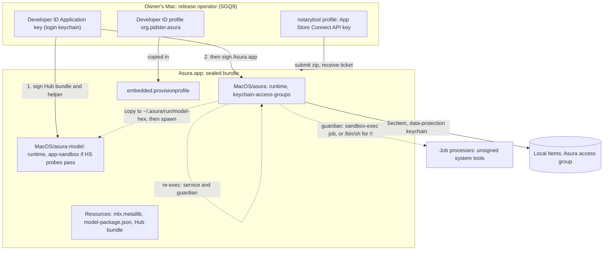

### Signing order and build identity

Selected. D-S3 fixes the order. A step that changes a signed file after its
digest is recorded is a defect.

#### SG-F1: release signing flow

Selected design. Arrows show the next step; labelled arrows show a decision
result. Every "Stop" publishes nothing.

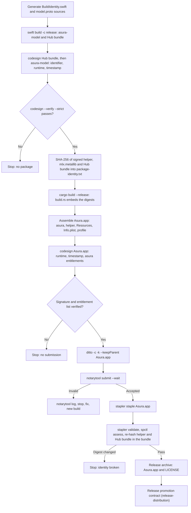

Apple facts used here, from
[Customizing the notarization workflow](https://developer.apple.com/documentation/security/customizing-the-notarization-workflow):

- "The notary service accepts disk images (UDIF format), signed flat installer
  packages, and ZIP archives." A `.tar.gz` cannot be submitted.
- "While you can notarize a ZIP archive, you can't staple to it directly ...
  Although tickets are created for standalone binaries, it's not currently
  possible to staple tickets to them." A bare `asura` therefore depends on
  Gatekeeper's online ticket lookup. A stapled `Asura.app` does not.
- "Limit notarizations to 75 per day."
- `notarytool store-credentials` saves the credential as a keychain profile,
  and `--keychain-profile` keeps it out of scripts.

Unverified: whether the stapled ticket survives the `.tar.gz` round trip and
Homebrew's extraction (probe NT-P1). Unverified: whether Homebrew sets
`com.apple.quarantine` on formula downloads. If it does not, Gatekeeper never
assesses the formula install, and notarisation protects only direct downloads
from the GitHub release. Probe NT-P1 records the result either way.

### Where credentials live

Selected (SGQ9).

| Secret | Location | Never |
| --- | --- | --- |
| Developer ID Application private key | The owner's login keychain on the release Mac. The owner keeps an exported `.p12` backup offline | In the repository, CI, a test fixture, or any file under the working tree |
| Apple Development key (development bundles, SGQ3) | The owner's login keychain | As above |
| Notary credential | `notarytool store-credentials` profile (App Store Connect API key, Developer role). The operator deletes the `.p8` file after storing it | In environment files, scripts, logs or arguments |
| Provisioning profiles | Downloaded by the operator into an ignored path (`.build/signing/`). They are not secret, but they hold the team's certificate and are not tracked | Tracked in git |
| Team ID | Given to the package script by the operator (argument or environment) at run time. The script checks it against the profile and against the signed result (`codesign -dv` `TeamIdentifier`), so it never reads the keychain to find it. Rust code does not embed it: the service reads its access group, which holds the team ID, from its own signed entitlements at run time ([access group](#access-group-from-the-entitlements)) | Hard-coded in source or written to a tracked file |

Tracked files: entitlement property lists for each executable and build kind,
the `Info.plist` template, and the package script
([SG1 package script](#sg1-package-script)). None contains a secret. The
script takes the signing identity name, the team ID, the profile path and the
notary profile name from the operator. It stores none of them in a tracked
file and prints no secret. It refuses a release when the working tree is
unclean or when any of the four inputs is absent. Its ad hoc mode is the dry
run (release-distribution HD10): it runs every step except `codesign` with a
real identity, `notarytool` and `stapler`. The dry run signs ad hoc, so it
never touches a certificate or a keychain. CI may run the dry run; it never
holds an identity or a notary profile (RS10).

### Development builds compared with release builds

Selected (SGQ3).

| Property | Plain Cargo / SwiftPM build | Assembled development bundle | Release |
| --- | --- | --- | --- |
| Signature | Linker ad hoc | Apple Development certificate | Developer ID Application |
| Hardened Runtime | No | Yes | Yes |
| `get-task-allow` | Implicit (ad hoc) | Yes, so that the owner can debug | No |
| Profile | None | macOS development profile, registered Mac | Developer ID profile |
| Data-protection keychain | Unavailable: the build claims no group, so the store makes no Keychain call and reports `not_signed` ([access group](#access-group-from-the-entitlements)). A call that names a group returns -34018 (KC-P1) | Available, group `<TeamID>.org.pidster.asura` | Available, same group |
| Helper App Sandbox | No | Yes if the HS probes pass, development signed | Yes if the HS probes pass |
| Notarised | No | No | Yes, stapled |
| Secret store result | `unavailable` with the text "This Asura build is not signed for the Keychain." | Normal | Normal |

The development group and the release group are the same string. A
development build and a release build on one Mac therefore share items
(SGQ4). The sweep and the binding digest already handle items from another
installation. Probe KC-P1 showed that Apple Development and Developer ID
signatures from one team both satisfy the group: each read and deleted the
other's items (2026-10-27).

Found by the owner's profile check (2026-10-27): macOS development profiles
carry no `com.apple.security.get-task-allow`. The SG1 script refuses a
development profile without it, and `asura.development.plist` claims it. This
is an SG1 defect for packet SG4 (or an SG1 follow-up) to correct before the
first `--development` bundle; SG3 does not change `asura-bundle`.

### SG1 package script

Selected design (packet SG1, engineering, 2026-10-23). The script
`tools/release/asura-bundle` builds, signs and checks `Asura.app`. It is an
operator tool. No Asura runtime component calls it, and no `cargo test` runs
it. `tools/release/README.md` gives the operator commands.

#### Modes and inputs

| Mode | Signing identity | Required inputs | Entitlement files | Profile | Timestamp | After signing |
| --- | --- | --- | --- | --- | --- | --- |
| `--ad-hoc` (dry run, HD10) | `-` (ad hoc) | `--out` only. An identity, team, profile or notary argument is refused | `*.ad-hoc.plist` | None | None | Archive, marked unstapled |
| `--development` (SGQ3) | Apple Development | Identity name, team ID, development profile | `*.development.plist` | Copied in | None | None |
| `--release` | Developer ID Application | Identity name, team ID, Developer ID profile, notary keychain profile name; clean working tree | `*.release.plist` | Copied in | Secure timestamp | Notarise, staple, archive |

Each identity input comes from an argument (`--identity`, `--team-id`,
`--profile`, `--notary-profile`) or from the environment (`ASURA_SIGN_IDENTITY`,
`ASURA_TEAM_ID`, `ASURA_PROFILE`, `ASURA_NOTARY_PROFILE`). An argument wins.
The ad hoc mode reads none of the environment inputs. Every mode needs a new
output directory (`--out`, which must not exist) and the verified generators
`ASURA_PROTOC` (`protoc` 36.2) and `ASURA_PROTOC_GEN_SWIFT`
(`protoc-gen-swift` 1.38.1), checked against `tools/protobuf/lock.json`. The
team ID must be ten upper-case letters or digits.

The profile is decoded with `/usr/bin/openssl smime -verify -noverify`, which
reads no keychain. The script refuses a profile that has expired, whose
`TeamIdentifier` does not hold the team ID, whose
`com.apple.application-identifier` is not `<TeamID>.org.pidster.asura`, or
whose `keychain-access-groups` lacks `<TeamID>.org.pidster.asura` (or
`<TeamID>.*`). No step calls `security`.

#### Entitlement files

Tracked in `tools/release/entitlements/`. `@TEAM_ID@` is replaced with the
team ID at signing time, in the output directory only.

| File | Keys |
| --- | --- |
| `asura.release.plist` | `keychain-access-groups` [`@TEAM_ID@.org.pidster.asura`], `com.apple.application-identifier` `@TEAM_ID@.org.pidster.asura`, `com.apple.developer.team-identifier` `@TEAM_ID@` |
| `asura.development.plist` | The release keys and `com.apple.security.get-task-allow` `true` |
| `asura.ad-hoc.plist` | None |
| `asura-model.release.plist`, `asura-model.ad-hoc.plist` | `com.apple.security.app-sandbox` `true`, `com.apple.security.network.client` `true`, `com.apple.security.temporary-exception.files.home-relative-path.read-only` [`/.asura/data/models/`, `/.asura/run/`] (SG2, SGQ7) |
| `asura-model.development.plist` | The release helper keys and `com.apple.security.get-task-allow` `true` |

The ad hoc helper list equals the release list: these keys need no profile,
so an ad hoc helper can claim them, and the dry run signs the helper that a
release would ship. No tracked list carries an absolute-path exception; the
SG-V5 test variant adds one at test time ([SG2 delivery](#sg2-delivery)).

The ad hoc files omit the profile-authorised keys because the kernel kills an
ad hoc process that claims them: an ad hoc, hardened test binary that claimed
`keychain-access-groups` and `com.apple.application-identifier` exited with
`SIGKILL` (status 137) at launch (observed, 2026-10-23, macOS 27.0). The dry
run therefore proves the bundle layout, the signing order, the Hardened
Runtime and the digests. It does not prove the restricted entitlements; KC-P1
and NT-P1 do.

#### Steps and checks

The steps run one at a time. Each check that fails stops the script with
`asura-bundle: <step>: <reason>` and a non-zero status, and nothing after it
runs. A failed run leaves its output directory for inspection and never writes
the archive. A new run needs a new output directory.

1. **Preflight.** macOS 27 on Apple silicon; mode inputs present and valid;
   generator versions; profile checks; release mode needs a clean tree.
2. **Generate.** A new random 32-byte build ID; `schema_digest` is the SHA-256
   of `contracts/model/v1/model.proto`. Write `BuildIdentity.swift` and
   `model.pb.swift` into the ignored `Sources/HelperCore/Generated/`.
3. **Build the helper.** `swift build -c release --product asura-model`.
   The products are `asura-model`, `swift-transformers_Hub.bundle` and
   `mlx-swift_Cmlx.bundle/Contents/Resources/default.metallib`, staged as
   `mlx.metallib`.
4. **Stage and check limits.** Helper at most 128 MiB, `mlx.metallib` at most
   64 MiB, Hub bundle within the BN1 limits, no symbolic link anywhere.
5. **Sign inside-out (D-S3).** The Hub bundle first, then `asura-model` with
   identifier `org.pidster.asura.model` and the Hardened Runtime. Check:
   `codesign --verify --strict` passes for both; the helper's identifier is
   `org.pidster.asura.model`, its flags hold `runtime`, its embedded
   `Info.plist` is bound, and the signed helper's code reports the build ID
   and schema digest from step 2 through `--version` (step 2 also checks that
   each generated array holds 32 bytes). The check runs an ad hoc copy with
   no entitlements: the signed helper claims the App Sandbox, and starting it
   would create its container under `org.pidster.asura.model` on the
   packaging Mac. The copy has the same code; only its signature differs.
6. **Hash.** SHA-256 of the signed helper and `mlx.metallib`, and the Hub
   bundle digest ([encoding](#hub-bundle-digest-encoding)). Write the five
   lines of `.build/model-tools/package-identity.txt` and the staged
   `model-package.json` (`format` `0.1`).
7. **Build the service.** `cargo build --release --locked -p asura-cli`.
   `asura-service/build.rs` embeds the digests from step 6.
8. **Assemble** `Asura.app` ([bundle layout](#bundle-layout)) from the template
   `tools/release/Info.plist.in` (version from `asura-cli`), the staged files
   and, for a signed mode, the profile. Check: at most 64 files; the copied
   helper, `mlx.metallib` and Hub bundle digests equal step 6.
9. **Sign the bundle.** `codesign` on `Asura.app` with the `asura` entitlements,
   without `--deep`, so nested code is not signed again. Check:
   `codesign --verify --deep --strict` passes; the entitlements of `asura` and
   `asura-model` (`codesign -d --entitlements`) equal the expected files; both
   carry `runtime`; the bundle identifier is `org.pidster.asura`; in a signed
   mode both carry the team ID and the profile allows every signed
   entitlement; the digests inside the bundle still equal step 6 (SG-V2).
10. **Notarise (release only).** Zip with `ditto -c -k --keepParent`, then
    `xcrun notarytool submit --keychain-profile <name> --wait`. A result other
    than `Accepted` downloads the log with `notarytool log`, stops and publishes
    nothing. Then `xcrun stapler staple` with paced retries
    ([failure handling](#failure-handling)), `stapler validate`,
    `spctl --assess --type execute`, and the step 9 digest check again.
11. **Archive.** `asura-<version>-macos-arm64.tar.gz` holding `Asura.app` and
    `LICENSE`, with its SHA-256 beside it. The ad hoc archive is named
    `…-adhoc-unstapled.tar.gz` so that it cannot be mistaken for a release.
    The release promotion and the formula stay with SG4.

The script also leaves the signed helper, `mlx.metallib`, the Hub bundle and
`model-package.json` in `<out>/package/`, the development package layout
(resources beside the helper). Steps 2 and 6 rewrite the generated Swift
sources and `.build/model-tools/package-identity.txt`, as the manual package
step does. Later Cargo builds therefore embed this package's identity, and
native tests use `<out>/package/` beside the test binaries.

Time: no step has a time bound (RS8). `notarytool --wait` ends with the
service's reply or an operator cancel (Ctrl-C). Stapling retries end with
success or an operator cancel.

#### SG-F4: package script checks

Selected design. Arrows show the next step; labelled arrows show a check
result. Every "Stop" leaves no archive.

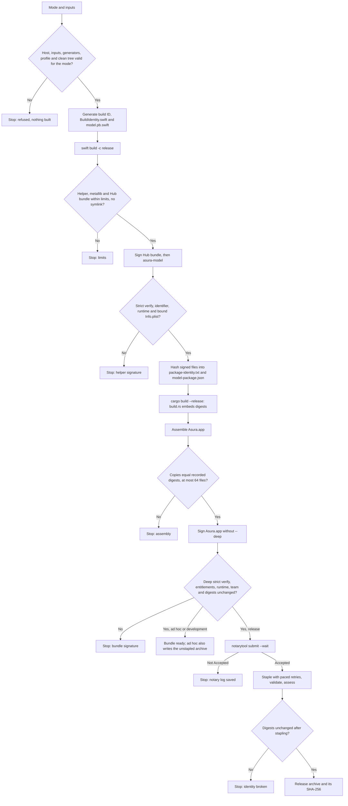

#### Resource directory inside the bundle

Selected (engineering, packet SG1). The helper stays beside the canonical
service executable, so `model_owner` is unchanged. The platform owner
(`asura_platform::package_resource_directory`) derives the one source
directory for `mlx.metallib` and the Hub bundle from the helper path. It
inspects only the path; there is no search and no second location.

| Helper path | Resource directory |
| --- | --- |
| `<name>.app/Contents/MacOS/asura-model` | `<name>.app/Contents/Resources` |
| Any other path (development package, test binaries) | The helper's directory |

A bundle layout with resources beside the helper and none in `Resources`
fails before spawn, like any missing resource. The copied run layout does not
change: the copy step still places both resources beside the helper copy.

#### SG-F5: resource directory resolution

Selected design. Arrows show the next test on the helper path; labels show
the result.

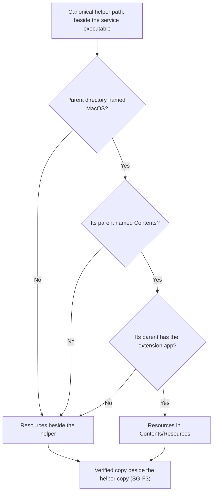

## Service App Sandbox: no

Selected (D-S1). Each row gives its evidence and its status.

| Concern | Finding | Status |
| --- | --- | --- |
| Children inherit the sandbox | Apple DTS: "If a sandboxed process runs another program as a child process, that child process always inherits its sandbox from the parent." ([forum 706390](https://developer.apple.com/forums/thread/706390)). `!!` would therefore run inside the App Sandbox, which breaks EXD-1 and PCR21. | Documented by Apple DTS |
| One executable has several roles | `asura` re-execs itself as the service and the guardian. A child signed with `app-sandbox` but without `com.apple.security.inherit` "will crash in `_libsecinit_appsandbox`. A process is not allowed to change its sandbox" (same thread). One Mach-O cannot carry `inherit` for its child roles and also not carry it for its top-level CLI role. The service would need its own executable, and every guardian would still be inside the service sandbox. | Documented by Apple DTS; follows from the current code |
| Nested `sandbox-exec` | EC-V-NEST: `sandbox-exec` inside a Seatbelt profile returns `sandbox_apply: Operation not permitted`. The App Sandbox uses the same Seatbelt mechanism. The per-job profiles of `!` and model jobs would therefore fail, and with them the EX5 marker attribution. | Strong inference, **unverified for the App Sandbox**. Probe SB-P1 |
| Projects anywhere on disk | A sandboxed process reaches files outside its container only through user selection (open panel), security-scoped bookmarks or temporary exceptions ([Accessing files from the macOS App Sandbox](https://developer.apple.com/documentation/security/accessing-files-from-the-macos-app-sandbox)). A TUI and a background service have no open panel. The same page says that an app "can't run programs in locations outside its app bundle, sandbox container, or app group containers" with user-selected access, unless it has `files.user-selected.executable`. Project scripts and build outputs could not run. | Documented |
| Inherited rights | A forum answer reports that inheritance carries only static entitlements, not rights granted after launch such as PowerBox file access. A project granted by a bookmark could then be unreadable to `git` and `sh` children. | Forum statement, **unverified**. Probe SB-P3 |
| `~/.asura`, the control socket and journals | The App Sandbox redirects `HOME` to the container. Every `~/.asura` path would need a temporary exception. | Documented behavior of containers |
| EX5 process inspection | The guardian calls `proc_listpids(PROC_UID_ONLY)`, `proc_pidinfo`, `proc_pidfdinfo`, `sysctl(KERN_PROCARGS2)` and `sandbox_check` on other processes. The App Sandbox normally limits `process-info*` to the process's own sandbox. | **Unverified.** Probe SB-P2 |

Conclusion (D-S1): `asura` runs with the Hardened Runtime and no App Sandbox.
Confinement of untrusted work stays with the per-job `sandbox-exec` profiles
that the exec_cmd and person command designs own. Under D1, same-user
processes are one principal. The App Sandbox would not change that claim, and
it would break RS6. The SB probes confirm the evidence; a probe result that
contradicts a row is recorded here but does not by itself reverse D-S1,
because the inheritance and multi-role rows are documented.

## Helper App Sandbox

Selected (SGQ7): the helper App Sandbox is a release requirement if probes
HS-P1 to HS-P7 pass. Otherwise the helper ships unsandboxed, and the gap is
recorded in the execution threat model as residual EX-H1 "helper unconfined".

The helper handles untrusted model output, untrusted model files (weights,
tokenizer JSON, Jinja chat templates parsed by `swift-jinja`) and HTTP
responses from Ollama. It runs as the person with no confinement today
([platform capabilities](platform-capabilities.md#minimal-helper-package-and-identity):
"makes no OS sandbox confinement claim"). A sandboxed helper that is
compromised could not read `~/.ssh`, write `~/.asura` journals or the control
socket, or start unsandboxed programs. This is defence in depth. It does not
change the D1 claim.

The design uses the Apple-maintained App Sandbox profile, not a custom
`sandbox-exec` profile, for the helper. Metal, Foundation Models and Core AI
need many system service lookups. Apple maintains those rules for sandboxed
apps. A custom Seatbelt profile would have to list them and keep them current.

### What the helper needs

| Need | Under the App Sandbox | Entitlement or mechanism | Probe |
| --- | --- | --- | --- |
| Start as a bare executable spawned by an unsandboxed parent | The helper is not a child of a sandboxed app, so it must not claim `inherit`. It sets up its own sandbox and container, keyed by its signing identifier. Apple does not document whether a bare executable without an app bundle can do this. | `app-sandbox`; an embedded `Info.plist` (required, HS-P1) | HS-P1 |
| Private channel on FD 3, diagnostics on FD 1/2 | The parent passes the descriptors before exec. The sandbox checks access when a file is opened, so inherited descriptors should keep working. | None | HS-P1 |
| Read its own executable, `mlx.metallib` and the Hub bundle in `~/.asura/run/model-<hex>/` | Outside the container | `temporary-exception.files.home-relative-path.read-only: /.asura/run/` | HS-P3 |
| Read assets in `~/.asura/data/models/{coreai,mlx}/` | Outside the container | `temporary-exception.files.home-relative-path.read-only: /.asura/data/models/` | HS-P6 |
| Ollama on loopback, later remote providers (EX13) | Outgoing network | `com.apple.security.network.client` | HS-P5 |
| Metal and MLX GPU kernels | Sandboxed apps can use Metal; no entitlement is documented | None | HS-P3 |
| Foundation Models | No entitlement is documented | None | HS-P2 |
| Core AI (`CoreAI.framework`) | Not documented | Unknown | HS-P4 |
| Writes | Only the container (caches, temporary files) | None | HS-P7 negative cases |
| EX14 provider credentials | A sandboxed bare executable cannot claim `keychain-access-groups` (no profile). The EX14 design must choose between a nested `AsuraModel.app` with its own profile and the service passing the credential over the private channel. | Recorded dependency, not decided here | — |

Temporary-exception entitlements are acceptable for Developer ID. The Mac App
Store reviews them; notarisation does not reject them. This is a reading of
the documentation and is **unverified** until NT-P1 notarises a helper that
claims them. If `home-relative-path` cannot express `~/.asura/run/` because the
account home is not the container owner's home, the fallback is a read-only
exception for the exact run directory. That is weaker, because the home path
differs per user.

Effect on EX5: the escapee scan's first test, `sandbox_check(pid, NULL, 0) == 1`,
also matches the sandboxed helper. The helper cannot write any job scratch,
so the second test excludes it. EC-I cases must run with a sandboxed helper
alive (HS-P7).

### SG-F2: helper sandbox decision

Selected design (SGQ7). Arrows show the next step; labels show probe results.
One helper executable serves all providers, and the sandbox belongs to the
executable, so it cannot be turned off for one provider.

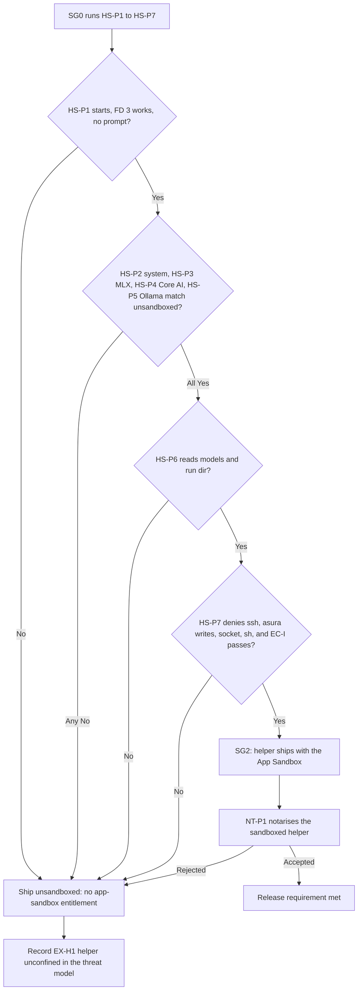

## Team Keychain store

Selected (SGQ4, SGQ5, SGQ6, SGQ8), revised 2026-10-27 from the KC probe
results. Packet SG3 implements it in `asura-platform::keychain` and
`asura-service::secret_store`; the [secret store](secret-store.md) design
describes the store as a whole.

### Is a provisioning profile, and so a bundle, required?

Yes. Apple states this directly:

- TN3137: "macOS builds the list of data protection keychain access groups
  available to your program from its code signing entitlements ... These
  entitlements must be authorized by a provisioning profile. Your program needs
  an app-like bundle structure in which to embed that profile. This is standard
  for app and app extensions but not for command-line tools."
  ([TN3137](https://developer.apple.com/documentation/technotes/tn3137-on-mac-keychains))
- TN3125: "A standalone executable can't claim a restricted entitlement because
  there's no place to embed the provisioning profile that authorizes that claim.
  If your standalone executable needs to do this, wrap it in an app-like
  structure." It names `keychain-access-groups` as profile-authorised, and says
  macOS expects the profile at `MyApp.app/Contents/embedded.provisionprofile`.
  ([TN3125](https://developer.apple.com/documentation/technotes/tn3125-inside-code-signing-provisioning-profiles))
- [Signing a daemon with a restricted entitlement](https://developer.apple.com/documentation/xcode/signing-a-daemon-with-a-restricted-entitlement)
  gives the wrapping procedure.
- TN3137: "The data protection keychain is only available in a user login
  context." The per-user service runs in the person's login context when the
  CLI starts it from a GUI login session. Over SSH this is **unverified** (probe
  KC-P3 was not run; [field evidence](#keychain-field-evidence) records it).

This is the reason for SGQ1. Probe KC-P1 confirmed that a process whose
executable is `Contents/MacOS/asura` gets the group, and probe KC-P2 confirmed
it when `asura` starts through a Homebrew-style symlink, by path or by `PATH`,
and when it re-execs itself in a new session (2026-10-27).

### Item contract changes

Selected, replacing rows of the
[secret store item contract](secret-store.md#keychain-item-contract) (SG3):

| Property | Team Keychain store |
| --- | --- |
| Keychain | Data-protection keychain: `kSecUseDataProtectionKeychain = true` on every add, query and delete. Production no longer uses `kSecUseKeychain` or `SecKeychainCopyDefault` |
| Access group | `kSecAttrAccessGroup` is set in every add, query and delete, to the group the process reads from its own entitlements ([access group](#access-group-from-the-entitlements)): `<TeamID>.org.pidster.asura`, or `<TeamID>.org.pidster.asura.test` in the qualification bundle. Never omitted: KC-P1 showed that a process with no Keychain entitlement that omits the group gets -25300, which reads as "absent" (F2) |
| Accessibility | `kSecAttrAccessibleAfterFirstUnlockThisDeviceOnly` (KQ1). "ThisDeviceOnly" keeps the item out of backups to other devices and out of migration |
| Synchronizable | `false`, explicitly |
| User interaction | `kSecUseAuthenticationUI = kSecUseAuthenticationUIFail` in every dictionary, so a call that would need a dialog fails with -25308 instead. The process-wide `SecKeychainSetUserInteractionAllowed(false)` also stays: it costs one call at worker start and also covers the test-only file backend. KC-P4 saw no dialog for any call |
| Who can read and delete | Any executable signed by the team that claims the group under a valid profile (SGQ4, KQ2 revised; KC-P1). Another same-user program cannot name the group: a query on a group the program is not entitled to returns `errSecMissingEntitlement` (-34018), not `errSecItemNotFound` (KC-P4, F1). Apple's [sharing access](https://developer.apple.com/documentation/security/sharing-access-to-keychain-items-among-a-collection-of-apps) page suggests the second; the probe found the first on macOS 27.0 (26A428) |
| Service, account, label, payload, 55,413-byte bound, 256 items, 257-item list bound | Unchanged. KC-P4 added and read a 55,413-byte item |

The platform wrapper builds every dictionary through one function that always
sets `kSecUseDataProtectionKeychain`, the access group, `kSecAttrSynchronizable
= false` and the user-interaction key. A dictionary without the flag would
reach the file-based keychain (TN3137: `SecItem` "defaults to targeting the
file-based keychain"). Unit test KC-U1 asserts this for every call kind, and
asserts that no dictionary carries `kSecUseKeychain`.

### Access group from the entitlements

Selected (engineering, 2026-10-27, finding F2). Rejected: a build-time
constant. It would put the team ID in source or in a build input, which the
[credentials rule](#where-credentials-live) forbids, and it would still need a
run-time check that the signature grants it.

The secret store worker reads the group once, when it opens the store, on its
own thread. `SecTaskCreateFromSelf` and `SecTaskCopyValueForEntitlement` read
the running process's signed entitlements; they make no `securityd` call, but
they run on the worker like every other Security framework call (AE-02). A
running process cannot gain or lose an entitlement, so the worker never reads
them again.

The group is valid only when all of these hold. Otherwise the store is
`unavailable` with reason `not_signed`, and the worker makes **no** Keychain
call for the rest of the process:

1. `com.apple.application-identifier` is a string `<T>.<B>`, where `<T>` is ten
   upper-case letters or digits and `<B>` is `org.pidster.asura` or
   `org.pidster.asura.test`;
2. `keychain-access-groups` is an array of exactly one string, equal to the
   application identifier;
3. `com.apple.developer.team-identifier` is absent or equals `<T>`;
4. each value has the expected Core Foundation type.

A release or development `asura` therefore uses `<T>.org.pidster.asura`. The
qualification bundle, signed with the test App ID, uses
`<T>.org.pidster.asura.test`, so it cannot name the production group (owner
runbook, open point 1). An unsigned or ad hoc build has no entitlements and
fails rule 1 before any call. A build with an extra or unexpected group fails
rule 2: it reports `not_signed` rather than choosing one of its groups.

#### SG-F7: access group check

Selected design. Arrows show the next check; labels show the result. Every
"not_signed" end makes no Keychain call.

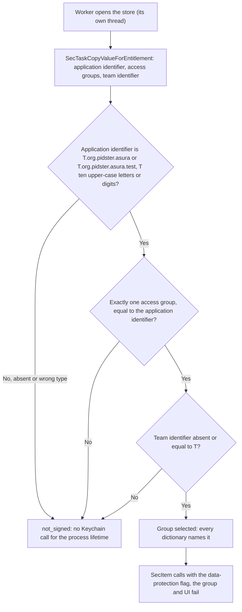

### What SG3 removes

- The target pre-check (`SecKeychainGetStatus`) in production. There is one
  data-protection keychain per user, and every dictionary names it with the
  flag and the group, so SS-T7 (a call reaching the wrong keychain) cannot
  happen in production. The pre-check remains a rule for the test-only
  scratch backend.
- `SecKeychainCopyDefault` and `kSecUseKeychain` in production.
- **Stranded items, as a category** (SGQ4). SS-P3 stranding comes from the
  file keychain's per-cdhash read ACL and per-file-name delete rule. With an
  access group, every team-signed Asura build can delete every Asura item. A
  delete can then fail only for the whole store (missing entitlement, or
  `errSecInteractionNotAllowed` before the first unlock), never for one item.
  `stranded_count` and `stranded_inputs` (`SecretStoreStatus` fields 4 and 6),
  the `stranded` count of the `secret_store.sweep` audit event and the
  `/status` stranded notice are removed. Field numbers 4 and 6 are reserved.
  This is a schema change within protocol `0.1` under the
  [numbering authority](../engineering.md#wire-protocol-change-authority).
  A delete that fails for any reason leaves an orphan that the next sweep
  retries.
- `denied` in production (KQ2 revised). A missing entitlement is
  `unavailable` with reason `not_signed`, not `denied`, because no later call
  can succeed and the person needs the build fixed, not the item. The
  `denied` reply, the `secret_store_denied` refusal and hold reason stay only
  for the test-only scratch file backend, whose per-build ACL still produces
  -25293 and -25244. A production build cannot produce them.
- Unrecognized items stay: counted, never read or deleted.

The process-wide `SecKeychainSetUserInteractionAllowed(false)` is **not**
removed (revised 2026-10-27): every Keychain call must run with user
interaction disabled, and the per-call `kSecUseAuthenticationUIFail` key covers
the data-protection calls only.

### Status mapping

Selected; revised 2026-10-27 from probes KC-P1 and KC-P4. One platform
function maps the status of a data-protection call; the worker never sees an
`OSStatus` except as the evidence it records. Every row except success records
the raw status and the session state ([field evidence](#keychain-field-evidence)).

| Status | Reply | Evidence |
| --- | --- | --- |
| 0 | Success | KC-P1, KC-P4 (add, read, list, delete) |
| `errSecItemNotFound` (-25300) | `absent` on delete, `missing` on read, zero items on list. This holds only because the call named an entitled group: a process that omits the group and has no entitlement also gets -25300 (F2), which is why no call omits it | KC-P4 (list, read and delete of a missing item) |
| `errSecDuplicateItem` (-25299) | Existing duplicate rule | KC-P4 |
| `errSecInteractionNotAllowed` (-25308) | `locked`: the Mac has not been unlocked since start-up. The existing paced recheck applies | **Unverified**: KC-P3 case B was not run. The audit event records each occurrence with its session state |
| `errSecMissingEntitlement` (-34018) | `unavailable`, reason `not_signed`: "This Asura build is not signed for the Keychain." Returned for any group the process is not entitled to, not only for an unsigned build (F1). Terminal: the worker makes no further Keychain call | KC-P1 (unsigned list and add naming the group), KC-P4 (`list-unclaimed-group`) |
| Access group check fails before any call | Same as -34018 (`unavailable/not_signed`, status -34018); no Keychain call is made | [SG-F7](#sg-f7-access-group-check) |
| `errSecNotAvailable` (-25291) or any other code | `unavailable` with the code, as today | No probe case forced one |

#### SG-S1: secret store availability under the team Keychain store

Selected design, revised 2026-10-27. Arrows are the access group check or
observed call results on the secret store worker. `NotSigned` is terminal for
the process: no recheck can add an entitlement, so the worker answers every
later request at once without a Keychain call. Every transition into
`Locked`, `NotSigned` or `Unavailable` records the raw status and the session
state in that request's audit event.

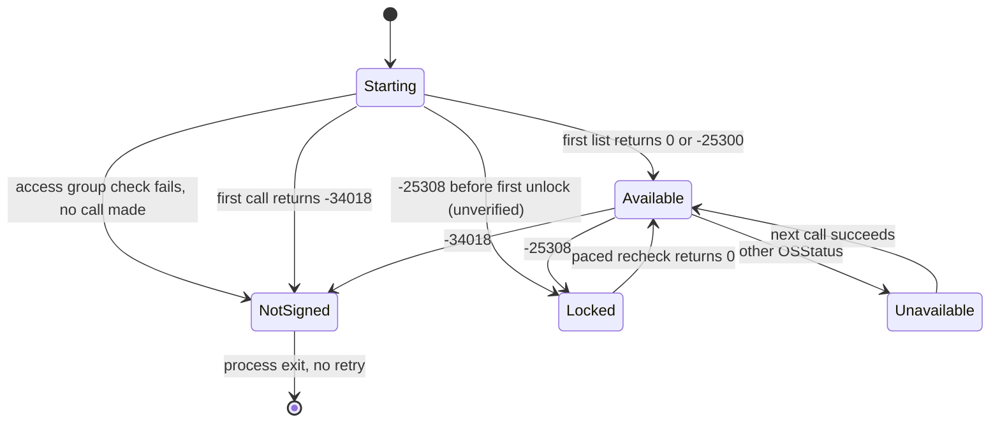

### Keychain field evidence

Selected (owner direction, 2026-10-27, finding F3). KC-P3 was skipped, so the
running product gathers the evidence it would have given. On every Keychain
error (`locked`, `denied`, `unavailable`, including `not_signed`), the
secret store worker records two facts with the request's reply, and the
conversation owner writes them into that request's `secret_store.put`,
`.get`, `.delete` or `.sweep` audit event:

- `status`: the raw `OSStatus` as a signed 32-bit integer (for example
  -25308 or -34018). A request the worker refused as a defect
  (`invalid_request`) made no Keychain call; it records status 0 and no
  session.
- `session`: the session state, read on the worker thread when the error
  returns:

| Field | Source | Values |
| --- | --- | --- |
| `boot_time_s` | `sysctl kern.boottime` | Seconds since 1970; absent if the call fails |
| `console` | Owner of `/dev/console` (`stat`) compared with the process's real user ID | `self` (this user owns the console: a GUI login), `other` (another user), `none` (owned by root: the login window), `unknown` (the call failed) |
| `audit_flags` | `getaudit_addr`: the audit session flags of the process | The raw flags; absent if the call fails |
| `origin` | Derived from `audit_flags` | `remote` (`AU_SESSION_FLAG_IS_REMOTE`, set for SSH logins), else `graphic` (`AU_SESSION_FLAG_HAS_GRAPHIC_ACCESS`, a GUI login session started by `loginwindow` and `launchd`), else `other` (for example a `launchd` background session), or `unknown` |

The audit session is inherited across `fork`, `exec` and `setsid`, so the
service reports the session of the CLI that started it. Together, boot time,
console owner and origin distinguish the KC-P3 cases: an SSH start with a GUI
login of the same user (`remote`, `self`), an SSH start with no GUI login
(`remote`, `none`) and a start soon after boot.

Bounds: four fixed-size fields, no strings from the system, no user or account
name, no path and no item data (RS5). Each call is one system call on the
worker thread (AE-02); none blocks on `securityd`. Success replies record
neither field. The audit record format number does not change: the fields are
added in place to the `secret_store.*` events (RS7).

#### SG-F8: evidence for one Keychain error

Selected design. Arrows show the order of work for one failed call; labels
name the thread.

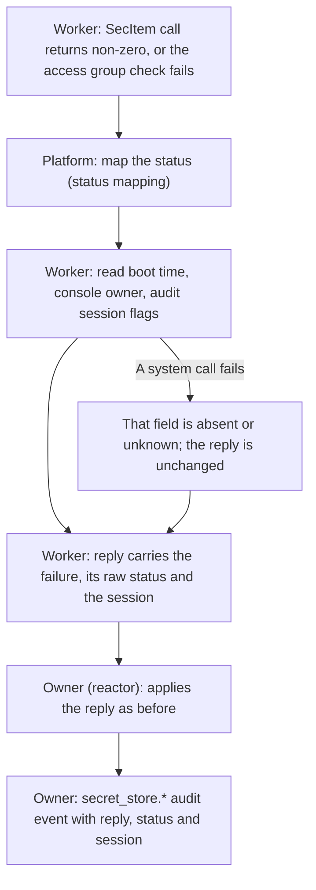

### Switch from the login keychain

Selected (SGQ5): a clean switch.

1. The new build has no code that reads, lists or deletes file-keychain items.
2. A kind 31 journal record whose item now lives only in the login keychain
   reaches dispatch, finds no item and is held with `secrets_lost`. This is the
   existing behavior; the person enters the command again.
3. The SG3 change notes tell the developer to do this once: open Keychain
   Access, select the login keychain, search for "Asura queued command
   secrets" and delete each match. These items hold values of commands that
   can no longer run.

Rejected: a one-release sweep of the login keychain. It is a legacy reader
(RS7) and keeps the deprecated `SecKeychain` API in production.

An unsigned development build (a plain `cargo build`) now reports
`not_signed`. Person commands that need the store, and every `!!` command,
are refused with "This Asura build is not signed for the Keychain." Commands
with no secret and model turns are unaffected.

### Test isolation without the login keychain

Selected (SGQ6), revised 2026-10-27.

| Layer | Backend | What it proves |
| --- | --- | --- |
| Unit (`cargo test`) | Scripted `KeychainPort`; recording `Calls` fixture in the platform | Worker, codec, sweep, replies, `not_signed` terminal state, field evidence, KC-U cases |
| Unit (`cargo test`) | Pure functions of the platform | KC-U1 dictionaries, KC-U2 mapping, KC-U4 access group rules, KC-U5 session decoding |
| Integration (`cargo test`, test-support) | The scratch **file** keychain backend, kept as the test-only `Target::Scratch` with its target pre-check and testing rules | Real Security framework IPC, queueing, a blocked call (AE-07). It does not prove data-protection behavior |
| Integration, negative (`cargo test`) | The unsigned test binary against the data-protection keychain | (a) Opening `Target::Default` reads no entitlement and returns `not_signed` with no Keychain call. (b) A list, a read and a delete that name the group `ASURATEST0.org.pidster.asura.test` (a made-up team ID, so no real item can match) each return -34018 and map to `not_signed`. The test checks first that the binary has no Keychain entitlement. No test calls `SecItemAdd` against the data-protection keychain; KC-P1 recorded that an unsigned add returns -34018 |
| Qualification (signed, not `cargo test`) | The qualification bundle ([below](#signed-qualification-run)) | Real data-protection add, read, list, delete, sweep and restart through the production backend and the store worker. Production Asura cannot see the test group. The run deletes every item it wrote and then lists the group to prove that it is empty |

`Target::Default` is the data-protection backend. `Target::Scratch` stays
behind the `test-support` feature. A production build therefore cannot select
the file keychain, and SS-U7 is extended to check this. The platform's own
unit tests refuse `Target::Default` when the access group check succeeds, so
a signed test binary still never reaches the data-protection keychain.

If the qualification run ends before its clean-up (crash or cancel), the next
qualification run lists the test group first and deletes every item it finds
before it writes. The test group holds only qualification items, so this
delete never touches a production item.

#### Signed qualification run

Selected (engineering, 2026-10-27; owner runbook open points 1 and 4).

- **Executable.** `secret_store_qualification`, a `test-support` binary of
  `asura-service` over `asura_service::secret_store::qualification_main`. It
  uses the production `Target::Default` backend and the production store
  worker; only the case driver is test code. It is never part of `Asura.app`.
- **Identity.** A bundle `AsuraKeychainQualification.app` with
  `CFBundleIdentifier` `org.pidster.asura.test`, the test App ID's profile
  embedded, and the entitlements of the tracked list
  `tools/release/entitlements/secret-store-qualification.plist`: application
  identifier and the one access group `<TeamID>.org.pidster.asura.test`, and
  the team identifier. The access group check therefore selects the test
  group. The executable refuses to run, with no Keychain call, unless the
  selected group ends in `.org.pidster.asura.test`.
- **Build.** `tools/release/secret-store-qualification` builds the binary,
  assembles and signs the bundle with the operator's identity (Apple
  Development or Developer ID) and the test profile, checks the signed
  entitlements and runs the cases. Its `--ad-hoc` mode assembles and signs ad
  hoc without restricted entitlements and expects the executable to refuse
  with `not_signed`; `cargo test` never runs either mode.
- **Cases.** Q0 purges the test group. Q1 a sweep of an empty store lists zero
  items. Q2 puts a 55,413-byte payload; a retry with equal values is
  `exists_same` and with other values `exists_different`. Q3 reads the values
  back exactly. Q4 puts a second item, closes the store and starts a new
  worker (restart); a sweep with the first input live keeps it and deletes the
  second. Q5 reads the first again, deletes it, then `absent` and `missing`.
  Q6 the observation reports zero items and status 0. Q7 purges and lists the
  whole test group: it must be empty (`test-group-empty=yes`).
- **Purge.** A `test-support` platform function lists every generic-password
  item in the test group (at most 257 per listing, attributes only) and
  deletes each by its service and account. It refuses unless the selected
  group is the test group. It repeats while a listing was full and the pass
  deleted an item.

The run proves the data-protection path of the store worker. The service-level
SS-I and SL5 cases on a signed bundle need the real `asura` signed with the
test group in an isolated home, which no build mode provides; they stay with
SG5.

### Secure Enclave: open item

Open decision (owner, 2026-10-23, SGQ8): the Secure Enclave design item from
EXD-3 stays open for later study. The team Keychain store does not depend on it. These notes
are input to that study; they select nothing.

- The Secure Enclave holds only NIST P-256 keys. It signs and does key
  agreement; it cannot store a 55 KB payload
  ([Protecting keys with the Secure Enclave](https://developer.apple.com/documentation/security/protecting-keys-with-the-secure-enclave)).
  A design would encrypt the payload with ECIES to an enclave key and store the
  ciphertext in a keychain item or in an Asura file.
- Decryption returns the plaintext to the calling process as `CFData`. The
  in-process copy described by SS-T8 therefore stays. The securityd copy would
  move to an enclave key-agreement call; this detail is **unverified**.
- The enclave key reference itself lives in the data-protection keychain under
  the same access group. A Secure Enclave design therefore needs the team Keychain store
  first.
- Under D1, a same-user reader of process memory is the same principal. SS-T8
  stays an accepted residual (EXD-3) until the study decides otherwise.

## Hardened Runtime: DYLD, Metal and resource bundles

### `DYLD_*` and PC-I38

- Apple: the `allow-dyld-environment-variables` entitlement "causes the macOS
  dynamic linker (`dyld`) to read from environment variables that begin with
  `DYLD_`"
  ([entitlement page](https://developer.apple.com/documentation/bundleresources/entitlements/com.apple.security.cs.allow-dyld-environment-variables)).
  Without it, a Hardened Runtime process ignores them. Library validation also
  refuses a library from another team
  ([disable-library-validation](https://developer.apple.com/documentation/bundleresources/entitlements/com.apple.security.cs.disable-library-validation)).
- Effect on [PC-I38](person-command-mode.md#integration): the FD 11 design
  already keeps the launch environment out of the guardian. In a signed build,
  the guardian is also immune if `DYLD_*` reaches its own environment. PC-I38
  keeps its unsigned run, because cargo test binaries are unsigned. A new case
  PC-I38-S runs the signed qualification bundle: a guardian started with
  `DYLD_INSERT_LIBRARIES` in its own environment never loads the marker
  library (probe HR-P1).
- **Unverified: whether `dyld` also removes `DYLD_*` from the environment of a
  Hardened Runtime process.** If it does, the TUI's own environment loses them
  at start, and the `!!` launch environment cannot contain them. The effect on
  `!!` is small: PC-I38 already records that SIP removes `DYLD_*` when
  `/bin/sh` starts, so `!!` children never saw them. Probe HR-P2 records the
  result, and the `!!` documentation states it.
- The helper is spawned with only `LANG` and `LC_ALL`, so `DYLD_*` cannot reach
  it.

### `mlx.metallib`

Metal loads the file with `newLibraryWithURL` as GPU code. Library validation
covers Mach-O code loaded by `dyld`, not Metal libraries. MLX on Apple platforms
builds no CPU code at run time (`backend/cpu/compiled.cpp` is excluded). Neither
`allow-jit` nor `allow-unsigned-executable-memory` is therefore expected. This
conclusion rests on reading the code. It is **unverified at run time**: probe
HS-P3 runs MLX generation in a hardened, and then a sandboxed, helper.

Lookup order after the bundle change: MLX first tries `mlx.metallib` beside the
running executable. The running executable is the copy in
`~/.asura/run/model-<hex>/`, and the copy step already places `mlx.metallib`
there. In a bundle, the source path changes from beside `asura-model` to
`Contents/Resources/mlx.metallib`
([resource directory](#resource-directory-inside-the-bundle)). The copied
layout does not change.

### SwiftPM resource bundles

- A resource bundle has no code. The Hardened Runtime does not affect reading
  it.
- `SwiftProtobuf_*.bundle` and `swift-crypto_Crypto.bundle` hold privacy
  manifests only. No code path reads them at run time (no `Bundle.module` use
  found outside Hub). They are not shipped.
- `swift-transformers_Hub.bundle` is read at run time. Its absence is defect
  BN-P1, below. It exists today without signing and is fixed by BN1.

## BN1: Hub resource bundle defect

Status: defect confirmed by probe BN-P1, 2026-10-23
([result](#bn-p1-result)). Fix (D-S6) selected (engineering) and delivered
for development packages ([delivery](#bn1-delivery)); release placement in
`Contents/Resources` and bundle signing remain with SG1. Owned with the
[model provider packaging](model-provider-integration.md#verified-metal-resource-packaging).

**Defect.** `Hub.tokenizerConfig` calls `fallbackTokenizerConfig(for:)` when
the tokenizer configuration has no `tokenizer_class` and the model has a
`model_type`. It also calls it when the tokenizer configuration is absent and
the model has a `model_type`. That function reads `Bundle.module`. The
generated accessor searches `Bundle.main.resourceURL`, the framework bundle
and `Bundle.main.bundleURL` for `swift-transformers_Hub.bundle`. The
`PACKAGE_RESOURCE_BUNDLE_PATH` override exists only in debug builds, and the
helper environment holds only `LANG` and `LC_ALL`. For the copied helper, the
search reaches only `~/.asura/run/model-<hex>/`. The current package ships no
Hub bundle, so the accessor calls `fatalError` and the helper exits. The
service handles the exit as a helper failure: the crash is contained and
control stays usable, but the model cannot run.

**Fix (selected, D-S6): ship and copy.**

1. Package assembly takes `swift-transformers_Hub.bundle` from the release
   SwiftPM build and places it at
   `Asura.app/Contents/Resources/swift-transformers_Hub.bundle`. A
   development package places it beside `asura-model`, as it places
   `mlx.metallib`. Until SG1 moves the resource source path, the copy step
   reads the bundle beside `asura-model`.
2. The release script signs the Hub bundle before the helper (D-S3). It then
   records the bundle digest in `package-identity.txt` and
   `model-package.json` as `hub_bundle_sha256`. The digest is the SHA-256 of
   the sorted list of (relative path, file SHA-256) pairs of every regular
   file in the bundle ([encoding](#hub-bundle-digest-encoding)). It is the
   fifth line of `package-identity.txt`, after the `metallib` digest.
   `asura-service/build.rs` embeds it as it embeds the `metallib` digest.
3. The preparation worker copies the bundle beside the helper copy, as
   `~/.asura/run/model-<hex>/swift-transformers_Hub.bundle/`, for every MLX
   and every Core AI selection (BN-P1 shows both reach `Hub.tokenizerConfig`).
   It uses the existing copy rules: regular files only,
   owned by the service account, not group or world writable, no symlinks,
   64 KiB chunks under the preparation cancellation flag, each copied inode
   re-read and hashed. Source directories follow the same owner and mode
   rules and are opened without following links. A digest mismatch or a
   missing bundle makes the provider unavailable before spawn. System and
   Ollama selections do not copy the bundle.
4. Limits: at most 16 files and 16 directories, depth 4, each file at most
   1 MiB, and the bundle at most 1 MiB in total. A file at depth 4 has a
   relative path of four components. Empty files are allowed: the ad hoc
   signed bundle holds an empty `Contents/_CodeSignature/CodeSignature`. Each
   name is UTF-8 with no control character and no backslash, so the
   `shasum` form below stays exact. The current bundle has 7 files and
   3 directories in 44 KiB. A bundle over a limit fails package assembly and
   fails preparation.
5. Cleanup removes only the copied names whose device and inode match the
   retained descriptors, then the matching empty directories, deepest first,
   as for `mlx.metallib`. Unknown entries survive, and so do their
   directories.

#### Hub bundle digest encoding

Selected (engineering). For each regular file, the relative path joins the
names below the bundle root with `/` (for example
`Contents/Resources/gpt2_tokenizer_config.json`). Sort the files by the bytes
of that path. For each file, write one line: the 64 lowercase hex digits of the
file SHA-256, two spaces, the relative path and a line feed. The digest is the
SHA-256 of these lines. The bytes equal the output of `shasum -a 256` over the
sorted relative paths, run in the bundle root, so the development package step
can compute the same value with standard tools. The platform owner computes it
in Rust during the copy; a unit test pins both forms to one known vector.

#### BN-P1 result

Run 2026-10-23 on macOS 27.0 (26A428), Apple Swift 6.4
(swiftlang-6.4.0.34.1), development helper build, no signing.

- Fixture: `mlx-community/Falcon-H1-Tiny-Tool-Calling-90M-bf16` copied to a
  scratch directory (`model_type` `falcon_h1`), with `tokenizer_class` removed
  from `tokenizer_config.json`. Run through `conversation_flow --native-mlx`
  with a scratch home, so the service copied the helper into
  `<home>/.asura/run/model-<hex>/` without the Hub bundle.
- Without the bundle: the submit failed with `model_helper_failed`. The crash
  report shows `EXC_BREAKPOINT` (`SIGTRAP`) in the `NSBundle.module`
  initializer, called from `LanguageModelConfigurationFromHub.fallbackTokenizerConfig(for:)`,
  `tokenizerConfig`, `AutoTokenizer.from(modelFolder:)` and the MLX tokenizer
  loader.
- Control: the same model with `tokenizer_class` kept completed the journey.
- With the bundle beside the copied helper (after BN1), the same
  `falcon_h1` fixture no longer crashes. `Hub` guesses the class
  `Falcon_H1Tokenizer`, which `swift-transformers` does not know, so the
  helper reports the provider unavailable (`model_unavailable`). This is the
  library's selection rule, not a crash.
- A second fixture completes the journey: a synthetic one-layer `llama`
  model (64 hidden units, zero attention and MLP weights, greedy output of one
  token then EOS) with the Falcon-H1 tokenizer files and no
  `tokenizer_class`. `Hub` guesses `LlamaTokenizer`. Before BN1 the same
  fixture fails with `model_helper_failed`; after BN1 it completes.
- Providers: MLX reaches `Hub.tokenizerConfig` (proved above). Core AI reaches
  it by code reading: `CoreAILanguageModels` `LanguageBundle.loadTokenizer()`
  calls `AutoTokenizer.from(modelFolder:)` on the embedded `tokenizer/`
  directory. No Core AI asset was run. System and Ollama do not load a Hub
  tokenizer.

Rejected alternative: **reject such models.** MLX asset validation would
refuse a model whose tokenizer configuration lacks `tokenizer_class` when
`model_type` is set. It refuses valid models that Hub supports through its
fallback and its capitalised-name guess, and it copies Hub's selection logic
into Asura, where it can drift from the library.

#### BN1 delivery

Delivered 2026-10-23 on branch `bn1`:

- `asura-platform` `ModelProcess::spawn_with_resources` takes
  `PackageResources` (`metallib`, `hub_bundle`). The bundle copy walks the
  source by directory descriptor, applies the limits above, copies each file
  with the existing verified-copy routine (empty files allowed), computes the
  digest, and re-checks every retained name before spawn. Cleanup is owned by
  the retained descriptors.
- `asura-service` `build.rs` reads an optional fifth identity line;
  `PackageIdentity.hub_bundle_digest` holds it. `model_owner` requires it for
  `mlx:` and `coreai:` selections and fails owner creation without it.
- The development package step is documented in
  `swift/model-helper/README.md`. No tracked script assembles the package; the
  root build owner runs the step.

Proof limits: no Core AI asset was run; no release bundle, signing or
`Contents/Resources` lookup exists yet (SG1). The service-level stalled-copy
responsiveness case in AE-07 has no test seam yet; cancellation during the
copy is proved at the platform unit level.

### SG-F3: Hub bundle preparation

Selected design (BN1). Arrows show the next step; labels show check results.
This view extends the MLX path of the
[verified Metal resource packaging](model-provider-integration.md#verified-metal-resource-packaging)
flow; it does not replace it.

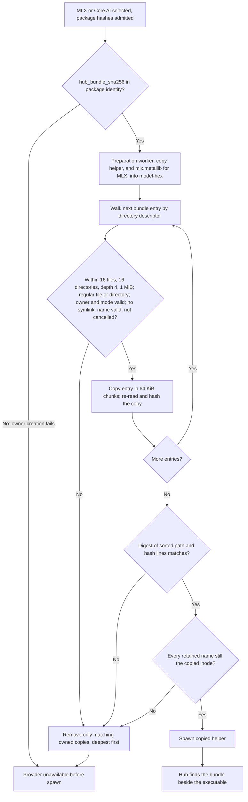

## Failure handling

| Failure | Result |
| --- | --- |
| Helper signature or its digest is wrong in the package | Existing HD14 path: the service rejects the helper before model content, reports model work unavailable, and control stays usable |
| Hub bundle missing or its digest is wrong | The provider is unavailable before spawn ([SG-F3](#sg-f3-hub-bundle-preparation)); other providers are unaffected |
| `codesign --verify` fails in the release script | The script stops before notarisation. No artifact is published |
| Notarisation returns `Invalid` | The script downloads the log, stops and publishes nothing. A fixed build is a new build with a new digest |
| `notarytool --wait` does not return | No time bound (RS8). The operator cancels. A later `notarytool info <id>` resumes the check without a new submission |
| `stapler staple` fails because the ticket is not yet available | Paced retries 1, 2, 4, 8 … s, at most 60 s apart. Pacing ends nothing; success or an operator cancel ends the loop |
| Profile missing or expired in the bundle | `asura` fails to start, or the group is missing: `not_signed` (SG-F7 or -34018). Release verification checks the entitlements against the profile before submission |
| Data-protection keychain unavailable (SSH, before first unlock) | `locked` or `unavailable`, with the existing paced recheck. Never a fallback to a file. The audit event records the raw status and the session state ([field evidence](#keychain-field-evidence)) |
| Unsigned development binary, or a build with an unexpected group | `unavailable/not_signed` with no Keychain call. Person commands that need the store and every `!!` command are refused with "This Asura build is not signed for the Keychain." Draft and mode kept. A command already queued waits at dispatch with `keychain_unavailable`; the worker answers each recheck at once without a call. `/status` shows the text with OSStatus -34018 |
| Sandboxed helper denied a needed path or service | The helper exits or reports a provider error. The service reports the provider unavailable through the existing paths. No relaxation at run time |
| Sandboxed helper first launch while the container manager stalls | The helper process is stalled. The model owner already waits with no time bound, ending on Hello, exit, cancel or shutdown. Control stays responsive |
| `fatalError` from a missing resource bundle | Helper exit; existing helper-failure settlement. BN1 removes the cause |
| Qualification run ends before clean-up | Items remain in the test group only. The next qualification run deletes them first ([test isolation](#test-isolation-without-the-login-keychain)) |

## Security

- **Authority.** A signature proves who built a binary. It does not prove what
  the binary does. Under D1, same-user processes are one principal. This
  design makes no new boundary claim.
- **Stronger defence in depth.** In a signed build, the Hardened Runtime
  refuses `DYLD_*` injection, and with no `get-task-allow` it refuses a
  debugger attaching to `asura`. With the team Keychain store, a same-user program that lacks
  the team-signed group cannot read or delete Asura items. SS-T1 and SS-T3
  improve: a binary named `asura` can no longer delete items by name. SS-T6
  (`!!` runs as the person) and SS-T8 are unchanged.
- **New residual SG-T1.** Any build signed by the team with the group,
  including a development build, reads and deletes every Asura item on that
  Mac (SGQ4, accepted by the owner, 2026-10-23).
- **New residual SG-T2.** The release Mac holds the Developer ID key. Whoever
  controls that account can sign as Asura. Notarisation keeps an audit trail,
  and Apple can revoke tickets
  ([Notarizing macOS software](https://developer.apple.com/documentation/security/notarizing-macos-software-before-distribution)).
- **Helper sandbox.** SG2 ships it (2026-10-23): it limits a compromised
  helper to reading models, its run directory and the Hub bundle, using the
  network, and writing its container. EX-H1 is not recorded. If NT-P1 rejects
  the sandboxed helper, SG-F2 ships it unsandboxed and EX-H1 is recorded.
- **New residual SG-T3 (HS-P7).** The App Sandbox does not stop the helper
  reading the arguments and environment of other processes of the same user
  through `KERN_PROCARGS2` (process list and descriptor info are denied, these
  reads are not). A compromised helper can therefore see secrets that other
  long-running programs hold in their environment variables, for example API
  tokens. The App Sandbox has no entitlement to deny this. Probe HS-P8 (SG2a,
  2026-10-23, macOS 27.0 26A428) found no Seatbelt rule that blocks a
  same-user `KERN_PROCARGS2` read: `(deny process-info*)`, `(deny
  sysctl-read)` blanket, by name and by the `kern.proc` prefix, and a
  deny-default profile all leave it allowed; `(target others)` has no effect
  in any rule; and the App Sandbox cannot be combined with a service-applied
  Seatbelt profile (the helper traps in `_libsecinit_appsandbox`). The
  residual therefore stands and the helper keeps the App Sandbox (SGQ7), which
  confines files, sockets and the process list. Where a Seatbelt profile
  limits process information, it is written `(deny process-info*)` with
  `(allow process-info* (target self))`, never with `(target others)`. The
  person is advised to keep long-lived secrets out of the environment of
  programs that stay running.
- **Hub bundle.** The bundle holds tokenizer configuration data only. Its
  digest is pinned like the helper's, so a changed bundle fails before spawn.
- **Data handling.** No signing material enters Asura records, tests or logs.
  The release log records identities by name and certificate SHA-1 only.

## Limits

| Item | Limit | Owner |
| --- | --- | --- |
| Secret store queue | 16 requests, one call at a time | Secret store (unchanged) |
| Items and list | 256 items, list of 257 | Secret store (unchanged) |
| Payload | 55,413 bytes | Secret store (unchanged) |
| Helper executable | 128 MiB | Model packaging (unchanged) |
| `mlx.metallib` | 64 MiB | Model packaging (unchanged) |
| Hub bundle | 16 files, 16 directories, depth 4, 1 MiB each, 1 MiB total | BN1 |
| `Asura.app` | At most 64 files (selected; the current count is under 20) | SG1 release script |
| Notarisation | One submission at a time; at most 75 per day (Apple) | Release operator |
| Stapling retries | Paced 1, 2, 4, 8 … s, at most 60 s apart, no count limit | Release script |

## Asynchronous execution

| Rule | Application |
| --- | --- |
| AE-01 | No signing or notarisation code exists in the runtime. The runtime gains no new call on the reactor, control or render path |
| AE-02 | Runtime blocking calls: `SecItemAdd`, `SecItemCopyMatching` and `SecItemDelete` with the data-protection flag run on the existing secret store worker thread only (IPC to securityd). So do the access group check (`SecTaskCreateFromSelf`, `SecTaskCopyValueForEntitlement`, once per worker) and the field evidence reads (`sysctl`, `stat` of `/dev/console`, `getaudit_addr`, once per failed call). The Hub bundle copy runs on the existing preparation worker. The helper's sandbox set-up runs inside the helper process at exec, under the existing model-owner supervision. Release-time blocking tools (`codesign`, `ditto`, `notarytool`, `stapler`, `spctl`) run only in the operator's release script, one at a time |
| AE-03 | See [limits](#limits). No new queue is added |
| AE-04 | No time bound. Store calls end with a reply, cancel or shutdown. `notarytool --wait` ends with the service's reply or an operator cancel. Stapling uses pacing only. The Hub copy ends on completion, failure or the preparation cancel flag |
| AE-05 | A notarisation submission is not repeated after an unknown outcome. The operator queries its ID. A rejected build is never re-signed in place; a new build gets a new digest |
| AE-06 | Service start: the store worker reads its access group when it opens the store and makes its first list call after replay, as today. A `not_signed` result is recorded and does not delay start; later requests get it without a call |
| AE-07 | Acceptance: with a data-protection call blocked by the test seam, the TUI stays responsive and Ctrl-C and Drop work (existing SS case, repeated on the signed qualification bundle). With the Hub copy blocked by the test seam, cancel ends preparation and control stays responsive |

## Probes

Each probe is an executable experiment. The table gives its question, method
and pass result. These boundaries apply to every probe, so the table is the
probe design that the [design process](../design-process.md#workflow)
requires:

- Probe code lives in the session scratchpad, never in the repository. Only
  the result is recorded here.
- No probe reads, writes or deletes an item in the login keychain.
- Probes marked "Ad hoc" use ad hoc signatures only and touch no certificate,
  profile or notary credential.
- Probes marked "Owner" need a real certificate or profile. Only the owner,
  or a session the owner authorises for that probe, runs them, on the owner's
  Mac. They use the test access group only and end with the group empty.
- A probe records a result even when it fails. A failed probe changes the
  packet that depends on it, as stated in [readiness](#packet-readiness).

| ID | Question | Method | Pass result | Signing |
| --- | --- | --- | --- | --- |
| SB-P1 | Can a process in the App Sandbox run `sandbox-exec`? | Fixture with `app-sandbox` runs `/usr/bin/sandbox-exec -p '(version 1)(allow default)' /usr/bin/true` | Records the result; expected `sandbox_apply: Operation not permitted` | Ad hoc |
| SB-P2 | Can an App-Sandboxed process call `proc_listpids(PROC_UID_ONLY)`, `proc_pidinfo`, `KERN_PROCARGS2` and `sandbox_check` on another same-user process? | Same fixture against a spawned unsandboxed sleeper | Records each result | Ad hoc |
| SB-P3 | Does a child of a sandboxed process report sandboxed, and does it get a bookmark grant of its parent? | Fixture spawns `/bin/sh`; `sandbox_check(child, NULL, 0)`; child reads a bookmarked path | Records the results | Ad hoc |
| HS-P1 | Can a bare helper with `app-sandbox`, copied to `~/.asura/run/model-<hex>/`, start from an unsandboxed parent and use FD 3? | Fixture helper and the existing spawn path | Starts, container created, no prompt, FD 3 echo works | Ad hoc, then owner |
| HS-P2 | Foundation Models in the sandboxed helper | Real `system` provider generation | Same result as unsandboxed | Ad hoc |
| HS-P3 | MLX with `mlx.metallib` in a hardened, then a hardened and sandboxed, helper | `conversation_flow --native-mlx` | Generation passes; no `allow-jit` needed | Ad hoc with `runtime` flag |
| HS-P4 | Core AI in the sandboxed helper | Native Core AI selection | Same result as unsandboxed | Ad hoc |
| HS-P5 | Ollama on loopback with `network.client` | `conversation_flow --native-ollama` | Passes; without the entitlement, fails | Ad hoc |
| HS-P6 | Read-only exceptions reach `~/.asura/data/models/` and `~/.asura/run/` | Asset inventory | Lists assets | Ad hoc |
| HS-P7 | Negative: the sandboxed helper cannot read `~/.ssh`, write `~/.asura`, connect to the control socket, or spawn `/bin/sh` outside its sandbox; the EX5 scan excludes it | Fault-injection build of the fixture helper | Each attempt denied; EC-I cases pass with the helper alive | Ad hoc |
| HR-P1 | A Hardened Runtime `asura` guardian ignores `DYLD_INSERT_LIBRARIES` | PC-I38-S | No marker from the guardian PID | Ad hoc with `runtime` flag |
| HR-P2 | Does `dyld` remove `DYLD_*` from a hardened process's own environment? | Hardened fixture prints `environ` | Records the result | Ad hoc with `runtime` flag |
| BN-P1 | Does an MLX asset without `tokenizer_class` crash a relocated helper? Which providers reach `Hub.tokenizerConfig`? | Fixture model directory with `model_type` set and no `tokenizer_class`, run through the copied helper with and without the bundle beside it | Without the bundle: records the exit; with it: the tokenizer loads | None |
| KC-P1 | Does a Developer ID `Asura.app` with the profile and group add, read, list and delete data-protection items? Does a rebuilt, re-signed build read them? Do an Apple Development build and a Developer ID build share the group? Does an unsigned binary get -34018? | Qualification bundle, test group | All as stated | Owner |
| KC-P2 | Does the group apply when `asura` starts through a symlink, and in its re-exec as the service? | Homebrew-style `bin/asura` link | Same results as KC-P1 | Owner |
| KC-P3 | Data-protection availability over SSH, and before first unlock | SSH session to the qualification Mac | Records the status codes. Not run (owner, 2026-10-27); the [field evidence](#keychain-field-evidence) gathers it until a rerun | Owner |
| KC-P4 | Status code inventory; no prompt on any call | Qualification bundle | [Status mapping](#status-mapping) confirmed or corrected | Owner |
| NT-P1 | Notarise a zip of `Asura.app` with a sandboxed helper that claims temporary exceptions; staple; tar round trip; Homebrew install | Real release dry run to a private tap branch | Accepted; `stapler validate` passes after extraction; `codesign --verify --strict` passes in the keg; quarantine state recorded | Owner |

### SG0 results (ad hoc part, 2026-10-23)

Run on the macOS 27 host with ad hoc signing only, scratch homes, probe-only
bundle IDs (`org.pidster.asura.probe.*`) and no Keychain call. The full record
with commands, entitlement plists and output is kept with the session
evidence; the results and their design effect are:

| Probe | Result | Effect |
| --- | --- | --- |
| SB-P1 | `sandbox-exec` inside the App Sandbox: `sandbox_apply: Operation not permitted`, exit 71 | Confirms D-S1: the service is not App-Sandboxed (EC-V-NEST verified) |
| SB-P2 | Inside the App Sandbox, `proc_listpids` and file-descriptor info are denied; bsdinfo, pidpath, `sandbox_check` and `KERN_PROCARGS2` (with environment) are allowed | EX5 escapee control would lose its process list inside the App Sandbox; recorded in D-S1 |
| SB-P3 | A `/bin/sh` child of a sandboxed process is sandboxed; a dynamic sandbox extension (the mechanism behind bookmarks) is inherited by the child | Corrects the forum claim; D-S1 unchanged (`!!` still cannot run outside the sandbox) |
| HS-P1 | A sandboxed bare helper starts from an unsandboxed parent, gets its container and FD 3, with no prompt, only with an embedded `Info.plist` | Embedded `Info.plist` required (SG1) |
| HS-P2, HS-P4 | System provider and Core AI match the unsandboxed helper | Pass |
| HS-P3 | MLX with the metallib works hardened and sandboxed; no `allow-jit` | Pass |
| HS-P5 | Ollama works with `network.client`; without it `model_unavailable` | Pass |
| HS-P6 | Read-only exceptions work, but the `--models` inventory fails: it opens `/` and walks each component with `openat`, and `private` and `Users` are denied | Fix in packet SG2: the inventory opens the asset root by its full path (or the service passes a directory descriptor); rerun HS-P6 before SGQ7 is decided for release |
| HS-P7 | `~/.ssh` reads, writes and unix-socket connects are denied; children stay sandboxed; EX5 qualification passes with a sandboxed stand-in alive | Pass. Limit: the helper sandbox does not stop `KERN_PROCARGS2` reads of other same-user processes' arguments and environment (recorded under security, EX-H1) |
| HR-P1 | A hardened guardian loads no `DYLD_INSERT_LIBRARIES` library; the unsigned control does | Pass at the dyld level; PC-I38-S runs with SG1 |
| HR-P2 | dyld removes `DYLD_*` from a hardened process's own environment | Resolved: a hardened `asura` cannot pass `DYLD_*` on to `!!` |
| BN-P1 | MLX and Core AI reach the Hub fallback and crash without the bundle; no crash with it | Defect confirmed; fixed by BN1 for MLX and Core AI |

SG2a reruns (2026-10-23): HS-P1 and HS-P6 pass with a sandboxed helper built
with the embedded `Info.plist` and the inventory opening its asset root by full
path; SG2's HS-P6 condition is met. The conversation-flow crash-recovery step
was timing-sensitive with the slower-starting sandboxed helper (3 of 5 runs);
its harness wait ends on the recorded event, not a deadline (SG-V5). Probes and
end-to-end cases assert on helper behaviour, never on an outside
`sandbox_check` answer, which reported readable model paths as denied. The
helper's run copy for system, Ollama and inventory selections is a bare
`run/model-<hex>` file whose name differs from `CFBundleExecutable`; every
probe passed, so the name need not match.

Core AI cache: with the embedded identity, repeated spawns share one cache,
`~/Library/Caches/coreai-cache/<os build>/org.pidster.asura.model` (about
2.1 GB per identity and OS build). Core AI owns that cache; Asura does not
delete it, and the user documentation states its size and location.

Test isolation (from HS-P6): home-relative exceptions anchor to the real
account home, not `HOME` or the Asura home, so a sandboxed helper cannot read a
harness home under `/private/tmp`. Tests of a sandboxed helper (SG-V5 and the
HS end-to-end cases) sign a test variant with an absolute-path read-only
exception for the harness home; release entitlements never carry it.

Core AI cache (observed): Core AI keys its compiled-model cache by process
identity. Unsigned helper copies with a new name per spawn each created a 2 to
15 GB cache under `~/Library/Caches/coreai-cache/`, never reused (about 340 GB
had collected; the owner approved deleting them on 2026-10-23). The embedded
`Info.plist` identity (HS-P1) is the fix; packet SG2a delivers it for
development builds before SG1.

### KC probe results (2026-10-27)

Run on the owner's Mac (Mac16,6, macOS 27.0 build 26A428, team ID recorded
with the owner's evidence) at the owner's request, from the owner's runbook.
The probe was a C program in a probe-only bundle, signed with the test App ID
`org.pidster.asura.test` and the access group `<TeamID>.org.pidster.asura.test`
only; it refused to run with any other entitlement set. Items used the probe
service `org.pidster.asura.kc-probe`. Each run started and ended with a purge
of the test group, which ended empty. `security list-keychains -d user`
listed only the login keychain afterwards. No dialog appeared during any
Keychain call; the only dialog was `codesign` asking for the login keychain
password to use the signing key while building.

| Probe | Result | Effect |
| --- | --- | --- |
| Profiles (open point 2) | All four profiles (development and Developer ID, for `org.pidster.asura` and for `org.pidster.asura.test`) carry `keychain-access-groups` = `<TeamID>.*` with no capability turned on. The development profiles list this Mac; the Developer ID profiles provision all devices. The macOS development profiles carry no `get-task-allow` | Open point 2 resolved: no Keychain Sharing capability is needed. The `get-task-allow` finding is an SG1 defect ([development builds](#development-builds-compared-with-release-builds)) |
| KC-P1 | Pass. A Developer ID build adds, reads, lists and deletes data-protection items in the group. A rebuild with a different CDHash reads them. Apple Development and Developer ID builds of the team read and delete each other's items. An unsigned binary that names the group gets -34018 for list and for add. **Difference:** an unsigned binary that omits the group gets -25300 for list, not -34018 (F2) | SGQ4 confirmed. F2: every call names the group (D-S7) |
| KC-P2 | Pass. A start through a Homebrew-style `bin/asura` symlink, by path and by `PATH`, keeps the entitlements, and the executable path resolves to the canonical bundle path. A `posix_spawn` re-exec with `POSIX_SPAWN_SETSID` in a new session reads, adds, lists and deletes in the group | The service and guardian re-exec keep the group. No design change |
| KC-P3 A | Not run (SSH with a GUI login). Skipped by the owner on 2026-10-27, to revisit | -25308 stays unverified; field evidence (F3, D-S8) |
| KC-P3 B | Not run (before first unlock). Skipped by the owner on 2026-10-27 | As KC-P3 A |
| KC-P4 | 17 of 18 cases match the design for both the Developer ID and the Apple Development builds: -25300 for list, read and delete of a missing item; 0 for add, read and list; -25299 for a duplicate add; a 55,413-byte item adds and reads exactly; with the group omitted, the default group is the first `keychain-access-groups` entry. **Difference:** a list naming a group the process does not claim returns -34018, not -25300 (F1). The SSH run of KC-P4 was not made | Status mapping revised: -34018 means "not entitled to this group" |

Findings that changed this design:

- **F1.** A query on a group that the process is not entitled to returns
  -34018. The code means "not entitled to this group", not only "unsigned".
- **F2.** A process with no Keychain entitlement that omits the group gets
  -25300, which looks like "absent". Every call now names the group, read
  from the process's own entitlements, and a build without a valid group
  reports `not_signed` before any call (D-S7).
- **F3 (owner direction).** KC-P3 case B was skipped, so the product gathers
  the evidence: every Keychain error records its raw status and the session
  state (D-S8). -25308 is handled as `locked` and stays marked unverified.

## Validation

| ID | Requirement | Unit | Integration | End to end | Environment |
| --- | --- | --- | --- | --- | --- |
| SG-V1 | RS1, RS2, D-S2 | Entitlement property lists parse; each lists only the allowed keys (a test reads the tracked files) | Release dry run: `codesign -d --entitlements` of the ad hoc build equals the expected list | NT-P1 on the release build | macOS 27, Apple silicon |
| SG-V2 | D-S3, RS9 | — | Dry run: the helper and Hub bundle digests inside the bundle equal `package-identity.txt` after signing and after stapling | HD9, HD14 from the installed keg | Clean host |
| SG-V3 | RS3, RS10 | A check that no tracked file matches `*.p12`, `*.p8`, `*.provisionprofile` or contains `BEGIN PRIVATE KEY` | The release script refuses without identity arguments; the dry run calls no real identity | — | — |
| SG-V4 | D-S1, RS6 | — | SB-P1, SB-P2 and SB-P3 recorded | Existing EC and PC suites pass on the signed qualification bundle, including the `KERN_PROCARGS2` environment-marker scan | macOS 27 |
| SG-V5 | SGQ7 | — | HS-P1 to HS-P7 | Native system, MLX, Core AI and Ollama journeys with the sandboxed helper | macOS 27, real models |
| SG-V6 | RS4, the team Keychain store | KC-U1 every dictionary kind sets the data-protection flag, the access group, `kSecAttrSynchronizable` false and UI fail, and none sets `kSecUseKeychain`; KC-U2 status mapping including -34018 as `not_signed` and -25308 as `locked`; KC-U3 no stranded fields in the observation, the schema or the audit event; KC-U4 access group rules (SG-F7); KC-U5 session decoding and the evidence on every failure reply; KC-U6 `not_signed` is terminal: later requests make no port call; SS-U7 extended | Unsigned negative case: `Target::Default` gives `not_signed` with no call, and list, read and delete naming an unentitled group give -34018; scratch file backend cases, with a denied delete now an orphan; TUI and audit carry the not_signed text and the evidence | Signed qualification run Q0 to Q7 with the test group; the group ends empty. SS-I and SL5 on a signed `asura` stay with SG5 | Qualification Mac (SGQ6) |
| SG-V7 | RS5 | Test-support seam: production cannot select `Scratch`; platform unit tests refuse `Target::Default` when a group is found | After each qualification run, the test group lists empty; `cargo test` makes no data-protection add and no login keychain search | — | — |
| SG-V8 | PC-I38 | — | PC-I38 unsigned (existing) | PC-I38-S signed; HR-P2 recorded | macOS 27 |
| SG-V9 | Bundle lookup | Resource path resolution from `Contents/MacOS` | Copy step finds `Resources/mlx.metallib` and the Hub bundle | `--native-mlx` from the installed keg | Clean host |
| SG-V10 | BN1 | Digest over sorted (path, SHA-256) pairs, pinned to the `shasum` form; limit checks (17 files, 17 directories, depth 5, 1 MiB + 1 byte file, 1 MiB + 1 byte total rejected; the limits themselves accepted); empty file accepted; symlink, group-writable and control-character names rejected | Copy into a scratch run root and read by the copied helper; mismatch and absence fail before spawn; Core AI copies, system does not; cleanup leaves unknown entries; cancel during copy cleans owned copies; the service reports an MLX selection unavailable before spawn when the package bundle does not match its embedded digest | `conversation_flow --native-mlx` with a fixture model that has `model_type` and no `tokenizer_class` completes | macOS 27, real MLX model (BN-P1 fixture) |

## Delivery

### SG-P: packet order

Selected plan. Arrows mean "must finish before". Owner decisions SGQ1–SGQ9
are recorded, so no packet waits on a question.

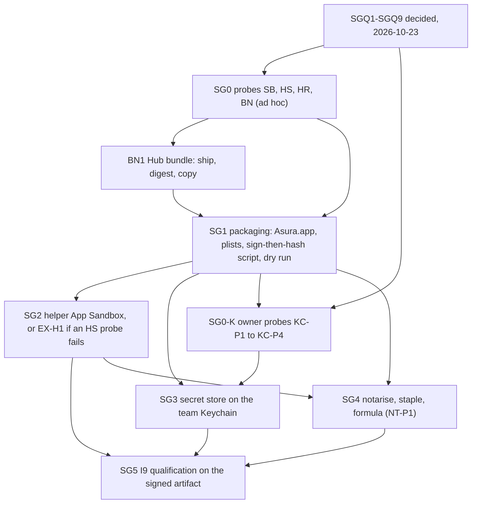

| Packet | Owned paths | Depends on | Delivers |
| --- | --- | --- | --- |
| SG0 | Scratchpad probes only; then results recorded in this design | This design | SB, HS, HR, BN-P1 results |
| BN1 | `asura-platform/src/model_process.rs` (bundle copy, limits, cleanup), `asura-service/build.rs` and `asura-service/src/model_owner.rs` (`hub_bundle_sha256`), `model-package.json` producer, `swift/model-helper/README.md` (package step), model provider integration design | BN-P1 | SG-V10 |
| SG1 | `tools/release/` (new script, `Info.plist` template, entitlement plists), `asura-service/src/model_owner.rs` (resource path), `asura-platform/src/model_process.rs` (resource source path), `swift/model-helper/README.md` | SGQ1–SGQ3, BN1 | SG-V1 to SG-V3, SG-V9 |
| SG0-K | Owner's Mac; results recorded in this design | SG1 (a signed qualification bundle) | KC-P1 to KC-P4 results |
| SG2a | HS-P8 probe (Seatbelt `process-info*` and `kern.procargs2` denial for the helper); `swift/model-helper` build: embed `Info.plist` (`CFBundleIdentifier` `org.pidster.asura.model`) in every helper build; the model inventory opens the asset root by its full path instead of walking from `/` | SG0 ad hoc results | HS-P1 and HS-P6 rerun with an ad hoc sandboxed helper; one Core AI cache for repeated spawns (two spawns create one cache directory) |
| SG2 | Helper entitlement plist; threat model rows | SG1, SG2a | SG-V5, or EX-H1 recorded |
| SG3 | `asura-platform/src/keychain*`, `asura-service/src/secret_store*`, `ServiceObservation` field 8 schema (fields 4 and 6 reserved) and its validation, the `secret_store.*` audit event fields (status, session; `stranded` removed), the owner's store wiring in `conversation/person_command.rs`, TUI `/status` and refusal text, the qualification binary and `tools/release/secret-store-qualification` with its entitlement list, secret store design | SG0-K, SGQ4–SGQ6 | SG-V6, SG-V7 |
| SG4 | `tools/release/`, `pidster/homebrew-tap` formula | SG1, SG2, NT-P1 | HD1, HD5, HD9, HD10, HD12, HD13 |
| SG5 | Qualification records | SG2, SG3, SG4 | SG-V4, SG-V8 and the release-distribution gates |

BN1 and SG1 both own `asura-platform/src/model_process.rs` and
`swift/model-helper/README.md`. They run in sequence, never at the same time.
BN1 fixes a defect that exists without signing, so it does not wait for any
signing packet.

### Packet readiness

| Packet | Ready? | Missing before code |
| --- | --- | --- |
| SG0 | Ready | BN-P1 done; SB, HS and HR probes remain |
| BN1 | Ready | — (BN-P1 confirmed the crash, 2026-10-23) |
| SG1 | Delivered (branch `sg1`, 2026-10-23) | — ([delivery](#sg1-delivery)) |
| SG0-K | Done for KC-P1, KC-P2 and KC-P4 (2026-10-27) | KC-P3 not run (owner, to revisit) ([results](#kc-probe-results-2026-10-27)) |
| SG2a | Delivered (branch `sg2a`, 2026-10-23) | — |
| SG2 | Delivered (branch `sg2`, 2026-10-23) | — ([delivery](#sg2-delivery)) |
| SG3 | Ready (2026-10-27) | — (KC results recorded; this design and the secret store design revised. -25308 stays unverified, covered by the field evidence) |
| SG4 | Not ready | NT-P1 |
| SG5 | Not ready | SG3 and SG4 |

### SG1 delivery

Delivered 2026-10-23 on branch `sg1`, ad hoc signing only. No named identity,
`notarytool`, `stapler` or `security` call was made; `security list-keychains
-d user` listed only the login keychain before and after.

- `tools/release/`: `asura-bundle`, `test-asura-bundle`, `Info.plist.in`, six
  entitlement files, and `README.md` with the operator commands.
- `asura_platform::package_resource_directory` and its use in
  `ModelProcess::spawn_with_resources`
  ([resource directory](#resource-directory-inside-the-bundle)).
  `model_owner` keeps the helper beside the canonical executable; only its
  comment changed.
- `conversation_flow --bundle-mlx`: an opt-in journey that runs the service
  from an `Asura.app` layout built from an assembled bundle
  (`ASURA_TEST_BUNDLE`) with an MLX model (`ASURA_TEST_MLX_ASSET`).

| Case | Layer | Evidence |
| --- | --- | --- |
| SG-V1 | Unit | `test-asura-bundle --static`: every tracked list parses; each lists only its allowed keys; no false Boolean and no `cs.` exception key; `Info.plist` template keys and values |
| SG-V1 | Integration | `test-asura-bundle --bundle`: `codesign -d --entitlements` of `asura` and `asura-model` equals `*.ad-hoc.plist`; both carry `runtime`; identifiers, bound helper `Info.plist`, layout, file count |
| SG-V2 | Integration | The script checks the digests after assembly and after bundle signing (and after stapling in a release); `test-asura-bundle --bundle` re-hashes the helper, `mlx.metallib` and Hub bundle against `model-package.json` and `package-identity.txt`, and finds the digests in `asura` |
| SG-V3 | Unit | `test-asura-bundle --static`: no tracked `*.p12`, `*.p8`, `*.provisionprofile` or `*.mobileprovision`, no PEM private key, no literal team-scoped identifier under `tools/` |
| SG-V3 | Integration | `test-asura-bundle --static`: 25 refusal cases (missing or mixed modes and inputs, ad hoc identity inputs, malformed team ID, generators, existing output, expired, foreign-team, groupless or wrong-`get-task-allow` profiles, unsigned profile, unclean tree), each without an output directory; a valid scratch profile passes preflight. `--bundle` checks that every signature in the dry run is `adhoc` with no team |
| SG-V9 | Unit | `package_resource_directory_is_contents_resources_only_inside_an_app_bundle` |
| SG-V9 | Integration | `app_bundle_resources_are_read_from_contents_resources` (decoys beside the helper ignored), `app_bundle_without_contents_resources_never_spawns` |
| SG-V9 | End to end | `conversation_flow --bundle-mlx` with the ad hoc bundle and `mlx-community/Qwen3-1.7B-4bit`: the run copy is the bundle's signed helper, `mlx.metallib` and the Hub bundle come from `Contents/Resources`, MLX generation completes, no copy remains after shutdown |

Found during delivery: the first dry run generated empty `BuildIdentity`
arrays, and the helper then failed at Hello (`helper_protocol`). The script now
checks that each generated array holds 32 bytes and that the signed helper's
`--version` reports the generated build ID and schema digest.

Proof limits: the restricted entitlements, the profile checks against a real
Apple profile, development and release signing, notarisation and stapling are
not run (KC-P1, KC-P2, NT-P1, owner only). The SG-V9 end-to-end case runs a
relocated test binary in place of `asura`, because `asura` uses the account
home; the installed-keg case stays with SG4 and SG5. The script does not yet
build the qualification bundle that SG0-K needs. Native tests that use the
development package need `<out>/package/` beside the test binaries.

### SG2 delivery

Delivered 2026-10-23 on branch `sg2`, ad hoc signing only (`codesign -s -`).
No named identity, `notarytool`, `stapler` or Keychain call was made;
`security list-keychains -d user` listed only the login keychain before and
after. SGQ7 is decided for release: HS-P1 to HS-P7 passed (SG0, SG2a and the
SG-V5 run below), so the helper ships with the App Sandbox and EX-H1 is not
recorded. NT-P1 still decides whether the notary service accepts the
temporary exceptions ([SG-F2](#sg-f2-helper-sandbox-decision)).

- `tools/release/entitlements/asura-model.{release,development,ad-hoc}.plist`:
  the App Sandbox keys of the [entitlement table](#entitlement-files). The
  embedded `Info.plist` identity (`org.pidster.asura.model`) is unchanged.
- `tools/release/asura-bundle`: step 5 checks `--version` on an ad hoc copy
  without entitlements, so that packaging never starts the sandboxed helper
  and creates no container under the product identifier. No other step
  changed; step 9 already compares the helper's entitlements with its list.
- `tools/release/test-asura-bundle`: `--static` checks the helper keys and
  that no tracked list carries an absolute-path or writable exception;
  `--sandbox APP` runs SG-V5 ([SG-F6](#sg-f6-sg-v5-checks)). The SG1 team-ID
  check no longer matches the script's own fixture strings.
- `tools/release/sandbox-probe.c`: the HS-P7 negative fixture.
- `conversation_flow --bundle-sandbox` replaces `--bundle-mlx`. The shipped
  helper reads only the account home's `~/.asura`, so a sandboxed bundle
  helper cannot run in a test home; SG-V9's end-to-end checks now run inside
  this journey with the test variant. The crash-recovery step's wait for the
  started event has no deadline; it ends on the started or a terminal event
  (paced poll).

Test isolation (selected, engineering): `--sandbox` re-signs a copy of the
bundle's helper as a test-only variant. It claims the bundle helper's list
plus `com.apple.security.temporary-exception.files.absolute-path.read-only`
[`/private/tmp/`], the parent of every harness home (the home name is random,
and an exception names a directory, not a prefix). Its signing identifier and
its embedded `CFBundleIdentifier` are the probe identifier
`org.pidster.asura.probe.model` (the section is rewritten at the same size),
so tests never create a container or Core AI cache under
`org.pidster.asura.model`. The variant's digest goes into
`package-identity.txt` for the journey build only; the script restores the
file afterwards. At the end it removes the probe container's `Data`
directory and lists what remains.

#### SG-F6: SG-V5 checks

Selected design. Arrows show the next step; labelled arrows show a check
result. A failed check is recorded and the next step runs, except where a
step cannot produce its input.

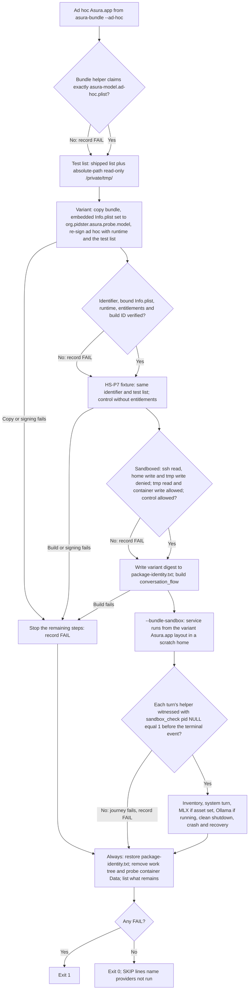

| Case | Layer | Evidence (2026-10-23, macOS 27.0, ad hoc bundle `sg2-1`) |
| --- | --- | --- |
| SG-V1 (SG2 keys) | Unit | `test-asura-bundle --static`: 71 passed. Helper lists hold exactly the App Sandbox, `network.client` and the two home-relative read-only paths (development adds `get-task-allow`); no absolute-path, writable or `inherit` key; `asura` lists claim no App Sandbox |
| SG-V1 | Integration | `test-asura-bundle --bundle`: 34 passed; the ad hoc helper's signed entitlements equal `asura-model.ad-hoc.plist` |
| SG-V5, HS-P7 | Integration | `--sandbox`: the fixture with the helper's identifier and list is sandboxed; listing `~/.ssh` and opening `~/.ssh/known_hosts` are denied; creating a file in the account home and in `/private/tmp/` is denied; reading `/private/tmp/` and writing in the container are allowed. The unsandboxed control lists and opens `~/.ssh` and writes `/private/tmp/` |
| SG-V5, HS-P1, HS-P6 | End to end | `--bundle-sandbox`: every helper is witnessed sandboxed; the inventory lists a metadata-only MLX asset with no MLX issue; at a clean shutdown no run copy remains; after a service kill the sandboxed helper exits on EOF and recovery starts no helper |
| SG-V5, HS-P2 | End to end | A system provider turn completes over FD 3 |
| SG-V5, HS-P3, SG-V9 | End to end | `mlx-community/Qwen3-1.7B-4bit` completes; the run copy is the variant helper, and `mlx.metallib` and the Hub bundle come from `Contents/Resources` |
| SG-V5, HS-P5 | End to end | An Ollama turn (`granite4.1:8b`, a local Ollama already running) completes on loopback |

Found during delivery: a test directory created under `.asura` with mode
0755 made the restart's authority scan report `unsafe_authority`; the journey
creates its fixture directories with mode 0700. A killed service leaves its
helper run copy, so the leak check runs at a clean shutdown before the crash
step.

Proof limits: no Core AI asset was run sandboxed in SG-V5 (HS-P4 passed in
SG0; it would create a Core AI cache of about 2 GB for the probe identity).
The control-socket connect and `/bin/sh` child cases of HS-P7 are not repeated
here (SG0 recorded them). Development and release signatures, the profile and
notarisation of the sandboxed helper remain with SG0-K, NT-P1 and SG4. The
`<out>/package/` helper now claims the App Sandbox with the product
identifier, so native tests beside it would read only the account home;
native tests use an unsandboxed development helper or the SG-V5 variant.

## Design verification

Recorded on 2026-10-23. Written from the draft of the same day and the owner's
answers SGQ1–SGQ9. The draft read AGENTS.md, the design process, the writing
standard, the secret store, the execution threat model, escapee control,
person command mode (relevant sections), release distribution, ADR-0008,
ADR-0009, platform capabilities and model provider integration (relevant
sections), and the code paths cited in [current state](#current-state). Apple
documentation was read on 2026-10-23 from the developer.apple.com pages linked
above and from Apple Developer Forums thread 706390 (Apple DTS). Local
inspection used `otool -L` on build outputs, and reads of the
`swift-transformers` `Hub.swift` checkout, the generated
`resource_bundle_accessor.swift` and the built Hub bundle.

Not done: no `codesign`, `notarytool`, `stapler`, `security` or Keychain call;
no probe; no code or test. Diagrams SG-O1, SG-F1, SG-F2, SG-S1, SG-F3 and SG-P
were rendered with the local Mermaid CLI and inspected.

Updated 2026-10-23 by packet BN1: probe BN-P1 ran (result above), BN1 code and
tests landed, and the revised SG-F3 diagram was rendered with the local
Mermaid CLI and inspected. The other probes and packets remain as stated.

Updated 2026-10-23 by packet SG1: the [package script](#sg1-package-script),
the [resource directory](#resource-directory-inside-the-bundle) rule and the
[delivery record](#sg1-delivery). Team ID input changed from "read from the
certificate" to an operator input checked against the profile and the
signature, so the script reads no keychain. Diagrams SG-F4 and SG-F5 were
rendered with Mermaid CLI 12.0.0 and inspected.

Updated 2026-10-23 by packet SG2: the helper
[entitlement files](#entitlement-files), the step 5 version check, the
[helper sandbox](#security) bullet, [readiness](#packet-readiness) and the
[delivery record](#sg2-delivery). Diagram SG-F6 was rendered with the local
Mermaid CLI and inspected.

Updated 2026-10-27 for packet SG3, from the owner's KC probe record sheet and
raw outputs (KC-P1, KC-P2, KC-P4 for the Developer ID and Apple Development
builds, the final purge and the dialog note) and the probe source. Changed:
the status block, the item contract, the
[access group](#access-group-from-the-entitlements) rule (new, SG-F7), the
status mapping and SG-S1, the [field evidence](#keychain-field-evidence)
(new, SG-F8), what SG3 removes, test isolation and the
[signed qualification run](#signed-qualification-run), the
[KC probe results](#kc-probe-results-2026-10-27), failure handling, AE-02 and
AE-06, SG-V6, SG-V7, the SG3 owned paths and readiness. The `get-task-allow`
profile finding is recorded for SG1 or SG4 and not acted on here. Diagrams
SG-F7, SG-S1 and SG-F8 were rendered with the local Mermaid CLI (`mmdc -s 2`)
into a temporary directory outside the repository and inspected. The design
writer made no Keychain call and signed nothing for this revision.

Return to the [design index](README.md).
