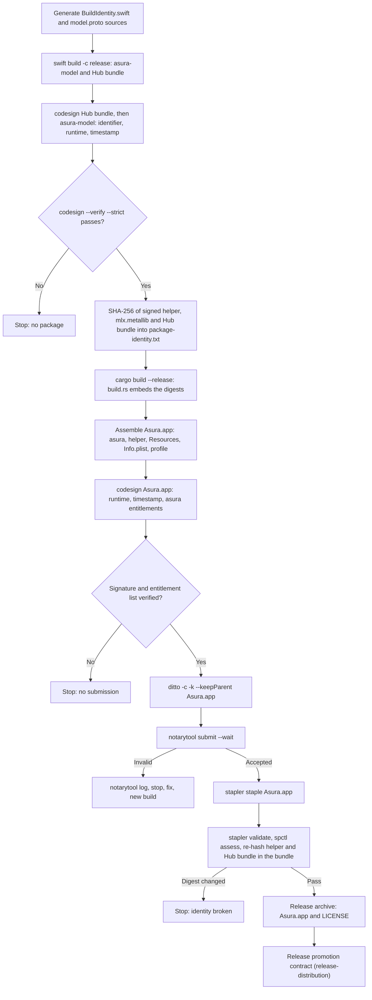
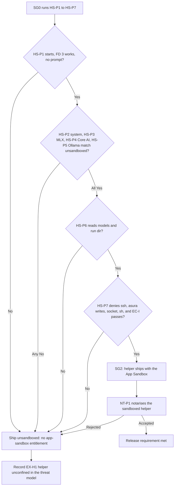
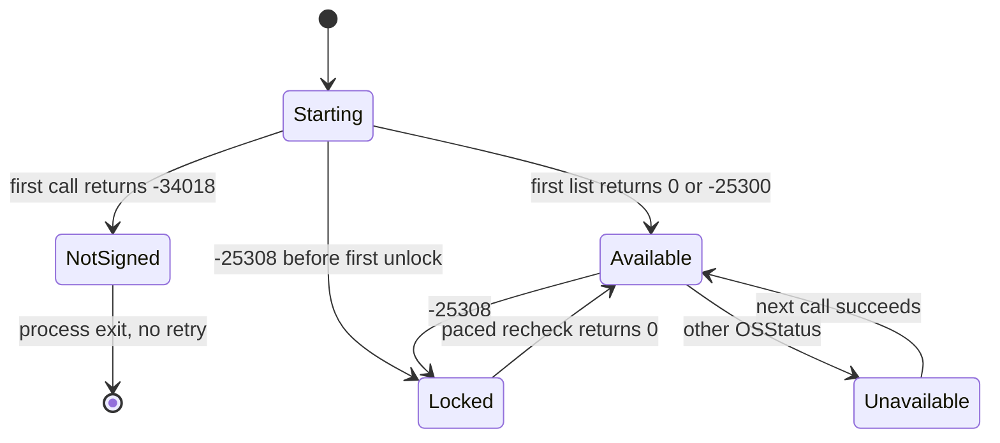
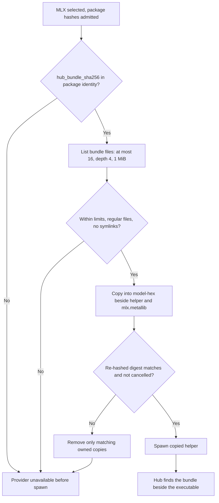
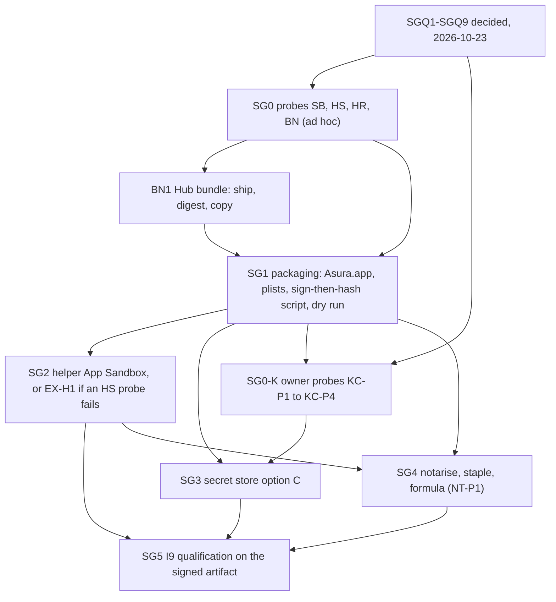

# Release signing, Keychain option C and helper sandbox (I9)

Status: selected design, 2026-10-23. The owner answered the nine signing
questions SGQ1–SGQ9 on 2026-10-23 ([owner decisions](#owner-decisions)). No
code, test, signature, notarisation or Keychain call was made to write this
design. Protocol numbering stays `0.1`; journal format stays `1`.

What is fixed:

- the bundle layout, bundle IDs and access group (SGQ1, SGQ2);
- signing of development bundles (SGQ3) and release bundles;
- Keychain option C: the secret store moves to the team data-protection
  Keychain with the Asura access group, with a clean switch (SGQ4–SGQ6);
- the helper App Sandbox rule (SGQ7) and the owner-only signing operator
  (SGQ9);
- the `swift-transformers` Hub resource bundle defect and its fix packet
  ([BN1](#bn1-hub-resource-bundle-defect)).

What is open:

- the probe results in [probes](#probes). Packets that depend on a probe are
  not ready until the probe result is recorded here
  ([readiness](#packet-readiness));
- the Secure Enclave design item, kept open for later study (SGQ8,
  [Secure Enclave](#secure-enclave-open-item)).

This design owns the signing and notarisation contract that
[release distribution](release-distribution.md) leaves open. When packet SG3
lands, it replaces the file-based login keychain mechanism of the
[secret store](secret-store.md) under KQ1 and EXD-3. Until then the login
keychain store remains the implemented state.

## Scope

In scope:

- Signing identities, Hardened Runtime and entitlements for every shipped
  executable; notarisation and stapling; where signing and notary credentials
  live; development builds compared with release builds.
- Whether the Rust service runs in the App Sandbox (selected: no, D-S1).
- Whether the Swift model helper runs in the App Sandbox (selected: yes if
  probes HS-P1 to HS-P7 pass, SGQ7).
- Keychain option C: the data-protection keychain with a keychain access
  group. This covers the switch from the login keychain, stranded items and
  test isolation.
- The effect of the Hardened Runtime on `DYLD_*` (PC-I38), on `mlx.metallib`
  and on SwiftPM resource bundles.
- The Hub resource bundle defect BN-P1 and its fix packet BN1.

Non-goals:

- Upgrade, handover and migration between releases. These are deferred until
  the first release (owner, 2026-10-17).
- Provider credentials (EX14). This design records only how they depend on the
  helper sandbox.
- Mac App Store distribution and TestFlight.
- A signing service in CI (SGQ9).
- A Secure Enclave key design (SGQ8: open, later study).

Dependencies: [release distribution](release-distribution.md),
[ADR-0008](../decisions/0008-homebrew-tap-distribution.md),
[ADR-0009](../decisions/0009-supervised-local-model-helper.md),
[secret store](secret-store.md),
[execution threat model](execution-threat-model.md),
[exec_cmd tool](exec-cmd-tool.md),
[escapee control](escapee-control.md),
[person command mode](person-command-mode.md),
[model provider integration](model-provider-integration.md#verified-metal-resource-packaging),
[platform capabilities](platform-capabilities.md#minimal-helper-package-and-identity).

## Current state

Read from the repository on 2026-10-23.

| Fact | Source |
| --- | --- |
| One Rust executable, `asura`, is the CLI, the TUI, the service and the exec_cmd guardian. The service is a re-exec of the canonical `current_exe` (`spawn_service_inner`). The guardian is the same file, run with the first argument `--asura-exec-cmd-guardian`. | `asura-platform/src/startup.rs:252`, `asura-service/src/exec_cmd_worker.rs:971`, `asura-cli/src/app.rs:395` |
| One Swift executable, `asura-model` (SwiftPM product of `swift/model-helper`). The service finds it beside its own canonical executable. | `asura-service/src/model_owner.rs:240-244` |
| Before spawn, the platform copies the helper (and `mlx.metallib` for MLX) into a new `model-<hex>` directory under `~/.asura/run/`. It checks the SHA-256 of each copy and runs the copy. The helper's environment is only `LANG=C` and `LC_ALL=C`. | `asura-platform/src/model_process.rs:255-300, 386-405` |
| `asura-service/build.rs` embeds the helper SHA-256 (and the optional `metallib` SHA-256) from `.build/model-tools/package-identity.txt` into the Rust binary at compile time. | `asura-service/build.rs` |
| The development package `.build/current-package/` holds `asura-model`, `mlx.metallib`, `model-package.json` and `identity-input.json`. No packaging or signing script exists in the repository. Step 5 of the helper README names a manual "root build owner" assembly. | `swift/model-helper/README.md` |
| `otool -L` (read-only) of the packaged `asura-model` and of the previous `asura` lists only `/System/Library/...` frameworks and `/usr/lib/...` libraries. No third-party dynamic library is loaded. | Local inspection, 2026-10-23 |
| MLX on Apple platforms excludes `backend/cpu/compiled.cpp`, the only `dlopen` of compiled code in MLX. GPU kernels come from `mlx.metallib`, found first beside the running executable. | `mlx-swift/Package.swift:182-184`, `backend/metal/device.cpp:90-160` |
| `swift-transformers` `Hub` reads `Bundle.module` when a model's tokenizer configuration has no `tokenizer_class` and the model has a `model_type`. The generated accessor calls `fatalError` when `swift-transformers_Hub.bundle` is not beside the executable. The development package does not contain this bundle. | `Hub.swift` (`tokenizerConfig`, `fallbackTokenizerConfig`); generated `resource_bundle_accessor.swift` |
| `swift-transformers_Hub.bundle` from the build holds 7 files in 44 KiB: `Info.plist`, the build's `_CodeSignature` files, and `Resources/gpt2_tokenizer_config.json` and `Resources/t5_tokenizer_config.json`. | Local inspection of `target/debug/swift-transformers_Hub.bundle`, 2026-10-23 |
| Test and fixture executables: `keychain_fixture`, `secret_store_fixture`, `asura-toolchain-bootstrap`, `examples/tcr_p1`, every Cargo test binary, and the Swift test bundle. | `rust/crates/*/src/bin`, `Cargo.toml` |
| The secret store uses the file-based login keychain. The SS-P3 probe found that read access follows the writer's cdhash and delete access follows the executable file name. | [secret store](secret-store.md#stranded-and-unrecognized-items) |

## Requirements

Required behavior.

| ID | Requirement | Source |
| --- | --- | --- |
| RS1 | Each release must contain signed executables that the macOS notary service accepts. Notarisation requires the Hardened Runtime. | [Apple: Hardened Runtime](https://developer.apple.com/documentation/security/hardened-runtime) ("To upload a macOS app to be notarized, you must enable the Hardened Runtime capability"); ADR-0008; release-distribution HD1, HD9 |
| RS2 | An executable must claim only the entitlements that it needs. A false Boolean entitlement must be omitted. | Apple Hardened Runtime page |
| RS3 | Signing keys and notary credentials must never be in the repository, in test inputs, or in any file that a test reads. No test signs with a real identity. | AGENTS.md (credentials stay out of tracked files) |
| RS4 | A queued person command's values must stay in the macOS Keychain. Under option C the store uses the data-protection keychain with `kSecAttrAccessibleAfterFirstUnlockThisDeviceOnly` and the Asura access group. | KQ1, SO6, EXD-2, SGQ4 |
| RS5 | Tests must never read, write or delete items in the person's keychains. Only the signed qualification run writes data-protection items, under a separate test access group, and it must leave that group empty. | SSR6, SGQ6 |
| RS6 | `!!` commands must run with no sandbox. `!` and model jobs must run under per-job `sandbox-exec` profiles. The escapee scan must keep working. | EXD-1, PCR21, EX5 |
| RS7 | No backward compatibility with unreleased builds or data. | Owner, 2026-10-17; SGQ5 |
| RS8 | Every blocking call must have an isolation owner, numeric limits and a loop-closure ending. No default time bound. | AE-01 to AE-07; owner, 2026-10-15 |
| RS9 | The helper identity check (exact `build_id`, `schema_digest`, helper and `metallib` SHA-256) must stay. | release-distribution; HD14 |
| RS10 | Only the owner signs and notarises, on the owner's Mac, for the first release. CI holds no signing secret. | SGQ9 |

## Terms

| Term | Meaning |
| --- | --- |
| Developer ID Application | The Apple certificate type for code that is distributed outside the Mac App Store |
| Hardened Runtime | The code-signing flag `runtime`. It turns on library validation and ignores `DYLD_*`, unless an exception entitlement allows them |
| Restricted entitlement | An entitlement that a provisioning profile must authorise, such as `keychain-access-groups` ([TN3125](https://developer.apple.com/documentation/technotes/tn3125-inside-code-signing-provisioning-profiles)) |
| App-like bundle | A directory `Asura.app/Contents/{Info.plist, MacOS/, Resources/, embedded.provisionprofile}`. It holds a command-line executable so that a profile can be embedded |
| Data-protection keychain | The per-user keychain that `SecItem` calls reach with `kSecUseDataProtectionKeychain = true`. Its access control is keychain access groups ([TN3137](https://developer.apple.com/documentation/technotes/tn3137-on-mac-keychains)) |
| Asura access group | `<TeamID>.com.pidster.asura` (SGQ2). The test access group is `<TeamID>.com.pidster.asura.test` (SGQ6) |
| Keychain option C | The secret store on the data-protection keychain with the Asura access group, replacing the file-based login keychain (SGQ4, SGQ8) |
| Qualification bundle | A test `Asura.app` that the owner signs with the test access group, used only by the signed qualification run (SGQ6) |

## Owner decisions

Answered by the owner on 2026-10-23. Each decision is required behavior for
the packets below.

| ID | Question | Decision (owner, 2026-10-23) |
| --- | --- | --- |
| SGQ1 | Can the released `asura` command live in `Asura.app/Contents/MacOS/asura`, with Homebrew linking `bin/asura` to it? Option C needs a provisioning profile, and a profile needs an app-like bundle. | Yes, `Asura.app`; Homebrew links `bin/asura`. |
| SGQ2 | Which bundle IDs? | `com.pidster.asura` and `com.pidster.asura.model`; access group `<TeamID>.com.pidster.asura`. |
| SGQ3 | Sign the assembled development bundle with the Apple Development identity and a development profile? | Yes. Development `Asura.app` bundles are signed with the Apple Development identity and a development profile. Cargo test binaries stay unsigned. |
| SGQ4 | KQ2 says that only the build that wrote an item can read it. Under option C, any build that the team signs with the access group can read and delete the item. Accept? | Yes. Any build signed by the team with the access group may read and delete items (KQ2 revised). Stranded items go away. |
| SGQ5 | Old items named "Asura queued command secrets" stay in the login keychain on development Macs. Accept a one-time manual clean-up, with no Asura code that reads or deletes them? | Clean switch. No migration code. The leftovers are deleted by hand once. |
| SGQ6 | Can the signed qualification run (not `cargo test`) write and delete items under a separate test access group? | Yes. Only the signed qualification run writes items, under a separate test access group, and it must leave that group empty. |
| SGQ7 | Must the Swift model helper run in the App Sandbox? | The helper App Sandbox is a release requirement if probes HS-P1 to HS-P7 pass. Otherwise the helper ships unsandboxed, with the gap recorded. |
| SGQ8 | EXD-3 planned a Secure Enclave replacement for SS-T8. Close it? | Keep the Secure Enclave design item open for later study. Option C for now is the team data-protection Keychain. |
| SGQ9 | Who signs and notarises? | Only the owner, on the owner's Mac, for the first release. No CI secrets. |

The draft of this design recommended closing the Secure Enclave item (SGQ8).
The owner did not accept that recommendation; the item stays open.

## Engineering decisions

Selected (engineering), consistent with the owner decisions:

- **D-S1. The `asura` executable is not App-Sandboxed.** Evidence is in
  [service App Sandbox](#service-app-sandbox-no).
- **D-S2. The Hardened Runtime is on for `asura` and `asura-model`, with no
  exception entitlements.** No third-party dynamic library and no JIT is
  present ([current state](#current-state)).
- **D-S3. Sign inside-out, then hash.** The helper (and the Hub bundle, BN1)
  is signed before its SHA-256 is recorded in `package-identity.txt`. Any
  later change to the helper's bytes breaks HD14.
- **D-S4. Notarise a zip of `Asura.app`, staple `Asura.app`, then build the
  release archive.** A ticket cannot be stapled to a bare executable or to a
  zip ([notarisation facts](#signing-order-and-build-identity)).
- **D-S5. Option C replaces the file-keychain production path in one change
  (SG3).** No legacy reader (RS7, SGQ5).
- **D-S6. BN1 ships the Hub resource bundle and copies it beside the
  helper.** See [BN1](#bn1-hub-resource-bundle-defect).
- Rejected: **runtime self-verification of the helper signature**
  (`SecStaticCodeCheckValidity`) before spawn. The embedded SHA-256 already pins
  the exact signed bytes, and the Rust binary that holds the digest is itself
  signed. A second check adds Security framework IPC with no new guarantee.

## Signing identities and artifacts

### What gets signed

Selected mechanism.

| Executable | Release signature | Hardened Runtime | Entitlements | Why |
| --- | --- | --- | --- | --- |
| `Asura.app` / `Contents/MacOS/asura` (CLI, TUI, service, guardian) | Developer ID Application, secure timestamp | Yes | `keychain-access-groups: [<TeamID>.com.pidster.asura]`, plus `com.apple.application-identifier` and `com.apple.developer.team-identifier` as the profile requires. Nothing else. | The secret store needs the access group (RS4). The process needs no JIT, no `DYLD_*`, no unsigned libraries and no debugger rights. The guardian calls `sandbox_check`, `proc_listpids`, `proc_pidinfo` and `sysctl(KERN_PROCARGS2)` on same-user processes; these need no entitlement (the escapee control probes ran unsigned). |
| `Asura.app/Contents/MacOS/asura-model` | Developer ID Application, secure timestamp, identifier `com.pidster.asura.model` | Yes | If the HS probes pass (SGQ7): `com.apple.security.app-sandbox`, `com.apple.security.network.client`, and `com.apple.security.temporary-exception.files.home-relative-path.read-only` for `/.asura/data/models/` and `/.asura/run/`. If an HS probe fails: none. | See [helper App Sandbox](#helper-app-sandbox). An embedded `Info.plist` (`-sectcreate __TEXT __info_plist`) may be needed for a sandboxed bare executable (probe HS-P1). |
| `Asura.app/Contents/Resources/mlx.metallib` | Not code. Sealed by the bundle's `CodeResources` | — | — | Metal loads it as data. The service still checks its SHA-256 (RS9). |
| `Asura.app/Contents/Resources/model-package.json` | Sealed by the bundle | — | — | Manifest |
| `Asura.app/Contents/Resources/swift-transformers_Hub.bundle` | Nested bundle, signed before the helper and the outer bundle (BN1) | — | — | `Bundle.module` calls `fatalError` when it is absent ([BN1](#bn1-hub-resource-bundle-defect)) |
| Cargo test binaries, `keychain_fixture`, `secret_store_fixture`, `asura-toolchain-bootstrap`, examples, Swift test bundle, PC-I38 marker library and the escapee fixtures | Not Developer ID signed. They keep the linker's ad hoc signature. | No | None | Tests must not depend on the release identity (RS3). They then cannot reach the data-protection keychain (RS5). The PC-I38 control run needs an unsigned fixture. |

A release `Asura.app` has no `get-task-allow`. Notarisation rejects it, and its
absence stops same-user debuggers from attaching to `asura`.

### Bundle layout

Selected (SGQ1, SGQ2). The
[platform capabilities design](platform-capabilities.md#minimal-helper-package-and-identity)
puts the helper "beside the command executable" and the release in "libexec".
This layout keeps the helper beside `asura`, as `model_owner.rs` expects, and
moves the data files to `Resources`. The package step and the `metallib` lookup
must change together (packet SG1).

```text
Asura.app/
  Contents/
    Info.plist                  CFBundleIdentifier com.pidster.asura, CFBundleExecutable asura,
                                LSUIElement true, LSMinimumSystemVersion 27.0
    MacOS/asura
    MacOS/asura-model
    Resources/mlx.metallib
    Resources/model-package.json
    Resources/swift-transformers_Hub.bundle/   (BN1)
    embedded.provisionprofile   Developer ID profile for com.pidster.asura
    _CodeSignature/CodeResources
LICENSE
```

The Homebrew formula installs `Asura.app` into `libexec` and links
`bin/asura` to `libexec/Asura.app/Contents/MacOS/asura`. `spawn_service_inner`
canonicalizes `current_exe`, so the service and the guardian re-exec the
bundle path, not the symlink. Probe KC-P2 must show that the profile's
entitlements apply when `asura` starts through the symlink.

### SG-O1: signed artifact view

Selected design. Solid arrows show "contains", "signs" or a runtime call.
Dashed arrows show runtime spawns. Boxes are trust boundaries. The helper's
App Sandbox depends on SGQ7 and the HS probes.


### Signing order and build identity

Selected. D-S3 fixes the order. A step that changes a signed file after its
digest is recorded is a defect.

#### SG-F1: release signing flow

Selected design. Arrows show the next step; labelled arrows show a decision
result. Every "Stop" publishes nothing.



Apple facts used here, from
[Customizing the notarization workflow](https://developer.apple.com/documentation/security/customizing-the-notarization-workflow):

- "The notary service accepts disk images (UDIF format), signed flat installer
  packages, and ZIP archives." A `.tar.gz` cannot be submitted.
- "While you can notarize a ZIP archive, you can't staple to it directly ...
  Although tickets are created for standalone binaries, it's not currently
  possible to staple tickets to them." A bare `asura` therefore depends on
  Gatekeeper's online ticket lookup. A stapled `Asura.app` does not.
- "Limit notarizations to 75 per day."
- `notarytool store-credentials` saves the credential as a keychain profile,
  and `--keychain-profile` keeps it out of scripts.

Unverified: whether the stapled ticket survives the `.tar.gz` round trip and
Homebrew's extraction (probe NT-P1). Unverified: whether Homebrew sets
`com.apple.quarantine` on formula downloads. If it does not, Gatekeeper never
assesses the formula install, and notarisation protects only direct downloads
from the GitHub release. Probe NT-P1 records the result either way.

### Where credentials live

Selected (SGQ9).

| Secret | Location | Never |
| --- | --- | --- |
| Developer ID Application private key | The owner's login keychain on the release Mac. The owner keeps an exported `.p12` backup offline | In the repository, CI, a test fixture, or any file under the working tree |
| Apple Development key (development bundles, SGQ3) | The owner's login keychain | As above |
| Notary credential | `notarytool store-credentials` profile (App Store Connect API key, Developer role). The operator deletes the `.p8` file after storing it | In environment files, scripts, logs or arguments |
| Provisioning profiles | Downloaded by the operator into an ignored path (`.build/signing/`). They are not secret, but they hold the team's certificate and are not tracked | Tracked in git |
| Team ID | Read by the release script from the signing certificate at run time. Rust code does not embed it: `SecItem` calls omit `kSecAttrAccessGroup`, so the default group is the first group in the entitlement | Hard-coded in source |

Tracked files: entitlement property lists for each executable and build kind,
the `Info.plist` template, and the release script. None contains a secret.
The release script takes the signing identity name and the notary profile
name as arguments. It refuses to run when the working tree is unclean or when
either name is absent. Tests do not run the release script. A dry-run mode
(release-distribution HD10) runs every step except `codesign` with a real
identity, `notarytool` and `stapler`. The dry run signs ad hoc, so it never
touches a certificate. CI may run the dry run; it never holds an identity or
a notary profile (RS10).

### Development builds compared with release builds

Selected (SGQ3).

| Property | Plain Cargo / SwiftPM build | Assembled development bundle | Release |
| --- | --- | --- | --- |
| Signature | Linker ad hoc | Apple Development certificate | Developer ID Application |
| Hardened Runtime | No | Yes | Yes |
| `get-task-allow` | Implicit (ad hoc) | Yes, so that the owner can debug | No |
| Profile | None | macOS development profile, registered Mac | Developer ID profile |
| Data-protection keychain | Unavailable (`errSecMissingEntitlement`, -34018, expected; probe KC-P1) | Available, group `<TeamID>.com.pidster.asura` | Available, same group |
| Helper App Sandbox | No | Yes if the HS probes pass, development signed | Yes if the HS probes pass |
| Notarised | No | No | Yes, stapled |
| Secret store result | `unavailable` with the text "This Asura build is not signed for the Keychain." | Normal | Normal |

The development group and the release group are the same string. A
development build and a release build on one Mac therefore share items
(SGQ4). The sweep and the binding digest already handle items from another
installation. Probe KC-P1 must show whether Apple Development and Developer ID
signatures from one team both satisfy the group.

## Service App Sandbox: no

Selected (D-S1). Each row gives its evidence and its status.

| Concern | Finding | Status |
| --- | --- | --- |
| Children inherit the sandbox | Apple DTS: "If a sandboxed process runs another program as a child process, that child process always inherits its sandbox from the parent." ([forum 706390](https://developer.apple.com/forums/thread/706390)). `!!` would therefore run inside the App Sandbox, which breaks EXD-1 and PCR21. | Documented by Apple DTS |
| One executable has several roles | `asura` re-execs itself as the service and the guardian. A child signed with `app-sandbox` but without `com.apple.security.inherit` "will crash in `_libsecinit_appsandbox`. A process is not allowed to change its sandbox" (same thread). One Mach-O cannot carry `inherit` for its child roles and also not carry it for its top-level CLI role. The service would need its own executable, and every guardian would still be inside the service sandbox. | Documented by Apple DTS; follows from the current code |
| Nested `sandbox-exec` | EC-V-NEST: `sandbox-exec` inside a Seatbelt profile returns `sandbox_apply: Operation not permitted`. The App Sandbox uses the same Seatbelt mechanism. The per-job profiles of `!` and model jobs would therefore fail, and with them the EX5 marker attribution. | Strong inference, **unverified for the App Sandbox**. Probe SB-P1 |
| Projects anywhere on disk | A sandboxed process reaches files outside its container only through user selection (open panel), security-scoped bookmarks or temporary exceptions ([Accessing files from the macOS App Sandbox](https://developer.apple.com/documentation/security/accessing-files-from-the-macos-app-sandbox)). A TUI and a background service have no open panel. The same page says that an app "can't run programs in locations outside its app bundle, sandbox container, or app group containers" with user-selected access, unless it has `files.user-selected.executable`. Project scripts and build outputs could not run. | Documented |
| Inherited rights | A forum answer reports that inheritance carries only static entitlements, not rights granted after launch such as PowerBox file access. A project granted by a bookmark could then be unreadable to `git` and `sh` children. | Forum statement, **unverified**. Probe SB-P3 |
| `~/.asura`, the control socket and journals | The App Sandbox redirects `HOME` to the container. Every `~/.asura` path would need a temporary exception. | Documented behavior of containers |
| EX5 process inspection | The guardian calls `proc_listpids(PROC_UID_ONLY)`, `proc_pidinfo`, `proc_pidfdinfo`, `sysctl(KERN_PROCARGS2)` and `sandbox_check` on other processes. The App Sandbox normally limits `process-info*` to the process's own sandbox. | **Unverified.** Probe SB-P2 |

Conclusion (D-S1): `asura` runs with the Hardened Runtime and no App Sandbox.
Confinement of untrusted work stays with the per-job `sandbox-exec` profiles
that the exec_cmd and person command designs own. Under D1, same-user
processes are one principal. The App Sandbox would not change that claim, and
it would break RS6. The SB probes confirm the evidence; a probe result that
contradicts a row is recorded here but does not by itself reverse D-S1,
because the inheritance and multi-role rows are documented.

## Helper App Sandbox

Selected (SGQ7): the helper App Sandbox is a release requirement if probes
HS-P1 to HS-P7 pass. Otherwise the helper ships unsandboxed, and the gap is
recorded in the execution threat model as residual EX-H1 "helper unconfined".

The helper handles untrusted model output, untrusted model files (weights,
tokenizer JSON, Jinja chat templates parsed by `swift-jinja`) and HTTP
responses from Ollama. It runs as the person with no confinement today
([platform capabilities](platform-capabilities.md#minimal-helper-package-and-identity):
"makes no OS sandbox confinement claim"). A sandboxed helper that is
compromised could not read `~/.ssh`, write `~/.asura` journals or the control
socket, or start unsandboxed programs. This is defence in depth. It does not
change the D1 claim.

The design uses the Apple-maintained App Sandbox profile, not a custom
`sandbox-exec` profile, for the helper. Metal, Foundation Models and Core AI
need many system service lookups. Apple maintains those rules for sandboxed
apps. A custom Seatbelt profile would have to list them and keep them current.

### What the helper needs

| Need | Under the App Sandbox | Entitlement or mechanism | Probe |
| --- | --- | --- | --- |
| Start as a bare executable spawned by an unsandboxed parent | The helper is not a child of a sandboxed app, so it must not claim `inherit`. It sets up its own sandbox and container, keyed by its signing identifier. Apple does not document whether a bare executable without an app bundle can do this. | `app-sandbox`; an embedded `Info.plist` if needed | HS-P1 |
| Private channel on FD 3, diagnostics on FD 1/2 | The parent passes the descriptors before exec. The sandbox checks access when a file is opened, so inherited descriptors should keep working. | None | HS-P1 |
| Read its own executable, `mlx.metallib` and the Hub bundle in `~/.asura/run/model-<hex>/` | Outside the container | `temporary-exception.files.home-relative-path.read-only: /.asura/run/` | HS-P3 |
| Read assets in `~/.asura/data/models/{coreai,mlx}/` | Outside the container | `temporary-exception.files.home-relative-path.read-only: /.asura/data/models/` | HS-P6 |
| Ollama on loopback, later remote providers (EX13) | Outgoing network | `com.apple.security.network.client` | HS-P5 |
| Metal and MLX GPU kernels | Sandboxed apps can use Metal; no entitlement is documented | None | HS-P3 |
| Foundation Models | No entitlement is documented | None | HS-P2 |
| Core AI (`CoreAI.framework`) | Not documented | Unknown | HS-P4 |
| Writes | Only the container (caches, temporary files) | None | HS-P7 negative cases |
| EX14 provider credentials | A sandboxed bare executable cannot claim `keychain-access-groups` (no profile). The EX14 design must choose between a nested `AsuraModel.app` with its own profile and the service passing the credential over the private channel. | Recorded dependency, not decided here | — |

Temporary-exception entitlements are acceptable for Developer ID. The Mac App
Store reviews them; notarisation does not reject them. This is a reading of
the documentation and is **unverified** until NT-P1 notarises a helper that
claims them. If `home-relative-path` cannot express `~/.asura/run/` because the
account home is not the container owner's home, the fallback is a read-only
exception for the exact run directory. That is weaker, because the home path
differs per user.

Effect on EX5: the escapee scan's first test, `sandbox_check(pid, NULL, 0) == 1`,
also matches the sandboxed helper. The helper cannot write any job scratch,
so the second test excludes it. EC-I cases must run with a sandboxed helper
alive (HS-P7).

### SG-F2: helper sandbox decision

Selected design (SGQ7). Arrows show the next step; labels show probe results.
One helper executable serves all providers, and the sandbox belongs to the
executable, so it cannot be turned off for one provider.



## Keychain option C

Selected (SGQ4, SGQ5, SGQ6, SGQ8). Packet SG3 implements it. Until SG3 lands,
the [secret store](secret-store.md) keeps the file-based login keychain.

### Is a provisioning profile, and so a bundle, required?

Yes. Apple states this directly:

- TN3137: "macOS builds the list of data protection keychain access groups
  available to your program from its code signing entitlements ... These
  entitlements must be authorized by a provisioning profile. Your program needs
  an app-like bundle structure in which to embed that profile. This is standard
  for app and app extensions but not for command-line tools."
  ([TN3137](https://developer.apple.com/documentation/technotes/tn3137-on-mac-keychains))
- TN3125: "A standalone executable can't claim a restricted entitlement because
  there's no place to embed the provisioning profile that authorizes that claim.
  If your standalone executable needs to do this, wrap it in an app-like
  structure." It names `keychain-access-groups` as profile-authorised, and says
  macOS expects the profile at `MyApp.app/Contents/embedded.provisionprofile`.
  ([TN3125](https://developer.apple.com/documentation/technotes/tn3125-inside-code-signing-provisioning-profiles))
- [Signing a daemon with a restricted entitlement](https://developer.apple.com/documentation/xcode/signing-a-daemon-with-a-restricted-entitlement)
  gives the wrapping procedure.
- TN3137: "The data protection keychain is only available in a user login
  context." The per-user service runs in the person's login context when the
  CLI starts it from a GUI login session. Over SSH this is **unverified** (probe
  KC-P3).

This is the reason for SGQ1. Probe KC-P1 must confirm that a process whose
executable is `Contents/MacOS/asura` gets the group, and probe KC-P2 must
confirm it when `asura` starts through a symlink and when it re-execs itself
as the service.

### Item contract changes

Selected, replacing rows of the
[secret store item contract](secret-store.md#keychain-item-contract) when SG3
lands:

| Property | Option C |
| --- | --- |
| Keychain | Data-protection keychain: `kSecUseDataProtectionKeychain = true` on every add, query and delete. Production no longer uses `kSecUseKeychain` or `SecKeychainCopyDefault` |
| Access group | Omitted in calls. The default group is the first `keychain-access-groups` entry, `<TeamID>.com.pidster.asura` ([Apple: sharing access](https://developer.apple.com/documentation/security/sharing-access-to-keychain-items-among-a-collection-of-apps)) |
| Accessibility | `kSecAttrAccessibleAfterFirstUnlockThisDeviceOnly` (KQ1). "ThisDeviceOnly" keeps the item out of backups to other devices and out of migration |
| Synchronizable | `false`, explicitly |
| Who can read and delete | Any executable signed by the team that claims the group under a valid profile (SGQ4, KQ2 revised). Other same-user programs get no match ([Apple](https://developer.apple.com/documentation/security/sharing-access-to-keychain-items-among-a-collection-of-apps): a query on a group the program does not belong to returns `errSecItemNotFound`) |
| Service, account, label, payload, 55,413-byte bound, 256 items, 257-item list bound | Unchanged |

The platform wrapper must build every dictionary through one function that
always sets `kSecUseDataProtectionKeychain`. A dictionary without it would reach
the file-based keychain (TN3137: `SecItem` "defaults to targeting the
file-based keychain"). Unit test KC-U1 asserts this for every call.

### What SG3 removes

- The target pre-check (`SecKeychainGetStatus`) in production. There is one
  data-protection keychain per user, so SS-T7 (a call reaching the wrong
  keychain) cannot happen in production. The pre-check remains a rule for the
  test-only scratch backend.
- `SecKeychainSetUserInteractionAllowed`. It controls the file-based keychain
  only. The data-protection items carry no `SecAccessControl` user-presence
  flag, so no prompt can be shown. Probe KC-P4 must confirm that no call
  prompts.
- **Stranded items, as a category** (SGQ4). SS-P3 stranding comes from the
  file keychain's per-cdhash read ACL and per-file-name delete rule. With an
  access group, every team-signed Asura build can delete every Asura item. A
  delete can then fail only for the whole store (missing entitlement, or
  `errSecInteractionNotAllowed` before the first unlock), never for one item.
  `stranded_count` and `stranded_inputs` (`SecretStoreStatus` fields 4 and 6)
  and the `/status` stranded notice are removed. Field numbers 4 and 6 are
  reserved. This is a schema change within protocol `0.1` under the
  [numbering authority](../engineering.md#wire-protocol-change-authority).
- `secret_store_denied` after a rebuild (KQ2 revised). It remains only as the
  reply to a missing entitlement, with new text.
- Unrecognized items stay: counted, never read or deleted.

### Status mapping

Selected; probe KC-P4 must confirm each code before SG3 is ready.

| Status | Reply |
| --- | --- |
| 0 | Success |
| `errSecItemNotFound` (-25300) | `absent` |
| `errSecDuplicateItem` (-25299) | Existing duplicate rule |
| `errSecInteractionNotAllowed` (-25308) | `locked`: the Mac has not been unlocked since start-up. The existing paced recheck applies |
| `errSecMissingEntitlement` (-34018) | `unavailable`, reason `not_signed`: "This Asura build is not signed for the Keychain." No retry |
| `errSecNotAvailable` (-25291) or any other code | `unavailable` with the code, as today |

#### SG-S1: secret store availability under option C

Selected design. Arrows are observed call results on the secret store
worker. `NotSigned` is terminal for the process: no recheck can add an
entitlement.



### Switch from the login keychain

Selected (SGQ5): a clean switch.

1. The new build has no code that reads, lists or deletes file-keychain items.
2. A kind 31 journal record whose item now lives only in the login keychain
   reaches dispatch, finds no item and is held with `secrets_lost`. This is the
   existing behavior; the person enters the command again.
3. The SG3 change notes tell the developer to do this once: open Keychain
   Access, select the login keychain, search for "Asura queued command
   secrets" and delete each match. These items hold values of commands that
   can no longer run.

Rejected: a one-release sweep of the login keychain. It is a legacy reader
(RS7) and keeps the deprecated `SecKeychain` API in production.

### Test isolation without the login keychain

Selected (SGQ6).

| Layer | Backend | What it proves |
| --- | --- | --- |
| Unit (`cargo test`) | Scripted `KeychainPort` (exists) | Worker, codec, sweep, replies, KC-U cases |
| Integration (`cargo test`, test-support) | The scratch **file** keychain backend, kept as the test-only `Target::Scratch` with its target pre-check and testing rules | Real Security framework IPC, queueing, a blocked call (AE-07). It does not prove data-protection behavior |
| Integration, negative (`cargo test`) | Unsigned test binary against the data-protection keychain | Every call returns -34018 and the reply is `unavailable/not_signed`. The binary has no entitlement, so it can make no change. This is safe under RS5 |
| Qualification (signed, not `cargo test`) | The qualification bundle, signed with the test group `<TeamID>.com.pidster.asura.test` and a random installation ID | Real data-protection add, read, list, delete, sweep and restart. Production Asura cannot see this group. The run deletes every item it wrote and then lists the group to prove that it is empty |

`Target::Default` becomes the data-protection backend. `Target::Scratch` stays
behind the `test-support` feature. A production build therefore cannot select
the file keychain, and SS-U7 is extended to check this.

If the qualification run ends before its clean-up (crash or cancel), the next
qualification run lists the test group first and deletes every item it finds
before it writes. The test group holds only qualification items, so this
delete never touches a production item.

### Secure Enclave: open item

Open decision (owner, 2026-10-23, SGQ8): the Secure Enclave design item from
EXD-3 stays open for later study. Option C does not depend on it. These notes
are input to that study; they select nothing.

- The Secure Enclave holds only NIST P-256 keys. It signs and does key
  agreement; it cannot store a 55 KB payload
  ([Protecting keys with the Secure Enclave](https://developer.apple.com/documentation/security/protecting-keys-with-the-secure-enclave)).
  A design would encrypt the payload with ECIES to an enclave key and store the
  ciphertext in a keychain item or in an Asura file.
- Decryption returns the plaintext to the calling process as `CFData`. The
  in-process copy described by SS-T8 therefore stays. The securityd copy would
  move to an enclave key-agreement call; this detail is **unverified**.
- The enclave key reference itself lives in the data-protection keychain under
  the same access group. A Secure Enclave design therefore needs option C
  first.
- Under D1, a same-user reader of process memory is the same principal. SS-T8
  stays an accepted residual (EXD-3) until the study decides otherwise.

## Hardened Runtime: DYLD, Metal and resource bundles

### `DYLD_*` and PC-I38

- Apple: the `allow-dyld-environment-variables` entitlement "causes the macOS
  dynamic linker (`dyld`) to read from environment variables that begin with
  `DYLD_`"
  ([entitlement page](https://developer.apple.com/documentation/bundleresources/entitlements/com.apple.security.cs.allow-dyld-environment-variables)).
  Without it, a Hardened Runtime process ignores them. Library validation also
  refuses a library from another team
  ([disable-library-validation](https://developer.apple.com/documentation/bundleresources/entitlements/com.apple.security.cs.disable-library-validation)).
- Effect on [PC-I38](person-command-mode.md#integration): the FD 11 design
  already keeps the launch environment out of the guardian. In a signed build,
  the guardian is also immune if `DYLD_*` reaches its own environment. PC-I38
  keeps its unsigned run, because cargo test binaries are unsigned. A new case
  PC-I38-S runs the signed qualification bundle: a guardian started with
  `DYLD_INSERT_LIBRARIES` in its own environment never loads the marker
  library (probe HR-P1).
- **Unverified: whether `dyld` also removes `DYLD_*` from the environment of a
  Hardened Runtime process.** If it does, the TUI's own environment loses them
  at start, and the `!!` launch environment cannot contain them. The effect on
  `!!` is small: PC-I38 already records that SIP removes `DYLD_*` when
  `/bin/sh` starts, so `!!` children never saw them. Probe HR-P2 records the
  result, and the `!!` documentation states it.
- The helper is spawned with only `LANG` and `LC_ALL`, so `DYLD_*` cannot reach
  it.

### `mlx.metallib`

Metal loads the file with `newLibraryWithURL` as GPU code. Library validation
covers Mach-O code loaded by `dyld`, not Metal libraries. MLX on Apple platforms
builds no CPU code at run time (`backend/cpu/compiled.cpp` is excluded). Neither
`allow-jit` nor `allow-unsigned-executable-memory` is therefore expected. This
conclusion rests on reading the code. It is **unverified at run time**: probe
HS-P3 runs MLX generation in a hardened, and then a sandboxed, helper.

Lookup order after the bundle change: MLX first tries `mlx.metallib` beside the
running executable. The running executable is the copy in
`~/.asura/run/model-<hex>/`, and the copy step already places `mlx.metallib`
there. The source path changes from beside `asura-model` to
`Contents/Resources/mlx.metallib`. The copied layout does not change.

### SwiftPM resource bundles

- A resource bundle has no code. The Hardened Runtime does not affect reading
  it.
- `SwiftProtobuf_*.bundle` and `swift-crypto_Crypto.bundle` hold privacy
  manifests only. No code path reads them at run time (no `Bundle.module` use
  found outside Hub). They are not shipped.
- `swift-transformers_Hub.bundle` is read at run time. Its absence is defect
  BN-P1, below. It exists today without signing and is fixed by BN1.

## BN1: Hub resource bundle defect

Status: defect found by reading the code, 2026-10-23. Probe BN-P1 must confirm
it before BN1's code. Fix (D-S6) selected (engineering). Owned with the
[model provider packaging](model-provider-integration.md#verified-metal-resource-packaging).

**Defect.** `Hub.tokenizerConfig` calls `fallbackTokenizerConfig(for:)` when
the tokenizer configuration has no `tokenizer_class` and the model has a
`model_type`. It also calls it when the tokenizer configuration is absent and
the model has a `model_type`. That function reads `Bundle.module`. The
generated accessor searches `Bundle.main.resourceURL`, the framework bundle
and `Bundle.main.bundleURL` for `swift-transformers_Hub.bundle`. The
`PACKAGE_RESOURCE_BUNDLE_PATH` override exists only in debug builds, and the
helper environment holds only `LANG` and `LC_ALL`. For the copied helper, the
search reaches only `~/.asura/run/model-<hex>/`. The current package ships no
Hub bundle, so the accessor calls `fatalError` and the helper exits. The
service handles the exit as a helper failure: the crash is contained and
control stays usable, but the model cannot run.

**Fix (selected, D-S6): ship and copy.**

1. Package assembly takes `swift-transformers_Hub.bundle` from the release
   SwiftPM build and places it at
   `Asura.app/Contents/Resources/swift-transformers_Hub.bundle`. A
   development package places it in `.build/current-package/`.
2. The release script signs the Hub bundle before the helper (D-S3). It then
   records the bundle digest in `package-identity.txt` and
   `model-package.json` as `hub_bundle_sha256`. The digest is the SHA-256 of
   the sorted list of (relative path, file SHA-256) pairs of every regular
   file in the bundle. `asura-service/build.rs` embeds it as it embeds the
   `metallib` digest.
3. The preparation worker copies the bundle beside the helper copy, as
   `~/.asura/run/model-<hex>/swift-transformers_Hub.bundle/`, for every MLX
   selection, and for any other provider that BN-P1 shows reaching
   `Hub.tokenizerConfig`. It uses the existing copy rules: regular files only,
   owned by the service account, not group or world writable, no symlinks,
   64 KiB chunks under the preparation cancellation flag, each copied inode
   re-read and hashed. A digest mismatch or a missing bundle makes the provider
   unavailable before spawn.
4. Limits: at most 16 files, depth 4, each file at most 1 MiB, and the bundle
   at most 1 MiB in total. The current bundle has 7 files in 44 KiB. A bundle
   over a limit fails package assembly.
5. Cleanup removes only the copied names whose device and inode match the
   retained descriptors, then the matching empty directories, as for
   `mlx.metallib`.

Rejected alternative: **reject such models.** MLX asset validation would
refuse a model whose tokenizer configuration lacks `tokenizer_class` when
`model_type` is set. It refuses valid models that Hub supports through its
fallback and its capitalised-name guess, and it copies Hub's selection logic
into Asura, where it can drift from the library.

### SG-F3: Hub bundle preparation

Selected design (BN1). Arrows show the next step; labels show check results.
This view extends the MLX path of the
[verified Metal resource packaging](model-provider-integration.md#verified-metal-resource-packaging)
flow; it does not replace it.



## Failure handling

| Failure | Result |
| --- | --- |
| Helper signature or its digest is wrong in the package | Existing HD14 path: the service rejects the helper before model content, reports model work unavailable, and control stays usable |
| Hub bundle missing or its digest is wrong | The provider is unavailable before spawn ([SG-F3](#sg-f3-hub-bundle-preparation)); other providers are unaffected |
| `codesign --verify` fails in the release script | The script stops before notarisation. No artifact is published |
| Notarisation returns `Invalid` | The script downloads the log, stops and publishes nothing. A fixed build is a new build with a new digest |
| `notarytool --wait` does not return | No time bound (RS8). The operator cancels. A later `notarytool info <id>` resumes the check without a new submission |
| `stapler staple` fails because the ticket is not yet available | Paced retries 1, 2, 4, 8 … s, at most 60 s apart. Pacing ends nothing; success or an operator cancel ends the loop |
| Profile missing or expired in the bundle | `asura` fails to start, or the group is missing (-34018). Release verification checks the entitlements against the profile before submission |
| Data-protection keychain unavailable (SSH, before first unlock) | `locked` or `unavailable`, with the existing paced recheck. Never a fallback to a file |
| Unsigned development binary | `unavailable/not_signed`. Person commands that need the store and every `!!` command are refused with that text. Draft and mode kept |
| Sandboxed helper denied a needed path or service | The helper exits or reports a provider error. The service reports the provider unavailable through the existing paths. No relaxation at run time |
| Sandboxed helper first launch while the container manager stalls | The helper process is stalled. The model owner already waits with no time bound, ending on Hello, exit, cancel or shutdown. Control stays responsive |
| `fatalError` from a missing resource bundle | Helper exit; existing helper-failure settlement. BN1 removes the cause |
| Qualification run ends before clean-up | Items remain in the test group only. The next qualification run deletes them first ([test isolation](#test-isolation-without-the-login-keychain)) |

## Security

- **Authority.** A signature proves who built a binary. It does not prove what
  the binary does. Under D1, same-user processes are one principal. This
  design makes no new boundary claim.
- **Stronger defence in depth.** In a signed build, the Hardened Runtime
  refuses `DYLD_*` injection, and with no `get-task-allow` it refuses a
  debugger attaching to `asura`. With option C, a same-user program that lacks
  the team-signed group cannot read or delete Asura items. SS-T1 and SS-T3
  improve: a binary named `asura` can no longer delete items by name. SS-T6
  (`!!` runs as the person) and SS-T8 are unchanged.
- **New residual SG-T1.** Any build signed by the team with the group,
  including a development build, reads and deletes every Asura item on that
  Mac (SGQ4, accepted by the owner, 2026-10-23).
- **New residual SG-T2.** The release Mac holds the Developer ID key. Whoever
  controls that account can sign as Asura. Notarisation keeps an audit trail,
  and Apple can revoke tickets
  ([Notarizing macOS software](https://developer.apple.com/documentation/security/notarizing-macos-software-before-distribution)).
- **Helper sandbox.** If SG2 ships, it limits a compromised helper to reading
  models, its run directory and the Hub bundle, using the network, and writing
  its container. If an HS probe fails, residual EX-H1 records the unconfined
  helper.
- **Hub bundle.** The bundle holds tokenizer configuration data only. Its
  digest is pinned like the helper's, so a changed bundle fails before spawn.
- **Data handling.** No signing material enters Asura records, tests or logs.
  The release log records identities by name and certificate SHA-1 only.

## Limits

| Item | Limit | Owner |
| --- | --- | --- |
| Secret store queue | 16 requests, one call at a time | Secret store (unchanged) |
| Items and list | 256 items, list of 257 | Secret store (unchanged) |
| Payload | 55,413 bytes | Secret store (unchanged) |
| Helper executable | 128 MiB | Model packaging (unchanged) |
| `mlx.metallib` | 64 MiB | Model packaging (unchanged) |
| Hub bundle | 16 files, depth 4, 1 MiB each, 1 MiB total | BN1 |
| `Asura.app` | At most 64 files (selected; the current count is under 20) | SG1 release script |
| Notarisation | One submission at a time; at most 75 per day (Apple) | Release operator |
| Stapling retries | Paced 1, 2, 4, 8 … s, at most 60 s apart, no count limit | Release script |

## Asynchronous execution

| Rule | Application |
| --- | --- |
| AE-01 | No signing or notarisation code exists in the runtime. The runtime gains no new call on the reactor, control or render path |
| AE-02 | Runtime blocking calls: `SecItemAdd`, `SecItemCopyMatching` and `SecItemDelete` with the data-protection flag run on the existing secret store worker thread only (IPC to securityd). The Hub bundle copy runs on the existing preparation worker. The helper's sandbox set-up runs inside the helper process at exec, under the existing model-owner supervision. Release-time blocking tools (`codesign`, `ditto`, `notarytool`, `stapler`, `spctl`) run only in the operator's release script, one at a time |
| AE-03 | See [limits](#limits). No new queue is added |
| AE-04 | No time bound. Store calls end with a reply, cancel or shutdown. `notarytool --wait` ends with the service's reply or an operator cancel. Stapling uses pacing only. The Hub copy ends on completion, failure or the preparation cancel flag |
| AE-05 | A notarisation submission is not repeated after an unknown outcome. The operator queries its ID. A rejected build is never re-signed in place; a new build gets a new digest |
| AE-06 | Service start: the store worker makes its first list call after replay, as today. A `not_signed` result is recorded once and does not delay start |
| AE-07 | Acceptance: with a data-protection call blocked by the test seam, the TUI stays responsive and Ctrl-C and Drop work (existing SS case, repeated on the signed qualification bundle). With the Hub copy blocked by the test seam, cancel ends preparation and control stays responsive |

## Probes

Each probe is an executable experiment. The table gives its question, method
and pass result. These boundaries apply to every probe, so the table is the
probe design that the [design process](../design-process.md#workflow)
requires:

- Probe code lives in the session scratchpad, never in the repository. Only
  the result is recorded here.
- No probe reads, writes or deletes an item in the login keychain.
- Probes marked "Ad hoc" use ad hoc signatures only and touch no certificate,
  profile or notary credential.
- Probes marked "Owner" need a real certificate or profile. Only the owner,
  or a session the owner authorises for that probe, runs them, on the owner's
  Mac. They use the test access group only and end with the group empty.
- A probe records a result even when it fails. A failed probe changes the
  packet that depends on it, as stated in [readiness](#packet-readiness).

| ID | Question | Method | Pass result | Signing |
| --- | --- | --- | --- | --- |
| SB-P1 | Can a process in the App Sandbox run `sandbox-exec`? | Fixture with `app-sandbox` runs `/usr/bin/sandbox-exec -p '(version 1)(allow default)' /usr/bin/true` | Records the result; expected `sandbox_apply: Operation not permitted` | Ad hoc |
| SB-P2 | Can an App-Sandboxed process call `proc_listpids(PROC_UID_ONLY)`, `proc_pidinfo`, `KERN_PROCARGS2` and `sandbox_check` on another same-user process? | Same fixture against a spawned unsandboxed sleeper | Records each result | Ad hoc |
| SB-P3 | Does a child of a sandboxed process report sandboxed, and does it get a bookmark grant of its parent? | Fixture spawns `/bin/sh`; `sandbox_check(child, NULL, 0)`; child reads a bookmarked path | Records the results | Ad hoc |
| HS-P1 | Can a bare helper with `app-sandbox`, copied to `~/.asura/run/model-<hex>/`, start from an unsandboxed parent and use FD 3? | Fixture helper and the existing spawn path | Starts, container created, no prompt, FD 3 echo works | Ad hoc, then owner |
| HS-P2 | Foundation Models in the sandboxed helper | Real `system` provider generation | Same result as unsandboxed | Ad hoc |
| HS-P3 | MLX with `mlx.metallib` in a hardened, then a hardened and sandboxed, helper | `conversation_flow --native-mlx` | Generation passes; no `allow-jit` needed | Ad hoc with `runtime` flag |
| HS-P4 | Core AI in the sandboxed helper | Native Core AI selection | Same result as unsandboxed | Ad hoc |
| HS-P5 | Ollama on loopback with `network.client` | `conversation_flow --native-ollama` | Passes; without the entitlement, fails | Ad hoc |
| HS-P6 | Read-only exceptions reach `~/.asura/data/models/` and `~/.asura/run/` | Asset inventory | Lists assets | Ad hoc |
| HS-P7 | Negative: the sandboxed helper cannot read `~/.ssh`, write `~/.asura`, connect to the control socket, or spawn `/bin/sh` outside its sandbox; the EX5 scan excludes it | Fault-injection build of the fixture helper | Each attempt denied; EC-I cases pass with the helper alive | Ad hoc |
| HR-P1 | A Hardened Runtime `asura` guardian ignores `DYLD_INSERT_LIBRARIES` | PC-I38-S | No marker from the guardian PID | Ad hoc with `runtime` flag |
| HR-P2 | Does `dyld` remove `DYLD_*` from a hardened process's own environment? | Hardened fixture prints `environ` | Records the result | Ad hoc with `runtime` flag |
| BN-P1 | Does an MLX asset without `tokenizer_class` crash a relocated helper? Which providers reach `Hub.tokenizerConfig`? | Fixture model directory with `model_type` set and no `tokenizer_class`, run through the copied helper with and without the bundle beside it | Without the bundle: records the exit; with it: the tokenizer loads | None |
| KC-P1 | Does a Developer ID `Asura.app` with the profile and group add, read, list and delete data-protection items? Does a rebuilt, re-signed build read them? Do an Apple Development build and a Developer ID build share the group? Does an unsigned binary get -34018? | Qualification bundle, test group | All as stated | Owner |
| KC-P2 | Does the group apply when `asura` starts through a symlink, and in its re-exec as the service? | Homebrew-style `bin/asura` link | Same results as KC-P1 | Owner |
| KC-P3 | Data-protection availability over SSH, and before first unlock | SSH session to the qualification Mac | Records the status codes | Owner |
| KC-P4 | Status code inventory; no prompt on any call | Qualification bundle | [Status mapping](#status-mapping) confirmed or corrected | Owner |
| NT-P1 | Notarise a zip of `Asura.app` with a sandboxed helper that claims temporary exceptions; staple; tar round trip; Homebrew install | Real release dry run to a private tap branch | Accepted; `stapler validate` passes after extraction; `codesign --verify --strict` passes in the keg; quarantine state recorded | Owner |

## Validation

| ID | Requirement | Unit | Integration | End to end | Environment |
| --- | --- | --- | --- | --- | --- |
| SG-V1 | RS1, RS2, D-S2 | Entitlement property lists parse; each lists only the allowed keys (a test reads the tracked files) | Release dry run: `codesign -d --entitlements` of the ad hoc build equals the expected list | NT-P1 on the release build | macOS 27, Apple silicon |
| SG-V2 | D-S3, RS9 | — | Dry run: the helper and Hub bundle digests inside the bundle equal `package-identity.txt` after signing and after stapling | HD9, HD14 from the installed keg | Clean host |
| SG-V3 | RS3, RS10 | A check that no tracked file matches `*.p12`, `*.p8`, `*.provisionprofile` or contains `BEGIN PRIVATE KEY` | The release script refuses without identity arguments; the dry run calls no real identity | — | — |
| SG-V4 | D-S1, RS6 | — | SB-P1, SB-P2 and SB-P3 recorded | Existing EC and PC suites pass on the signed qualification bundle, including the `KERN_PROCARGS2` environment-marker scan | macOS 27 |
| SG-V5 | SGQ7 | — | HS-P1 to HS-P7 | Native system, MLX, Core AI and Ollama journeys with the sandboxed helper | macOS 27, real models |
| SG-V6 | RS4, option C | KC-U1 every dictionary sets the data-protection flag; KC-U2 status mapping including -34018; KC-U3 no stranded fields; SS-U7 extended | Unsigned negative case (-34018, no change); scratch file backend cases unchanged | Signed qualification: SS-I and SL5 cases with the test group; the store ends empty | Qualification Mac (SGQ6) |
| SG-V7 | RS5 | Test-support seam: production cannot select `Scratch` | After each run, the test group lists empty; no test runs a login keychain search | — | — |
| SG-V8 | PC-I38 | — | PC-I38 unsigned (existing) | PC-I38-S signed; HR-P2 recorded | macOS 27 |
| SG-V9 | Bundle lookup | Resource path resolution from `Contents/MacOS` | Copy step finds `Resources/mlx.metallib` and the Hub bundle | `--native-mlx` from the installed keg | Clean host |
| SG-V10 | BN1 | Digest over sorted (path, SHA-256) pairs; limit checks (17 files, depth 5, 1 MiB + 1 byte rejected); symlink rejected | Copy into a scratch run root; mismatch and absence fail before spawn; cleanup leaves unknown entries; cancel during copy cleans owned copies | `conversation_flow --native-mlx` with a fixture model that has `model_type` and no `tokenizer_class` completes | macOS 27, real MLX model |

## Delivery

### SG-P: packet order

Selected plan. Arrows mean "must finish before". Owner decisions SGQ1–SGQ9
are recorded, so no packet waits on a question.



| Packet | Owned paths | Depends on | Delivers |
| --- | --- | --- | --- |
| SG0 | Scratchpad probes only; then results recorded in this design | This design | SB, HS, HR, BN-P1 results |
| BN1 | `asura-platform/src/model_process.rs` (bundle copy, limits, cleanup), `asura-service/build.rs` and `asura-service/src/model_owner.rs` (`hub_bundle_sha256`), `model-package.json` producer, `swift/model-helper/README.md` (package step), model provider integration design | BN-P1 | SG-V10 |
| SG1 | `tools/release/` (new script, `Info.plist` template, entitlement plists), `asura-service/src/model_owner.rs` (resource path), `asura-platform/src/model_process.rs` (resource source path), `swift/model-helper/README.md` | SGQ1–SGQ3, BN1 | SG-V1 to SG-V3, SG-V9 |
| SG0-K | Owner's Mac; results recorded in this design | SG1 (a signed qualification bundle) | KC-P1 to KC-P4 results |
| SG2 | Helper entitlement plist; `swift/model-helper` (no Swift change expected); threat model rows | SG1, HS probes | SG-V5, or EX-H1 recorded |
| SG3 | `asura-platform/src/keychain*`, `asura-service/src/secret_store*`, `ServiceObservation` field 8 schema (fields 4 and 6 reserved), TUI `/status` text, secret store design | SG0-K, SGQ4–SGQ6 | SG-V6, SG-V7 |
| SG4 | `tools/release/`, `pidster/homebrew-tap` formula | SG1, SG2, NT-P1 | HD1, HD5, HD9, HD10, HD12, HD13 |
| SG5 | Qualification records | SG2, SG3, SG4 | SG-V4, SG-V8 and the release-distribution gates |

BN1 and SG1 both own `asura-platform/src/model_process.rs` and
`swift/model-helper/README.md`. They run in sequence, never at the same time.
BN1 fixes a defect that exists without signing, so it does not wait for any
signing packet.

### Packet readiness

| Packet | Ready? | Missing before code |
| --- | --- | --- |
| SG0 | Ready | — |
| BN1 | Not ready | BN-P1 result. If BN-P1 shows no crash, BN1 is closed with the result recorded |
| SG1 | Not ready | BN1 delivered or closed; SG0 results for HS-P1 (embedded `Info.plist`) and HR-P2 |
| SG0-K | Not ready | SG1 qualification bundle; the owner runs it (SGQ9) |
| SG2 | Not ready | HS-P1 to HS-P7 results ([SG-F2](#sg-f2-helper-sandbox-decision)) |
| SG3 | Not ready | KC-P1 to KC-P4 results; then the secret store design revision that SG3 owns |
| SG4 | Not ready | SG1, SG2 and NT-P1 |
| SG5 | Not ready | SG2, SG3 and SG4 |

## Design verification

Recorded on 2026-10-23. Written from the draft of the same day and the owner's
answers SGQ1–SGQ9. The draft read AGENTS.md, the design process, the writing
standard, the secret store, the execution threat model, escapee control,
person command mode (relevant sections), release distribution, ADR-0008,
ADR-0009, platform capabilities and model provider integration (relevant
sections), and the code paths cited in [current state](#current-state). Apple
documentation was read on 2026-10-23 from the developer.apple.com pages linked
above and from Apple Developer Forums thread 706390 (Apple DTS). Local
inspection used `otool -L` on build outputs, and reads of the
`swift-transformers` `Hub.swift` checkout, the generated
`resource_bundle_accessor.swift` and the built Hub bundle.

Not done: no `codesign`, `notarytool`, `stapler`, `security` or Keychain call;
no probe; no code or test. Diagrams SG-O1, SG-F1, SG-F2, SG-S1, SG-F3 and SG-P
were rendered with the local Mermaid CLI and inspected.

Return to the [design index](README.md).
