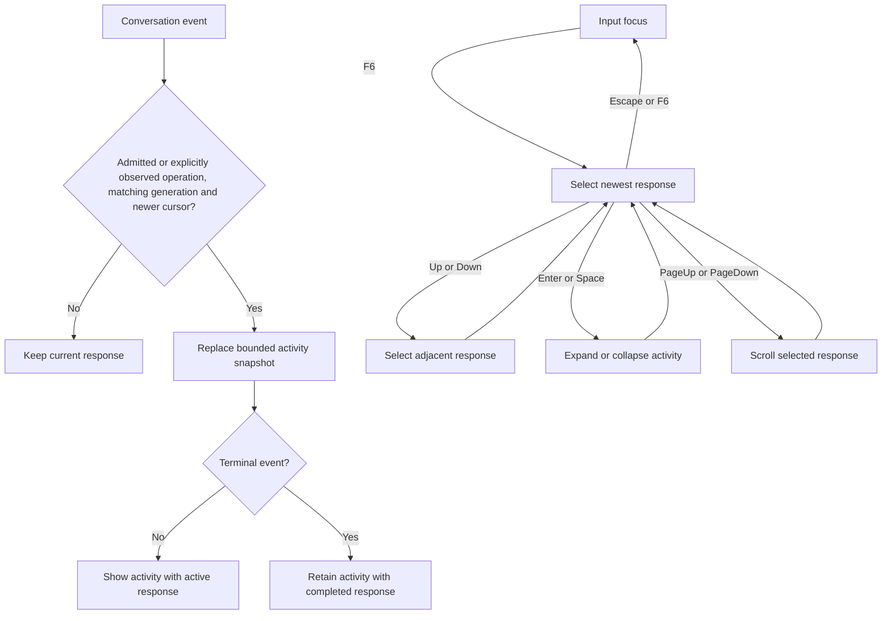
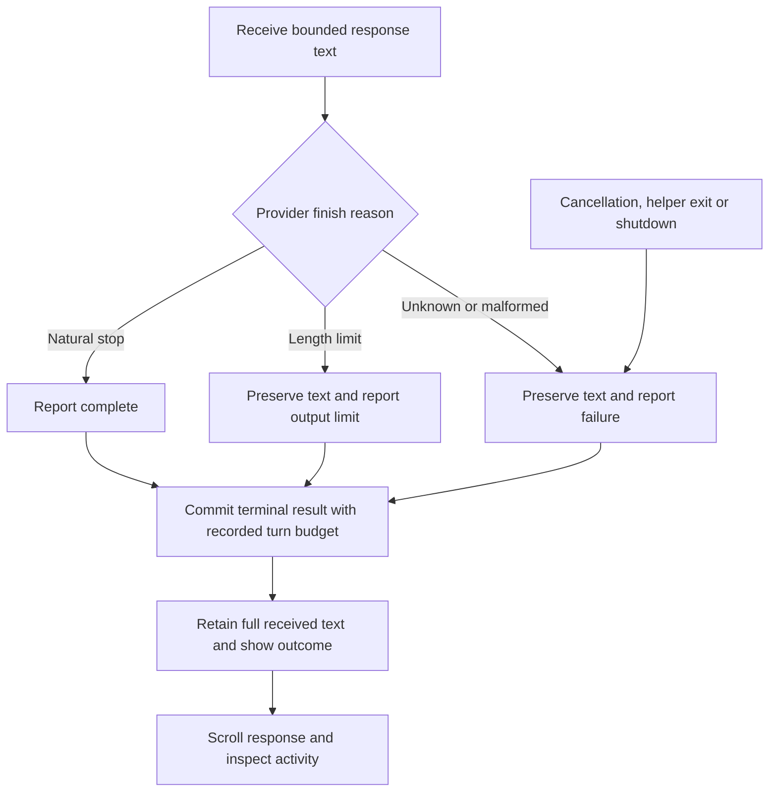
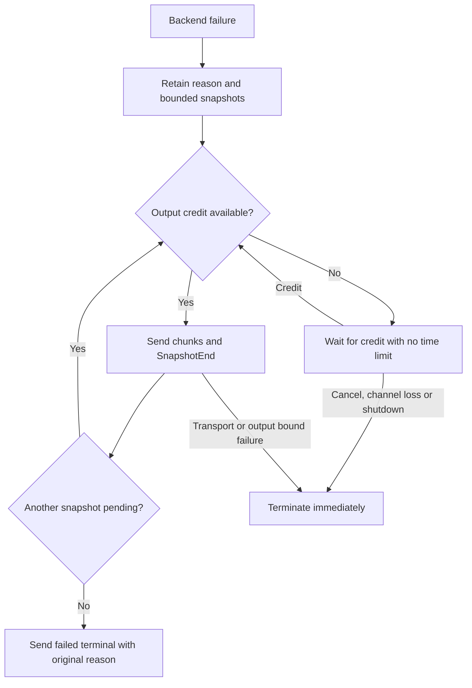
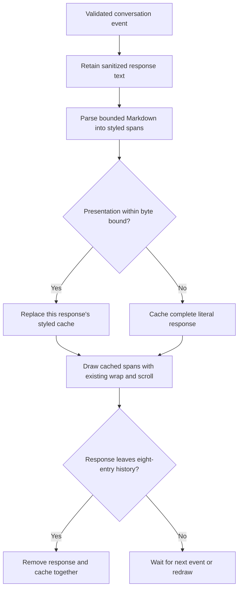
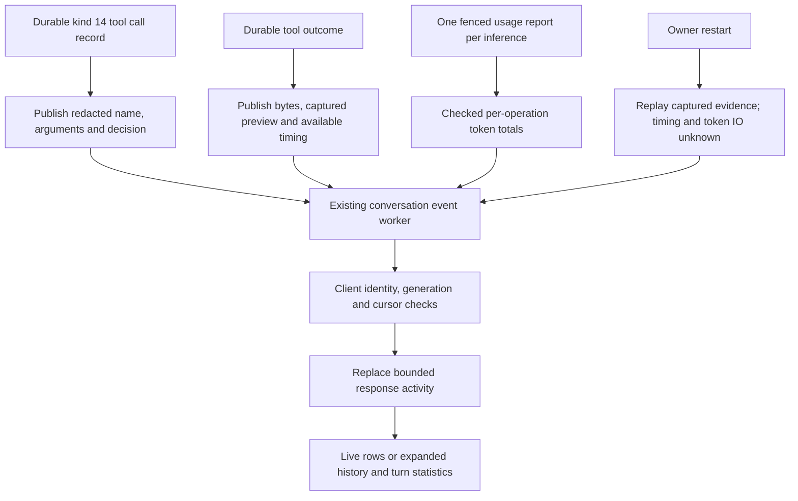

# Response activity and navigation

Status: implemented for live activity and expandable response history; see the
[recorded qualification](#recorded-qualification--2026-09-30).

Owner requirement, 2026-10-13: token limits must not be hard-coded. The fixed
token figures in this design describe the current implementation and will be
replaced by [model-sized limits](loop-closure.md#model-sized-limits).

The selected 2026-09-30 extension below adds richer live feedback and turn
measurements. The [conversation projection direction](conversation-projections.md)
also proposes recoverable full results and recomposable model context. Those later
extensions remain design work.

## Ownership and data

The service owns tool execution and durable intent/result records. Existing
`ConversationEvent.tools` carries a cumulative snapshot of at most eight tools.
Each entry contains ordinal, name, state and result status. Tool acknowledgements
advance the event cursor independently of generated text. The TUI consumes these
snapshots through its existing conversation worker, including pending events.
No transport, journal or protocol numbering changes are needed.

The TUI retains activity beside each of its eight retained response entries.
Operation identity, generation and monotonic cursor prevent a late event from changing another
response. Repeated snapshots replace metadata; they never append duplicate tools.
Equal-cursor empty pending heartbeats preserve the last snapshot. Explicit `/observe`
creates a recovered entry if the operation is absent from local history.
Terminal state closes the response. Disconnect preserves the last observed state;
absence of an event never implies successful completion. Explicit observation can
recover cumulative activity from the service journal. This packet does not add a
browser for conversations from previous TUI launches.

## Interaction

Active responses show their tool list automatically. Each row shows its ordinal,
name and running, complete, failed or interrupted state. Failed rows also show the
result reason. The lifecycle row shows waiting, generating, complete, failed,
cancelled or interrupted. A pending event may name the
[waiting step](model-provider-integration.md#waiting-step-display--owner-2026-10-16),
for example `Waiting: model output · Esc stops`. This is execution metadata, not private model reasoning.
The selected extension adds bounded arguments and captured-result previews.
Continuous exec_cmd output streaming remains outside this packet.

Completed responses show a compact activity summary. F6 enters response navigation
at the newest entry. Up/Down select a response; Home/End select oldest/newest.
Enter or Space expands or collapses its activity. PageUp/PageDown scroll the selected
response by a viewport; selection and scroll remain stable while new events arrive.
Escape or F6 returns to input and follows the newest response. The draft is preserved.
Ctrl+P/N retain their existing input recall function outside response navigation.
Quit and cancellation retain existing routing. The hint row explains the focused
interaction. Selection uses the existing lighter grey-blue palette, without inversion.
Activity text has one character of horizontal padding at each edge; input blue stays
reserved for composer input. The history input's half-block separator supplies the
vertical spacing. Do not add blank rows around activity text between input and
response. Tiny terminals may clip content but must remain operable.

## Selected flow

Arrows describe validated event delivery and user actions.

## Limits, failures and validation

No file, network, model or blocking operation runs in render/key handlers. No new
worker or polling timer is added. Existing conversation cancellation, wakeup and
backpressure contracts remain authoritative. Metadata is limited to eight entries
per response with names limited to 64 bytes, plus scalar state/identity/cursor.
The eight response limit and existing prompt/output bounds remain unchanged.
Evicting an old response also evicts its metadata. Navigation clamps after eviction
or resize. Strings pass through existing terminal-control sanitization.

Unit tests must cover pending activity before text, completed/failed/interrupted
states, duplicate/stale events, operation separation, eviction, expansion, navigation,
scroll, resize and unchanged drafts. Render previews must show active and expanded
activity with the established palette. The actual PTY journey must exercise F6,
response selection, expand/collapse and return to a preserved draft. Service tests
must show tool progress without text and durable terminal/reconnect snapshots.
Run CLI unit and lifecycle checks, focused service coverage, lint and final build.

## Response limits and truthful completion

Selected correction: new admissions reserve 2,048 output tokens. Tool inference
requests use a first-request cap of 1,024 and continuation caps of 512.
The 2026-09-30 extension removes the independent three-request limit and releases
unused reservations only from verified successful output counts. The service uses
the selected cancellation-driven turn lifetime and retains its
eight-tool limit and 61,440-byte response bound. Limits remain
necessary; reaching one must preserve received text and mark the response incomplete.
The TUI retains every received response byte within the wire bound, sanitizes control
characters and permits scrolling through the complete retained text.

Every turn reserves exactly 2,048 output tokens. Replay rejects any other
reservation, including the earlier 512-token value (owner, 2026-10-17: no
compatibility with older journals). Replay validates each terminal charge against
its turn's reservation. Recovery charges the recorded reservation if usage is unknown. Journal
format remains 1 and protocol remains 0.1. Model wire limits permit up to 2,048;
per-turn enforcement still uses the actual Begin reservation. Context checks reserve
the actual requested output budget before generation. Small contexts reject excessive
input with context-limit status rather than silently clipping context or output.

The Ollama adapter inspects its finish reason. A length stop preserves the delivered
prefix and reports output-limit. A natural stop reports completion. Unsupported or
ambiguous finish reasons fail explicitly rather than claiming completion. The shared
bounded executor records a typed failure in its turn-local budget state, so SDK error
wrapping cannot turn output-limit into success or an unrelated error. Cancellation
checks remain active between inference passes and during streaming. The owner
removed the explicit generation deadline (2026-10-16); Begin has no deadline
field (owner, 2026-10-17).

Validation includes natural and length stops, final-chunk text preservation, wrapped
executor failure, exact pass allocations, rejection of a non-2,048 reservation, and a
native local Ollama post-tool response longer than 128 tokens with an expected ending.
No heuristic based on punctuation decides whether an answer is complete.

### Selected completion flow

Arrows describe provider finish classification and durable publication.

Ollama `stop` is a natural stop, including tool-call responses. `length` is an
output limit. A missing or empty reason with eval_count at the requested cap is
also an output limit; otherwise it is invalid-response. Unknown reasons are invalid.
The adapter emits valid final-chunk text before classifying the finish. The shared
wrapper retains typed errors for both tool and plain-text inference. Plain-text
inference uses one dispatch with the admitted maximum, not the tool-pass split.

The turn-local executor budget starts with the actual Begin token reservation.
Each tool dispatch reserves the smallest of its pass cap (1,024 first, 512 later),
the caller's cap and the remaining reservation before provider I/O. Only verified
measured output from a successful request refunds unused reservation. Zero
remaining tokens or a 65th tool dispatch fails before provider I/O. Plain-text
dispatch reserves its actual admitted maximum once.
The first typed executor failure is retained through SDK error wrapping; cancellation
still takes priority. Tests cover small remaining reservations and separate turns.

The installed SDK drops buffered response text if its executor throws. For a typed
executor failure, the bounded adapter therefore records the failure and returns
normally to drain the SDK channel, then the outer backend throws the recorded
failure. This does not authorize tool execution: native callbacks wait for the
current inference dispatch to settle and check its recorded failure before calling
the service. The existing turn-local actor retains at most eight cancellation-aware
callback continuations; overload rejects before host effects. Cancellation removes
its waiter. Every success, typed failure, other failure and cancellation settles
this gate. Further inference reservations reject the retained failure. Tests prove
partial text is delivered, failed inference cannot invoke a native host handler,
and cancelled waiters leave no retained callback.

Unknown terminal finish classification becomes a typed protocol-fault at the
executor boundary, so its valid received prefix uses the same drain-before-failure
path. Callback gate overload records output-limit and rejects all pending callbacks.

### Failure delivery under output backpressure

The helper session retains one pending backend failure reason while its existing
current snapshot and replaceable latest snapshot drain through output credit.
It accepts no further backend snapshots or tool requests after that failure.
After the final SnapshotEnd, it sends a failed terminal with the original reason
and unknown usage. This adds no snapshot queue. Control cancellation terminates
immediately; transport failure or an output bound reached by the drain also
terminates without retrying the failed pump. The wait has no time limit (owner,
2026-10-16; Begin has no deadline field). It stays
cancellation-driven with bounded retained snapshots and responsive controls, and
ends on credit, cancellation, channel loss or shutdown. Socket tests cover delayed
credit preserving both snapshots, withheld credit held until cancellation, and
cancellation during the drain. Implemented 2026-10-16: the helper no longer arms
a generation deadline.

## Terminal Markdown presentation

**Selected design.** The TUI formats model response text in the history pane.
The service keeps the original response bytes and remains the owner of durable
conversation data. The TUI keeps its sanitized response string for inspection and
builds Ratatui styled text when a response event changes that string. The draw
loop reads this cached text. Prompts, activity, notices and configuration remain
literal. This is presentation only; Markdown and embedded HTML cannot execute or
authorize work.

Use the pinned CommonMark event parser already available in the local Rust source
cache. Render strong emphasis as bold, emphasis as italic, strike as crossed out,
inline code and fenced code in the muted code style, and headings as bright bold
text. Show list markers, quote guides, rules, task markers and table cell separators.
Show link labels with an underline and their destination as visible text. Keep
literal HTML visible as text; do not interpret it. Keep the established response
gutter, marker, wrapping, scrolling and palette. Styling must not inject terminal
control sequences.

An event supplies at most 61,440 response bytes. The presentation cache retains
at most eight responses and at most 65,536 emitted bytes per response. If rich
presentation exceeds that bound, show the complete sanitized original response
literally. A malformed or unfinished Markdown fragment also remains visible.
The renderer performs bounded local CPU work only when a response changes. It has
no I/O, dependency wait, retry or timer; incoming replacement events cancel the
relevance of older cached output. Eviction removes both text and cache entry.
The input and response event pipeline remain responsive under rapid snapshots.

Arrows describe response presentation and its failure fallback:

Unit checks cover bold punctuation removal and cell style, nested emphasis,
Unicode, escaped markers, inline and fenced code, lists, links, raw HTML, incomplete
Markdown, the byte fallback, cache replacement and eviction. A TUI integration
check delivers a Markdown response event and inspects its rendered cells and F6
history without changing the draft. The existing PTY journey checks that a real
terminal can navigate and exit cleanly after rendering. Run CLI tests, formatting,
strict lint and a final build. No control schema or numbering change is needed.

**Verified behavior, 2026-09-28.** The CLI library suite passed 137 tests.
The Markdown test checks the Ratatui cell's bold modifier and removed markers
after a conversation event; parser tests cover nested styles and the literal
fallback. The isolated CLI lifecycle and PTY suite passed, including history
navigation and terminal restoration. Workspace Clippy with warnings denied,
Rust formatting, diff checks and the final CLI build passed. The local Mermaid
CLI rendered this flow and its output was inspected. The PTY fixture does not
inject a deterministic Markdown model response; the Ratatui buffer test provides
the direct styled-cell evidence.

## Rich activity and turn measurements — selected 2026-09-30

The owner authorizes work items 1–2 of the conversation projection direction.
Extend existing service events, tool replay projections, helper callbacks and
client activity. Result payload retention and richer graph ontology remain design
work; no new output store, context composer or scheduler is introduced here.

ToolProgress adds optional arguments (192 UTF-8 bytes), policy_decision (1 service
admitted, 2 access denied, 3 rejected arguments), elapsed_ms, result_bytes,
preview (128 UTF-8 bytes), truncated and exit_code. Rejected note content and
large note bodies are not exposed; show version/body size references. Values
come from typed service intents and committed results, not model assertions.
Current-owner timing uses monotonic instants; replay can recover arguments and
captured previews but cannot invent absent timing.

Revision (2026-10-18, [tool call records](tool-call-records.md#context-composer-and-views),
TCR-D13): each entry projects one kind 14 `ToolCall` record. `name` is a display
prefix of at most 64 bytes of the stored redacted name, cut on a UTF-8 boundary
(TCR-D26; empty when the name was not retained). `policy_decision` is the kind 14 decision code: 1 `run`, 2
`invalid_arguments`, 3 `unknown_tool`, 4 `refused`, 5 `busy`, 6 `denied`, 7
`limit`, 8 `cancelled`. New field 12 `fault` carries the fault code 1–15.
`arguments` is a display prefix of at most 192 bytes of the stored argument
text, or a service-written `[not retained: <reason>, <n> bytes]` when the text
was not retained. For a call that does not run, `state` is 3 (failed), `status`
is the rendered status, and `preview` is the rendered result text. The TUI
shows a rejected call as `<name>  <decision>: <fault>`. At most nine entries
are sent per event (ordinal 9 exists only for the over-limit record). These are
projections; the kind 14 record stays the one source. Preview truncation is separate
from stored-result truncation. Existing exec_cmd tails remain explicitly truncated.

The replay projection caches bounded argument/result descriptions in ToolRecord,
derived from verified journal bytes. This adds no filesystem access on the reactor
and no new journal encoding. Charge the additional fixed memory against its existing
16 MiB replay limit. At most nine tools are sent per event (eight before 2026-10-18), with 192-byte arguments
and 128-byte preview caps preserving room beside the existing 61,440-byte response.
Strict wire validation and a maximal-frame regression must enforce that bound.
The TUI sanitizes every string, displays running tools immediately, and expands
committed outcomes/previews in response history. It cannot label execution safe
merely because admission succeeded. A filesystem access failure can follow admission.

ConversationEvent adds optional TurnStatistics: elapsed_ms, input_tokens,
output_tokens, cached_input_tokens, complete and request_count. Duration starts
when durable Start is dispatched, excludes queue/preparation and ends on settlement.
Live observations report elapsed time without incrementing cursor for time alone.
At most eight current-owner operation summaries are retained for terminal replay;
restart leaves measurements absent. This explicitly does not persist new statistics
in format-1 records. That belongs to the result/graph storage packet. Token IO is
informational and does not replace existing durable charge accounting.

Private InferenceUsage reports use envelope field 23 and consecutive request
ordinals 1–64. Each optional count is at most 1,000,000,000; cached input requires
measured input and cannot exceed it. Every settled request reports once; absent
counts remain unknown. Service totals sum measured counts with checked arithmetic
and mark them partial unless all reported requests completed with both counts.
Channel loss/cancellation with an unreported active inference makes totals partial.
The [helper usage design](turn-usage-helper.md) defines actual provider observations,
start-marker cancellation settlement and conservative unknown counts. System,
CoreAI and MLX cannot claim per-request counts from opaque SDK events; Ollama can.
No counter comes from context occupancy, byte estimates or budget reservations.

The observed failure after three tool passes requires correcting the fixed pass
allocation guard. Keep the 2,048-token turn budget, first tool-pass cap 1,024,
later-pass cap 512 and eight native proposals. Remove the independent three-pass
limit. Only verified actual output from a successful request refunds unused
reservation; unknown, failed and cancelled requests consume their reservation.
The helper design specifies request identity, counter checks and release ordering.
Plain-text generation keeps its single admitted request. This introduces no retry
and does not repeat earlier tool effects.

### Rich activity delivery — selected flow

Arrows show existing execution events and bounded projection updates.

Added work is bounded local CPU and existing awaited transport only. Existing
workers, retained slots, cancellation, priority inboxes and
owned shutdown remain in force. No file/network calls occur in key/render loops.
Service unit tests cover truthful policy/result mapping, unknown/replayed timing,
duplicate/stale usage, overflow and failure. Storage tests verify bounded derived
previews through reopen. Swift tests cover multiple small tool passes followed by
an answer, conservative unknown accounting, cancellation and counter validation.
Cross-language fixtures cover new fields and malformed messages. Process checks
verify real Ollama continuation usage and responsive controls. PTY checks verify
live metadata, expanded history, statistics, header notice relocation, draft
preservation and owned cleanup. Native unsupported-provider counts remain unknown.

### Recorded qualification — 2026-09-30

**Verified behavior:** Swift helper tests passed 98 cases. The cross-language
fixture exchange passed valid, unknown, zero and malformed inference-usage cases.
Affected Rust library and journal suites passed 432 cases: CLI 168, control 31,
service 137, storage 50, authority conversation 37 and journal writer 9.

The actual local Ollama 0.34.4 service with `granite4.1:8b` completed a native
tool continuation: two inference requests, 2,134 input tokens and 61 output tokens.
The same process journey verified durable replay, disconnect continuation and
outside-project secret non-disclosure. The Swift SDK regression completed three
small tool calls followed by a fourth inference request and final answer.

Isolated PTY journeys passed live exec_cmd activity and a four-request tool sequence,
including a denied file access, full response, measurements, history navigation,
draft preservation and owned cleanup. Composer navigation also passed.
The restored-history journey exposed an intermittent writer-admission race.
The service correction retains foreground reads behind any pending writer job.
Four deterministic regressions passed, including active observation/cancellation
bypass. The final CLI argument and lifecycle gate passed, including two restored
launches with exact journal checks, queue reorder, ownership and terminal cleanup.

Workspace Clippy passed with warnings denied. The actual debug CLI and matching
Swift helper package were built. Timing and per-request token counts remain
volatile across service restart. These checks do not verify full-result paging,
new graph ontology implementation or native terminal visual correctness.
