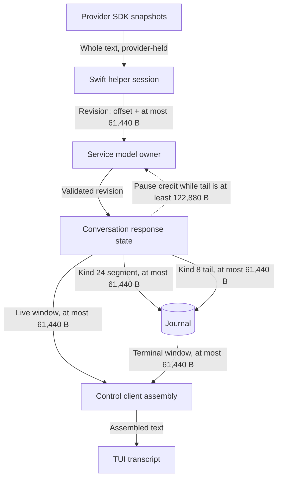
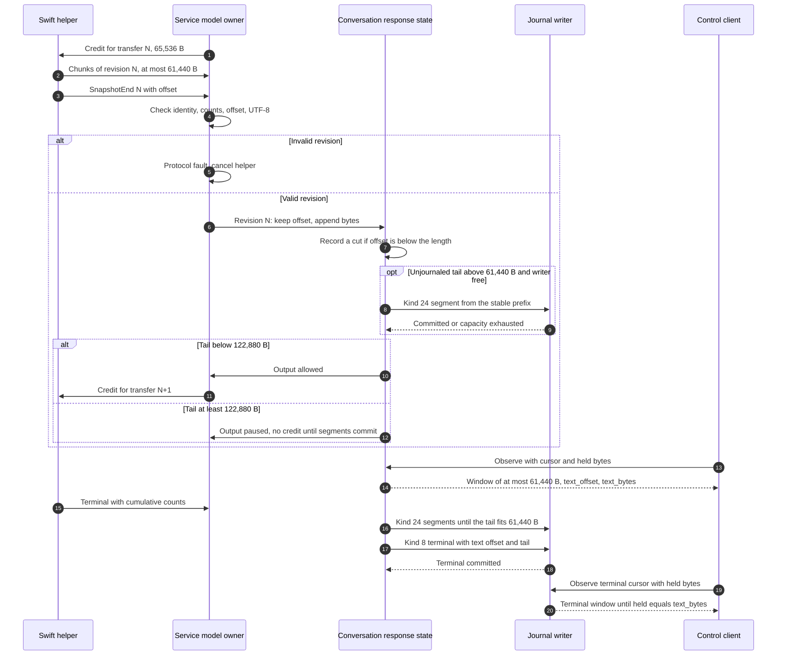
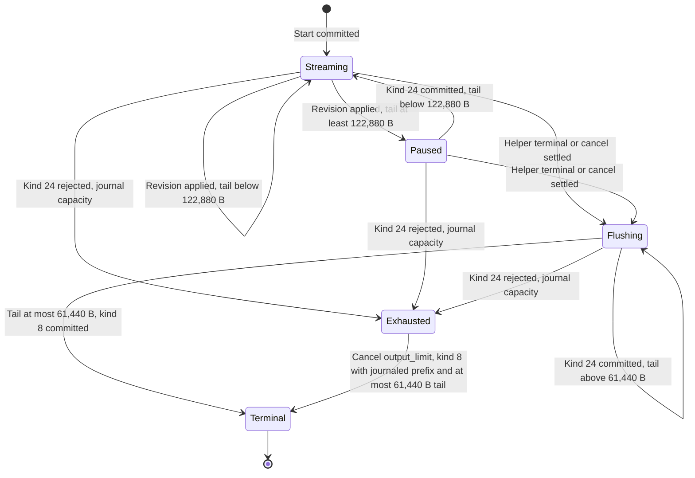

# Response text transfer

Status: selected design (owner decision, 2026-10-18), implemented 2026-10-18.
It removes the three per-operation output totals. The
[Swift/Rust boundary](swift-rust-boundary.md), the
[first-conversation packet](platform-capabilities.md#control-messages-at-version-01),
[conversation admission](conversation-admission.md#transition-payloads) and
[response activity](response-activity.md) link here for the response text
contract. Wire protocol 0.1 and journal format 1 do not change.
[Thinking level](thinking-level.md#model-channel-modelproto) extends each
revision with an optional thinking part and each event with a thinking window
that shares the 61,440-byte window budget.

## Owner decision and scope

Owner, 2026-10-18: “Remove the three output totals too.” Commit 6e22c27 had
already removed the per-turn model-run cap, the 2,048-token turn budget and the
64 KiB turn result total. This design removes the three remaining output totals:

| Removed total | Where it was enforced | Why it existed |
| --- | --- | --- |
| 1,024 snapshot revisions per operation | Helper session, helper and service wire validation, service credit | Each revision re-sent the whole response. The count bounded the number of whole copies. |
| 4 MiB of transmitted output per operation | Helper session, `Terminal` validation, service receive | Whole-text snapshots made cumulative bytes grow quadratically with response length. The total stopped that growth. |
| 61,440-byte response | Helper `Limits.output`, provider adapters, service snapshot, `ConversationEvent.text`, kind 8 terminal text, TUI | The service sent the whole response in one control event and the journal stored it in one kind 8 frame. Both frames are 64 KiB. |

All three totals came from one design choice: the response travelled and was
stored as one whole-text snapshot. This design replaces whole snapshots with
bounded segments. Each frame keeps its 64 KiB bound. Per-item bounds stay;
no per-turn or per-operation total replaces the removed ones.

Non-goals: the journal capacity (8 MiB, 32,768 frames; L30 in
[tool output views](tool-output-views.md#journal-and-records)) and the
[segmented journal](segmented-journal.md) that replaces it; the per-request output-token cap (2,048, since
removed by the owner on 2026-10-19; see [request admission](turn-usage-helper.md#request-admission)); the
Ollama per-request stream parser total (4 MiB, L28; removed on 2026-10-20 by
[full-window requests](model-provider-integration.md#full-window-ollama-requests--owner-2026-10-20)); control and model frame
sizes; tool call limits; Markdown presentation limits.

## Required behavior

- A response of any length reaches the journal whole and reaches every control
  client whole. Any revision count and any cumulative transmitted byte count
  are valid.
- Every model-channel frame, control frame and journal frame stays within 64 KiB.
- Service memory for an active response is the response itself plus a bounded
  unjournaled tail. Credit, not a turn total, bounds the tail.
- A slow or absent control client never makes the service retain more data.
- A response that the journal cannot hold ends by known-size exhaustion of the
  journal. The turn records the journaled prefix and stays truthful.

## Ownership

| Owner | Responsibility |
| --- | --- |
| Swift helper session (`Session.swift`) | Turns SDK snapshots into revisions: keep `offset` bytes of the committed text, then append at most 61,440 bytes. It splits a large change into several revisions. |
| Service model owner (`model_owner.rs`) | Validates each revision, assembles one transfer of at most 61,440 bytes, and grants the next transfer's credit only when the conversation owner allows it. |
| Conversation owner response state (`conversation/response.rs`) | Holds the active response, its journaled prefix and its recent cuts. Selects journal segments and observation windows. Decides output pause. |
| Journal (`asura-storage` authority) | Stores kind 24 `ResponseText` segments and the kind 8 terminal tail. Replay rebuilds each response from its pieces. The writer reads one window or one whole response. |
| Control client (`asura-client` `ResponseAssembly`) | Applies event windows to a local copy and reports how many bytes it holds. |
| TUI conversation worker | Uses the client assembly, publishes the assembled text and shows all of it. |

No new process, thread, queue or scheduler is added. The journal stays the one
source of truth for terminal text. Observation windows are derived values.

### Data flow overview

Selected design. Arrows show response bytes; labels give the per-item bound.

## Contracts

### Model channel revisions

`SnapshotEnd` gains field 4, `offset` (uint64). One output transfer carries one
revision:

1. The receiver keeps the first `offset` bytes of its committed response text.
2. It appends the transfer's `total_bytes` bytes. `total_bytes` is at most
   61,440 and may be zero for a pure truncation.
3. `offset` must not exceed the committed length and must be a UTF-8 character
   boundary. The appended bytes must be valid UTF-8.

Revisions start at 1 and increase by one with no upper bound. Output transfer ID
is revision plus one. Chunk ordinals stay below 61,440 per transfer, because a
transfer holds at most 61,440 nonempty chunks. `Terminal.last_revision`, `count` and `total_bytes`
are cumulative and have no upper bound other than u64. The service still
reconciles them exactly with what it received.

The helper keeps the committed text and the newest SDK snapshot. For each
transfer it computes the common prefix, backs it off to a character boundary in
both texts, and sends at most 61,440 bytes of the remaining target. When the
target is longer, the next transfer continues from the new committed length.
An unchanged snapshot after the first revision sends nothing. The first revision
is always sent, so a complete terminal has at least one revision.

The service grants 65,536 bytes of credit per transfer, as before. A transfer
of at most 61,440 bytes always completes within that credit. The service grants
the next transfer's credit only while output is not paused. A paused helper keeps
coalescing SDK snapshots and holds no per-token queue.

### Journal records

Kind 24 `ResponseText`, new in format 1. Payload fields in byte order:
model-operation ID, conversation generation u64, offset u64, text string of at
most 61,440 bytes. Replay requires an accepted, started, nonterminal operation of
the current owner generation; `offset` at most the journaled length; and a record
that changes the text (`text` nonempty or `offset` below the length).

Kind 8 `TurnTerminal` gains `text offset u64` before `text`. The terminal keeps
`text offset` bytes of the journaled response and appends `text` (at most
61,440 bytes). Complete still requires a nonempty final response. A restart
terminal records the journaled length as `text offset` and empty text, so the
interrupted operation keeps its journaled prefix as incomplete text.

Replay keeps each response as a list of pieces: start position, kept length and
frame range. It clones no text. A read rebuilds the text from the frames and
rejects a piece cut inside a UTF-8 character as `RepairRequired`. Each piece
charges 64 bytes against the existing 16 MiB replay memory limit.

### Control observation windows

`ConversationObserve` gains field 4, `text_offset` (uint64): how many response
bytes the client holds. `ConversationEvent` gains field 13, `text_offset`, and
field 14, `text_bytes`. When `text` is present, the client truncates its copy to
`text_offset` bytes and appends `text`; the response then has `text_bytes` bytes
in total. `text` is at most 61,440 bytes and ends on a character boundary.

- Live (kind 2): `text_offset` is the smaller of the held count and the lowest
  cut since the client's cursor. The service keeps the 16 most recent cuts. A
  cursor older than a forgotten cut restarts at 0.
- Terminal (kinds 3–6): the response comes from the journal. A client that
  sends the terminal cursor (`u64::MAX`) continues from its held count. Any other
  cursor restarts at 0, because the journal keeps no cut history.
- A client that holds the whole current response gets a pending heartbeat
  (kind 1, no text). A parked observation waits only while that holds and the
  cursor has not changed.
- The client has the whole response when it holds `text_bytes` bytes. It
  observes again immediately while it holds fewer.

The event frame proof (TCR-D26) stays valid: the window replaces the former
whole-response text at the same 61,440-byte bound, and the two new fields add at
most 22 bytes.

### Response revision and journaling sequence

Selected design. Solid arrows are messages or journal commands; dashed arrows
are replies. The loop repeats until the helper's terminal.

### Response state

Selected design for one active response. Guards name the numeric thresholds.

## Failure and recovery

| Case | Required result |
| --- | --- |
| Invalid revision: wrong ID, ordinal, counts, offset, boundary or UTF-8 | Protocol fault; the turn fails with the received text as an incomplete prefix. |
| Helper sends without credit or beyond 61,440 bytes in one transfer | Protocol fault. |
| Kind 24 rejected for journal capacity | Record cancel cause 3 (`output_limit`). The terminal keeps the journaled prefix plus at most 61,440 tail bytes and is marked cancelled. Clients see a cut and resynchronize. |
| Writer stalled | Output pauses at a tail of 122,880 bytes. Controls, cancel and observation stay responsive. Cancel still settles after the writer replies. |
| Service crash or restart | The restart terminal keeps the journaled prefix, marked interrupted. No automatic retry. |
| Client disconnect or slow client | The service keeps no per-client state. Reconnect resumes from the held count or restarts at 0. |
| Cut below a forgotten cursor | The service restarts that client's window at 0. |

Every wait ends through an existing loop closure: helper terminal, cancel, helper
exit, protocol fault, writer reply, disconnect or shutdown. This design adds no
deadline or timeout.

## Security and data handling

Response text is model output and stays untrusted data. The journal already
stores it; this design stores the same text in more frames. No new process,
file, endpoint or permission is added. The TUI still sanitizes control
characters before display.

## Asynchronous execution and bounds

| Rule | Application |
| --- | --- |
| AE-01 | The reactor applies revisions, selects windows and submits journal commands without waiting. Window selection copies at most 61,440 bytes. |
| AE-02 | No new blocking call. Journal I/O stays in the writer thread. |
| AE-03 | Model transfer at most 61,440 B; credit 65,536 B; journal segment and terminal tail at most 61,440 B; event window at most 61,440 B; output pauses at 122,880 unjournaled bytes, so at most 184,320 bytes wait for the journal; 16 recent cuts; journal capacity 8 MiB bounds a response's total size. |
| AE-04 | Pause ends when a segment commits; the turn ends on terminal, cancel, helper exit, protocol fault or shutdown. No time bound. |
| AE-05 | Kind 24 and kind 8 are append-only; replay rebuilds the text. Restart preserves the journaled prefix. |
| AE-06 | Shutdown cancels the helper; the terminal flush uses the same segment rule. |
| AE-07 | The validation cases below cover stalled journal and slow client. |

## Validation

| ID | Case | Unit | Integration | End-to-end |
| --- | --- | --- | --- | --- |
| RT-01 | More than 1,024 revisions are accepted | Control and Swift `Wire` validation at revision 1,025 and above; Swift session sends 1,100 revisions; model owner accepts 1,100 revisions | Scripted helper response over many revisions (RT-03) | — |
| RT-02 | More than 4 MiB of transmitted output is accepted | `Terminal` validation above 4 MiB; model owner receives more than 4 MiB of revisions | Swift session transmits more than 4 MiB cumulatively | — |
| RT-03 | A response above 61,440 bytes reaches the journal and the client whole | Response state segments and windows; journal kind 24 replay, window read and history; client assembly; TUI worker assembly and transcript without a cut | `tool_call_flow response`: real service, real Swift helper and a scripted loopback Ollama endpoint return a 1,000,000-byte answer. The journal replays it whole in kind 24 segments and a tail; a client assembles it from windows, before and after a service restart; every event frame stays within 64 KiB | Not automated: the PTY gate cannot force a live model above 61,440 bytes; the TUI unit tests and the PTY gate cover the changed worker and display path |
| RT-04 | A cut below the held text resynchronizes | Response state cut log and window offset; client assembly truncate | — | — |
| RT-05 | A stalled journal writer bounds service memory | Response state pause threshold; model owner withholds the next credit; conversation owner with a real private journal releases credit only below 122,880 unjournaled bytes | `tool_call_flow response`: with journal appends held, the service holds at most the journaled length plus 184,320 bytes and the turn does not complete; after release it completes whole | — |
| RT-06 | A slow client adds no service memory | Window selection keeps no per-client state | `tool_call_flow response`: a client that did not observe during the turn assembles the whole response | — |
| RT-07 | Journal capacity ends the turn truthfully | Real writer refuses a kind 24 segment beyond capacity and still commits the cancel and terminal; the conversation owner maps the refusal to cancel cause 3 and one tail | — | — |
| RT-08 | Restart keeps the journaled prefix | Writer restart terminal records `text offset` equal to the journaled length | — | — |
| RT-09 | Replay rejects an invalid kind 24 or kind 8 offset | Offset above length, terminal operation, wrong generation, no-op record | — | — |
| RT-10 | The maximum event frame stays within 64 KiB | Event with a 61,440-byte window, both new fields and nine tools encodes within the frame | — | — |

Live-model journeys could not force a response above 61,440 bytes under the
2,048-token per-request cap that applied when this design was qualified (removed,
owner, 2026-10-19); RT-03 uses the scripted loopback endpoint through the real
helper. The TUI PTY gate exercises the changed worker and display path with
short responses only.

## Decisions and alternatives

- **Selected: revisions with an offset.** A delta from a kept prefix handles both
  appends and provider rewrites, and costs bytes proportional to the change.
  Rejected: append-only deltas, because providers may revise published text.
- **Selected: the journal stores the response.** It already owns terminal text
  and replays it. Rejected: the payload store, because it owns tool output with
  quota expiry, and a response is conversation history that must not expire.
- **Selected: incremental kind 24 segments with a terminal tail.** The common
  short response still commits in one kind 8 frame. Segments bound the
  unjournaled tail and keep the prefix through a crash. Rejected: writing all
  segments at terminal time, because the service would hold an unbounded
  unjournaled tail and a restart would lose the whole response.
- **Selected: client-held count instead of per-client service state.** A slow
  client cannot grow service memory.

The [segmented journal](segmented-journal.md) replaced the single 8 MiB file
(L30) on 2026-10-19. One response is bounded by the journal quota and by 65,536
pieces (about 3.75 GiB of full pieces). At the quota the turn pauses
(OD-SJ-2): its unjournaled text waits and output credit is withheld until
space returns; a cancel keeps the journaled prefix and one tail.
