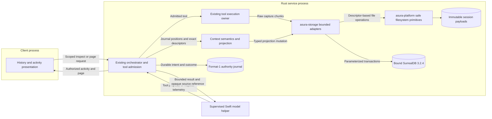
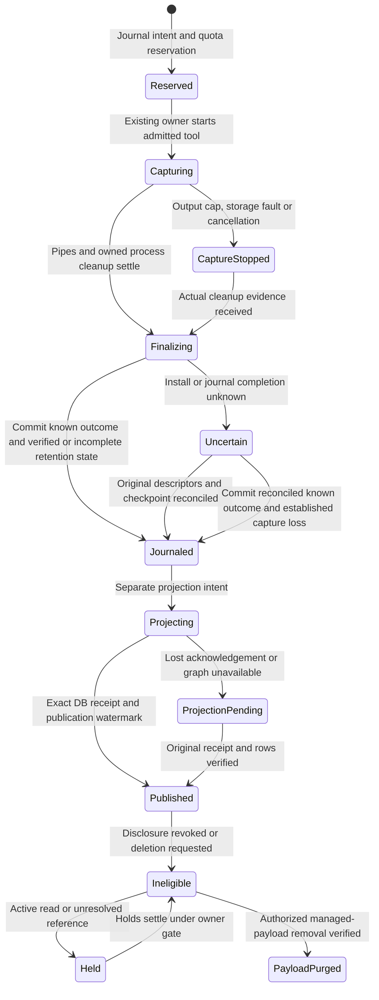
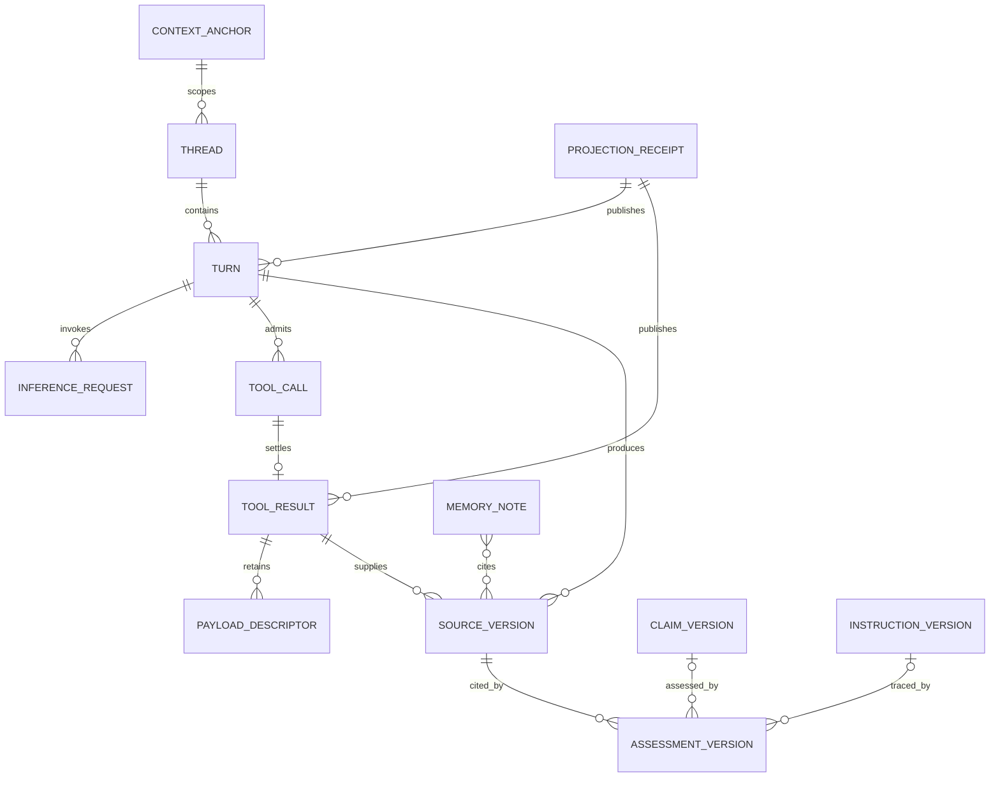
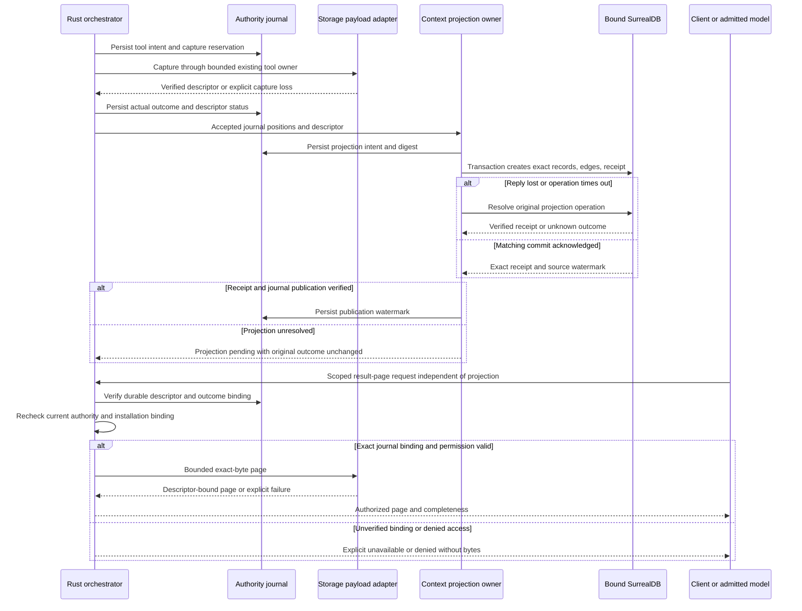
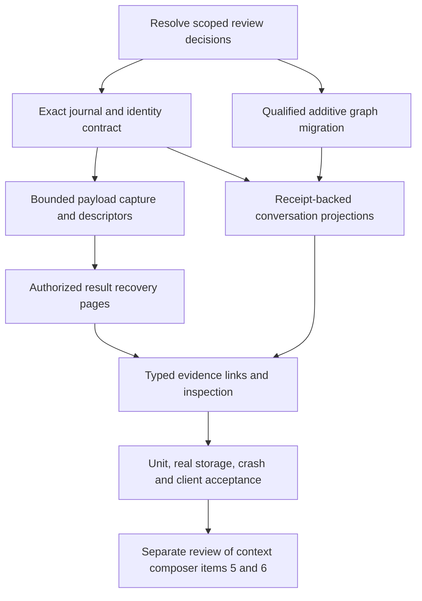

# Retained results and conversation graph foundations

Status: proposed design analysis for delivery items 3–4, 2026-09-30.
Independent source/design review is complete; identified deletion, partial-outcome,
graph-outage paging and corruption-classification findings are resolved here.
All five diagrams were rendered and visually inspected. The implementation gates
below remain open; this packet does not claim implemented retention or ontology.
The owner authorized analysis and review of these items. On 2026-10-14 the
owner authorized item 3 (capture, descriptors and pages) as tool job packet J1
and deferred item 4 (graph projection) to a separate later review (G1); see
[owner decisions of 2026-10-14](#owner-decisions-of-2026-10-14). Item 4 remains
unauthorized. Other mechanisms and limits below remain proposals until scoped
review resolves the open decisions. Protocol numbering remains
`0.1`; journal and persisted schema version numbers remain `1`.

## Scope and governing contracts

This packet develops complete captured-result recovery and the graph foundations
for conversations, turns, inference requests and evidence. It follows
[conversation projections](conversation-projections.md),
[graph memory evolution](graph-memory-evolution.md), the
[hybrid ontology](hybrid-memory-ontology.md),
[storage ownership](storage-adapters.md) and the [shell tool](shell-tool.md).

Required behavior: the person can inspect actual tool activity during a turn.
Later, the person or an admitted model can retrieve retained detail by identity.
Display summaries and future context summaries must name their exact sources.
Audit rotation must not remove those sources.

Items 5–6 remain outside this packet: context selection, recomposition, instruction
precedence resolution, context manifests and deterministic historical reconstruction.
The [context composer](context-composer.md) design governs them.
This schema preserves exact sources needed by those items. It does not claim that
the graph alone makes past model input reproducible. Sensors, reflection, classifier
training, vector search and automatic policy adoption also remain outside scope.

## Current code evidence

Read-only inspection found these boundaries. No database or account service was
started during this analysis.

| Current source | Observed behavior and consequence |
| --- | --- |
| `rust/crates/asura-storage/Cargo.toml`, `Cargo.lock` | SurrealDB is pinned to `3.2.4`; embedded linkage uses `kv-surrealkv`. This packet proposes no dependency change. |
| `asura-storage/src/memory/schema.surql` | Schemafull notes, note-to-note `derived_from` relations and operation receipts exist. No thread, turn, request or captured-result tables exist. |
| `asura-storage/src/memory/database.rs` | Bound marker checks, parameter binding and note/link/receipt transactions exist. Receipt reconciliation checks exact rows; an acknowledgement alone is insufficient. |
| `asura-storage/src/memory/owner.rs` | Scratch qualification owns one engine with eight queued requests and retained cancellation/settlement state. Bound production work must extend its existing authority integration. |
| `asura-storage/src/authority.rs` | The authority journal is bounded at 8 MiB and 32,768 frames. The graph cannot bypass this admission bound. |
| `asura-storage/src/authority/conversation/types.rs` | Conversations and operations have existing IDs. Tool identity is operation, generation and ordinal. Durable tool results contain bounded text, status, continuation and truncation. |
| `asura-service/src/tools.rs` | Model delivery allows 16 KiB per result and 64 KiB aggregate result text. Retained payload storage must not increase these model-delivery bounds implicitly. |
| `shell-tool.md` and the existing shell owner | Shell output is drained fairly, with separate 8 KiB tail rings and a combined 64 MiB emitted-output limit. Existing results contain tails, not complete output. |

The installed SurrealDB 3.2.4 SDK exposes transaction commit/cancel handles and
query/transaction timeouts. Existing code uses a parameterized transaction query.
Neither SDK availability nor current note tests prove the proposed graph schema,
index behavior, migration or cross-store recovery. Those require the tests below.

## Canonical ownership

| Behavior | Canonical owner and boundary |
| --- | --- |
| Input admission, turn identity, execution state, cancellation and publication | Rust service orchestrator, backed by the existing format-1 authority journal |
| Tool execution and pipe draining | Existing Rust tool owner and platform process owner; no second process supervisor |
| Payload format, storage quotas, immutable installation and page reads | `asura-storage`, through safe `asura-platform` descriptor and filesystem primitives |
| Graph meaning, typed endpoint validation and evidence eligibility | Rust context subsystem behind existing service authority work; do not introduce a second scheduler |
| SurrealDB schema, transactions, indexes and receipt decoding | Existing `asura-storage` graph adapter and its retained engine owner |
| Current permission and cross-project eligibility | Existing service policy/admission owners, rechecked per disclosure |
| Model session and provider callbacks | Supervised Swift helper; it receives bounded authorized results, never DB credentials or managed file paths |
| Rendering, expansion and history navigation | Rust client; it submits typed page requests and renders sanitized service results |
| Audit | Existing audit adapter records correlation and decision metadata; it is neither a payload store nor a result index |

Graph execution records are projections of journal decisions. Notes and source
versions remain evidence records under their existing receipt contract. A graph
row cannot resume a turn, grant access, establish a tool outcome or repair a missing
authority journal. No new process is proposed.

### RG-O1: proposed ownership and trust boundaries

Arrows name calls or evidence delivery. The Swift helper and client cannot access
the database or payload directory directly.

## Item 3: complete captured-result retention

### Capture contract

The proposed [tool job controller](tool-job-controller.md#capture-watermark-and-page-contract-amendments)
extends this contract with reads of a running job's staging objects and up to
four concurrent captures. Its review must update the limits below.

Propose immutable raw-byte payloads per result stream. Shell has separate `stdout`
and `stderr` objects. A typed tool may also retain a `result` object containing
its exact returned UTF-8 body. A service-generated descriptor connects streams
to the exact call and result. It states encoding, byte count and SHA-256 digest.

`complete_capture` means all bytes observed on the named streams until their
recorded end were retained. It does not imply command success or complete
execution. A cancelled command can have a complete capture of a partial execution.
Output-limited, disconnected or storage-failed captures expose retained ranges,
observed counts, missing counts when known and a closed loss reason.
Unknown emitted bytes must remain unknown. Never reconstruct them from tails.

Retain contiguous prefixes when capture stops; do not concatenate a prefix and
tail as if there were no gap. Existing tail previews may remain in the ToolResult
for compatibility. Their descriptor labels them `legacy_tail` or `partial`, with
`complete_capture=false`. Old output cannot be recovered retrospectively.

Proposed path shape:
`$HOME/.asura/sessions/<artifact-set-id>/objects/<payload-id>`.
Both IDs are service-derived opaque IDs. Storage resolves them through retained
directory descriptors; callers supply neither paths nor filenames. Use private
directories and regular files, with symlink, replacement and FIFO rejection.
Large bytes remain file based. The DB contains typed metadata, digests and links.
`tmp/` contains owned staging files only. Config, diagnostic logs and audit logs
retain their existing locations and owners.

Secret filtering at capture (EX4, owner 2026-10-15; SD2, SD6 and SD9 of the
[secret detection design](secret-detection.md)) amends this contract for J1.
The job controller's
[J1 and SL3 implementation details](tool-job-controller.md#j1-and-sl3-implementation-details)
define the records, payload store, quota ledger and pages that implement it:

- The capture worker scans each stream before hashing and staging. Each
  detected secret is replaced by `$ASURA_SECRET_<n>`, and bytes it cannot check
  are replaced by a loss marker. The retained payloads therefore hold redacted
  bytes, not the exact emitted bytes; raw bytes are never written to disk.
- The SHA-256 digest, byte offsets, retained length and pages describe the
  redacted stored stream. No digest of raw output exists anywhere (SD9).
- Each descriptor records that redaction ran, the rule-set revision and digest,
  observed and stored byte counts, replacement counts and loss spans. A
  descriptor without that flag is not a valid J1 capture.
- `complete_capture` still means every observed byte was handled: retained,
  replaced or recorded as withheld with its size and reason.
- Raw pages, when added, return the stored bytes. RG-11's "recover exact
  bytes" therefore means the exact stored bytes; replaced values cannot be
  recovered.

Use domain-separated SHA-256 identity derivation with the current 16-byte ID
encoding. Include installation, operation, generation, ordinal and stream kind.
Content equality does not merge calls or deduplicate across projects. Exact
derivation labels and collision/conflict rejection need the wire/codec review.

### Numeric limits proposed for review

| Boundary | Proposed limit and overload result |
| --- | --- |
| Shell retained bytes | No per-call or per-job cap; the shared installation quota applies (owner, 2026-10-14, J1d; PC7 for person jobs) |
| Other tool result payload | 16 KiB per current returned body; future larger typed tools need separate admission |
| Capture concurrency | One capture worker per job slot, each with a 512 KiB transfer queue (owner, 2026-10-14, R4) |
| Capture transfer | Eight chunks of at most 64 KiB; 512 KiB queued bytes plus one active chunk |
| Capture saturation | Backpressure: stop reading the pipes until the queue drains; no cancellation (owner, 2026-10-15, J1-Q1). After a cancel trigger, bytes that cannot be queued are discarded, counted and recorded; retention is then incomplete. Never silently drop bytes and claim completeness. |
| Storage operation | No deadline for writes, sync, install or recovery steps (owner, 2026-10-15). A page read keeps its 2 s storage step (owner, 2026-10-14). After a cancel trigger, the shell cleanup bound of 2.5 s (L3) also covers capture settlement; an unsettled capture is recorded `unconfirmed` and its worker stays owned (J1-Q1). |
| Installation payload quota | Configurable, default 1 GiB retained bytes plus reservations; each capture reserves 1 MiB at intent and grows in 1 MiB steps (owner, 2026-10-14, R1; growing reservation selected 2026-10-13, [job retained output lifetime](tool-job-controller.md#retained-output-lifetime)) |
| Recovery reserve | Fixed 16 MiB reserved for bounded descriptors and settlement; payload admission cannot consume it (owner, 2026-10-14, R1) |
| Page concurrency | Two page-read workers, one reserved for the model (owner, 2026-10-14, R4); eight queued; ninth queued request returns `busy` |
| Raw page | Deferred after J1 (owner, 2026-10-14, R5). Proposed: up to 8 KiB; base64 expansion plus metadata must remain below 16 KiB encoded result |
| Text page | Up to 8 KiB decoded source bytes; UTF-8 boundary validation and sanitization preserve exact source offsets |
| Historical graph page | 32 nodes or edges, at most 64 KiB decoded metadata |
| Startup recovery | At most 128 candidate objects per batch; indexed continuation; no time bound |
| Shutdown | Close ingress immediately; request cancellation; after two seconds retain unsettled ownership and report pending cleanup |

Filesystem operations include create, write, hash, read, sync, rename, directory
sync and unlink. Isolate these in storage-owned retained workers. A page-read
step or the post-cancel settlement bound does not prove a blocked OS call
stopped. Keep its reservation and slot until settlement; do not create
replacement workers to evade the limit.
The service reactor and client render loop must never wait on these calls.
This design adds no whole-turn deadline.

The proposed quota and wind-down bounds require measured qualification. Reserving space
is accounting, not proof that the disk has free blocks. An actual disk-full error
must take the same explicit incomplete-capture path. A single blocked capture
must not prevent Inspect, Cancel, typing or disconnect.

### Durable ordering and graph independence

Before an effect starts, the journal must reserve settlement capacity and record
capture identity and quota reservation with the existing tool intent. Do not
write a descriptor and assume the effect was admitted.

After pipe and process cleanup settle, storage syncs the staging objects, whose
digests it computed incrementally during capture. The service then records the
actual tool outcome with the digests and a descriptor reference, and only then
installs the payloads (owner, 2026-10-14, R2). An uninstalled staging file found
at recovery is an unverified prefix to clean up.
Outcome and retention availability are separate fields. Failure to retain output
cannot erase a known exit code or cause the command to run again.

A tool outcome remains journal-authoritative when graph projection fails. The
service may return its bounded existing result with `retention_pending` or
`retention_unavailable`. It must not claim a fully recoverable graph reference.
For graph publication, extend the existing ingestion contract: persist a projection
intent, transactionally write metadata, edges and receipt, reconcile it, then
journal the projection publication watermark. This separate projection operation
cannot change the original effect outcome. Require both checkpoints for graph
eligibility. This preserves the hybrid ontology's publication gate.

### RG-S1: proposed retained-result lifecycle

Arrows name evidence or failure, rather than assuming cancellation completed.
Effect settlement continues independently of graph publication.

### Authorized page contract

Propose typed `ReadResultPage(result_id, stream, offset, limit, representation)`.
Use it through both the control client and the existing grouped tool dispatcher.
The tool-family name and unused Protobuf tags remain integration decisions.
Every request binds current installation, project, principal, generation and
verified graph binding. An opaque result ID is not a bearer access token.

The response contains exact descriptor ID and digest, stream, source offset,
returned source byte count, total retained bytes, next offset, capture state,
outcome and loss reason. A text preview declares sanitization and encoding loss.
A raw page returns exact bytes encoded for the transport. Text offsets count
source bytes, not rendered glyphs. Binary or invalid UTF-8 data can always use raw
pages; terminal sanitization never changes the retained original.

An offset beyond the retained stream rejects. An offset equal to its length
returns an empty complete page. A text offset inside a UTF-8 scalar starts at
the next scalar boundary and reports the actual start (owner, 2026-10-14, R5);
the page end trims to a scalar boundary. J1 serves text pages only; raw pages
follow later, so RG-11 is partial until then. Cursors bind descriptor digest and
scope. Recheck current authority on every page, not just cursor issuance.

Read results distinguish `expired`, `deleted`, `missing`, `corrupt`,
`retention_pending`, `incomplete`, `denied`, `stale_cursor` and `busy`.
Never expose raw paths, rerun a command, or replace missing content with a summary.
An unavailable graph does not grant fallback disclosure: descriptor reads require
the journal's verified identity and scope, plus current binding and permissions.
The durable descriptor binding must include installation, origin project,
conversation, operation/generation/ordinal, stream, object ID, digest, retained
length, capture status and outcome checkpoint. Storage verifies those fields
against the journal and current installation binding before opening an object.
Graph receipt publication is not a prerequisite for this result-page path.
Binding repair or unresolved journal identity still blocks the read.

## Item 4: conversation and evidence graph foundations

### Identity and physical record proposal

Reuse existing project and conversation IDs. `thread` is the graph projection of
the current conversation, not a new model session. A queued input remains an
input until admitted; do not fabricate a turn or provider request for Held work.
`turn` identifies an admitted operation. Steering references its real target and
creates lineage; it does not rewrite the prior operation.

Inference requests need IDs supplied by the service across the Swift boundary.
One turn can have several requests or continuation passes. A provider retry is
a separate attempt linked to its original request; it must not double-count
usage. Item 2's eventual selected request identity is a dependency of this schema.
Its live cache is not a durable evidence source. Before graph projection begins,
define journal persistence for request/attempt identity, accepted telemetry,
terminal usage completeness and duplicate detection. Replay must reconstruct
those facts without a running helper or its transient cache. Missing historical
records remain unknown; never infer request count or usage from response text.

Propose separate schemafull tables with closed typed relations. Keep original
`memory_note` and `memory_link` tables and semantics unchanged. Every new table
uses the common envelope from the hybrid ontology: installation, graph provenance,
origin project, publication operation, immutable content identity and trust class.

| Table or record | Essential fields and source of truth |
| --- | --- |
| `context_anchor` | Existing project ID and registry revision; journal projection |
| `thread` | Existing conversation ID and creation journal position; journal projection |
| `turn` | Operation ID, admitted generation, input ID, outcome revision and journal position; journal projection |
| `inference_request` | Service request ID, turn ID, provider/model identifiers, attempt identity and measured usage state; accepted helper events |
| `tool_call` | Operation/generation/ordinal, exact bounded argument digest and protected argument source reference; journal projection |
| `tool_result` | Exact call ID, outcome, capture descriptor IDs, retention state and journal position; journal projection plus verified storage evidence |
| `source_version` | Exact user message, response, tool-result or authorized file capture; digest, byte ranges, trust and retained source reference |
| `claim_version` | Bounded factual proposition, subject, producer and evidence IDs; unassessed by default |
| `instruction_version` | Proposed physical projection of the governing `normative_clause` identity/version, source span, claimed issuer/scope and review state; historical evidence, never a live grant |
| `normative_artifact_version`, `translation_record` | Existing graph-design concepts for exact governing artifact revisions and reviewed source-to-clause translations; preserve their canonical identities |
| `assessment_version` | Support, contradiction, translation or supersession assessment, assessor, basis and exact source versions |
| `evidence_edge` | Closed relation kind, exact typed endpoints, origin scope, ingest ID and receipt |
| `projection_receipt` | Projection operation ID, command digest, source watermark and exact created IDs |

Separate bounded structured bodies from payload files. Propose 16 KiB inline
content maximum, reusing the existing note scale; larger source bytes use objects.
Instruction kinds form a closed set: directive, rule, policy, guideline and
standard clause. This distinguishes their claimed force without deciding their
authority. A fact is a claim with attributed support and assessment, not a
truth flag set by its author. Exact source versions retain all corrections.
An instruction node records what a source said. Only the canonical instruction
owner can later publish an application or authority decision. Model-authored
claims and assessments remain attributed proposals. They cannot declare their
own output to be user instruction or verified host observation.
`instruction_version` is a proposed storage name, not a competing instruction
ontology. Review must choose this alias or retain `normative_clause` as the table
name. Clauses cite exact `normative_artifact_version` spans; `translation_record`
preserves source/derived spans, semantic delta and review status under the
[governing instruction graph](graph-memory-evolution.md). No translation gains
authority because this packet captures it.

Projected lifecycle changes create immutable versions keyed by source journal
revision. A separately indexed current head uses an expected-revision transaction.
The logical turn object remains the existing operation ID. Links to historical
outcomes name exact versions, rather than following a changing current head.

Plan, task, assignment and partial-progress shapes remain governed by the hybrid
ontology. A turn may reference an actual task or adopted plan revision when that
owner supplies the identity. Absence stays absent. Progress evidence may cite a
result source version; neither this link nor a graph status can complete a task
or release its dependent work. Introducing those execution owners is outside
this foundation packet.

### RG-D1: proposed graph relationships

Cardinalities show logical relationships, not proof that the DB enforces them.
Relationship validators and pinned-engine integration tests must establish them.

Relation direction must be specified in typed command schemas: `contains` points
thread to turn; `invokes` points turn to request; `settles` points call to result;
`cites` points derivative to exact source. `supports` and `contradicts` connect
an assessment to a claim and its evidence. `supersedes` points the new version
to the old version and records the resolving authority or proposal status.
Prevent cycles in accepted supersession paths. Do not interpret all connected
nodes as currently applicable or true.
An assessment's target is exactly one claim version or instruction version.
The optional targets in RG-D1 express this exclusive choice; decoding must reject
both-target and no-target records.

Thread and turn indexes use installation/project/conversation and journal sequence.
Tool indexes include operation/generation/ordinal. Evidence lookup indexes include
scope, kind and exact version ID. Every query filters scope before expansion.
Never query the graph globally and filter unauthorized results in the client.

Propose typed inspection `ListTurns`, `ListTurnRequests`, `GetResultDescriptor`
and `TraceEvidence`; no caller-provided SurrealQL. Evidence traversal reuses the
graph design's depth 3, 128 visited nodes, 256 edges and 256 KiB decoded-content
caps. Pages contain at most 32 items. A two-second query deadline applies to the
isolated operation. Capped closure reports partial evidence, not an absence claim.

### RG-I1: proposed projection and retrieval interaction

Arrows name requests, checkpoints and bounded results. Original tool execution
does not repeat when the graph acknowledgement is lost.

## Restart, retention, deletion and migration

Propose retention until an explicit authorized deletion, constrained by quota.
This avoids silently expiring referenced evidence. It is a proposed product
decision, not permission to retain private content indefinitely without review.
At quota, reject new capture before effects start; offer user-controlled cleanup.
Do not quietly evict active references or recent conversation results.

Amended for tool job output by the owner on 2026-10-13: automatic expiry of
unreferenced output, growing reservations, user cleanup and value-ordered expiry
apply together, with expiry holds for pins, evidence links, open reads and recent
model references. See [job retained output lifetime](tool-job-controller.md#retained-output-lifetime).
The explicit-deletion proposal above no longer applies to job output.

Protect payloads referenced by admitted work, unresolved capture/projection intents,
active reads, retained exports and future context manifests. References and GC
share the existing serialized owner gate. GC must tombstone eligibility first,
advance invalidation, settle holds, then prove removal from managed files and DB.
Retain minimal identity/state proof after deletion, without content in tombstones.
Deletion of source files outside managed storage is never part of payload GC.

Managed-payload purge is distinct from content erasure. The current immutable
journal retains raw bounded tool results and response bodies. Audit files,
exports and backups can also retain content. Removing payload files and graph
bodies must report `payload_purged`, not claim that all copies were erased.
Before exposing a content-erasure operation, resolve journal checkpoint/archive
redaction, required outcome proof, backups and export retention. Review this as
an implementation gate for RG-09; do not weaken journal recovery or imply that
an immutable content-bearing journal was erased by payload GC.

Age alone cannot prove an orphan abandoned. Recovery inspects journal identities,
verified payload descriptors and receipts before quarantine or cleanup. Quarantine
requires verified digest, length, identity or unsafe-object violations. Transient
I/O failure, cancellation or a deadline reports unavailable/pending, without
classifying the payload as corrupt. A read cannot
substitute another matching-hash payload from a different project.

| Failure checkpoint | Required outcome |
| --- | --- |
| Intent committed, no spawn | Settle original operation without effect; never infer bytes exist |
| Spawn occurred, capture or process cleanup uncertain | Retain reservation; report actual known capture and uncertain effects; no replay |
| Payload installed, result commit uncertain | Reconcile original intent and object; protect payload from GC |
| Tool outcome committed, graph unavailable | Original outcome remains valid; graph projection pending and bounded descriptor access independently authorized |
| DB receipt present, journal publication absent | Verify exact rows and watermark, then finalize original projection; no new records or effect |
| Reference exists, bytes missing or digest differs | Explicit unavailable/corrupt state; dependent evidence ineligible |
| Revocation during page read | Fence disclosure and future pages; settle worker ownership without returning private bytes |
| Purge races a new reference | Serialized eligibility revision prevents admission to a tombstoned object |
| External store disconnected | No embedded fallback; status/cancel remain responsive and memory state says unavailable |

The 8 MiB authority journal limit remains in force. This packet cannot claim
unbounded conversation retention or recovery from a graph after the journal is
lost. A future journal checkpoint/archive design must retain projection obligations,
source hashes, reservations and deletion tombstones before releasing old frames.
Until then, existing explicit admission failure applies at journal capacity.

Schema additions change the schema digest while keeping numbering `1`.
The current marker requires the exact schema digest, so silently installing new
tables under an old marker is forbidden. A migration needs a journaled operation,
verified old digest, exact additive schema digest, receipt reconciliation and
atomic marker update. Qualify each crash boundary before account-store migration.
Rebinding to another graph remains outside this packet and cannot act as migration.

Embedded SurrealDB is the first qualification environment. Configured external
operation requires its existing authenticated endpoint and disclosure contract,
receipt tests and no-fallback behavior. This proposal does not claim that external
mode is implemented or qualified. A remote DB is a data-egress destination
independent of whether inference is local.

## Acceptance cases

Each case requires real managed file and embedded-engine integration, plus the
actual service/client path. Deterministic fixture tools establish transport and
storage behavior; they do not establish provider reasoning quality.

| Case | Initial state and trigger | Required result | Test layers |
| --- | --- | --- | --- |
| RG-01 full capture | Shell emits interleaved streams larger than existing rings | Exact stdout/stderr bytes recover; prefixes/tails/previews cannot masquerade as originals | Unit: offsets, hashing, stream identity. Integration: real pipes and files. E2E: inspect live activity, restart, retrieve each stream and compare bytes. |
| RG-02 partial capture | Output cap, cancellation, storage error or disconnect interrupts capture | Actual outcome and retained ranges/loss reason stay distinct; no invented missing count | Unit: every reason and boundary. Integration: inject each trigger. E2E: inspect partial result after restart without rerunning. |
| RG-03 overload | Chunk queue fills or filesystem write stalls | While running: backpressure only, no cancellation, no loss. After a cancel trigger: a capture not settled within 2.5 s is recorded `unconfirmed`, the result is delivered and the worker stays owned (J1-Q1, owner, 2026-10-15). Memory remains bounded; controls remain responsive | Unit: queue/reservation admission and the post-cancel bound. Integration: stalled storage and full queue, before and after cancel. E2E: typing within 100 ms and Inspect within 100 ms under fixture load. |
| RG-04 quota | Two reservations compete for remaining space, or disk fills after reservation | No over-reservation, protected evidence remains, effect cannot start without reservation | Unit: quota race. Integration: real constrained filesystem. E2E: visible admission failure and authorized cleanup. |
| RG-05 crash recovery | Crash before/after each intent, install, result, receipt and publication checkpoint | One original outcome/reference; no duplicate tool or graph mutation; uncertainty remains explicit | Unit: replay transition matrix. Integration: child-process fault injection at every checkpoint. E2E: restart and recover exact result or precise unavailable state. |
| RG-06 disclosure | Another project guesses a result ID; permission changes during paging | No bytes or existence leak; stale page fenced; raw paths absent | Unit: scope and cursor matrix. Integration: revocation during read. E2E: two project sessions and a current-authority check on every page. |
| RG-07 graph meaning | Repeated identical calls, multiple requests and steering occur | Distinct call/request IDs, exact turn lineage, journal watermark and no fabricated Held turn | Unit: identities and typed edges. Integration: receipts/ordering. E2E: trace the real conversation and inspect request/tool lineage. |
| RG-08 evidence authority | Tool text claims to change instructions; two sources conflict | Attributed evidence remains untrusted; supersession is a proposal without authority | Unit: trust classes and cycles. Integration: scope/source validation. E2E: inspect both sources; execution permissions remain unchanged. |
| RG-09 deletion | Active page or unresolved projection races payload purge; journal still contains raw text | Tombstone prevents new use; purge waits for holds; verified managed removals report payload purge, never complete erasure | Unit: eligibility revision race and erasure-state distinctions. Integration: purge interruption, orphan scan and retained-journal inspection. E2E: explicit pending/payload-purged state and unavailable historical reference. Content erasure remains blocked until journal/backup decisions and tests exist. |
| RG-10 schema migration | Current note graph upgrades; crash occurs at every migration checkpoint | Original notes preserved, one marker cutover, no acceptance of mixed/unknown digest | Unit: schema/receipt validation. Integration: real 3.2.4 upgrades and reopen. E2E: existing note tools plus new graph inspection after restart. |
| RG-11 representation | Binary, invalid UTF-8 and terminal escape bytes appear | Raw pages recover exact bytes; display sanitizes; source offsets remain valid | Unit: byte/text boundary vectors. Integration: payload/page encoding. E2E: safe terminal expansion and downloaded/raw byte comparison. |
| RG-12 external outage | Selected external graph loses commit acknowledgement or connectivity | No fallback or blind retry; local controls work; receipt reconciliation retains original identity | Unit: outcome mapping. Integration: real authenticated external engine and partitions. E2E: reconnect/restart with explicit memory status. |

Record throughput, peak RSS, queued bytes, control latency and disk use at these
limits. Local fixtures do not qualify account-wide encryption, external trust or
backup erasure. Cleanup must stop every test-owned process; never stop an existing
user backend or initialize account state as test setup.

## Review decisions and delivery dependencies

1. **Retention and quota policy:** review the proposed explicit-deletion lifetime,
   1 GiB quota, reservations and user cleanup behavior before implementation.
   Resolved for tool job output: lifetime and reservation approach on 2026-10-13;
   quota sizes (R1) and value classes, ages and tie-break (S2) on 2026-10-14
   ([job retained output lifetime](tool-job-controller.md#retained-output-lifetime)).
2. **Journal compatibility:** select exact descriptor, reservation, projection and
   deletion record shapes within format 1, including terminal-capacity accounting.
   Older binaries must reject unsupported required records safely. Resolved for
   item 3 by R3 (owner, 2026-10-14): new kinds allocated in delivery order; the
   job controller's [durable records](tool-job-controller.md#durable-records) list
   them. Projection records remain open with item 4.
3. **Request identity:** align the graph's inference request/attempt IDs with item
   2 telemetry before allocating new fields. Select durable identity and usage
   evidence records; the live item-2 cache cannot reconstruct historical requests.
   No name/argument matching fallback.
4. **Capture integration:** review the existing process owner's nonblocking
   draining and cancellation extension. Confirm fair streams and no hidden
   synchronous writes. Do not add another supervisor. Resolved by R2 and R4
   (owner, 2026-10-14).
5. **Schema migration:** review exact typed tables, relations, indexes, digest and
   marker cutover on SurrealDB 3.2.4. Existing note behavior must survive.
6. **Encryption and backups:** current private-file protections are not encryption
   at rest. Decide whether stronger requirements apply and specify restore closure
   across journal, graph and payloads before claiming protected archival storage.
   Full content erasure also requires journal/checkpoint, backup and export
   decisions under RG-09; managed-payload purge alone cannot satisfy it.
7. **Tool and control surface:** choose the grouped result-recovery command and
   exact page encoding, while preserving current result budgets and protocol 0.1.
   Text pages for J1 resolved by R5 (owner, 2026-10-14); raw encoding remains open.

### Owner decisions of 2026-10-14

The owner resolved these for item 3 on 2026-10-14. The
[tool job controller](tool-job-controller.md#owner-decisions-of-2026-10-14) is
canonical for their detail.

| ID | Decision |
| --- | --- |
| G1 | Item 3 only, as job packet J1; item 4 deferred to a separate later review |
| R1 | Configurable quota: default 1 GiB, 1 MiB initial reservation, 1 MiB steps, fixed 16 MiB recovery reserve |
| R2 | Hash incrementally, commit settlement with digests, then install; uninstalled staging at recovery is an unverified prefix |
| R3 | New record kinds allocated in delivery order; legacy tools keep ToolResult kind 15 for now. Superseded by EX4 (owner, 2026-10-15): there are no legacy tools; all tools use jobs. J1 allocates kinds 22 and 23. |
| R4 | One capture worker per job slot with a 512 KiB transfer queue; 2 page-read workers |
| R5 | Text pages only in J1, snapped to UTF-8 boundaries; raw pages later; RG-11 partial |
| R6 | ENOSPC pauses capture; other I/O faults and stalls cancel |
| J1d | No per-job output cap; the shared quota only |

Proposed dependency order: review decisions, deliver bounded capture/descriptor
storage, add read recovery, then add journal-derived graph projections and evidence
inspection. Do not begin [context composer](context-composer.md) work as part of these packets.

### RG-P1: proposed delivery dependency view

Arrows mean prerequisites. Passing a gate requires its named test evidence.

## Validation evidence and proof limits

This packet is documentation only. Source inspection establishes the existing
owners and current limits. No proposed implementation or runtime test ran.
The parent owns index integration, Mermaid rendering and visual inspection.
Independent review must check checkpoint ordering, quota settlement, disclosure
fences and the exact journal/migration contracts before any implementation packet
is marked ready. The unresolved decisions above prevent a readiness claim.
