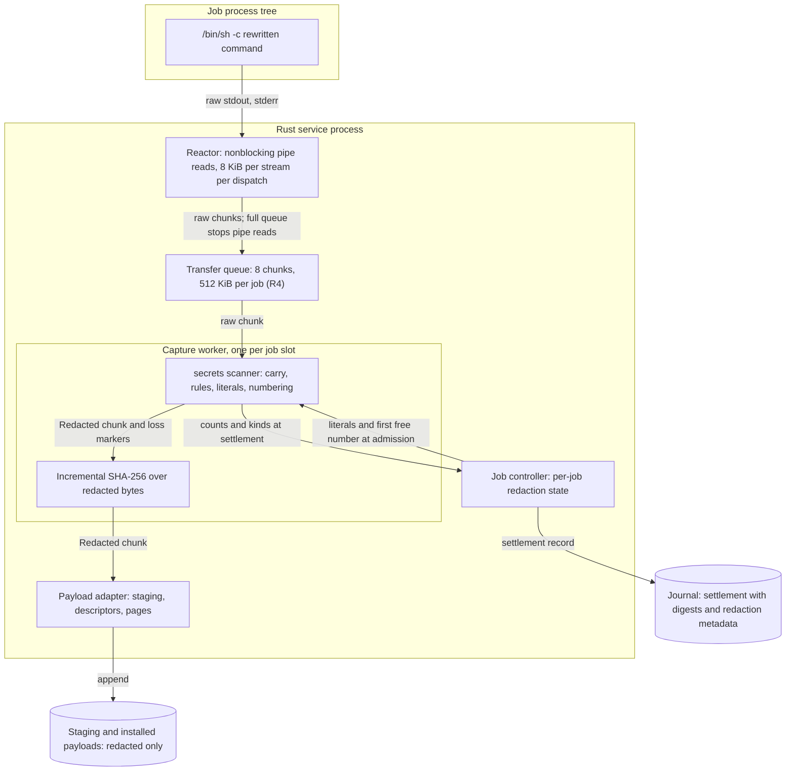
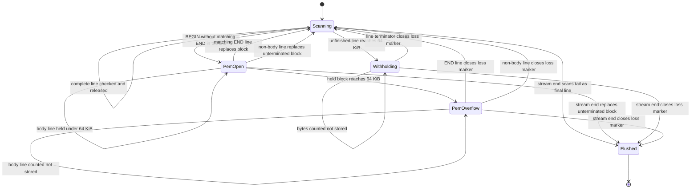
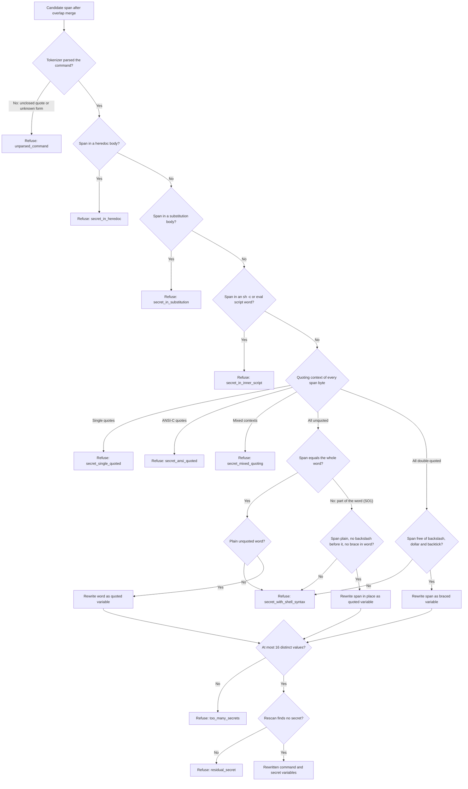
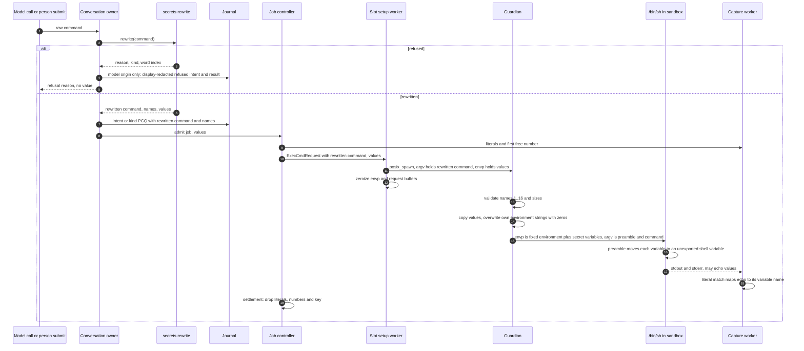
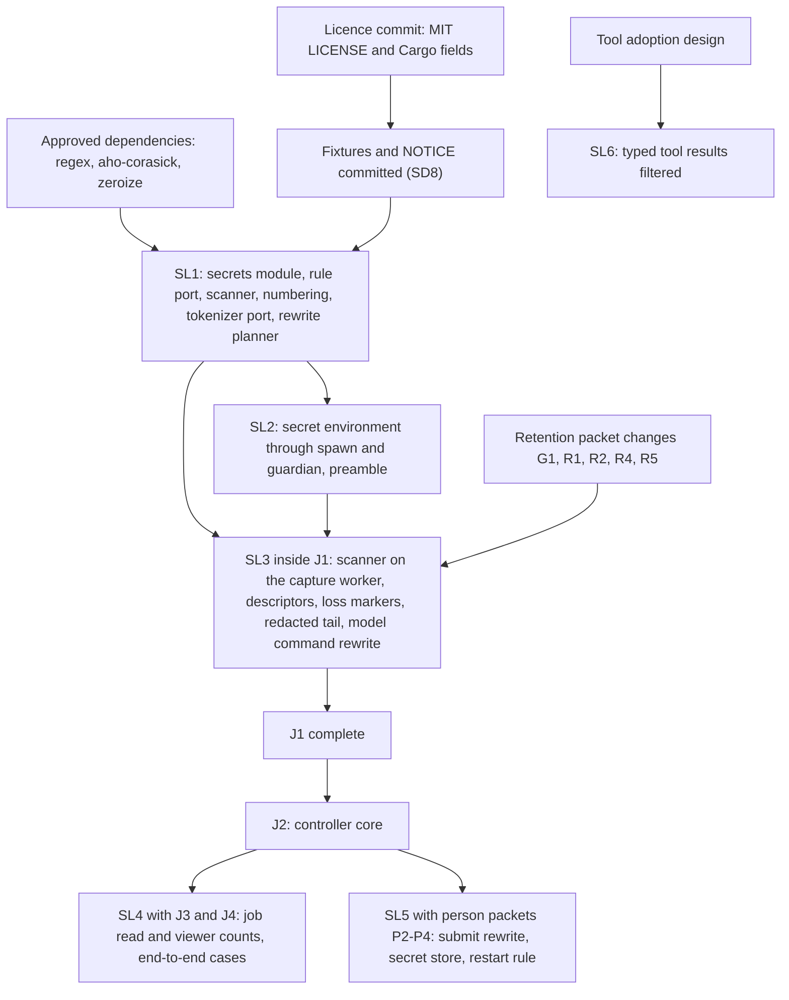

# Secret detection and redaction

Status: selected design, 2026-10-15. The owner selected the required behavior
in decisions SD1–SD9, confirmed Asura's MIT licence, approved the dependencies
and answered SO1–SO4 and the preamble question, all on 2026-10-15. They are
recorded in [owner decisions](#owner-decisions). Mechanisms marked "proposed"
are engineering choices under the
[iteration rules](../design-process.md#iteration-and-escalation). Values marked
"proposed" in limit tables need the measurements in [validation](#validation).
Slices SL1 and SL2 are implemented; see
[SL1 implementation](#sl1-implementation) and
[SL2 implementation](#sl2-implementation). SL3 is implemented inside tool job
packet J1; see [SL3 implementation](#sl3-implementation). SL4–SL6 are not implemented.
Protocol numbering remains `0.1`; journal format remains `1`.

Readiness: slice SL3 is implemented inside tool job packet J1. Its
implementation details, including record kind 23 and the exec_cmd facts of
kind 14 (which replaced kind 22 on 2026-10-18), are in the job controller's
[J1 and SL3 implementation details](tool-job-controller.md#j1-and-sl3-implementation-details)
and [J1 implementation](tool-job-controller.md#j1-implementation). No owner
decision remains open. SL5 waits only for the person command packets. The SD8
fixtures can be committed after the licence commit lands; see
[fixtures and licensing](#fixtures-and-licensing).

## Purpose and scope

The [execution threat model](execution-threat-model.md#owner-decisions)
decision EX4 (owner, 2026-10-15) requires Asura to filter secrets at capture.
It also requires a secret in a command to pass through a per-execution
environment variable. This document is the follow-up design that EX4, PX6 and
PCR19 name. It defines the rules, the streaming scanner, the placeholders, the
command rewrite, the environment path and their validation.

Objectives:

- No Asura record holds a detected secret: retained streams, pages, journal
  records, audit, the model view and the job viewer show placeholders.
- A command that holds a detected secret runs with the real value, and every
  Asura record keeps only the variable name.
- One mechanism serves model tools and person commands.
- Detection never runs on the reactor and never stalls controls.

Non-goals:

- Personal data. EX4 filters secrets only.
- A trained or model-based classifier. SD1 defers it until measurement shows
  that the rules miss too much.
- Generic high-entropy detection. [Wisp ADR 0031](#reference-material) rejects
  it because lockfiles and build output hold many hashes.
- Person chat messages and model responses. EX4 covers tool output and
  commands; the owner deferred them to a later design (SO4).
- Files that a job writes into the project. Capture filtering applies to the
  job's output streams only.
- Protection against a deliberately evasive process or model. Detection is an
  accidental-exposure control; see [residual risks](#residual-risks).

Dependencies:

- [Tool job controller](tool-job-controller.md): job slots, capture workers,
  settlement order (R2), the 512 KiB transfer queue (R4) and text pages (R5).
- [Retained results](result-retention-graph-packet.md#capture-contract):
  capture contract, descriptors and page contract.
- [Person command mode](person-command-mode.md): kind PCQ, the PC3
  environment allow-list and PCR19.
- [exec_cmd tool](exec-cmd-tool.md) and the platform exec_cmd owner
  (`rust/crates/asura-platform/src/exec_cmd.rs`): spawn, guardian and fixed
  environment.

### Terms

These terms are local to this design. The [glossary](../glossary.md) has no
entries for them yet.

| Term | Meaning |
| --- | --- |
| Secret placeholder | The text `$ASURA_SECRET_<n>` that replaces a detected secret value in stored output and in a rewritten command (SD3) |
| Secret variable | The environment variable `ASURA_SECRET_<n>` that carries a command secret into one execution |
| Secret number | The `<n>` in a placeholder: per job, the same value has the same number (SD4) |
| Carry | Bytes of one stream that the scanner holds in memory until it can decide them: an unfinished line or an open private-key block |
| Loss marker | Text that replaces bytes the scanner could not check, with their size and reason (SD2) |
| Rule set | The ported detection rules, with a revision and a digest recorded on every descriptor (SD9) |
| Literal | A known secret value that the scanner matches exactly: a command secret, or a value already found in this job's output |

## Owner decisions

All decisions are the owner's, 2026-10-15. The last column states where this
design applies each one.

| ID | Decision | Applied in |
| --- | --- | --- |
| SD1 | Port Wisp's `SecretScanner` secret rules and `Redactor` approach to Rust, on the capture worker. No classifier now; a value-level classifier may be designed later if measurement shows the rules miss too much. ADR 0031 is the reference. This corrects EX4's "rules plus a classifier". | [Rule set](#rule-set), [ownership](#ownership) |
| SD2 | Fail closed with a loss marker: an unchecked part is not stored; a marker states its size and reason; the job continues. | [Loss markers](#loss-markers), [failure handling](#failure-handling) |
| SD3 | The output placeholder is `$ASURA_SECRET_<n>`, the same as in commands. An echoed command secret maps to its variable name. The kind is kept in metadata. | [Placeholders and numbering](#placeholders-and-numbering) |
| SD4 | Numbering is per job. The same value has the same number within a job. Values are dropped at settlement. | [Placeholders and numbering](#placeholders-and-numbering) |
| SD5 | The carry limit is 64 KiB for an unfinished line or an open private-key block. Beyond it, a loss marker applies (SD2). | [Streaming scanner](#streaming-scanner) |
| SD6 | Scan raw bytes as they are. Binary and invalid UTF-8 output is stored unchanged apart from replacements. Text pages replace invalid UTF-8 at read (R5). | [Rule set](#rule-set), [pages](#pages-and-views) |
| SD7 | Rewrite only safe forms: a whole unquoted word, a whole double-quoted word, or a span inside double quotes. Refuse single-quoted secrets, `sh -c` bodies, heredocs and anything the tokenizer cannot parse. | [Command rewrite](#command-rewrite) |
| SD8 | Commit Wisp's train, dev and test sets, secret and none lines only, with NOTICE and licence files, once Asura's licence is confirmed. | [Fixtures and licensing](#fixtures-and-licensing) |
| SD9 | Digests cover the redacted stored bytes. The descriptor records that redaction ran and the rule-set version. No raw digest exists anywhere. | [Digests and metadata](#digests-and-metadata) |
| Licence | Asura is MIT. The integrator commits the `LICENSE` file and Cargo licence fields before this design's commit. | [Fixtures and licensing](#fixtures-and-licensing) |
| Dependencies | Approve `regex` 1.13.1, `aho-corasick` 1.1.5 and `zeroize` 1.9.0 as direct dependencies of `asura-platform`, at their locked versions with minimal features. The lockfile diff is reviewed at implementation. | [Dependencies](#dependencies) |
| SO1 | Rewrite a secret inside an unquoted word in place with double quotes: `--password="$ASURA_SECRET_1"`, `-p"$ASURA_SECRET_1"`, `user:"$ASURA_SECRET_1"`, `export TOKEN="$ASURA_SECRET_1"`. This extends SD7; single-quoted secrets, `sh -c` bodies, heredocs and unparsable input stay refused. | [Command rewrite](#command-rewrite) |
| SO2 | After a restart, a queued command whose secret values are lost stays `Held`. Resume is refused with `secrets_lost`; the person enters it again. | [Queued person commands](#queued-person-commands) |
| SO3 | Keep SD5 for J1. SDM-05 measures withheld output; revisit if the loss is too high. | [Streaming scanner](#streaming-scanner), [measurement](#measurement) |
| SO4 | Person chat messages and model replies are a later follow-up design. | [Follow-up designs](#follow-up-designs) |
| Scan time | No time bound on secret scanning. Matching is linear in the input, so a slow scan backpressures the producer through the transfer queue; it is never a capture fault and never cancels a job. Throughput measurements are acceptance criteria, not closures. | [Asynchronous execution](#asynchronous-execution) |
| Preamble | Accepted. Secret variables become unexported shell variables; child processes inherit only what the command passes explicitly. | [Environment path](#environment-path) |
| Guardian erasure | SDI-09 option (a), after the SL2 finding. The guardian copies the accepted values into `Zeroizing` buffers, then overwrites its own environment strings in place before any other setup step, so `KERN_PROCARGS2` and `ps -E` no longer show them. | [Environment path](#environment-path), [SL2 implementation](#sl2-implementation) |

Effect on earlier decisions:

- **EX4** stands, except that "rules plus a classifier, as Wisp does" now reads
  "Wisp's rules and redaction approach". Wisp ships no secret classifier: ADR
  0031 measured one at precision 0.53 and did not wire it in.
- **PX6** is superseded by EX4: redaction applies to person commands as it
  does to model tools. This design is the one rule for both.
- **SD7** is extended by SO1: a secret inside an unquoted word is rewritten in
  place. The refusals SD7 lists still apply.
- **PCR19 and PC3** gain their mechanism: the secret variable names, count and
  size bounds below.
- **R5 and RG-11**: offsets, pages and digests describe the redacted stored
  bytes. A later raw page returns stored bytes, not the original output.

## Problem and current behavior

Verified behavior (code inspection at commit `254704b`). No path filters
secrets today:

| Path | Current behavior | Consequence |
| --- | --- | --- |
| Model exec_cmd command | The tool validator checks length and NUL only (`asura-service/src/tools.rs:176-195`). ToolIntent kind 16 stored the exact command (`asura-storage/src/authority/conversation/types.rs:417`). J1 replaced it with kind 22. [Tool call records](tool-call-records.md) then replaced kind 22 with the kind 14 `ToolCall` record (2026-10-18), which stores the rewritten command in its redacted argument text. | A secret in a command was journaled. |
| Guardian argument vector | The command is an argument of the guardian (`asura-platform/src/exec_cmd.rs:258`) and of `/bin/sh -c` (`exec_cmd/guardian.rs:218-219`). | A secret in a command is visible in the process argument list for the command's lifetime. |
| exec_cmd output | The capture ring keeps the last 8 KiB per stream (`exec_cmd/capture.rs:44-50`). `text()` returns the last 6144 bytes (`capture.rs:54-79`). | Raw output reaches the result. |
| exec_cmd result | `render_text()` (`exec_cmd.rs:49-67`) builds the result text. `mapped_result` stores it in a ToolResult (`asura-service/src/exec_cmd_worker.rs:416-429`), whose `text` is journaled (`types.rs:436`). | Raw output is journaled and sent to the model, within 16 KiB per result (`tools.rs:9`). |
| Planned retention | J1 retains each stream completely under a shared quota ([J1d](tool-job-controller.md#owner-decisions-of-2026-10-14)). | Without filtering, every secret a job prints would persist until expiry. |
| exec_cmd environment | The guardian builds a fixed five-entry environment (`exec_cmd/guardian.rs:221-227`) and launches itself with an empty environment (`exec_cmd.rs:279`). | No path exists for a per-execution variable. |

Search for an existing owner (`rg -i "secret|redact"` over `rust/crates`)
found only test fixtures. No splitter or tokenizer exists yet. The
[person design](person-command-mode.md#command-display) proposes one canonical
splitter, `asura-platform::exec_cmd::split`, ported from Wisp's `CommandSplitter`.

## Required behavior

Required behavior. Each item traces to EX4 and the SD decisions.

| ID | Requirement |
| --- | --- |
| SR1 | The service scans every byte of every captured stream before the bytes are hashed, staged, paged, journaled or shown. One rule set serves model and person jobs (EX4, PX6). |
| SR2 | Each detected secret value is replaced by `$ASURA_SECRET_<n>`. The same value within one job has the same number. An echoed command secret has its variable's number (SD3, SD4). |
| SR3 | Bytes the scanner cannot check are not stored. A loss marker replaces them and states their size and reason. The job continues (SD2, SD5). |
| SR4 | Raw bytes are never written to disk. Carry, numbers and literals live in memory and are dropped at settlement (SD4). |
| SR5 | Digests, byte offsets and pages describe the redacted stored bytes. The descriptor records that redaction ran and the rule-set revision. No digest of raw output or of a secret value is computed or stored (SD9). |
| SR6 | A command with a detected secret is rewritten before any record holds it. Each value becomes a secret variable for that one execution. Only the forms in SD7 and SO1 are rewritten; any other command with a detected secret is refused with a reason that never contains the value. |
| SR7 | A secret variable value never appears in a journal record, audit event, log, argument vector or client reply. It is held in zeroizing memory and dropped after spawn, except where the literal matcher needs it until settlement. |
| SR8 | Detection is labelled best effort wherever Asura describes it to the person. |
| SR9 | Detection never runs on the reactor. A slow detector applies backpressure to the job's pipes; it never stalls controls (AE-01, AE-03). |

## Ownership

Selected design. Detection is pure computation over bytes, with no I/O. Its
users are the capture worker, the command admission paths of the conversation
owner, and the platform spawn path.

| Behavior | Canonical owner | Reason |
| --- | --- | --- |
| Rule set, predicates, streaming scanner, numbering, literal matcher, loss markers | New module `asura-platform::secrets` | `asura-storage` and `asura-service` both depend on `asura-platform`, so one owner is reachable from the capture worker and command admission. The module performs no I/O. |
| Shell tokenizer and quoting contexts | `asura-platform::exec_cmd::split`, the splitter the person design proposes | One tokenizer serves command display and command rewrite. A second tokenizer would let display and rewrite disagree. |
| Rewrite planner | `asura-platform::secrets::rewrite`, using the splitter's tokenizer | It combines the rule set with quoting contexts; both are in `asura-platform`. |
| Per-job redaction state | Created by the job controller (`asura-service`) at admission; moved to the job slot's capture worker; dropped at settlement | The controller owns job lifetime and slots (TJ-O1). |
| Scanning of output chunks | The job slot's capture worker, before the payload adapter hashes and stages bytes | R4 assigns one capture worker per slot. The scan is the worker's first stage. |
| Hashing, staging, descriptors and pages | Existing payload adapter (`asura-storage`), unchanged except that it accepts only redacted chunks | The adapter's append API takes a `secrets::Redacted` value that only the scanner constructs, so the type system rejects raw bytes. |
| Model command rewrite and refusal | Conversation owner, in tool validation before the intent append | The intent is the first record of a command. |
| Person command rewrite and refusal | Conversation owner, in submit validation before the kind PCQ append | Kind PCQ is the first record of a person command. |
| Secret variables through spawn | Platform exec_cmd owner and guardian | They own the environment and argument vector. |

Rejected owners:

- **A module in the `asura-storage` capture path.** The command rewrite and the
  environment path also need the rules, and the tokenizer is in
  `asura-platform`. The rules would then sit below their tokenizer's owner.
- **A new workspace crate.** It would be cleaner for dependencies but adds a
  workspace member and build surface for one module. Reconsider it if the
  module grows beyond detection and rewrite.
- **The Swift helper or the TUI.** Neither sees person and model output on one
  path, and neither is the authority for records.

### SD-O1: ownership and capture data flow

Selected design. Solid arrows carry bytes or records. Labels name the data.
Raw bytes exist only in the reactor's read buffer, the transfer queue and the
scanner's carry, all in memory.

## Rule set

Required behavior (SD1): the rule set is Wisp's `SecretScanner` rules of the
`secret` category, ported to Rust. The source is
`harness/Sources/WispCore/Condense/SecretScanner.swift`, lines 50–171, at Wisp
commit `4305d2ceca370e2f8a8262bc916e36aa0b56086f` (2026-10-15). The seven
`personal` rules (lines 172–186) are not ported. No entropy rule is added (ADR
0031). Rule order is Wisp's order, because ties resolve to the earlier rule.

Rule-set revision 1 is this port. The rule set's digest is SHA-256 over its
canonical table: for each rule, its kind, pattern text, value group and
predicate identifiers, in order. The encoding is a sequence of fields, each a
4-byte big-endian length and its bytes: the text `asura-secret-rules`, the
revision as 4 big-endian bytes, then for each rule its ID, kind, Rust pattern
text, value group as 4 big-endian bytes, and its predicate identifiers joined
by commas. Revision 1's digest is
`54cd1df419cddec67ea8ade827ba37fb6219993cb6be4eb0464395570f8985a9`. A rule change needs a design update and a new
revision. The revision is a content identifier recorded in data; it is not a
format, API or protocol version number.

### Ported rules

Each row is one Wisp rule. "Predicate" names a code check applied to the value
after the expression matches. "Rewrite" names the change from the Swift
expression; [construct rewrites](#construct-rewrites) defines each code.

| ID | Kind | Matches | Predicate | Rewrite |
| --- | --- | --- | --- | --- |
| SR-01 | `private-key` | `-----BEGIN … PRIVATE KEY-----` block to its matching END | — | B1: state machine |
| SR-02 | `private-key` | Unheaded PKCS#1, PKCS#8 or OpenSSH key body line | — | U |
| SR-03 | `aws-access-key` | `AKIA` or `ASIA` and 16 characters | not placeholder | U |
| SR-04 | `aws-secret-key` | 40 characters after an `aws…secret` or `aws…private` name | not placeholder | U |
| SR-05 | `github-token` | `gh[pousr]_` and `github_pat_` tokens | not placeholder | U |
| SR-06 | `gitlab-token` | `glpat-` and other GitLab prefixes | — | U |
| SR-07 | `pypi-token` | `pypi-AgE…` | — | U |
| SR-08 | `docker-token` | `dckr_pat_…` | — | U |
| SR-09 | `npm-token` | `npm_…` | — | U |
| SR-10 | `bitbucket-token` | `ATBB…` | — | U |
| SR-11 | `vault-token` | `hvs.`, `hvb.` and `s.` tokens | — | U |
| SR-12 | `fly-token` | `FlyV1 fm1_` and `fm2_` | — | U |
| SR-13 | `webhook-secret` | `whsec_…` | — | U |
| SR-14 | `mailgun-key` | `key-` and 32 hex digits | — | U |
| SR-15 | `google-oauth` | `GOCSPX-`, `1//0`, `ya29.` | — | U |
| SR-16 | `azure-key` | `AccountKey=` and `SharedAccessKey=` values | — | U |
| SR-17 | `slack-token` | `xox[abprs]-…` | — | U |
| SR-18 | `slack-webhook` | `https://hooks.slack.com/services/…` | — | U |
| SR-19 | `chat-webhook` | Discord and Teams webhook URLs | — | U |
| SR-20 | `stripe-key` | `sk_` and `rk_` live and test keys | — | U |
| SR-21 | `anthropic-key` | `sk-ant-…` | — | U |
| SR-22 | `openai-key` | `sk-`, `sk-proj-`, `sk-svcacct-` | — | U |
| SR-23 | `google-api-key` | `AIza` and 35 characters | — | U |
| SR-24 | `jwt` | Three `eyJ…` segments | — | U |
| SR-25 | `url-password` | Password between `:` and `@` in a URL | not placeholder | U |
| SR-26 | `url-secret` | `sig`, `token`, `key` and similar query values | not placeholder | U |
| SR-27 | `auth-header` | `Authorization:` with a scheme and value | not placeholder | U |
| SR-28 | `auth-header` | Bare `Bearer` token of 20 or more characters | not placeholder | U |
| SR-29 | `session-cookie` | Session, token or auth cookie value | not placeholder | U, lazy kept |
| SR-30 | `password-hash` | bcrypt, SHA-crypt and Apache MD5 hashes | — | U |
| SR-31 | `assigned-secret` | Quoted value after `api_key`, `secret`, `token`, `password` and similar | not placeholder | U |
| SR-32 | `env-secret` | `NAME=value` where the name holds KEY, SECRET, TOKEN or PASSWORD | not placeholder, not code | U, `(?m)` kept |
| SR-33 | `assigned-secret` | Quoted value after a credential name | not placeholder | L1, A1 |
| SR-34 | `assigned-secret` | Unquoted value after a credential name and `=` | not placeholder, not code | L1, P1 |
| SR-35 | `assigned-secret` | Unquoted value after a credential name and `:` in key position | not placeholder, not code | L1, P1, L2 |
| SR-36 | `assigned-secret` | Unquoted value after a credential name and `:` in sentence position | not placeholder, not code, reads as credential | L1, P1, L2 |
| SR-37 | `cli-password` | `--password`, `--token`, `--secret` and similar flags | not placeholder | U |
| SR-38 | `cli-password` | `mysql -p…` and relatives | not placeholder | U, lazy kept |
| SR-39 | `cli-password` | `sshpass`, `docker login`, `podman login`, `helm registry login`, `az login` with `-p` | not placeholder | U, lazy kept |
| SR-40 | `cli-password` | `redis-cli -a`, `zip -P`, `openssl -k`, `security add-…-password -w` | not placeholder | U, lazy kept |
| SR-41 | `cli-password` | `curl` and `wget` `-u user:password` | not placeholder | U, lazy kept |
| SR-42 | `cli-password` | `htpasswd -b` password argument | — | U |
| SR-43 | `cli-password` | `echo … \| sudo -S` | not placeholder | U |
| SR-44 | `cli-password` | `sudo -S <<< …` | not placeholder | U |
| SR-45 | `cli-password` | `aws configure set …secret…` and `…token…` | not placeholder | U |
| SR-46 | `netrc-password` | `machine … login … password …` | — | U |
| SR-47 | `wifi-password` | `WIFI:…P:…;` | — | U |

SR-35 and SR-36 compile to one expression with a position predicate; see L2.
The port therefore has 46 expressions and one state machine for 47 rules.

### Construct rewrites

Rust's `regex` crate has no lookaround, backreference or possessive
quantifier. Every rule compiles with `regex::bytes::RegexBuilder` and these
global settings:

- **G1, ASCII semantics.** Unicode mode is off. `\s`, `\d`, `\w`, `\b` and
  `(?i)` use ASCII definitions. Wisp's `NSRegularExpression` uses Unicode
  definitions, so a non-ASCII space no longer separates words. The parity
  measurement (SDM-01) records any label this changes.
- **G2, bytes.** Negated classes such as `[^\s"']` match any byte, including
  bytes that are not valid UTF-8 (SD6). Values are byte strings.
- **G3, size limits.** Each expression has a compiled-size limit of 1 MiB and
  a lazy DFA cache limit of 256 KiB (proposed). The combined `RegexSet` has a
  compiled-size limit of 46 MiB and a lazy DFA cache limit of 2 MiB (proposed). A rule that fails to compile
  fails the service's detection self-check; see [failure handling](#failure-handling).

Rule-specific rewrites (the codes in the table above):

| Code | Swift construct | Rust form |
| --- | --- | --- |
| U | Supported constructs only | Same pattern text under G1–G3 |
| B1 | SR-01: `-----BEGIN ([A-Z ]*)PRIVATE KEY( BLOCK\|)-----` with `[\s\S]*?` and backreferences `\1`, `\2` to the END line | The BEGIN expression without the body. The [PEM state machine](#streaming-scanner) finds the END line and compares its label and suffix with the BEGIN captures as bytes. A BEGIN and matching END on one line (an escaped `\n` key in JSON) match within the line. |
| L1 | `credentialName` starts with `(?<![A-Za-z0-9:])` | The consuming prefix `(?:^\|[^A-Za-z0-9:])` before the name: the byte before the name is absent (line start) or not in `[A-Za-z0-9:]`. The next search after a match starts at the match's last byte, so that byte can serve as the next prefix. This is equivalent to the lookbehind and needs no restart. |
| A1 | SR-33 ends with `(?!\s*[+\[])` | Predicate: after the closing quote, skip ASCII whitespace within the line; the next byte is not `+` or `[`. Whitespace after the line end is not visible; the line end counts as "not `+`". A rejected match restarts the search one byte after the name start, as the lookahead would. The restarts are bounded by the line, which the 64 KiB carry bounds; no separate step limit applies, and SDM-02's adversarial input measures the cost. |
| P1 | `unquotedValue` is `([^\s"'\`,;{}()\[\]<>]{4,}+)(?![(\[])` | Greedy `{4,}` with the same class, and a predicate: the byte after the value is not `(` or `[`. The class excludes `(` and `[`, so a greedy match ends where the possessive one does. A rejected match restarts one byte after the name start, as A1 does. |
| L2 | SR-35 `(?<![A-Za-z0-9][ \t]{1,16})` and SR-36 `(?<=[A-Za-z0-9][ \t]{1,16})` before the name | One expression. Predicate: count the run k of space and tab bytes immediately before the name, examining at most 17. If 1 ≤ k ≤ 16 and the byte before the run is in `[A-Za-z0-9]`, the match is in sentence position and SR-36's predicates apply. Otherwise it is in key position and SR-35's apply. SR-35 and SR-36 iterate separately over the shared expression, each restarting after a position rejection, so a rejection by one rule cannot hide a match of the other. |
| lazy kept | `*?` inside one line | Supported by Rust; leftmost-first semantics give the same first match. |

### Predicates

Each predicate is a pure function over the value bytes, ported from
`SecretScanner.swift` lines 205–209 and 380–410:

- **Not placeholder** (`isPlaceholder`): after ASCII lowercasing, the value has
  at most 2 distinct bytes; or contains one of `changeme`, `password`,
  `secret`, `example`, `placeholder`, `your`, `dummy`, `fake`, `redacted`,
  `mock`, `sample`, `not-a-real`, `test-`, `...`, `…` (UTF-8 bytes), `***`,
  `xxxx`; or equals one of `test`, `testing`, `postgres`, `root`, `guest`,
  `user`, `demo`, `none`, `null`, `todo`, `tbd`; or starts with `$`, `<`,
  `{{` or `%`. The `$` rule also keeps every secret placeholder from being
  detected again.
- **Not code** (`isCode`): the value, trimmed of `?` and `!` at both ends and
  lowercased, is not a listed type or keyword word; does not start with one of
  `+?-=/~.#`; and matches neither the dotted-reference nor the file-path
  expression of line 405.
- **Reads as credential** (`readsAsCredential`): the value has an ASCII letter
  and an ASCII digit, and is not a number with an optional unit of at most
  three letters or `%`. Non-ASCII bytes count as neither letter nor digit
  (G1).

### Matching within a line

For each complete line, the scanner first runs one `regex::bytes::RegexSet`
over all 46 expressions. It then runs `captures_iter` only for the expressions
the set reports. Each accepted match yields a candidate span: the value group's
byte range, the rule's kind and its table order.

Overlaps resolve as follows. This is a deliberate change from Wisp, whose
overlapping loser keeps its bytes:

1. Sort candidates by start, then longer first, then table order.
2. Merge each candidate that overlaps a kept span into that span. The merged
   span covers both ranges and keeps the earlier candidate's kind.
3. No byte of any accepted candidate survives.

## Streaming scanner

Selected design. The scanner holds one state per stream. Both streams of a job
share the job's numbering and literals. A chunk is at most 64 KiB, the
retention packet's transfer unit.

A **line** ends at `\n` or `\r`, and the terminator belongs to the line. `\r`
counts so that progress output that never ends in `\n` still flows. A line is
scanned only when it is complete, so a value split across chunks or reads is
matched whole.

The scanner releases a line after it has applied rules and literals to it. A
released line goes to the hash and staging stages. Bytes in the carry are never
staged, so a `live` page cannot show part of an undecided value.

### PEM block handling

SR-01 needs more than one line. A body line is a line that, after removing up
to 16 leading bytes from `space tab + - > # " '` and up to 16 trailing bytes
from `space tab \r " ' , \`, is one of:

- empty;
- 1–128 bytes of the base64 alphabet `[A-Za-z0-9+/=]`;
- a header of the form `Name: value` of at most 256 bytes, where the name is
  1–32 bytes of `[A-Za-z0-9-]` starting with a letter (`Proc-Type`,
  `DEK-Info`, PGP `Version` and `Comment`).

The END line matches when it contains `-----END ` followed by the BEGIN label
bytes, `PRIVATE KEY`, the BEGIN suffix bytes and `-----`.

### SD-S1: per-stream scanner states

Selected design. Each arrow is triggered by a complete line, a size limit or
stream end. Every path releases only checked or replaced bytes. On entry to
`PemOpen` the text before BEGIN is released; on entry to `Withholding` the
prefix up to the last delimiter is released; on entry to `PemOverflow` a loss
marker opens. The transition rules below give the detail.

Transition rules:

- **Long line (SD5).** When an unfinished line reaches 64 KiB, the scanner
  scans the held bytes as a line. It releases them up to and including the
  last delimiter byte (ASCII whitespace or one of `" ' , ; & | < > ( ) { } [ ]`).
  The bytes after that delimiter, and every byte up to the next line
  terminator, are withheld. If the held bytes have no delimiter, all of them
  are withheld. A value cut by the limit is therefore withheld, not partly
  stored.
- **Unterminated block.** A non-body line, or stream end, inside `PemOpen`
  replaces the whole held block, BEGIN line to last body line, with one
  `private-key` placeholder. This is stricter than Wisp, which replaces only
  the BEGIN line when no END follows.
- **Stream end.** At pipe EOF the scanner flushes that stream. At job
  settlement both streams are flushed and the job's literals and numbers are
  dropped.
- **Capture stop.** A capture fault stops staging. The scanner drops its carry
  without writing it.

### Literal matching

Proposed mechanism (SD1 names the Redactor approach; the research recommended
Aho–Corasick). The job's literals are matched with one `aho_corasick` automaton
per job, built with `MatchKind::LeftmostLongest`, over each complete line before
the rules run. Literal matches and rule matches then merge under the overlap
rules above.

Literal sources:

- **Command secrets.** Each value the rewrite moved into a secret variable,
  with its number. An echo of the value maps to that variable's number (SD3).
- **Propagated values.** Each output value of 8–4096 bytes that a rule found
  in this job, up to 256 values and 64 KiB in total. A later bare occurrence
  of the value, without the context the rule needed, is then replaced too.
  Bytes released before the value was first found are not changed.

A literal that contains a line terminator is split into its lines. Each piece
of at least 3 bytes is matched, with the literal's number. A multi-line value
echoed in output therefore becomes one placeholder per line.

The automaton is rebuilt before the next line whenever the literal set grows.
Its internal tables copy the pattern bytes and cannot be zeroized; the memory
is freed at settlement. See [residual risks](#residual-risks).

## Placeholders and numbering

Required behavior (SD3, SD4). Each replaced value becomes the ASCII text
`$ASURA_SECRET_<n>`, with `<n>` in decimal without leading zeros.

- Command secrets take numbers 1 to k, in order of first appearance in the
  command.
- Output values take k+1 onward, in the order the capture worker first finds
  them. The two streams share one sequence; their interleaving follows chunk
  processing order.
- The same value receives the same number within the job, in either stream.
- A private-key block's value is the whole block.

Proposed mechanism: the number map is keyed by SHA-256 over a per-job random
32-byte key followed by the value. The key comes from the platform's existing
random owner (`arc4random_buf`, which `random_id` also uses) at admission, and
is zeroized at settlement. The map therefore holds no value bytes, and its
memory per entry is constant. The keyed digest never leaves memory and never
reaches a record (SD9).

After 16,384 distinct numbers (proposed), a new value is still replaced, by the
reserved placeholder `$ASURA_SECRET_0`, meaning "unnumbered". The descriptor
counts these replacements. This keeps the fail-closed rule when numbering
cannot continue.

Program output can contain text that looks like a placeholder. The descriptor
counts are authoritative; the scanner does not escape such text.

## Loss markers

Required behavior (SD2). Withheld bytes are replaced in the stored stream by
one ASCII line fragment:

`[ASURA_WITHHELD <bytes> bytes: <reason>]`

The line terminator that ends the withheld run is stored after the marker.
Reasons:

| Reason | Cause |
| --- | --- |
| `line_over_limit` | An unfinished line passed 64 KiB (SD5) |
| `key_block_over_limit` | An open private-key block passed 64 KiB (SD5) |
| `detector_error` | The scanner reported an internal error for a chunk |

The descriptor lists each stream's loss spans: stored offset, withheld byte
count and reason, for the first 64 spans, then totals only. The inline marker
is for readers; the descriptor is authoritative.

## Digests and metadata

Required behavior (SD9). The capture worker hashes the redacted bytes as it
releases them. Settlement, descriptors, pages and cursors bind that digest.
Byte offsets count stored bytes. Nothing computes a digest of raw output or of
a secret value, apart from the in-memory keyed number map.

Proposed record fields. J1 allocated them as record kinds 22 (ExecCmdIntent)
and 23 (CaptureSettled). Since 2026-10-18 the kind 14 `ToolCall` record holds
the job intent facts (kind 22 is retired) and kind 23 no longer repeats the
rule set; the
[J1 records](tool-job-controller.md#j1-records-kinds-14-and-23) and
[tool call records](tool-call-records.md#record-kind-14-toolcall) give the
exact encodings. The journal format stays `1`. J1 records a later exact match of a
known value as a literal replacement count per stream, not as a third number
origin, so "propagated" below is a count.

| Record | Added fields, in order |
| --- | --- |
| Job intent (kind 14 `ToolCall` for model exec_cmd) | Secret variables: at most 16 entries of kind, in number order (kind 14 field 16 entries 1 to k; k is derived from the stored command). Rule-set revision and digest (fields 18–19). No value or value digest. |
| Kind PCQ | The same secret variable list (SL5) |
| Descriptor, per stream | Redaction ran (always true for new captures); rule-set revision and digest; observed bytes (raw count); stored bytes; replacements; unnumbered replacements; per-kind counts, at most 48 entries; loss span count, withheld bytes and the first 64 spans; degraded flag |
| Job settlement | Numbers by kind and origin (command, output, propagated) for the first 256 numbers; total distinct numbers |

The observed byte count reveals the total length of replaced values, not their
content. Line counts in the person design count raw newlines, as it specifies.

A descriptor without the redaction field cannot exist for a J1 capture. A
reader that finds such a descriptor from a test build treats it as unverified.

## Pages and views

- **Pages (R5).** Text pages read stored bytes, so they show placeholders and
  loss markers only. A page boundary can split a placeholder's text; that
  reveals nothing, because no secret byte is stored. Pages do not snap to
  placeholders.
- **Live watermark.** The watermark counts released bytes. Carry is never
  readable.
- **Model result in J1.** J1 keeps today's model result shape. Its tail text
  must come from the last 6144 bytes of the redacted stream, not from the raw
  capture ring (`exec_cmd/capture.rs:54-79`).
- **Job facts.** Proposed: job results, notices and the job viewer state the
  replacement count and withheld bytes, for example "2 secrets replaced (best
  effort); 0 bytes withheld". Page replies carry the running counts.
- **TUI.** The viewer shows placeholders as ordinary text through the existing
  `literal` sanitization. Styling them differently is a later UX refinement.

## Command rewrite

Required behavior (SD7 as extended by SO1, EX4). The rewrite runs once per command, before the
first record that would hold it: the model's intent, or the person's kind PCQ.
The same function serves both origins.

### Steps

1. Reject a command that references `$ASURA_SECRET_<n>` or
   `${ASURA_SECRET_<n>}` with `placeholder_not_available`. A placeholder seen
   in earlier output names no value in a new execution, because no variable is
   reused across commands.
2. Scan the whole command with the rule set in whole-buffer mode: the same
   scanner, fed one chunk and flushed. Collect candidate spans after overlap
   merging.
3. If no span exists, return the command unchanged.
4. Tokenize with the splitter's tokenizer, ported from Wisp's `tokens(of:)`,
   `segments(of:)`, `substitutions(in:)` and `innerScripts(of:)`
   (`CommandSplitter.swift` lines 245, 306, 375 and 548). The port records,
   for every source byte, its quoting context and nesting.
5. Classify each span with SD-F1 below. Any refusal refuses the whole command.
6. Assign numbers 1 to k by first appearance; equal values share a number. More
   than 16 distinct values refuses with `too_many_secrets`. Numbers follow the
   span bytes, not the scanner's literal numbers, so a propagated piece of a
   multi-line value never stands for the whole value.
7. Replace each span:
   - a whole unquoted word becomes `"$ASURA_SECRET_<n>"`;
   - a span inside an unquoted word (SO1) becomes `"$ASURA_SECRET_<n>"` in
     place, and the rest of the word is unchanged: `-p<value>` becomes
     `-p"$ASURA_SECRET_1"`;
   - a whole double-quoted word, or a span inside double quotes, becomes
     `${ASURA_SECRET_<n>}` inside the existing quotes. The braces stop a
     following name character from extending the variable name.
8. Scan the rewritten command again. Any accepted rule match that holds a
   byte outside the inserted text refuses with `residual_secret`. The
   placeholder predicate rejects most matches of the inserted names; rules
   without it, such as `netrc-password`, can match an inserted name, and a
   match wholly inside inserted text is not residual.
9. Return the rewritten command, the secret variable list and the values in
   zeroizing buffers.

Context rules for step 5:

- A **plain unquoted word** has no quote, backslash, `$`, backtick, `*`, `?`,
  `[`, `{` or `~`, no whitespace and none of `| & ; < > ( )`, and does not
  start with `#`. Its shell value equals its raw text, so
  `"$ASURA_SECRET_<n>"` reproduces it exactly, without field splitting,
  globbing, brace or tilde expansion. The operators are excluded because the
  ported tokenizer splits words on whitespace only, so a span such as
  `pw>out` would otherwise hide a redirection.
- A **span inside an unquoted word** (SO1) must itself pass the plainness
  check, and the byte before it must not be a backslash. The word must hold no
  unquoted `{`, so the span cannot be part of a brace expansion. An unescaped
  `$` followed only by name characters up to the span would make the span part
  of a parameter name, so it refuses. A span that starts inside the name of an
  assignment word (`NAME=`) refuses, because quoting it would end the
  assignment. The other
  bytes of the word keep their meaning, and the quoted expansion reproduces
  the span's bytes. An assignment word such as `TOKEN=<value>` stays an
  assignment.
- A **double-quoted span** must not contain a backslash, `$` or backtick,
  which double quotes would interpret. The byte before it must not be a
  backslash or the end of a `$name` that reaches it.
- A span inside `$(…)`, backticks or a `( … )` subshell group is refused with
  `secret_in_substitution`. The tokenizer port parses top-level words only and
  treats these bodies as opaque, as Wisp's `substitutions(in:)` returns all
  three. This applies SD7's "anything the tokenizer cannot parse". An unclosed
  group, quote or backtick, or a heredoc operator without a delimiter, makes
  the command unparsed.
- The words after `sh -c`, `bash -c`, `bash -lc`, `zsh -c` and similar shells
  in Wisp's `innerScripts`, and the words after `eval`, are inner scripts. As
  in Wisp, wrappers such as `sudo`, `env` and `timeout`, leading keywords such
  as `if` and `then`, and `find -exec` commands are looked through.
- A heredoc starts at an unquoted `<<` or `<<-` operator and runs to its
  delimiter line. A here-string `<<<` is not a heredoc; its word follows the
  ordinary rules.

### SD-F1: span classification

Selected design. Each path ends in rewrite or refusal. Arrows name the tested
condition.

### Refusal

A refusal carries a reason code, the rule kind and the 1-based word index. It
never carries the value, a masked preview, a byte offset or a digest. Example
text: "Command refused: a `cli-password` secret in word 4: it is single-quoted.
Use double quotes so Asura can pass it as a variable." The word index counts
the tokenizer's words, so a substitution body counts as words. It names the
first word that holds a span byte, and is absent for a heredoc body.

- **Model origin.** The conversation owner records the intent in
  display-redacted form: every span replaced by its placeholder, with a refused
  flag. It records a refused result with the reason. Nothing is spawned. The
  model sees the reason.
- **Person origin.** The submit returns `secret_unsafe` with the reason before
  kind PCQ, as other validation failures do (PCM-S1 `Rejected`). Nothing is
  journaled. The TUI keeps the draft and mode and shows the reason.
- **Detection unavailable.** If the rule set failed its startup self-check,
  every command is refused with `secret_detection_unavailable`.

A false positive in a command is rewritten, not refused, when its form is
safe. The command still runs with the same bytes, and the log shows a
placeholder.

### Examples

| Command | Result |
| --- | --- |
| `curl -H "Authorization: Bearer <token>" https://x` | `curl -H "Authorization: Bearer ${ASURA_SECRET_1}" https://x` |
| `docker login -u ci -p <password> ghcr.example.com` | `docker login -u ci -p "$ASURA_SECRET_1" ghcr.example.com` |
| `sudo -S <<< <password> true` | `sudo -S <<< "$ASURA_SECRET_1" true` |
| `mysql -u root -p<password> shop` | `mysql -u root -p"$ASURA_SECRET_1" shop` (SO1) |
| `export GITHUB_TOKEN=<token>` | `export GITHUB_TOKEN="$ASURA_SECRET_1"` (SO1) |
| `curl -u admin:<password> https://x` | `curl -u admin:"$ASURA_SECRET_1" https://x` (SO1) |
| `tool --password=<pa*ss>` | Refused, `secret_with_shell_syntax`: the span holds a glob character |
| `echo '<token>'` | Refused, `secret_single_quoted` |
| `sh -c "git push https://u:<password>@host"` | Refused, `secret_in_inner_script` |
| `cat <<EOF` with a secret body | Refused, `secret_in_heredoc` |

## Secret variables through spawn

Required behavior (EX4, PC3, SR7). A secret variable exists only for the one
execution it was created for.

### SD-Q1: command rewrite and execution sequence

Selected design for both origins. Arrows are calls or records. The values move
only along the arrows marked "values"; every record arrow carries names only.

### Environment path

Selected mechanism inside `asura-platform::exec_cmd`; the owner accepted the
preamble on 2026-10-15:

- `ExecCmdRequest` gains `secrets: Vec<SecretVariable>`, where each entry is a
  number of 1–16 and a `Zeroizing<Vec<u8>>` value with no NUL byte. The values
  total at most 8192 bytes, the command limit.
- The slot setup worker passes the values to the guardian in the guardian's
  environment, as `ASURA_SECRET_<n>=<value>` entries of `spawn::launch`'s
  `env` argument (today empty, `exec_cmd.rs:279`). The guardian argument vector
  holds only the rewritten command, so `ps` shows no value. After
  `posix_spawn` returns, the setup worker zeroizes the `CString` buffers of the
  environment array and drops the request's values.
- The guardian reads `ASURA_SECRET_<n>` entries from its own environment. It
  rejects any other name, a number outside 1–16, a duplicate, a NUL, or a total
  above 8192 bytes, with the existing setup failure notice. It appends the
  entries to the fixed environment it builds today (`exec_cmd/guardian.rs:221-227`).
  The model profile's environment is otherwise unchanged. The person profile
  adds them to its PC3 environment.
- After copying the accepted values, and before any other setup step, the
  guardian overwrites its own environment strings with zero bytes (owner
  decision, guardian erasure). The kernel's view of its initial environment
  then holds no value.
- The guardian prefixes the command with a fixed preamble on the same line:
  for each n, `__asura_t=$ASURA_SECRET_n; unset ASURA_SECRET_n; ASURA_SECRET_n=$__asura_t;`
  then `unset __asura_t;`. A variable that `sh` imported from its environment
  is exported; after `unset` and reassignment it is an ordinary shell variable.
  The command still expands it, but child processes do not inherit it. This
  matches the original command, whose children received the literal only
  through their arguments. The preamble holds names only, so its text is
  fixed. It is not journaled; records hold the rewritten command.
- The client never sends `ASURA_SECRET_<n>` names; PC3 rejects them with
  `environment_invalid`.
- No log, audit event or diagnostic prints an environment entry.

Exposure that remains:

- The kernel keeps each process's initial environment. `sh` holds the values
  there for its lifetime; the guardian holds them only until it erases them,
  before it starts `sh`. SDI-09 tests whether a same-user process or a
  concurrent sandboxed job can read them.
- `set` in the command prints the shell variable with its raw value. The
  captured output holds that value until SL3's literal matching replaces it.
- A process the command starts can still receive the value through an
  argument, as the original command intended.

Rejected for the guardian path: a dedicated descriptor carrying the values.
It would keep them out of the guardian's environment, but `sh` still holds them
in its own, so the exposure class does not change. It would add a descriptor
protocol beyond the person design's FDs 11–17.

## Tool call argument redaction

Required behavior (2026-10-18, [tool call records](tool-call-records.md)
TCR-R3, TCR-D4, TCR-D5). Every model tool call is recorded as one kind 14
`ToolCall` record. The record holds the tool name and the argument JSON text
after redaction. `secrets::redact_arguments` produces both. The conversation
owner calls it on every call before the record. The function never stores or
logs raw text.

- **Rule set.** The function uses the rule set in whole-buffer mode, as
  `display_redacted` does. If the rule set failed its self-check, no text is
  kept: argument form 4, reason `detection_unavailable`, decision `refused`.
- **Scope.** It scans the name, every JSON key and every JSON string value.
  It does not scan numbers, booleans or null. It also scans the raw text as
  one buffer, because some rules need the text around a value; every value
  found by any scan is replaced wherever it occurs in a key or string
  (TCR-D19). A string with withheld bytes is stored as `[withheld]`; unparsed
  text with withheld bytes is not retained (TCR-D21).
- **Numbering.** Numbers follow [placeholders and numbering](#placeholders-and-numbering)
  within one call. For exec_cmd, the SL3 rewrite's secrets take 1 to k; other
  values take k+1 onward in order of first appearance, name first. Numbers
  are assigned after the choice of stored form and after any command cut, so
  they are contiguous (TCR-D22). A per-call
  random key keys the number map. After 256 distinct values in one call, a new
  value becomes `$ASURA_SECRET_0`.
- **Model-written placeholders (TCR-D4).** A placeholder token that the model
  wrote (`$ASURA_SECRET_<digits>` or `${ASURA_SECRET_<digits>}`) in the name,
  a key, a string value or unparsed text becomes the unnumbered form
  (`$ASURA_SECRET_0` or `${ASURA_SECRET_0}`). The record counts it with the
  inserted unnumbered placeholders. Replay can therefore check that every
  numbered placeholder was inserted by the redactor. SL3 still refuses a
  model-written placeholder in an exec_cmd command with
  `placeholder_not_available`; the refused command is stored display-redacted
  with this replacement.
- **Forms.** The function keeps the verbatim text when its redacted form
  parses to the same JSON value as the canonical redacted form. Otherwise it
  keeps the canonical form. exec_cmd always keeps the canonical form. Text
  that is not JSON is kept display-redacted, unless a backslash escape could
  hide a match; then it is not kept. The
  [redaction algorithm](tool-call-records.md#redaction-algorithm) is the
  canonical flowchart.
- **One JSON parser (TCR-D5).** `secrets::json` is the strict RFC 8259 parser.
  It keeps member order and number lexemes, rejects duplicate keys, and limits
  depth to 32 and keys plus values to 4,096. The redactor uses it for the
  canonical form. The service's typed argument reader reads its parsed value.
  No crate dependency is added.
- **Memory.** Raw text, typed values and the per-call key are held in
  zeroizing buffers and cleared after the decision.

## Asynchronous execution

This section maps the design to
[AE-01–AE-07](../engineering.md#asynchronous-execution-and-recovery). The job
controller's own mapping applies to the job.

| Rule | How this design meets it |
| --- | --- |
| AE-01 | The reactor reads pipes and enqueues chunks; it never scans. The command rewrite is an in-memory operation on the admission path over a known-size input of at most 8192 bytes. Its cost is measured by SDM-03 as an acceptance criterion; it has no time bound. If SDM-03 misses its figure, the design is revised to move the rewrite to a retained worker before the intent append; a slow rewrite never refuses a command. |
| AE-02 | The scanner makes no blocking call. `arc4random_buf` for the per-job key runs once at admission; it does not block and has no failure result. Environment construction runs on the existing setup worker and guardian. Hashing and staging keep their existing isolation. |
| AE-03 | Limits are in the table below. A slow scan fills the 512 KiB transfer queue; the reactor then stops reading that job's pipes, so the job's writes block in the kernel. Other jobs and controls are unaffected. |
| AE-04 | Scanning has no time bound (owner, 2026-10-15). `regex::bytes` and Aho–Corasick match in time linear in the input, so a chunk's scan time is proportional to its size; SDM-02 measures it. A slow scan fills the transfer queue and backpressures the producer; it is never a capture fault and never cancels the job. The capture worker checks cancellation between chunks. Turn and job cancellation do not stop capture; the scanner flushes at pipe EOF and at settlement as designed. Capture stop for a storage fault drops the carry. |
| AE-05 | No raw byte is persisted, so recovery never has raw state to reconcile. Replay never needs a value, because a restarted job never runs again. A queued person command that lost its values stays `Held` and cannot resume (SO2). |
| AE-06 | Shutdown follows the job controller and its shutdown cleanup bound, which belongs to the job, not to the scan. The scanner flushes as the streams end. A job that does not settle within that bound becomes `interrupted`, and its staging holds redacted bytes only. |
| AE-07 | SDI-04, SDI-05 and SDE-04 require real processes, a gated and a deliberately slowed scanner, a full queue and typing within 100 ms. |

### Numeric limits

Values marked "proposed" are engineering choices that SDM measurements must
confirm before J1 completes. Following the owner's instruction of 2026-10-15,
this design adds no time bound: no deadline, timeout or step limit ends or
refuses scanning, rewriting, environment handling, flush or settlement. Work
ends through the job's closures: completion, cancel, revocation, restart or a
known-size limit. Performance figures are acceptance criteria only.

| Resource | Limit and overload result |
| --- | --- |
| Carry per stream | 64 KiB (SD5); beyond it, a loss marker |
| Private-key block | Inside the stream's 64 KiB carry (SD5) |
| Transfer queue | 512 KiB per job in chunks of at most 64 KiB (R4); a full queue stops pipe reads |
| Secret variables per command | 16 distinct values; more refuses with `too_many_secrets` |
| Command secret bytes | At most 8192 in total, bounded by the command limit |
| Propagated literals | 256 values of 8–4096 bytes, 64 KiB in total per job (proposed); beyond it, values are still replaced but not propagated |
| Numbered values | 16,384 per job (proposed); beyond it, `$ASURA_SECRET_0` |
| Metadata | 48 kind counts and 64 loss spans per stream; 256 numbers per job; then totals only |
| Scanner memory per job | 6 MiB (proposed, SDM-04): carry 128 KiB, number map about 1 MiB, literal automaton |
| Compiled rules | One immutable set per service; lazy DFA cache 256 KiB per expression per worker thread (proposed, SDM-04) |
| Scan throughput | Acceptance criterion, not a closure: p95 at most 25 ms and worst case at most 250 ms per 512 KiB (proposed, SDM-02). A miss revises the design before J1 completes; it never ends a job. |
| Scan time bound | None (owner, 2026-10-15); a slow scan backpressures through the transfer queue |
| Rewrite cost | Acceptance criterion, not a closure: at most 2 ms for an adversarial 8192-byte command (proposed, SDM-03). No time bound applies at run time. |

## Failure handling

Required behavior: fail closed (SD2). No failure stores a raw byte. Proposed
mechanism for each case:

| Case | Result |
| --- | --- |
| Rule set fails its startup self-check | The service runs, but refuses every job start and command with `secret_detection_unavailable`. A unit test compiles every rule, so this is a build defect. |
| Unfinished line passes 64 KiB | Prefix to the last delimiter released; rest of the line withheld, `line_over_limit` |
| Private-key block passes 64 KiB | Withheld from BEGIN to END or the first non-body line, `key_block_over_limit` |
| Scanner internal error on a chunk | The chunk's undecided bytes and the stream's carry are withheld, `detector_error`. The descriptor's degraded flag is set. The job continues. |
| Slow scanning, queue full | Backpressure: pipe reads pause and the producer's writes block; nothing is lost and the job is not cancelled. There is no scan time bound. |
| Number limit reached | `$ASURA_SECRET_0` for new values |
| Binary or invalid UTF-8 output | Scanned as bytes; stored unchanged apart from replacements (SD6) |
| Command cannot be rewritten safely | Refused with a reason; nothing runs |
| Guardian rejects the secret environment | Setup failure notice; outcome not started, `spawn_failed`; values dropped |
| Capture stops for a storage fault | Carry dropped unwritten; retained prefix labelled, as today |
| Service restart or crash | Carry, numbers, key and literals are lost with the process. Staging holds redacted bytes only and becomes an unverified prefix (R2). The job never runs again. |
| Restart with a queued person command that has secret variables | `Held`; Resume refused with `secrets_lost`; the person enters the command again (SO2) |
| Allocation failure | Process abort under Rust's default; restart as above |

### Queued person commands

A person command is rewritten at submit, before kind PCQ. Its values must wait
in memory until dispatch, which can follow other queued work.

Mechanism for SL5; the restart rule is owner decision SO2:

- The conversation owner keeps a secret store keyed by input ID. Each entry
  holds the zeroizing values and a keyed digest of them for duplicate checks.
  The store holds at most 16 entries, the unresolved-input limit.
- The request digest of kind PCQ covers the rewritten command, never the raw
  one. An exact retry in the same service run compares the keyed digest of its
  values; different values under the same request ID conflict.
- Dispatch moves the values into the job admission and deletes the entry.
  Drop deletes the entry. Settlement drops the values.
- After a restart, a kind PCQ entry whose secret variable list is not empty has
  no values. Restart already makes it `Held` (MQ07R). Resume is refused with
  `secrets_lost` (SO2), and the TUI says "This command's secrets were cleared
  when the service restarted. Drop it and enter it again." The person can
  still Drop it.

## Security

Trust boundaries:

- The service process is trusted. It holds raw output in memory only between
  the pipe read and the scanner release.
- The job's processes and the model are untrusted producers of output and
  commands. Detection does not stop a process or model that encodes, splits or
  delays a secret on purpose.
- The person is trusted. The TUI holds the raw command in its draft, outbox
  and session-local recall. Recall is never persisted
  ([editor navigation](composer-editor-navigation.md)) and process exit
  discards it.
- Disk, journal, audit, payloads and the model view are outside the raw-data
  boundary. Only redacted bytes and names cross it.

Authority: detection grants and removes nothing. A rewritten command runs under
the same grant, profile and sandbox as the original. A refused command never
reaches admission.

Data handling:

- Values live in `Zeroizing` buffers (`zeroize` crate) in the rewrite result,
  the person secret store, `ExecCmdRequest` and the spawn environment array.
- The Aho–Corasick automaton and the regex engine copy matched bytes into
  memory that cannot be zeroized; it is freed at settlement.
- Audit records counts only: replacements, withheld bytes and refusal reason
  codes. It never records a kind with a position.

### Residual risks

| Risk | Consequence | Treatment |
| --- | --- | --- |
| Low recall | Wisp's rules found 67 of 211 secrets (32%) on the third-party test set, against 85% on train and 92% on dev. Most secrets in unfamiliar forms pass through. | Asura calls detection best effort wherever it describes it (SR8). SDM-01 measures the port. A value-level classifier may follow (SD1). |
| Irreversible false positives | A replaced value is gone from the stored stream. Rerunning the command is the only way to see it. | Wisp measured precision 1.00 on train and dev and 9 false lines in 434 on test. SDM-01 measures the port's false alarms, including the hard-negative slice. |
| Same-user process listing | Secret variables sit in the initial environment of the guardian and `sh`. | SDI-09 at SL2 found the guardian's copy readable by a concurrent sandboxed job. Owner decision (guardian erasure): the guardian overwrites its environment strings after copying them; SDI-09 now finds no value in the guardian or `sh` on the development host. The `sh` result rests on the kernel not returning `/bin/sh`'s environment; see [SL2 implementation](#sl2-implementation). |
| Child inheritance | Without the preamble, every child would inherit the variables. | The preamble removes the export. A child started with an explicit environment copy, such as `env "ASURA_SECRET_1=$ASURA_SECRET_1"`, still receives it. |
| Long lines | A line over 64 KiB, such as minified JavaScript or a JSON blob, loses everything after the limit. | SD5, kept for J1 (SO3). SDM-05 measures the loss; the owner revisits if it is too high. |
| Evasion | Encoded, reversed, split or delayed output evades rules and literals. | Accepted: detection protects against accidental exposure. |
| Cross-line context | A rule cannot match across a line terminator, unlike Wisp's whole-text scan. | Parity measured by SDM-01. |
| Model context | The model or its provider already holds a value that it generated in a command. The rewrite protects Asura's records, not the model's context. | Recorded. |
| Messages and responses | A secret in a person message or a model response is not filtered. | A later follow-up design (SO4). |
| Typed tool results | `read_file` and memory results are not job output until tools adopt jobs. | SL6, with the tool adoption design. |

## Validation

Required test layers. Unit tests are deterministic and need no process.
Integration tests use real processes, the real guardian and sandbox, the real
payload adapter and journal in private scratch homes. End-to-end tests drive
the real TUI through the PTY harness and a native model. No test uses the
account's live service.

Fixture secrets are assembled at run time by concatenation, as Wisp's tests do,
so no token-shaped literal is committed. Every integration and end-to-end test
ends with the **raw-byte sweep**: it reads every file under the test home
(staging, installed payloads, journal, audit, logs and configuration) and fails
on any fixture secret's raw bytes.

### Unit

| ID | Case | Required result |
| --- | --- | --- |
| SDU-01 | Every expression compiles under G1–G3; rule-set digest is stable | All 46 compile; the digest matches the recorded value |
| SDU-02 | Per-rule positives and negatives, ported from `SecretScannerTests.swift`: known shapes and masks, real-looking assignments and placeholders, headers, flags and keys, URL passwords, look-alikes, sentence position | Each line yields the Wisp kind or nothing, as the Swift test expects |
| SDU-03 | Construct rewrites L1, A1, P1 and L2 with boundary vectors: name at line start, after `:`, after 16 and 17 blanks, value followed by `(`, `[`, `+` | Same accept or reject as the Swift expression |
| SDU-04 | Overlap merge: nested, adjacent, identical and partial overlaps between rules and literals | Union replaced; no candidate byte survives; kind from the earlier candidate |
| SDU-05 | Chunk split at every offset: each fixture stream fed as two chunks split at every byte offset, and as three chunks at sampled pairs | Output identical to the one-chunk result |
| SDU-06 | Private key across chunks: BEGIN, body and END in separate chunks; CRLF; escaped one-line JSON key; diff-prefixed lines; unterminated block at EOF and before prose | One placeholder per block; unterminated block replaced whole |
| SDU-07 | Long lines: 64 KiB − 1, 64 KiB and 64 KiB + 1; a token straddling the cut; no delimiter at all | Release and withholding as specified; loss marker with exact size |
| SDU-08 | Key block over 64 KiB, then END, then a non-body line | `key_block_over_limit` marker with exact size; scanning resumes |
| SDU-09 | Invalid UTF-8 and binary bytes around and next to secrets | Secrets replaced; other bytes unchanged |
| SDU-10 | Numbering: same value in both streams and in several chunks; command literal echoed; propagated value bare later; limit of 16,384 | Stable numbers; echo maps to its variable; `$ASURA_SECRET_0` past the limit |
| SDU-11 | Rewrite per form: whole unquoted word, whole double-quoted word, span in double quotes, here-string word, equal values twice; span inside an unquoted word (SO1) at its end (`--password=`, `-p`, `user:`), in an assignment (`export TOKEN=`, `TOKEN=… cmd`) and in the middle of a word | Exact rewritten text and variable list; the shell value of each rewritten word equals the original word's value |
| SDU-12 | Refusal per form: single quotes, ANSI-C quotes, mixed quoting, shell syntax in the value, a part-of-word span with a glob or `~`, a backslash before it or a brace in the word, substitution, `sh -c`, `eval`, heredoc, unclosed quote, 17 values, placeholder reference, residual secret | Each reason code; no reason text contains the value |
| SDU-13 | Guardian secret environment validation: bad name, number 0 and 17, duplicate, NUL, over 8192 bytes | Each rejects with the setup failure notice |
| SDU-14 | Descriptor and intent codecs with redaction fields | Exact round trip; bounds; no value or value digest field |
| SDU-15 | Fixture loader strips U+200B and keeps secret and none lines only | Counts per file match [fixtures](#fixtures-and-licensing) |

### Integration

| ID | Case | Required result |
| --- | --- | --- |
| SDI-01 | A controlled writer prints a secret in pieces, each in a separate pipe write, waiting for the test's go-ahead byte between pieces | Stored stream holds the placeholder; `live` pages never show a piece; raw-byte sweep clean |
| SDI-02 | A real process prints a private key, a long line over 64 KiB and binary data | Stored bytes as SDU-06, SDU-07 and SDU-09 specify; digest matches the stored bytes |
| SDI-03 | Model exec_cmd command with a secret through the real conversation owner | Intent holds the rewritten command; guardian `ps` argument list holds no value; the command runs with the real value; raw-byte sweep clean |
| SDI-04 | Slow scanner: a test-support gate blocks the scanner while a producer floods output | Queue fills; pipe reads pause; producer blocks; nothing is lost after release; reactor and controls respond within 100 ms |
| SDI-05 | A test-support throttle slows the scanner well below the producer's output rate for a long flood | Queue fills and pipe reads pause; the producer blocks; no byte is lost, no capture fault is recorded and the job is not cancelled; the job settles normally with complete redacted output; controls respond within 100 ms (AE-07) |
| SDI-06 | Environment substitution: `printf '%s' "<secret>" > out.txt` rewritten and run | `out.txt` holds the real value; the captured output and records hold names only |
| SDI-07 | `printenv`, `env` and the shell's `set` after a rewritten command | `printenv` and `env` show no secret variable; `set` output shows the placeholder, not the value |
| SDI-08 | Echo of a command secret on stdout and stderr | Both map to the variable's number |
| SDI-09 | A second sandboxed model job runs `ps -E` and a `KERN_PROCARGS2` read against the first job's `sh` | Record the result. A readable value is a threat model finding, not a pass. |
| SDI-10 | Restart while a job prints secrets; restart with a queued person command holding secrets | Unverified prefix holds redacted bytes only; the queued command is `Held` and Resume returns `secrets_lost` (SO2) |
| SDI-11 | Concurrent jobs at the slot limit, each printing secrets | Numbers are independent per job; memory per job within SDM-04 |

### End to end

| ID | Case | Required result |
| --- | --- | --- |
| SDE-01 | Native model runs `cat` of a fixture `.env` through the exec_cmd tool (J1), then pages with `job read` (J3) | Model result and pages show placeholders; the TUI tool activity shows placeholders; raw-byte sweep clean |
| SDE-02 | Native model issues a command with a secret | The TUI shows the rewritten command; the command succeeds |
| SDE-03 | Person types `!curl -H "Authorization: Bearer <token>" …` (P4) | The log header shows the placeholder; the job runs; the viewer shows placeholders; a single-quoted variant is refused and the draft is kept |
| SDE-04 | Flood with secrets while the person types and opens the viewer | Typing and viewer controls respond within 100 ms (AE-07) |
| SDE-05 | Job viewer over a capture with a loss marker | The marker and the withheld count are visible |

### Measurement

| ID | Measure | Acceptance |
| --- | --- | --- |
| SDM-01 | Parity and quality on the committed fixtures: per-line labels on train, dev and test (secret and none lines). Precision, recall and false alarms on test; false alarms on the 119-line hard-negative slice. | Every line agrees with Wisp's rule labels at the pinned commit, except recorded G1 or cross-line divergences, each listed. Test recall at least 67 of 211. The test set is for reporting only and never used to change a rule. |
| SDM-02 | Scan throughput per 512 KiB, release build on the macOS 27 development host: build logs, `git log -p`, lockfiles, minified JS, binary, and an adversarial input of repeated `token: ` lines | p50 and p95 recorded; p95 at most 25 ms and worst case at most 250 ms (proposed). An acceptance criterion for the implementation, not a runtime closure. |
| SDM-03 | Rewrite time for ordinary and adversarial 8192-byte commands | At most 2 ms worst case (proposed). An acceptance criterion for the implementation, not a runtime closure. |
| SDM-04 | Peak memory per job and per worker under SDI-11 | Within the proposed limits |
| SDM-05 | Loss frequency: withheld bytes on a corpus of real build and `cat` output Recorded for the owner's SO3 review; a high loss reopens SD5 |

Environments: macOS 27 development host with `sandbox-exec`, the native process
harness, the system model and verified local Ollama. Release qualification is
not claimed.

## Fixtures and licensing

Required behavior (SD8, licence decision). Asura is MIT (owner, 2026-10-15).
Commit `254704b` has no `LICENSE` file and no Cargo licence field; the
integrator commits the MIT `LICENSE` ("Copyright (c) 2026 Stuart Williams")
and the Cargo `license = "MIT"` fields before this design's commit. Wisp's
`LICENSE` is MIT with the same holder. The fixtures are unblocked after the
licence commit.

Proposed location: `rust/crates/asura-platform/tests/fixtures/secrets/`. Files
copied from Wisp `training/secrets/` at commit `4305d2c`:

| Asura file | Source and change |
| --- | --- |
| `train.tsv` | Wisp `train.tsv`, secret and none lines and comments only: 164 secret, 225 none |
| `dev.tsv` | Wisp `dev.tsv`, filtered the same way: 25 secret, 44 none |
| `test.tsv` | Wisp `test.tsv`, filtered the same way: 211 secret, 216 none, including the 119-line hard-negative slice and its marker comment |
| `labels.md` | Unchanged |
| `NOTICE.md` | Wisp `NOTICE.md` unchanged, followed by an Asura section stating the source commit, the removal of personal lines, and the SHA-256 of each copied file |
| `licenses/Apache-2.0.txt`, `CC-BY-4.0.txt`, `CredSweeper-MIT.txt`, `gitleaks-MIT.txt`, `Privy-MIT.txt` | Unchanged |
| `licenses/Wisp-MIT.txt` | Wisp's `LICENSE` |
| `wisp-rule-labels.tsv` | New: Wisp's rule label and kinds for each kept line, from running `SecretScanner.swift` at commit `4305d2c`. It holds no value. SDM-01 compares the port with it. |

Rules for the fixtures:

- The files keep the U+200B that Wisp inserts after the fourth character of
  credential-shaped values. The test loader strips it before scanning, so
  push protection and scanners do not take the files for leaks.
- The CC BY 4.0 lines (Nemotron-PII) are an adapted subset; the Asura NOTICE
  section states the further change, as the licence requires.
- The test set is frozen for reporting. No rule change may be chosen by
  reading it.

## Dependencies

Approved by the owner on 2026-10-15: SL1 adds these direct dependencies to
`asura-platform`, which today depends only on `libc` and `sha2`, at their
locked versions with minimal features. The implementer reviews the lockfile
diff before building, as the root instructions require.

| Crate | Version in `Cargo.lock` | Present today through | Use |
| --- | --- | --- | --- |
| `regex` | 1.13.1 | `surrealdb` → `revision`, in the shipped `asura-cli` graph | `regex::bytes` rules and `RegexSet` |
| `aho-corasick` | 1.1.5 | `regex` | Per-job literal automaton |
| `zeroize` | 1.9.0 | `aws-lc-rs`, `bcrypt`, `jsonwebtoken` under `surrealdb` | Value buffers |

Pinning each at its locked version, as the workspace pins every dependency,
adds no new package to `Cargo.lock`. Feature selection can still change the
compiled code and is part of that review. Minimal features: `regex` with
`std` and `perf` and without `unicode`; `aho-corasick` with `std` and
`perf-literal`; `zeroize` with `alloc`. `aho-corasick` 1.1.5 has no `perf`
feature; `perf-literal` is its performance feature, and `regex`'s `perf`
already enables it.

## Delivery

### SD-P1: delivery slices

Selected plan. Arrows are prerequisites. Each slice needs its listed tests
before the next starts.

| Slice | Delivers | Tests |
| --- | --- | --- |
| SL1 | `asura-platform::secrets` with the 47 rules, predicates, scanner states, literal matcher, numbering, loss markers; the tokenizer port in `exec_cmd::split`; the rewrite planner | SDU-01–SDU-12, SDU-15; SDM-01–SDM-03 |
| SL2 | `ExecCmdRequest` secret variables, environment construction, guardian validation and preamble, zeroization | SDU-13; SDI-06, SDI-07, SDI-09 |
| SL3 | Inside J1: scanner on each capture worker before hashing; redaction fields in descriptors; loss markers; the model result tail from the redacted stream; model exec_cmd command rewrite and refusal before the intent | SDU-14; SDI-01–SDI-05, SDI-08, SDI-11; SDE-01 (exec_cmd result part), SDE-02, SDE-04; SDM-04 |
| SL4 | With J3 and J4: counts in job results, notices, pages and the viewer | SDE-01 (`job read` part), SDE-05 |
| SL5 | With person packets: submit rewrite, `secret_unsafe` reply, secret store, kind PCQ variable list, the SO2 restart rule | SDI-10; SDE-03 |
| SL6 | With the tool adoption design: whole-buffer scanning of typed tool results before their records | Defined by that design |

This design unblocks J1: J1's "secret filter" item is SL3, which needs SL1, SL2
and the licence commit for its fixtures. No owner decision remains open.

## Follow-up designs

No owner decision remains open for this design. These follow-ups are recorded:

1. **Messages and replies (SO4).** A secret in a person chat message or a model
   reply is journaled and sent to the model. A later design must decide how to
   filter them; message editing and history recomposition belong to the
   [context composer](context-composer.md).
2. **Long lines (SO3).** SD5 stays for J1. If SDM-05 shows too much withheld
   output, the owner revisits the limit, for example with overlapping windows.
3. **Typed tool results (SL6).** They follow the tool adoption design.
4. **Value-level classifier (SD1).** Designed only if measurement shows the
   rules miss too much.

## Alternatives considered

- **Rules plus a trained classifier now.** Rejected by SD1. Wisp's measured
  classifier had precision 0.53, cost about 12 ms per line, and labels whole
  lines, so it cannot say which bytes to replace.
- **Wisp's markers `[REDACTED:<kind>#<n>]`.** Rejected by SD3 in favor of one
  form for commands and output, with the kind in metadata.
- **Numbering per conversation.** Rejected by SD4: it would keep values in
  memory beyond a job.
- **Withholding binary or non-UTF-8 output.** Rejected by SD6.
- **A raw digest beside the redacted digest.** Rejected by SD9: a digest of a
  short password allows offline guessing.
- **Wisp's overlap rule (earliest and longest wins).** Replaced by union
  merging, so an overlapping loser cannot leave bytes behind.
- **Scanning on the reactor.** Rejected by AE-01.
- **Holding values in the number map.** Replaced by a keyed digest, so memory
  per entry is constant and no value outlives its line except literals.
- **Values through a descriptor to the guardian.** See
  [environment path](#environment-path).
- **Leaving secret variables exported.** Children would inherit a variable that
  the original command never gave them. The preamble removes the export.

## Reference material

Design input only; Wisp source is not Asura evidence. Read at Wisp commit
`4305d2c` on 2026-10-15:

- `docs/decisions/0031-secret-scanning-and-redaction.md`, with its amendments
  of 2026-09-27 and 2026-10-12;
- `harness/Sources/WispCore/Condense/SecretScanner.swift`, `Redactor.swift`
  and `SecretScan.swift`;
- `harness/Sources/WispCore/Exec/CommandSplitter.swift`, `tokens(of:)` and
  its helpers;
- `harness/Tests/WispCoreTests/SecretScannerTests.swift`;
- `training/secrets/labels.md`, `NOTICE.md` and `licenses/`.

## SL1 implementation

Implemented behavior, 2026-10-15. Code:

- `rust/crates/asura-platform/src/secrets.rs`: `SecretKind`, `placeholder`,
  and `detection()`, which compiles the rule set once per process and checks
  its digest. A failed self-check makes `rewrite_command` refuse with
  `secret_detection_unavailable`.
- `secrets/rules.rs`: the 47-rule table, predicates, per-line matching and the
  overlap merge.
- `secrets/stream.rs`: `JobRedaction` (per job: both stream scanners, the
  keyed number map and the literals), `Redacted`, `StreamStats`, `LossSpan`
  and `JobSummary`. `Redacted` has no public constructor.
- `secrets/rewrite.rs`: `rewrite`, `rewrite_command`, `display_redacted`,
  `SecretVariable`, `Refusal` and `RefusalCode`. `SecretVariable` holds its
  value in `Zeroizing` memory, and its `Debug` output omits the value.
- `exec_cmd/split.rs`: the tokenizer port (`tokens`, `segments`,
  `substitutions`, `inner_scripts`) and `analyze`, which records each byte's
  quoting context, word, heredoc, substitution and inner-script flags.

Refinements made during SL1, beyond those written into the sections above:

- **Partial line in an open block.** An unfinished line that makes the carry
  reach 64 KiB inside `PemOpen` or `PemOverflow` is withheld up to its
  terminator inside the `key_block_over_limit` marker. The block then
  continues in `PemOverflow`. The line cannot be classified without its
  bytes, so the scanner treats it as part of the block and fails closed.
- **Terminators.** An unterminated block's placeholder, and a block overflow
  marker closed by a non-body line, cover the held bytes except the last held
  line's terminator byte. The scanner stores that byte after the placeholder
  or marker, as the long-line rule does.
- **Zero-byte loss.** The scanner writes no marker when the withheld count is
  0, for example a line of exactly 64 KiB that ends with a delimiter.
- **BEGIN in a line.** A candidate that reaches past an unmatched BEGIN is cut
  at BEGIN, because the bytes after BEGIN are held in the block.
- **Bytes after stream end.** A chunk scanned after `finish` is withheld with
  `detector_error`, and the stream's degraded flag is set.
- **Detector error.** `JobRedaction::detector_error` withholds the given
  undecided bytes and the stream's carry with `detector_error`. No matching
  path returns an error in SL1; the capture worker in SL3 calls it if
  scanning a chunk fails.
- **Search cost.** Matching runs the fast search first. Structural predicates
  (A1, P1, L2) use only the match bounds. For the credential-name rules
  SR-33–SR-36, the value bounds come from a byte scan of the name, quote,
  blanks and separator. Debug builds assert that this scan equals the capture
  group. Other rules with a value group run a capture search only for a match
  that passed the fast search.
- **Display form.** `display_redacted` returns a command with every detected
  span replaced by its placeholder, for the refused-intent record.
- **Tokenizer whitespace.** Only ASCII whitespace separates words, as in
  `/bin/sh`; Wisp also split on Unicode spaces. The heredoc pre-pass does not
  recognize comments, so a quote inside a comment makes the command
  unparsed. An arithmetic `<<` counts as a heredoc. Both fail closed.

Verified behavior on the macOS 27 development host, Rust 1.98:

| Check | Result |
| --- | --- |
| SDU-01 | 47 rules and 46 expressions compile under G1–G3; the digest equals the recorded value |
| SDU-02 | 92 vectors (Wisp's tests plus one positive per rule) give Wisp's kinds; each expectation was checked by running the Swift scanner |
| SDU-03 | 18 boundary vectors for L1, A1, P1 and L2 agree with the Swift expressions |
| SDU-04–SDU-10 | Pass, including every split offset and 400 sampled three-chunk splits of a mixed stream |
| SDU-11 | Exact text and variables per form. Real `/bin/sh` expands 11 rewritten commands and one here-string to the original words |
| SDU-12 | Every refusal code; no reason text or `Debug` output contains the value |
| SDU-15 | Counts match [fixtures](#fixtures-and-licensing) |
| SDM-01 | All 885 kept lines agree with Wisp's rule labels; no divergence. Test recall 67/211 (31.8%), 9 false alarms in 216 none lines, 8 of them in the 119-line hard-negative slice. Train 139/164, dev 23/25, both without false alarms |
| SDM-02 | Release build, 30 runs per 512 KiB input in 64 KiB chunks. Build log, `git log -p`, lockfile, minified JS and binary: p95 at most 1.9 ms, worst at most 4.3 ms. Adversarial `token: ` lines: p50 20.4 ms, p95 20.9 ms, worst 21.2 ms. Adversarial 64 KiB lines: p95 2.8 ms |
| SDM-03 | Release build, 8192-byte commands: ordinary worst 0.44 ms; adversarial `token:` worst 0.05 ms; quoting worst 0.06 ms; more than 16 secrets (refused) worst 0.81 ms. Figures are the worst of two runs |

SDM-01 also compared byte spans with Wisp on every kept line. The one
difference is a JSON line whose private key has BEGIN without END. Wisp
replaces 45 bytes of the quoted value; the port replaces the whole
unterminated block, as [unterminated block](#sd-s1-per-stream-scanner-states)
requires. Both label the line `secret`.

Proof limits: these are unit and in-process checks. SDM-02 and SDM-03 are
single-host timings, recorded as acceptance criteria and never enforced at run
time. SDM-04, SDM-05 and every integration and end-to-end case belong to later
slices.

## SL2 implementation

Implemented behavior, 2026-10-15. Code in `rust/crates/asura-platform`:

- `exec_cmd.rs`: `ExecCmdRequest::secrets` holds the rewrite's `SecretVariable`
  values; SL2 adds no second type. `validate` refuses a number outside 1–16,
  a repeated number, a NUL or more than 8192 value bytes in total with
  `ExecCmdError::Invalid`, before any descriptor work. `MAX_COMMAND_BYTES` names
  the shared 8192-byte limit. The setup worker builds each
  `ASURA_SECRET_<n>=<value>` entry in `Zeroizing` memory and passes the
  entries as `spawn::launch`'s `env`.
- `exec_cmd/spawn.rs`: `launch` takes environment entries as bytes. It copies
  each entry into a NUL-terminated `Zeroizing<Vec<u8>>` instead of a
  `CString`, because a dropped `CString` clears only its first byte. The
  copies are zeroed when `launch` returns, after `posix_spawn` or on any
  failure.
- `PreparedExecCmd::spawn` clears `request.secrets` after `spawn_inner` returns,
  on success and on failure, so each value is zeroed then.
- `exec_cmd/guardian.rs`: the guardian validates its own environment first in
  setup. It reads `environ` through `_NSGetEnviron` and refuses the set with the
  setup failure notice (reason 5, outcome `Unavailable`, no process) for any
  other name, a non-canonical or out-of-range number, a duplicate, a NUL, more
  than 16 entries or more than 8192 value bytes. It copies accepted entries into
  `Zeroizing` memory, appends them to the fixed environment and prefixes the
  `sh -c` script with the preamble in number order.

Refinements made during SL2:

- **CoreFoundation entry.** The guardian binary links CoreFoundation. Its
  load-time initializer sets `__CF_USER_TEXT_ENCODING` in `environ` before
  `main` when the spawner did not set it. The kernel's copy of the initial
  environment does not hold it. The guardian skips exactly this name and never
  passes it to `sh`; every other unexpected name is still refused.
- **Number syntax.** A number is canonical decimal: `ASURA_SECRET_01` and
  `ASURA_SECRET_+1` are refused. Numbers need not be contiguous.
- **Preamble and the command limit.** The preamble does not count against the
  8192-byte command limit. The setup worker checks the command (8192 bytes)
  and the private argument vector (8704 bytes) as before; the guardian checks
  the received command again (8192 bytes) and adds the preamble after that
  check. The preamble for all 16 numbers is 1,254 bytes, so the guardian
  refuses a script above 8192 + 1280 bytes as a defensive check. The
  preamble is never in the guardian's own argument vector. With no secret
  variables, the script is the command unchanged, as the
  [exec_cmd tool](exec-cmd-tool.md) contract states. With secret variables, the
  argument after `-c` is the preamble followed by the command.
- **Test hook.** The `test-support` method
  `PreparedExecCmd::replace_secret_environment_for_test` sends raw entries that
  bypass the service check, so the guardian's own check runs on real
  processes.

Verified behavior on the macOS 27 development host, Rust 1.98, `/bin/sh`
GNU bash 3.2.57. Real-process cases run in the harness-free `exec_cmd_process`
qualification in private scratch homes. They use a fixture token assembled at
run time and the real `rewrite_command`.

| Check | Result |
| --- | --- |
| SDU-13 | Unit: the guardian check refuses another name, `ASURA_SECRET_0`, `ASURA_SECRET_17`, a leading zero, three digits, a duplicate, a NUL, 8193 bytes in one value or in total, and a 17th entry. The service check refuses the same request cases. Real guardian: another name, 0, 17, a duplicate and both size cases settle with failure `Unavailable`, no exit code and no command effect. A NUL cannot pass `execve`, so `launch` refuses it with `Invalid` before any process starts. |
| SDI-06 | `printf '%s' "<token>" > out.txt` is rewritten to `printf '%s' "${ASURA_SECRET_1}" > out.txt`. `out.txt` holds the real value. The captured output and the rewritten command hold no value. |
| SDI-07 | `printenv` and `env` list no `ASURA_SECRET_` variable, and a child `sh` sees `ASURA_SECRET_1` unset. `set` prints the line `ASURA_SECRET_1=<value>` with the raw value, and no `__asura_t` variable. At SL2 the captured output therefore holds the value. The SDI-07 result "`set` shows the placeholder" depends on SL3, whose literal matching replaces the echoed value before storage. |
| SDI-09 | Job A holds one secret variable while job B, a second sandboxed job, probes it. In job B, `/bin/ps` cannot run: `Operation not permitted`, exit 126. Job B's `KERN_PROCARGS2` reads succeed and return no environment entries: A's `sh` gives argc 3, envc 0; A's guardian gives argc 5, envc 0. Outside the sandbox, the same user gets envc 0 for both, and `ps -E` prints each argument vector with no environment entry. The test asserts that no read holds the value. Before guardian erasure, job B's read and the same-user `ps -E` of the guardian returned `ASURA_SECRET_1=<value>`. |
| Argument vectors | `ps -o args` and the `KERN_PROCARGS2` argument vector of the guardian and of `sh` hold no value. The `sh` script starts with the preamble. |
| Raw-byte sweep | After the SL2 cases, no file under the scratch home holds the token, once the expected `out.txt` is removed. |

**Threat-model finding (SDI-09) and its treatment.** Before erasure, a
concurrent sandboxed job could read another job's secret values from that
job's guardian through `KERN_PROCARGS2`, for the job's lifetime; the sandbox
profile allows `sysctl-read`. The kernel did not return the environment of
`/bin/sh`. The owner selected option (a), guardian erasure:

- `own_secret_environment` walks `*_NSGetEnviron()` once and records each
  string's pointer and length. It validates and copies the accepted entries
  into `Zeroizing` buffers.
- It then overwrites every walked entry with zero bytes, name and value, using
  `zeroize`'s volatile writes, whether the set was accepted or refused. The one
  exception is `__CF_USER_TEXT_ENCODING`, which holds no secret.
- These strings are the ones the kernel placed on the initial stack, which
  `KERN_PROCARGS2` reads. CoreFoundation's `setenv` adds a new string but does
  not move the original ones. The writes stay inside each string's length and
  keep its NUL, so every entry stays a valid empty C string. The guardian runs
  one thread, and nothing reads its environment afterwards: `sh` receives an
  explicit array.
- Entries beyond the walk bound (18 entries) are not erased. Such a set is
  always refused, and the guardian exits after its notice.

The `set` exposure in SDI-07 remained until SL3; see
[SL3 implementation](#sl3-implementation).

Proof limits: one host and one `/bin/sh`. The `sh` result can differ on hosts
where `/bin/sh` is not the platform bash. No service, journal or capture path
uses secret variables until SL3; SDI-03 and the person path are not claimed.

## SL3 implementation

Implemented behavior, 2026-10-16, inside tool job packet J1. The code map,
refinements and full test record are in the job controller's
[J1 implementation](tool-job-controller.md#j1-implementation). SL3 parts:

- **Command rewrite at `ToolCall`.** `secrets::rewrite_exec_cmd_call` rewrites
  the model command, scans the cwd in whole-buffer mode (`secret_in_cwd`,
  code 14) and refuses a rewrite over 8,192 bytes (`rewritten_command_too_long`,
  code 13). The conversation owner calls it before any record; kind 22 held
  the rewrite, or the display-redacted command when refused. Since 2026-10-18
  the stored `command` value of the kind 14 argument text holds it
  ([argument redaction](#tool-call-argument-redaction)). The raw command
  is zeroized after the rewrite and never retained.
- **Scanner on the capture worker.** Each chunk is scanned with
  `JobRedaction::scan` inside `catch_unwind` before staging and hashing.
  After a panic the stream is degraded and every later chunk goes to
  `detector_error`; a panic there is a capture fault (`detector_fault`). No
  path stages unchecked bytes. The worker settles the scanner and drops its
  literals, numbers and key (SD4). Raw chunk buffers are zeroizing.
- **Metadata.** Kind 23 records per-stream counts, kinds, loss spans,
  degraded flags and up to 256 numbers with origin command or output
  (propagated values count as literal replacements, G17). No record holds a
  value or a digest of one.
- **Model tail.** Kind 15 tails come from the redacted stream only, through
  `render_tail`.

Verified behavior on the macOS 27 development host (real processes, the real
guardian and sandbox, scratch homes; every integration and end-to-end case
ends with the raw-byte sweep):

| Check | Result |
| --- | --- |
| SDU-14 | (Before 2026-10-18) Kinds 22 and 23 round trip at every bound and the maximum sizes; each invalid field is `Corrupt`; fixed code tables; no value field (J1T-01) |
| SDI-01 | A secret printed in three pipe writes 0.4 s apart: 19 `live` pages read during the call showed no piece; the stored stream holds `$ASURA_SECRET_1` (J1T-12) |
| SDI-02 | A private key block, a 70 KiB line and 256 binary bytes: one key placeholder, one `line_over_limit` marker for 71,680 bytes, binary bytes unchanged, digest equal to the stored object (J1T-13) |
| SDI-03 | (Before 2026-10-18; TCR-I02 repeats it for kind 14) Through the real owner and helper: kind 22 holds `"${ASURA_SECRET_1}"`, variables list one `github-token`; ten `ps -axww` samples during the call held no value; the command wrote the real value (J1T-14) |
| SDI-04 | Scanner gate held: the producer blocked after about 60 KB (8 queued chunks plus the pipe); after release all 804,000 bytes were stored, no discard, no cancel (J1T-15) |
| SDI-05 | Scanner throttled to 3 ms per chunk: complete, every byte stored, no fault (J1T-15) |
| SDI-07 | `set` after a rewritten command stores `ASURA_SECRET_1=$ASURA_SECRET_1`; the value is replaced by literal matching (J1T-16) |
| SDI-08 | The echoed value on stdout and stderr both store `$ASURA_SECRET_1`, number 1, origin command (J1T-17) |
| SDI-11 | Four concurrent capture workers fed by real processes: independent numbering (each starts at 1) (J1T-18) |
| SDE-01 (exec_cmd part) | A scripted loopback model issues `cat .env`: kind 15, the tool message the model received and the TUI activity show `GITHUB_TOKEN=$ASURA_SECRET_1` (J1T-24) |
| SDE-02 | Fixture model: the TUI activity shows the rewritten command and the command ran with the real value; see J1T-25 for the native-model part |
| SDE-04 (typing part) | See J1T-26 |
| SDM-04 | Process maximum RSS grew 7.5 MiB for four workers, about 1.9 MiB each (acceptance 6 MiB); a measurement, not a runtime limit |

Proof limits: SDE-01's paging part, SDE-03 and SDE-05 belong to later slices;
SDI-06, SDI-09 and SDI-10 keep their SL2 results or later-slice scope.

## Design verification

Recorded on 2026-10-15: the owner decisions, the Wisp sources above and the
Asura designs this one depends on were read. Code citations were checked by
read-only inspection at commit `254704b`. `cargo tree --offline` confirmed the
dependency versions and paths in [dependencies](#dependencies). The fixture
line counts were taken from the Wisp files. Diagrams SD-O1, SD-S1, SD-F1,
SD-Q1 and SD-P1 were rendered with Mermaid CLI 12.0.0 and visually inspected.
No code or test was run.

Recorded later on 2026-10-15: the owner approved the dependencies, answered
SO1–SO4, accepted the preamble and confirmed the licence handling. The
decisions table, rewrite rules, examples, unit cases SDU-11 and SDU-12,
queued-command handling and delivery changed. The owner also removed any
time bound on scanning; the 2-second scan step deadline and its capture fault
were removed, and SDI-05 now tests backpressure from a slowed scanner. A
sweep removed the 64-restart step limit on rejected candidates and restated
the rewrite and throughput figures as acceptance criteria only. SD-F1 and SD-P1 were
re-rendered with Mermaid CLI 12.0.0 and inspected.

Recorded at SL1 on 2026-10-15: the refinements and results are in
[SL1 implementation](#sl1-implementation). No diagram changed. The lockfile
diff adds three dependency edges to `asura-platform` and no package.

Recorded at SL2 on 2026-10-15: the refinements, results and the SDI-09
finding are in [SL2 implementation](#sl2-implementation). No dependency was
added. After the owner selected guardian erasure, SD-Q1 gained the erasure
step. SD-Q1 was re-rendered with Mermaid CLI 12.0.0 and inspected.

Return to the [design index](README.md).
