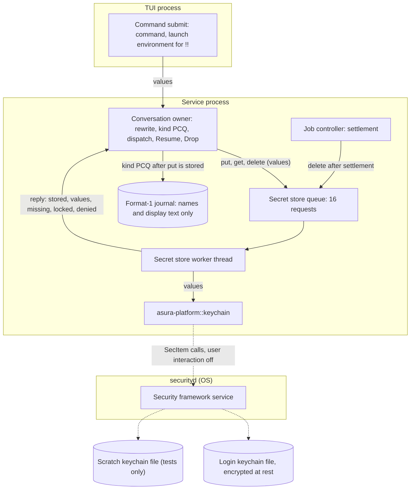
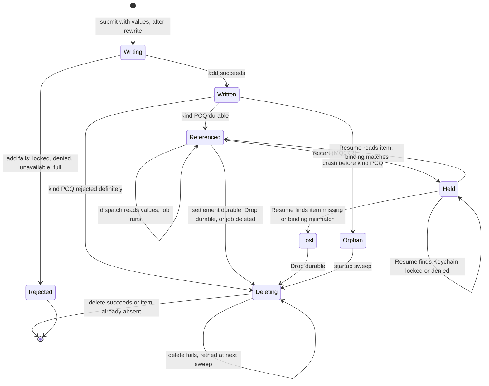
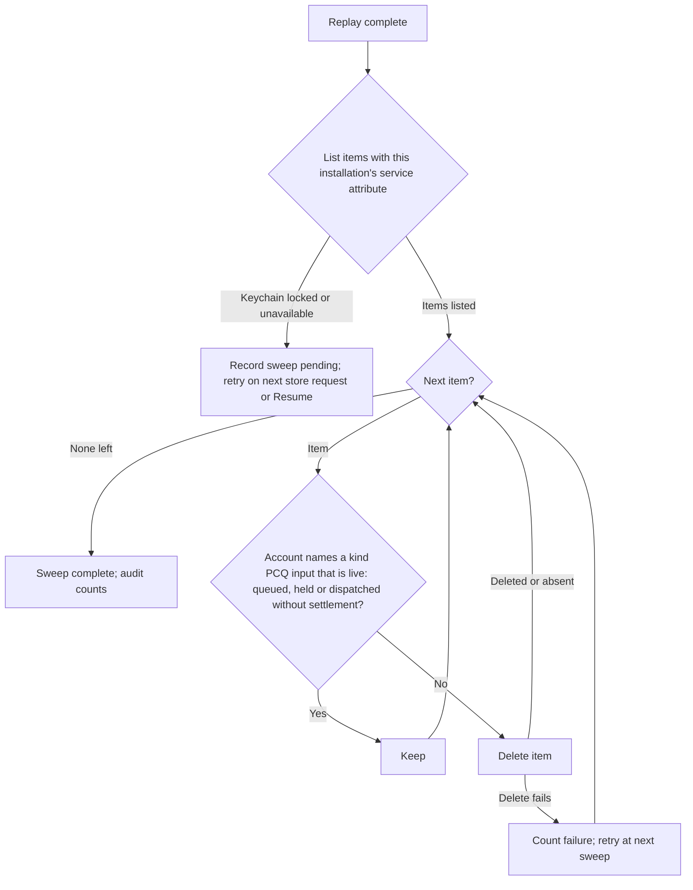
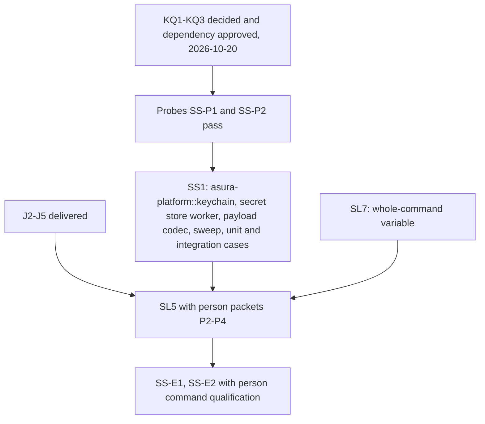

# Durable secret store

Status: proposed design, 2026-10-20. The owner selected the required behavior
on 2026-10-20 (decision [SO6](secret-detection.md#owner-decisions)): the secret
store is durable, in the macOS Keychain, so a queued person command with
secrets and a queued `!!` command resume after a restart. The owner answered
KQ1–KQ3 the same day ([owner decisions](#owner-decisions)); no question
remains. Mechanisms marked "proposed" are engineering choices under the
[iteration rules](../design-process.md#iteration-and-escalation).
Nothing here is implemented. Protocol numbering remains `0.1`; journal format
remains `1`.

## Scope

The secret store holds values that must not enter any Asura record but must
reach a later execution:

- the per-execution secret variables of a rewritten person command
  ([secret detection](secret-detection.md#environment-path));
- the whole raw command of a person command run through the
  [whole-command variable](secret-detection.md#whole-command-variable) (SO5);
- the TUI launch environment of a `!!` command
  ([outside environment](person-command-mode.md#outside-profile-environment)).

Objectives:

- A queued person command keeps these values across a service restart and
  resumes with them.
- Values at rest are protected by the Keychain, never written to an Asura file.
- Every value is deleted when its command can no longer run.
- No Keychain call blocks the reactor, the control path or a cancel.

Non-goals:

- Model call values. A model call runs at once and never runs again after a
  restart (AE-05), so its values stay in memory (SO6). Writing them would put
  secrets at rest with no use.
- Provider credentials. EX14 gives those to the model helper; this store does
  not hold them.
- Syncing values to other devices, or exporting them.

Dependencies: [secret detection](secret-detection.md) (values, numbering,
preamble), [person command mode](person-command-mode.md) (kind PCQ, queue,
dispatch), the [managed input queue](managed-input-queue.md) (Hold, Resume,
Drop), the [job controller](tool-job-controller.md) (settlement), and the
[execution threat model](execution-threat-model.md#secret-store-at-rest)
(EXD-2).

## Required behavior

Required behavior (owner, 2026-10-20). IDs are stable test references.

| ID | Rule |
| --- | --- |
| SSR1 | A person command's secret values, whole-command value and `!!` launch environment are stored in one macOS Keychain item before any journal record refers to them. |
| SSR2 | After a restart, Resume of a held person command reads its item and runs the command with the stored values. |
| SSR3 | The item is deleted when its command settles, is dropped, or is withdrawn, and when its job is deleted. A startup sweep deletes items the journal does not reference. |
| SSR4 | When the Keychain is locked, unavailable or denies access, the person sees why. Asura never falls back to writing values to disk, and never shows a Keychain prompt. |
| SSR5 | No Keychain call runs on the reactor, a control handler or a render path. No Keychain wait has a time bound; each ends by a reply, a cancel of the waiting request, or shutdown. |
| SSR6 | Tests never read, write or delete items in the login keychain; they use a scratch keychain file. |

## Terms

| Term | Meaning |
| --- | --- |
| Secret store | The service component that holds person command values: the Keychain items and the worker that reads and writes them |
| Secret item | One Keychain generic-password item holding all values of one person command input |
| Secret store worker | The retained service thread that makes every Keychain call |
| Keychain target | The keychain the worker uses: the login keychain in production, a scratch keychain file in tests |
| Orphan item | A secret item whose input the journal does not reference as live |

## Ownership

| Behavior | Canonical owner | Change |
| --- | --- | --- |
| Keychain calls: add, read, delete, list, status; user-interaction lock; scratch keychain for tests | New module `asura-platform::keychain` over `security-framework` | New |
| Request queue, worker thread, item payload codec, binding check, sweep | New module `asura-service::secret_store` | New |
| When to write, read and delete | Conversation owner (`asura-service/src/conversation.rs`) for submit, dispatch, Resume and Drop; job controller for settlement | Calls the store |
| Values in flight to the spawn | Existing secret detection environment path and guardian | None |
| What the person sees | TUI, from queue reply reasons | New reason texts |

Rust, not the Swift helper, owns Keychain access. The service already owns
admission, journal ordering and the spawn that consumes the values; the
values never need to leave the service process. The Swift model helper is the
model's process and handles untrusted model traffic; routing command secrets
through it would widen what that process holds and add a transfer the threat
model would have to cover. `asura-platform` is the crate that owns safe OS
primitives with narrow unsafe code, and the `security-framework` crate gives
safe bindings, so no new unsafe code is needed.

### SS-O1: components and trust boundaries

Proposed design. Solid arrows are calls or data. Dashed arrows are OS IPC.
Subgraphs are process boundaries. Values move only along arrows marked
"values".

## Keychain item contract

Proposed mechanism unless marked otherwise.

| Property | Value |
| --- | --- |
| Class | Generic password (`kSecClassGenericPassword`) |
| Keychain | Production: the default file-based keychain, normally the login keychain (`Location::DefaultFileKeychain`). Tests: a scratch keychain file (`Location::FileKeychain`) |
| Service attribute | `asura.secret-store.<installation ID, lowercase hex>` |
| Account attribute | `input.<input ID, lowercase hex>` |
| Label | `Asura queued command secrets` |
| Synchronizable | No. A file-based keychain item is never synced to iCloud |
| Access control | The default ACL of an item the service creates: the creating binary may read it without a prompt ([KQ2](#owner-decisions)) |
| Accessibility class | Not available on a file-based keychain; see [KQ1](#owner-decisions). The login keychain is readable while it is unlocked, normally from login |
| Data | The payload below, at most 131,072 bytes |

The service and account attributes bind an item to one installation and one
input. The payload binds it again by digest, so an item copied under another
name is rejected.

### Payload

Proposed format. All integers are big-endian. The codec rejects unknown
versions, trailing bytes and any bound violation.

| Field | Content |
| --- | --- |
| version | u8, `1` |
| binding | 32 bytes: SHA-256 over ASCII `asura.secret-item`, one zero byte, installation ID, project ID, conversation ID, input ID and the kind PCQ request digest |
| flags | u8: bit 0 whole-command value present; bit 1 `!!` launch environment present |
| secret variables | u8 count 0–16; each entry u8 number 1–16, u16 length, value bytes |
| whole-command value | When bit 0: u16 length 1–8192, raw command bytes |
| launch environment | When bit 1: u16 count 0–4096; each entry u16 name length 1–1024, name, u32 value length, value |
| value digest key | 32 random bytes, used for the keyed duplicate-retry digest |

Bounds: secret variable values at most 8192 bytes in total, as secret
detection requires; whole-command value at most 8192 bytes; launch environment
at most 49,152 bytes of names and values. With entry headers the payload stays
below 131,072 bytes. Probe SS-P1 must confirm that the Keychain stores and
returns a 131,072-byte generic-password value; if it does not, this design is
revised before code.

At most 256 secret items exist per installation. A submit that would create
the 257th returns `busy` with reason `secret_store_full`. The unresolved-input
limit of 16 per conversation bounds normal use well below this.

## Lifecycle

### SS-S1: secret item lifecycle

Proposed design. Arrows are events with guards. `Written` means the Keychain
add returned success; it does not mean the journal refers to the item.

### Ordering rules

1. **Write first.** The conversation owner sends `put` and waits for its reply
   before it appends kind PCQ. A journal record never refers to an item that
   was not stored.
2. **Reject without a record.** If `put` fails, the submit gets the failure
   reason, nothing is journaled, and the TUI keeps the draft.
3. **Uncertain append.** If the kind PCQ append outcome is uncertain, the item
   stays. Resolution by request ID either references it or deletes it.
4. **Read at dispatch.** Dispatch always reads the item; the service keeps no
   second copy between submit and dispatch. The values move into the job
   admission and are zeroized after spawn, as secret detection requires. One
   read path serves the first run and the run after a restart.
5. **Delete after the deciding record.** The owner sends `delete` only after
   the settlement, Drop, or job deletion record is durable. A delete failure
   leaves an orphan that the next sweep removes; it never changes the record.
6. **Exact retry.** A retry with the same request ID finds the existing item.
   The worker compares a keyed digest of the retried values, using the item's
   value digest key; equal values return the original input ID, different
   values return `idempotency_conflict`.

### Startup sweep

Proposed mechanism. The sweep runs once on the worker after journal replay
completes. It does not delay admission: a Resume that arrives first is queued
behind it on the same worker.

### SS-F1: startup sweep

Items of other installation IDs are never listed or touched. The list is
bounded by the 256-item limit; items beyond it, which only an older fault
could create, are deleted when they are not live.

## Requests and replies

| Request | Input | Replies |
| --- | --- | --- |
| `put` | Installation, input ID, binding, payload | `stored`, `exists_same`, `exists_different`, `locked`, `denied`, `unavailable`, `full` |
| `get` | Installation, input ID, binding | `values`, `missing`, `mismatch`, `locked`, `denied`, `unavailable` |
| `delete` | Installation, input ID | `deleted`, `absent`, `locked`, `unavailable` |
| `sweep` | Installation, live input IDs from replay | Counts: kept, deleted, failed |

Status mapping (proposed; probe SS-P2 qualifies each code on macOS 27):

| Security status | Reply |
| --- | --- |
| `errSecSuccess` | Success reply |
| `errSecItemNotFound` | `missing` or `absent` |
| `errSecDuplicateItem` | Compare digest: `exists_same` or `exists_different` |
| `errSecInteractionNotAllowed` with the keychain locked (`SecKeychainGetStatus`) | `locked` |
| `errSecInteractionNotAllowed` with the keychain unlocked, or `errSecAuthFailed` | `denied` |
| `errSecNoSuchKeychain`, `errSecNotAvailable`, any other code | `unavailable`, with the code in audit |

## Failure handling

No failure writes a value to disk outside the Keychain. Each reason text names
the condition and the person's next action.

| Case | Result |
| --- | --- |
| Keychain locked at submit | Submit refused with `secret_store_locked`: "The login keychain is locked. Unlock it, then press Enter again." Draft and mode kept. Nothing journaled |
| Access denied at submit | Refused with `secret_store_denied`: "macOS denied Asura access to its Keychain item." Draft kept |
| Keychain unavailable | Refused with `secret_store_unavailable` and the status code. Draft kept |
| 256 items exist | `busy`, `secret_store_full`; draft kept |
| Worker queue full | `busy`, `secret_store_busy`; draft kept |
| Locked at dispatch | The command stays at the lane head, shown `waiting: Keychain locked`. Dispatch retries on the person's next action in that conversation: Send now, Resume, a new submit, or Drop. No timer retries it |
| Denied or unavailable at dispatch | Same as locked, with its own reason |
| Item missing or binding mismatch at dispatch or Resume | The command is `Held` with `secrets_lost`: "This command's secrets are no longer in the Keychain. Drop it and enter it again." A mismatched item is deleted |
| Crash after put, before kind PCQ | Orphan; deleted by the startup sweep |
| Delete fails | Item kept; counted in audit; retried by the next sweep |
| Keychain stalls inside securityd | The worker waits without a time bound. Later requests queue, then `busy`. Control, cancel, Drop records and other conversations stay responsive |
| Shutdown while a request is in flight | Shutdown does not wait for the worker. The ordering rules keep records consistent: an unreferenced item is an orphan, a referenced one is still valid |
| Person deletes the item in Keychain Access | Treated as missing |
| Service binary rebuilt or replaced | The default ACL may no longer trust it; reads fail as `denied` ([KQ2](#owner-decisions)) |

A command with no detected secret, a `!` command with no secret, and a model
call never touch the Keychain. A `!!` command always has a launch environment,
so every `!!` command needs the Keychain.

## Asynchronous execution

Mapping to [AE-01–AE-07](../engineering.md#asynchronous-execution-and-recovery):

| Rule | Application |
| --- | --- |
| AE-01 | Every Security framework call runs on the one retained secret store worker thread. The reactor, control handlers and rendering never call it. |
| AE-02 | Blocking calls: `SecItemAdd`, `SecItemCopyMatching`, `SecItemDelete`, `SecKeychainGetStatus`, `SecKeychainSetUserInteractionAllowed`; in tests `SecKeychainCreate` and `SecKeychainOpen`. Each is IPC to securityd and can wait. |
| AE-03 | Queue: 16 requests, then `busy`. One request runs at a time. Deletes after settlement join the same queue; if it is full, the delete is left for the next sweep. Items: 256 per installation. Payload: 131,072 bytes. |
| AE-04 | No time bound. A request ends by its reply. A submitter that stops waiting (client cancel or disconnect) leaves the request to finish; its result is applied or swept. A stalled securityd is a stalled dependency: the store reports `busy` and everything else continues. |
| AE-05 | Values are read at each dispatch, never relaunched after an unknown outcome. Orphans are reconciled against replay. |
| AE-06 | Startup: the worker starts after the platform disables Keychain user interaction for the process, then sweeps after replay. Shutdown: admission closes; the worker is not awaited. |
| AE-07 | Acceptance: with the scratch keychain call blocked by a test seam, the TUI stays responsive, Ctrl-C and Drop work, and a submit without secrets still runs. |

User interaction: the platform calls `SecKeychainSetUserInteractionAllowed(false)`
through `SecKeychain::disable_user_interaction()` once at service start and
holds the guard for the process lifetime. The setting is process-wide. A call
that would show a dialog then fails instead of waiting for a person.

## Security

Owner decision EXD-2 (2026-10-20) in the
[threat model](execution-threat-model.md#secret-store-at-rest) accepts secrets
at rest in the Keychain.

- **At rest.** Values are encrypted in the keychain file under keys derived
  from the person's login password. They are included in backups of that file
  in encrypted form. They never sync, because a file-based keychain item does
  not.
- **Who can read.** The service binary that created the item reads it without
  a prompt while the keychain is unlocked. Another same-UID process gets a
  prompt, or with user interaction off, a refusal. Same-UID processes are one
  principal under [D1](threat-model.md#scope-assets-and-actors), so this is
  defense in depth, not a boundary claim.
- **What never holds values.** Journal, payloads, audit, logs, client replies,
  argument vectors and Asura files. The payload binding digest uses identifiers
  only; the value digest is keyed with a random key stored inside the item.
- **Memory.** Values read from the Keychain go into zeroizing buffers and are
  dropped after spawn, as secret detection requires.
- **Lifetime.** An item lives from submit until its command settles or is
  dropped, plus at most one sweep after a failed delete.

## Operations and audit

- No configuration key. The production target is the login keychain.
- Audit events `secret_store.put`, `secret_store.get`, `secret_store.delete`
  and `secret_store.sweep` carry the input ID, the reply code and counts. They
  never carry a value, name, digest or payload size.
- The service status reports the item count and whether a sweep is pending.

## Validation

Every test uses a scratch keychain file created in the test's scratch runtime
root with `CreateOptions::create` and a random password. A test build selects
the scratch target from its scratch runtime root; a unit test asserts that a
scratch root can never select the default keychain. Tests that create a
scratch keychain check after teardown that the person's keychain search list
is unchanged (SS-P1 confirms whether creation adds it).

### Probes before code

| ID | Question | Pass |
| --- | --- | --- |
| SS-P1 | Does a 131,072-byte generic-password value round trip in a scratch file keychain on macOS 27, and does `SecKeychainCreate` change the search list? | Exact round trip; search list restored by teardown |
| SS-P2 | Which status codes do a locked keychain, a denied ACL (item created by another binary) and a missing keychain return with user interaction off? | Each maps to the table above; no dialog appears |

### Unit

| ID | Case | Required result |
| --- | --- | --- |
| SS-U1 | Payload codec at every bound, plus one byte over each; unknown version; trailing bytes | Exact round trip; each invalid form rejected |
| SS-U2 | Binding digest vectors; an item read under another input or installation | `mismatch` |
| SS-U3 | Status mapping table with fixture codes | Each reply as listed |
| SS-U4 | Ordering: put failure, put then append rejected, append uncertain, settlement, Drop | No record before `stored`; delete only after the deciding record; uncertain keeps the item |
| SS-U5 | Queue: 17th request; full queue on a settlement delete | `busy`; delete left for the sweep |
| SS-U6 | Sweep decision over a fixture replay state: queued, held, dispatched, settled, dropped, unknown input | Keep the first three; delete the rest |
| SS-U7 | Target selection from a scratch runtime root | Never the default keychain |
| SS-U8 | Exact retry with equal and different values | Original input ID; `idempotency_conflict` |

### Integration

Real service, journal and scratch keychain file; no login keychain item is
read or written.

| ID | Case | Required result |
| --- | --- | --- |
| SS-I1 | Submit `!` with a rewritten secret and a whole-command secret, and `!!` with a fixture environment | One item each before kind PCQ; journal raw-byte sweep finds no value |
| SS-I2 | Queue them behind a model turn; kill the service; restart; Resume each | Each runs with its real values; items deleted after settlement |
| SS-I3 | Kill the service between put and append (test seam) | Restart sweep deletes the orphan |
| SS-I4 | Lock the scratch keychain; submit; unlock; submit again | `secret_store_locked`, nothing journaled; second submit runs |
| SS-I5 | Lock at dispatch; Send now after unlock | Waits at the lane head; runs after Send now |
| SS-I6 | Delete the item outside Asura; Resume | `secrets_lost`; Drop succeeds |
| SS-I7 | Item created by another binary identity | `denied`, no dialog |
| SS-I8 | Block the worker inside a Keychain call (seam) | Control, cancel, Drop and secret-free commands stay responsive; 17th store request `busy` |
| SS-I9 | Drop a queued command; delete fails once (seam) | Drop durable; next sweep deletes the item |
| SS-I10 | 256 items present; submit with a secret | `busy`, `secret_store_full` |

### End to end

| ID | Case | Required result |
| --- | --- | --- |
| SS-E1 | TUI against an isolated service with a scratch keychain: model turn running; type `!!printf %s "$FIXTURE_TOKEN" \| shasum -a 256` and `!curl -H 'Authorization: Bearer <fixture>' <loopback fixture>`; restart the service; Resume both | Both run after Resume; the loopback fixture receives the token; the digest matches; the log shows placeholders; no item remains after settlement |
| SS-E2 | Same with the scratch keychain locked | The TUI shows the locked message and keeps the draft |

## Delivery

### SS-P: delivery order

Proposed plan. Arrows mean "is a prerequisite of". SS1 does not depend on the
job packets; SL5 needs both.

## Decisions and alternatives

Selected (owner, 2026-10-20, SO6): a durable Keychain store for person command
values. Engineering choices in this design:

- **Rust owner, not the Swift helper.** See [ownership](#ownership).
- **File-based login keychain now.** The data-protection keychain needs a
  code-signed binary with a keychain access group entitlement. Asura's signing
  is not selected until I9, and development builds are unsigned.
- **One item per input.** Deletion and the sweep act on one item per command.
  Rejected: one item per value, which multiplies calls and partial states.
- **Read at every dispatch.** One read path for the first run and after a
  restart. Rejected: an in-memory copy beside the item, a second source of
  truth.
- **Model values in memory.** A model call never resumes. Rejected: writing
  them, which adds secrets at rest with no reader.
- **Rejected: an Asura-owned encrypted file.** It needs a key, and the key
  would need the Keychain anyway.

## Owner decisions

Answered by the owner on 2026-10-20. No owner question remains open.

| ID | Decision |
| --- | --- |
| KQ1 | Use the file-based login keychain now. When release signing is chosen (I9), move to the data-protection keychain with `kSecAttrAccessibleAfterFirstUnlockThisDeviceOnly` and an Asura access group. |
| KQ2 | Only the binary that wrote an item may read it: the default ACL. The owner accepts that a rebuilt development binary may get `secret_store_denied` for items written before the rebuild; such commands are entered again. |
| KQ3 | Approved: `security-framework` 3.7.0, with `security-framework-sys` and `core-foundation`, as dependencies of `asura-platform`, minimal features. The implementer verifies the version against crates.io and records the lockfile diff for review. |

## Design verification

Recorded on 2026-10-20: written from the owner's answers of 2026-10-20 and
from `security-framework` 3.7.0 source in the local Cargo registry
(`Location`, `CreateOptions`, `SecKeychain::disable_user_interaction`).
No Keychain call was made and no code or test was run. Diagrams SS-O1, SS-S1,
SS-F1 and SS-P were rendered with Mermaid CLI 12.0.0 and inspected. The
owner's KQ1–KQ3 answers were recorded the same day; SS-P's first node label
changed and was re-rendered.

Return to the [design index](README.md).
