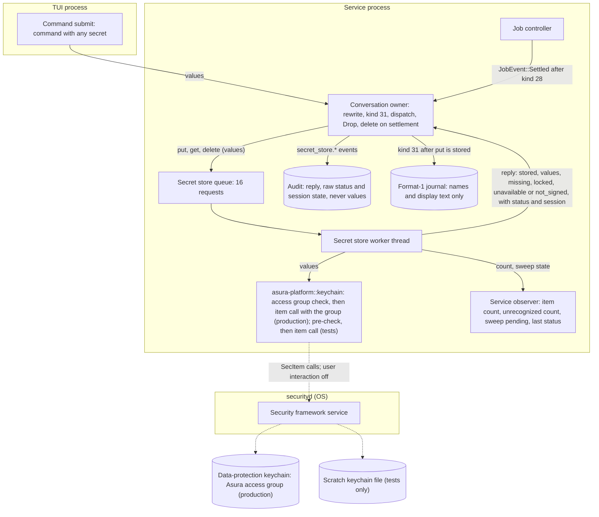
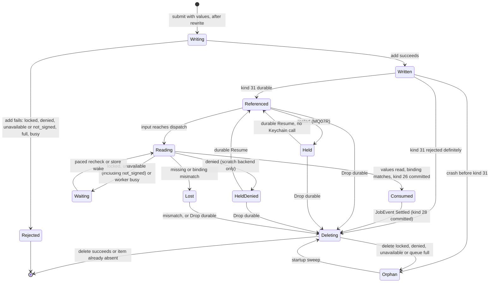
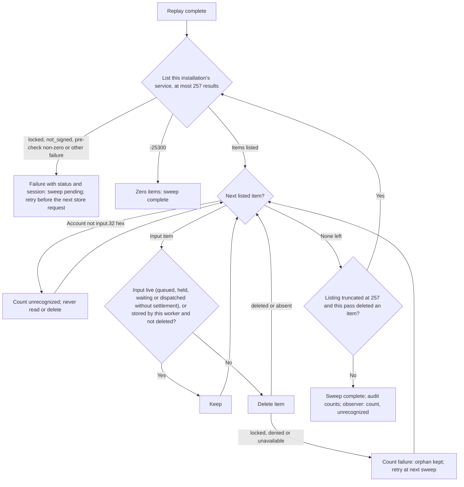
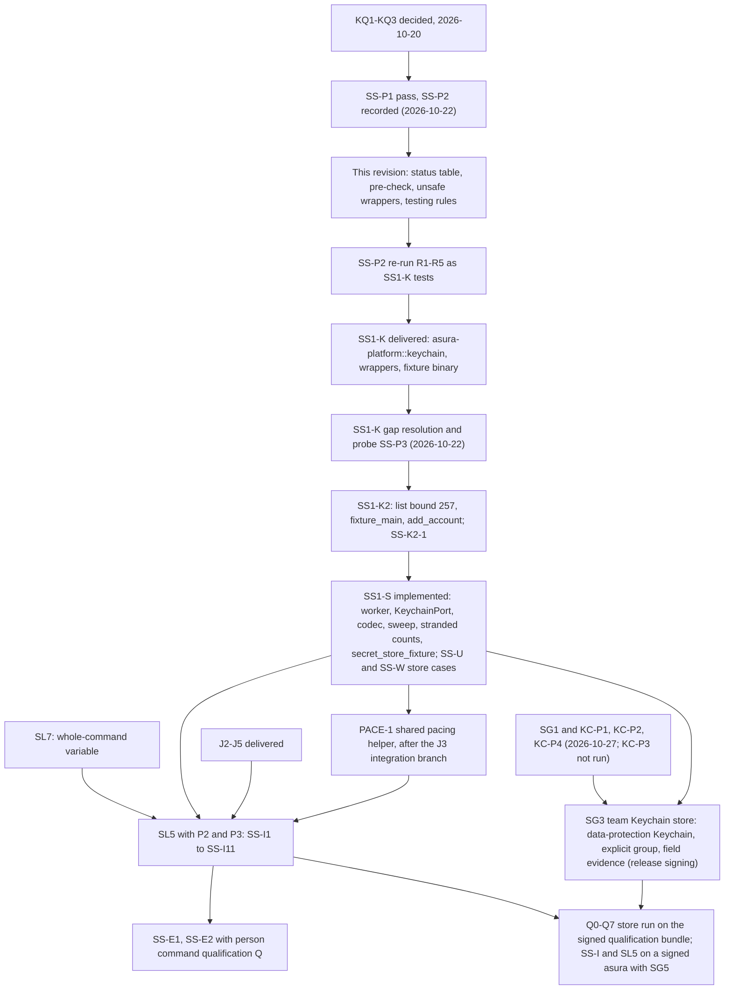

# Durable secret store

Status: proposed design, 2026-10-20; revised 2026-10-22 for SS1 code.
Packets SS1-K, SS1-K2 and SS1-S are implemented on `main` (2026-10-22); the
person command path (SL5 with P2 and P3) is not. The
owner selected the required behavior on 2026-10-20 (decision
[SO6](secret-detection.md#owner-decisions)): the secret store is durable, in
the macOS Keychain, so a queued person command with secrets and a queued `!!`
command resume after a restart. The owner answered KQ1–KQ3 the same day
([owner decisions](#owner-decisions)); no question remains. Mechanisms marked
"selected (engineering)" or "proposed" are engineering choices under the
[iteration rules](../design-process.md#iteration-and-escalation).

Revision of 2026-10-22: the person command and secret store readiness audit
gaps are resolved here ([audit resolution](#readiness-audit-resolution-2026-10-22)),
and the SS1-K probe results are recorded ([probe results](#probe-results-2026-10-22)).
Probe SS-P1 passed. Probe SS-P2 disproved the first status table; the table,
the target pre-check and the testing rules below replace it.

Second revision of 2026-10-22, for SS1-S: packet SS1-K is implemented
(`asura_platform::keychain`, commits `1641dc1` and `f5aa762`). Its report
raised seven gaps; this revision resolves them
([SS1-K gap resolution](#ss1-k-gap-resolution-2026-10-22)). Probe SS-P3
showed that a rebuilt service binary can delete the items of the previous
build. Items that a build still cannot delete are now
stranded items (removed by SG3, [unrecognized items](#unrecognized-items)). Packet SS1-K2 (a small
platform follow-up) and then SS1-S are ready for implementation. Protocol
numbering remains `0.1`; journal format remains `1`.

Third revision of 2026-10-22: SS1-K2 (`1968bbe`) and SS1-S (`2c17a53`) are
implemented. The SS1-S report's choices and gaps are recorded in
[SS1-S implementation record](#ss1-s-implementation-record-2026-10-22). The
owner's half of the store (put at submit, get at dispatch, delete on
settlement, the replay live set, audit emission and the observer field) is
packet P3-E and is not implemented.

Revision of 2026-10-23, for release signing: the owner answered the signing
questions SGQ1–SGQ9 ([release signing](release-signing.md#owner-decisions)).
The storage that follows the login keychain (KQ1, EXD-3) is now resolved as
[team Keychain store](release-signing.md#team-keychain-store): the team
data-protection Keychain with the access group `<TeamID>.org.pidster.asura`.
KQ2 is revised by SGQ4: any build that the team signs with the access group
may read and delete items, so stranded items go away. The switch is clean,
with no migration code (SGQ5), and only the signed qualification run writes
items, under a separate test access group (SGQ6). The Secure Enclave item
stays open for later study (SGQ8). Packet SG3 implements the team Keychain store.

Revision of 2026-10-27, for packet SG3: the owner's probes KC-P1, KC-P2 and
KC-P4 ran ([KC probe results](release-signing.md#kc-probe-results-2026-10-27)).
This design now describes the **team Keychain store** as the production store:
the data-protection keychain, with the access group named in every call and
read from the process's own entitlements. The file-based keychain remains only
as the test-only scratch backend. Stranded items are removed. Every Keychain
error records its raw status and the session state in the audit event. The
[release signing design](release-signing.md#team-keychain-store) owns the
signing-specific rules; this document links to them. Packet SG3 delivered
this on 2026-10-27 ([SG3 delivery](release-signing.md#sg3-delivery)); the
signed qualification run is the owner's.

Revision of 2026-10-31 (owner decision
[ENV1](person-command-environment.md#owner-decisions-2026-10-31)): Asura builds
the environment of `!` and `!!` commands from an allow-list, so no item holds
an environment. The payload's launch environment section and flag bit 1 are
removed, with no compatibility; the largest payload is 8,307 bytes. A `!!`
command has an item only when its command holds a secret, as a `!` command
does. Earlier text that names the `!!` launch environment describes the
superseded design.

## Scope

The secret store holds values that must not enter any Asura record but must
reach a later execution:

- the per-execution secret variables of a rewritten person command
  ([secret detection](secret-detection.md#environment-path));
- the whole raw command of a person command run through the
  [whole-command variable](secret-detection.md#whole-command-variable) (SO5).

Until 2026-10-31 it also held the TUI launch environment of a `!!` command;
the [allow-list environment](person-command-environment.md) removed that
(ENV1).

Objectives:

- A queued person command keeps these values across a service restart and
  resumes with them.
- Values at rest are protected by the Keychain, never written to an Asura file.
- Every value is deleted when its command can no longer run.
- No Keychain call blocks the reactor, the control path or a cancel.
- No Keychain call ever reaches a keychain other than its target.

Non-goals:

- Model call values. A model call runs at once and never runs again after a
  restart (AE-05), so its values stay in memory (SO6). Writing them would put
  secrets at rest with no use.
- Provider credentials. EX14 gives those to the model helper; this store does
  not hold them.
- Syncing values to other devices, or exporting them.

Dependencies: [secret detection](secret-detection.md) (values, numbering,
preamble), [person command mode](person-command-mode.md) (kind 31 PCQ, queue,
dispatch), the [managed input queue](managed-input-queue.md) (Hold, Resume,
Drop), the [job controller](tool-job-controller.md) (settlement events), and
the [execution threat model](execution-threat-model.md#secret-store-at-rest)
(EXD-2).

## Required behavior

Required behavior (owner, 2026-10-20). IDs are stable test references. SSR3
was corrected on 2026-10-22: an item's life ends with its command, not with
its job's later output deletion.

| ID | Rule |
| --- | --- |
| SSR1 | A person command's secret values and whole-command value are stored in one macOS Keychain item before any journal record refers to them. Revised 2026-10-31 (ENV1): the `!!` launch environment is no longer stored. |
| SSR2 | After a restart, a held person command that the person resumes runs with the stored values, read from its item at dispatch. |
| SSR3 | The item is deleted when its command's job settles (kind 28 committed), when its input is dropped (kind 13 Drop committed), when its kind 31 append is rejected, or when dispatch finds it mismatched. A startup sweep deletes items the journal does not reference as live. |
| SSR4 | When the Keychain is locked, unavailable or denies access, the person sees why. Asura never falls back to writing values to disk, and never shows a Keychain prompt. |
| SSR5 | No Keychain call runs on the reactor, a control handler or a render path. No Keychain wait has a time bound; each ends by a reply, a cancel of the waiting request, or shutdown. |
| SSR6 | Tests never read, write or delete items in the login keychain; they use a scratch keychain file. No test or probe calls `SecItemAdd` on a scratch keychain unless its status pre-check returned 0 in the same worker step ([testing rules](#testing-rules)). Only the signed qualification run writes data-protection items, under the test access group, and it leaves that group empty (SGQ6, [test isolation](release-signing.md#test-isolation-without-the-login-keychain)). |

## Terms

| Term | Meaning |
| --- | --- |
| Secret store | The service component that holds person command values: the Keychain items and the worker that reads and writes them |
| Secret item | One Keychain generic-password item holding all values of one person command input |
| Secret store worker | The retained service thread that makes every Keychain call |
| Keychain target | The keychain the worker uses: the data-protection keychain with the Asura access group in production (`Target::Default`), a scratch keychain file in tests (`Target::Scratch`) |
| Access group | The keychain access group the process reads from its own signed entitlements; every production call names it ([access group](release-signing.md#access-group-from-the-entitlements)) |
| Target pre-check | The `SecKeychainGetStatus` call that the scratch backend makes before every item call ([target pre-check](#target-pre-check)). Test-only |
| Orphan item | A secret item whose input the journal does not reference as live |
| Unrecognized item | An item under this installation's service attribute whose account is not `input.<32 lowercase hex>`. Asura never writes one |
| Field evidence | The raw `OSStatus` and the session state that every Keychain error records in its audit event ([field evidence](release-signing.md#keychain-field-evidence)) |

## Ownership

| Behavior | Canonical owner | Change |
| --- | --- | --- |
| Keychain calls: add, read, delete, bounded list on the data-protection keychain with the access group; the access group check; the session state read; user-interaction lock; for tests, the scratch file backend with its pre-check, scratch keychain create, lock and delete, the fixture writer and the qualification purge | Module `asura-platform::keychain` (`keychain.rs`, `keychain/{data_protection,session,tests}.rs`) over `security-framework`, plus narrow `extern "C"` wrappers ([unsafe wrappers](#unsafe-wrappers)) | SS1-K, SS1-K2; SG3 adds the data-protection backend, the group check and the session state |
| Status code to `Failure` mapping: the data-protection table, and for the scratch backend the second `SecKeychainGetStatus` call after -25293 or -25308 | `asura-platform::keychain` (`classify` of each backend) | SG3 ([status mapping](#status-mapping)) |
| `Failure` to reply mapping, request queue, worker thread, item payload codec, binding check, sweep, item count and unrecognized count, the `not_signed` terminal state, the field evidence on every failure reply | Module `asura-service::secret_store` (`secret_store.rs`, `secret_store/{codec,port,worker,qualification}.rs`), declared `pub mod secret_store;` so the integration tests reach it | SS1-S; SG3 |
| When to write and read | Conversation owner (`asura-service/src/conversation.rs`): `put` at submit, `get` at dispatch | Calls the store |
| When to delete | Conversation owner: on `JobEvent::Settled` for a person-origin job (after kind 28 commits), after a kind 13 Drop commits, after a definite kind 31 rejection, and on a dispatch `mismatch` | Calls the store; the job controller never calls it |
| Values in flight to the spawn | Existing secret detection environment path and guardian | P1 |
| Item count and sweep state in the service status | Service observer (`ServiceObservation` field 8, [operations](#operations-and-audit)) | P3-E; SG3 removes the stranded fields |
| What the person sees | TUI, from queue refusal and waiting reasons ([control API](person-command-mode.md#control-api-additions)) | New reason texts |

The job controller does not call the store. Its `JobEvent::Settled(job,
outcome)` reaches the conversation owner after kind 28 commits. For a
person-origin job the owner derives the input ID from the job's origin and
sends `delete`. One owner therefore issues every item call (selected,
engineering, 2026-10-22).

Rust, not the Swift helper, owns Keychain access. The service already owns
admission, journal ordering and the spawn that consumes the values; the
values never need to leave the service process. The Swift model helper is the
model's process and handles untrusted model traffic; routing command secrets
through it would widen what that process holds and add a transfer the threat
model would have to cover. `asura-platform` is the crate that owns safe OS
primitives with narrow unsafe code.

### Unsafe wrappers

Selected (engineering, 2026-10-22). Probe finding (e): `security-framework`
3.7.0 and `security-framework-sys` 2.17.0 do not expose `SecKeychainGetStatus`,
`SecKeychainLock` or `SecKeychainDelete`. The earlier claim that no new unsafe
code is needed is withdrawn. `asura-platform::keychain` declares three
functions from the Security framework with `extern "C"`:

| Function | Build | Use |
| --- | --- | --- |
| `SecKeychainGetStatus(SecKeychainRef, *mut u32) -> OSStatus` | `test-support` only (SG3) | The scratch backend's [target pre-check](#target-pre-check) and its locked or denied decision |
| `SecKeychainLock(SecKeychainRef) -> OSStatus` | `test-support` only | Lock a scratch keychain for the locked cases |
| `SecKeychainDelete(SecKeychainRef) -> OSStatus` | `test-support` only | Delete a scratch keychain at teardown |

Each wrapper is one `unsafe` block with a `// SAFETY:` comment. The keychain
reference comes from a live `SecKeychain` owned by the caller, so it is valid
for the call. The status pointer is a local `u32`. No pointer outlives the call.
The deprecated-API warning is allowed on these three items only. KQ3's
dependency approval is unchanged; no other crate is added.

SG3 (2026-10-27) adds these declarations, for the same reason: the crates do
not expose them.

| Item | Build | Use |
| --- | --- | --- |
| `SecTaskCreateFromSelf`, `SecTaskCopyValueForEntitlement` | Production | The [access group check](release-signing.md#access-group-from-the-entitlements). Each returned object is taken under the create rule and released once |
| `kSecUseAuthenticationUIFail` (static) | Production | The user-interaction value of every data-protection dictionary |
| `SecItemAdd`, `SecItemCopyMatching`, `SecItemDelete` (from `security-framework-sys`) | Production | The data-protection calls, over dictionaries the backend builds itself so that KC-U1 can inspect them |
| `getaudit_addr` and the `auditinfo_addr` layout (48 bytes, flags at offset 40, checked against the SDK header on macOS 27.0) | Production | The session flags of the [field evidence](release-signing.md#keychain-field-evidence) |

`sysctlbyname`, `stat` and `getuid` come from `libc`. Every pointer passed is
a live local or a Core Foundation object owned for the call.

### SS-O1: components and trust boundaries

Selected design, revised twice on 2026-10-22 and for SG3 on 2026-10-27. Solid
arrows are calls or data. Dashed arrows are OS IPC. Subgraphs are process
boundaries. Values move only along arrows marked "values". Every production
item call names the data-protection keychain and the access group; every
scratch (test) item call passes the status pre-check first.



## Keychain item contract

Selected (engineering) unless marked otherwise.

| Property | Value |
| --- | --- |
| Class | Generic password (`kSecClassGenericPassword`) |
| Keychain | Production: the data-protection keychain (`kSecUseDataProtectionKeychain = true`) with the access group in every call ([team Keychain store](release-signing.md#item-contract-changes)). Tests: a scratch keychain file (`Location::FileKeychain`), passed as `kSecUseKeychain` |
| Access group | Production: the group read from the process's entitlements, `<TeamID>.org.pidster.asura` (`.test` in the qualification bundle). Tests: none |
| Service attribute | `asura.secret-store.<installation ID, lowercase hex>` |
| Account attribute | `input.<input ID, lowercase hex>` |
| Label | `Asura queued command secrets` |
| Synchronizable | `false`, set explicitly in every production call |
| Access control | Production: any build signed by the team that claims the group reads and deletes the item (SGQ4, KC-P1); another program gets -34018. Tests: the scratch file's default ACL binds read to the writer's cdhash and delete to its executable file name (probes SS-P2 (b), SS-P3) |
| Accessibility class | Production: `kSecAttrAccessibleAfterFirstUnlockThisDeviceOnly` (KQ1). Tests: not available on a file keychain |
| Data | The payload below, at most 8,307 bytes |

The service and account attributes bind an item to one installation and one
input. The payload binds it again by digest, so an item copied under another
name is rejected.

The [team Keychain store item contract](release-signing.md#item-contract-changes)
owns the production rows above and the user-interaction rule.

### Payload

Selected format. All integers are big-endian. The codec rejects unknown
versions, trailing bytes and any bound violation.

| Field | Content |
| --- | --- |
| version | u8, `1` |
| binding | 32 bytes: SHA-256 over ASCII `asura.secret-item`, one zero byte, installation ID, project ID, conversation ID, input ID and the kind 31 request digest |
| flags | u8: bit 0 whole-command value present; other bits 0 (bit 1, the removed launch environment, must be 0) |
| secret variables | u8 count 0–16; each entry u8 number 1–16, u16 length, value bytes. Count 0 when bit 0 is set (the whole-command variable is used alone) |
| whole-command value | When bit 0: u16 length 1–8192, raw command bytes |
| value digest key | 32 random bytes, used for the keyed duplicate-retry digest |

Bounds: secret variable values at most 8,192 bytes in total, as secret
detection requires; whole-command value at most 8,192 bytes. The largest
payload is 8,307 bytes: 1 version, 32 binding, 1 flags, 8,241 for 16 numbered
variables (1 + 16 × 3 + 8,192; the whole-command form needs at most 8,195)
and 32 for the key (revised 2026-10-31, ENV1; it was 8,307 with the launch
environment). Probe SS-P1 confirmed a 131,072-byte value round trip, so the item size has
margin.

The whole-command variable's detected values are not stored as a separate
list. Dispatch re-plans them from the stored raw command
([dispatch read](#ordering-rules), rule 4).

MAX_ITEM_BYTES in `asura_platform::keychain` is 8,307, the same number:
1 + 32 + 1 + 8,241 + 32 = 8,307 (2026-10-31).

At most 256 secret items exist per installation. A submit that would create
the 257th is refused with `secret_store_full`. The
[managed input queue](managed-input-queue.md#admission-and-delivery--selected-design)
is the one source of the unresolved-input limit: 16 inputs across all
projects. That limit keeps normal use far below 256.

### Item count and memory bounds

Selected (engineering, 2026-10-22, SS1-K gap 5).

- **What counts.** The item count is every item that a list under this
  installation's service attribute returns: live items, orphans and
  unrecognized items. All of them use the same keychain and the same
  list memory. `put` is refused with `full` when the count is 256 or more.
- **List bound.** The platform list asks for at most 257 results
  (`kSecMatchLimit` 257, `Limit::Max(257)`): the 256-item limit plus one.
  When 257 results return, `Listing.truncated` is true and the count is
  reported as 257, which means "more than 256". Probe SS-P3 confirmed that a
  numeric match limit caps the result on a file keychain. A list reads
  attributes only, never item data. SS1-K2 replaces `Limit::All` with this
  bound.
- **Read bound.** `get` copies the whole item data; the Security framework
  gives no way to bound a read before the copy. Only team-signed builds with
  the access group can write an item the service reads, and `add` refuses data
  over 8,307 bytes, so an item Asura wrote is never larger. The service payload codec
  is the one owner of the payload bound: it rejects any data over 8,307
  bytes, and the reply is `mismatch`. The platform does not check the read
  size a second time.
- **Attribute size.** In production only a team-signed build with the group
  can write items under Asura's service attribute in that group. A list then
  holds up to 257 attribute sets for one call. In the scratch backend another
  same-UID process can write them. This is a residual under
  [D1](threat-model.md#scope-assets-and-actors), recorded as
  [SS-T9](execution-threat-model.md#secret-store-at-rest).

### Unrecognized items

Selected (engineering, 2026-10-22, SS1-K gap 4; revised for SG3,
2026-10-27). SG3 removed stranded items (SGQ4): every team-signed build can
delete every Asura item in the group, so a delete fails only for the whole
store. A delete that fails for any reason, including `denied` from the
test-only scratch backend, leaves an orphan that the next sweep retries
([what SG3 removes](release-signing.md#what-sg3-removes)).

An **unrecognized item** has an account that is not `input.<32 hex>`. Asura
never writes one, and no older Asura format exists to migrate. The store
counts it and reports the count; it never reads or deletes it, and the
platform has no call to delete it. Deleting accounts outside the item
contract would let the service destroy items it did not write. `/status`
reports the count.

## Lifecycle

### SS-S1: secret item lifecycle

Selected design, revised 2026-10-22 and for SG3 on 2026-10-27. Arrows are
events with guards. `Written` means the Keychain add returned success; it does
not mean the journal refers to the item. Resume never reads the item; dispatch
does. `denied` comes only from the test-only scratch backend; production
reports a missing entitlement as `unavailable` (`not_signed`).



### Ordering rules

1. **Write first.** The conversation owner sends `put` and waits for its reply
   before it appends kind 31. A journal record never refers to an item that
   was not stored.
2. **Reject without a record.** If `put` fails, the submit gets the refusal
   reason, nothing is journaled, and the TUI keeps the draft.
3. **Uncertain append.** If the kind 31 append outcome is uncertain, the item
   stays. Resolution by request ID either references it or deletes it.
4. **Read only at dispatch.** Resume changes queue state only and makes no
   Keychain call. Dispatch always reads the item; the service keeps no second
   copy between submit and dispatch. One read path serves the first run and
   the run after a restart (selected, engineering, 2026-10-22). After the
   read, the owner re-plans the whole-command literals: it runs the rewrite
   planner on the stored raw command with the running rule set and checks
   that the numbered values match kind 31's number count and kinds. If kind
   31's rule-set revision differs from the running rule set, the input is
   `Held` with hold reason `secret_rules_changed` and nothing runs; the item
   stays until Drop. A rule-set change needs a new binary; under the team
   Keychain store (SGQ4) the new binary reads the item, so this hold reason
   appears directly.
   The values move into the job admission and are zeroized after spawn, as
   secret detection requires.
5. **Delete after the deciding record.** The owner sends `delete` only after
   the kind 28 settlement, kind 13 Drop, or definite kind 31 rejection is
   durable, or after a dispatch `mismatch`. A delete that fails (`locked`,
   `unavailable`, or `denied` from the scratch backend) leaves an orphan that
   the next sweep removes. It does not change the record.
6. **Exact retry.** A retry with the same request ID is first matched against
   kind 31's request digest. When the item exists, the worker also compares a
   keyed digest of the retried values, using the item's value digest key;
   equal values return the original input ID, different values return
   `request_conflict`. When the item no longer exists, because the command
   already settled or was dropped or the item was deleted outside Asura, the
   kind 31 request digest alone decides: an equal digest returns the original
   input ID and nothing runs again. The retry never writes a new item for a
   recorded request ID (selected, engineering, 2026-10-22). When the item
   exists but cannot be read (locked, unavailable or denied), the kind 31
   request digest alone decides as well. The owner looks the request ID up in
   the journal before the put, including requests older than the replay
   checkpoint, so a retry finds its record first (P3-E2, 2026-10-23).

### Target pre-check

Selected (engineering, 2026-10-22), from probe finding (d): `SecKeychainOpen`
succeeds for a path with no keychain, and `SecItemAdd` with that reference as
`kSecUseKeychain` returned success and wrote the item into the login keychain.
Read, list and delete on the missing keychain returned -25300.

Before every add, get, list or delete on a scratch keychain, the platform
calls `SecKeychainGetStatus` on the target reference in the same worker step.
A non-zero return makes the reply `unavailable` with the status code in audit,
and the item call is not made. The platform never passes a keychain reference
to an item call without a pre-check that returned 0 in that step.

This rule applies to the test-only scratch backend alone (SG3). The
data-protection keychain has one target per user, and every production
dictionary names it with the flag and the access group, so production makes no
pre-check ([what SG3 removes](release-signing.md#what-sg3-removes)).

Residual (test-only): a scratch keychain deleted between the pre-check and the
add is a check-then-add race. Production does not delete its target, so the
race needs a test that deletes its own keychain while the worker runs. The
[testing rules](#testing-rules) forbid that order.

### Startup sweep

Selected (engineering). The sweep runs once on the worker after journal replay
completes. It does not delay admission: a dispatch read that arrives first is
queued behind it on the same worker. Probe finding (a) showed that list and
delete succeed while a file keychain is locked. For the data-protection
keychain before first unlock this is unverified (KC-P3 was not run); a
`locked` listing defers the sweep like any failed listing.

### SS-F1: startup sweep

Selected design, revised three times on 2026-10-22 and for SG3 on 2026-10-27.
Arrows are decisions in order. Every list and delete box is one platform
call; on the scratch backend it runs the target pre-check first. The `Next` loop ends when no listed item is left. The
`Again` loop ends because each repeat deletes at least one item of a finite
set; it stops at once when a pass deletes nothing.



Items of other installation IDs are never listed or touched. An item that
this worker stored and has not deleted counts as live even when the replay
live set omits it, so a sweep never deletes a just-written item whose kind 31
is still being appended (recorded 2026-10-22 from SS1-S). A listing that
is still truncated when the sweep ends sets the count to 257, so `put` is
refused with `full` until the person removes items.

## Requests and replies

| Request | Input | Replies |
| --- | --- | --- |
| `put` | Installation, input ID, binding, payload | `stored`, `exists_same`, `exists_different`, `locked`, `denied`, `unavailable`, `full` |
| `get` | Installation, input ID, binding | `values`, `missing`, `mismatch`, `locked`, `denied`, `unavailable` |
| `delete` | Installation, input ID | `deleted`, `absent`, `locked`, `denied`, `unavailable` |
| `sweep` | Installation, live input IDs from replay | Counts: kept, deleted, failed, unrecognized; whether the last listing was truncated |

Every failure reply (`locked`, `denied`, `unavailable`) carries the raw
`OSStatus` and the session state that the worker read when the call failed
([field evidence](release-signing.md#keychain-field-evidence)). `unavailable`
also carries a reason: `not_signed` for a missing entitlement (-34018, or the
access group check), `invalid_request` for a defect that made no call, or
none.

A full worker queue (16 requests, counting the request the worker is running)
answers `busy` before the request reaches the worker.

### Status mapping

Production uses the
[team Keychain store status mapping](release-signing.md#status-mapping)
(SG3, confirmed by KC-P1 and KC-P4 except -25308): 0 success; -25300
`missing`, `absent` or zero items; -25299 the duplicate rule; -25308 `locked`
(unverified); -34018 `unavailable` with reason `not_signed`, terminal; any
other code `unavailable`.

The table below is the scratch file backend's mapping (selected, engineering,
2026-10-22, replacing the table that probe SS-P2 disproved). It applies only
to `Target::Scratch` in tests. The platform reads the `OSStatus` of each item
call after a successful pre-check.

| Security status | Reply |
| --- | --- |
| `errSecSuccess` (0) | Success reply |
| `errSecItemNotFound` (-25300) on `get` or `delete` | `missing` or `absent`. This holds only because the target pre-check returned 0 in the same step |
| `errSecItemNotFound` (-25300) on list | Zero items (probe finding: a list with no match returns -25300, not an empty list) |
| `errSecDuplicateItem` (-25299) on `put` | Read the item and compare digests: `exists_same` or `exists_different` |
| `errSecAuthFailed` (-25293) or `errSecInteractionNotAllowed` (-25308) | Call `SecKeychainGetStatus` on the target. Unlock bit `0x1` clear: `locked`. Bit set: `denied`. A failed status call: `unavailable` |
| `errSecInvalidOwnerEdit` (-25244) | `denied` |
| `errSecNoSuchKeychain` (-25294), any other code | `unavailable`, with the code in audit |
| Pre-check returned non-zero | `unavailable`; no item call was made |

Probe evidence for the table: a locked keychain returned -25293 for read and
add; status flags were `0x2` locked and `0x7` unlocked; an item written by
another binary returned -25293 with the keychain unlocked; deleting an item
written by the `security` CLI returned -25244. SS1-K's re-run step R2 found
that deleting an item written by `keychain_fixture` also returns -25244, so
the reply is `denied`.

**Owner of the mapping** (SS1-K, 2026-10-22; SG3, 2026-10-27). Each table is
implemented once, in `asura_platform::keychain`, as the `classify` of its
backend. The scratch `classify` makes the second `SecKeychainGetStatus` call
after -25293 or -25308, in the same platform call as the item call. Each
`Failure` carries the raw status of the call that failed; the worker records
it as evidence and never maps a raw `OSStatus` itself. The worker maps
platform results to replies with this table and nothing else:

| Platform result | Worker reply |
| --- | --- |
| `Added::Stored` | `stored` |
| `Added::Duplicate` | `get` the item, then compare digests: `exists_same` or `exists_different`; that `get`'s failure gives its own reply. A `get` that returns `Found::Missing` after the duplicate (the item was deleted between the two calls) gives `unavailable` with status -25300 |
| `Found::Data`, `Found::Missing` | Decode and bind: `values` or `mismatch`; `missing` |
| `Removed::Deleted`, `Removed::Absent` | `deleted`, `absent` |
| `Failure::Locked { status }` | `locked`, for `put`, `get` and `delete` alike; a locked delete leaves an orphan for the next sweep |
| `Failure::Denied { status }` | `denied` (scratch backend only); a denied delete leaves an orphan for the next sweep |
| `Failure::NotSigned { .. }` | `unavailable` with status -34018 and reason `not_signed`, in audit and in `last_status`. The worker enters its terminal `not_signed` state: every later request gets the same reply with no port call and no open |
| `Failure::Unavailable { status, .. }` | `unavailable`, with `status` in audit and in `last_status` |
| `Failure::Invalid` | `unavailable` with status 0 and audit reason `invalid_request`, with no session. The codec and the item key rules make this unreachable; reaching it is a defect that SS-U10 detects |

Every row except `Invalid` also carries the session state the worker read
after the failure ([field evidence](release-signing.md#keychain-field-evidence)).

### Worker seam for tests

Selected (engineering, 2026-10-22, SS1-K gap 2). The pre-check order and the
status mapping are platform behavior. SS1-K tests them with its recording
fixture of the Security framework calls (`Calls`). SS-U3 (status codes) and
SS-U9 (pre-check order) are therefore SS1-K cases, delivered. SS1-S does not
repeat them.

SS1-S defines one trait in `asura-service::secret_store`, the store's only
route to the platform:

```rust
pub(crate) trait KeychainPort: Send + 'static {
    fn add(&self, key: &ItemKey, data: &[u8]) -> Result<Added, Failure>;
    fn get(&self, key: &ItemKey) -> Result<Found, Failure>;
    fn delete(&self, key: &ItemKey) -> Result<Removed, Failure>;
    fn list(&self, installation: &[u8; 16]) -> Result<Listing, Failure>;
}
```

- Production: `impl KeychainPort for asura_platform::keychain::Keychain`,
  one forwarding line per method. The worker opens it with `Keychain::open`
  on its own thread and owns it.
- Unit tests: a scripted port in `secret_store/tests.rs` returns queued
  platform results and records calls. It covers the `Failure` to reply table,
  the sweep decisions, the unrecognized count, truncation, the `not_signed`
  terminal state and the evidence on failure replies (SS-U5, SS-U6, SS-U10,
  SS-U11, KC-U3, KC-U5, KC-U6). It never makes a Keychain call.
- Integration tests: a gated port (`test-support` only) wraps the real
  `Keychain`. It can block before a call until the test releases it (SS-W4)
  or return `Failure::Unavailable` once for a named call (SS-W8). Every other
  call goes to the real scratch keychain.

The port carries platform types, so the store has no second status table and
no raw `OSStatus` path.

## Failure handling

No failure writes a value to disk outside the Keychain. Each reason text names
the condition and the person's next action. Refusals use the
[queue refusal codes](person-command-mode.md#control-api-additions); waits use
the queue entry's waiting reason.

| Case | Result |
| --- | --- |
| Keychain locked at submit | Refused with `secret_store_locked`: "The Keychain is locked until this Mac is unlocked after start-up. Unlock it, then press Enter again." Draft and mode kept. Nothing journaled |
| Build not signed for the Keychain at submit | Refused with `secret_store_unavailable` and status 34018: "This Asura build is not signed for the Keychain." Draft and mode kept. No Keychain call is made after the first `not_signed` |
| Access denied at submit (scratch backend only) | Refused with `secret_store_denied`: "macOS denied Asura access to its Keychain item." Draft kept |
| Keychain unavailable at submit | Refused with `secret_store_unavailable` and the status code. Draft kept |
| 256 items exist | Refused with `secret_store_full`; draft kept. The count includes unrecognized items |
| Worker queue full at submit | Refused with `secret_store_busy`; draft kept |
| Locked or unavailable (including `not_signed`) at dispatch | The command stays at the lane head with waiting reason `keychain_locked` or `keychain_unavailable`. Under `not_signed` the worker answers each recheck at once without a Keychain call; the person can Drop the command or restart a signed build. The owner rechecks on the paced delays 1, 1, 2, 3, 5, 8 s and so on, at most 60 s apart, as the controller's `disk_space` recheck does, and at once on the person's next action in that conversation (Send now, Resume, a new submit, Drop). The pacing ends nothing |
| Worker queue full at dispatch | Waits with reason `keychain_busy`; dispatch retries when the worker answers any request |
| Denied at dispatch (scratch backend only) | The command is `Held` with hold reason `secret_store_denied`: "macOS denied Asura access to this command's Keychain item. Drop it and enter it again." A recheck cannot clear it. Production cannot produce `denied` |
| Item missing or binding mismatch at dispatch | The command is `Held` with hold reason `secrets_lost`: "This command's secrets are no longer in the Keychain. Drop it and enter it again." A mismatched item is deleted |
| Rule-set revision changed at dispatch | `Held` with `secret_rules_changed` (rule 4); item kept until Drop |
| Crash after put, before kind 31 | Orphan; deleted by the startup sweep |
| Delete locked or unavailable | Item kept as an orphan; counted in audit; retried by the next sweep |
| Delete denied (scratch backend only) | Item kept as an orphan; counted in audit as a failed delete; retried by the next sweep |
| Unrecognized item under the service | Counted toward the 256-item limit and reported; never read or deleted |
| List returns 257 items | Count reported as 257 ("more than 256"); `put` refused with `full`; the sweep repeats while each pass deletes an item |
| Item data over 8,307 bytes | The codec rejects it: `mismatch`, held with `secrets_lost`, item deleted |
| Keychain stalls inside securityd | The worker waits without a time bound. Later requests queue, then `busy`. Control, cancel, Drop records and other conversations stay responsive |
| Shutdown while a request is in flight | Shutdown does not wait for the worker. The ordering rules keep records consistent: an unreferenced item is an orphan, a referenced one is still valid |
| The item is deleted outside Asura | Treated as missing |
| Another same-UID binary deletes the item | Production: only a build signed by the team with the access group can (SGQ4); another program gets -34018 (KC-P4). The command is held with `secrets_lost` at dispatch. Denial of service, not disclosure ([SS-T3](execution-threat-model.md#secret-store-at-rest)) |
| Service binary rebuilt or replaced | A team-signed rebuild with the group reads and deletes every earlier item (SGQ4, KC-P1). An unsigned rebuild reports `not_signed` |
| Scratch keychain missing or deleted (tests) | Pre-check non-zero: `unavailable`; no item call; never a write to another keychain |

The [release signing failure handling](release-signing.md#failure-handling)
owns the signing-related rows (profile, SSH, before first unlock).

A command with no detected secret, a `!` command with no secret, and a model
call never touch the Keychain. A `!!` command needs the Keychain only when its command holds a secret
(revised 2026-10-31, ENV1).

## Asynchronous execution

Mapping to [AE-01–AE-07](../engineering.md#asynchronous-execution-and-recovery):

| Rule | Application |
| --- | --- |
| AE-01 | Every Security framework call runs on the one retained secret store worker thread. The reactor, control handlers and rendering never call it. |
| AE-02 | Blocking calls, all on the worker thread: `SecItemAdd`, `SecItemCopyMatching`, `SecItemDelete` and `SecKeychainSetUserInteractionAllowed` (IPC to securityd, can wait); `SecTaskCreateFromSelf` and `SecTaskCopyValueForEntitlement` (once, at open); the evidence reads `sysctl`, `stat` of `/dev/console` and `getaudit_addr` (once per failed call); in tests `SecKeychainGetStatus`, `SecKeychainCreate`, `SecKeychainOpen`, `SecKeychainLock` and `SecKeychainDelete`. |
| AE-03 | Queue: 16 requests, then `busy`. One request runs at a time. Deletes after settlement join the same queue; if it is full, the delete is left for the next sweep. Items: 256 per installation, counting every listed item. List: at most 257 attribute results per call, no item data. Read: one item's data, at most 8,307 bytes for any item this build can read; the codec rejects more. Payload: 8,307 bytes. Evidence: one status and four fixed-size session fields per failure reply. |
| AE-04 | No time bound. A request ends by its reply. A submitter that stops waiting (client cancel or disconnect) leaves the request to finish; its result is applied or swept. A stalled securityd is a stalled dependency: the store reports `busy` and everything else continues. The locked-at-dispatch recheck is pacing (1, 1, 2, 3, 5 … s, at most 60 s) and ends nothing. |
| AE-05 | Values are read at each dispatch, never relaunched after an unknown outcome. Orphans are reconciled against replay. |
| AE-06 | Startup: the worker disables Keychain user interaction for the process and reads the access group when it opens the store on its own thread, then sweeps after replay. A `not_signed` open does not delay start. Shutdown: admission closes; the worker is not awaited. |
| AE-07 | Acceptance: with the scratch keychain call blocked by a test seam, the TUI stays responsive, Ctrl-C and Drop work, and a submit without secrets still runs. |

User interaction: the platform calls `SecKeychainSetUserInteractionAllowed(false)`
through `SecKeychain::disable_user_interaction()` once, when the worker opens
the store, and holds the guard for the process lifetime. The setting is
process-wide and covers the file backend. Every data-protection dictionary
also sets `kSecUseAuthenticationUI = kSecUseAuthenticationUIFail`, so a call
that would show a dialog fails with -25308 instead of waiting for a person.
The SS1-K probes and KC-P4 saw no dialog. Whether `SecItemAdd` accepts the
user-interaction key on the data-protection keychain is verified by the signed
qualification run, not by `cargo test`.

## Security

Owner decision EXD-2 (2026-10-20) in the
[threat model](execution-threat-model.md#secret-store-at-rest) accepts secrets
at rest in the Keychain.

- **At rest.** Values are in the data-protection keychain,
  `kSecAttrAccessibleAfterFirstUnlockThisDeviceOnly`: readable after the
  first unlock since start-up, excluded from backups to other devices and
  from migration, never synchronized.
- **Who can read and delete.** Any build signed by the team that claims the
  access group (SGQ4, residual [SG-T1](release-signing.md#security)).
  Another same-UID program cannot name the group: it gets -34018 (KC-P4).
  Same-UID processes are one principal under
  [D1](threat-model.md#scope-assets-and-actors), so this is defense in depth,
  not a boundary claim. The effect of an early delete is a lost command
  (`secrets_lost`), not disclosure.
- **Field evidence.** Failure audit events carry a raw status, the boot time,
  the console owner as `self`, `other` or `none`, and the audit session flags.
  They name no user, account, path or value.
- **What never holds values.** Journal, payloads, audit, logs, client replies,
  argument vectors and Asura files. The payload binding digest uses identifiers
  only; the value digest is keyed with a random key stored inside the item.
- **Wrong keychain.** Every production dictionary sets the data-protection
  flag and the access group (KC-U1), so no call reaches the file-based
  keychain or omits the group. In tests the target pre-check prevents an item
  call from falling through to the default keychain when a scratch target is
  missing.
- **Memory.** Values read from the Keychain go into zeroizing buffers and are
  dropped after spawn, as secret detection requires. Copies made inside the
  Security framework are outside Asura's control: `security-framework` copies
  a read result from a `CFData` that is released without zeroizing, and
  securityd holds values in its own process. This is residual
  [SS-T8](execution-threat-model.md#secret-store-at-rest).
- **Lifetime.** An item lives from submit until its command's job settles or
  its input is dropped, plus the sweeps until a failed delete succeeds.

## Operations and audit

- No configuration key. The production target is the data-protection
  keychain with the access group from the entitlements (SG3).
- Audit events `secret_store.put`, `secret_store.get`, `secret_store.delete`
  and `secret_store.sweep` carry the input ID, the reply code and counts. A
  failure reply (`locked`, `denied`, `unavailable`) also carries `status`, the
  raw signed `OSStatus` (0 for `invalid_request`), and, when a Keychain call
  or the access group check failed, `session`: `boot_time_s`, `console`,
  `audit_flags` and `origin`
  ([field evidence](release-signing.md#keychain-field-evidence)). A success
  reply carries neither. The events never carry a value, name, digest,
  payload size, user or account name. Packet P3-E2 added them to the audit
  schema (`asura-storage/src/audit/types.rs`) and emits them from the owner;
  SG3 changed `status` to the raw signed value, added `session` and removed
  the sweep's `stranded` count, in place under audit format 1. The project
  audit read does not show them, as for the `person_command.*` events.
- Service status (selected, engineering, 2026-10-22; SG3 removed fields 4
  and 6). `ServiceObservation` field 8 `SecretStoreStatus secret_store` is
  owned by the service observer and fed by the worker after each request:

```proto
message SecretStoreStatus {
  reserved 4, 6;
  reserved "stranded_count", "stranded_inputs";
  optional uint32 item_count = 1;         // every listed item, 0-257; 257 means more than 256
  optional bool sweep_pending = 2;        // startup sweep deferred
  optional uint32 last_status = 3;        // 0, or the last unavailable OSStatus as its absolute value
  optional uint32 unrecognized_count = 5; // items whose account is not input.<32 hex>, 0-257
}
```

The count is the number of items the last sweep listed, plus the items the
worker has stored since, minus the items it has deleted since. It is absent
until the first sweep completes. After a sweep that ends on a truncated
listing the count stays 257 until a later listing returns fewer. `last_status`
is cleared to 0 by the next port call that does not fail (recorded 2026-10-22
from SS1-S); under `not_signed` no call succeeds, so it stays 34018. The TUI
shows these fields only in `/status` detail; they are not in the top pane.
When `unrecognized_count` is above 0, it shows "N Keychain items under
Asura's service name were not written by Asura."

`/status` is a local TUI command (added by P4, 2026-10-23). It opens the text
panel titled "Service status" and makes no service request: it shows the
header facts of the last `ServiceObservation`, then "N Keychain items" (a
count of 257 reads "more than 256"), "sweep pending" when set, and the last
unavailable `OSStatus` when it is not 0: "Keychain unavailable: this Asura
build is not signed for the Keychain (OSStatus -34018)" for 34018, else
"Keychain unavailable: last OSStatus -N". Then the unrecognized notice above.

## Validation

Every integration test that makes a Keychain item call uses a scratch
keychain file created in the test's scratch runtime root with
`CreateOptions::create` and a random password. Unit tests use the scripted
port or the recording fixture and make no Keychain call. The only cases that
reach the data-protection keychain from `cargo test` are the negative ones
([test isolation](release-signing.md#test-isolation-without-the-login-keychain)):
an unsigned binary's list, read and delete naming an unentitled group, which
return -34018. Probe SS-P1 confirmed
that `SecKeychainCreate` does not add the scratch keychain to the search list;
tests still check after teardown that the person's search list is unchanged.

### Testing rules

Required for every test, probe and fixture (SSR6, 2026-10-22):

1. No test, probe or fixture calls `SecItemAdd` unless the target pre-check of
   its scratch keychain returned 0 in the same worker step. No `cargo test`
   case calls `SecItemAdd` on the data-protection keychain.
2. Teardown stops the worker before it deletes the scratch keychain
   (`SecKeychainDelete`, test-support).
3. A test about a missing or deleted keychain checks the pre-check result only.
   It never calls add on a missing keychain, because probe finding (d) shows
   that such an add writes to the default keychain.
4. The scratch target is selectable only through the test-support seam below.

These rules stay after SG3. SG3 adds the unsigned negative case against the
data-protection keychain (no add; list, read and delete return -34018) and
the signed qualification run under the test access group (SGQ6); see
[test isolation](release-signing.md#test-isolation-without-the-login-keychain).

### Test-support seam

Selected (engineering, 2026-10-22). `asura_platform::keychain::Target` has one
production variant, `Default`, which is the data-protection backend (SG3). The variant `Scratch { path, password }` exists
only with the `test-support` feature. `asura_service::secret_store::Store::new`
takes a `Target`. Production service start passes `Target::Default`. The
service test harness (`asura-service/src/test_support.rs`) creates a scratch
keychain under the test's scratch runtime root and passes `Target::Scratch`.
A production build therefore cannot select a scratch keychain, and a test
build cannot reach the data-protection keychain through the harness. SS-U7
checks both. The platform's own unit tests refuse `Target::Default` with
`Invalid` when the access group check finds a group; an unsigned test binary
gets `not_signed` with no Keychain call.

SG5 adds one test-support selection (2026-10-29,
[release signing](release-signing.md#test-group-secret-store)). A harness
home whose `secret-store-keychain` file starts with
`data-protection:test-group` gets `Target::Default` only in a test-support,
non-unit-test build whose selected access group is
`<TeamID>.org.pidster.asura.test`; otherwise it gets no target. Only a
qualification harness bundle signed with the test App ID meets this, and the
operator runs it outside `cargo test`, so testing rule 1 still holds for
`cargo test`. `scratch::add_account` accepts `Target::Default` under the same
group rule.

### Probe results (2026-10-22)

Recorded by packet SS1-K on macOS 27.0 build 26A428 with
`security-framework` 3.7.0, `security-framework-sys` 2.17.0 and
`core-foundation` 0.10.1, user interaction disabled throughout. These are
verified behaviors of the OS mechanism, not of Asura code.

| ID | Question | Result |
| --- | --- | --- |
| SS-P1 | Does a 131,072-byte generic-password value round trip in a scratch file keychain, and does `SecKeychainCreate` change the search list? | Pass. 131,072 bytes and 1 MiB round trip. The search list is unchanged. Duplicate add returns -25299; read and delete of a missing item return -25300; a list with no match returns -25300 |
| SS-P2 | Which status codes do a locked keychain, a denied ACL and a missing keychain return with user interaction off? | Fail against the first table, which this revision replaces. (a) Locked: read and add return -25293, not -25308; `SecKeychainGetStatus` flags `0x2` locked and `0x7` unlocked; list and delete succeed while locked. (b) An item written by another binary (the `security` CLI, or probe A read by probe B) returns -25293: the default ACL enforces KQ2 per build. (c) Another same-UID binary deleted an item without a prompt; deleting a `security`-CLI item returned -25244. (d) `SecKeychainOpen` on a missing path succeeds; status returns -25294; `SecItemAdd` with that reference returned success and wrote the item into the login keychain; read, list and delete returned -25300. (e) The crates do not expose `SecKeychainGetStatus`, `SecKeychainLock` or `SecKeychainDelete`. (f) Status after `SecKeychainDelete` returned 100000 |

| SS-P3 | Can a rebuilt binary with the same name and path delete the previous build's items, and what decides delete access? | Run 2026-10-22 by the design writer, same host and crate versions, scratch keychain only, user interaction disabled. A probe binary `kprobe` (ad-hoc signed, no team ID) wrote items as v1. It was rebuilt in place as v2 (new cdhash, new inode, same code-signing identifier). v2: list succeeded (4 items); get of a v1 item returned -25293; delete of a v1 item succeeded. A copy of v2 named `kprobe` in another directory deleted a v1 item. A copy of v2 named `renamed` got -25244 on a v1 item. A copy of v2 named `kprobe2` in the same directory got -25244 on a v2 item. A binary from another crate, with another code-signing identifier but the file name `kprobe`, deleted a v1 and a v2 item. A v3 rebuild deleted the two items that `renamed` and `kprobe2` could not. The item ACL (`security dump-keychain -a`) names the writer's path and `cdhash` for decrypt only; it has no delete entry. Conclusion: read follows the cdhash; delete followed the executable file name. `kSecMatchLimit` 1 and 3 capped a 5-item list; 10 returned 5. Scratch keychain creation and `SecKeychainDelete` worked with user interaction disabled; status after delete returned -25294 |

SS1-K report facts (2026-10-22, packet report; not re-run by the design
writer): re-run step R2 found that deleting an item written by
`keychain_fixture` returns -25244, mapped to `denied`. Scratch keychain
creation and `SecKeychainDelete` worked with user interaction disabled.
`MAX_ITEM_BYTES` is 8,307, which matches the payload arithmetic.

After SS-P3, `security find-generic-password` (read only) searched the login
keychain for the probe's service attribute and label and found neither; the
search list and default keychain were unchanged.

Incident: finding (d) wrote one synthetic probe item into the login keychain
of the development account. It held no secret. The owner is removing it. The
target pre-check and the testing rules exist so that no later test can repeat
this.

### SS-P2 re-run plan

Implemented by SS1-K as platform tests in `asura-platform/src/keychain/tests.rs`.
R2's delete outcome is `denied` (-25244). The re-run uses the revised status
mapping and a scratch keychain only:

| Step | Check | Pass |
| --- | --- | --- |
| R1 | Locked scratch keychain (`SecKeychainLock`): pre-check, then get and add | Pre-check 0; replies `locked` |
| R2 | Item written by a second fixture binary; get, then delete | `denied` for get; delete `deleted` or `denied` (recorded) |
| R3 | Scratch keychain deleted after the worker stops: pre-check only | Pre-check non-zero; reply `unavailable`; no add is called; the login keychain search shows no new Asura item |
| R4 | List while locked; delete while locked | List and delete succeed |
| R5 | List with no items | Zero items |

### Unit

| ID | Case | Required result |
| --- | --- | --- |
| SS-U1 | Payload codec at every bound (16 variables of 8,192 bytes in total; whole-command 8,192; flag bit 1 refused), plus one over each; unknown version; trailing bytes; maximum payload 8,307 bytes | Exact round trip; each invalid form rejected |
| SS-U2 | Binding digest vectors; an item read under another input or installation | `mismatch` |
| SS-U3 | SS1-K, platform, scratch backend. Status mapping with fixture codes, including -25293 and -25308 with status flags `0x2` and `0x7`, -25244, -25294, -25300 after a pre-check of 0 and a list -25300, and a non-zero pre-check | Each `Failure` as the revised table lists, carrying the call's raw status; no item call after a non-zero pre-check |
| SS-U4 | P3-E. Ordering: put failure, put then append rejected, append uncertain, `JobEvent::Settled`, Drop | No record before `stored`; delete only after the deciding record; uncertain keeps the item |
| SS-U5 | Queue: 17th request; full queue on a settlement delete | `busy`; delete left for the sweep |
| SS-U6 | Store half SS1-S (keep exactly the live set it is given); owner half P3-E (the live set built from a fixture replay state). States: queued, held, waiting, dispatched, settled, dropped, unknown input | Keep the first four; delete the rest |
| SS-U7 | Store half SS1-S (`Store::new` takes a `Target`); harness half P3-E (`test_support.rs` creates the scratch keychain). Target selection from a scratch runtime root; a production build | Never the default keychain from the harness; `Target::Scratch` absent without `test-support` |
| SS-U8 | Equal and different values SS1-S (keyed digest); retry after the item was deleted P3-E (needs the kind 31 request digest). Exact retry with equal and different values; retry after the item was deleted | Original input ID; `request_conflict`; original input ID with no new item |
| SS-U9 | SS1-K, platform, scratch backend. Pre-check order with the recording `Calls` fixture | Every add, get, list and delete is preceded by a status call in the same platform call; a non-zero status prevents the item call |
| SS-U10 | SS1-S. Scripted port returns each platform result of the [worker reply table](#status-mapping), including `Added::Duplicate` followed by each `get` result, and `Failure::Invalid` | Each worker reply as the table lists, each failure with its raw status and a session; `Invalid` gives `unavailable` with status 0, audit `invalid_request` and no session; `NotSigned` gives `unavailable` -34018 `not_signed` |
| SS-U11 | SS1-S, revised SG3. Sweep over a scripted port: a denied delete; a later sweep where it succeeds; 2 unrecognized accounts; a truncated listing of 257 where the pass deletes 3, then a listing of 254; a truncated listing where the pass deletes nothing | Denied delete counted as `failed` and kept, then deleted by the later sweep; unrecognized counted, never deleted or read; second listing made, then sweep ends; no second listing when nothing was deleted, count 257 and `put` gives `full` |
| SS-K2-1 | SS1-K2, platform. `list` with the recording fixture | The search asks for at most 257 results; 257 results set `truncated`; fewer leave it false |
| KC-U1 | SG3, platform. The data-protection dictionary of each call kind (add, read, delete, list) | Each sets `kSecUseDataProtectionKeychain` true, the access group, `kSecAttrSynchronizable` false, `kSecUseAuthenticationUI` fail, the class and the service; none sets `kSecUseKeychain`; add also sets `kSecAttrAccessibleAfterFirstUnlockThisDeviceOnly`, the label and the data; list asks for at most 257 attribute results |
| KC-U2 | SG3, platform. Data-protection status mapping with the recording fixture: 0, -25300 on read, delete and list, -25299, -25308, -34018, -25291 and another code | `Found::Missing`, `Removed::Absent`, an empty listing, `Added::Duplicate`, `Locked`, `NotSigned`, `Unavailable` with the code; no pre-check call; every failure carries its raw status |
| KC-U3 | SG3. The observation, `SecretStoreStatus` and the sweep audit event | No stranded field; fields 4 and 6 reserved; a sweep audit event with a `stranded` key is rejected |
| KC-U4 | SG3, platform. Access group rules ([SG-F7](release-signing.md#sg-f7-access-group-check)) over entitlement values | The production and test groups accepted; absent, lower-case or nine-character team, another bundle ID, zero or two groups, a group that differs from the identifier, a mismatched team identifier and a wrong value type each refused |
| KC-U5 | SG3. Session decoding (console owner, origin from audit flags) and the evidence on each failure reply | `self`, `other`, `none`, `unknown`; `remote` before `graphic`, `other`, `unknown`; every failure reply except `invalid_request` carries status and session; the audit event validation requires them together, on failure replies only |
| KC-U6 | SG3. `not_signed` from the open and from a call | Every later request replies `unavailable` -34018 `not_signed` with no port call and no further open |

### Integration (SS1, worker layer)

Real `secret_store` worker over real `asura-platform::keychain` and a scratch
keychain file; no journal and no person command path. These are the cases SS1
can prove alone.

| ID | Case | Required result |
| --- | --- | --- |
| SS-W1 | Put, get, delete and list a 8,307-byte payload | Exact values; `absent` on a second delete; zero items listed afterwards |
| SS-W2 | Lock the scratch keychain; get and put; list and delete | `locked`; list and delete succeed while locked |
| SS-W3 | Scratch backend. Fixture binary (`secret_store_fixture`) writes an item under the same service and account; get | `denied`; no dialog |
| SS-W4 | Block the worker inside a Keychain call (seam) | The 17th request gets `busy`; the caller's reactor fixture stays responsive |
| SS-W5 | Worker stopped; scratch keychain deleted; worker restarted on the deleted path; get and sweep | Pre-check non-zero: `unavailable`; no add is made; the login keychain gains no item |
| SS-W6 | Sweep with a fixture live set over 3 items | Keeps the live one; deletes the others; observer counts updated |
| SS-W7 | 256 items present; put | `full` |
| SS-W8 | Delete fails once (seam) | Item kept; the next sweep deletes it |
| SS-W9 | `secret_store_fixture` writes 2 items under this installation's service: one with an `input.<hex>` account that is not live, one with the account `other`; sweep with an empty live set | Input item: delete `denied`, counted as `failed`, kept as an orphan; `other`: unrecognized count 1, never read or deleted; item count 2; a `put` still succeeds |
| SS-W10 | 257 worker-written items, none live, plus 1 more (258); sweep with an empty live set | First listing returns 257 and is truncated; the sweep lists again and ends with zero items; no listing returns more than 257 |
| KC-N1 | SG3, platform, unsigned test binary. Open `Target::Default`; then list, read and delete naming `ASURATEST0.org.pidster.asura.test` after checking the binary has no Keychain entitlement | `not_signed` with no call; each named call returns -34018 and maps to `NotSigned`; no add is made |

#### Fixture binary

Selected (engineering, 2026-10-22, SS1-K gap 3). Cargo builds a package's
`[[bin]]` targets before that package's integration tests and gives them
`CARGO_BIN_EXE_<name>`. It does not build another package's binaries for
`cargo test -p asura-service`. So each package that needs the fixture has its
own thin binary, and the fixture logic exists once:

- SS1-K2 moves the body of `keychain_fixture` into
  `asura_platform::keychain::scratch::fixture_main()` (`test-support` only).
  It keeps the same arguments, the same pre-checked add through `Keychain`,
  and the same reply words and exit codes.
- `asura-platform/src/bin/keychain_fixture.rs` calls `fixture_main()`. The
  platform unit tests keep locating it in the target profile directory.
- SS1-S adds `asura-service/src/bin/secret_store_fixture.rs`, which calls
  `fixture_main()`, with `[[bin]] name = "secret_store_fixture"`,
  `required-features = ["test-support"]`, `test = false`.
- The SS-W cases are the integration test `asura-service/tests/secret_store.rs`,
  declared as `[[test]] name = "secret_store"` with
  `required-features = ["test-support"]` (recorded 2026-10-22; the design
  first named it `secret_store_worker.rs`). They run the fixture with
  `env!("CARGO_BIN_EXE_secret_store_fixture")`. A missing feature fails the
  build of the test, not the test run.
- The fixture's file name differs from the test executable's, so, by probe
  SS-P3, the test binary is denied both read (SS-W3) and delete (SS-W9) of
  fixture items in the scratch keychain. SS-W9 asserts the denied delete,
  which SG3 counts as a failed delete; if a later macOS allows it, SS-W9
  fails and this design is revised.

SS-W9 needs an unrecognized account, which `ItemKey` cannot name. SS1-K2
adds `scratch::add_account(target, installation, account, data)`, a
`test-support` function. It opens only a `Target::Scratch`, runs the target
pre-check, and adds one item under `service_name(installation)` with the
given account, through the same `Calls::add` as `Keychain::add`. Production
builds have no call that writes an account outside the item contract.
`fixture_main()` uses `Keychain::add` for an `input.<hex>` account and
`add_account` for any other.

### Integration (SL5 and P3, person command path)

These cases need kind 31 and the person submit path. They move to slice SL5
with packets P2 and P3 ([packet split](person-command-mode.md#packet-split)).
Real service, journal and scratch keychain file; no login keychain item is
read or written.

| ID | Case | Required result |
| --- | --- | --- |
| SS-I1 | Submit `!` with a rewritten secret and a whole-command secret, and `!!` with a secret in its command | One item each before kind 31; a `!!` command without a secret has no item; journal raw-byte sweep finds no value |
| SS-I2 | Queue them behind a model turn; kill the service; restart; Resume each | Each runs with its real values after dispatch reads the item; items deleted after settlement |
| SS-I3 | Kill the service between put and append (test seam) | Restart sweep deletes the orphan |
| SS-I4 | Lock the scratch keychain; submit; unlock; submit again | `secret_store_locked`, nothing journaled; second submit runs |
| SS-I5 | Lock at dispatch; unlock | Waits at the lane head with `keychain_locked`; runs at the next paced recheck or at once on Send now |
| SS-I6 | Delete the item outside Asura; Resume | Resume succeeds; dispatch holds with `secrets_lost`; Drop succeeds |
| SS-I7 | Item created by another binary identity at dispatch | `Held` with `secret_store_denied`; no dialog |
| SS-I8 | Block the worker inside a Keychain call (seam) | Control, cancel, Drop and secret-free commands stay responsive; a submit gets `secret_store_busy` |
| SS-I9 | Drop a queued command; delete fails once (seam) | Drop durable; next sweep deletes the item |
| SS-I10 | 256 items present; submit with a secret | `secret_store_full` |
| SS-I11 | Exact `!!` retry after its job settled | Original input ID; no new item; nothing runs again |

### End to end

| ID | Case | Required result |
| --- | --- | --- |
| SS-E1 | TUI against an isolated service with a scratch keychain: model turn running; type `!!printf %s "$FIXTURE_TOKEN" \| shasum -a 256` and `!curl -H 'Authorization: Bearer <fixture>' <loopback fixture>`; restart the service; Resume both | Both run after Resume; the loopback fixture receives the token; the digest matches; the log shows placeholders; no item remains after settlement |
| SS-E2 | Same with the scratch keychain locked | The TUI shows the locked message and keeps the draft |

## Delivery

### SS-P: delivery order

Selected plan, revised 2026-10-22 (third revision adds PACE-1) and 2026-10-23
(adds SG3). Arrows mean
"is a prerequisite of". SS1 does not depend on the job packets; SL5 needs both. The packet names match the
[person command packet split](person-command-mode.md#packet-split). SG3 and
its prerequisites are owned by the [release signing packet order](release-signing.md#sg-p-packet-order).



## Decisions and alternatives

Selected (owner, 2026-10-20, SO6): a durable Keychain store for person command
values. Engineering choices in this design:

- **Rust owner, not the Swift helper.** See [ownership](#ownership).
- **File-based login keychain first, then the team Keychain store.** The
  data-protection keychain needs a code-signed binary with a keychain access
  group entitlement, so SS1 used the login keychain. SG3 replaced it
  (owner, 2026-10-23; delivered 2026-10-27): the
  [release signing design](release-signing.md#team-keychain-store) selects
  the team data-protection Keychain, with a clean switch (SGQ5). The file
  backend remains for tests only.
- **Access group named in every call, read from the entitlements**
  (2026-10-27, F2). Rejected: omitting the group, which lets an unentitled
  build read -25300 as "absent"; and a build-time constant, which embeds the
  team ID.
- **`not_signed` is `unavailable`, not `denied`** (2026-10-27). The owner
  direction names it `unavailable/not_signed`. It is terminal for the worker,
  which then makes no Keychain call. Rejected: `denied` with a hold, which
  the scratch backend's per-item meaning would confuse.
- **One item per input.** Deletion and the sweep act on one item per command.
  Rejected: one item per value, which multiplies calls and partial states.
- **Read only at dispatch.** One read path for the first run and after a
  restart; Resume needs no Keychain call. Rejected: an in-memory copy beside
  the item, a second source of truth; and a read at Resume, which would hold
  values in memory while the input waits behind other work.
- **Status pre-check before every call** (2026-10-22). Rejected: relying on the
  item call's own status, which probe finding (d) showed can succeed against
  the wrong keychain.
- **Paced recheck when locked at dispatch** (2026-10-22). Rejected: waiting
  only for the person's next action, which left a command stuck after the
  person unlocked the keychain elsewhere.
- **Conversation owner deletes on settlement** (2026-10-22). Rejected: the job
  controller calling the store, which would give two owners item calls.
- **Model values in memory.** A model call never resumes. Rejected: writing
  them, which adds secrets at rest with no reader.
- **Rejected: an Asura-owned encrypted file.** It needs a key, and the key
  would need the Keychain anyway.
- **Stranded items stay and are reported** (2026-10-22). A denied delete
  keeps the item, counts it, retries it at each sweep and names it in
  `/status`. Rejected: a write-time trusted-application ACL. The crate
  exposes only the `SecAccess` type, with no `SecAccessCreate`,
  `SecTrustedApplicationCreateFromPath` or `SecACL` function, and
  `ItemAddOptions` cannot set `kSecAttrAccess`. It would need at least four
  more deprecated `extern "C"` functions and a hand-built add dictionary.
  For an ad-hoc signed binary the trusted-application entry is a cdhash
  (SS-P3 ACL dump), so it cannot name an identity that survives a rebuild
  before release signing (I9). An "any application may delete" entry would
  give no more than the file-name rule already gives. Rejected: a
  `/secrets purge` command. The running binary is the one that was denied,
  and Drop already deletes the items of live inputs. Revisit at I9, when the
  data-protection keychain and an access group bind items to a signed
  identity (KQ1). Revisited 2026-10-23: under the team Keychain store (SGQ4)
  stranded items go away. SG3 removed this rule on 2026-10-27: a denied delete
  (scratch backend only) leaves an orphan for the next sweep.
- **Unrecognized items are counted, never deleted** (2026-10-22). Rejected: a
  platform delete by raw account, which would let the service delete items
  it did not write.
- **Codec owns the read bound** (2026-10-22). Rejected: a second size check
  in the platform `get`, which would give the payload bound two owners.

### SS1-K2: platform follow-up

Selected packet (2026-10-22). Owned paths: `asura-platform/src/keychain.rs`,
`asura-platform/src/keychain/tests.rs`,
`asura-platform/src/bin/keychain_fixture.rs`. It depends on SS1-K and
precedes SS1-S. It delivers:

1. `Calls::accounts(service, max)` with `max` 257 (`Limit::Max`), and
   `Listing.truncated`, set when 257 results return. SS-K2-1.
2. `scratch::fixture_main()` with the body of the current fixture binary,
   and `scratch::add_account` ([fixture binary](#fixture-binary)). The
   platform R2 test keeps passing unchanged.
3. No change to the status mapping, the pre-check or the wrappers.

## SS1-S implementation record (2026-10-22)

Recorded from the SS1-S report and the merged code (`2c17a53`). These are
selected (engineering) choices of the store; the owner's rules above are
unchanged.

**Packaging.** The module is `pub mod secret_store;` in `asura-service`,
because the integration test reaches it through the public path. The SS-W
cases are `asura-service/tests/secret_store.rs` (`[[test]] name =
"secret_store"`, `required-features = ["test-support"]`). The fixture binary
is `secret_store_fixture`, as [fixture binary](#fixture-binary) states.

**Store behavior.**

| Topic | Choice |
| --- | --- |
| Queue | The 16-request bound counts the request the worker is running |
| `put` before the first sweep | When the item count is unknown, `put` lists once before the add, so the 256-item rule always uses a listed count |
| Items of this worker | An item that this worker stored and has not deleted is never deleted by a sweep, even when the live set omits it. A retried sweep reuses the live set of the original `sweep` request from replay |
| Pending sweep | A sweep deferred by `unavailable` is retried before the worker's next request, on the worker thread |
| Duplicate then missing | `Added::Duplicate` followed by `Found::Missing` gives `unavailable` with status -25300 ([status mapping](#status-mapping)) |
| `last_status` | Cleared to 0 by the next port call that does not fail |
| `delete` while locked | Replies `locked`; the item stays as an orphan for the next sweep |
| Truncated listing | After a sweep that ends truncated, the count stays 257 and `put` gives `full` |
| Locked-at-dispatch pacing | `secret_store::Recheck`, an alias of the shared [`Fibonacci`](#shared-pacing-helper-pace-1) helper: 1, 1, 2, 3, 5, 8 s and so on, at most 60 s apart; the owner resets it when the command leaves the wait |

**Codec.** Secret variable numbers are strictly ascending. Each secret value
is at least 1 byte.
These add to the [payload](#payload) bounds, which are unchanged.

**Left to P3-E.** SS1-S delivers the store and the worker layer only. These
need kind 31, replay or the owner, and belong to
[P3-E](person-command-mode.md#packet-split):

- SS-U4, ordering against kind 31;
- the owner half of SS-U6, the live set from replay;
- the harness half of SS-U7, the scratch keychain in `test_support.rs`;
- the retry-after-delete case of SS-U8, which needs the kind 31 request
  digest;
- emission of the `secret_store.*` audit events;
- wiring of `ServiceObservation` field 8 from `Store::observation`.

### Shared pacing helper (PACE-1)

Selected (engineering, 2026-10-22), from the SS1-S report. Delivered
2026-10-23 (branch `pace-1`): the four copies below use the shared type, and
`RECHECK_CAP_SECS`, `PACING_MAX`, `RECHECK_MAX` and the capture worker's
`Backoff` are removed. The owner's pacing pattern of 2026-10-19 (1, 1, 2, 3,
5, 8 s and so on, at most 60 s apart; pacing only, it ends nothing) had four
copies:

| Copy | Code |
| --- | --- |
| Journal writer held recheck | `asura-storage/src/authority/writer/mod.rs` |
| Job controller `disk_space` recheck, and from J34-E the [jobs limits read retry](tool-job-controller.md#start-time-limits-read-failure), which reuses this type | `Pacing` (an `Instant` and a `Fibonacci`), `asura-service/src/job_controller.rs`; its use in `conversation/jobs.rs` |
| Capture worker paused-capture retry | `asura-service/src/capture_worker.rs` (was `Backoff`) |
| Locked-at-dispatch recheck | `Recheck`, now an alias of `Fibonacci`, `asura-service/src/secret_store.rs` |

One source of truth: packet **PACE-1** adds one pure type,
`asura_platform::pacing::Fibonacci`, with the 1 s start, the 60 s cap, a
`next_delay()` that advances the sequence and a `reset()`. `asura-platform` is
the lowest crate that both `asura-storage` and `asura-service` depend on; the
type makes no OS call. The four copies then use it and keep only their own
wake and reset rules. A user that advances only when a gap elapses (the
journal writer and the capture worker: a job or event that arrives during the
wait does not advance it) waits on a copy and keeps the advanced copy only on
timeout; the type needs no peek method.

- **Owned paths:** `asura-platform/src/pacing.rs` (new) and its `pub mod`
  line in `asura-platform/src/lib.rs`; the pacing code and its unit tests in
  the four files above, the retry's use in `conversation/jobs.rs`, and in
  `job_controller/tests.rs`,
  `capture_worker/tests.rs` and `secret_store/tests.rs`.
- **Order:** after the J3 integration branch merges, because J34-K and J3-D
  edit `job_controller.rs` and `capture_worker.rs` there; before P3-K and
  P3-T, which edit the same files.
- **Validation:** one unit vector in `pacing.rs`
  (1, 1, 2, 3, 5, 8, 13, 21, 34, 55, 60, 60) and `reset()`; the four existing
  pacing tests keep their vectors unchanged. No behavior changes.

## SS1-K gap resolution (2026-10-22)

| Gap from the SS1-K report | Resolution |
| --- | --- |
| 1 A delete of another binary's item returns -25244 (`denied`); can a rebuilt service delete the previous build's items? | Probe SS-P3: yes, while the executable file name stays the same. Denied deletes leave [stranded items](#stranded-and-unrecognized-items): kept, counted, retried, shown in `/status` |
| 2 The second status call is in the platform | Recorded under [status mapping](#status-mapping); SS1-S uses the [`KeychainPort` seam](#worker-seam-for-tests); SS-U3 and SS-U9 are SS1-K cases |
| 3 The fixture binary is in `asura-platform` | A thin `secret_store_fixture` binary in `asura-service` over the shared `fixture_main()` ([fixture binary](#fixture-binary)) |
| 4 Unrecognized accounts have no delete call | Counted and reported, never deleted ([unrecognized items](#unrecognized-items)) |
| 5 `list` and `get` memory | List at most 257 results; the codec rejects data over 8,307 bytes ([bounds](#item-count-and-memory-bounds)) |
| 6 Copies inside the Security framework | Residual [SS-T8](execution-threat-model.md#secret-store-at-rest), owner-accepted (EXD-3, 2026-10-22); Secure Enclave replacement after release signing (I9). Revised 2026-10-23 (SGQ8): the team Keychain store does not remove these copies; the Secure Enclave item stays open for later study ([release signing](release-signing.md#secure-enclave-open-item)) |
| 7 Probe facts | Recorded in [probe results](#probe-results-2026-10-22) |

## Readiness audit resolution (2026-10-22)

| Audit item | Resolution |
| --- | --- |
| 19 Probes not run | [Probe results](#probe-results-2026-10-22) recorded; SS-P2 re-run planned |
| 20 SS1 claims integration it cannot run; SS-I7 fixture; scratch seam | [SS-W cases](#integration-ss1-worker-layer) for SS1; SS-I cases moved to SL5 and P3; fixture binary and [test-support seam](#test-support-seam) |
| 21 Locked at dispatch only clears on person action | Paced recheck ([failure handling](#failure-handling)) |
| 22 Item count has no owner | Service observer, `ServiceObservation` field 8 |
| 14 Who deletes after settlement | Conversation owner on `JobEvent::Settled` ([ownership](#ownership)) |
| 15 Whole-command literals | Re-planned at dispatch ([ordering rule 4](#ordering-rules)) |
| Resume reads the item | Resume makes no Keychain call; dispatch reads |
| Exact `!!` retry after deletion | [Ordering rule 6](#ordering-rules) |
| Unresolved-input limit | Linked to the managed input queue: 16 across all projects |
| Stale item lifetime | SSR3 corrected |

## Owner decisions

Answered by the owner on 2026-10-20. No owner question remains open.

| ID | Decision |
| --- | --- |
| KQ1 | Use the file-based login keychain now. When release signing is chosen (I9), move to the data-protection keychain with `kSecAttrAccessibleAfterFirstUnlockThisDeviceOnly` and an Asura access group. |
| KQ2 | Only the binary that wrote an item may read it: the default ACL. The owner accepts that a rebuilt development binary may get `secret_store_denied` for items written before the rebuild; such commands are entered again. |
| KQ3 | Approved: `security-framework` 3.7.0, with `security-framework-sys` and `core-foundation`, as dependencies of `asura-platform`, minimal features. The implementer verifies the version against crates.io and records the lockfile diff for review. |

Answered by the owner on 2026-10-23 in the
[release signing design](release-signing.md#owner-decisions). They took
effect with packet SG3 (2026-10-27); KQ1 and KQ2 above describe the SS1
store that SG3 replaced.

| ID | Decision (owner, 2026-10-23) |
| --- | --- |
| KQ1 follow-up (EXD-3) | Resolved: after release signing the store is the team Keychain store: the team data-protection Keychain with the access group `<TeamID>.org.pidster.asura` and `kSecAttrAccessibleAfterFirstUnlockThisDeviceOnly` (SGQ2, SGQ8). |
| KQ2 revised (SGQ4) | Any build that the team signs with the access group may read and delete items. Stranded items go away. |
| SGQ5 | Clean switch. No migration code. Leftover login keychain items are deleted by hand once. |
| SGQ6 | Only the signed qualification run writes items, under a separate test access group, and it must leave that group empty. |
| SGQ8 | The Secure Enclave design item stays open for later study. |

## Design verification

Recorded on 2026-10-20: written from the owner's answers of 2026-10-20 and
from `security-framework` 3.7.0 source in the local Cargo registry
(`Location`, `CreateOptions`, `SecKeychain::disable_user_interaction`).
No Keychain call was made and no code or test was run. Diagrams SS-O1, SS-S1,
SS-F1 and SS-P were rendered with Mermaid CLI 12.0.0 and inspected. The
owner's KQ1–KQ3 answers were recorded the same day; SS-P's first node label
changed and was re-rendered.

Recorded on 2026-10-22: revised for the readiness audit and the SS1-K probe
results reported by the coordinator. The probe results are the packet's
report; this design writer ran no Keychain call. SS-O1, SS-S1, SS-F1 and SS-P
changed and were rendered with Mermaid CLI 12.0.0 and inspected. No code or
test was run.

Recorded on 2026-10-22 (second revision): written from the SS1-K report, the
code of `asura_platform::keychain` at commit `f5aa762`, the
`security-framework` 3.7.0 and `security-framework-sys` 2.17.0 sources in the
local Cargo registry, and probe SS-P3. SS-P3 was a scratchpad program outside
the repository, run against one scratch keychain that it created and then
deleted; it made no call on the login keychain. No product code or test was
written or run. SS-O1, SS-S1, SS-F1 and SS-P changed and were rendered with Mermaid
CLI and inspected.

Recorded on 2026-10-22 (third revision): written from the SS1-S report and
the merged code at commit `1a5991a` (`asura-service/src/secret_store.rs`,
`secret_store/*.rs`, `tests/secret_store.rs`, `Cargo.toml`). SS-F1 and SS-P
changed and were rendered with Mermaid CLI and inspected. No code or test was run by the
design writer.

Recorded on 2026-10-23: revised for the owner's signing answers SGQ1–SGQ9 and
the [release signing design](release-signing.md). Implemented-state text is
kept; the parts that SG3 replaces are marked. SS-P changed (SG3 nodes) and was
rendered with Mermaid CLI 12.0.0 and inspected. No Keychain call, code or test
was run.

Recorded on 2026-10-27: revised for packet SG3 from the owner's KC probe
results ([release signing](release-signing.md#kc-probe-results-2026-10-27))
and the code of `asura_platform::keychain`, `asura_service::secret_store` and
the owner wiring at commit `adc8b02`. The team Keychain store is now the
described production state; stranded items are removed; the field evidence,
the `not_signed` terminal state and the KC cases are added. SS-O1, SS-S1,
SS-F1 and SS-P changed and were rendered with the local Mermaid CLI
(`mmdc -s 2`) into a temporary directory outside the repository and
inspected. No Keychain call was made for this revision.

Return to the [design index](README.md).
