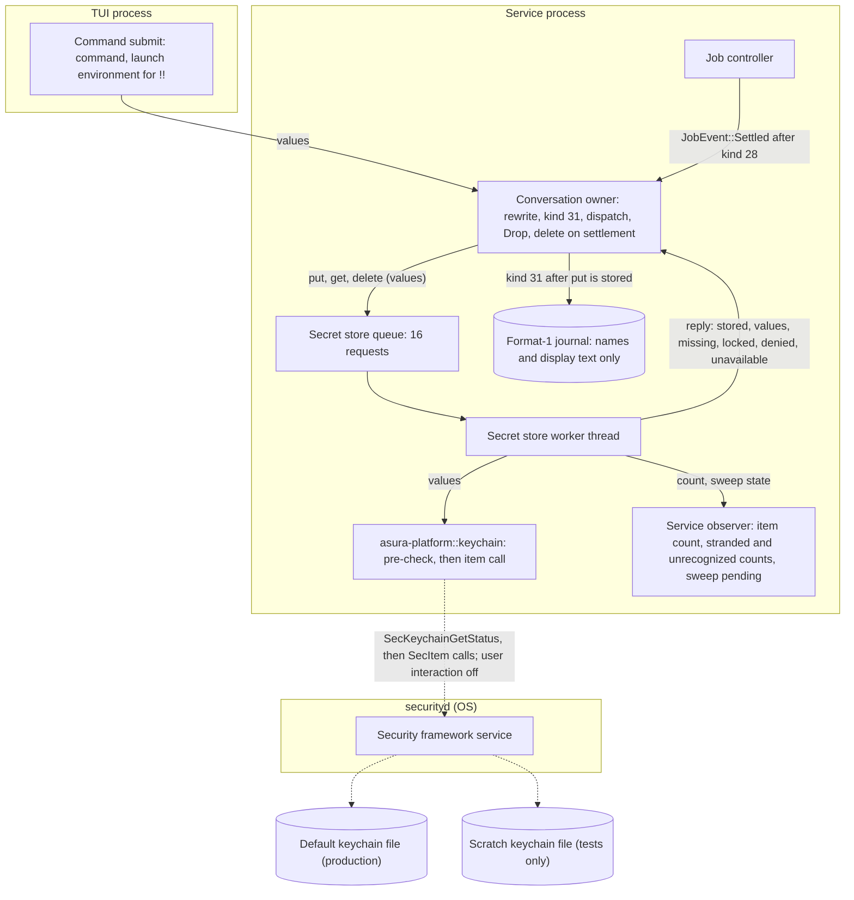
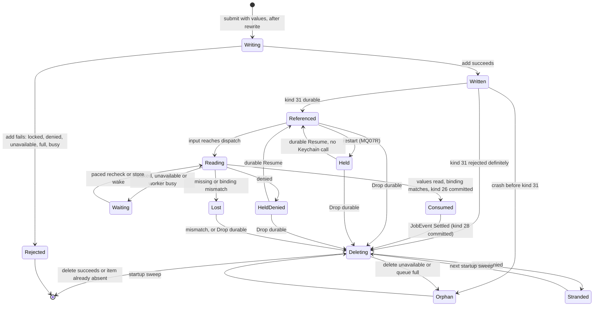
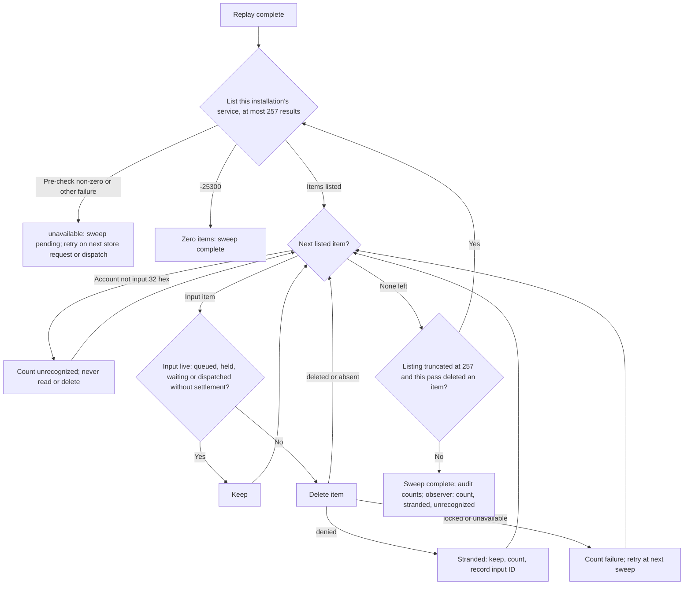
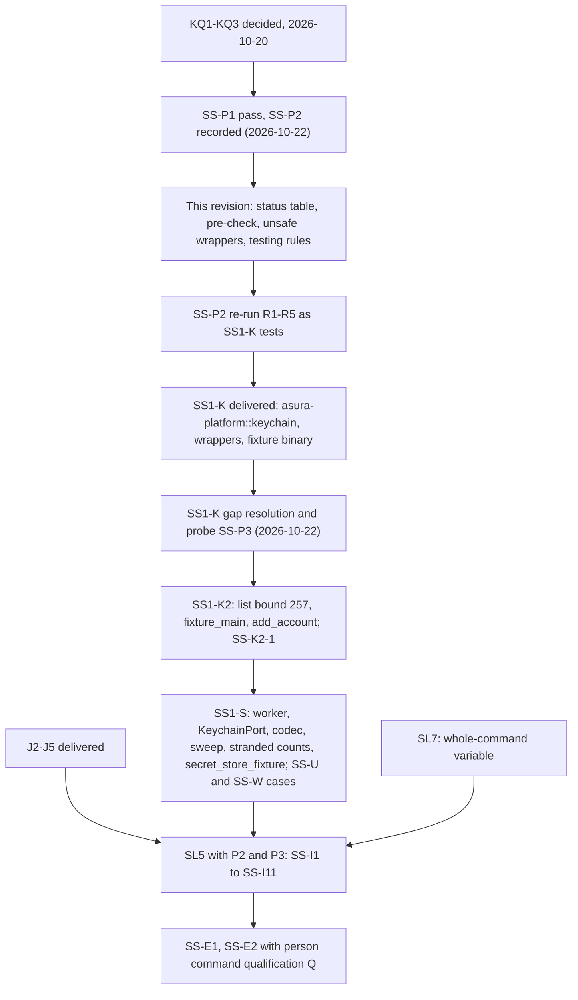

# Durable secret store

Status: proposed design, 2026-10-20; revised 2026-10-22 for SS1 code. The
owner selected the required behavior on 2026-10-20 (decision
[SO6](secret-detection.md#owner-decisions)): the secret store is durable, in
the macOS Keychain, so a queued person command with secrets and a queued `!!`
command resume after a restart. The owner answered KQ1–KQ3 the same day
([owner decisions](#owner-decisions)); no question remains. Mechanisms marked
"selected (engineering)" or "proposed" are engineering choices under the
[iteration rules](../design-process.md#iteration-and-escalation).

Revision of 2026-10-22: the person command and secret store readiness audit
gaps are resolved here ([audit resolution](#readiness-audit-resolution-2026-10-22)),
and the SS1-K probe results are recorded ([probe results](#probe-results-2026-10-22)).
Probe SS-P1 passed. Probe SS-P2 disproved the first status table; the table,
the target pre-check and the testing rules below replace it.

Second revision of 2026-10-22, for SS1-S: packet SS1-K is implemented
(`asura_platform::keychain`, commits `1641dc1` and `f5aa762`). Its report
raised seven gaps; this revision resolves them
([SS1-K gap resolution](#ss1-k-gap-resolution-2026-10-22)). Probe SS-P3
showed that a rebuilt service binary can delete the items of the previous
build. Items that a build still cannot delete are now
[stranded items](#stranded-and-unrecognized-items). Packet SS1-K2 (a small
platform follow-up) and then SS1-S are ready for implementation. The rest of
the store is not implemented. Protocol numbering remains `0.1`; journal
format remains `1`.

## Scope

The secret store holds values that must not enter any Asura record but must
reach a later execution:

- the per-execution secret variables of a rewritten person command
  ([secret detection](secret-detection.md#environment-path));
- the whole raw command of a person command run through the
  [whole-command variable](secret-detection.md#whole-command-variable) (SO5);
- the TUI launch environment of a `!!` command
  ([outside environment](person-command-mode.md#outside-profile-environment)).

Objectives:

- A queued person command keeps these values across a service restart and
  resumes with them.
- Values at rest are protected by the Keychain, never written to an Asura file.
- Every value is deleted when its command can no longer run.
- No Keychain call blocks the reactor, the control path or a cancel.
- No Keychain call ever reaches a keychain other than its target.

Non-goals:

- Model call values. A model call runs at once and never runs again after a
  restart (AE-05), so its values stay in memory (SO6). Writing them would put
  secrets at rest with no use.
- Provider credentials. EX14 gives those to the model helper; this store does
  not hold them.
- Syncing values to other devices, or exporting them.

Dependencies: [secret detection](secret-detection.md) (values, numbering,
preamble), [person command mode](person-command-mode.md) (kind 31 PCQ, queue,
dispatch), the [managed input queue](managed-input-queue.md) (Hold, Resume,
Drop), the [job controller](tool-job-controller.md) (settlement events), and
the [execution threat model](execution-threat-model.md#secret-store-at-rest)
(EXD-2).

## Required behavior

Required behavior (owner, 2026-10-20). IDs are stable test references. SSR3
was corrected on 2026-10-22: an item's life ends with its command, not with
its job's later output deletion.

| ID | Rule |
| --- | --- |
| SSR1 | A person command's secret values, whole-command value and `!!` launch environment are stored in one macOS Keychain item before any journal record refers to them. |
| SSR2 | After a restart, a held person command that the person resumes runs with the stored values, read from its item at dispatch. |
| SSR3 | The item is deleted when its command's job settles (kind 28 committed), when its input is dropped (kind 13 Drop committed), when its kind 31 append is rejected, or when dispatch finds it mismatched. A startup sweep deletes items the journal does not reference as live. |
| SSR4 | When the Keychain is locked, unavailable or denies access, the person sees why. Asura never falls back to writing values to disk, and never shows a Keychain prompt. |
| SSR5 | No Keychain call runs on the reactor, a control handler or a render path. No Keychain wait has a time bound; each ends by a reply, a cancel of the waiting request, or shutdown. |
| SSR6 | Tests never read, write or delete items in the login keychain; they use a scratch keychain file. No test or probe calls `SecItemAdd` unless the status pre-check of its scratch keychain returned 0 in the same worker step ([testing rules](#testing-rules)). |

## Terms

| Term | Meaning |
| --- | --- |
| Secret store | The service component that holds person command values: the Keychain items and the worker that reads and writes them |
| Secret item | One Keychain generic-password item holding all values of one person command input |
| Secret store worker | The retained service thread that makes every Keychain call |
| Keychain target | The keychain the worker uses: the default (login) keychain in production, a scratch keychain file in tests |
| Target pre-check | The `SecKeychainGetStatus` call on the target that the worker makes before every item call ([target pre-check](#target-pre-check)) |
| Orphan item | A secret item whose input the journal does not reference as live |
| Stranded item | An orphan item whose delete the Keychain denied to the running service binary. It stays until a later sweep or the person deletes it ([stranded items](#stranded-and-unrecognized-items)) |
| Unrecognized item | An item under this installation's service attribute whose account is not `input.<32 lowercase hex>`. Asura never writes one |

## Ownership

| Behavior | Canonical owner | Change |
| --- | --- | --- |
| Keychain calls: add, read, delete, bounded list, status pre-check; user-interaction lock; scratch keychain create, lock and delete for tests; the fixture writer | Module `asura-platform::keychain` over `security-framework`, plus narrow `extern "C"` wrappers ([unsafe wrappers](#unsafe-wrappers)) | SS1-K delivered; SS1-K2 adds the list bound and the shared fixture function |
| Status code to `Failure` mapping, including the second `SecKeychainGetStatus` call after -25293 or -25308 | `asura-platform::keychain` (`classify`) | SS1-K delivered ([status mapping](#status-mapping)) |
| `Failure` to reply mapping, request queue, worker thread, item payload codec, binding check, sweep, item count, stranded and unrecognized counts | New module `asura-service::secret_store` | New (SS1-S) |
| When to write and read | Conversation owner (`asura-service/src/conversation.rs`): `put` at submit, `get` at dispatch | Calls the store |
| When to delete | Conversation owner: on `JobEvent::Settled` for a person-origin job (after kind 28 commits), after a kind 13 Drop commits, after a definite kind 31 rejection, and on a dispatch `mismatch` | Calls the store; the job controller never calls it |
| Values in flight to the spawn | Existing secret detection environment path and guardian; the launch environment through the [person environment descriptor](person-command-mode.md#platform-changes) | P1 |
| Item count and sweep state in the service status | Service observer (`ServiceObservation` field 8, [operations](#operations-and-audit)) | New field |
| What the person sees | TUI, from queue refusal and waiting reasons ([control API](person-command-mode.md#control-api-additions)) | New reason texts |

The job controller does not call the store. Its `JobEvent::Settled(job,
outcome)` reaches the conversation owner after kind 28 commits. For a
person-origin job the owner derives the input ID from the job's origin and
sends `delete`. One owner therefore issues every item call (selected,
engineering, 2026-10-22).

Rust, not the Swift helper, owns Keychain access. The service already owns
admission, journal ordering and the spawn that consumes the values; the
values never need to leave the service process. The Swift model helper is the
model's process and handles untrusted model traffic; routing command secrets
through it would widen what that process holds and add a transfer the threat
model would have to cover. `asura-platform` is the crate that owns safe OS
primitives with narrow unsafe code.

### Unsafe wrappers

Selected (engineering, 2026-10-22). Probe finding (e): `security-framework`
3.7.0 and `security-framework-sys` 2.17.0 do not expose `SecKeychainGetStatus`,
`SecKeychainLock` or `SecKeychainDelete`. The earlier claim that no new unsafe
code is needed is withdrawn. `asura-platform::keychain` declares three
functions from the Security framework with `extern "C"`:

| Function | Build | Use |
| --- | --- | --- |
| `SecKeychainGetStatus(SecKeychainRef, *mut u32) -> OSStatus` | Production | The [target pre-check](#target-pre-check) and the locked or denied decision |
| `SecKeychainLock(SecKeychainRef) -> OSStatus` | `test-support` only | Lock a scratch keychain for the locked cases |
| `SecKeychainDelete(SecKeychainRef) -> OSStatus` | `test-support` only | Delete a scratch keychain at teardown |

Each wrapper is one `unsafe` block with a `// SAFETY:` comment. The keychain
reference comes from a live `SecKeychain` owned by the caller, so it is valid
for the call. The status pointer is a local `u32`. No pointer outlives the call.
The deprecated-API warning is allowed on these three items only. KQ3's
dependency approval is unchanged; no other crate is added.

### SS-O1: components and trust boundaries

Selected design, revised twice on 2026-10-22. Solid arrows are calls or data. Dashed
arrows are OS IPC. Subgraphs are process boundaries. Values move only along
arrows marked "values". Every item call passes the status pre-check first.



## Keychain item contract

Selected (engineering) unless marked otherwise.

| Property | Value |
| --- | --- |
| Class | Generic password (`kSecClassGenericPassword`) |
| Keychain | Production: the default keychain reference from `SecKeychainCopyDefault`, normally the login keychain, passed as `kSecUseKeychain`. Tests: a scratch keychain file (`Location::FileKeychain`), passed the same way |
| Service attribute | `asura.secret-store.<installation ID, lowercase hex>` |
| Account attribute | `input.<input ID, lowercase hex>` |
| Label | `Asura queued command secrets` |
| Synchronizable | No. A file-based keychain item is never synced to iCloud |
| Access control | The default ACL of an item the service creates: the creating binary may read it without a prompt ([KQ2](#owner-decisions)). Probe SS-P2 (b) confirmed that read is bound per build: the ACL names the writer's code hash (cdhash). Delete is not bound per build: probe SS-P3 showed that a binary with the writer's executable file name deletes the item, and a binary with another file name gets -25244 |
| Accessibility class | Not available on a file-based keychain; see [KQ1](#owner-decisions). The login keychain is readable while it is unlocked, normally from login |
| Data | The payload below, at most 55,413 bytes |

The service and account attributes bind an item to one installation and one
input. The payload binds it again by digest, so an item copied under another
name is rejected.

### Payload

Selected format. All integers are big-endian. The codec rejects unknown
versions, trailing bytes and any bound violation.

| Field | Content |
| --- | --- |
| version | u8, `1` |
| binding | 32 bytes: SHA-256 over ASCII `asura.secret-item`, one zero byte, installation ID, project ID, conversation ID, input ID and the kind 31 request digest |
| flags | u8: bit 0 whole-command value present; bit 1 `!!` launch environment present; other bits 0 |
| secret variables | u8 count 0–16; each entry u8 number 1–16, u16 length, value bytes. Count 0 when bit 0 is set (the whole-command variable is used alone) |
| whole-command value | When bit 0: u16 length 1–8192, raw command bytes |
| launch environment | When bit 1: u16 count 0–1,024; each entry u16 name length 1–1,024, name, u32 value length, value |
| value digest key | 32 random bytes, used for the keyed duplicate-retry digest |

Bounds: secret variable values at most 8,192 bytes in total, as secret
detection requires; whole-command value at most 8,192 bytes; launch
environment at most 1,024 entries and 40,960 bytes of names and values
([OD4](person-command-mode.md#owner-decisions-of-2026-10-22)). The largest
payload is 55,413 bytes: 1 version, 32 binding, 1 flags, 8,241 for 16 numbered
variables (1 + 16 × 3 + 8,192; the whole-command form needs at most 8,195),
47,106 for the launch environment (2 + 1,024 × 6 + 40,960) and 32 for the key.
Probe SS-P1 confirmed a 131,072-byte value round trip, so the item size has
margin.

The whole-command variable's detected values are not stored as a separate
list. Dispatch re-plans them from the stored raw command
([dispatch read](#ordering-rules), rule 4).

MAX_ITEM_BYTES in `asura_platform::keychain` is 55,413, the same number. The
sum above was checked again on 2026-10-22: 1 + 32 + 1 + 8,241 + 47,106 + 32
= 55,413.

At most 256 secret items exist per installation. A submit that would create
the 257th is refused with `secret_store_full`. The
[managed input queue](managed-input-queue.md#admission-and-delivery--selected-design)
is the one source of the unresolved-input limit: 16 inputs across all
projects. That limit keeps normal use far below 256.

### Item count and memory bounds

Selected (engineering, 2026-10-22, SS1-K gap 5).

- **What counts.** The item count is every item that a list under this
  installation's service attribute returns: live items, orphans, stranded
  items and unrecognized items. All of them use the same keychain and the same
  list memory. `put` is refused with `full` when the count is 256 or more.
- **List bound.** The platform list asks for at most 257 results
  (`kSecMatchLimit` 257, `Limit::Max(257)`): the 256-item limit plus one.
  When 257 results return, `Listing.truncated` is true and the count is
  reported as 257, which means "more than 256". Probe SS-P3 confirmed that a
  numeric match limit caps the result on a file keychain. A list reads
  attributes only, never item data. SS1-K2 replaces `Limit::All` with this
  bound.
- **Read bound.** `get` copies the whole item data; the Security framework
  gives no way to bound a read before the copy. The read ACL lets the service
  read only items written by its own build, and `add` refuses data over
  55,413 bytes, so a readable item is never larger. The service payload codec
  is the one owner of the payload bound: it rejects any data over 55,413
  bytes, and the reply is `mismatch`. The platform does not check the read
  size a second time.
- **Attribute size.** Another same-UID process can write items with large
  attributes under Asura's service attribute. A list then holds up to 257
  such attribute sets for one call. This is a residual under
  [D1](threat-model.md#scope-assets-and-actors), recorded as
  [SS-T9](execution-threat-model.md#secret-store-at-rest).

### Stranded and unrecognized items

Selected (engineering, 2026-10-22, SS1-K gaps 1 and 4).

A **stranded item** is an orphan whose delete returned `denied`
(-25244, or -25293 or -25308 with the keychain unlocked). Probe SS-P3 showed
when this happens: the deleting binary's executable file name differs from
the writer's. The production service runs as the `asura` executable
(`spawn_service` re-executes the canonical `current_exe`), and a rebuild or
an upgrade keeps that name. So a rebuild leaves no stranded items; a renamed
binary, or an item written by a test fixture binary, does. The rule is an
observed behavior of macOS 27.0, not a documented contract. The design
therefore handles a denied delete without relying on it:

1. The worker keeps a stranded item. It stays in the item count and so
   counts toward the 256-item limit.
2. Every sweep tries to delete it again, because a later binary with the
   writer's file name can delete it.
3. The service observer reports the stranded count and up to 16 stranded
   input IDs ([operations](#operations-and-audit)). The TUI's `/status`
   detail shows the notice "Asura cannot delete N old Keychain items. In
   Keychain Access, delete the login keychain items named 'Asura queued
   command secrets' with these accounts:" and the `input.<hex>` accounts.
   These inputs are not live, so deleting them loses no command.
4. When stranded items make the store full, the `secret_store_full` text adds
   "/status lists Keychain items to delete."

An **unrecognized item** has an account that is not `input.<32 hex>`. Asura
never writes one, and no older Asura format exists to migrate. The store
counts it and reports the count; it never reads or deletes it, and the
platform has no call to delete it. Deleting accounts outside the item
contract would let the service destroy items it did not write. The person
can delete it in Keychain Access.

Not verified: no probe deleted an item with Keychain Access. The `security`
command-line tool was not used for this check, because it can show a dialog.

## Lifecycle

### SS-S1: secret item lifecycle

Selected design, revised 2026-10-22. Arrows are events with guards. `Written`
means the Keychain add returned success; it does not mean the journal refers
to the item. Resume never reads the item; dispatch does.



### Ordering rules

1. **Write first.** The conversation owner sends `put` and waits for its reply
   before it appends kind 31. A journal record never refers to an item that
   was not stored.
2. **Reject without a record.** If `put` fails, the submit gets the refusal
   reason, nothing is journaled, and the TUI keeps the draft.
3. **Uncertain append.** If the kind 31 append outcome is uncertain, the item
   stays. Resolution by request ID either references it or deletes it.
4. **Read only at dispatch.** Resume changes queue state only and makes no
   Keychain call. Dispatch always reads the item; the service keeps no second
   copy between submit and dispatch. One read path serves the first run and
   the run after a restart (selected, engineering, 2026-10-22). After the
   read, the owner re-plans the whole-command literals: it runs the rewrite
   planner on the stored raw command with the running rule set and checks
   that the numbered values match kind 31's number count and kinds. If kind
   31's rule-set revision differs from the running rule set, the input is
   `Held` with hold reason `secret_rules_changed` and nothing runs; the item
   stays until Drop. A rule-set change needs a new binary, and the default ACL
   is bound per build (KQ2), so this case normally appears as `denied` first.
   The values move into the job admission and are zeroized after spawn, as
   secret detection requires.
5. **Delete after the deciding record.** The owner sends `delete` only after
   the kind 28 settlement, kind 13 Drop, or definite kind 31 rejection is
   durable, or after a dispatch `mismatch`. An `unavailable` delete leaves an
   orphan that the next sweep removes. A `denied` delete leaves a
   [stranded item](#stranded-and-unrecognized-items). Neither changes the
   record.
6. **Exact retry.** A retry with the same request ID is first matched against
   kind 31's request digest. When the item exists, the worker also compares a
   keyed digest of the retried values, using the item's value digest key;
   equal values return the original input ID, different values return
   `request_conflict`. When the item no longer exists, because the command
   already settled or was dropped or the item was deleted outside Asura, the
   kind 31 request digest alone decides: an equal digest returns the original
   input ID and nothing runs again. The retry never writes a new item for a
   recorded request ID (selected, engineering, 2026-10-22).

### Target pre-check

Selected (engineering, 2026-10-22), from probe finding (d): `SecKeychainOpen`
succeeds for a path with no keychain, and `SecItemAdd` with that reference as
`kSecUseKeychain` returned success and wrote the item into the login keychain.
Read, list and delete on the missing keychain returned -25300.

Before every add, get, list or delete, the worker calls `SecKeychainGetStatus`
on the target reference in the same worker step. A non-zero return makes the
reply `unavailable` with the status code in audit, and the item call is not
made. The production target is the default keychain reference, obtained once
at worker start with `SecKeychainCopyDefault` and pre-checked the same way.
The worker never passes a keychain reference to an item call without a
pre-check that returned 0 in that step.

Residual (test-only): a scratch keychain deleted between the pre-check and the
add is a check-then-add race. Production does not delete its target, so the
race needs a test that deletes its own keychain while the worker runs. The
[testing rules](#testing-rules) forbid that order.

### Startup sweep

Selected (engineering). The sweep runs once on the worker after journal replay
completes. It does not delay admission: a dispatch read that arrives first is
queued behind it on the same worker. Probe finding (a) shows that list and
delete succeed while the keychain is locked, so the sweep runs while locked.

### SS-F1: startup sweep

Selected design, revised twice on 2026-10-22. Arrows are decisions in order.
Every list and delete box is one platform call, which runs the target
pre-check first. The `Next` loop ends when no listed item is left. The
`Again` loop ends because each repeat deletes at least one item of a finite
set; it stops at once when a pass deletes nothing.



Items of other installation IDs are never listed or touched. A listing that
is still truncated when the sweep ends sets the count to 257, so `put` is
refused with `full` until the person removes items.

## Requests and replies

| Request | Input | Replies |
| --- | --- | --- |
| `put` | Installation, input ID, binding, payload | `stored`, `exists_same`, `exists_different`, `locked`, `denied`, `unavailable`, `full` |
| `get` | Installation, input ID, binding | `values`, `missing`, `mismatch`, `locked`, `denied`, `unavailable` |
| `delete` | Installation, input ID | `deleted`, `absent`, `denied`, `unavailable` |
| `sweep` | Installation, live input IDs from replay | Counts: kept, deleted, failed, stranded, unrecognized; whether the last listing was truncated |

A full worker queue (16 requests) answers `busy` before the request reaches
the worker.

### Status mapping

Selected (engineering, 2026-10-22), replacing the table that probe SS-P2
disproved. The worker reads the `OSStatus` of each item call after a
successful pre-check.

| Security status | Reply |
| --- | --- |
| `errSecSuccess` (0) | Success reply |
| `errSecItemNotFound` (-25300) on `get` or `delete` | `missing` or `absent`. This holds only because the target pre-check returned 0 in the same step |
| `errSecItemNotFound` (-25300) on list | Zero items (probe finding: a list with no match returns -25300, not an empty list) |
| `errSecDuplicateItem` (-25299) on `put` | Read the item and compare digests: `exists_same` or `exists_different` |
| `errSecAuthFailed` (-25293) or `errSecInteractionNotAllowed` (-25308) | Call `SecKeychainGetStatus` on the target. Unlock bit `0x1` clear: `locked`. Bit set: `denied`. A failed status call: `unavailable` |
| `errSecInvalidOwnerEdit` (-25244) | `denied` |
| `errSecNoSuchKeychain` (-25294), any other code | `unavailable`, with the code in audit |
| Pre-check returned non-zero | `unavailable`; no item call was made |

Probe evidence for the table: a locked keychain returned -25293 for read and
add; status flags were `0x2` locked and `0x7` unlocked; an item written by
another binary returned -25293 with the keychain unlocked; deleting an item
written by the `security` CLI returned -25244. SS1-K's re-run step R2 found
that deleting an item written by `keychain_fixture` also returns -25244, so
the reply is `denied`.

**Owner of the mapping** (implemented by SS1-K, 2026-10-22). The table above
is implemented once, in `asura_platform::keychain`. The platform function
`classify` makes the second `SecKeychainGetStatus` call after -25293 or
-25308, in the same platform call as the item call. The worker receives a
`Failure` and never sees an item call's `OSStatus`. The worker maps platform
results to replies with this table and nothing else:

| Platform result | Worker reply |
| --- | --- |
| `Added::Stored` | `stored` |
| `Added::Duplicate` | `get` the item, then compare digests: `exists_same` or `exists_different`; that `get`'s failure gives its own reply |
| `Found::Data`, `Found::Missing` | Decode and bind: `values` or `mismatch`; `missing` |
| `Removed::Deleted`, `Removed::Absent` | `deleted`, `absent` |
| `Failure::Locked` | `locked` |
| `Failure::Denied` | `denied`; on a delete, the item becomes stranded |
| `Failure::Unavailable { status, .. }` | `unavailable`, with `status` in audit and in `last_status` |
| `Failure::Invalid` | `unavailable` with status 0 and audit reason `invalid_request`. The codec and the item key rules make this unreachable; reaching it is a defect that SS-U10 detects |

### Worker seam for tests

Selected (engineering, 2026-10-22, SS1-K gap 2). The pre-check order and the
status mapping are platform behavior. SS1-K tests them with its recording
fixture of the Security framework calls (`Calls`). SS-U3 (status codes) and
SS-U9 (pre-check order) are therefore SS1-K cases, delivered. SS1-S does not
repeat them.

SS1-S defines one trait in `asura-service::secret_store`, the store's only
route to the platform:

```rust
pub(crate) trait KeychainPort: Send + 'static {
    fn add(&self, key: &ItemKey, data: &[u8]) -> Result<Added, Failure>;
    fn get(&self, key: &ItemKey) -> Result<Found, Failure>;
    fn delete(&self, key: &ItemKey) -> Result<Removed, Failure>;
    fn list(&self, installation: &[u8; 16]) -> Result<Listing, Failure>;
}
```

- Production: `impl KeychainPort for asura_platform::keychain::Keychain`,
  one forwarding line per method. The worker opens it with `Keychain::open`
  on its own thread and owns it.
- Unit tests: a scripted port in `secret_store/tests.rs` returns queued
  platform results and records calls. It covers the `Failure` to reply table,
  the sweep decisions, stranded and unrecognized counts, and truncation
  (SS-U5, SS-U6, SS-U10, SS-U11). It never makes a Keychain call.
- Integration tests: a gated port (`test-support` only) wraps the real
  `Keychain`. It can block before a call until the test releases it (SS-W4)
  or return `Failure::Unavailable` once for a named call (SS-W8). Every other
  call goes to the real scratch keychain.

The port carries platform types, so the store has no second status table and
no raw `OSStatus` path.

## Failure handling

No failure writes a value to disk outside the Keychain. Each reason text names
the condition and the person's next action. Refusals use the
[queue refusal codes](person-command-mode.md#control-api-additions); waits use
the queue entry's waiting reason.

| Case | Result |
| --- | --- |
| Keychain locked at submit | Refused with `secret_store_locked`: "The login keychain is locked. Unlock it, then press Enter again." Draft and mode kept. Nothing journaled |
| Access denied at submit | Refused with `secret_store_denied`: "macOS denied Asura access to its Keychain item." Draft kept |
| Keychain unavailable at submit | Refused with `secret_store_unavailable` and the status code. Draft kept |
| 256 items exist | Refused with `secret_store_full`; draft kept. The count includes stranded and unrecognized items; when stranded items exist, the text adds "/status lists Keychain items to delete." |
| Worker queue full at submit | Refused with `secret_store_busy`; draft kept |
| Locked or unavailable at dispatch | The command stays at the lane head with waiting reason `keychain_locked` or `keychain_unavailable`. The owner rechecks on the paced delays 1, 1, 2, 3, 5, 8 s and so on, at most 60 s apart, as the controller's `disk_space` recheck does, and at once on the person's next action in that conversation (Send now, Resume, a new submit, Drop). The pacing ends nothing |
| Worker queue full at dispatch | Waits with reason `keychain_busy`; dispatch retries when the worker answers any request |
| Denied at dispatch | The command is `Held` with hold reason `secret_store_denied`: "macOS denied Asura access to this command's Keychain item. Drop it and enter it again." Under KQ2 a rebuilt binary causes this; a recheck cannot clear it |
| Item missing or binding mismatch at dispatch | The command is `Held` with hold reason `secrets_lost`: "This command's secrets are no longer in the Keychain. Drop it and enter it again." A mismatched item is deleted |
| Rule-set revision changed at dispatch | `Held` with `secret_rules_changed` (rule 4); item kept until Drop |
| Crash after put, before kind 31 | Orphan; deleted by the startup sweep |
| Delete locked or unavailable | Item kept as an orphan; counted in audit; retried by the next sweep |
| Delete denied | Item kept as a [stranded item](#stranded-and-unrecognized-items); counted in audit and in the observer; retried by every sweep; `/status` names it for the person to delete |
| Unrecognized item under the service | Counted toward the 256-item limit and reported; never read or deleted |
| List returns 257 items | Count reported as 257 ("more than 256"); `put` refused with `full`; the sweep repeats while each pass deletes an item |
| Item data over 55,413 bytes | The codec rejects it: `mismatch`, held with `secrets_lost`, item deleted |
| Keychain stalls inside securityd | The worker waits without a time bound. Later requests queue, then `busy`. Control, cancel, Drop records and other conversations stay responsive |
| Shutdown while a request is in flight | Shutdown does not wait for the worker. The ordering rules keep records consistent: an unreferenced item is an orphan, a referenced one is still valid |
| Person deletes the item in Keychain Access | Treated as missing |
| Another same-UID binary deletes the item | Probe SS-P3: this succeeds without a prompt when the binary's executable file name is the writer's (`asura`); another file name gets -25244. The command is held with `secrets_lost` at dispatch. Denial of service, not disclosure ([SS-T3](execution-threat-model.md#secret-store-at-rest)) |
| Service binary rebuilt or replaced | The default ACL no longer trusts it for reads: `denied` ([KQ2](#owner-decisions)). Deletes still succeed while the executable file name stays `asura` (probe SS-P3), so Drop and the sweep remove the old items. A renamed binary leaves stranded items |
| Target keychain missing or deleted | Pre-check non-zero: `unavailable`; no item call; never a write to another keychain |

A command with no detected secret, a `!` command with no secret, and a model
call never touch the Keychain. A `!!` command always has a launch environment,
so every `!!` command needs the Keychain.

## Asynchronous execution

Mapping to [AE-01–AE-07](../engineering.md#asynchronous-execution-and-recovery):

| Rule | Application |
| --- | --- |
| AE-01 | Every Security framework call runs on the one retained secret store worker thread. The reactor, control handlers and rendering never call it. |
| AE-02 | Blocking calls: `SecKeychainGetStatus`, `SecItemAdd`, `SecItemCopyMatching`, `SecItemDelete`, `SecKeychainCopyDefault`, `SecKeychainSetUserInteractionAllowed`; in tests `SecKeychainCreate`, `SecKeychainOpen`, `SecKeychainLock` and `SecKeychainDelete`. Each is IPC to securityd and can wait. |
| AE-03 | Queue: 16 requests, then `busy`. One request runs at a time. Deletes after settlement join the same queue; if it is full, the delete is left for the next sweep. Items: 256 per installation, counting every listed item. List: at most 257 attribute results per call, no item data. Read: one item's data, at most 55,413 bytes for any item this build can read; the codec rejects more. Payload: 55,413 bytes. Observer: at most 16 stranded input IDs. |
| AE-04 | No time bound. A request ends by its reply. A submitter that stops waiting (client cancel or disconnect) leaves the request to finish; its result is applied or swept. A stalled securityd is a stalled dependency: the store reports `busy` and everything else continues. The locked-at-dispatch recheck is pacing (1, 1, 2, 3, 5 … s, at most 60 s) and ends nothing. |
| AE-05 | Values are read at each dispatch, never relaunched after an unknown outcome. Orphans are reconciled against replay. |
| AE-06 | Startup: the worker starts after the platform disables Keychain user interaction for the process, takes the default keychain reference, then sweeps after replay. Shutdown: admission closes; the worker is not awaited. |
| AE-07 | Acceptance: with the scratch keychain call blocked by a test seam, the TUI stays responsive, Ctrl-C and Drop work, and a submit without secrets still runs. |

User interaction: the platform calls `SecKeychainSetUserInteractionAllowed(false)`
through `SecKeychain::disable_user_interaction()` once at service start and
holds the guard for the process lifetime. The setting is process-wide. A call
that would show a dialog then fails instead of waiting for a person. The
SS1-K probes ran with it disabled and saw no dialog.

## Security

Owner decision EXD-2 (2026-10-20) in the
[threat model](execution-threat-model.md#secret-store-at-rest) accepts secrets
at rest in the Keychain.

- **At rest.** Values are encrypted in the keychain file under keys derived
  from the person's login password. They are included in backups of that file
  in encrypted form. They never sync, because a file-based keychain item does
  not.
- **Who can read.** The service binary that created the item reads it without
  a prompt while the keychain is unlocked. Another same-UID binary gets
  -25293 with user interaction off (probe SS-P2 (b)). Same-UID processes are
  one principal under [D1](threat-model.md#scope-assets-and-actors), so this
  is defense in depth, not a boundary claim.
- **Who can delete.** Another same-UID binary with the writer's executable
  file name deleted an Asura item without a prompt (probes SS-P2 (c) and
  SS-P3). A binary with another file name got -25244. Any same-UID process
  can start a binary named `asura`, so this is not a boundary either. The
  effect is a lost command (`secrets_lost`), not disclosure.
- **What never holds values.** Journal, payloads, audit, logs, client replies,
  argument vectors and Asura files. The payload binding digest uses identifiers
  only; the value digest is keyed with a random key stored inside the item.
- **Wrong keychain.** The target pre-check prevents an item call from falling
  through to the default keychain when a scratch target is missing.
- **Memory.** Values read from the Keychain go into zeroizing buffers and are
  dropped after spawn, as secret detection requires. Copies made inside the
  Security framework are outside Asura's control: `security-framework` copies
  a read result from a `CFData` that is released without zeroizing, and
  securityd holds values in its own process. This is residual
  [SS-T8](execution-threat-model.md#secret-store-at-rest).
- **Lifetime.** An item lives from submit until its command's job settles or
  its input is dropped, plus at most one sweep after a failed delete.

## Operations and audit

- No configuration key. The production target is the default (login)
  keychain.
- Audit events `secret_store.put`, `secret_store.get`, `secret_store.delete`
  and `secret_store.sweep` carry the input ID, the reply code, the status code
  for `unavailable` and counts. They never carry a value, name, digest or
  payload size.
- Service status (selected, engineering, 2026-10-22). `ServiceObservation`
  gains field 8 `SecretStoreStatus secret_store`, owned by the service
  observer and fed by the worker after each put, delete and sweep:

```proto
message SecretStoreStatus {
  optional uint32 item_count = 1;         // every listed item, 0-257; 257 means more than 256
  optional bool sweep_pending = 2;        // startup sweep deferred
  optional uint32 last_status = 3;        // 0, or the last unavailable OSStatus as its absolute value
  optional uint32 stranded_count = 4;     // items whose delete was denied, 0-257
  optional uint32 unrecognized_count = 5; // items whose account is not input.<32 hex>, 0-257
  repeated bytes stranded_inputs = 6;     // at most 16 input IDs of 16 bytes each
}
```

The count is the number of items the last sweep listed, plus the items the
worker has stored since, minus the items it has deleted since. It is absent
until the first sweep completes. A `denied` delete adds the input to the
stranded set; a later `deleted` or `absent` reply removes it. The TUI shows
these fields only in `/status` detail; they are not in the top pane. When
`stranded_count` is above 0, `/status` shows the
[stranded item notice](#stranded-and-unrecognized-items) with each
`input.<hex>` account from `stranded_inputs` and "and N more" for the rest.
When `unrecognized_count` is above 0, it shows "N Keychain items under
Asura's service name were not written by Asura."

## Validation

Every test uses a scratch keychain file created in the test's scratch runtime
root with `CreateOptions::create` and a random password. Probe SS-P1 confirmed
that `SecKeychainCreate` does not add the scratch keychain to the search list;
tests still check after teardown that the person's search list is unchanged.

### Testing rules

Required for every test, probe and fixture (SSR6, 2026-10-22):

1. No test, probe or fixture calls `SecItemAdd` unless the target pre-check of
   its scratch keychain returned 0 in the same worker step.
2. Teardown stops the worker before it deletes the scratch keychain
   (`SecKeychainDelete`, test-support).
3. A test about a missing or deleted keychain checks the pre-check result only.
   It never calls add on a missing keychain, because probe finding (d) shows
   that such an add writes to the default keychain.
4. The scratch target is selectable only through the test-support seam below.

### Test-support seam

Selected (engineering, 2026-10-22). `asura_platform::keychain::Target` has one
production variant, `Default`. The variant `Scratch { path, password }` exists
only with the `test-support` feature. `asura_service::secret_store::Store::new`
takes a `Target`. Production service start passes `Target::Default`. The
service test harness (`asura-service/src/test_support.rs`) creates a scratch
keychain under the test's scratch runtime root and passes `Target::Scratch`.
A production build therefore cannot select a scratch keychain, and a test
build cannot reach the default keychain through the harness. SS-U7 checks
both.

### Probe results (2026-10-22)

Recorded by packet SS1-K on macOS 27.0 build 26A428 with
`security-framework` 3.7.0, `security-framework-sys` 2.17.0 and
`core-foundation` 0.10.1, user interaction disabled throughout. These are
verified behaviors of the OS mechanism, not of Asura code.

| ID | Question | Result |
| --- | --- | --- |
| SS-P1 | Does a 131,072-byte generic-password value round trip in a scratch file keychain, and does `SecKeychainCreate` change the search list? | Pass. 131,072 bytes and 1 MiB round trip. The search list is unchanged. Duplicate add returns -25299; read and delete of a missing item return -25300; a list with no match returns -25300 |
| SS-P2 | Which status codes do a locked keychain, a denied ACL and a missing keychain return with user interaction off? | Fail against the first table, which this revision replaces. (a) Locked: read and add return -25293, not -25308; `SecKeychainGetStatus` flags `0x2` locked and `0x7` unlocked; list and delete succeed while locked. (b) An item written by another binary (the `security` CLI, or probe A read by probe B) returns -25293: the default ACL enforces KQ2 per build. (c) Another same-UID binary deleted an item without a prompt; deleting a `security`-CLI item returned -25244. (d) `SecKeychainOpen` on a missing path succeeds; status returns -25294; `SecItemAdd` with that reference returned success and wrote the item into the login keychain; read, list and delete returned -25300. (e) The crates do not expose `SecKeychainGetStatus`, `SecKeychainLock` or `SecKeychainDelete`. (f) Status after `SecKeychainDelete` returned 100000 |

| SS-P3 | Can a rebuilt binary with the same name and path delete the previous build's items, and what decides delete access? | Run 2026-10-22 by the design writer, same host and crate versions, scratch keychain only, user interaction disabled. A probe binary `kprobe` (ad-hoc signed, no team ID) wrote items as v1. It was rebuilt in place as v2 (new cdhash, new inode, same code-signing identifier). v2: list succeeded (4 items); get of a v1 item returned -25293; delete of a v1 item succeeded. A copy of v2 named `kprobe` in another directory deleted a v1 item. A copy of v2 named `renamed` got -25244 on a v1 item. A copy of v2 named `kprobe2` in the same directory got -25244 on a v2 item. A binary from another crate, with another code-signing identifier but the file name `kprobe`, deleted a v1 and a v2 item. A v3 rebuild deleted the two items that `renamed` and `kprobe2` could not. The item ACL (`security dump-keychain -a`) names the writer's path and `cdhash` for decrypt only; it has no delete entry. Conclusion: read follows the cdhash; delete followed the executable file name. `kSecMatchLimit` 1 and 3 capped a 5-item list; 10 returned 5. Scratch keychain creation and `SecKeychainDelete` worked with user interaction disabled; status after delete returned -25294 |

SS1-K report facts (2026-10-22, packet report; not re-run by the design
writer): re-run step R2 found that deleting an item written by
`keychain_fixture` returns -25244, mapped to `denied`. Scratch keychain
creation and `SecKeychainDelete` worked with user interaction disabled.
`MAX_ITEM_BYTES` is 55,413, which matches the payload arithmetic.

After SS-P3, `security find-generic-password` (read only) searched the login
keychain for the probe's service attribute and label and found neither; the
search list and default keychain were unchanged.

Incident: finding (d) wrote one synthetic probe item into the login keychain
of the development account. It held no secret. The owner is removing it. The
target pre-check and the testing rules exist so that no later test can repeat
this.

### SS-P2 re-run plan

Implemented by SS1-K as platform tests in `asura-platform/src/keychain/tests.rs`.
R2's delete outcome is `denied` (-25244). The re-run uses the revised status
mapping and a scratch keychain only:

| Step | Check | Pass |
| --- | --- | --- |
| R1 | Locked scratch keychain (`SecKeychainLock`): pre-check, then get and add | Pre-check 0; replies `locked` |
| R2 | Item written by a second fixture binary; get, then delete | `denied` for get; delete `deleted` or `denied` (recorded) |
| R3 | Scratch keychain deleted after the worker stops: pre-check only | Pre-check non-zero; reply `unavailable`; no add is called; the login keychain search shows no new Asura item |
| R4 | List while locked; delete while locked | List and delete succeed |
| R5 | List with no items | Zero items |

### Unit

| ID | Case | Required result |
| --- | --- | --- |
| SS-U1 | Payload codec at every bound (16 variables of 8,192 bytes in total; whole-command 8,192; 1,024 launch entries and 40,960 bytes), plus one over each; unknown version; trailing bytes; maximum payload 55,413 bytes | Exact round trip; each invalid form rejected |
| SS-U2 | Binding digest vectors; an item read under another input or installation | `mismatch` |
| SS-U3 | SS1-K, platform. Status mapping with fixture codes, including -25293 and -25308 with status flags `0x2` and `0x7`, -25244, -25294, -25300 after a pre-check of 0 and a list -25300, and a non-zero pre-check | Each `Failure` as the revised table lists; no item call after a non-zero pre-check |
| SS-U4 | Ordering: put failure, put then append rejected, append uncertain, `JobEvent::Settled`, Drop | No record before `stored`; delete only after the deciding record; uncertain keeps the item |
| SS-U5 | Queue: 17th request; full queue on a settlement delete | `busy`; delete left for the sweep |
| SS-U6 | Sweep decision over a fixture replay state: queued, held, waiting, dispatched, settled, dropped, unknown input | Keep the first four; delete the rest |
| SS-U7 | Target selection from a scratch runtime root; a production build | Never the default keychain from the harness; `Target::Scratch` absent without `test-support` |
| SS-U8 | Exact retry with equal and different values; retry after the item was deleted | Original input ID; `request_conflict`; original input ID with no new item |
| SS-U9 | SS1-K, platform. Pre-check order with the recording `Calls` fixture | Every add, get, list and delete is preceded by a status call in the same platform call; a non-zero status prevents the item call |
| SS-U10 | SS1-S. Scripted port returns each platform result of the [worker reply table](#status-mapping), including `Added::Duplicate` followed by each `get` result, and `Failure::Invalid` | Each worker reply as the table lists; `Invalid` gives `unavailable` with status 0 and audit `invalid_request` |
| SS-U11 | SS1-S. Sweep over a scripted port: a denied delete; a later sweep where it succeeds; 2 unrecognized accounts; a truncated listing of 257 where the pass deletes 3, then a listing of 254; a truncated listing where the pass deletes nothing; a `denied` delete after settlement | Stranded count 1, then 0; unrecognized counted, never deleted or read; second listing made, then sweep ends; no second listing when nothing was deleted, count 257 and `put` gives `full`; stranded set holds at most 16 IDs while the count keeps the total |
| SS-K2-1 | SS1-K2, platform. `list` with the recording fixture | The search asks for at most 257 results; 257 results set `truncated`; fewer leave it false |

### Integration (SS1, worker layer)

Real `secret_store` worker over real `asura-platform::keychain` and a scratch
keychain file; no journal and no person command path. These are the cases SS1
can prove alone.

| ID | Case | Required result |
| --- | --- | --- |
| SS-W1 | Put, get, delete and list a 55,413-byte payload | Exact values; `absent` on a second delete; zero items listed afterwards |
| SS-W2 | Lock the scratch keychain; get and put; list and delete | `locked`; list and delete succeed while locked |
| SS-W3 | Fixture binary (`secret_store_fixture`) writes an item under the same service and account; get | `denied`; no dialog |
| SS-W4 | Block the worker inside a Keychain call (seam) | The 17th request gets `busy`; the caller's reactor fixture stays responsive |
| SS-W5 | Worker stopped; scratch keychain deleted; worker restarted on the deleted path; get and sweep | Pre-check non-zero: `unavailable`; no add is made; the login keychain gains no item |
| SS-W6 | Sweep with a fixture live set over 3 items | Keeps the live one; deletes the others; observer counts updated |
| SS-W7 | 256 items present; put | `full` |
| SS-W8 | Delete fails once (seam) | Item kept; the next sweep deletes it |
| SS-W9 | `secret_store_fixture` writes 2 items under this installation's service: one with an `input.<hex>` account that is not live, one with the account `other`; sweep with an empty live set | Input item: delete `denied`, stranded count 1, its ID in the stranded set; `other`: unrecognized count 1, never read or deleted; item count 2; a `put` still succeeds |
| SS-W10 | 257 worker-written items, none live, plus 1 more (258); sweep with an empty live set | First listing returns 257 and is truncated; the sweep lists again and ends with zero items; no listing returns more than 257 |

#### Fixture binary

Selected (engineering, 2026-10-22, SS1-K gap 3). Cargo builds a package's
`[[bin]]` targets before that package's integration tests and gives them
`CARGO_BIN_EXE_<name>`. It does not build another package's binaries for
`cargo test -p asura-service`. So each package that needs the fixture has its
own thin binary, and the fixture logic exists once:

- SS1-K2 moves the body of `keychain_fixture` into
  `asura_platform::keychain::scratch::fixture_main()` (`test-support` only).
  It keeps the same arguments, the same pre-checked add through `Keychain`,
  and the same reply words and exit codes.
- `asura-platform/src/bin/keychain_fixture.rs` calls `fixture_main()`. The
  platform unit tests keep locating it in the target profile directory.
- SS1-S adds `asura-service/src/bin/secret_store_fixture.rs`, which calls
  `fixture_main()`, with `[[bin]] name = "secret_store_fixture"`,
  `required-features = ["test-support"]`, `test = false`.
- The SS-W cases are the integration test `asura-service/tests/secret_store_worker.rs`
  (`required-features = ["test-support"]`). They run the fixture with
  `env!("CARGO_BIN_EXE_secret_store_fixture")`. A missing feature fails the
  build of the test, not the test run.
- The fixture's file name differs from the test executable's, so, by probe
  SS-P3, the test binary is denied both read (SS-W3) and delete (SS-W9) of
  fixture items. SS-W9 asserts the denied delete; if a later macOS allows it,
  SS-W9 fails and this design is revised.

SS-W9 needs an unrecognized account, which `ItemKey` cannot name. SS1-K2
adds `scratch::add_account(target, installation, account, data)`, a
`test-support` function. It opens only a `Target::Scratch`, runs the target
pre-check, and adds one item under `service_name(installation)` with the
given account, through the same `Calls::add` as `Keychain::add`. Production
builds have no call that writes an account outside the item contract.
`fixture_main()` uses `Keychain::add` for an `input.<hex>` account and
`add_account` for any other.

### Integration (SL5 and P3, person command path)

These cases need kind 31 and the person submit path. They move to slice SL5
with packets P2 and P3 ([packet split](person-command-mode.md#packet-split)).
Real service, journal and scratch keychain file; no login keychain item is
read or written.

| ID | Case | Required result |
| --- | --- | --- |
| SS-I1 | Submit `!` with a rewritten secret and a whole-command secret, and `!!` with a fixture environment | One item each before kind 31; journal raw-byte sweep finds no value |
| SS-I2 | Queue them behind a model turn; kill the service; restart; Resume each | Each runs with its real values after dispatch reads the item; items deleted after settlement |
| SS-I3 | Kill the service between put and append (test seam) | Restart sweep deletes the orphan |
| SS-I4 | Lock the scratch keychain; submit; unlock; submit again | `secret_store_locked`, nothing journaled; second submit runs |
| SS-I5 | Lock at dispatch; unlock | Waits at the lane head with `keychain_locked`; runs at the next paced recheck or at once on Send now |
| SS-I6 | Delete the item outside Asura; Resume | Resume succeeds; dispatch holds with `secrets_lost`; Drop succeeds |
| SS-I7 | Item created by another binary identity at dispatch | `Held` with `secret_store_denied`; no dialog |
| SS-I8 | Block the worker inside a Keychain call (seam) | Control, cancel, Drop and secret-free commands stay responsive; a submit gets `secret_store_busy` |
| SS-I9 | Drop a queued command; delete fails once (seam) | Drop durable; next sweep deletes the item |
| SS-I10 | 256 items present; submit with a secret | `secret_store_full` |
| SS-I11 | Exact `!!` retry after its job settled | Original input ID; no new item; nothing runs again |

### End to end

| ID | Case | Required result |
| --- | --- | --- |
| SS-E1 | TUI against an isolated service with a scratch keychain: model turn running; type `!!printf %s "$FIXTURE_TOKEN" \| shasum -a 256` and `!curl -H 'Authorization: Bearer <fixture>' <loopback fixture>`; restart the service; Resume both | Both run after Resume; the loopback fixture receives the token; the digest matches; the log shows placeholders; no item remains after settlement |
| SS-E2 | Same with the scratch keychain locked | The TUI shows the locked message and keeps the draft |

## Delivery

### SS-P: delivery order

Selected plan, revised 2026-10-22. Arrows mean "is a prerequisite of". SS1
does not depend on the job packets; SL5 needs both. The packet names match the
[person command packet split](person-command-mode.md#packet-split).



## Decisions and alternatives

Selected (owner, 2026-10-20, SO6): a durable Keychain store for person command
values. Engineering choices in this design:

- **Rust owner, not the Swift helper.** See [ownership](#ownership).
- **File-based login keychain now.** The data-protection keychain needs a
  code-signed binary with a keychain access group entitlement. Asura's signing
  is not selected until I9, and development builds are unsigned.
- **One item per input.** Deletion and the sweep act on one item per command.
  Rejected: one item per value, which multiplies calls and partial states.
- **Read only at dispatch.** One read path for the first run and after a
  restart; Resume needs no Keychain call. Rejected: an in-memory copy beside
  the item, a second source of truth; and a read at Resume, which would hold
  values in memory while the input waits behind other work.
- **Status pre-check before every call** (2026-10-22). Rejected: relying on the
  item call's own status, which probe finding (d) showed can succeed against
  the wrong keychain.
- **Paced recheck when locked at dispatch** (2026-10-22). Rejected: waiting
  only for the person's next action, which left a command stuck after the
  person unlocked the keychain elsewhere.
- **Conversation owner deletes on settlement** (2026-10-22). Rejected: the job
  controller calling the store, which would give two owners item calls.
- **Model values in memory.** A model call never resumes. Rejected: writing
  them, which adds secrets at rest with no reader.
- **Rejected: an Asura-owned encrypted file.** It needs a key, and the key
  would need the Keychain anyway.
- **Stranded items stay and are reported** (2026-10-22). A denied delete
  keeps the item, counts it, retries it at each sweep and names it in
  `/status`. Rejected: a write-time trusted-application ACL. The crate
  exposes only the `SecAccess` type, with no `SecAccessCreate`,
  `SecTrustedApplicationCreateFromPath` or `SecACL` function, and
  `ItemAddOptions` cannot set `kSecAttrAccess`. It would need at least four
  more deprecated `extern "C"` functions and a hand-built add dictionary.
  For an ad-hoc signed binary the trusted-application entry is a cdhash
  (SS-P3 ACL dump), so it cannot name an identity that survives a rebuild
  before release signing (I9). An "any application may delete" entry would
  give no more than the file-name rule already gives. Rejected: a
  `/secrets purge` command. The running binary is the one that was denied,
  and Drop already deletes the items of live inputs. Revisit at I9, when the
  data-protection keychain and an access group bind items to a signed
  identity (KQ1).
- **Unrecognized items are counted, never deleted** (2026-10-22). Rejected: a
  platform delete by raw account, which would let the service delete items
  it did not write.
- **Codec owns the read bound** (2026-10-22). Rejected: a second size check
  in the platform `get`, which would give the payload bound two owners.

### SS1-K2: platform follow-up

Selected packet (2026-10-22). Owned paths: `asura-platform/src/keychain.rs`,
`asura-platform/src/keychain/tests.rs`,
`asura-platform/src/bin/keychain_fixture.rs`. It depends on SS1-K and
precedes SS1-S. It delivers:

1. `Calls::accounts(service, max)` with `max` 257 (`Limit::Max`), and
   `Listing.truncated`, set when 257 results return. SS-K2-1.
2. `scratch::fixture_main()` with the body of the current fixture binary,
   and `scratch::add_account` ([fixture binary](#fixture-binary)). The
   platform R2 test keeps passing unchanged.
3. No change to the status mapping, the pre-check or the wrappers.

## SS1-K gap resolution (2026-10-22)

| Gap from the SS1-K report | Resolution |
| --- | --- |
| 1 A delete of another binary's item returns -25244 (`denied`); can a rebuilt service delete the previous build's items? | Probe SS-P3: yes, while the executable file name stays the same. Denied deletes leave [stranded items](#stranded-and-unrecognized-items): kept, counted, retried, shown in `/status` |
| 2 The second status call is in the platform | Recorded under [status mapping](#status-mapping); SS1-S uses the [`KeychainPort` seam](#worker-seam-for-tests); SS-U3 and SS-U9 are SS1-K cases |
| 3 The fixture binary is in `asura-platform` | A thin `secret_store_fixture` binary in `asura-service` over the shared `fixture_main()` ([fixture binary](#fixture-binary)) |
| 4 Unrecognized accounts have no delete call | Counted and reported, never deleted ([stranded and unrecognized items](#stranded-and-unrecognized-items)) |
| 5 `list` and `get` memory | List at most 257 results; the codec rejects data over 55,413 bytes ([bounds](#item-count-and-memory-bounds)) |
| 6 Copies inside the Security framework | Residual [SS-T8](execution-threat-model.md#secret-store-at-rest), owner-accepted (EXD-3, 2026-10-22); Secure Enclave replacement after release signing (I9) |
| 7 Probe facts | Recorded in [probe results](#probe-results-2026-10-22) |

## Readiness audit resolution (2026-10-22)

| Audit item | Resolution |
| --- | --- |
| 19 Probes not run | [Probe results](#probe-results-2026-10-22) recorded; SS-P2 re-run planned |
| 20 SS1 claims integration it cannot run; SS-I7 fixture; scratch seam | [SS-W cases](#integration-ss1-worker-layer) for SS1; SS-I cases moved to SL5 and P3; fixture binary and [test-support seam](#test-support-seam) |
| 21 Locked at dispatch only clears on person action | Paced recheck ([failure handling](#failure-handling)) |
| 22 Item count has no owner | Service observer, `ServiceObservation` field 8 |
| 14 Who deletes after settlement | Conversation owner on `JobEvent::Settled` ([ownership](#ownership)) |
| 15 Whole-command literals | Re-planned at dispatch ([ordering rule 4](#ordering-rules)) |
| Resume reads the item | Resume makes no Keychain call; dispatch reads |
| Exact `!!` retry after deletion | [Ordering rule 6](#ordering-rules) |
| Unresolved-input limit | Linked to the managed input queue: 16 across all projects |
| Stale item lifetime | SSR3 corrected |

## Owner decisions

Answered by the owner on 2026-10-20. No owner question remains open.

| ID | Decision |
| --- | --- |
| KQ1 | Use the file-based login keychain now. When release signing is chosen (I9), move to the data-protection keychain with `kSecAttrAccessibleAfterFirstUnlockThisDeviceOnly` and an Asura access group. |
| KQ2 | Only the binary that wrote an item may read it: the default ACL. The owner accepts that a rebuilt development binary may get `secret_store_denied` for items written before the rebuild; such commands are entered again. |
| KQ3 | Approved: `security-framework` 3.7.0, with `security-framework-sys` and `core-foundation`, as dependencies of `asura-platform`, minimal features. The implementer verifies the version against crates.io and records the lockfile diff for review. |

## Design verification

Recorded on 2026-10-20: written from the owner's answers of 2026-10-20 and
from `security-framework` 3.7.0 source in the local Cargo registry
(`Location`, `CreateOptions`, `SecKeychain::disable_user_interaction`).
No Keychain call was made and no code or test was run. Diagrams SS-O1, SS-S1,
SS-F1 and SS-P were rendered with Mermaid CLI 12.0.0 and inspected. The
owner's KQ1–KQ3 answers were recorded the same day; SS-P's first node label
changed and was re-rendered.

Recorded on 2026-10-22: revised for the readiness audit and the SS1-K probe
results reported by the coordinator. The probe results are the packet's
report; this design writer ran no Keychain call. SS-O1, SS-S1, SS-F1 and SS-P
changed and were rendered with Mermaid CLI 12.0.0 and inspected. No code or
test was run.

Recorded on 2026-10-22 (second revision): written from the SS1-K report, the
code of `asura_platform::keychain` at commit `f5aa762`, the
`security-framework` 3.7.0 and `security-framework-sys` 2.17.0 sources in the
local Cargo registry, and probe SS-P3. SS-P3 was a scratchpad program outside
the repository, run against one scratch keychain that it created and then
deleted; it made no call on the login keychain. No product code or test was
written or run. SS-O1, SS-S1, SS-F1 and SS-P changed and were rendered with Mermaid
CLI and inspected.

Return to the [design index](README.md).
