# Security policy

Status: **ready for implementation, 2026-11-03**, for delivery packet
[PL1](#delivery-packets). Later packets are ready where their row in the
[packet table](#delivery-packets) says so; the others wait for the named
designs, probes or [evidence](#evidence-still-missing). The owner answered
the [owner questions](#open-owner-questions) on 2026-11-03.
Packet PL1 is implemented (2026-11-03) with two budgets failing, PL-B1 and
PL-B2, reported to the owner ([PL1 delivery record](#pl1-delivery-record)).
Later packets are not implemented. Protocol numbering stays `0.1` and the
journal format stays `1` until release 1.0.0; schemas change in place.

This is the D3 policy design that the [security policy brief](security-policy-brief.md)
requires. It resolves the brief's open decisions for the policy layer and
applies the owner decisions of 2026-11-03. The
[execution threat model](execution-threat-model.md#policy-layer) records the
threats. [ADR-0013](../decisions/0013-cedar-effect-policy.md) records the
selection. Terms are in the [glossary](../glossary.md).

Labels follow the [writing standard](../writing-standard.md#status-and-requirements):
**Required behavior** (an owner decision or a requirement), **Selected**
(an engineering choice this design makes), **Proposed** (not selected; needs
research or a later design) and **Verified** (recorded evidence). This
document records no verified product behavior. Spike figures are cited as
spike evidence only.

## Owner decisions this design applies

| ID | Decision | Date |
| --- | --- | --- |
| AD-28 | Task envelopes (PL8) wait for a task design (OQ1) | 2026-11-03 |
| AD-29 | The full default "ask first" intent list for PL7 (OQ2) | 2026-11-03 |
| AD-30 | Probe an LGPL-free cvc5 build before the solver packaging (OQ3); answered by SBQ1 and SBQ2 below | 2026-11-03 |
| SBQ1 | Ship GMP after all: cvc5 is bundled with GMP 6.3.0 as a separate, replaceable `@rpath/libgmp.10.dylib` under LGPL-3.0; each release publishes the exact GMP source, the build script, the licence texts and a notice | 2026-11-03 |
| SBQ2 | Drop LibPoly (`--no-poly`), subject to re-running SV-P1 on the product corpus at PL4a | 2026-11-03 |
| OQ3 legal | No open legal question and no release gate: Asura is open source (MIT), so anyone can rebuild it with another GMP and sign it themselves; compliance is the replaceable dylib, the published GMP source and build script, and the shipped licence texts and notice | 2026-11-03 |
| AD-31 | The 8 MiB budget covers the `asura` executable only; the solver's size is reported each release with no limit (OQ4) | 2026-11-03 |
| AD-32 | No replacement solver for now; only the bundled, signed solver (OQ5) | 2026-11-03 |
| AD-13 | Cedar is the policy language and decision engine. It decides; it does not enforce | 2026-11-03 |
| AD-14 | Pattern A: each scope is evaluated separately; allow only if every scope allows; a refusal names the denying scope | 2026-11-03 |
| AD-17 | cvc5 built from source with a dynamic or replaceable GMP, signed and notarised inside `Asura.app`; proofs on the person's Mac, offline; a bounded admission tool with no default time limit. Refined by SBQ1 (GMP 6.3.0 as `@rpath/libgmp.10.dylib`) and SBQ2 (no LibPoly) | 2026-11-03 |
| AD-27 | Effects are the authority. Commands, MCP tools and skills are intent: they may only tighten | 2026-11-03 |
| Budgets | Decision p50 at most 150 µs; end-to-end p99 at most 1.5 ms at 64 concurrent requests; at most 8 MiB added to the `asura` executable (AD-31); startup at most 200 ms. Revised by the owner on 2026-11-03 after the PL1 measurements (AD-33), from p50 100 µs and p99 1 ms: pattern A evaluates four scopes over 258 policies, about 80 µs of the decision, and a model turn takes seconds | 2026-11-03 |
| AD-24 | Envelope approval is an authorized policy change; envelopes end with their task or on revocation | 2026-11-02 |
| AD-15, AD-16 | The classifier may stop a model job to ask; `unknown` asks; an unanswered job waits in its agent's queue with a short reason | 2026-11-02 |
| AD-25 | Context egress is a policy decision over data classes, destinations and projects | 2026-10-31 |
| AD-7 | No network lockdown for `!` and `!!` person commands | 2026-10-31 |

The canonical record of each is the
[owner decisions table](assurance-and-differentiation.md#owner-decisions).

## Scope

Objectives:

- One canonical policy owner in the service that decides every effect a job
  may cause, with Cedar, for all clients.
- A Cedar schema over effects (AD-27), with intent and classifier attributes
  that can only tighten.
- A deny-on-any-error wrapper, strict validation and admission proofs.
- Asura-owned canonicalisation of paths, programs, hosts and secrets.
- Per-scope evaluation (AD-14) with stable reason codes that name the scope.
- A policy revision lifecycle with atomic activation, journaled decisions,
  restart recovery and rollback.
- Compilation of effect decisions into per-job Seatbelt profiles under the
  soundness rule.
- Envelopes (AD-24) as effect sets, approvals (AD-15) through the per-agent
  queue, and the solver package (AD-17).
- A first slice that changes no visible behavior and journals every model
  `exec_cmd` job decision.

Non-goals, each with its owner:

- The classifier model and its evaluation (DF4, a classifier design).
- The network proxy and brokers (AD-4, AD-6, AD-7 for model jobs: a broker
  design). This design defines the `network.connect` and `secret_use`
  decisions they will request.
- Remote providers and the EX13 destination grant (remote provider design).
  This design defines the `context.egress` decision shape only.
- Endpoint Security, Network Extension and the Linux VM backend. The
  [live enforcement](#live-enforcement-later-proposed) section proposes them
  and lists the research.
- The GUI and the full approval and policy editing UX (D6). This design gives
  the fixed texts and the control messages.
- Remote hosts (D5). Pattern A reserves the remote host scope.

Dependencies: [security policy brief](security-policy-brief.md),
[assurance and differentiation](assurance-and-differentiation.md),
[policy engine spike](policy-engine-spike.md),
[execution threat model](execution-threat-model.md),
[exec_cmd tool](exec-cmd-tool.md), [tool job controller](tool-job-controller.md),
[execution setting](execution-setting.md), [person command mode](person-command-mode.md),
[person command environment](person-command-environment.md),
[execution path guard](execution-path-guard.md), [named secrets](named-secrets.md),
[context composer](context-composer.md), [escapee control](escapee-control.md),
[tool call records](tool-call-records.md), [release signing](release-signing.md),
[loop closure](loop-closure.md) and [ADR-0006](../decisions/0006-async-event-pipelines.md).

## Terms

| Term | Meaning |
| --- | --- |
| Effect | An operation on a resource that a job can cause: a file read, write, creation or deletion, a program execution, a network connection, a secret use, a Mach lookup or a context egress |
| Effect action | A Cedar action that names an effect, such as `file.write` |
| Intent | What a proposer says it wants: a command line, an MCP tool call or a skill step, with its parsed features. It is context, never authority (AD-27) |
| Policy owner | The service module `asura-service::policy`, the one owner of decisions, revisions and admission |
| Scope | One source of policy: installation, user, workspace, repository; later remote host |
| Scope set | The admitted Cedar policies of one scope, partitioned by action group |
| Policy revision | The numbered, immutable set of active scope sets; every decision names it |
| Hard forbid | An installation forbid that no approval, envelope or lower scope can lift |
| Tighten-only attribute | A context attribute that only `forbid` policies may read: intent and classifier attributes |
| Effect envelope | The set of effects one job may cause: the regions its profile allows, computed from the policy for the job's principal |
| Constraint set | The typed result of compiling an effect envelope for one backend; the guardian renders it as a Seatbelt profile |
| Task envelope | The AD-24 envelope: a person-approved set of extra effects for one task, rendered as generated permits |
| Admission | The checks before a candidate revision may activate: parse, strict validation, lints, proofs and compilation |
| Solver | The bundled cvc5 process that answers the SymCC queries of one admission |
| Decision record | Journal kind 34: one decision with its revision, scopes, reasons and constraint digest |

## Required behavior

| ID | Rule | Source |
| --- | --- | --- |
| SP-R1 | Default deny. Any parse, schema, validation, evaluation or size error, and any exceeded limit, denies | Brief invariants; spike FE1 |
| SP-R2 | Every effect a job may cause is decided by the policy owner, as an effect action on a canonical resource. A command line, an MCP tool call or a skill never grants an effect | AD-27 |
| SP-R3 | Intent and classifier attributes appear only in `forbid` policies. The policy without them must satisfy every safety property, and admission proves that removing them never denies less | AD-27, CL-1 |
| SP-R4 | Each scope is evaluated separately. A request is allowed only if every applicable scope allows it with no error. A refusal names the first denying scope and every denying scope | AD-14 |
| SP-R5 | A backend allows a subset of what the policy permits for the job (`Enforced ⊆ Permitted`). When no backend can enforce a required restriction, the action is denied, never weakened | Brief; research 5.1 |
| SP-R6 | Each decision record names the action, the principal, the host, the policy revision, the reasons and the enforced constraint digest | Brief |
| SP-R7 | A revision activates atomically, after admission, in one reactor step together with the revocation of work it no longer permits | Brief lifecycle |
| SP-R8 | No default time bound. Each wait ends by a loop-closure condition: a reply, completion, cancel, revocation, shutdown, restart or a known-size limit | AE-04 |
| SP-R9 | Blocked work waits in its agent's queue with a brief reason; it is not refused for being blocked | AQ1 |
| SP-R10 | Person commands keep network access; no policy may lock down `!` or `!!` network | AD-7 |
| SP-R11 | Models, repository content, tool output, the classifier and remote responses never approve, never create a grant and never change policy | Architecture; brief |
| SP-R12 | Proofs run on the person's Mac with the bundled solver, offline. A solver failure, `unknown` or a cancel refuses the candidate | AD-17 |
| SP-R13 | A superseded revision stays readable, so every earlier decision can be explained and replayed | Brief; DF5 |

## Ownership

Selected. One canonical owner decides; other components supply trusted
attributes or enforce.

| Responsibility | Owner | Change |
| --- | --- | --- |
| Schema, request and entity types, the deny-on-any-error wrapper, scope composition, reason codes, the region compiler | New crate `rust/crates/asura-policy`: pure, synchronous, no I/O, no clock, no threads | New |
| Admission queries: SymCC compilation, lints, proofs, change differences | New crate `rust/crates/asura-policy-admission`: depends on `asura-policy` and `cedar-policy-symcc`; talks to the solver only through an injected byte pipe | New |
| Decision owner: active revision, worker pool, per-agent decision queues, lifecycle, approvals, envelopes, revocation, decision records | New module `asura-service::policy`, on the existing reactor | New |
| Solver process: pinned copy, digest check, sandboxed spawn, pipes, kill and reap | New module `asura-platform::solver`, beside the existing `model_process` owner | New |
| Seatbelt profile text from a constraint set | Existing `asura-platform::exec_cmd::guardian` profile generator | Changed: input becomes a constraint set |
| Path canonicalisation through retained descriptors | Existing `asura-platform::project_identity` walk | Extended |
| Program identity (code signing) | New function in `asura-platform` (Security framework static code check) | New |
| Path classes (implicit execution, build and test) | Existing `asura-service::path_guard` lists | Unchanged owner; becomes an attribute source |
| Intent features of a command | Existing tokenizer `asura-platform::exec_cmd::split`, extended with a feature extractor | Extended |
| Job admission, queues, slots, revocation | Existing job controller | New start conditions and reasons |
| Decision, revision and approval records | Existing authority writer and replay in `asura-storage` | New kinds 34, 35, 36 |
| Admitted policy texts | Existing retained payload store, pinned | New payload class |
| `/status` policy line | Existing service observer | New field |
| Audit events | Existing audit store | New events |
| Solver build, signing, notice and release checks | Release tooling under `tools/release/` | New script and checks |

Dependency direction stays: TUI → control client → service → storage and
platform. `asura-service` depends on `asura-policy` and
`asura-policy-admission`; `asura-policy` depends on no Asura crate; neither
policy crate depends on `asura-platform`. No Swift component evaluates policy.

### SP-C1: components and trust boundaries

Selected design. Boxes are modules; subgraphs are processes. Solid arrows are
calls, messages or records; dashed arrows are spawns or enforcement. Arrows
into the policy owner carry trusted attributes only.

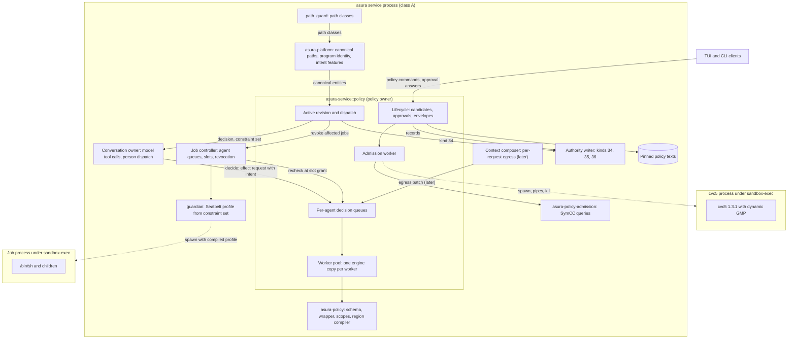

### Worker pool

Selected. Cedar evaluation is CPU-bound and synchronous (spike AE-01), so it
never runs on the reactor.

| Item | Value |
| --- | --- |
| Workers | `clamp(available_parallelism() / 2, 2, 8)`: 8 on the 16-core reference Mac |
| Engine copies | Each worker holds its own deep copy of each active scope set, the schema and the standing entities. No `PolicySet` or `Entities` is shared across workers (spike finding: sharing cost about 2.5 times the single-thread time) |
| Action split | Each scope set is partitioned by action group: `file`, `process`, `network`, `secret`, `mach`, `egress`. A request evaluates only its group's sets (spike: exact, and halves the work). PL1 refines this to one set per action: each policy enters the set of every action its action scope names, with `file.any` and `process.exec.any` expanded; this is exact for the same reason. A lower-scope set that holds only the baseline permit allows without calling Cedar |
| In flight | At most 2 requests per worker; the dispatcher holds the rest |
| Installation of a revision | The owner sends the compiled revision to each worker; each worker builds its own copy and replies `installed(seq)`. A worker keeps the previous revision until its in-flight requests under it finish |

### Asynchronous interface

Selected. The owner is a reactor component with message ports, like the job
controller. No call blocks the reactor.

| Message | From | Reply | Closures |
| --- | --- | --- | --- |
| `decide(ticket, agent, DecisionRequest)` | Conversation owner, person dispatch | `decided(ticket, Decision)` event | Reply; the requester's cancel (turn cancel, drop); shutdown |
| `decide_job(ticket, agent, JobRequest)` | Conversation owner, job controller | `job_decided(ticket, JobDecision)`: decision plus constraint set | Same |
| `recheck(ticket, job, decided_seq)` | Job controller at slot grant | `rechecked(ticket, JobDecision)` | Same |
| `submit_candidate(source, text)` | Control handler (person) | `candidate_result` event after admission | Admission result; person cancel; shutdown |
| `answer_approval(approval_id, answer)` | Control handler (person) | `approval_applied` event | Activation; cancel; shutdown |
| `status()` | Service observer | Snapshot (bounded, in memory) | Immediate |

A `DecisionRequest` is typed Rust, never Cedar JSON from a caller. The owner
builds entities and context from trusted sources ([trust table](#trusted-attribute-sources)).
A decision is a value; it authorizes nothing by itself. The job controller
starts a job only with a `JobDecision` whose revision is still current
([activation and launch](#atomic-activation-and-launch)).

## Schema

Selected. The schema is written over effects (AD-27). The spike corpus wrote
commands as resources; that shape is replaced. The schema is text inside
`asura-policy` (`schema/asura.cedarschema`), identified as `asura-policy/1`
with its SHA-256 digest. Strict validation uses it as a complete schema
(no `external` declarations).

### Schema text

```cedar
namespace Asura {
  // Closed vocabularies
  entity Origin enum ["model", "person_typed", "system"];
  entity Profile enum ["model-1", "person-1", "person-outside-1"];
  entity PathClass enum ["ordinary", "implicit_exec", "build_test", "asura_state"];
  entity Delivery enum ["raw", "brokered"];
  entity Parse enum ["simple", "compound", "unparsed"];
  entity IntentSource enum ["model_tool", "person_command", "mcp_tool", "skill"];
  entity Risk enum ["safe", "moderate", "dangerous", "unknown"];
  entity DataClass enum ["prompt", "history", "notice", "file_page", "tool_result"];

  // Resources
  entity Path in [Path] = { class: PathClass, in_project: Bool, rel: String };
  entity Program = {
    path: Path,
    identity_known: Bool,   // false: a program Seatbelt may start but Asura cannot identify
    platform: Bool,         // Apple platform binary
    team_id: String,        // "" when unknown or platform
    signing_id: String,     // "" when unknown
    cdhash: String,         // "" when unknown
  };
  entity Domain in [Domain];
  entity Address;
  entity Secret;
  entity MachService;
  entity Destination = { remote: Bool };

  // Principals
  entity Project = { root: Path, declared_env: Set<String> };
  entity Task = { project: Project };
  entity Job = {
    origin: Origin,
    profile: Profile,
    project: Project,
    task: Task,
    scratch: Path,
    cache_roots: Set<Path>,
    developer_dir?: Path,   // absent for model-1 (PL1 contract)
  };

  // Intent: what the proposer asked for. Tighten-only (SP-R3).
  type Command = {
    parse: Parse,
    tools: Set<String>,
    first_tool: String,
    subcommand: String,
    flags: Set<String>,
    shell_features: Set<String>,
    bytes: Long,
    secret_vars: Long,
    secret_reference: Bool,
    whole_command: Bool,
  };
  type Intent = { source: IntentSource, name: String, digest: String, command?: Command };

  type FileContext = { now: datetime, intent?: Intent, risk?: Risk };
  type ExecContext = {
    now: datetime,
    request_digest: String,
    env_terminal: Set<String>,
    env_declared: Set<String>,
    outside_switch: Bool,
    intent?: Intent,
    risk?: Risk,
  };
  type ConnectContext = { now: datetime, ip: ipaddr, port: Long, via_proxy: Bool, intent?: Intent, risk?: Risk };
  type SecretContext = { now: datetime, delivery: Delivery, intent?: Intent, risk?: Risk };
  type MachContext = { now: datetime };
  type EgressContext = { now: datetime, data_class: DataClass, tainted: Bool };

  action "file.any";
  action "file.read", "file.write", "file.create", "file.delete" in ["file.any"]
    appliesTo { principal: [Job], resource: [Path], context: FileContext };
  action "process.exec.any";
  action "process.exec", "process.exec.ask", "process.exec.approved" in ["process.exec.any"]
    appliesTo { principal: [Job], resource: [Program], context: ExecContext };
  action "network.connect"
    appliesTo { principal: [Job], resource: [Domain, Address], context: ConnectContext };
  action "secret_use"
    appliesTo { principal: [Job], resource: [Secret], context: SecretContext };
  action "mach.lookup"
    appliesTo { principal: [Job], resource: [MachService], context: MachContext };
  action "context.egress"
    appliesTo { principal: [Task], resource: [Destination], context: EgressContext };
}
```

Rules that the schema cannot state, and that the entity loader enforces:

- A `Job`'s `scratch` path is in no project, and its `task.project` is its
  `project`.
- `Path` parents are the canonical parent directory, so `in` is containment.
  `rel` is the project-relative canonical path when `in_project` is true,
  otherwise `""`.
- `Program.identity_known` is true only when the platform's static code check
  succeeded for the file at its canonical path ([programs](#programs)).
- `Domain` parents are the label suffixes: `api.github.com` is in `github.com`,
  which is in `com`.

Until Asura has a task entity, a `Task` is one conversation's main agent
(agent key: conversation ID, agent 0), for decisions and records only. The
owner decided (AD-28, [OQ1](#open-owner-questions)) that task envelopes wait
for a task design; no envelope binds to this interim `Task`.

### Actions and what they decide

| Action group | Actions | Decided for | Enforced by today |
| --- | --- | --- | --- |
| `file` | `file.read`, `file.write`, `file.create`, `file.delete` | The regions of a job's effect envelope | Seatbelt `file-read*` and `file-write*` rules compiled per job |
| `process` | `process.exec` (run), `process.exec.ask` (Asura may offer an approval), `process.exec.approved` (a generated grant applies) | The job's entry program with its intent; the exec regions of the envelope | The service before spawn (entry program); Seatbelt `process-exec` rules (descendants) |
| `network` | `network.connect` | Regions: none or all today; per connection through a proxy later | Seatbelt network rules on or off |
| `secret` | `secret_use` | Each named secret a job would receive, with its delivery | The service: resolution at submit and the guardian environment |
| `mach` | `mach.lookup` | Mach services a profile would allow; no grant beyond the fixed runtime set in v1 | Seatbelt `mach-lookup` (designed) |
| `egress` | `context.egress` | Each data class of a model request to its destination | The context composer (designed for later, [egress](#egress-by-data-class-ad-25)) |

The approval pattern of research section 3.7 is kept at the effect level. A
hard forbid targets the whole group `process.exec.any`, so no approval lifts
it. A tighten-only forbid targets `process.exec` only. It moves the job to
the approval step when `process.exec.ask` is allowed in every scope.

Command-detected secret variables (SL3, SL7) are not `secret_use`: they are
the command's own bytes moved into the environment. They appear as the intent
fields `secret_vars` and `whole_command`. `secret_use` covers named secrets
only, until brokers exist.

### Trusted attribute sources

Required behavior: every attribute comes from a trusted Asura owner. Intent
and classifier attributes are the only attributes that come from untrusted
proposers or models, and only `forbid` policies may read them.

| Attribute | Trusted source |
| --- | --- |
| Job origin, profile, project, task, scratch, cache roots | Job controller and the grant that created the job |
| `developer_dir` | The validated developer directory of the exec_cmd baseline; absent for `model-1` jobs ([PL1 contract](#pl1-implementation-contract)) |
| Canonical paths, `class`, `in_project`, `rel` | Canonicaliser and the path guard lists ([paths](#paths)) |
| Program identity | Platform static code check ([programs](#programs)) |
| Domain, address, IP, port, `via_proxy` | Network mediator (later) |
| Secret name and delivery | Named secret resolver; brokers (later) |
| `now` | Host wall clock at evaluation, recorded in the decision record |
| `request_digest` | SHA-256 of the canonical decision request, computed by the owner |
| Intent | Proposer text through the intent feature extractor ([intent](#commands-and-other-intent)) |
| `risk` | Classifier adapter only (later) |

### SP-D1: entities, actions and context

Selected design. Boxes are Cedar entity and record types. Lines show an
attribute that references another entity, with its cardinality, and the
hierarchy (`in`). The `Actions` box lists each action with its resource type.

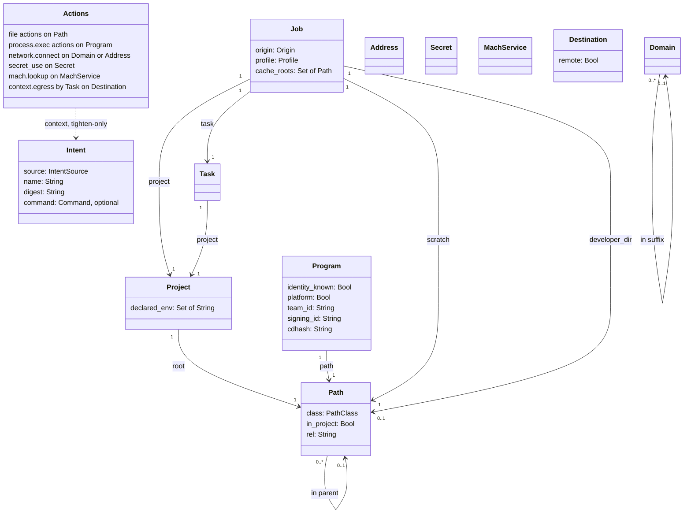

### Versioning

Selected, under the [no backward compatibility rule](../engineering.md#wire-protocol-change-authority).

| Item | Rule |
| --- | --- |
| Schema identifier | `asura-policy/1` and the SHA-256 of the schema text. The identifier stays `1` before release 1.0.0; the text changes in place, and its digest changes |
| Cedar | `cedar-policy =4.14.1` and `cedar-policy-symcc =0.8.1`, pinned exactly; the Cedar language version (`get_lang_version()`) and SDK version are recorded in every revision |
| Intent vocabulary | The `tools` rules and the `shell_features` names are part of the schema text and its digest |
| Change at upgrade | A revision whose recorded schema digest, Cedar versions or solver digest differ from the running build is revalidated and reproved before it decides ([restart](#restart-recovery-and-rollback)) |

### Bundle format

Selected. Asura wraps Cedar text. It adds no second rule language.

A **scope source** is one UTF-8 file of Cedar policies, at most 256 KiB,
written by its author. Each policy carries these annotations:

| Annotation | Rule |
| --- | --- |
| `@id("...")` | Required; `[a-z0-9_.-]{1,64}`; unique in the scope. Asura forms the global ID `<scope>:<id>` |
| `@reason("...")` | Required; a reason code `[a-z0-9_]{1,48}` |
| `@explain("...")` | Optional; at most 200 bytes of person-facing text. A model sees it only for installation and user policies |
| `@intent("true")` | Required on, and only on, a policy that reads `context.intent` |
| `@classifier("true")` | Required on, and only on, a policy that reads `context.risk` |

Asura reserves `@scope`, `@hard`, `@grant`, `@approval` and `@envelope`. They
appear only in installation text and in text that Asura generates. An author's
use of a reserved annotation refuses the candidate.

| Scope | Source | Author | Trust |
| --- | --- | --- | --- |
| Installation | `asura-policy/policies/installation.cedar`, compiled into the `asura` binary | Asura release | Sealed by the code signature; proved in the release gate |
| User | `~/.asura/policy/user.cedar`, created from `asura-policy/policies/user-default.cedar` at first start; plus generated grants | The person; Asura for grants | Admitted by the person |
| Workspace | `~/.asura/policy/workspace/<project-id>.cedar` | The person | Admitted by the person; forbid-only |
| Repository | `<project root>/.asura/policy.cedar`, read through the retained project descriptor | Anyone who can commit | Untrusted until the person admits it; forbid-only |
| Remote host | Reserved for D5 | — | — |

The active text of a scope is its admitted copy in the pinned payload store,
never the file on disk. A later change to a source file has no effect until
the person admits it again. `/status` reports an admitted scope whose source
file changed after admission.

Installation scope has no administrator file. Selected (engineering): the
hard forbids can change only with a new Asura release. The person narrows
through the user scope.

A **revision manifest** is generated by Asura and stored in kind 35. For
each scope set it lists the scope, the project (workspace and repository),
the source identity, the text payload digest, the policy IDs and the
generated grants. It also lists the schema digest, the Cedar language and SDK
versions, the solver digest and the digest of the admission results.

### SP-D2: bundle and revision records

Selected design. Boxes are logical records; lines show references with their
cardinality. Physical storage: the authority journal holds the records, and
the pinned payload store holds the policy texts.

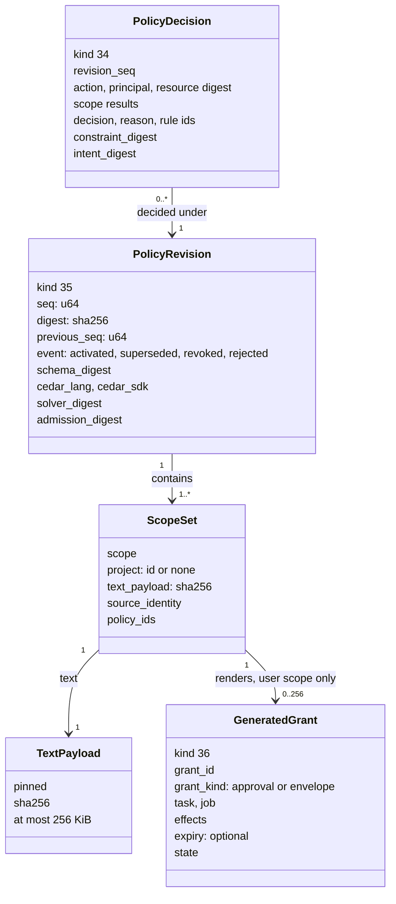

## Deny-on-any-error wrapper

Required behavior (SP-R1). Cedar skips a policy that errors, and a skipped
forbid can turn a deny into an allow (spike FE1 to FE4, confirmed). The
wrapper in `asura-policy` applies these rules to every scope evaluation.

| Rule | Behavior |
| --- | --- |
| W1 Size | Before construction: request at most 16 KiB encoded; strings at most 1,024 bytes; sets at most 64 elements; nesting at most 8; entities per request at most 128; ancestors per path at most 64. A breach denies `request_too_large` |
| W2 Schema | `Context::from_json_value`, `Request::new` and `Entities::from_entities`, each with the schema. A failure denies `request_invalid` |
| W3 Error | Any entry in `Response::diagnostics().errors()` denies `policy_error` with the erroring policy IDs, even when Cedar says Allow |
| W5 Default | No determining policy denies `no_permit` |
| W6 Reasons | Reasons and IDs come from the `@reason` and `@id` annotations of the determining policies |
| A1 Strict validation | At admission, `Validator::validate` in `ValidationMode::Strict`. Any error refuses the candidate |
| A2 Warnings refuse | Any validator warning refuses the candidate (spike SD7: an impossible policy passes validation with a warning) |
| A3 Never errors | At admission, `check_never_errors` on every `forbid` of every scope, in every request environment where it applies. A failure or `unknown` refuses the candidate |
| A4 Runtime stays | A3 assumes a well-formed entity store (spike PES-M15 limit, the FE1 shape). W3 therefore stays on every evaluation; a proof never removes a runtime check |

Cedar evaluation has no step counter. W1 and the [limits](#limits) are its
known-size closures (AE-04).

### SP-F1: one scope evaluation

Selected design. Arrows show the order of checks for one request in one
scope set. Every failure ends in a deny with a reason; no failure path
reaches Allow.

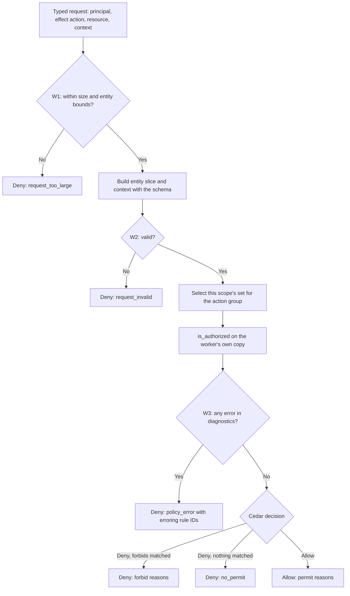

## Canonicalisation

Required behavior: Asura owns canonical forms before evaluation. A proof
covers policy text only; the canonicaliser, the identity check, the intent
extractor and the entity loader are trusted code with their own tests
([proofs cover policy text only](assurance-and-differentiation.md#proofs-cover-policy-text-only)).

### Paths

Selected. Path entities are built only from canonical forms.

| Case | Rule |
| --- | --- |
| Resolution | Walk from a retained directory descriptor (project root, scratch, Asura tmp owner), one component at a time, with `O_NOFOLLOW`, as `project_identity` does. The canonical string is built from the walked components |
| `..`, `.`, empty components, `//`, trailing `/` | Refused in every input path (`path_not_canonical`). A request never resolves `..` lexically |
| Symlink component | Refused (`path_symlink`). A symlink is never followed into a decision |
| Firmlinks and mount spellings | Compared by device and inode with the retained descriptors, as [state isolation](asura-state-isolation.md) does. The canonical spelling is the one of the retained root plus walked names |
| Case and Unicode | A component is kept as stored on disk (read back through the descriptor), so two spellings of one file on a case-insensitive volume give one entity ID. Probe SP-P1 must confirm the spelling source |
| Hard links | A file with `st_nlink > 1` has no single canonical parent. A service-mediated write to such a file is refused (`path_hard_link`); for job regions, Seatbelt decides by the path used, which is a stated residual ([threat PL-T3](execution-threat-model.md#policy-layer)) |
| `/private` aliases | `/tmp`, `/var` and `/etc` are spelled `/private/...` after the walk |
| Class | `asura_state` when the path is inside `~/.asura` by identity; else `implicit_exec` or `build_test` from the path guard lists; else `ordinary`. The first match in this order wins |
| Literals in policy text | Every `Path::"..."` literal must be canonical. Admission opens each literal that exists and refuses a literal whose canonical spelling differs, with the spelling to use. A literal that does not exist must be lexically canonical |
| Repository and workspace literals | Lower-scope policies name project paths by `resource.rel` (`rel == "vendor"`, `rel like "vendor/*"`), because the absolute root differs on each Mac |

A check on a path string followed by an open of the same string is a race.
For job regions, Seatbelt is the authority at each effect; the policy
decision is compiled into its rules ([backends](#compiling-decisions-to-backends)).

### SP-F2: path canonicalisation

Selected design. Arrows show the order of checks for one input path; every
refusal names its reason.

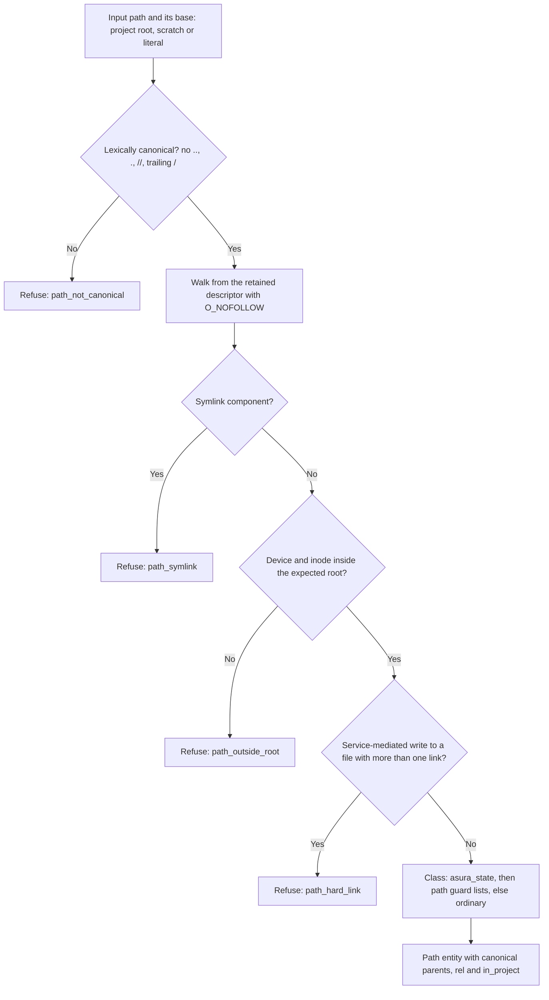

### Programs

Selected. A `Program` entity names a file by canonical path and, when the
platform can check it, by code-signing identity.

- The platform reads the identity with the Security framework static code
  check on a platform worker thread (blocking file I/O, AE-02): team ID,
  signing identifier, cdhash and the platform-binary flag. Results are cached
  by device, inode, size and modification time, at most 1,024 entries.
- A failed or unsigned check gives `identity_known = false` and empty
  identity strings. It never fails the decision by itself; a policy decides
  what an unidentified program may do.
- The entry program of every job today is `/bin/sh`. Its identity is checked
  once per service start and when its fingerprint changes.
- Seatbelt cannot check a code signature at exec. For exec regions, the
  compiler therefore asks about a program with `identity_known = false` in
  that region. A policy that permits exec only by identity cannot open a
  region to a Seatbelt job; it applies to the entry program, which the
  service checks before spawn, and to live enforcement later.

### Hosts and IPs

Selected, for the network mediator when it exists.

| Item | Rule |
| --- | --- |
| Host name | Lower case; trailing dot removed; IDNA to A-labels; each label 1–63 bytes `[a-z0-9-]`, not starting or ending with `-`; total at most 253 bytes. Invalid names refuse (`host_invalid`) |
| Domain hierarchy | Parents are the label suffixes, so `resource in Asura::Domain::"github.com"` covers subdomains |
| IP | Parsed by the Rust standard library; IPv4-mapped IPv6 becomes IPv4; zone identifiers refuse. The connected IP after resolution goes into `context.ip`; the mediator connects to the IP it checked (DNS rebinding) |
| Port | 1–65535 |
| Without a mediator | Only "all network" or "no network" exists. Model jobs get no network (EX2); person jobs get all network (AD-7) |

### Secrets

Selected. `Secret::"<NAME>"` uses the [naming rules](named-secrets.md#naming-rules)
unchanged: 1–48 bytes `[A-Za-z_][A-Za-z0-9_]*`, not `COMMAND`, case
sensitive. The existing resolver finds the references in a person command at
submit; each reference becomes one `secret_use` request with delivery `raw`.
A model job never receives a named value (NS-R6); the installation hard
forbid states it, and the guardian still passes no named value to a model job.

### Commands and other intent

Required behavior (AD-27): intent never grants. Selected mechanism: the
intent feature extractor extends the existing tokenizer
`asura-platform::exec_cmd::split`, which already serves command display and
the secret rewrite. No second tokenizer exists.

| Feature | Rule |
| --- | --- |
| `parse` | `simple`: one segment of words. `compound`: segments joined by `;`, `&&`, `\|\|` or `\|`, each parsed. `unparsed`: tokenizer failure, an unclosed quote, a heredoc, `$(` or a backtick in a command word, more than 64 segments, or nesting deeper than 8 |
| `tools` | The basename of the command word of every segment, after leading assignments; for `env`, `command`, `exec`, `nohup`, `time`, `xargs` and `sudo`, the next command word too |
| `first_tool`, `subcommand`, `flags` | From the first segment only; `subcommand` is the first word after the tool that does not start with `-`; flags are words starting with `-`, split at `=` |
| `shell_features` | Closed set: `pipe`, `list`, `background`, `redirect_out`, `redirect_in`, `heredoc`, `command_substitution`, `process_substitution`, `subshell`, `eval`, `source`, `nested_shell`, `pipe_to_interpreter`, `assignment`, `glob`, `tilde`, `parameter_expansion` |
| `secret_vars`, `secret_reference`, `whole_command` | From the existing secret rewrite plan |
| No positional argv | No feature exposes word positions beyond `first_tool` and `subcommand` |

MCP tools and skills have no runner in Asura today. Their intent is reserved:
`source = mcp_tool` or `skill`, `name` the tool or skill name, `digest` the
SHA-256 of the canonical arguments. A later design that adds them uses the
same tighten-only rule.

The parser view and the shell's view can differ. That is safe under AD-27,
because the shell's effects are decided by the effect envelope, not by the
parse. A parse error makes `parse = unparsed`, which an intent forbid may
send to the approval step; it can never widen.

## Scope composition (pattern A)

Required behavior (AD-14). Selected mechanism below.

| Step | Rule |
| --- | --- |
| Applicable scopes | Installation and user always. Workspace and repository when an admitted set exists for the request's project. Remote host later |
| Order | Installation, user, workspace, repository, remote host. The order fixes the explanation; it never changes the result |
| Evaluation | Every applicable scope is evaluated, with no short cut, so the record holds each scope's result |
| Result | Allow only when every applicable scope allows with no error |
| Installation set | Ceiling permits for each action group, hard forbids (`@hard`) and tighten-only forbids |
| User set | The profile regions (`user-default.cedar`), the person's own permits and forbids, and the generated grants of approvals and task envelopes (AD-24: the person who approves is the user-scope authority) |
| Workspace and repository sets | Forbid-only. Admission refuses a `permit` in them, and Asura adds one baseline policy `@id("baseline") permit (principal, action, resource);`, so an absent rule means "no narrowing" |
| Unavailable scope | A scope whose admitted set cannot load, or that waits for a re-proof, denies with `scope_unavailable` or waits with `scope_reproving` ([restart](#restart-recovery-and-rollback)) |

Under the AND, a lower scope can only remove permissions. The forbid-only
rule keeps lower-scope files simple and makes their meaning "what this scope
forbids". A safety property proved on the installation set alone holds for
the composed decision, because the composed allow set is inside every
scope's allow set.

### Reason codes and explanation

Selected. Every decision carries the scope results in order and a primary
reason: the first denying scope's first reason, ordered by rule ID.

| Reason | Meaning | Text to the model |
| --- | --- | --- |
| Forbid `@reason` | A forbid matched | `denied: policy: <scope>: <reason>: <explanation>; do not retry` |
| `no_permit` | No permit matched in that scope | `denied: policy: <scope>: no_permit: nothing in the <scope> policy allows this` |
| `policy_error` | An evaluation error | `denied: policy: <scope>: policy_error: a policy could not be evaluated` |
| `request_invalid`, `request_too_large` | The request did not fit the schema or bounds | `denied: policy: request_invalid` |
| `scope_unavailable` | The scope's admitted set is not available | `denied: policy: <scope>: scope_unavailable: the <scope> policy needs repair` |
| `cannot_enforce` | No backend can enforce the decision | `denied: policy: cannot_enforce: Asura cannot enforce this limit here` |

`<explanation>` is the policy's `@explain` text for installation and user
policies, or the fixed text of the reason code. For workspace and repository
policies the model sees `a <scope> policy forbids this (rule <id>)`, because
their text may be written by someone else and could carry instructions. Rule
IDs are limited to `[a-z0-9_.-]`. No model text and no path is repeated
(TCR-D12). The person sees all denying scopes, their rule IDs and `@explain`
texts in the job view and `/policy explain`.

### SP-F3: composed decision

Selected design. Arrows show evaluation and combination for one request;
labels name the outcome of each scope. All applicable scopes are evaluated.

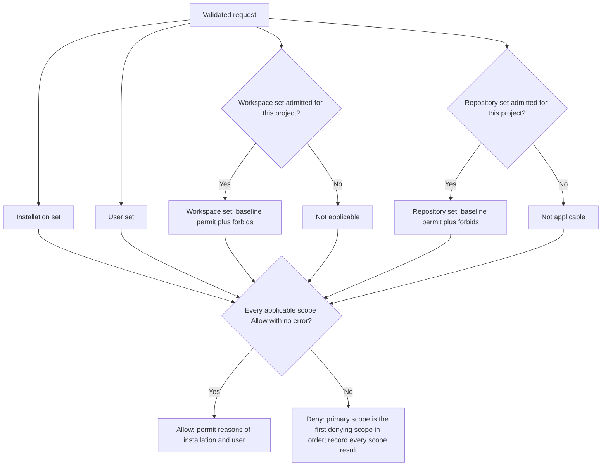

## Admission and lifecycle

Required behavior: the brief's [policy lifecycle](security-policy-brief.md#policy-lifecycle-and-active-work).
Selected mechanism below.

### Who may change policy

| Change | Requester | Path |
| --- | --- | --- |
| User, workspace text | The person, through an authenticated control attachment | `PolicyCandidateSubmit` with the scope and text, or `asura policy admit --scope user FILE` |
| Repository text | The person, after reading it | `PolicyCandidateSubmit` with scope `repository`; the service reads the file through the retained project descriptor |
| Approval and envelope grants | The person's answer to an approval or envelope request | `PolicyApprovalAnswer` |
| Revocation of a grant | The person, the end of a task, or a narrowing revision | `PolicyGrantRevoke`, task end, activation |
| Rollback | The person | `PolicyRollback` with a scope and an earlier revision number |
| Installation | A new Asura release | Not a runtime change |

A model never submits a candidate (SP-R11). A model may later draft text for
the person (DF6); a draft is not a candidate until the person submits it.

### Admission steps

Selected. The admission worker runs these steps in order for one candidate.
Any failure refuses the candidate, and the active revision stays unchanged.

| Step | Check | Refusal reason |
| --- | --- | --- |
| 1 Bounds | Text at most 256 KiB; at most 512 policies per scope; total at most 2,048 in the revision; generated grants at most 256 | `candidate_too_large` |
| 2 Parse | `PolicySet::from_str`; annotations present and well formed; no reserved annotation from an author | `candidate_parse` |
| 3 Strict validation | A1 and A2: no error, no warning | `candidate_invalid` |
| 4 Lints | Workspace and repository: no `permit`. Tighten-only: a policy reading `context.intent` or `context.risk` must be a `forbid` with the matching annotation. Literals: canonical ([paths](#paths)). Compilable shapes ([backends](#compiling-decisions-to-backends)) | `candidate_lint` |
| 5 Proofs | The queries in the [proof table](#admission-proofs), with the solver | `proof_failed` with a counterexample, `solver_failed`, `solver_unknown` |
| 6 Compile | Region compilation for each profile and project the revision affects; the soundness proof SP-AQ7 | `cannot_enforce` |
| 7 Change difference | `check_implies(P_new, P_old)` per changed scope. A widening change returns up to 8 counterexamples for the person; it does not refuse by itself | — |
| 8 Ready | Persist the text payload (pinned) and the admission result | `storage_unavailable` |

A candidate that only removes generated grants (a revocation or a task end)
skips step 5: removing a permit from the user set can only narrow, and the
remaining forbids were proved before. CL-1 still holds: the user set without
the grant has the same forbids and fewer permits. This fast path keeps
revocation independent of the solver.

### Admission proofs

Selected. Each query runs once for each request environment that
`Schema::request_envs` lists, with no time limit; its closures are the
solver's reply and cancel. `P_s` is the set of scope `s`. `I0` is the
installation set without its tighten-only forbids. `U0` is the user set
without its generated grants.

| ID | Query | Pass condition | Evidence |
| --- | --- | --- | --- |
| SP-AQ1 | `check_never_errors` on each `forbid` of each scope | Proven in every applicable environment | Spike PES-M15 |
| SP-AQ2 | Tighten-only lint: intent and risk read only by annotated `forbid` policies, in every scope | No violation | Spike PES-M16 lint |
| SP-AQ3 | CL-1 and the intent rule: `check_implies(I, I0)`; for each scope with tighten-only forbids, the same against that scope without them | Holds for every environment | Spike AQ3 |
| SP-AQ4 | Safety specifications `check_implies(I, S_k)` | Holds for each `S_k` in the [safety list](#safety-specifications) | Spike AQ6 |
| SP-AQ5 | Lower-scope shape: workspace and repository sets hold only the baseline permit and forbids | Lint and parse; a proof is not needed under pattern A | Spike AQ8 seeded permit |
| SP-AQ6 | Task envelope containment `check_implies(U0 + E, U0 + S_E)` for each envelope `E` | Holds | Spike AQ5, PES-M18 |
| SP-AQ7 | Soundness of each compiled constraint set: `check_implies(S_C, P_s)` for each applicable scope `s`, where `S_C` permits exactly the regions the constraint set allows | Holds | Research 5.2 |
| SP-AQ8 | Change difference `check_implies(P_new, P_old)` per changed scope | Reported to the person | Spike AQ7 |

#### Safety specifications

Selected. Each `S_k` permits everything except one property. They are proved
on the installation set, so no lower scope and no grant can break them.

| ID | Property |
| --- | --- |
| S1 | No model-origin job writes, creates or deletes an `implicit_exec` path (EPG-R1) |
| S2 | No job writes, creates or deletes an `asura_state` path outside its scratch (EX16) |
| S3 | No model-origin job connects except through the mediator (`via_proxy`) (EX2) |
| S4 | No model-origin job uses a named secret, raw or brokered, until a broker design admits brokered use (NS-R6) |
| S5 | No `context.egress` of tainted data (T1) |
| S6 | No `process.exec.approved` without a generated `@approval` grant: the installation set permits `process.exec.approved` only for policies the user set generates (checked on the composed user set) |

S4 changes when the broker design lands and AD-4 is decided; that change is a
new release with its own proof.

### SP-S1: revision lifecycle

Selected design, refining the brief's lifecycle view. States belong to one
candidate revision. Arrows name the event; guards are in brackets.

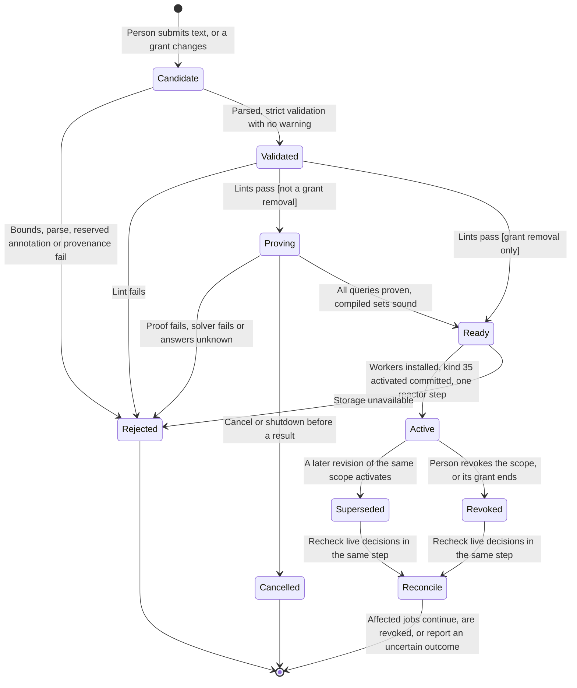

A cancelled candidate is not admitted; the active revision is unchanged. After a
restart, a candidate in `Proving` is resubmitted only if it came from a
recorded approval or envelope answer; a text submission must be submitted
again by the person.

### Atomic activation and launch

Required behavior (SP-R7): a policy change must not let work start under a
grant that is no longer valid. Selected mechanism: the reactor serializes
activation and the job controller's slot grant, and the owner revokes
affected work in the activation step.

1. The owner sends the ready revision `N+1` to every worker. Each worker
   builds its own copy and replies `installed(N+1)`.
2. When all workers have replied, the owner appends kind 35 `activated(N+1)`.
3. On the commit, in one reactor step, the owner:
   - makes `N+1` the dispatch revision; new requests use it;
   - skips the next actions when step 7 proved `N+1` only widens every
     changed scope (`check_implies(P_old, P_new)` holds), because no earlier
     decision can become invalid;
   - otherwise marks every queued job start decided under `N` or earlier as
     `recheck`, cancels every `Starting` job decided under an older revision
     (kind 28 `not_started`, reason `policy_changed`), and sends every live
     job's recorded decision request to the workers for re-evaluation.
4. A re-evaluation that denies revokes the job through the controller's
   existing revocation path (reason `policy_revoked`): `T` on the lease, kind
   27, kind 28.
5. At slot grant, the controller starts a queued job only if its decision
   revision equals the dispatch revision; otherwise it sends `recheck` and the
   entry waits with the reason `waiting: re-checking policy`.

The bound on revocation propagation: queued and starting work is stopped in
the activation step; running jobs receive `T` when their re-evaluation
returns, after at most 64 re-evaluations on the workers. Effects that a
running job caused before `T` may have occurred; its settlement reports them
under the job controller's rules. A running job whose re-evaluation allows
it continues under the new revision. A Seatbelt profile cannot change
during a job, so no job is widened mid-run.

### SP-Q1: admission and activation

Selected design. Solid arrows are messages or calls; dashed arrows are
replies or events. The solver steps run only for candidates that need proofs.

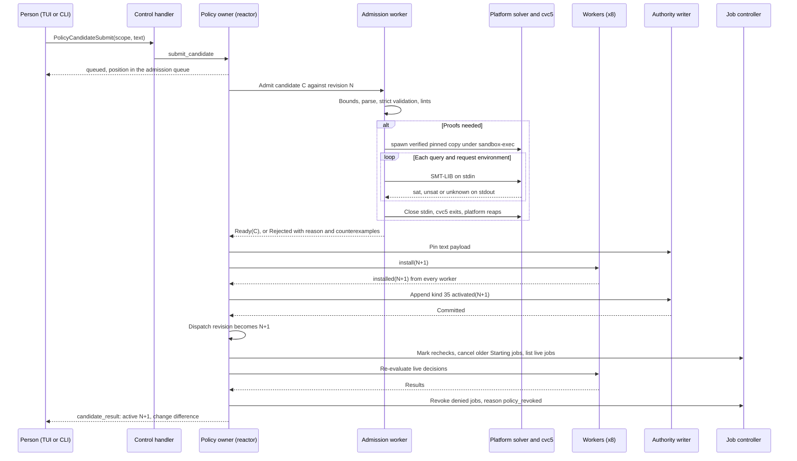

### Decision records

Selected. Journal kind 34 `PolicyDecision`, format 1, a new kind (schema
change in place). One record per decision that admits or refuses work:

| Field | Content |
| --- | --- |
| Subject | Operation and tool ordinal (model call), input ID (person command) or job ID (recheck) |
| Action and principal | Effect action; job origin, profile, project, task |
| Resource digest | SHA-256 of the canonical resource and its attributes; no path text |
| Intent digest | SHA-256 of the intent record; no command text |
| Revision | Sequence number and digest |
| Scope results | For each applicable scope: decision, up to 8 rule IDs, error class |
| Decision | `run`, `ask` or `deny`, with the primary reason and scope |
| Constraint digest | SHA-256 of the compiled constraint set, for job decisions |
| `now` | The evaluation time used in the context |

Size: at most 4 KiB. Order: kind 34 is appended immediately before the
kind 14 of the same model call; for a person command, before its kind 26.
The writer has no batch append, so the two are consecutive appends of the
conversation owner; the [PL1 contract](#kinds-34-and-35-in-pl1) gives the
replay rules R1 to R7. Replay rejects a kind 34 that names a revision with no
earlier kind 35 `activated` (`Corrupt`).

Kind 35 `PolicyRevision` records `activated`, `superseded`, `revoked` and
`rejected` events with the manifest (at most 8 KiB). Kind 36 `PolicyGrant`
records approval and envelope requests, answers and ends (at most 8 KiB). No
record holds a secret value, a command line or a path string; display text
lives in the pinned payload store with the policy text.

### Restart recovery and rollback

Selected.

1. Replay builds, for each scope, the last `activated` revision that no
   later record supersedes or revokes, and the open kind 36 grants.
2. The owner loads each scope text from the pinned payload store and checks
   its digest. A missing or mismatched payload makes that scope
   `scope_unavailable`; its requests deny with a repair reason.
3. The owner strict-validates each text against the running schema. A
   failure makes the scope unavailable.
4. When the recorded schema digest, Cedar versions or solver digest differ
   from the running build, the scope is `reproving`. Requests that need it
   wait in their agent's queue with `waiting: re-checking policy after an
   update`. The admission worker reproves it; success activates it as a new
   revision, failure makes it unavailable. No time bound ends the wait.
5. The installation set is proved in the release gate. The binary carries
   its admission result digest; startup compares digests and needs no solver.
6. Queued model jobs settle `interrupted` under the existing J2 rule, and
   their open approval requests end with kind 36 `cancelled: restart`.
   Recorded envelope answers resume in `Proving`.

Rollback is a new candidate built from an earlier admitted text. It passes
all admission steps and activates as a new revision number. Asura never
rewinds the journal, so every earlier decision keeps its revision. If no
valid user revision exists at first start, the owner admits
`user-default.cedar` without proofs that need the solver only when the
release gate proved that exact text; otherwise effects deny with
`scope_unavailable`.

### SP-F4: restart of one scope

Selected design. Arrows show the checks for one scope at service start.

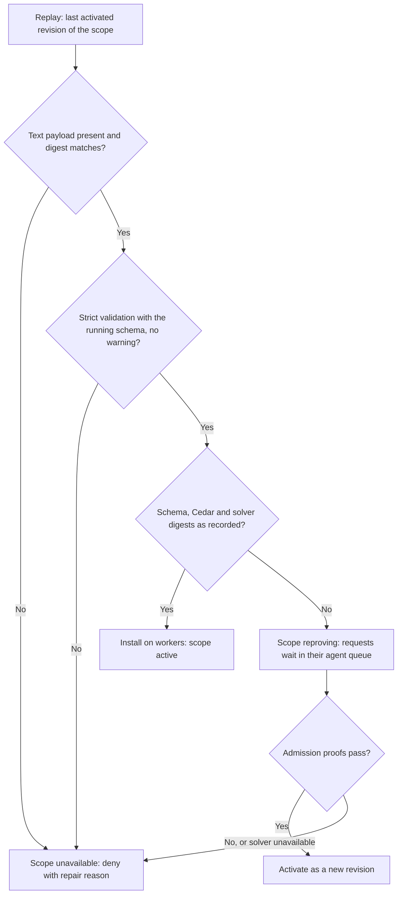

### Solver process lifecycle

Selected. The platform owns the process; the admission worker owns its use.
The package and build are in [the solver package](#solver-package-ad-17).

| Item | Rule |
| --- | --- |
| Start | One process per admission run, started by `asura-platform::solver` on the admission worker thread. The platform copies `cvc5` and its GMP libraries from the bundle into `~/.asura/run/solver-<random>/`, checks each SHA-256 against the digests compiled into `asura`, and spawns `/usr/bin/sandbox-exec -p PROFILE <copy>/MacOS/cvc5 --lang smt` with three pipes |
| Arguments | `--lang smt` only. No `--tlimit` and no `--rlimit`. SymCC's `LocalSolver::cvc5()` adds `--tlimit=60000`, a 60-second default time limit, so Asura does not use it: `asura-policy-admission` implements the SymCC `Solver` trait over the pipes the platform hands it |
| Sandbox | A deny-default profile: read the copy directory, `/usr/lib`, `/System` and the fixed runtime set; no write; no network; no Mach lookup beyond the runtime set; exec of the copy only. Probe SV-P2 must show that cvc5 runs under it |
| Input | SMT-LIB that SymCC generates from admitted text only; at most 64 MiB written per query |
| Output | One line per answer; a model at most 1 MiB; standard error kept up to 64 KiB for diagnostics, never shown to a model |
| End | Normal: the admission worker closes standard input; cvc5 exits on end of input; the platform reaps it. Cancel, shutdown or a protocol fault: the platform sends `SIGKILL` at once and reaps. No grace time and no time limit exist |
| Failure | Exit, a parse error reply, an unrecognised line or `unknown` refuses the candidate with `solver_failed` or `solver_unknown`. Nothing is retried automatically; the person may submit again |
| Concurrency | One solver process at a time. Candidates wait in a FIFO of at most 16 with the reason `waiting: proving a policy change (N ahead)` |
| Memory | No bound is selected. macOS does not enforce `RLIMIT_AS` for this use (unverified; probe SV-P6). The candidate bounds of step 1 limit the query size |

### SP-S2: solver process

Selected design. States belong to one solver process. Arrows name the event.

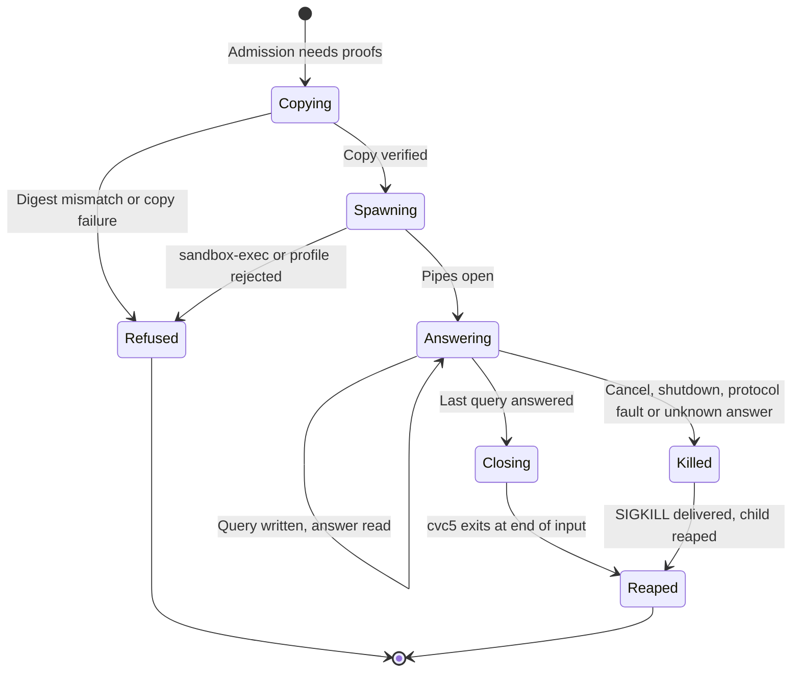

## Task envelopes (AD-24)

Required behavior: [DF1-S1](assurance-and-differentiation.md#df1-s1-envelope-lifecycle)
and the brief's [envelope rules](security-policy-brief.md#owner-revision-of-2026-11-02-task-envelopes).
Selected mechanism below. Under AD-27 an envelope is an **effect set**.
Packet PL8 is blocked until a new task design defines the task entity
(AD-28, [OQ1](#open-owner-questions)). The task field, the end causes and
SP-S3 below are proposed until that design; they bind to its task entity.

### Grant shape

| Field | Rule |
| --- | --- |
| Envelope ID | 16 random bytes, hex |
| Task | The task (today: one conversation's main agent) |
| Write roots | 0–16 canonical directories. Each must exist, must not be in `~/.asura` and must not be a path guard implicit path. Effects: `file.write`, `file.create`, `file.delete` under each root |
| Read roots | 0–16 canonical directories; effect `file.read` |
| Hosts | 0–32 entries of host or IP range with a port (`network.connect`); designed for the proxy; refused by compilation until a mediator exists (`cannot_enforce`) |
| Secret bindings | 0–16 named secrets with delivery `brokered`; refused until a broker exists |
| Budget | A reference to an aggregate budget reservation ([ADR-0003](../decisions/0003-aggregate-budget-admission.md)); recorded, enforced by the budget owner when it exists |
| Expiry | Optional, set by the person. There is no default expiry (SP-R8) |

Asura renders each field into generated user-scope permits from fixed
templates. No free text from a model or a person enters the policy text; the
values are canonical paths, names and numbers. Example for one write root:

```cedar
@id("env.3f9c.write.0") @reason("envelope_write") @envelope("3f9c...")
permit (principal is Asura::Job, action in Asura::Action::"file.any", resource is Asura::Path)
when { principal.task == Asura::Task::"c-7a1e:0" &&
       action != Asura::Action::"file.read" &&
       resource in Asura::Path::"/Users/person/src/shared/out" };
```

An expiry adds `&& context.now < datetime("...")`. An envelope never lifts a
hard forbid: the installation set keeps its forbids, and the AND applies.

### Approval text

Selected fixed text. The service fills the bracketed values; the client
renders it. Paths are display-redacted.

```text
Allow this task to do these things without asking:
  write files in: [root 1], [root 2]
  read files in:  [root]
  connect to:     [host:port]            (not available yet)
  use secrets:    [NAME] (brokered)       (not available yet)
Until: the task ends[, or EXPIRY].
Asura proved that this envelope allows nothing outside these limits.
Asura's own limits still apply: no writes to Git hooks or other
implicit-execution files, no writes to Asura's files, no model network
except through Asura.
New effects this allows: [up to 8 examples from the change difference]
[Approve]  [Decline]
```

A model may propose an envelope only through a later tool; the person's
`/envelope` command is the first source. The proposal is a draft; the
person's answer on a control attachment is the only approval.

### Proof, activation and end

1. Draft: the person's command or a later model proposal creates a kind 36
   `envelope_drafted` record with the typed fields.
2. Approve: the person's answer appends kind 36 `envelope_approved` (the
   "authorized policy change" of AD-24).
3. Prove: the user-scope candidate `U0 + E` passes admission, including
   SP-AQ6 containment and SP-AQ7 compilation of the task's profiles.
4. Activate: kind 35 `activated`. Later jobs of the task get the envelope's
   regions in their constraint sets. Running jobs keep their profiles; a
   Seatbelt profile cannot widen mid-run.
5. End: the task ends, the expiry passes (the owner removes the grant at the
   first decision after it, and the `context.now` condition already denies),
   the person revokes, or a narrowing revision removes it. The grant-removal
   fast path activates the new user revision without the solver; kind 36
   `envelope_ended` records the cause. Jobs whose recorded decisions relied on
   the envelope are re-evaluated and revoked ([activation](#atomic-activation-and-launch)).

### SP-S3: one task envelope

Selected design, refining DF1-S1 with the mechanism. Arrows name the event.

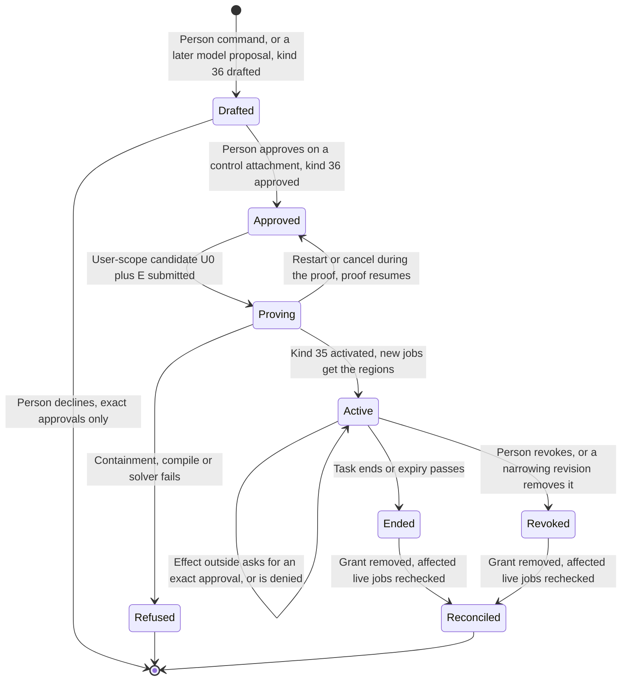

## Intent and classifier context (AD-15, AD-16, AD-27)

### Tighten-only rule

Required behavior: intent (AD-27) and classifier labels (CL-1) may only
tighten. Selected mechanism: SP-AQ2 (lint) and SP-AQ3 (proof). Together they
show that every request the composed policy allows is also allowed when every
tighten-only forbid is removed, for every value of `intent` and `risk`,
including absent.

Region requests carry no intent and no risk. The entry request of a job
carries both when they exist. A tighten-only forbid can therefore never
change a job's constraint set; it can only move the entry decision from run
to ask, or from ask to deny.

### Run, ask or deny

Selected. For each job start the owner evaluates, all scopes each time:

1. `process.exec` of the entry program with intent and risk. Allow, and the
   effect envelope covers the profile's base needs: **run**.
2. Otherwise, if the denial came only from tighten-only forbids,
   `process.exec.ask` with the same request. Allow in every scope: **ask**.
3. Otherwise: **deny** with the primary reason.

Model jobs had no approval step before AD-15. Packet PL7 adds it; until then
an `ask` outcome is impossible, because the shipped installation set has no
tighten-only forbid (PL1 has none, by design). The default intent rules that
ask for approval are the owner's list below (AD-29).

### Default intent rules (AD-29)

Required behavior (owner, 2026-11-03, [OQ2](#open-owner-questions)). Packet
PL7 ships one tighten-only `forbid` on `process.exec` for model-origin jobs
per group below, so each matching model command asks the person first. PL1
ships none of them.

| Group | Intent that asks first |
| --- | --- |
| Git push | `git push`, including its force flags |
| Publish | `cargo publish`, `npm publish`, `gem push`, `twine upload`, `swift package-registry publish` and similar publish commands |
| Privilege | `sudo`, `su`, `doas`, `osascript` with administrator privileges, and `launchctl` changes |
| Hard-to-undo Git | `git reset --hard`, `git clean -fdx` and similar Git commands that discard work |
| Unparsed text | Every command whose `parse` is `unparsed` |

The rules read the intent features of the [intent extractor](#commands-and-other-intent)
(PL2): `tools`, `first_tool`, `subcommand` and `flags`. PL7 fixes the
complete tool, subcommand and flag lists of each group ("and similar") in its
rule text and tests. Those lists are an engineering choice inside the owner's
groups. The person may narrow or remove the rules in the user scope after PL3
admission.

### The approval step and the per-agent queue

Selected. An `ask` outcome admits the job into its agent's job queue with a
new start condition, ahead of the existing ones: `approval`, with the brief
reason `waiting: approval needed: <reason text>`. The model call returns the
job handle with state `queued` and that reason (J3 yield window rules).

- The service appends kind 36 `approval_requested` with the request digest,
  the constraint digest, the intent digest and the reasons.
- The person answers in the TUI (job view or `/approve` and `/deny`) or
  `asura approvals`. An answer from any channel other than an authenticated
  control attachment is impossible: the model channel has no such message.
- Approve: kind 36 `approval_granted`; a generated permit on
  `process.exec.approved`, bound to the job, the request digest (which covers
  the constraint digest) and an optional person-set expiry, enters the user
  scope by the admission path; then the owner evaluates
  `process.exec.approved`. Allow: the start condition holds and the job
  starts with exactly the decided constraint set. Hard forbids still apply,
  because they target `process.exec.any`.
- Deny: kind 36 `approval_denied`; the job settles `not_started`, reason
  `approval_denied`; the model gets the reason text.
- No answer: the job waits with no time limit (AD-15). Closures: the
  person's answer, the person's or model's cancel, revocation, shutdown, and
  restart (the queued model job settles `interrupted` under J2; kind 36
  `cancelled: restart`).

Approval text, fixed:

```text
The model wants to run a command that needs your approval.
  Command:  [display-redacted command, at most 512 bytes]
  Why:      [reason text of each tighten-only forbid]
  Project:  [name]   Conversation: [title]
If you approve, Asura runs this command once, in the model sandbox, with
the limits shown in the job view. Your approval cannot override Asura's own
limits.
[Approve once]  [Deny]   (Esc leaves it waiting)
```

### SP-F5: one model job start

Selected design. Arrows show the order of decisions; labels name the outcome.
The wait loop ends only on the listed closures.

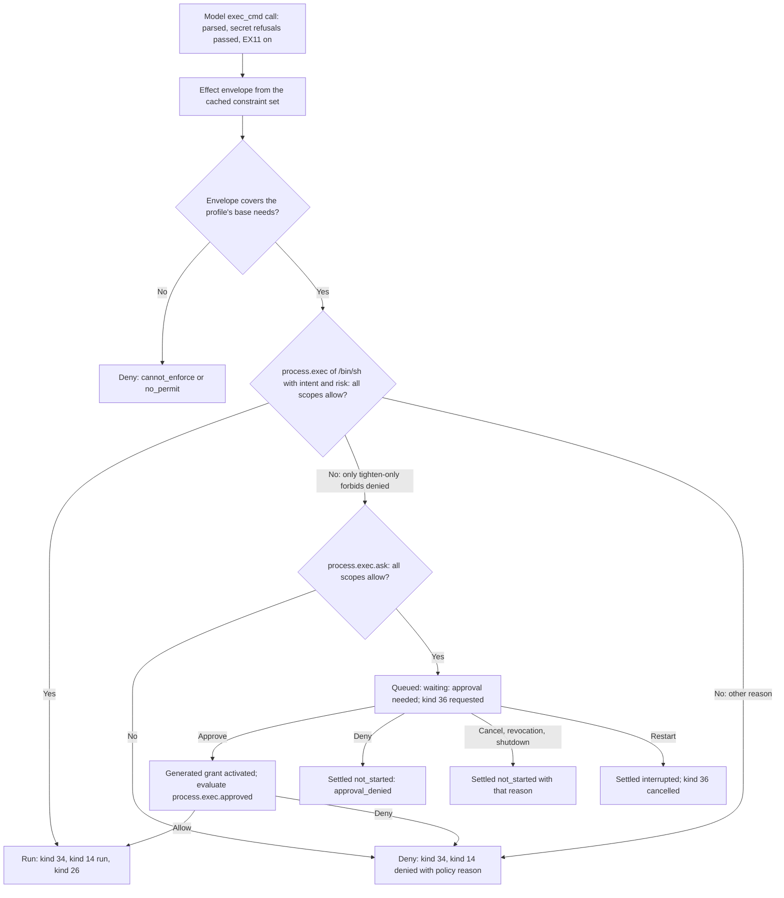

### Classifier context

Proposed for the classifier design (DF4); the contract is selected here.

- The classifier adapter is the only writer of `context.risk`. It sets
  `unknown` when the helper is unavailable, the label is invalid or the
  confidence is below the calibrated threshold (AD-16).
- The classifier forbids (`@classifier`) are part of the installation set
  only while the DF4 capability is enabled under its evidence gate. With the
  capability disabled, `risk` is absent and no classifier forbid exists.
- `!` and `!!` jobs have origin `person_typed`; every classifier forbid must
  include `principal.origin == Asura::Origin::"model"` as a top-level
  condition (lint; PCR22).
- The decision record holds the classifier task, version, label, confidence,
  threshold and the `unknown` cause.

### Watching effects

Proposed (AD-27 item 3); needs research ER-1 to ER-3. The classifier also
watches what a job does, not only what it asked for.

| Source | Status |
| --- | --- |
| Seatbelt violation reports: the kernel reports each denied operation with process, operation and path to the unified log | Today's source. How the service reads them for its own jobs (a `log stream` child, `OSLogStore`, or another interface), their latency, loss and attribution to a job are unknown (ER-1, ER-2) |
| Endpoint Security notify events | Later ([live enforcement](#live-enforcement-later-proposed)) |

A watcher may tighten mid-run, never widen:

- **Revoke**: the job controller revokes the job (reason `classifier_revoked`).
- **Pause and ask**: the guardian stops the job's process group with
  `SIGSTOP`, as the freeze step of [escapee control](escapee-control.md)
  does; the job shows `paused: approval needed: <reason>`. Approve resumes it
  with `SIGCONT`; deny or cancel kills it. The pause has no time limit.

Neither action changes the profile; nothing can widen a running job.

## Compiling decisions to backends

### Soundness rule

Required behavior (SP-R5): for every effect a backend cannot mediate at run
time, `Enforced(B, J) ⊆ Permitted(J)`. Where the backend is coarser than the
policy, the compiler chooses the widest configuration that is still inside
`Permitted(J)`. If that leaves the job's base needs uncovered, the start is
denied (`cannot_enforce`); the compiler never chooses a wider configuration.

### Enforcement classes

| Class | Effects | Enforcer today |
| --- | --- | --- |
| Service, before start | The entry program, its environment names, the outside switch, named secret delivery | The service: it starts the job or not |
| Static backend | File regions, exec regions, network on or off, Mach lookups | Seatbelt per-job profile, kernel-enforced |
| Runtime mediation | Per-host network, context egress | Proxy (later); context composer (later) |
| Live per-effect | Every exec, open, rename, unlink; every flow | Endpoint Security and Network Extension (proposed) |

### Effect envelope of a job

Selected. The compiler in `asura-policy` turns the policy into a constraint
set for one principal shape: (revision, profile, project, task envelopes).

1. **Candidates.** The profile template lists candidate regions (table
   below). The compiler adds exception candidates: one representative path for
   each path guard pattern and for `asura_state` inside each region, and every
   path literal or `rel` pattern in the active revision that falls inside a
   region.
2. **Evaluation.** Each candidate becomes a region request with no intent and
   no risk, evaluated in all scopes on the workers. A program candidate has
   `identity_known = false`.
3. **Rules.** An allowed region root becomes an allow rule (`subpath` or
   `literal`). A denied exception inside an allowed region becomes a deny rule
   after the allow, using the path guard's escaped `regex` for patterns. A
   network candidate gives `none` or `all`.
4. **Shapes.** Only these policy shapes compile: `resource in Path::"X"`,
   `resource == Path::"X"`, `resource.class == ...`, `resource.rel == "X"`,
   `resource.rel like "X/*"` with no other `*`, and principal, task and
   origin conditions. Admission refuses a policy on a compiled action whose
   condition uses another shape (`cannot_enforce`), naming the policy.
5. **Proof.** SP-AQ7 proves at admission that the allowed regions minus the
   deny rules are inside each scope's permitted set. Until packet PL3 brings
   the solver, only the built-in sets exist, and the golden tests of PL1 fix
   their compiled output.
6. **Cache.** Constraint sets are cached by (revision, profile, project,
   envelope set), at most 256 entries, and dropped when the revision changes.

| Template | File read regions | File write, create, delete regions | Exec regions | Network | Mach |
| --- | --- | --- | --- | --- | --- |
| `model-1` | `/bin`, `/usr/bin`, `/sbin`, `/usr/sbin`, `/usr/lib`, `/usr/share`, `/System`, project root, scratch, and the runtime set | Project root, scratch, `/dev/null` | `/bin`, `/usr/bin`, `/sbin`, `/usr/sbin`, `/usr/lib`, `/usr/share`, `/System`, project root, scratch | `none` unless a mediator exists | Runtime set only |
| `person-1` | The [person profile](person-command-mode.md#person-seatbelt-profile) read roots | Project root, `$TMPDIR`, existing cache roots, scratch | The person profile exec roots | `all` (AD-7) | The person profile set |
| `person-outside-1` | No backend: everything the account can read | Everything the account can write | Everything | `all` | Everything |

The `model-1` row is today's profile ([PL1 contract](#built-in-sets)); an
earlier draft listed `developer_dir`, which today's profile does not have.
The runtime set is the exec_cmd baseline's fixed support access: literal `/`,
`/private/var/select/sh` with its ancestors' metadata, `/dev/null`,
`/dev/random`, `/dev/urandom` and `sysctl-read`. The installation and default
user sets permit it explicitly, so it is inside `Permitted`.

`person-outside-1` has no static backend (EXD-1). Soundness then requires the
policy to permit every file, exec, network and Mach effect for that profile.
Admission refuses a policy that would forbid such an effect for it
(`cannot_enforce`); only service-enforced decisions (the entry program,
environment names, the outside switch, named secrets) apply to `!!`. No
policy may forbid `network.connect` for `person-1` or `person-outside-1`
(SP-R10, AD-7); admission refuses one.

### Seatbelt profile generation

Selected. The guardian keeps the one profile generator and its strict
quoting helper; its input becomes the constraint set instead of fixed
constants. It never interpolates command text. PL1 requires the rendered
`model-1` profile for the shipped bundle to be byte-equal to today's profile
for the same project and scratch (golden test), so PL1 changes no confinement.

### Enforcement evidence

Selected. The host reports that the limits were established before the
start counts as confined.

| Evidence | Source | Check |
| --- | --- | --- |
| Profile digest | SHA-256 of the rendered SBPL text, reported by the guardian in its spawned notice | Equals the digest the controller computed from the decision's constraint set |
| Job marker | The existing `sandbox_check` marker: the job may write its scratch and may not write its decoy | Both results as expected |
| Recorded | Profile digest and marker result in the job's kind 28 settlement | Replay compares them with kind 34 |

A mismatch stops the job at once (`T`, reason `enforcement_mismatch`) and
settles it. PL1 checks the profile digest in the guardian before the command
starts instead ([enforcement evidence in PL1](#enforcement-evidence-in-pl1)).
Effect evidence from violation reports is proposed
([watching effects](#watching-effects)).

### What needs runtime mediation

| Need | Mechanism | Status |
| --- | --- | --- |
| Per-host network rules for model jobs | Loopback proxy on one job port; `network.connect` per connection with host, connected IP and port | Designed for later; the broker design (AD-4, AD-6, AD-7 model part) |
| Context egress by data class | Context composer, per model request | Designed for later ([egress](#egress-by-data-class-ad-25)) |
| Exec by code-signing identity for descendants | Endpoint Security `AUTH_EXEC` | Proposed |
| Per-file decisions that depend on content | None | Not compilable; denied or approved as a wider grant |
| Linux guests | VM backend with in-guest enforcement (AD-18) | Proposed |

### SP-Q2: model exec_cmd job decision (packet PL1)

Selected design. Solid arrows are messages or calls; dashed arrows are
replies. The constraint set is cached; the entry decision runs for each call.

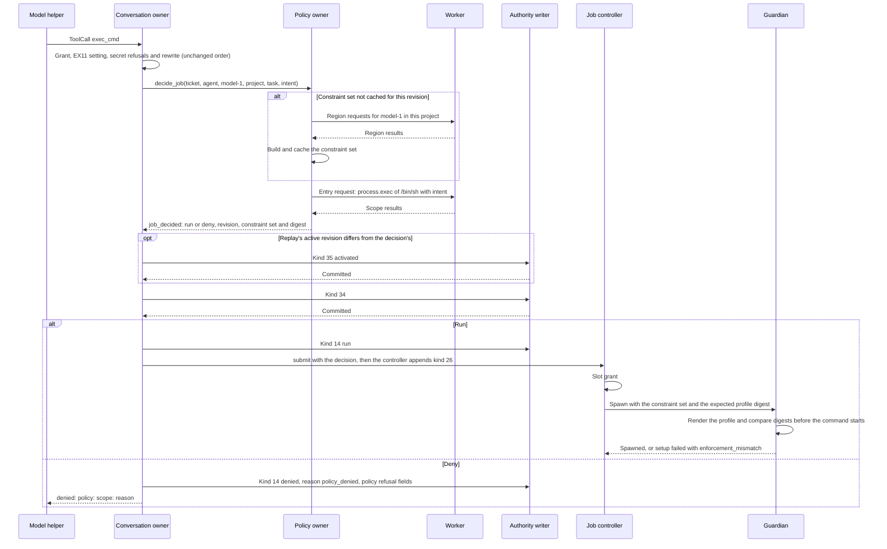

## Live enforcement later (proposed)

Proposed, not selected; each item needs research before a design. Seatbelt
profiles are static for a job's life. Live enforcement would decide each
effect when it happens, with the same Cedar policy and the same owner.

| Mechanism | What it would decide | Requirements and limits |
| --- | --- | --- |
| Endpoint Security system extension | `AUTH` events: exec, open, create, rename, unlink, link, `mmap` of executables and others, each with Asura's decision | The `com.apple.developer.endpoint-security.client` entitlement, granted by Apple on application; a system extension that the person approves; Full Disk Access granted by the person; Developer ID only (not the App Store). The kernel's answer deadline for `AUTH` events is the operating system's, not an Asura default time bound; decisions must therefore be cached and fast. The decision budget (p50 at most 100 µs) fits, but the deadline value and the behavior on a missed deadline must be measured |
| Network Extension content filter | Per-flow decisions with the source process (audit token), for `network.connect` by host, IP and port | A Network Extension entitlement and a system extension the person approves; Developer ID distribution needs the system extension form; attribution of a flow to a job must be proved |
| Linux VM backend (AD-18) | Effects inside Linux guests: seccomp user notification for system calls, Landlock for filesystem rules | Built after native and after brokers (AD-18); guest-side enforcement is inside the guest's trust boundary; the host decides through a guest agent channel |

Research and probes, not run:

| ID | Question |
| --- | --- |
| ES-1 | Which `AUTH` event types does macOS 27 offer, and what is their answer deadline on the reference Mac? What happens to the process on a missed deadline? |
| ES-2 | Can a client limit events to Asura's job processes (process muting, audit token, the job marker) so that other processes pay no cost? |
| ES-3 | Decision cache design: key, invalidation on revision change, memory bound; p99 under a build workload |
| ES-4 | Interaction with Seatbelt: both layers active; which denial wins; evidence records |
| ES-5 | Approval and install flow for the system extension and Full Disk Access; behavior when the person declines or revokes them |
| NE-1 | Content filter flow attribution to a job process group; latency per flow |
| NE-2 | DNS and host name visibility for filters; rebinding |
| VM-1 | seccomp user notification and Landlock availability in the guest kernels Containerization uses; notification latency over the guest channel |
| ER-1 | How the service reads Seatbelt violation reports for its own jobs, with attribution, loss and latency |
| ER-2 | Whether violation reports include enough fields (operation, path, pid) for the classifier without command text |
| ER-3 | Rate limits and loss of violation reports under a flood of denials |

Owner steps, when the owner chooses to pursue them: apply to Apple for the
Endpoint Security client entitlement and, if needed, the Network Extension
entitlement for the Developer ID team; decide whether Asura may ask the
person for a system extension approval and Full Disk Access; decide AD-18's
sequencing against this work.

## Egress by data class (AD-25)

Required behavior (AD-25, EX13). Designed for later: remote providers stay
refused until EX13 and EX14 exist (EX7), and no broker exists.

- Action: `context.egress`; principal `Task`; resource `Destination` (one per
  configured provider endpoint, `remote` true or false); context
  `data_class` and `tainted`.
- The context composer asks once per model request, in one batch, for each
  distinct data class present in the composed request (at most 5 decisions).
  A denied class is withheld; the manifest records the omission.
- The composer's taint hook (T1) stays the enforcer of taint exclusion. The
  safety specification S5 states the same rule in policy, so a policy can
  never permit tainted egress; tainted items never reach a request.
- Installation set: permit egress to local destinations; forbid tainted
  egress. User set: the EX13 grants per project and destination. Workspace
  and repository: forbids only.
- Proof (DF2 EV-P): SP-AQ5 and pattern A already ensure that no workspace or
  repository policy adds a destination or class.

## Interfaces

### Job controller and exec_cmd

Selected changes to the [tool job controller](tool-job-controller.md):

| Change | Rule |
| --- | --- |
| Start input | `submit` takes the `JobDecision` (revision, constraint set, digest). The controller passes the constraint set to the slot worker and the guardian |
| Start condition 0 `approval` | Before the existing conditions 1–8. Reason text `waiting: approval needed: <reason>`. Model jobs only, from PL7 |
| Start condition 0b `policy_recheck` | A queued entry whose decision revision is older than the dispatch revision. Reason text `waiting: re-checking policy` |
| Revocation trigger | Fills the existing row "Execution grant revoked for a project or principal": the policy owner revokes after a re-evaluation denies |
| Job reasons | 21 `enforcement_mismatch`, fixed by PL1, the packet that first writes it. Proposed, numbered by the packet that first writes each: `policy_revoked`, `approval_denied`, `policy_changed`, `classifier_revoked` |
| Kind 14 field 10 | `denied` 2 `policy_denied`, 3 `policy_unavailable`; `busy` 4 `policy_busy` (fixed by PL1), with the [policy refusal field](#kind-14-additions) |
| Guardian argv | `--asura-exec-cmd-guardian JOBHEX PROFILE CONSTRAINTS COMMAND` ([constraint set](#constraint-set)); notice kind 3 reason 10 `enforcement_mismatch` |
| Order at a model call | Grant check, EX11 setting, secret refusals and rewrite (unchanged), then the policy decision, then job admission |

The EX11 execution setting stays the person's switch for model execution and
keeps its owner. It is checked before the policy, so `execution_off` keeps
its reason and text.

### Person commands (`!` and `!!`)

Selected (packet PL2). At dispatch, after the secret item read and the path
guard check, the conversation owner asks for a job decision with profile
`person-1` or `person-outside-1` and intent source `person_command`.

- The entry `process.exec` request carries `env_terminal`, `env_declared`
  and `outside_switch`. The environment builder stays the enforcer of the
  allow-list (PE-R1); the policy states it, and a denial refuses the start.
- Each named reference gives one `secret_use` request with delivery `raw`.
- Network: AD-7 holds. The person templates compile to network `all`, and
  admission refuses a policy that forbids person network.
- The classifier never reads person jobs (PCR22).
- The `!!` hold of the path guard (EPG-R5) is unchanged. It is a warning
  hold, not a policy decision.

### Execution path guard

Answer to "does the path guard become a policy client?": **no**. Selected:
the path guard becomes an **attribute source**. It keeps its lists, walks,
fingerprints, digests, approvals and warnings (EPG-R2 to EPG-R6). The
canonicaliser asks it for the class of a path. EPG-R1, the model write
denial, becomes the installation hard forbid S1, and its Seatbelt deny rules
come from the compiler, which uses the path guard's escaped patterns. PL6
moves the deny rules; until then the guardian keeps them.

### Named secrets

Selected. `secret_use` decides each named reference of a person command, with
delivery `raw`. The installation hard forbid (S4) denies every named secret
to a model-origin job; the model refusal `model_secret_reference` keeps its
owner and its order (NS-F4), because it is a usability rule about the
command text. Brokered delivery is decided when brokers exist.

### Context composer

Selected for later (PL10): per-request egress decisions under CC4 stage B, as
in [egress](#egress-by-data-class-ad-25). The composer's request loop waits
for the batch reply on the reactor; a turn cancel ends the wait.

### Control API (protocol 0.1, schema change in place)

| Message | Direction | Content |
| --- | --- | --- |
| `PolicyStatus` | Client to service, reply | Active revision, each scope's state, admission queue length, solver availability |
| `PolicyCandidateSubmit` | Client to service | Scope, project, text (user and workspace) or "read repository file"; reply after admission: result, reasons, up to 8 counterexamples |
| `PolicyExplain` | Client to service | A decision reference (job or call); reply: every scope result, rule IDs and `@explain` texts |
| `PolicyApprovalList`, `PolicyApprovalAnswer` | Client to service | Open approvals and envelope drafts; approve or deny one |
| `PolicyGrantRevoke` | Client to service | End one envelope or approval grant |
| `PolicyRollback` | Client to service | Scope and earlier revision number |

TUI commands (presentation in a TUI packet design): `/policy`,
`/policy explain`, `/policy admit`, `/approve`, `/deny`, `/envelope`. CLI:
`asura policy status|admit|explain|rollback`, `asura approvals`.

### `/status` and audit

`/status` adds one line from a new `ServiceObservation` field:

```text
policy: revision 12 · installation ok · user ok · workspace 2 · repository 1 (1 changed, not admitted) · solver: cvc5 1.3.1 · 0 approvals waiting
```

New audit events (the audit schema number does not change). No event holds a
command, a path, a secret name or policy text.

| Event | Fields |
| --- | --- |
| `policy.revision_activated` | Sequence, scopes changed, widening (yes or no), solver digest |
| `policy.revision_rejected` | Scope, reason code |
| `policy.decision_denied` | Action group, primary scope and reason, rule ID, project |
| `policy.approval_requested`, `policy.approval_answered` | Approval ID, kind, answer |
| `policy.envelope_activated`, `policy.envelope_ended` | Envelope ID, cause |
| `policy.solver_failed` | Cause code |

Allowed decisions are in the journal (kind 34), not in audit events.

## Solver package (AD-17)

Required behavior: AD-17. Selected mechanism below, with the missing
evidence marked. Packet PL4 owns it and must first update the
[release signing design](release-signing.md) (bundle layout, DMG manifest,
signing order) to match.

### Build

| Item | Selected |
| --- | --- |
| Sources | cvc5 1.3.1 release source and GMP 6.3.0 source, each pinned by URL and SHA-256 in a tracked lock file `tools/release/solver/solver.lock`. Every dependency that the cvc5 build would download (CaDiCaL, SymFPU and others) is fetched by the script into a scratch cache from pinned URLs and digests first; the build then runs offline. Evidence missing: the exact dependency list of cvc5 1.3.1 and whether its CMake checks hashes (SV-B2) |
| Licences of the build | cvc5 production build, with every GPL option off (no CLN, no GLPK) and without LibPoly (`--no-poly`, owner SBQ2, 2026-11-03). PL4a re-runs SV-P1 on the product corpus; if the answers differ from the upstream binary, the packet stops and reports to the owner |
| GMP | GMP 6.3.0 built shared as `libgmp.10.dylib` with install name `@rpath/libgmp.10.dylib` (owner SBQ1, 2026-11-03). cvc5 links `libgmp` only, so `libgmpxx` is not shipped ([probe F3](solver-build-probes.md#findings-for-the-solver-adapter)). cvc5's own libraries stay static (BSD-3-Clause); only GMP is dynamic. The probe built this shape (SV-B1 evidence in [the probe](solver-build-probes.md#q5-the-built-solver-against-the-upstream-binary)) |
| Probe findings F1 to F5 | Requirements of the PL4a build script and its adapter ([findings](solver-build-probes.md#findings-for-the-solver-adapter)): F1, pass `GMP_LIBRARIES` and `GMPXX_LIBRARIES` explicitly, exclude `/opt/homebrew`, and check that `otool -L cvc5` lists exactly `@rpath/libgmp.10.dylib`, `libc++` and `libSystem`; F2, check the GMP version against the lock file in the script; F3, ship one dylib; F4, the SymCC adapter reads standard output and standard error while it writes standard input, and a full output buffer refuses the candidate (`solver_failed`), never stalls the admission worker, with a stalled-solver case in PL-I6; F5, `(set-logic ALL)` is kept |
| Toolchain | The owner's release Mac, arm64, the pinned Xcode clang, `MACOSX_DEPLOYMENT_TARGET=27.0` |
| Host paths | The same `-ffile-prefix-map` maps and linker `-S` as the helper build ([build-host paths](release-signing.md#build-host-paths-sg4-o1)); the host-paths scanner covers cvc5 and every dylib |
| Script | `tools/release/solver/build`: inputs the lock file and a scratch directory; output an unsigned package directory `solver/` with `MacOS/cvc5`, `Frameworks/libgmp*.dylib`, the licence files and a manifest of SHA-256 digests. The same output serves development tests (unsigned) and `asura-bundle` (signed) |

### Placement and signing

```text
Asura.app/Contents/
  MacOS/asura
  MacOS/asura-model
  MacOS/cvc5                         Developer ID, Hardened Runtime, identifier org.pidster.asura.cvc5
  Frameworks/libgmp.10.dylib         Developer ID, identifier org.pidster.asura.gmp
  Resources/licenses/solver/         notice and licence texts (sealed)
```

- Signing order: the dylibs, then `cvc5`, then the helper and its bundle,
  then `Asura.app` (inside out, as [SG-F1](release-signing.md#sg-f1-release-signing-flow)).
- Entitlements: none. Library validation stays on: a team-signed GMP loads
  into the team-signed cvc5 through `@executable_path/../Frameworks`.
  Evidence missing: that the Hardened Runtime cvc5 loads the team-signed GMP
  from the bundle and from the pinned copy directory (SV-P3).
- The build compiles the SHA-256 of `cvc5` and each dylib into `asura`, as it
  does for the helper. The platform checks them on every copy.

### Licence obligations and notice

Required: meet LGPL-3.0 for GMP and the notice conditions of cvc5
(BSD-3-Clause), CaDiCaL, SymFPU and MiniSat. Selected mechanism (owner
SBQ1, 2026-11-03): GMP 6.3.0 ships as the separate, replaceable
`@rpath/libgmp.10.dylib`, and each release publishes the exact GMP source,
the build script, the licence texts and a notice.

History: the owner first chose to probe an LGPL-free cvc5 build (AD-30,
[OQ3](#open-owner-questions)). The [solver build probes](solver-build-probes.md)
showed that GMP cannot be avoided without forking cvc5's number backend. The
owner then reversed the LGPL-free choice once the trade-off was clear; the
fork prototype was stopped. The legal part of OQ3 is decided, with no open
legal question and no release gate. The owner's position (2026-11-03):
Asura is open source (MIT). Anyone who wants to rebuild it and swap GMP for
another library, whether in practice or in theory, can fork it, submit a
pull request, or build it themselves. The owner is not obliged to sign their
build with his key, provided Asura complies with the licence terms.
Compliance stays as designed: GMP is a separate, replaceable `@rpath` dylib;
the exact GMP source and the build script are published with each release;
the LGPL-3.0 and GPL-3.0 texts and the notice ship in the licence folder;
Asura's own source is public, so a person can rebuild it and sign with their
own identity.

| Obligation | How Asura meets it |
| --- | --- |
| LGPL-3.0 §4(d)(1): a shared library mechanism that works with a modified, interface-compatible GMP | GMP is a separate `@rpath` dylib. A person can build a modified GMP, put it into a copy of `cvc5` and `Frameworks/`, sign both ad hoc (`codesign -f -s -`), and run that cvc5. Asura's service uses only the shipped, digest-checked files |
| LGPL-3.0 §4(a), (b): notice and licence texts | `Resources/licenses/solver/` holds `NOTICE.txt`, the GMP `COPYING.LESSERv3` and `COPYINGv3` texts, cvc5 `COPYING`, and the CaDiCaL, SymFPU and MiniSat licence texts; the DMG `LICENSE` file points to them |
| GPL-3.0 §6(d) through LGPL §4(d): corresponding source of GMP | The exact GMP source archive, the cvc5 source archive and the build script are published as assets of the same GitHub release as the DMG, for as long as that DMG is offered |
| Installation Information (GPL-3.0 §6) | Not required: Asura is not conveyed with the sale of a User Product. Asura is open source, so a person can rebuild it and sign with their own identity; the owner's OQ3 position (2026-11-03) |
| BSD-3-Clause and MIT notices | Reproduced in the licence folder |

Notice text (`NOTICE.txt`), fixed:

```text
Asura includes the cvc5 SMT solver, version 1.3.1, under the BSD 3-Clause
licence (cvc5-COPYING.txt). Asura uses it on this Mac to check policy
changes before they take effect.

cvc5 uses the GNU Multiple Precision Arithmetic Library (GMP), version
6.3.0, under the GNU Lesser General Public License, version 3
(gmp-COPYING.LESSERv3.txt and gmp-COPYINGv3.txt). GMP is a separate shared
library: Asura.app/Contents/Frameworks/libgmp.10.dylib. You may replace it
with a modified version. To run cvc5 with your GMP, copy MacOS/cvc5 and the
Frameworks folder, replace the library, and sign both with your own identity
or ad hoc. Asura itself runs only the solver files it shipped and checked.

The source code of this GMP version and of cvc5, and the script that built
them, are published with this Asura release at
https://github.com/<owner>/asura/releases/tag/v<version>.

cvc5 also contains CaDiCaL, SymFPU and MiniSat; their licences are in this
folder.
```

The release URL in the notice must pass the host-paths rule; the
[known limit](release-signing.md#build-host-paths-sg4-o1) about the owner's
user name in a GitHub URL applies, so PL4 resolves the URL form with the
scanner rule before the notice ships.

### Release checks

| Check | Rule |
| --- | --- |
| host-paths | The scanner reports no build path in `cvc5`, the dylibs or the licence folder |
| DMG manifest | The `asura-release check` manifest changes from exactly two Mach-O files to exactly the listed set: `asura`, `asura-model`, `cvc5`, `libgmp.10.dylib` (and `libgmpxx.4.dylib` if built) |
| Signatures | Deep strict `codesign --verify`; each Mach-O has the team ID, a secure timestamp, and the Hardened Runtime flag on `cvc5` |
| Notarisation scope | The DMG submission covers the nested code. The notarisation log must list no issue for `cvc5` or the dylibs (SV-P4) |
| Sandbox | cvc5 runs under the solver Seatbelt profile from the installed app (SV-P2) |
| Proof gate | The admission test suite (SP-AQ1 to SP-AQ8 on the built-in sets and the seeded defects) passes with the bundled, signed cvc5 on the release build |
| Licence folder | Present, sealed, and the files match the lock file's licence list |

## Failure handling

| Failure | Result |
| --- | --- |
| Worker panic or exit | The owner stops dispatch to it, fails its in-flight requests as deny `policy_error`, records `policy.worker_failed`, and starts a replacement only after the old thread has been joined. With no worker, decisions wait in their agent queues with `waiting: policy workers restarting` |
| Decision queue full for an agent | `busy` with reason `policy_busy` before any record; the per-agent bound is 8 |
| Journal unavailable | No decision record can be written, so no job is admitted; the job controller's existing `journal_unavailable` waiting reason applies |
| Payload store unavailable at activation | Candidate rejected `storage_unavailable`; the active revision stays |
| Solver missing, digest mismatch, sandbox refusal | Candidate rejected `solver_failed`; decisions continue under the active revision; `/status` shows the solver state |
| Solver `unknown` | Candidate rejected `solver_unknown`; never a pass |
| Admission cancel | Solver killed; candidate not admitted |
| Scope text invalid at startup | Scope unavailable; its requests deny with `scope_unavailable` and a repair action (`/policy rollback` or admit again) |
| Code signing check fails for a program | `identity_known = false`; the policy decides |
| Enforcement evidence mismatch | Job stopped at once, settled `enforcement_mismatch` |
| Clock change | `now` is read per decision; an expiry is enforced again by grant removal, so a clock moved back cannot keep an ended envelope active past its removal |

No failure retries an effect with an unknown outcome. Decisions are
idempotent per request digest: a resubmitted identical call is decided again
under the current revision and recorded again.

## Security

The [execution threat model](execution-threat-model.md#policy-layer) holds
threats PL-T1 to PL-T15 with their mitigations and residuals. Summary of the
boundaries this design adds:

- The policy owner is class A trusted code. Its inputs from models,
  repository content and the classifier are intent or forbid-only context.
- Repository policy text is untrusted: forbid-only, admitted by the person,
  its explanations never forwarded to a model.
- The solver parses SMT-LIB generated from admitted text that a repository
  may have written. It runs sandboxed with no network and no write, and a
  wrong or failed answer can only refuse a candidate or prove a false
  property. The runtime wrapper and the Seatbelt profile never depend on it.
- Same-UID processes remain one principal under the
  [D1 choice](threat-model.md#scope-assets-and-actors): they can edit the
  journal, the pinned texts and the run directory. Digest checks detect
  accidental damage, not a same-UID attacker.

## Asynchronous execution

| Rule | Application |
| --- | --- |
| AE-01 | The owner runs on the reactor: dispatch, queue rotation, activation and revocation are bounded in-memory steps. Evaluation never runs on the reactor |
| AE-02 | Blocking work: Cedar evaluation (workers), SymCC and solver pipes (admission worker), code signing checks and path walks (platform worker threads), payload pinning and journal appends (existing writer and payload workers), solver copy and reap (admission worker) |
| AE-03 | Numeric limits in [limits](#limits); per-agent queues with `policy_busy` at the bound; one admission at a time |
| AE-04 | No time bound. A decision ends on its reply, the requester's cancel or shutdown; an approval on the answer, cancel, revocation, shutdown or restart; a proof on the solver's reply or cancel; evaluation by its size bounds |
| AE-05 | Decisions are recomputed, never retried with effects; replay rebuilds revisions; a recorded envelope answer resumes its proof |
| AE-06 | Startup: load and validate scopes and install them on the workers before the first decision; requests that arrive earlier wait with `waiting: policy starting`. Shutdown: close the decision ingress, kill the solver, finish in-flight evaluations (bounded), join the workers |
| AE-07 | The [validation](#validation) cases PL-I10 to PL-I14 exercise overload, a stalled solver, worker loss, restart during admission and cancel |

## Limits

| Item | Limit |
| --- | --- |
| Request | 16 KiB; strings 1,024 bytes; sets 64; nesting 8 |
| Entities per request | 128; ancestors per path 64 |
| Scope text | 256 KiB; 512 policies per scope; 2,048 policies per revision |
| Generated grants | 256 active (at most 32 envelopes) |
| Workspace and repository sets | One each per project; at most 1,024 projects with a set |
| Workers | `clamp(available_parallelism() / 2, 2, 8)`; 2 in-flight requests each |
| Decision queues | 8 per agent; 512 in the service |
| Constraint set cache | 256 entries |
| Program identity cache | 1,024 entries |
| Live decisions kept for recheck | 64 (the job controller's unsettled job bound) |
| Admission queue | 16 candidates; 1 solver process; 4,096 queries per admission |
| Counterexamples shown | 8 per change |
| Records | Kind 34 at most 4 KiB; kinds 35 and 36 at most 8 KiB |
| Solver I/O | 64 MiB written per query; 1 MiB per model line; 64 KiB of standard error kept |
| Time bounds | None by default. The person-set envelope and approval expiries are explicit person choices |

## Performance budgets

Required behavior: the owner's revised budgets (2026-11-03). The original
spike targets are in the [spike's budget revision](policy-engine-spike.md#owner-revision-of-2026-11-03-budgets).
They are acceptance criteria, never runtime closures (AE-04).

| ID | Budget | Measurement |
| --- | --- | --- |
| PL-B1 | Decision p50 at most 150 µs (owner revision of 2026-11-03, AD-33; was 100 µs) | In the worker: request and entity slice construction, schema checks, every applicable scope, wrapper and reasons; on the product schema with the scale workload below |
| PL-B2 | End-to-end p99 at most 1.5 ms at 64 concurrent requests (owner revision of 2026-11-03, AD-33; was 1 ms) | From `decide` on the reactor to the `decided` event, 64 closed-loop requesters, the product worker pool |
| PL-B3 | At most 8 MiB added size | Stripped release `asura` with the policy layer against the same build without it. The solver and GMP files are reported separately for each release, with no limit (AD-31, [OQ4](#open-owner-questions)) |
| PL-B4 | Startup at most 200 ms | From the owner's start to the first decision: schema, every admitted scope of the workload, worker installation |
| PL-B5 | Safety budgets kept from the spike | PES-M2 (0 unenforced conventions), M3 (100 % injected errors deny), M4 (0 allows in 1,000,000 malformed requests), M5 (determinism), M6 (12 of 12 seeded defects refused, warnings refuse), M7 (reasons), M15 to M18 (proofs) |

Workload: the spike's scale corpus rewritten for the effect schema
(204 static policies and 54 grants, 40 projects, 1,000 requests), on the
reference Mac (Apple M4 Max, 16 cores, macOS 27). A budget failure stops the
packet that measured it and is reported to the owner; the mechanism is not
changed silently.

## Validation

Required test layers ([engineering](../engineering.md#required-test-layers)).
IDs are stable; each packet lists the IDs it delivers.

### Unit

| ID | Case | Packet |
| --- | --- | --- |
| PL-U1 | W1 bounds: each limit and one more | PL1 |
| PL-U2 | W2: unknown context field, wrong type, unknown entity type deny `request_invalid` | PL1 |
| PL-U3 | W3: the FE1 to FE4 shapes on the product schema deny `policy_error` while Cedar alone allows | PL1 |
| PL-U4 | Strict validation and warnings: 12 seeded defects on the product schema refused | PL1 |
| PL-U5 | Pattern A: each scope combination; the primary reason names the first denying scope; absent lower scopes not evaluated | PL1 (installation and user), PL5 |
| PL-U6 | Reason and text mapping; no model text, no path; workspace and repository explanations not forwarded | PL1, PL5 |
| PL-U7 | Region compiler: `model-1` template on the shipped sets equals today's rules; exception candidates; refused shapes | PL1 |
| PL-U8 | Determinism: 100 repetitions, fresh engines, 8 threads, identical decisions | PL1 |
| PL-U9 | Canonicaliser: `..`, symlink, firmlink, `/private`, case, hard link cases | PL2 |
| PL-U10 | Intent extractor: features per fixture; no positional argv; `unparsed` cases | PL2 |
| PL-U11 | Lints: tighten-only, forbid-only, reserved annotations, literals | PL3 |
| PL-U12 | Envelope rendering: typed fields to text; no free text | PL8 |
| PL-U13 | Kind 34, 35, 36 codecs and replay rules (`Corrupt` cases) | PL1, PL3, PL7 |

### Integration

| ID | Case | Packet |
| --- | --- | --- |
| PL-I1 | Service: a model exec_cmd call is decided on a worker; kind 34 precedes kind 14 in one batch; replay accepts it | PL1 |
| PL-I2 | Golden: the rendered `model-1` SBPL for the shipped sets is byte-equal to today's profile | PL1 |
| PL-I3 | A test-only installation set (test-support feature) that denies: the call is `denied`, reason `policy_denied`, no kind 26, no spawn | PL1 |
| PL-I4 | Enforcement evidence: the profile digest and marker match; an injected mismatch stops the job with `enforcement_mismatch` | PL1 |
| PL-I5 | Restart: kind 35 replay; a damaged payload makes the scope unavailable; a schema digest change makes it `reproving` and requests wait | PL1, PL3 |
| PL-I6 | Real solver: SP-AQ1 to SP-AQ8 against cvc5 built by the PL4 script; the test fails when the solver is absent (a gap, never a pass) | PL3 |
| PL-I7 | Seeded violations: a classifier permit, an intent permit, a repository permit, an envelope without its task condition, an uncompilable shape; each refused with a counterexample or lint | PL3, PL5, PL8 |
| PL-I8 | Activation race: a narrowing revision activates while jobs are queued, starting and running; queued rechecked, starting cancelled `policy_changed`, running revoked `policy_revoked` when denied | PL3 |
| PL-I9 | Real Seatbelt: a compiled workspace forbid (`rel like "vendor/*"`) denies a real write; a neighbour write succeeds | PL6 |
| PL-I10 | Overload: 64 concurrent requesters and full agent queues; `policy_busy` at the bound; Inspect and typing stay within 100 ms | PL1 |
| PL-I11 | Stalled solver (a test solver that never answers): admission waits, cancel kills it, decisions continue | PL3 |
| PL-I12 | Worker loss: a panicking worker is replaced after join; in-flight requests deny | PL1 |
| PL-I13 | Shutdown during admission and during decisions: settles with no orphan solver | PL3 |
| PL-I14 | Approval: ask, wait in the agent queue, approve, start; deny; restart gives `interrupted` | PL7 |
| PL-I15 | Person commands: `!` env allow-list denial; named secret `secret_use`; outside switch; no network forbid accepted | PL2 |

### Native

| ID | Case | Packet |
| --- | --- | --- |
| PL-N1 | Program identity of `/bin/sh` and a team-signed fixture on macOS 27 | PL2 |
| PL-N2 | Signed, notarised bundle: cvc5 loads GMP with library validation; runs under its profile; host-paths clean (SV-P2 to SV-P5) | PL4 |

### End to end

| ID | Case | Packet |
| --- | --- | --- |
| PL-E1 | TUI PTY journey: a scripted model's exec_cmd runs as before; `/status` shows the policy line; the journal holds kind 34 with the revision | PL1 |
| PL-E2 | TUI PTY journey with a test-only denying set: the model receives the policy denial text; the job view explains the scope | PL1 |
| PL-E3 | `/policy admit` of a user forbid; the next model call is denied with scope `user`; rollback restores it | PL3 |
| PL-E4 | Malicious repository policy with a `permit` and an instruction in `@explain`: refused; after removing the permit, admitted as forbid-only; the model never sees the text | PL5 |
| PL-E5 | Envelope: approve, a job writes inside, a job writing just outside is denied by the sandbox, the task ends and a new job loses the region | PL8 |
| PL-E6 | Unattended approval wait: the job waits with its reason until the person answers in a second client | PL7 |

### Proof and budget evidence

| Evidence | Cases | Type |
| --- | --- | --- |
| EV-P | PL-I6, PL-I7 on every admission of the built-in sets in the release gate | Proof |
| EV-E | PL-I2, PL-I4, PL-I9, PL-E5 on supported macOS with real attempted effects | Enforcement |
| Budgets | PL-B1 to PL-B4 by a `policy-bench` test binary in `asura-policy` (worker-level) and a service-level bench; PL-B5 by the fuzz and fail-closed suites | Performance and safety |

Check commands for every packet: `cargo fmt --all --check`;
`cargo clippy --workspace --all-targets --locked -- -D warnings`, with and
without `--all-features`; `cargo test --workspace --locked`; the
[CLI lifecycle gate](early-production-status-slice.md#mandatory-command-regression-execution);
the PTY journeys of the packet; and the packet's bench, recorded with its
environment.

## PL1 implementation contract

Selected, 2026-11-03. This section fixes the details that packet PL1 needs
and that the sections above leave open. Where it narrows an earlier
section, that section links here. PL1 changes no visible behavior for the
shipped sets: every model `exec_cmd` call that ran before still runs, under
a byte-equal Seatbelt profile.

### What PL1 builds and what waits

| Item | PL1 | Later |
| --- | --- | --- |
| Scope sources | The installation set and the default user set, both compiled into `asura` from `asura-policy/policies/installation.cedar` and `user-default.cedar`. Source identity `builtin` | PL3 creates and admits `~/.asura/policy/user.cedar`; PL5 adds workspace and repository |
| Payload store | Not used: a built-in text is sealed by the code signature and named by its SHA-256 in kind 35 | PL3 pins admitted texts |
| Admission | None. No solver, no lints, no proofs. The golden tests fix the compiled output of the built-in sets | PL3 |
| Requests | Model `exec_cmd` job decisions only: the entry `process.exec` and the `model-1` region requests | PL2 person commands and `secret_use` |
| Intent | `source = model_tool`, `name = "exec_cmd"`, `digest` = SHA-256 of the stored (rewritten) command. `command` is absent | PL2 adds the feature extractor and `command` |
| Program identity | `/bin/sh` has `identity_known = false` and empty identity strings | PL2 adds the static code check |
| Paths | Built from the fixed template literals, the registered project location, the runtime's Asura home and the job's scratch path. Parents are the lexical parent directories of these absolute paths | PL2 adds the descriptor-walk canonicaliser |
| `developer_dir` | Absent: the schema attribute is optional (`developer_dir?: Path`), and `model-1` has no developer directory region today | A later confinement change adds the region, with its own byte-level review |
| Tighten-only forbids | None, so no decision is `ask` | PL7 (AD-29) |
| Revision changes while running | None: one revision per service run | PL3 rechecks at slot grant |
| Audit events | None; worker failures are logged | PL3 adds the `policy.*` events |

### Built-in sets

The installation set holds, for `model-1` jobs: the ceiling permits of the
`model-1` template regions and the runtime set (below); the hard forbids S1
(no model write, creation or deletion of an `implicit_exec` path), S2 (no
write, creation or deletion of an `asura_state` path outside the job's
scratch, and for model jobs no read or execution of one either, EX16), S3
(no model `network.connect` except through the mediator) and S4 (no model
`secret_use`). It holds no tighten-only forbid. The default user set holds
the same `model-1` region permits as the person's default regions. Neither
set permits `process.exec.ask`, `process.exec.approved`, `mach.lookup` or
`context.egress`.

The `model-1` template is today's profile exactly (byte-equal rule):

| Region class | Roots, in render order |
| --- | --- |
| Read, execute and map | `/bin`, `/usr/bin`, `/sbin`, `/usr/sbin`, `/usr/lib`, `/usr/share`, `/System`, project root, scratch |
| Write, create and delete | Project root, scratch |
| Runtime set (fixed rules) | Literal `/`, `/private/var/select/sh` and its ancestors' metadata, `/dev/null` (read and write), `/dev/random`, `/dev/urandom`, `process-fork`, `sysctl-read` |
| Fixed deny rules (guardian) | The Asura home except the job's scratch (EX16); the path guard implicit-execution paths (EPG-R1) until PL6 |

The [effect envelope template](#effect-envelope-of-a-job) row for `model-1`
listed `developer_dir` and left `/usr/share` out of the exec regions. Both
differ from today's profile, so PL1 uses the table above; the
[execution threat model](execution-threat-model.md#threats-current-mitigations-and-gaps) keeps
the known `git init` gap.

Policies may use these shapes on compiled actions, in addition to the
[compilable shapes](#effect-envelope-of-a-job): `resource in
principal.project.root`, `resource in principal.scratch`, and
`resource.path in ...` with any of the listed forms for a `Program`.

### Constraint set

A constraint set is the compiled effect envelope of one job shape. Its type
belongs to the guardian contract in `asura-platform::exec_cmd` (the backend
vocabulary); `asura-policy` computes the allowed regions; the service maps
one to the other. For `model-1` it is three sets of roots over the closed
list of nine template roots.

| Field | Meaning | Guardian rule |
| --- | --- | --- |
| `read` | Roots the job may read (`file-read*`) | Must hold `/bin` and scratch |
| `exec` | Roots the job may execute and map (`process-exec`, `file-map-executable`) | Must hold `/bin` and scratch |
| `write` | Roots the job may write, create and delete (`file-write*`) | Project root and scratch only; must hold scratch |

The compiler puts a root into a set only when every applicable scope allows
every action of that set on the root: `file.read`; `process.exec` of a
`Program` at the root with `identity_known = false`; and `file.write`,
`file.create` and `file.delete`. It also evaluates each runtime set literal
(`file.read`, and `file.write` for `/dev/null`). A denied runtime literal, or
a missing base need (`/bin` and scratch in `read` and `exec`, scratch in
`write`), denies the job with `cannot_enforce`. A root that is not allowed
is left out; the guardian then renders the narrower profile. The fixed deny
rules are always rendered, so `Enforced ⊆ Permitted` holds whatever the
regions are.

The guardian renders, in today's order: the combined rule for roots in both
`read` and `exec`; a `file-read*` rule for roots only in `read`; a
`process-exec file-map-executable` rule for roots only in `exec`; the
ancestor metadata literals of every read or exec root; the write rule; the
runtime set; the state rules; the implicit-execution deny rules. A rule
with no roots is left out. For the template sets the output is today's
profile byte for byte.

**Encoding.** The service passes the set to the guardian in a new argv
element before the command: `--asura-exec-cmd-guardian JOBHEX PROFILE
CONSTRAINTS COMMAND`. `CONSTRAINTS` is `-` for the person profiles (PL6
compiles them) and for `model-1` is
`m1:<read>:<exec>:<write>:<profile digest>`. Each set is three lowercase hex
digits: bit *i* is root *i* in the order of the table above (bit 0 `/bin`,
bit 7 project root, bit 8 scratch). The profile digest is 64 lowercase hex
digits. Any other form, an unknown bit, a write bit for a system root or a
missing base need refuses the guardian before any effect (status 1, as an
unknown profile token). The argv bound grows from 8,704 to 9,216 bytes to
hold the token.

**Digests.** The constraint digest in kind 34 is the SHA-256 of
`m1:<read>:<exec>:<write>`; it does not depend on paths. The profile digest
is the SHA-256 of the rendered SBPL text. The slot worker's setup computes
it in the service process from the constraint set and the paths of the
pinned descriptors (FDs 7, 9 and 10, read the same way as the guardian
reads them), and passes it in the token.

### Enforcement evidence in PL1

The guardian renders the profile from its own pinned descriptors and the
constraint set, computes its SHA-256 and compares it with the digest in the
token before it starts `sandbox-exec`. A mismatch is a setup failure: notice
kind 3 with the new reason 10 `enforcement_mismatch`. The job settles
`not_started` with job reason 21 `enforcement_mismatch`, and the command
never starts. This is stricter than the stop with `T` in
[enforcement evidence](#enforcement-evidence): no effect can occur under a
profile that differs from the decision. The job marker check is the
existing EX5 attribution check (`sandbox_check`), unchanged. Kind 28 holds
no profile digest in PL1: a job that started proves that the digests
matched.

### PL1-F1: guardian constraint check

Selected design. Arrows show the order of checks in the guardian for one
`model-1` start; every refusal happens before the command exists.

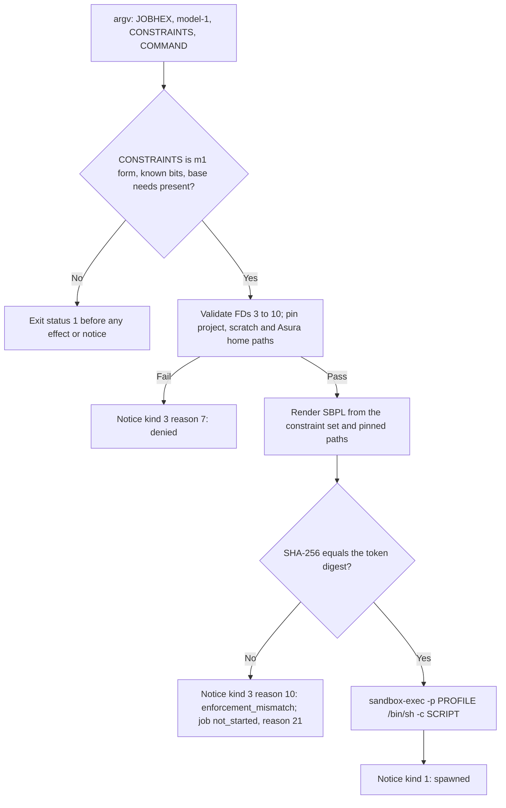

### PL1-D1: job decision data

Selected design. Boxes are typed values; lines show ownership with
cardinality. `JobDecision` is the reply of `decide_job`.

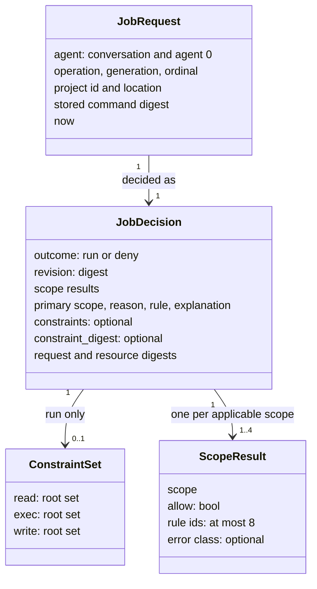

### Policy owner

`asura-service::policy` is one reactor component. It holds the built-in
revision texts and their digest, the worker pool, one decision queue per
agent (at most 8 entries; 512 in the service), the constraint set cache (at
most 256 entries, keyed by revision, profile, project and location) and the
ready replies.

| Step | Rule |
| --- | --- |
| Start | The owner starts `clamp(available_parallelism() / 2, 2, 8)` worker threads. Each builds its own engine from the texts (parse, strict validation, per-group sets) and reports `installed` or a load error. Requests that arrive earlier wait in their agent queue (`waiting: policy starting`). If any worker reports a load error, the owner is `unavailable` and every request is decided as a refusal with `scope_unavailable` for the installation scope |
| Dispatch | On each reactor step the owner moves queued requests, round-robin over agents, to workers with fewer than 2 in flight, over a bounded channel of 2 per worker |
| Decide | A worker builds the constraint set (cached result supplied by the owner when present), then evaluates the entry `process.exec` of `/bin/sh` with the intent, in every scope. It replies with the `JobDecision`; the owner stores a new constraint set in the cache |
| Reply | Workers send replies on one channel and wake the reactor. The owner keeps each reply until its requester takes it by ticket |
| Cancel | The requester's cancel drops a queued request, or discards the reply of a request in flight |
| Worker loss | A worker whose thread ended while requests were in flight (a panic) fails those requests as refusals with `policy_error`. The owner joins the finished thread and starts a replacement, which installs the revision before it receives work. Requests wait meanwhile (`waiting: policy workers restarting`) |
| Shutdown | The owner closes ingress, drops the queues, closes the worker channels and joins each worker when its thread has finished; an evaluation is bounded by W1 |

No call blocks the reactor: building engines, compiling and evaluating run
on the workers; the reactor step only moves typed values.

### PL1-S1: policy owner states

Selected design. States belong to the owner for one service run. Arrows
name the event; guards are in brackets.

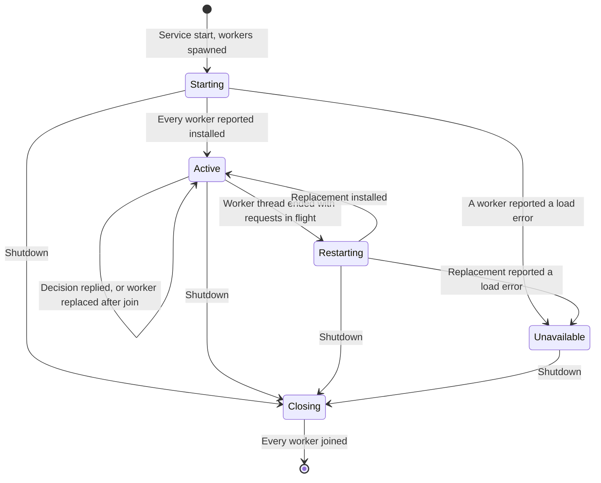

### The model call step

The conversation owner keeps the existing order (grant, EX11 setting,
secret refusals and rewrite) and adds the policy decision before job
admission, in the reactor step that would append kind 14:

1. The EX11 setting is off: kind 14 `denied` `execution_off`, as today; no
   policy request.
2. No decision yet: `decide_job`. A full agent queue gives kind 14 `busy`
   with field 10 reason 4 `policy_busy` and no kind 34. Otherwise the call
   waits for the reply; a turn cancel during the wait cancels the ticket
   and records kind 14 `cancelled` (TCR-D8).
3. The owner is unavailable: kind 14 `denied`, reason 3
   `policy_unavailable`, with the policy refusal fields; no kind 34.
4. The replay's active policy revision differs from the decision's revision
   digest: the owner appends kind 35 `activated` first (sequence = the last
   kind 35 sequence + 1).
5. The owner appends kind 34, then, after it commits, kind 14. A `run`
   decision then submits the job with its constraint set (a full controller
   queue still gives `busy`); a refusal gives kind 14 `denied`, reason 2
   `policy_denied`, with the policy refusal fields.

The writer appends one record per frame and has no batch. Kinds 34 and 14
are therefore consecutive appends of the conversation owner, which appends
nothing else for the turn between them. A stop between them leaves a
kind 34 with no kind 14; restart recovery ends that turn `interrupted`.

### Kind 14 additions

Field 10 gains three reasons: `denied` 2 `policy_denied`, `denied` 3
`policy_unavailable` and `busy` 4 `policy_busy`. A new last field, the
policy refusal, is present exactly when field 10 is `policy_denied` or
`policy_unavailable`:

| Part | Rule |
| --- | --- |
| Scope | 0 none (for `request_invalid`, `request_too_large`, `cannot_enforce`), 1 installation, 2 user, 3 workspace, 4 repository |
| Reason | `[a-z0-9_]{1,48}` |
| Rule | Empty, or the global rule ID `<scope>:<id>` with `<id>` in `[a-z0-9_.-]{1,64}` |
| Explanation | Empty, or the `@explain` text (at most 200 bytes of printable ASCII) of an installation or user policy |

The model text is rendered from kind 14 alone, as today (TCR-D12), with the
texts of the [reason table](#reason-codes-and-explanation): a forbid gives
`denied: policy: <scope>: <reason>: <explanation>; do not retry`, where the
explanation is the stored `@explain` text, or `a <scope> policy forbids
this (rule <id>)` when it is empty.

### Kinds 34 and 35 in PL1

Kind 34 `PolicyDecision` (at most 4 KiB) holds: the subject (model call:
operation, generation and ordinal); the action code; the principal's
origin, profile, project and task (conversation and agent); the resource,
request and intent digests; the revision sequence and digest; up to 4
scope results (scope, allow or deny, error class, up to 8 rule IDs); the
decision (`run` or `deny`; `ask` is refused by replay until PL7); the
primary scope and reason; the constraint digest for `run`; and `now` in
milliseconds since the Unix epoch.

Kind 35 `PolicyRevision` (at most 8 KiB) holds: the sequence, the revision
digest, the previous active sequence, the event, the schema digest, the
Cedar language and SDK versions, the optional solver and admission digests
(absent in PL1), and one entry per scope set (scope, optional project,
text digest, source identity, policy IDs). PL1 writes only `activated`.

Replay rules (each violation is `Corrupt`):

| Rule | Check |
| --- | --- |
| R1 | A kind 35 sequence is the last kind 35 sequence + 1 (the first is 1), and its previous sequence is the active one (0 for the first) |
| R2 | A kind 35 event other than `activated` is refused until the packet that writes it |
| R3 | A kind 34 names the active revision: its sequence and digest equal the last `activated` kind 35 |
| R4 | A kind 34 names an accepted, unterminated turn and an ordinal that has no kind 14 yet, and no other kind 34 is pending for that call |
| R5 | A kind 14 with reason `policy_denied` follows a pending kind 34 `deny` for the same call |
| R6 | A pending kind 34 `deny` is followed by a kind 14 that is not `run` |
| R7 | A kind 14 for a call with a pending kind 34 clears it; a turn's terminal clears its pending kind 34 only when the terminal is `interrupted` |

A model `exec_cmd` kind 14 `run` with no kind 34 stays valid in replay:
journals written before PL1 keep replaying, and the check costs nothing at
this layer. The service always writes the kind 34.

### `/status` in PL1

`ServiceObservation` field 10 is a new `PolicyStatus` message: owner state
(1 starting, 2 active, 3 unavailable), the journaled revision sequence (0
before the first activation), the installation and user scope states (1 ok,
2 unavailable), the workspace and repository set counts, the count of
changed repository sources, the solver state (1 none) and the count of
waiting approvals. The TUI renders one line, for example:

```text
policy: revision 1 · installation ok · user ok · workspace 0 · repository 0 · solver: none · 0 approvals waiting
```

While the owner starts, the line is `policy: starting`; when it is
unavailable, `policy: unavailable · installation unavailable · user
unavailable`.

### Test-only sets

The `test-support` feature of `asura-policy` adds a denying installation
set: the built-in text plus one tighten-only forbid (`@intent`) of model
`process.exec` with reason `test_denied`, conditioned on `context has
intent`. A plain forbid would also deny the region compile's exec requests,
which carry no intent, so every job would be `cannot_enforce` instead of
`test_denied`; the intent condition keeps the denial on the entry request.
Because the forbid is tighten-only and no scope permits `process.exec.ask`,
the outcome is `deny`, not `ask`. With the service's `test-support` feature, the owner uses it
when the file `policy-test-deny` exists in the scratch home of a scratch
runtime at owner start, as the other test-support seams are read. Production
builds have neither the text nor the check. PL-I3 and PL-E2 use it.

### PL1 validation map

| ID | PL1 evidence |
| --- | --- |
| PL-U1 to PL-U4, PL-U6, PL-U8 | `asura-policy` unit tests on the product schema and the built-in sets |
| PL-U5 | Installation and user combinations; the primary reason names the first denying scope |
| PL-U7 | The compiler on the built-in sets gives the template sets; a denied root drops out; a denied runtime literal or base need gives `cannot_enforce`; the guardian renders today's profile for the template sets (golden text frozen from `35cc82b`) |
| PL-U13 | Kind 34 and 35 codecs, limits and replay rules R1 to R7 |
| PL-I1 | Service: a model call is decided on a worker; kinds 35, 34 and 14 commit in that order; replay accepts the journal |
| PL-I2 | The service compiles the built-in sets; the guardian renders byte-equal text to the frozen legacy generator for several path sets |
| PL-I3 | The test-only denying set: kind 14 `denied` `policy_denied` with the installation scope; no kind 26; no spawn |
| PL-I4 | A real guardian run: the digests match and the job runs; an injected digest mismatch settles the job `not_started`, reason `enforcement_mismatch`, and the command never runs |
| PL-I10 | 64 concurrent requesters and full agent queues: `policy_busy` at the bound; the reactor stays responsive |
| PL-I12 | A worker that panics is replaced after its join; its in-flight requests are refused with `policy_error` |
| PL-E1 | PTY journey: a scripted model's `exec_cmd` runs as before; `/status` shows the policy line; the journal holds kinds 35 and 34 |
| PL-E2 | PTY journey with the test-only denying set: the model receives the policy denial text, and the TUI shows it |
| PL-B1 to PL-B5 | `policy-bench` in `asura-policy` (PL-B1, PL-B4, the PL-B5 fuzz and determinism parts), a service-level bench (PL-B2), stripped release sizes (PL-B3). PL-B5 proof budgets (PES-M15 to M18) need the solver and move to PL3 |

### PL1 delivery record

Verified, 2026-11-03, on the reference Mac (Apple M4 Max, 16 cores,
macOS 27), a shared machine whose load average is given with each figure.
The checks, their results and the proof limits are in the packet report;
the budget figures are recorded here because the budgets are this design's.

| Budget | Measurement | Result |
| --- | --- | --- |
| PL-B1 decision p50 at most 100 µs (the budget before AD-33) | `policy-bench` (release): scale workload of 204 static policies and 54 grants over four scopes, 40 projects, 1,000 requests, 10,000 decisions, load 2.6 to 3.4 | **Fail**: p50 130.7 µs, p99 160.6 µs. Entity and context construction with schema checks takes p50 53.9 µs of it. The built-in sets alone (PL1 production) decide the exec entry at p50 88.9 µs, p99 112.5 µs. A region compile on a cache miss takes p50 2.6 ms |
| PL-B2 end-to-end p99 at most 1 ms at 64 concurrent requesters (the budget before AD-33) | Service-level bench: `decide_job` on a reactor-like loop to the reply taken after the worker's wake, 8 workers, 64 closed-loop requesters, 20,000 decisions after 2,000 warm-up, built-in sets, three runs at load 3.4 to 11.6 | **Fail**: p99 1.044 to 1.126 ms (p50 966 to 993 µs). With 64 requests outstanding on 8 workers, queueing dominates: each decision waits for about 7 others on its worker |
| PL-B3 at most 8 MiB added to `asura` (AD-31) | Stripped release `asura` (`cargo build --release -p asura-cli`, `strip`) at PL1 against the same build at `35cc82b` | **Pass**: +6,138,056 bytes (5.85 MiB), 58,018,520 to 64,156,576 bytes |
| PL-B4 startup at most 200 ms | `policy-bench`: 8 workers, each building the schema and every scope, then the first decision, median of 10 | **Pass**: 37.2 ms (36.7 to 39.2) |
| PL-B5 safety | `policy-bench` and the unit suites | PES-M4 **pass** (0 allows in 1,000,000 malformed requests); M5 **pass** (identical decisions on fresh engines; PL-U8 across 8 threads); M3 (injected errors deny) and M6 (12 seeded defects, warnings refuse) **pass** as PL-U3 and PL-U4; M7 reasons pass as PL-U5 and PL-U6. M15 to M18 need the solver: PL3 |

A per-worker principal entity cache was then tried (owner decision,
2026-11-03), measured and reverted. Each model call names a new job, so its
principal misses on every call: PL-B1 improved only to p50 122.2 to 126.0
µs (47 % hits on the bench workload; hits alone 109.0 to 114.3 µs), and
PL-B2 slowed to p99 1.284 to 1.399 ms. Cached and uncached decisions were
identical over 10,000 workload decisions and 1,000,000 malformed requests.

The owner then revised PL-B1 to p50 at most 150 µs and PL-B2 to p99 at most
1.5 ms (AD-33, 2026-11-03): pattern A evaluates four scopes over 258 policies, about 80 µs of the decision, and a model turn takes seconds. The figures above stay
as the history against the earlier targets; the re-measurement against the
revised budgets follows.

Evidence item SP-P2 is answered: with per-request entity slices and the
schema-checked wrapper (W2), PL-B1 does not hold on the product scale
workload. Under the [budget rule](#performance-budgets) these failures go to
the owner; the mechanism is not changed silently. Options the owner may
choose between, none applied: re-measure on an idle machine; build entities
without the per-request schema check (saves about 30 µs, changes rule W2);
cache each principal's entities per worker; for PL-B2, more workers than
`clamp(n / 2, 2, 8)` or a lower concurrency in the budget's definition.

## Delivery packets

Selected order. Each packet updates this design first if its implementation
needs a change. Owned paths are exclusive while a packet runs.

| Packet | Delivers | Owned paths | Depends on | Gate |
| --- | --- | --- | --- | --- |
| PL1 | The policy owner; schema v1; built-in installation and default user sets; deny-on-any-error wrapper; installation and user scopes; region compiler for `model-1`; model exec_cmd job decisions by effect envelope with the command as intent; constraint set to the guardian (byte-equal profile); kinds 34 and 35; `/status` line; denial text | `rust/crates/asura-policy/**` (new, with `AGENTS.md`), `rust/crates/asura-service/src/policy.rs` and `policy/**`, the exec_cmd decision point in `conversation.rs` and `tools.rs`, the guardian profile input in `asura-platform/src/exec_cmd/guardian.rs`, kinds 34–35 in `asura-storage/src/authority/**`, `Cargo.toml`, `Cargo.lock` | This design | PL-U1–U8, U13; PL-I1–I4, I10, I12; PL-E1, E2; PL-B1–B5 recorded |
| PL2 | Canonicaliser, program identity, intent extractor; person command decisions; named secret `secret_use` | `asura-platform/src/project_identity.rs`, new `asura-platform/src/code_identity.rs`, `exec_cmd/split.rs`, person dispatch in `conversation.rs`, `asura-policy` request types | PL1 | PL-U9, U10; PL-I15; PL-N1 |
| PL4a | Solver build script and lock file; unsigned package for tests; probe findings F1 to F5 as script and adapter requirements | `tools/release/solver/**` | The solver build probes (SBQ1, SBQ2); SV-P1 re-run on the product corpus | Script builds offline; SV probes recorded |
| PL3 | Admission worker, SymCC solver adapter, platform solver process, lints, proofs, change difference, lifecycle with user-scope admission, rollback, restart reproving, control messages, audit | `rust/crates/asura-policy-admission/**` (new), `asura-platform/src/solver.rs`, `asura-service/src/policy/admission*`, control messages in `asura-control`, kind 35 events | PL1, PL4a | PL-U11; PL-I5–I8, I11, I13; PL-E3 |
| PL4b | Bundle placement, signing, notice, licence folder, release checks | `tools/release/asura-bundle`, `tools/release/asura-release`, `tools/release/host-paths`, `docs/designs/release-signing.md` (first), DMG `LICENSE` | PL4a, PL3 | PL-N2; release proof gate |
| PL5 | Workspace and repository scopes, forbid-only lint, baseline permit, `rel` literals | `asura-service/src/policy/scopes*`, `asura-policy` lints, repository source read | PL3 | PL-U5, U6; PL-I7; PL-E4 |
| PL6 | Compiler for `person-1` and lower-scope narrowings; EPG deny rules moved into the compiler; SP-AQ7 soundness proofs | `asura-policy` compiler, `guardian.rs`, `path_guard` interface | PL5 | PL-I9; EV-E |
| PL7 | Approval step: `process.exec.ask`, start condition `approval`, kind 36, control messages, TUI commands; the [default intent rules](#default-intent-rules-ad-29) (AD-29) | `asura-service/src/policy/approval*`, job controller start conditions, TUI packet files | PL2, PL3 | PL-I14; PL-E6 |
| PL8 | Task envelopes | `asura-service/src/policy/envelope*`, rendering in `asura-policy` | PL6, PL7; a new task design (AD-28) | PL-U12; PL-E5 |
| PL9 | Classifier context and effect watching | Classifier design first | DF4 design; ER-1 to ER-3 | Its own design |
| PL10 | Network connect through a proxy; context egress | Broker and remote provider designs first | AD-4, AD-6, EX13, EX14 | Their designs |

### SP-P1: packet order

Selected plan. Arrows are dependencies: a packet starts after the packets
that point to it pass their gates.

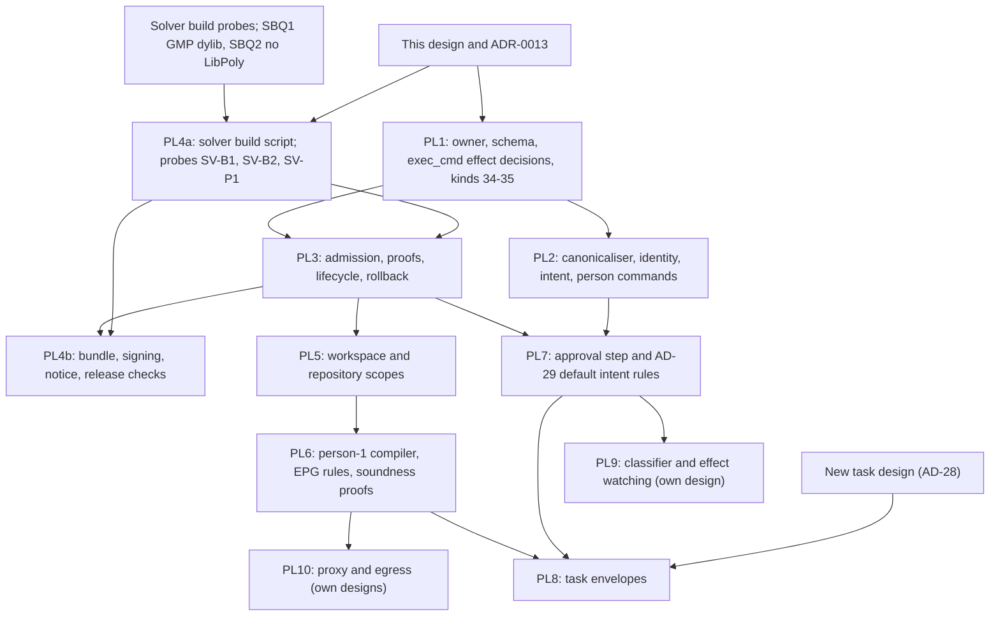

Every arrow is a dependency. The solver build probes and the task design
are prerequisites outside this design.

## Decisions and alternatives

| Decision | Selected | Alternatives and reasons |
| --- | --- | --- |
| Policy subject | Effects (AD-27) | Commands (the spike corpus): rejected by the owner; a shell reinterprets text |
| Composition | Pattern A with forbid-only lower scopes and an added baseline permit | Permits in lower scopes: harmless under AND but confusing; pattern B: not selected (AD-14) |
| Where grants live | User scope | A separate task scope: the owner's scope list has none, and the person who approves is the user-scope authority |
| Installation administration | Built-in only | An installation file: would let local edits lift hard forbids |
| Crates | `asura-policy` (decision path) and `asura-policy-admission` (SymCC) | One crate with a feature: weaker separation of the decision path's dependency closure |
| Entities | Per-request slices | One store of all entities: the spike's startup cost (95 ms for 10,325 entities) |
| Solver interface | Asura's `Solver` implementation over platform pipes | `LocalSolver::cvc5()`: adds a 60 s time limit and spawns outside the platform owner |
| Solver stop | `SIGKILL` on cancel, end of input otherwise | A TERM grace: a new time bound with no benefit for a stateless solver |
| Compile time | At admission and first use per revision, cached | Per request: about 50 region evaluations per job |
| Revocation of grants | Fast path without the solver | Full proofs: would make revocation wait for the solver |

## Open owner questions

The owner answered OQ1 to OQ5 on 2026-11-03. The canonical records are
AD-28 to AD-32 in the [owner decisions table](assurance-and-differentiation.md#owner-decisions).
The question and the recommendation stay as asked.

| ID | Question | Recommendation | Owner decision, 2026-11-03 | Effect |
| --- | --- | --- | --- | --- |
| OQ1 | Asura has no task entity yet. What ends a task envelope? | Bind it to one conversation's main agent; end it on the person's `/envelope end`, on an optional person-set expiry, on revocation, and when the person starts `/new` from that conversation | **Wait for a task design** (AD-28). No interim binding is selected | PL8 is blocked until a new task design defines the task entity; PL8 depends on that design |
| OQ2 | Which model command intents ask for approval by default (for example `git push`, force flags, `cargo publish`, privilege tools, `unparsed` text)? | Ship the spike corpus's set as default user-scope intent forbids, editable by the person | **The full default "ask first" list** (AD-29): `git push`, including force flags; publish commands (`cargo publish`, `npm publish`, `gem push`, `twine upload`, `swift package-registry publish` and similar); privilege tools (`sudo`, `su`, `doas`, admin `osascript`, `launchctl` changes); hard-to-undo Git commands (`git reset --hard`, `git clean -fdx` and similar); unparsed text | The [default intent rules](#default-intent-rules-ad-29) of PL7. PL1 ships none of them |
| OQ3 | Legal confirmation of the LGPL-3.0 mechanism, the notice text and the source offer as release assets | Ask for legal review before PL4b ships a release | **Probe an LGPL-free cvc5 build first** (AD-30); the [probe](solver-build-probes.md) followed. Then **SBQ1: ship GMP after all** as a replaceable `@rpath` dylib with source, script, licences and notice, and **SBQ2: drop LibPoly**. **Legal part decided, no open question:** the owner's position (2026-11-03): Asura is open source (MIT). Anyone who wants to rebuild it and swap GMP for another library, whether in practice or in theory, can fork it, submit a pull request, or build it themselves. The owner is not obliged to sign their build with his key, provided Asura complies with the licence terms (all 2026-11-03) | The [solver package](#solver-package-ad-17) is selected; compliance as designed; no release gate |
| OQ4 | Does the 8 MiB size budget cover the `asura` executable only, with cvc5 and GMP (about 20 MiB or more) recorded separately? | Yes: apply it to `asura`; record the solver files separately | **The `asura` executable only** (AD-31). The solver's size is reported for each release, with no limit | PL-B3 measures `asura` only |
| OQ5 | Should a person be able to approve a replacement solver binary? | Not now; the LGPL route does not need it | **No replacement solver for now** (AD-32). Only the bundled, signed solver runs | The solver lifecycle runs only the shipped, digest-checked files |

Existing open owner decisions that this design depends on but does not
decide: AD-4 (raw delivery to model jobs, brokers), AD-6 (provider keys
through the proxy), AD-7 for model jobs, AD-20, AD-26.

## Evidence still missing

Probes to run in the named packet, before the code that depends on them.

| ID | Question | Packet |
| --- | --- | --- |
| SV-B1 | Does cvc5 1.3.1 build with static cvc5 libraries and a shared GMP on macOS 27 arm64? | PL4a |
| SV-B2 | What does the cvc5 build download, and can every dependency be pinned and built offline? | PL4a |
| SV-P1 | Do SP-AQ1 to SP-AQ8 give the same answers with a LibPoly-free build as with the upstream binary? The probe answered it on the spike corpus; PL4a re-runs it on the product corpus (SBQ2) | PL4a |
| SV-P2 | Does cvc5 run under the deny-default solver profile? | PL4a, PL4b |
| SV-P3 | Does the Hardened Runtime cvc5 load the team-signed GMP through `@rpath`, from the bundle and from the pinned copy? | PL4b |
| SV-P4 | Does notarisation accept the bundle with no issue for cvc5 and the dylibs? | PL4b |
| SV-P5 | Is the host-paths scan clean for the solver files? | PL4b |
| SV-P6 | Is there a usable memory bound for a child process on macOS 27? | PL3 |
| SP-P1 | Which spelling does a path walk give across firmlinks, `/private` aliases and case-insensitive volumes? | PL2 |
| SP-P2 | Per-request entity slices: does PL-B1 hold on the product schema? Answered by PL1: no ([delivery record](#pl1-delivery-record)) | PL1 |
| ER-1 to ER-3, ES-1 to ES-5, NE-1, NE-2, VM-1 | [Live enforcement research](#live-enforcement-later-proposed) | Later designs |

## Design verification

Recorded on 2026-11-03: written from the brief, the spike results, the
assurance design, the threat model and the component designs named in the
scope, and from the installed `cedar-policy-symcc` 0.8.1 source (the
`Solver` trait and the `--tlimit=60000` default of `LocalSolver::cvc5()`) and
the upstream cvc5 1.3.1 static binary's `--show-config` (GMP and LibPoly
linked statically). No product code or test was run. Each Mermaid diagram
was rendered with the local Mermaid CLI 12.0.0 at scale 2 into a temporary
directory outside the repository and inspected.

Return to the [design index](README.md).
