# Segmented authority journal

Status: Implemented (2026-10-19), accepted the same day. This design replaces
the single 8 MiB authority journal file with known-size segment files,
checkpoint snapshots, sorted index runs and run compaction. It also removes the
64-project and 256-conversation lifetime totals. The
[validation status](#validation-status-2026-10-19) lists the evidence and the
remaining gaps; [implementation refinements](#implementation-refinements-2026-10-19)
record SJ-D12 to SJ-D27. The owner answered OD-SJ-1 to OD-SJ-5 on 2026-10-19; see
[owner decisions](#owner-decisions-2026-10-19).
Journal format stays **1** and the wire protocol stays **0.1**.

## Owner direction and scope

Owner, 2026-10-15, recorded in [conversation admission](conversation-admission.md#format-1-and-record-kinds):
“the single 8 MiB file must not remain the journal's limit.” The owner chose to
keep a separate file journal, not SurrealDB. The owner chose known-size segment
files with checkpoint snapshots and compaction. Total size comes from a
configurable quota and available disk space. No overwrite or deletion makes
space at a limit unless the owner decides otherwise.

Objectives:

- Remove the 8 MiB and 32,768-frame totals ([L30](tool-output-views.md#journal-and-records)).
  Keep the 64 KiB frame (L29) and the 16 MiB replay budget and 64 MiB writer
  budget (L35).
- Make replay memory independent of total journal size.
- Keep one source of truth: the frames. Checkpoints and index runs are derived
  projections. Replay recomputes every derived value.
- Keep every authoritative body: prompts, response text (kind 24 and the kind 8
  tail), tool call records (kind 14), tool results (kind 15) and queued input text.
- Bound total size by a configurable quota and by free disk space, and stop
  admitting new work truthfully at that bound.
- Remove the lifetime totals of 64 registered projects and 256 conversations
  (owner, 2026-10-19). Bound only what is held in memory and what one reply
  carries.

Non-goals:

- Migration from `slot-0.log`. Asura is not released (owner, 2026-10-17). A
  single-file journal is reported as `unsupported_layout`; no reader for it remains.
- Deleting, summarising or rewriting history. Compaction never removes history
  (owner, 2026-10-19, OD-SJ-3). A person-run command that deletes chosen
  conversations is possible future work with its own design; nothing here
  depends on it.
- Backup and restore. The backup paragraph in [persistence and recovery](persistence-recovery.md#compaction-and-backup)
  remains a later design; this design lists the files a backup must include.
- Repair of an incomplete tail (PR7) and physical power-loss qualification.
  They keep their existing owners and gaps.
- Model-written summaries and graph projection of history.

Dependencies: the [format-1 byte contract](persistence-recovery.md#format-1-byte-contract),
the [record kinds](conversation-admission.md#transition-payloads), the
[J1-0 no-time-bound rule](conversation-admission.md#journal-step-j1-0-journal-waits-without-a-time-bound),
[response text transfer](response-text-transfer.md#journal-records),
[tool call records](tool-call-records.md), the
[context composer](context-composer.md#cc1-implementation-details),
the [quota ledger pattern](tool-job-controller.md#quota-ledger) and
[configuration commands](config-commands.md#schema-and-command-behavior).

## Terms

| Term | Meaning in this design |
| --- | --- |
| Segment file | One journal file of format-1 frames with contiguous sequences, at most 8 MiB and 32,768 frames. The newest segment is the **active segment**; older ones are **sealed**. |
| Checkpoint | A file that holds the live state at one frame sequence `S`, plus the list of index runs that cover frames up to `S`. It is a projection of frames `1..S`. |
| Live state | The bounded replay state that changes: installation, chain head, projects, conversations, the active operation and the unresolved queue. |
| Delta index | In-memory index entries for frames after the newest checkpoint. |
| Index run | An immutable file of sorted, fixed-size index entries for settled history. It holds frame locators and small fixed facts, never text. |
| Locator | The 24-byte address of one frame: frame sequence, segment first sequence, byte offset and length. |
| Roll | The step that seals the active segment, writes its index run and checkpoint, and creates the next segment. |
| Run compaction | Merging several index runs into one. It never touches segment files. |
| Journal quota | The total byte limit for all journal files, from configuration and free disk space. |
| Roll reserve | Quota bytes held back so that one roll and the closure records can always complete. |

“Response segment” elsewhere means a kind 24 record. This design always says
“segment file” for the journal file.

## Required behavior

| ID | Requirement | Source |
| --- | --- | --- |
| SJ-R1 | A journal grows past 8 MiB and 32,768 frames. Only the journal quota and free disk space bound its total size. | Owner, 2026-10-15 |
| SJ-R2 | Segment files have a known maximum size. A frame never spans two segment files. | Owner, 2026-10-15 |
| SJ-R3 | Replay memory stays within 16 MiB for any total journal size. Startup reads only one checkpoint and at most two segment files, unless no valid checkpoint exists. | L35; this design |
| SJ-R4 | Frames are the only authority. Checkpoints and index runs hold only values that replay of the frames determines. Replay recomputes derived values; it never trusts a stored derived value that it can recompute. | One source of truth |
| SJ-R5 | No segment file is ever deleted, truncated or overwritten. Compaction removes only superseded checkpoints, merged index runs and unfinished temporary files. | Owner, 2026-10-15; owner, 2026-10-19 (OD-SJ-3) |
| SJ-R6 | At the quota or at the disk floor, the service stops admitting normal records and tells the person why. A running turn pauses until space returns. Closure records (cancel, terminal, start, owner generation) always fit. Nothing is deleted to make space. | Owner, 2026-10-15; owner, 2026-10-19 (OD-SJ-2) |
| SJ-R7 | Each append is durable before acknowledgement, as today. Each new or renamed directory entry is durable before any later step depends on it. | [CA-B contract](conversation-admission.md#ca-b-descriptor-and-worker-implementation-contract) |
| SJ-R8 | No journal step has a time bound. Each wait ends by completion, an I/O or validation error, cancel, shutdown or a known-size limit. | [J1-0](conversation-admission.md#journal-step-j1-0-journal-waits-without-a-time-bound) |
| SJ-R9 | All journal file work stays on the single journal worker. The reactor never performs file I/O. | [ADR-0006](../decisions/0006-async-event-pipelines.md) |
| SJ-R10 | Journal format stays 1 and protocol stays 0.1. No migration and no legacy reader. | [Engineering](../engineering.md#wire-protocol-change-authority) |
| SJ-R11 | Tests use scratch homes and never touch `~/.asura`. | Root and Rust instructions |
| SJ-R12 | No lifetime total limits registered projects or conversations. Memory holds a bounded set of recent and pinned ones; every other one is found through the index. Each reply carries a bounded page. | Owner, 2026-10-19 (generous limits: no small totals, bound single items) |

## Current implementation

The design replaces these mechanisms. Line numbers are from commit `3ef615c`.

| Mechanism today | Where | Consequence |
| --- | --- | --- |
| One file `state/control/slot-0.log`, created with `O_EXCL`, locked with `flock`, size limit 8 MiB | `asura-platform/src/journal_io.rs:8`, `:73-110`, `:183-190` | Hard journal total |
| `JournalFile::read_all` loads the whole file into memory | `journal_io.rs:155-176` | Memory grows with the journal |
| Writer keeps every journal byte in `State::bytes` and reads records from it | `asura-storage/src/authority/writer/state.rs:11`, `:98-105` | 8 MiB buffer in the 64 MiB writer budget |
| Every append re-runs the full replay over all bytes | `writer/state.rs:198` | Append cost grows with journal size |
| `MAX_JOURNAL`, `MAX_FRAMES` checks in replay, append and `reserve()` | `authority.rs:9-11`; `conversation/state.rs:1122-1130`, `:1139` | Capacity failure `Limit`, reported as `capacity_exhausted` |
| Replay charges `input_charge = bytes.len()` and keeps every operation, request, input and transition ID in memory | `conversation/state.rs:19-45`, `:1203-1204` | Replay memory grows with history |
| Records addressed by `Range<usize>` byte offsets in one file | `conversation/types.rs:304-330`, `:885-905` | No address for a second file |
| `Prepare` returns every completed prior turn with whole text | `writer/state.rs:1280-1352` | The 8 MiB file bounded the total |
| Inspection scan reads the whole file and runs the same replay | `asura-platform/src/authority.rs:204-252`; `asura-service/src/installation.rs:86-120` | Second whole-file read |
| On `Limit`, a kind 24 append cancels with `output_limit`; other appends make the conversation owner unavailable | `asura-service/src/conversation.rs:1905-1925` | Capacity ends the turn or the service |
| The sensor scan iterates every replayed operation | `asura-service/src/conversation.rs:1006-1045` | Reads history from the snapshot |
| `MAX_PROJECTS = 64`, `MAX_CONVERSATIONS = 256` reject registration and conversation creation | `conversation/types.rs:6-7`; `conversation/state.rs:223`, `:584`, `:723` | Lifetime totals |
| The sensor owner refuses a 65th resident project state | `asura-service/src/sensors.rs:12`, `:103` | Resident total tied to registrations |
| Clients read at most 8 project-list pages into a 64-entry registry | `asura-cli/src/conversation.rs:206-267`; [CF06b](command-flows.md#cf06b-project-list-and-local-selection) | Registry assumes 64 projects |

The writer worker (`writer/mod.rs:292-320`), its 8-slot queue with 2 control
slots (`:470-476`), tickets without deadlines and the retired-snapshot
backpressure (`writer/state.rs:165-176`) remain. This design changes what the
worker stores and reads, not how callers reach it.

## Ownership

| Owner | Responsibility |
| --- | --- |
| Storage authority (`asura-storage/src/authority/`) | Canonical frame codec; segment, checkpoint and run formats; incremental replay; live state; delta index; lookups; rolls; run compaction; quota ledger. One parser for the writer and the inspection scan. |
| Journal worker (`writer/`) | The only thread that opens, writes, renames or removes journal files. Runs commands in order; runs compaction steps between commands. |
| Platform (`asura-platform/src/journal_io.rs`, `authority.rs`) | Descriptor-held control directory; `openat`, `pwrite`, `pread`, `F_FULLFSYNC`, directory `fsync`, `renameat`, `unlinkat`, `fstatfs`, `flock`, `F_PREALLOCATE`; name and identity validation. No format knowledge. |
| Conversation owner (`asura-service/src/conversation.rs`) | Admission, closure ordering, mapping writer results to person-visible reasons, the active-turn behavior at the quota. |
| Configuration owner (`asura-storage/src/config.rs`) | The `journal.quotaBytes` key, its bounds and its default. |
| Control clients | Show the hold reason, keep the draft. No journal access. |

No new process, thread, queue or scheduler is added. The existing worker is the
single writer gate.

### Component view

Proposed design. Solid arrows are commands or calls. Dotted arrows are file
reads or writes performed by the platform on the journal worker's behalf.

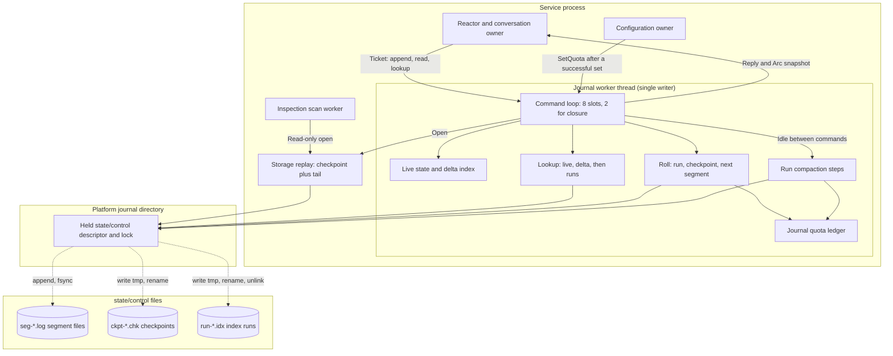

## On-disk layout

All files live in the existing `~/.asura/state/control/` directory (mode 0700).
Every file is a regular file, mode 0600, owned by the account, with one link.

| Name pattern | Content | Authority |
| --- | --- | --- |
| `seg-HHHHHHHHHHHHHHHH.log` | Format-1 frames. `H…` is the first frame sequence in 16 lowercase hex digits. | Authority. Never deleted. |
| `ckpt-HHHHHHHHHHHHHHHH.chk` | Checkpoint at sequence `S` = `H…`. | Derived |
| `run-HHHHHHHHHHHHHHHH-HHHHHHHHHHHHHHHH.idx` | Index run covering frames from the first to the last sequence. | Derived |
| Any of the above names with `.tmp` in place of the final suffix | A file being written | Derived, unfinished |
| `lock` | Empty file that holds the directory-wide writer `flock` | None |

The platform census accepts only these patterns, using exact lengths and
lowercase hex. Any other name, `slot-0.log` included, is `unsupported_layout`.
At most one `.tmp` checkpoint and one `.tmp` run may exist. The census reads
names in batches of 128 and accepts at most 131,328 entries: 131,072 segments
(the 1 TiB quota maximum divided by 8 MiB) plus 256 derived and lock entries.

### File formats

**Segment file.** A segment file is a sequence of complete format-1 frames
with no file header and no padding. The [format-1 envelope](persistence-recovery.md#format-1-byte-contract)
is unchanged: magic `ASURAJ01`, version 1, the 144-byte header, payload and
40-byte trailer. The hash chain continues across files: the first frame of a
segment carries the digest of the last frame of the previous segment. The file
name must equal the sequence of its first frame. A segment ends at end of file.

**Checkpoint file.** Canonical binary, the same integer, string, list and option
encoding as record payloads. At most 6 MiB.

| Field | Content |
| --- | --- |
| Magic; version | `ASURAK01`; u16 1 (journal format 1) |
| Installation ID | 16 bytes |
| Head | Sequence `S`, frame digest of `S`, locator of frame `S`, authority revision, owner generation |
| Segment census | Count of segment files whose first sequence is at most `S`, first sequence of the segment that holds `S`, total bytes of those files |
| Run list | At most 64 entries: first and last sequence, level, entry count, byte length, SHA-256 of the file |
| Live state | The sections in [checkpoint content](#checkpoint-content) |
| Trailer | SHA-256 of all preceding bytes, then `ASURAC01` |

**Index run file.** A 64-byte header, fixed 4,096-byte pages, and a 40-byte
trailer.

| Part | Content |
| --- | --- |
| Header | Magic `ASURAX01`, u16 version 1, u8 level, installation ID, first and last covered sequence, entry count, page count |
| Page | Up to 31 entries of 128 bytes in strictly ascending key order, then a 128-byte page trailer: entry count u16, page number u64, run first sequence u64, SHA-256 of the page's entries and these fields, zero padding |
| Trailer | SHA-256 of the header and all pages, then `ASURAC01` |

An index entry is a 32-byte key (tag u8, ID 16 bytes, discriminator u64, 7 zero
bytes) and a 96-byte value. Keys are unique within a run and across all runs
that one checkpoint references; a duplicate is `Corrupt`. Entry values hold
locators and small fixed facts. They never hold prompt, response, argument or
result text.

**Locator.** Frame sequence u64, segment first sequence u64, byte offset u32
within the segment, frame length u32. A read through a locator opens the named
segment, reads the frame and checks the magic, length, digest, commit marker,
installation ID and that the header sequence equals the locator sequence.
Any difference is `RepairRequired`. Locators replace every `Range<usize>` in
replay types.

### Data view

Proposed logical model. Lines show references and cardinality. Physical files
are named in the entity labels.

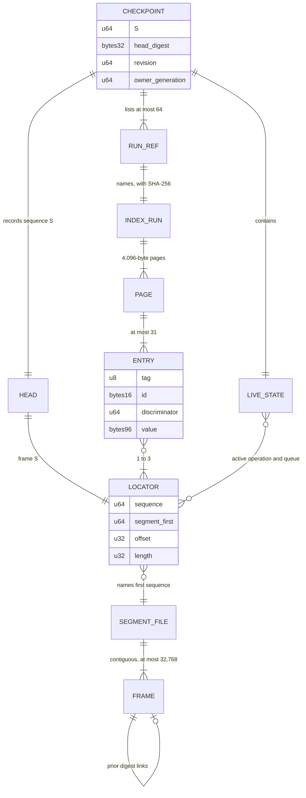

## Limits

| Limit | Value | Reason |
| --- | --- | --- |
| Frame | 64 KiB (unchanged, L29) | Transport unit |
| Segment file capacity | 8 MiB (8,388,608 bytes) and 32,768 frames | Reuses the qualified single-file bounds as the per-file bound |
| Delta charge per segment | 4 MiB of replay charge | Bounds memory for frames after a checkpoint; triggers a roll |
| Replay memory | 16 MiB (unchanged, L35); see [replay memory budget](#replay-memory-budget) | No longer scales with journal size |
| Writer memory | 64 MiB (unchanged, L35) | See [writer budget](#writer-memory-budget) |
| Checkpoint file | 6 MiB | Encoded live state |
| Level-0 index run | 17 MiB | At most 131,072 entries |
| Index runs per checkpoint | 64 | Lookup cost bound |
| Run compaction fan-in | 8 runs of one level | Tiered merge |
| Run compaction step | 256 output pages (1 MiB) | Work budget between commands |
| Open sealed-segment descriptors | 8, least recently used | Descriptor bound |
| Active response pieces | 65,536 | Single-response bound; see [response bound](#single-response-bound) |
| `Prepare` history candidates | 8 MiB of prompt and response text | Keeps today's effective bound |
| Roll reserve | 32 MiB | One segment file, one checkpoint and one level-0 run |
| Disk floor | 16 MiB free | Same floor as the payload quota ledger |
| Journal quota | `journal.quotaBytes`, 64 MiB to 1 TiB; default 4 GiB | Owner, 2026-10-15 and 2026-10-19 |
| Census | Batches of 128 names, at most 131,328 entries | Startup scan bound |
| Recent project set | 64 by activity, plus pinned (at most 81) | Memory residency, not a registration limit |
| Recent conversation set | 256 by activity, plus pinned (at most 273) | Memory residency, not a creation limit |
| Project and conversation pages | 8 entries, 40 KiB per reply | Reply bound; page count unbounded |

The frame count per segment and the u64 sequence remain. Sequence, revision and
generation exhaustion still reject rather than wrap.

## Appends and rolls

### Append

The worker handles one `Append` command at a time:

1. Encode the frame. Apply it to a copy of the live state and delta index. A
   transition failure rejects with no write. This replaces the full re-replay
   in `writer/state.rs:198`; the copy cost is bounded by the replay budget.
2. Run the [quota decision](#quota-decision). A normal record that would use the
   roll reserve gets `journal_quota` or `journal_disk_space` with no write.
3. If the frame does not fit the active segment, [roll](#roll) first.
4. Write the complete frame at the expected end offset with the existing
   `pwrite` loop, then `F_FULLFSYNC`. Validate the held identities.
5. Replace the live state and delta index. Publish one immutable snapshot.

A frame does not fit when the active segment's bytes plus the frame exceed
8 MiB, when the segment already holds 32,768 frames, or when the delta charge
after this frame would exceed 4 MiB. The frame then goes to the next segment
file whole. An empty new segment always holds one frame, because a frame is at
most 64 KiB.

The worker also rolls after an append when the delta charge exceeds 4 MiB, so
that the next append does not wait for it. This is the only case in which an
operation's terminal can move up to 4 MiB of response pieces into the delta.

### Roll

The worker rolls while it holds the single writer gate, inside the command that
needs it. Let `A` be the active segment and `S` its last sequence.

1. **Index run.** Sort the delta entries and the entries of operations that
   became terminal in `A`. Write them to `run-…-….tmp` with `O_CREAT|O_EXCL`,
   then `F_FULLFSYNC`, `renameat` to `.idx`, and directory `fsync`.
2. **Checkpoint.** Encode the live state at `S` and the new run list. Write
   `ckpt-S.tmp`, `F_FULLFSYNC`, `renameat` to `.chk`, directory `fsync`.
3. **Next segment.** Create `seg-(S+1).log` with `O_CREAT|O_EXCL|O_NOFOLLOW`,
   mode 0600. Request `F_PREALLOCATE` for 8 MiB beyond end of file without
   changing the size. Directory `fsync`.
4. **Append.** Write the waiting frame to the new segment as in [Append](#append).
5. **Retire.** Keep the newest two checkpoints and every run either one lists.
   Remove older checkpoints and unlisted runs with `unlinkat`, then directory `fsync`.

Steps 1 to 3 are idempotent. If a valid `ckpt-S.chk` already exists for the
same head, step 2 is skipped; if its run exists, step 1 is skipped. The delta
index becomes empty after step 2. Live response pieces of the active operation
stay in the live state until that operation is terminal and rolled.

Preallocation is a proposed space reservation. Correctness does not depend on
it: the [quota decision](#quota-decision) checks free space first. Validation
case SJ-17 must show whether APFS honours it; if not, step 3 omits it.

### Durability ordering

| Before this step | This must be durable | Why |
| --- | --- | --- |
| Acknowledging an append | The frame bytes (`F_FULLFSYNC`) and, for a new segment, its directory entry | Existing commit rule |
| Renaming a `.tmp` file | The file contents (`F_FULLFSYNC`) | A final name always has complete contents |
| Writing the checkpoint | The run rename and directory `fsync` | A checkpoint never lists a missing run |
| Creating the next segment | The checkpoint rename and directory `fsync` | Replay of the new segment always has a base |
| Removing any derived file | The newer checkpoint rename and directory `fsync` | The fallback checkpoint stays usable |

Rename within one directory relies on POSIX `rename` atomicity. Directory and
full-sync behavior on power loss stays an unqualified limit, as for the single
file today.

### Append and roll sequence

Proposed design. Solid arrows are requests; dashed arrows are replies. Each
`fsync` label is a durability point from the table above.

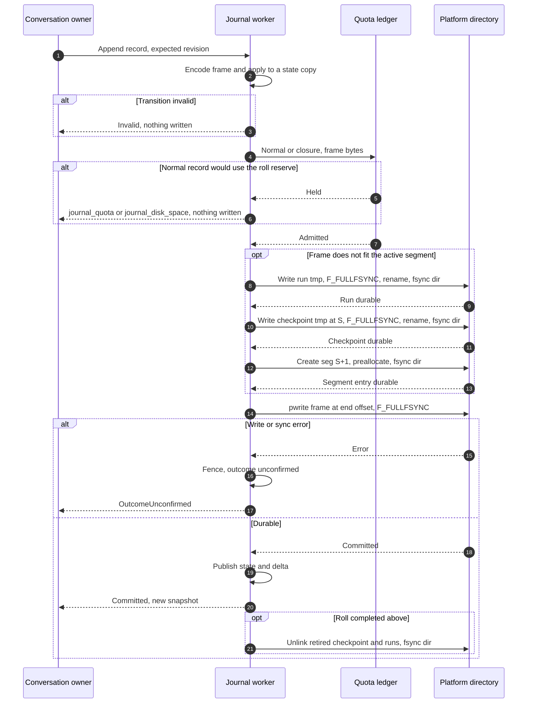

### Segment file lifecycle

Proposed design. Arrows name the worker step or the replay finding.

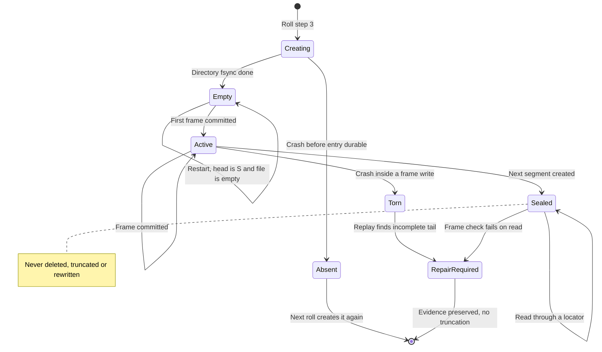

## Checkpoints

### Checkpoint content

A checkpoint at `S` holds the live state that full replay of frames `1..S`
produces. It holds stored facts only:

- Installation ID, chain head, authority revision, owner generation, the kind 10
  initialization facts and the kind 11 binding.
- The **recent project set**: the 64 projects with the newest activity, plus
  every project that the active operation or an unresolved input names. Each
  entry holds location, pinned identity, visibility, name, name revision, latest
  conversation and latest operation, and its last activity sequence.
- The **recent conversation set**: the 256 conversations with the newest
  activity, plus every conversation that the active operation or an unresolved
  input names. Each entry holds project, generation, the locator of the latest
  accepted turn and its last activity sequence.
- The active operation, if any: its kind 21 facts, start, cancel, tool records
  (at most 201, with their locators) and response pieces (at most 65,536).
- The queue: order revision, last dispatched lane, unresolved inputs (at most
  16), inputs dispatched to the active operation, and the 64 most recently
  settled inputs for queue projection.
- The run list and the segment census.

Activity is any committed record that names the project or conversation:
registration, alias, rename, queue input, queue decision, acceptance, start,
cancel, response text and terminal. The recent sets are an exact function of
the frames: order by last activity sequence, then by ID. They are caches of the
index, not the only copy: every project and conversation also has index entries
(`J`, `N`, `D`, `V`, `K`, `A`, `T`). An entity that leaves a recent set loses
nothing. With at most 17 pinned entities (one active operation and 16
unresolved inputs), the sets hold at most 81 projects and 273 conversations.

Replay recomputes these derived values after it loads a checkpoint, and never
stores them: closure reservations, input statuses, registered tool lookups,
create-note identities, exec_cmd job and payload IDs, request digests from
stored original fields, the per-project latest operation used by sensors, and
all memory charges. A checkpoint that contains a field outside this list is
`Corrupt`.

The checkpoint is valid only if it equals the result of replaying frames
`1..S`. Validation case SJ-05 proves this property for generated journals.
The writer never edits a checkpoint; it writes a new one.

### Checkpoint selection

Replay uses the newest checkpoint that passes all of these checks:

1. Size at most 6 MiB, magic, version, trailer digest and commit marker.
2. Installation ID equals the first frame's installation ID.
3. Every listed run exists with the listed size, header and level.
4. The census matches: the count of segment files up to `S` and the segment
   that holds `S`.
5. The frame at the head locator exists and its digest equals the head digest.

If the newest fails, replay tries the previous one. Replay never chooses by
file name alone.

### Checkpoint lifecycle

Proposed design. Arrows name the worker step or replay decision.

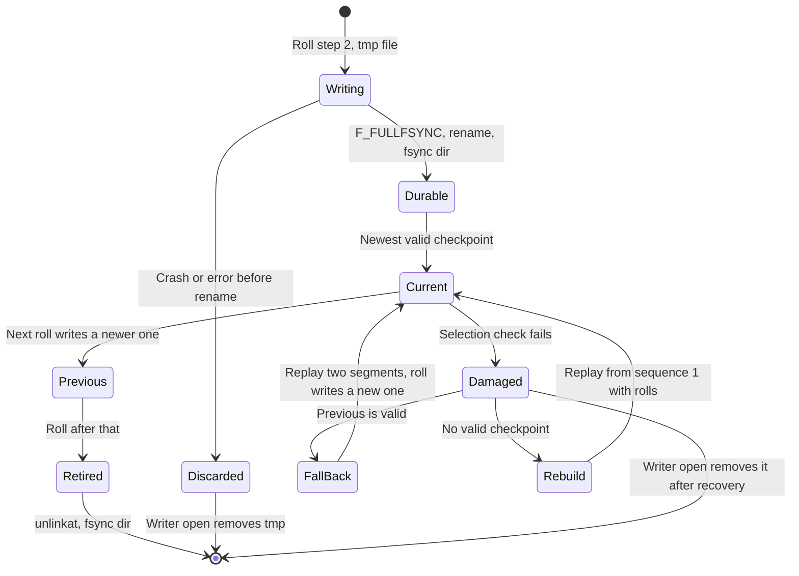

## Index runs and compaction

### Index entries

| Tag | Key: ID, discriminator | Value | Emitted |
| --- | --- | --- | --- |
| `R` request | Request ID, 0 | Command kind u16, request digest, locator of the result frame | Roll after commit |
| `G` generated ID | Installation, graph, task, operation, input or dispatch-request ID, 0 (SJ-D16) | Entity kind u8, locator of the creating frame | Roll after commit |
| `O` operation | Operation ID, 0 | Conversation, generation, terminal kind, cause, response length, piece count, call count, accepted and terminal locators | Roll after terminal |
| `P` response piece | Operation ID, start offset | Kept length, locator of the kind 24 or kind 8 frame | With `O` |
| `C` tool call | Operation ID, ordinal | Decision, kind 14, kind 15 and kind 23 locators (zero when absent) | With `O` |
| `T` turn | Conversation ID, generation | Operation ID, terminal kind, accepted locator, completed turns through this generation (SJ-D12) | With `O` |
| `I` input | Input ID, 0 | Status, kind 18 locator, promotion locator, dispatched operation | Roll after the input settles |
| `X` payload | Payload ID, 0 | Operation ID, generation, ordinal, kind 14 locator, kind 23 locator, last-use sequence | With `O` |
| `S` segment | Segment first sequence, 0 | Last sequence, byte length, last frame digest | Roll that seals it |
| `J` project | Project ID, 0 | Device, inode, visibility, kind 4 locator | Roll after registration |
| `N` project name | Project ID, name revision | Kind 20 locator | Roll after rename |
| `D` project identity | Device and inode as 16 bytes, 0 | Project ID | Roll after registration |
| `V` conversation | Conversation ID, 0 | Project ID, locator of the creating frame | Roll after creation |
| `K` project conversation | Project ID, creation sequence | Conversation ID | Roll after creation |
| `A` project activity | Project ID, accepted sequence | Conversation ID, operation ID, generation | Roll after acceptance |

`G` covers installation, graph, task, operation, input and dispatch-request
IDs; `J` and `V` cover project and conversation IDs for the generated-ID check. The newest entry under a prefix
gives a current value: the highest `N` revision is the current name, the
highest `T` generation the conversation generation, and the highest `A`
sequence the project's latest conversation. Every key is written once, so the
runs stay immutable.

An operation and all its `P`, `C`, `T` and `X` entries are emitted in one run,
because they are emitted together when the operation is terminal. Merges keep
them in one run. Request outcomes are decoded from the frame at the locator, so
the index holds no second copy of an outcome.

Transition IDs are no longer kept for the whole history. Replay rejects a
repeated transition ID within the frames it replays after a checkpoint. The
hash chain rejects a repeated, missing or reordered frame. The request index,
the generated-ID index and the transition rules reject a repeated effect.
Global transition-ID memory therefore adds no detection and grew with every frame.
This changes the format-1 rule “unique in this format” to “unique within each
replayed range”; see [contract changes](#changes-to-existing-contracts).

### Run compaction

Proposed mechanism. Level-0 runs come from rolls, one per segment file. When
eight runs of one level exist and they cover contiguous sequences, the worker
merges them into one run of the next level. The merge reads the inputs page by
page, writes the union in key order and verifies every input page digest and
every input file digest. A duplicate key is `Corrupt` and fences the worker.

The merge runs in steps of at most 256 output pages between commands. A queued
command always runs before the next step. The merged run is written as `.tmp`,
synchronized and renamed; it becomes visible at the next roll's checkpoint.
Inputs are removed only after the checkpoint that lists the merged run becomes
the previous checkpoint. A merge starts only when the quota holds its output
size beyond the roll reserve; otherwise it waits for space.

With fan-in 8, a 1 TiB journal (131,072 segment files) needs at most six levels
and at most 50 runs. A checkpoint lists at most 64. If a roll would list a 65th
run, normal records are held with `journal_quota` until a merge completes.

### What compaction may and may not remove

| Item | Compaction may remove it | Reason |
| --- | --- | --- |
| Any segment file or frame | No | Frames are the authority and hold the only copy of prompts, responses, tool calls and results |
| A checkpoint older than the newest two | Yes | Derived and superseded |
| An index run that neither kept checkpoint lists | Yes | Derived and superseded |
| A `.tmp` file | Yes, at writer open | Never valid |
| A checkpoint that fails selection | Yes, after a newer valid checkpoint is durable | Derived and unusable |

Conversation text, tool call records and response text stay in segment files.
Index runs and checkpoints reference them by locator. They never move into a
checkpoint. Compaction reclaims only derived bytes; journal growth is bounded
by the quota. The owner selected this on 2026-10-19 (OD-SJ-3). A later
person-run command to delete chosen conversations would need its own design.

### Index run lifecycle

Proposed design. Arrows name worker steps.

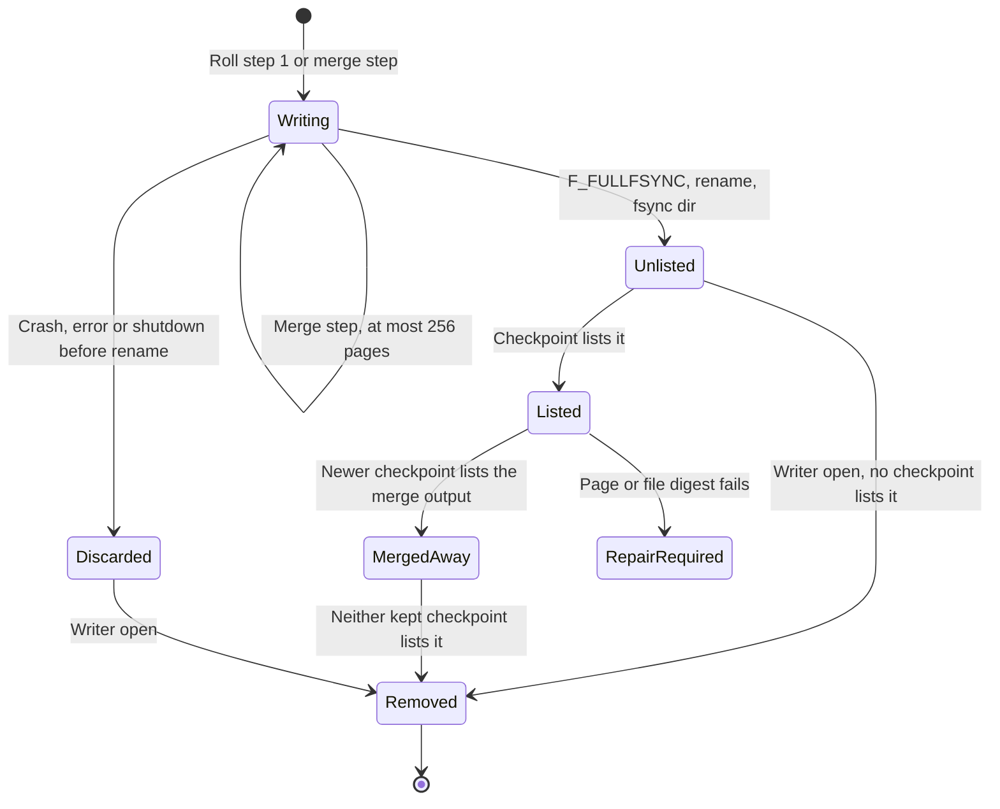

## Replay

### Replay algorithm

Storage owns one replay function. The writer and the inspection scan call it
with a source that reads through the held control directory. Replay reads
frames in 64 KiB chunks and never holds a whole segment file.

Proposed flow. Arrows are decisions; every exit names its result.

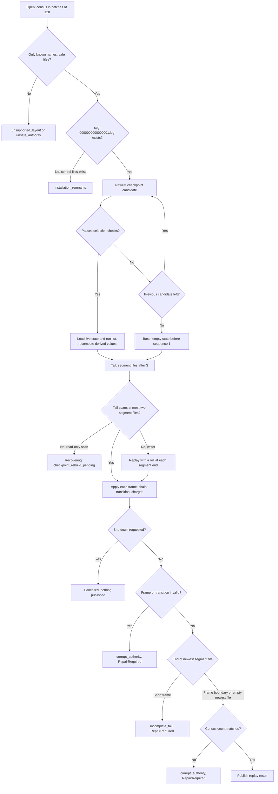

Rules:

- The first frame of the stream is kind 10, as today. With a checkpoint, the
  checkpoint's initialization facts carry that check.
- Each segment file name equals its first frame's sequence. Each later segment
  file starts at the previous file's last sequence plus 1.
- An empty newest segment file is valid only when its name is the head plus 1.
  Any other empty file is `Corrupt`.
- A sealed segment file is not read at startup unless it is in the tail. It is
  checked frame by frame when a locator reads it.
- The writer in rebuild mode is the normal roll path applied while replaying.
  It needs no extra memory. The read-only scan never writes; it reports
  `Recovering` with reason `checkpoint_rebuild_pending` until the writer finishes.
- Replay is all-or-nothing, as today. Any failure discards the public result.

### Replay memory budget

Proposed accounting. Every charge uses the existing conservative per-entry
charges in `conversation/state.rs`.

| Part | Budget | Bound that keeps it |
| --- | --- | --- |
| Live state, fixed part | 1 MiB | Recent project set (at most 81 entries, 5 KiB each), recent conversation set (at most 273 entries, 256 bytes each), one active operation's 201 tool records, 16 unresolved and 64 recent inputs, run list |
| Active response pieces | 4 MiB | 65,536 pieces at 64 bytes |
| Delta index | 8 MiB | Two segment files at 4 MiB each: the tail after a fallback checkpoint |
| Frame buffer, page buffers, closure charges | 3 MiB | One 64 KiB frame, 4 KiB pages, reserved closure frames at 128 bytes each |
| Total | 16 MiB | Independent of journal size |

The current `input_charge` (whole journal bytes) and the `end_offset` term in
`reserve()` are removed, because no journal bytes stay in memory.

### Writer memory budget

| Part | Budget |
| --- | --- |
| Three replay generations (current, proposed, one retired) | 48 MiB |
| `Prepare` history buffer | 8 MiB |
| Queue: 8 commands or replies at 64 KiB | 512 KiB |
| Frame, checkpoint encode and segment read buffers | 192 KiB |
| Merge buffers: 8 input pages and 1 output page | 36 KiB |
| Project page and lookup page buffers | 64 KiB |
| Total | below 64 MiB |

The 8 MiB journal buffer leaves the budget; the history buffer takes its place.
The retired-snapshot backpressure is unchanged.

### Single-response bound

A response's piece list stays in the live state while its operation is active.
The 65,536-piece limit is a single-item bound. A piece is one kind 24 record or
the kind 8 tail, at most 61,440 bytes. A response of whole pieces can therefore
reach 3.75 GiB. If a kind 24 record would add the 65,537th piece, the writer
returns `Limit` and the conversation owner records cancel cause 3
(`output_limit`), exactly as for journal capacity today (RT-07). The quota may
end a response earlier.

## Windowed reads

Every read runs on the journal worker and returns bounded results.

### Lookup order

Proposed flow. Arrows are decisions for one key.

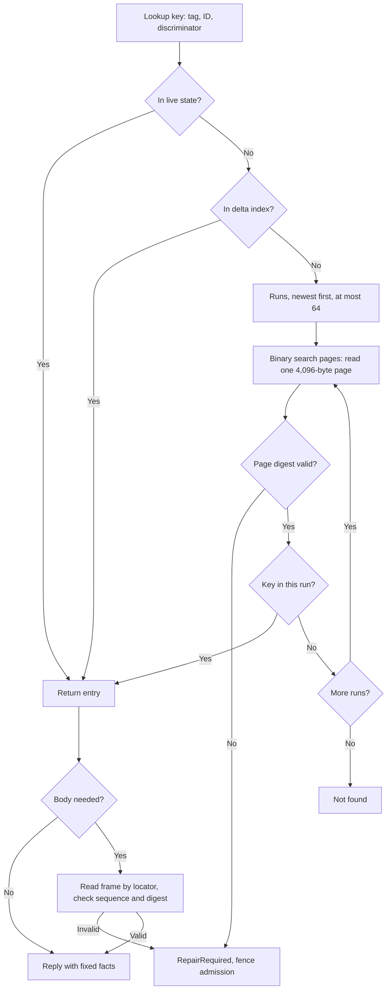

One lookup reads at most `ceil(log2(pages)) + 1` pages per run and at most 64
runs. Typical journals have fewer than 10 runs.

### Read commands

| Command | Change |
| --- | --- |
| `ReadRecord { range }` | Becomes `ReadRecord { locator }`. The locator must be one that the live state, delta or an index entry names. |
| `ReadResponse { operation, offset }` | `O` gives the length and piece count. The worker finds the last `P` entry with start at most `offset` and reads frames until the 61,440-byte window is full. Pieces in different segment files are read in order. |
| `History { conversation, before, limit ≤ 8 }` | `before` is the accepted frame sequence of the oldest entry shown (SJ-D14); the `A` entry for it gives the generation. Searches `T` entries in each run and the delta below that generation, adds the active turn on the first page, merges them newest first and returns `limit + 1` to set `has_more`. |
| `Prepare` | Returns completed prior turns newest first, from `T`, `O` and `P`, until the next turn would pass 8 MiB of prompt and response text. Older turns are reported as `omitted` (SJ-D23). The [context composer](context-composer.md#cc1-implementation-details) already omits turns that do not fit `W`. |
| `ReadPrompt { operation }` | `O` gives the accepted locator. |
| Tool-call replay | `C` entries give the kind 14, 15 and 23 locators for a terminal operation; the active operation's records are in the live state. |
| New `Lookup { operation }` | Returns the `O` facts of any operation. The service uses it where it reads `replay.operations` for a non-live operation. |
| New `PayloadFacts { payloads ≤ 128 }` | Returns `X` facts. The payload recovery worker uses it instead of replay-wide facts. |
| New `JournalStatus` | Returns usage, effective quota, configured quota, hold state and run count. |
| `Projects { after or before, limit ≤ 8 }` | Serves `ProjectList`. Merges `J` entries from the delta and every run in project-ID order after `after`, or in descending order below `before`; adds the current name from `N` and the stale check. Each page stays within 40 KiB. The total number of pages has no bound. |
| New `Project { project }` | Serves `ProjectList` with `only`: one project entry, or not found. Clients use it to validate `/project select ID` for a project outside their window. |
| `Register` duplicate check | Looks up `D` by device and inode instead of scanning a project map. |
| Latest conversation (restoration) | Recent project entry, otherwise the highest `A` key under the project. |
| New `Conversations { project, before, limit ≤ 8 }` | Pages `K` entries newest first. No client command uses it yet; a later conversation-list command uses this read. |
| Conversation lookup at admission | Recent conversation entry, otherwise `V` for the project and the highest `T` for the generation. |

## Quota and disk space

### Configuration

The configuration owner adds `journal.quotaBytes`: an integer from 67,108,864
(64 MiB) to 1,099,511,627,776 (1 TiB). Values outside the range are
`config_invalid_value`. The default is 4,294,967,296 (4 GiB; owner, 2026-10-19,
OD-SJ-1).
The [configuration commands](config-commands.md#schema-and-command-behavior)
table lists the key when it is implemented. Unlike `retention.quotaBytes`, a
successful set applies at once: the service sends `SetQuota` to the worker, so
a held journal can resume without a restart.

The key is separate from `retention.quotaBytes` (owner, 2026-10-19, OD-SJ-4),
because history never expires and tool output can.

### Accounting

Usage is the sum of: every segment file's size, except the active segment,
which counts as 8 MiB; every checkpoint file; every index run; and every
`.tmp` file. The worker computes usage at open from the census and updates it
at each roll, merge and removal. The effective quota is the smaller of the
configured quota and usage plus free disk space minus the 16 MiB disk floor.
The worker reads free space with `fstatfs` on the held directory at open, at
each roll, before each merge and on each resume check.

The ledger keeps the roll reserve (32 MiB) for closure records. A **normal
record** is any record except kind 8 `TurnTerminal`, kind 7 `CancelRequested`,
kind 6 `StartAuthorized` for an already accepted operation, kind 3
`OwnerGeneration`, the pending `run` call's kind 23 and kind 15, and a kind 14
with decision `cancelled` (SJ-D18). A normal record fits when its bytes, the
roll reserve and the closure reservation after the record (SJ-D19) fit. The existing closure reservation in `reserve()` still holds
the bytes of those closure frames for the active operation and unresolved inputs.

### Quota decision

Proposed flow for one append. Arrows are decisions.

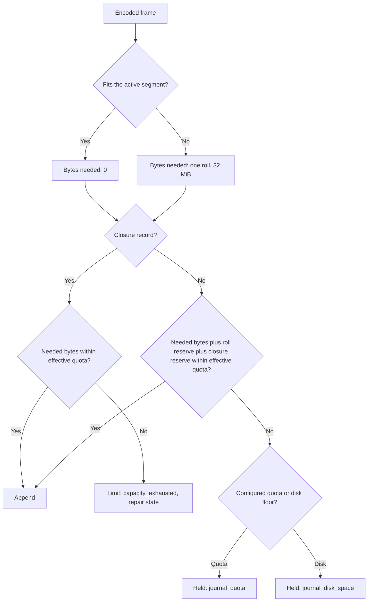

`capacity_exhausted` for a closure record can occur only when another process
fills the disk after the roll reserve was counted, or after repeated restarts
use the reserve. It keeps today's meaning: remain repair-required with all
evidence preserved.

### Holding and resuming

While held, the worker refuses each normal record with `journal_quota` or
`journal_disk_space` and writes nothing. Reads, lookups, closure records and
inspection continue. The worker leaves the held state when a check finds that
a normal record and the reserves fit again.

The worker checks again at once when the configuration owner changes the
quota, when the payload store reports removed files, or when the person asks
for status. Between events it checks free space after 1, 1, 2, 3, 5, 8 seconds
and so on, each the sum of the two before, at most 60 seconds apart (owner,
2026-10-19), so space freed outside Asura is seen within a minute. This is pacing; it
never ends or refuses work. Shutdown ends the held state.

Behavior for new work while held (required): queue input, project registration,
renames and new turns get `busy` with the hold reason. Clients keep the draft
and show “Journal space is full. Raise journal.quotaBytes or free disk space.”
for `journal_quota`, and “Disk space is low for the journal.” for
`journal_disk_space`.

Behavior for the active turn while held: the turn pauses (owner, 2026-10-19,
OD-SJ-2). It works as follows. The conversation owner keeps the active operation and stops
granting model output credit, as the response state already does while kind 24
appends wait. A tool call that needs a kind 14 record waits before execution.
The person sees “Paused: journal space is full.” The turn resumes when the
worker leaves the held state. Cancel, steering, shutdown and restart end the
pause; each uses closure records, which always fit.

### Hold and resume sequence

Proposed design for the owner-selected pause. Solid arrows are requests,
dashed arrows replies.

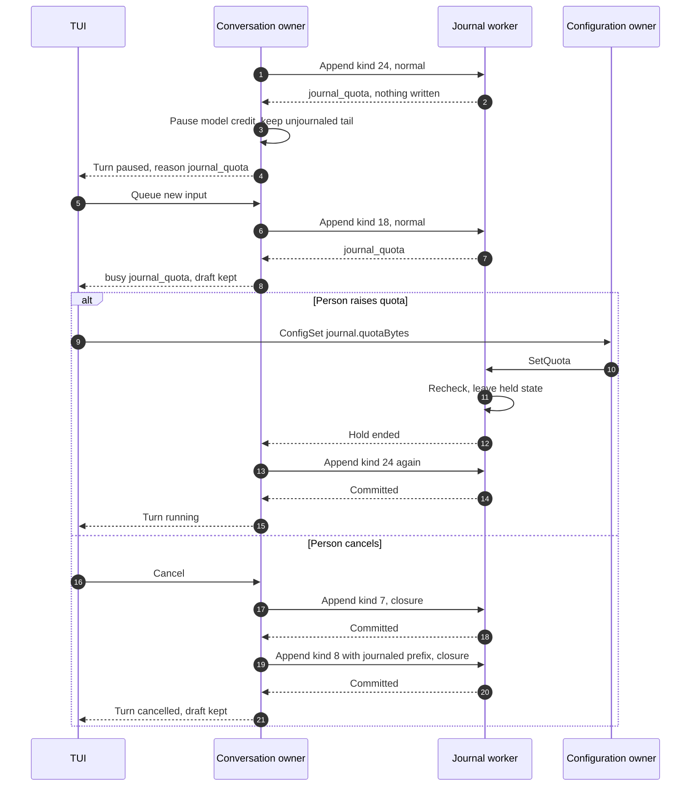

### Worker capacity states

Proposed design. Arrows name the trigger. Fenced is the existing uncertain-write state.

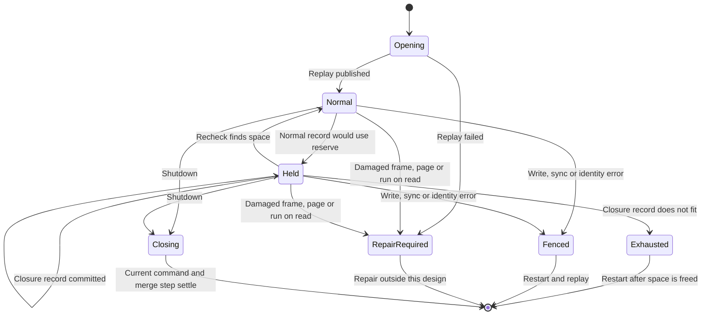

### Disk full during a write

`ENOSPC` from `pwrite` is handled as follows. The worker reads the file size.
If the size equals the expected end offset, no byte of the frame is in the
file. The worker does not fence; it enters `Held` with `journal_disk_space`
and returns that reason. If the size changed, the outcome is uncertain: fence
and return `OutcomeUnconfirmed`, as today. `ENOSPC` while writing a `.tmp`
derived file removes that file and enters `Held`. Validation case SJ-17 must
qualify the unchanged-size rule on APFS before the writer relies on it.

## Failure and recovery

| ID | Fault | Required result |
| --- | --- | --- |
| SJ-F01 | Crash while writing `run-….tmp` | Writer open removes the tmp file. The previous checkpoint and the full segment replay; the next append repeats the roll. |
| SJ-F02 | Crash after the run rename, before the checkpoint | The run is unlisted; writer open removes it; roll repeats. |
| SJ-F03 | Crash while writing `ckpt-S.tmp` | Same as SJ-F01. |
| SJ-F04 | Crash after the checkpoint rename, before its directory `fsync` | Either name survives. A tmp is removed; a final name passes selection or is removed after a newer one exists. |
| SJ-F05 | Crash after the checkpoint, before `seg-(S+1).log` exists | Replay uses the checkpoint with an empty tail. The next append creates the segment; steps 1 and 2 are skipped. |
| SJ-F06 | Crash after the segment entry, before the first frame | Empty newest segment named head plus 1: valid. |
| SJ-F07 | Crash inside a frame write in the active segment | `incomplete_tail`, RepairRequired, every file preserved (PR7). |
| SJ-F08 | Newest checkpoint damaged | Fall back to the previous one; replay two segment files; the next roll writes a new checkpoint. |
| SJ-F09 | Both checkpoints damaged or missing | Writer rebuilds from sequence 1 with rolls; inspection reports `checkpoint_rebuild_pending`. |
| SJ-F10 | A listed run missing or with a bad header | That checkpoint fails selection; SJ-F08 or SJ-F09 applies. |
| SJ-F11 | A run page digest fails on lookup | RepairRequired; the read fails; evidence preserved. |
| SJ-F12 | A sealed segment frame fails its check on read | RepairRequired; the read fails; evidence preserved. |
| SJ-F13 | A segment file is missing from the census | `corrupt_authority`, RepairRequired. |
| SJ-F14 | Crash during a merge step | The merge tmp is removed at open; inputs remain listed. |
| SJ-F15 | Crash after a derived-file `unlinkat`, before directory `fsync` | The file may reappear; it is unlisted and removed again. |
| SJ-F16 | `ENOSPC` with unchanged file size | `Held`, not fenced. |
| SJ-F17 | `ENOSPC` with changed size, or any other write or sync error | Fenced, `OutcomeUnconfirmed`, as today. |
| SJ-F18 | Unknown name, symlink, wrong mode, extra link or owner in the control directory | `unsupported_layout` or `unsafe_authority`; nothing is opened for write. |
| SJ-F19 | A second writer process | The `lock` file `flock` fails; `OwnerBusy`. |

Every recovery removes only derived or tmp files and only after a newer valid
checkpoint, or none is needed. No recovery truncates, renames or rewrites a
segment file.

## Concurrency and the writer gate

- One journal worker thread owns every journal descriptor. The `lock` file
  `flock` (exclusive, nonblocking) prevents a second writer process. The
  process-wide writer claim (`writer/mod.rs:286`) prevents a second worker.
- Rolls run inside the command that needs them. Compaction steps run only when
  the command queue is empty, at most 256 output pages each.
- The inspection scan reads with its own descriptors and never writes. The
  service publishes its result before the writer's first append, as today.
- Snapshots sent to the reactor hold only the live state and delta index. The
  retired-snapshot backpressure rule stays.
- Service code that now reads history maps from the snapshot changes:

| Site | Today | Change |
| --- | --- | --- |
| `conversation.rs:1006-1045` sensor scan | Iterates `replay.operations` for every registered project | Removed. Each append reply names the project, conversation, operation and sequence it touched; the sensor owner applies that activity. At startup the recent project set seeds the resident sensor owners ([sensor residency](sensors.md#resident-project-states)) |
| `conversation.rs:1047` sensor loop over `replay.projects` | First 64 registered projects | The sensor owner's resident set |
| `conversation/audit_tools.rs:176` project check | `state.projects.contains_key` | Recent project set, otherwise `Project { project }` |
| `asura-cli/src/conversation.rs:206-267` project pages | Reads up to 8 pages | Reads pages on demand; see [CF06b](command-flows.md#cf06b-project-list-and-local-selection) |
| `conversation.rs:1646`, `:1675`, `:2955` operation observe | `replay.operations.get` | Live or delta first; otherwise `ReadResponse` reads it through `O`, `P` and `C`; cancel of such an operation answers `unknown_operation` (SJ-D22) |
| `conversation.rs:1961`, `:3404`, `:3706` | Active-operation facts | Unchanged: the active operation is always live |
| `conversation.rs:2008` registration reply | `replay.requests.get` | Uses the writer reply's outcome |
| `asura-service/src/payload_owner.rs` recovery | Replay-wide exec_cmd facts | `PayloadFacts` in batches of 128 |

### Project and conversation residency

Proposed design. The state view applies to one project or one conversation in
the live state. Arrows name the committed record or replay step. Index entries
exist in every state after the roll that emits them.

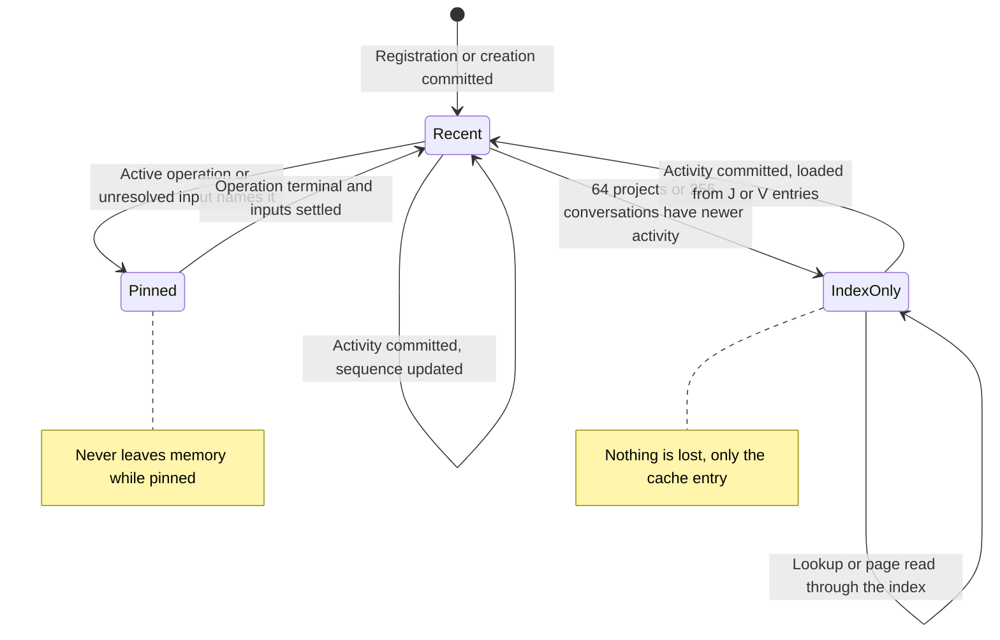

A lookup that misses the recent sets reads the index on the journal worker.
The reactor never reads the index; it sends `Project`, `Lookup` or a page
command and waits for the ticket.

## Asynchronous execution

| Rule | Application |
| --- | --- |
| AE-01 | The reactor sends commands and polls tickets. It never opens, reads or writes journal files. Lookups, rolls and merges run on the worker. |
| AE-02 | Blocking calls: `openat`, `pread`, `pwrite`, `F_FULLFSYNC`, directory `fsync`, `renameat`, `unlinkat`, `fstatfs`, `flock`, `F_PREALLOCATE`, `readdir`. All run on the existing journal worker. No new thread. |
| AE-03 | Queue 8 slots (6 normal, 2 closure); frame 64 KiB; segment file 8 MiB and 32,768 frames; delta 4 MiB per segment; replay 16 MiB; writer 64 MiB; 64 runs; merge step 256 pages; 8 open segment descriptors; census batches of 128; `Prepare` 8 MiB; roll reserve 32 MiB; disk floor 16 MiB. Overload gets `busy`; the quota gets `journal_quota` or `journal_disk_space`. |
| AE-04 | No deadline. An append ends on its write and sync result. A roll ends on completion or an error. A merge step ends on completion, error or shutdown. Replay ends on completion, a content failure or shutdown. The held state ends on space, a quota change or shutdown; the active turn's pause ends on resume, cancel, steering, shutdown or restart. The free-space recheck schedule is pacing that ends nothing. |
| AE-05 | Rolls and merges are idempotent. Derived files are rebuilt from frames. Uncertain appends fence as today and resolve by replay and request ID. No effect is retried with an unknown outcome. |
| AE-06 | Shutdown sets the worker's close flag. The current command finishes; a merge step stops at its next page and leaves a tmp file. Each crash point in the failure table recovers. Stop waits and shows progress; a second stop may force exit (owner, 2026-10-16). |
| AE-07 | Cases SJ-23 to SJ-26 measure responsiveness with gated rolls, merges, lookups and replay. |

## Security

- Paths come only from fixed name patterns and sequence numbers. No client or
  model value forms a journal path. All opens use `openat` on the held control
  directory with `O_NOFOLLOW`; new files use `O_CREAT|O_EXCL`, mode 0600.
- Before `renameat` or `unlinkat`, the worker checks the name pattern and the
  held identity of the file. It never unlinks a `seg-` name.
- The existing checks apply to every file: current-user owner, mode 0600 or
  0700, one link, no extra ACL, local APFS volume, identity unchanged since open.
- Derived files hold no prompt, response, argument or result text. They hold
  IDs, digests, sizes and locators. Case SJ-32 checks this.
- SHA-256 detects damage, not hostile rewriting. A same-UID attacker remains
  outside the supported threat boundary, as today.
- Tests use scratch homes. A test guard rejects any runtime root under the real
  `~/.asura` (SJ-31).

## Operations

- Logs: one info event per roll (usage, runs, segments) and per merge; one
  warning when the journal enters or leaves the held state (with usage and the
  effective quota). The service writes them from the published status. Logs
  never contain record text.
- Status: the writer publishes `JournalStatus` (usage, effective and
  configured quota, hold state, runs, segments, roll and merge counts) for the
  service without a ticket; the service logs roll, merge and hold changes. The
  status pane and a control field do not show it yet (open). Protocol stays
  0.1; adding a reply field follows the normal schema rules.
- Backup: a consistent copy needs every segment file and the two kept
  checkpoints with their runs. Derived files can be omitted and rebuilt. The
  backup design remains open in [persistence and recovery](persistence-recovery.md#compaction-and-backup).
- Performance acceptance (evidence, not closures): roll under 1 s and lookup
  under 10 ms on the development host; startup replay time and peak memory for
  1, 16 and 128 segment files recorded.

## Changes to existing contracts

| Contract | Change |
| --- | --- |
| [Format-1 bounds](persistence-recovery.md#bounds-interruption-and-preservation) | 8 MiB and 32,768 frames become per-segment-file bounds. Replay memory stays 16 MiB, independent of size. |
| [Stage 3A layout](persistence-recovery.md#ownership-and-supported-state) | `slot-0.log` is replaced by the layout above; `slot-0.log` becomes `unsupported_layout`. |
| [Compaction and backup](persistence-recovery.md#compaction-and-backup) | The two-slot SWITCH proposal is superseded by rolls and checkpoints. |
| Transition ID uniqueness | Unique within each replayed range, not across the whole history; see [index entries](#index-entries). |
| [Kind 24 capacity rule](conversation-admission.md#format-1-and-record-kinds) | A refused kind 24 means quota, disk or the 65,536-piece bound, not the 8 MiB file. |
| [CA-B memory limit](conversation-admission.md#ca-b-aggregate-journal-memory-limit) | The 8 MiB journal buffer becomes the 8 MiB `Prepare` buffer. |
| [Context composer candidates](context-composer.md#cc1-implementation-details) | `Prepare` stops at 8 MiB of text instead of relying on the file bound. |
| Replay types | `Range<usize>` frame addresses become locators. |
| [Project and conversation totals](conversation-admission.md#format-1-and-record-kinds) | 64 projects and 256 conversations removed (owner, 2026-10-19). |
| [ProjectList](conversation-admission.md#automatic-initialization-and-explicit-registration-workflow) | Pages without a total; new optional exact-ID field `only`. |
| [Sensor residency](sensors.md#resident-project-states) | 64 resident states become a cache with eviction; the replay scan is replaced by append activity. |
| [CF06b](command-flows.md#cf06b-project-list-and-local-selection) and [project names](project-names.md) | The client registry becomes a window; lists page on demand. |

### Code map

| Area | Files |
| --- | --- |
| Platform journal directory, census and file primitives | `asura-platform/src/journal_io.rs`, `authority.rs`, `journal_io/gate.rs` (test gates for roll, merge and lookup) |
| Format, limits, envelope | `asura-storage/src/authority.rs` |
| Replay source, live state, delta, checkpoint codec | `asura-storage/src/authority/conversation/state.rs`, `types.rs`, new `checkpoint.rs` |
| Index runs, lookups, merges | New `asura-storage/src/authority/index/` |
| Writer commands, roll, ledger | `asura-storage/src/authority/writer/mod.rs`, `state.rs` |
| Fixtures | `asura-storage/src/authority/fixture.rs` gains multi-segment builders |
| Configuration key | `asura-storage/src/config.rs` |
| Service consumers and hold reasons | `asura-service/src/conversation.rs`, `installation.rs`, `payload_owner.rs`, `sensors.rs`, `conversation/audit_tools.rs` |
| Totals removed | `MAX_PROJECTS` and `MAX_CONVERSATIONS` in `conversation/types.rs` and their checks in `state.rs`; `MAX_PROJECTS` in `asura-service/src/sensors.rs` becomes the resident-set size |
| Project list paging | `asura-control` `ProjectList.only`, `asura-client`, `asura-cli/src/conversation.rs`, `asura-cli/src/tui/` project picker |
| Client reasons and notices | `asura-client`, `asura-cli/src/tui/` |

## Validation

Every case uses a private scratch home on local APFS. Unit cases use the pure
codec, replay and index modules with in-memory sources. Integration cases use
real files through the platform and the real writer, with the existing
`journal_gate` feature for holds and faults. End-to-end cases use the real
service and TUI over the PTY gate, with the scripted loopback model endpoint
where a large response is needed.

| ID | Case | Unit | Integration | End-to-end |
| --- | --- | --- | --- | --- |
| SJ-01 | Layout and names | Name parser accepts exact patterns and rejects case, length, extra suffix and `slot-0.log` | Census with valid, unknown, symlink, mode, link and owner faults (SJ-F18) | `slot-0.log` home shows `unsupported_layout` |
| SJ-02 | Frame that does not fit | Roll trigger at 8 MiB minus 1 byte, at 32,768 frames and at 4 MiB delta charge; frame never split | Real writer rolls on each trigger; every file ends on a frame boundary | — |
| SJ-03 | Chain across files | First frame of a segment links the previous digest; wrong link is `Corrupt` | Three segment files replay; a swapped file is rejected | — |
| SJ-04 | Roll crash points | Idempotent step decisions for each existing-file combination | Process death at each of SJ-F01 to SJ-F06, then restart replays and appends | Service killed during a roll restarts and the TUI conversation continues |
| SJ-05 | Checkpoint equals replay | Property test: for generated journals, checkpoint plus tail equals genesis replay, byte for byte in canonical encoding | Real writer: checkpoint after 20 rolls matches a rebuild | — |
| SJ-06 | No stored derived values | Checkpoint with an extra or derived field is `Corrupt`; derived values recompute after load | — | — |
| SJ-07 | Checkpoint fallback | Selection order and checks | SJ-F08 with a damaged newest checkpoint | — |
| SJ-08 | Rebuild | Rebuild mode emits the same runs and checkpoint | SJ-F09: both checkpoints removed; writer rebuilds; inspection reports `checkpoint_rebuild_pending` meanwhile | TUI shows the loading state, then the conversation |
| SJ-09 | Replay memory is independent of size | Charges for 1, 16 and 128 segment files stay within 16 MiB | Peak resident memory of replay for 1, 16 and 128 files recorded; growth under 2 MiB | — |
| SJ-10 | Windowed reads across files | `ReadResponse` window across pieces in two files; history merge across runs and delta; `Prepare` stops at 8 MiB | Real journal of 40 segment files: history, prompt, response and tool-call reads match a reference | TUI restores and pages a conversation older than 8 MiB |
| SJ-11 | Run compaction | Merge of eight runs equals their union; lookups equal before and after | Merge steps interleave with appends; SJ-F14 crash recovery | — |
| SJ-12 | Duplicate keys | Duplicate across runs or within a page is `Corrupt` | Constructed duplicate run fences the writer | — |
| SJ-13 | Generated ID collision | Forced test RNG collision with an `G` entry in a run makes the writer draw again | Replay of a delta that repeats a run's ID is `Corrupt` | — |
| SJ-14 | Quota key | Bounds at 64 MiB − 1, 64 MiB, 1 TiB, 1 TiB + 1; default 4 GiB | Effective quota uses free space and the disk floor | `/config set journal.quotaBytes` applies without restart |
| SJ-15 | Held state | Normal record refused, closure record admitted, reserve arithmetic | Fill to the quota: queue input `busy`, cancel and terminal commit; raise quota resumes; no segment file removed | TUI shows the hold notice and keeps the draft |
| SJ-16 | Active turn at the quota | Credit withheld and tool call held while held; cancel admitted while held | Scripted helper response reaches the quota: output pauses, a tool call waits before its kind 14, raising the quota resumes and the response completes whole; a second run cancels during the pause and records the journaled prefix | TUI shows “Paused: journal space is full.”, then running or cancelled |
| SJ-17 | Disk space | Floor arithmetic; ENOSPC rules SJ-F16 and SJ-F17 | Small APFS disk image: free space below need at roll holds; real ENOSPC on append with size check; `F_PREALLOCATE` effect recorded | — |
| SJ-18 | Torn active tail | Short header, payload and trailer in the newest file | Writer death at every byte of a frame in the second segment file: `incomplete_tail`, all files preserved | — |
| SJ-19 | Sealed damage | Bad frame through a locator is `RepairRequired` | Flip a byte in a sealed file; the read fails and admission fences (SJ-F12) | — |
| SJ-20 | Missing segment file | Census count mismatch | Remove an interior file: `corrupt_authority` | — |
| SJ-21 | Run page damage | Page digest failure | Flip a run byte: lookup fails, RepairRequired (SJ-F11) | — |
| SJ-22 | Second writer | — | Second process gets `OwnerBusy` from the `lock` file (SJ-F19) | — |
| SJ-23 | Stalled roll | — | Gate the checkpoint `F_FULLFSYNC` for 5 s: Inspect and cancel admission within 100 ms; output pauses; no fence; completes after release | TUI typing within 100 ms during the gated roll |
| SJ-24 | Stalled merge | A queued command runs before the next merge step | Gate a merge page write: appends and reads continue between steps | — |
| SJ-25 | Shutdown | Close flag stops replay, merge and held recheck | Stop during roll, merge, rebuild and held state; restart recovers; second stop forces exit and restart recovers | Stop during a roll from the TUI shows progress |
| SJ-26 | Read-only inspection | Inspection source never writes | File list and bytes unchanged after inspection of every fault fixture | — |
| SJ-27 | Large response | Response state across three segment files | `tool_call_flow response` with a 20 MiB loopback answer: journaled whole, assembled from windows before and after restart | — (live model cannot exceed 61,440 bytes; see RT-03) |
| SJ-28 | Large tool turn | — | 200 maximum kind 14 records (about 12.6 MiB) commit across segment files | — |
| SJ-29 | Long installation | — | Synthetic 1 GiB journal: startup time and peak memory recorded; lookups correct | — |
| SJ-30 | Single-response bound | 65,537th piece returns `Limit`; owner records `output_limit` | Real writer with a reduced test piece limit shows the truthful terminal | — |
| SJ-31 | Scratch homes only | Guard rejects the real `~/.asura` root | All suites run with scratch roots | PTY harness asserts its scratch `HOME` |
| SJ-32 | No text in derived files | — | Search checkpoints and runs for marker strings from prompts, responses and arguments: none found | — |
| SJ-33 | Numbers unchanged | Frame version 1, checkpoint and run version 1, protocol 0.1 | — | — |
| SJ-34 | Payload facts | `PayloadFacts` batch bounds | Payload recovery after 10 rolls finds every retained call | — |
| SJ-35 | No project total | Registration of a 65th and a 1,000th project succeeds; the recent set stays at 64 plus pins; `D` finds an existing device and inode | 1,000 registrations across several rolls; restart; every project resolves by ID and by alias | `asura project add` succeeds for project 65 |
| SJ-36 | No conversation total | The 257th and 10,000th conversations are created; eviction order by activity then ID | 10,000 conversations across rolls: admission to an evicted conversation uses `V` and `T`; restart keeps generations | TUI continues an old conversation after many newer ones |
| SJ-37 | Project list paging | Page merge across delta and runs in ID order; 40 KiB page bound; `Project` exact read | 200 projects: pages have no gaps or duplicates across a concurrent rename and a roll | TUI list scrolls past 64 entries and selects entry 150; CLI prints all 200 |
| SJ-38 | Latest conversation | Highest `A` key under a project prefix across runs | Restoration for a project outside the recent set picks the newest accepted conversation | Relaunch restores it |
| SJ-39 | Sensor residency | Resident set bound, eviction only of settled idle states | 100 active projects in turn: at most 64 resident; evicted state reloads; no observation lost | — |
| SJ-40 | Checkpoint of recent sets | Recent sets after load equal genesis replay (part of SJ-05) | — | — |

### Validation status (2026-10-19)

Delivered evidence by layer. "Unit" uses the pure codecs and the journal
driver on in-memory files (`authority/index.rs`, `index/run.rs`,
`journal/tests.rs`); "integration" uses real files, the real writer and the
real service (`asura-storage/tests/segmented_journal.rs`, `journal_writer.rs`,
`asura-platform` journal tests, `asura-service` `tool_call_flow pause` and
`roll`, `sensor_residency_tests.rs`); "end to end" uses the real TUI, CLI and
service over the PTY gate (`tui_pty.py --segmented-journal` and
`--segmented-restore`).

| ID | Unit | Integration | End to end |
| --- | --- | --- | --- |
| SJ-01 | Name parser (`sj01_names_parse_exactly`) | Census faults (`sj_f18_census_rejects…`), `slot-0.log` scan | `slot-0.log` home reports `unsupported_layout` |
| SJ-02 | Byte, frame-count and delta-charge rolls | 20 MiB response rolls; files end on frame boundaries | — |
| SJ-03 | Chain across files; swapped file rejected | Three or more files replay after restart | — |
| SJ-04 | Crash at each of six roll points recovers | Service killed while a roll is held at its checkpoint sync restarts, removes the tmp file, interrupts the turn and runs the next | Not run through the TUI (gap) |
| SJ-05 | Checkpoint plus tail equals genesis replay for generated journals | Rebuild after removing every derived file reads the same response | — |
| SJ-06 | Extra checkpoint content is `Corrupt`; derived values recompute | — | — |
| SJ-07 | Damaged newest checkpoint falls back; the next roll replaces it | — | — |
| SJ-08 | Rebuild emits the same runs and checkpoints; read-only scan reports `checkpoint_rebuild_pending` | Rebuild through the real writer | TUI shows the loading state while the held writer rebuilds, then the conversation (the service shows `inspection_pending` until the writer opens) |
| SJ-09 | Replay charge independent of the number of segment files | Startup time recorded (SJ-29); peak resident memory not measured (gap) | — |
| SJ-10 | `T` entries merge delta and runs newest first | 20 MiB response windows, `Prepare`, history pages, prompt and tool-call reads before and after restart | Relaunch restores an old conversation (SJ-38) |
| SJ-11 | Merge equals union; lookups equal before and after | Merges interleave with commands on real files and retire inputs | — |
| SJ-12 | Duplicate keys across runs or within a page are `Corrupt` | — (unit only) | — |
| SJ-13 | A run's generated ID is not reused | — (unit only) | — |
| SJ-14 | Key bounds and default (configuration owner) | `journal.quotaBytes` set makes the writer recheck at once (pause case) | `/config set journal.quotaBytes` then the hold notice without restart |
| SJ-15 | Normal held, closure admitted, reserve arithmetic | Quota and disk holds: nothing written, closures commit, raising the quota or freeing space resumes | TUI shows "Disk space is low for the journal." and keeps the input |
| SJ-16 | Pause rendering (client unit) | Real helper: output pauses with the paused step, resumes whole; cancel during the pause keeps the journaled prefix | TUI paused display not run end to end (gap; client unit case) |
| SJ-17 | Floor arithmetic; ENOSPC with the size unchanged holds | APFS disk image: the floor holds before a roll; freeing space resumes; with the disk full an append inside the preallocated segment commits (F_PREALLOCATE honoured) | — |
| SJ-18 | Short newest file is an incomplete tail; short sealed file is damage | Torn newest segment on real files: repair required, files unchanged | — |
| SJ-19 | Damaged sealed frame fails the lookup | Damaged sealed frame on real files: the read fails and the writer is fenced | — |
| SJ-20 | Missing interior segment is damage | Same on real files | — |
| SJ-21 | Damaged run page fails the lookup | Damaged run on real files: selection or the read fails | — |
| SJ-22 | — | A second writer process gets `OwnerBusy` | — |
| SJ-23 | — | Roll held 5 s at its checkpoint sync: admission and status do not wait, no fence; service Inspect within 100 ms | TUI typing during a held roll not run (gap) |
| SJ-24 | Commands run before the next merge step (worker loop) | Merges on real files while commands run | — |
| SJ-25 | — | Shutdown during a held roll; restart recovers | Stop from the TUI during a roll not run (gap) |
| SJ-26 | Read-only open never writes | Inspection of each damage fixture leaves the files unchanged | — |
| SJ-27 | — | 20 MiB response across files, before and after restart and rebuild | — |
| SJ-28 | — | 200 tool-call records of about 64 KiB across files | — |
| SJ-29 | — | 40 MiB by default (`ASURA_SJ29_MIB` raises it): startup time recorded; 1 GiB not run by default (gap) | — |
| SJ-30 | Lowered piece bound refuses the next piece | Service maps `Limit` to `output_limit` (RT-07 path) | — |
| SJ-31 | — | Every suite uses scratch homes; the integration file asserts it | PTY fixtures use scratch homes |
| SJ-32 | Derived files hold no response marker | Same on real files | — |
| SJ-33 | Frame, checkpoint and run version 1; protocol 0.1 unchanged | — | — |
| SJ-34 | — | `PayloadFacts` after rolls finds every call | Payload recovery uses it at startup (service journeys) |
| SJ-35 | 1,000 registrations; recent set 64; `D` rejects a duplicate | 300 registrations across rolls and a restart; alias | `asura project add` succeeds beyond 64 |
| SJ-36 | 10,000 conversations; eviction order; old conversation continues; restart keeps generations | — (unit only) | — |
| SJ-37 | Page merge in ID order; `only` read | Pages without gaps or duplicates across a rename and a roll; descending pages; `only` | CLI prints 201; TUI `More:` hint, `/project list after ID`, picker reads the next page, selection of entry 150 |
| SJ-38 | Highest `A` gives the latest conversation | Restoration for a project outside the recent set | Relaunch in that project restores its conversation |
| SJ-39 | Eviction order and queue bound (sensor owner) | 100 projects: at most 64 resident; inspection of a non-resident state; every in-run activity recorded after settling | — |
| SJ-40 | Recent sets equal genesis replay (with SJ-05) | — | — |

Environment: macOS 27 development host, local APFS, real service, real Swift
helper with the scripted loopback endpoint for SJ-27. Process-death tests show
process-crash behavior only. Physical power loss is not qualified.

## Decisions

Selected by engineering judgment within the owner direction:

| ID | Decision | Alternatives rejected |
| --- | --- | --- |
| SJ-D1 | Segment file capacity 8 MiB and 32,768 frames | Larger files would make the replay tail exceed the 16 MiB budget; smaller files add rolls and file count |
| SJ-D2 | Checkpoint at every roll, newest two kept | Checkpoint on a timer (a time bound); a single kept checkpoint (no fallback) |
| SJ-D3 | Immutable sorted index runs with tiered merge | Rewriting one full index at each roll (cost grows with history); scanning segment files for lookups (unbounded read per request); an embedded database (owner chose a file journal) |
| SJ-D4 | Bodies stay in segment files; index holds locators only | Copying bodies into checkpoints (a second copy of authority) |
| SJ-D5 | Fixed 128-byte entries in 4,096-byte checksummed pages | Variable entries with a block index (more code, same bound) |
| SJ-D6 | Sealed segment files checked on read, not at every startup | Full startup verification (time grows with history) |
| SJ-D7 | Transition IDs unique within each replayed range | Global ID set (memory grows with every frame) |
| SJ-D8 | `tmp` plus `rename` publishes derived files | A journal record naming each checkpoint (adds a record kind and a write ordering with no added detection) |
| SJ-D9 | Single-response bound of 65,536 pieces | No bound (the active piece list would grow without limit in memory) |
| SJ-D10 | `Prepare` stops at 8 MiB of history text | Unbounded candidate list |
| SJ-D11 | A `lock` file holds the writer `flock` | Locking the changing active segment |

## Implementation refinements (2026-10-19)

Engineering refinements made while implementing, within the owner
direction. Each keeps one source of truth: the frames.

| ID | Refinement | Reason |
| --- | --- | --- |
| SJ-D12 | A `T` value also holds `completed`: the conversation's completed turns through that generation. The conversation entry of the recent set holds the same count. | The kind 21 rule counts every completed prior turn. Without the count, accepting a turn in a conversation outside the recent set would scan all its `T` entries. Replay maintains the count per frame; SJ-05 proves it equals genesis replay. |
| SJ-D13 | Replay checks registration identity by device and inode (`D`) only; the location-uniqueness check is removed. | No index addresses locations. The writer opens the path and checks `D` before it writes; a different directory at an old path is a new project, and the old entry lists as stale. |
| SJ-D14 | The history cursor (`before_accepted_frame`) and each history entry's `accepted_frame` carry the accepted frame's sequence. | Byte offsets name no file. The `A` key (project, accepted sequence) finds the cursor's turn exactly. The protocol field keeps its number and type. |
| SJ-D15 | The delta keeps operations that became terminal since the checkpoint whole, charged at 64 bytes per piece; the roll generates their `O`, `P`, `C`, `T` and `X` entries. | Bounds memory as the replay budget states, and keeps one representation of a terminal operation until its run is written. |
| SJ-D16 | `G` covers installation, graph, task, operation, input and dispatch-request IDs. A dispatch request ID is never accepted as another command's request ID. | Keeps today's rule that an input's dispatch request is used only by its kind 21, without keeping every input in memory. |
| SJ-D17 | A checkpoint stores the active operation's tool calls as frame locators (kind 14, 23 and 15). Loading rebuilds the display projection, the tool lookup and the derived identities from those frames. | Derived files hold no argument or result text (SJ-32). At most 201 calls are read, through locators, not by a scan. |
| SJ-D18 | Closure records are kind 8, 7, 6 and 3, plus the pending `run` call's kind 23 and kind 15 and a kind 14 `cancelled`. | The closure reservation already holds the bytes of the pending call's kind 23 and kind 15. A cancel during a pause must record a cancelled call before its terminal (TCR-D8). |
| SJ-D19 | The quota check of a normal record uses the closure reservation after the record. | A `run` kind 14 reserves its kind 15 and kind 23 (TCR-D16); at the quota it is held before execution, as the pause requires. |
| SJ-D20 | Live inputs hold the facts their status needs: the dispatched turn and its terminal kind, the steer target's terminal kind and cause, the promotion frame and the settle sequence. The 64 most recently settled inputs stay by settle sequence. A new input's order position follows the live inputs of its lane. | Input status is computed on the reactor's snapshot without index reads. The values are facts of later frames and replay recomputes them. |
| SJ-D21 | The writer creates the `lock` file when it is absent. | The lock is not authority; a journal copied without it still opens. |
| SJ-D22 | The service keeps at most 256 registrations from project pages to serve context identity, audit reads and sensor inspection for projects outside the recent set. Cancel answers from the live state and delta: an operation outside them is not running and gets `unknown_operation`; observation of such an operation reads it through `ReadResponse`. | The reactor never reads the index (AE-01), and cancel never waits for the journal (J1-0-07). The cache holds writer replies only; the journal stays the source. |
| SJ-D23 | `Prepare` also returns `omitted`: completed turns beyond its 8 MiB candidate text. The composer adds them to the omitted range; the context line then reads "more than N bytes". | The kind 21 composition must account for every completed prior turn. |
| SJ-D24 | Payload recovery runs `PayloadFacts` for the files present in the payload directories, from its own worker through a shared writer client, and waits on that worker for each reply. A call whose files are all gone is not listed. | Recovery work is bounded by retained files, not by history. The worker never holds a snapshot. |
| SJ-D25 | The inspection witness detects new, removed or renamed control files; damage inside an existing file is detected by frame, page and file digests when read. | A multi-file journal is read through locators; per-file content stamps would cover only files the scan opened. |
| SJ-D26 | The protocol adds `CONVERSATION_WAIT_STEP_JOURNAL_PAUSED = 5` for a paused turn and inspection reason 17 `checkpoint_rebuild_pending` (state `Recovering`). | The person sees the pause and the rebuild; protocol stays 0.1 under the schema rules. |
| SJ-D27 | The run list may name at most 64 runs: a roll that would list a 65th holds normal records with `journal_quota` until a merge completes. A complete merge output becomes visible at the next roll. | As designed; recorded because the merge and roll share the writer gate. |

## Owner decisions (2026-10-19)

| ID | Owner decision | Where it applies |
| --- | --- | --- |
| OD-SJ-1 | The default `journal.quotaBytes` is 4 GiB. | [Configuration](#configuration) |
| OD-SJ-2 | A running turn pauses at the quota. Model output and tool calls are held; the turn resumes when space returns; cancel always works. | [Holding and resuming](#holding-and-resuming) |
| OD-SJ-3 | Compaction never removes history. A person-run delete command may be designed later, as separate future work. | [What compaction may and may not remove](#what-compaction-may-and-may-not-remove) |
| OD-SJ-4 | `journal.quotaBytes` is separate from `retention.quotaBytes`. | [Configuration](#configuration) |
| OD-SJ-5 | Sensor state in memory: at start, the 64 projects with the newest journal activity; during a run, any project with activity. A state leaves memory only after its idle observation fires and its writes are saved (option A below). | [Sensors](sensors.md) |
| Caps | The 64-project and 256-conversation lifetime totals are removed. Only memory residency and reply pages are bounded. | [Checkpoint content](#checkpoint-content), [project and conversation residency](#project-and-conversation-residency) |

## OD-SJ-5 options considered

The owner chose option A (owner, 2026-10-19). The options are kept as the
decision record.

### OD-SJ-5: Which projects keep sensor state in memory

Asura keeps a small sensor state for each project. The state records
foreground activity and fires an idle observation after five minutes without
work. Today every registered project has its state in memory, and a service
start records a fresh activity checkpoint for each one. That was possible
because there were at most 64 projects. Now there is no such limit, so memory
can hold the state of only some projects. The state of other projects stays in
the database.

- **Option A: Recent and active projects.** Memory holds at most 64 states. At
  start, these are the 64 projects with the newest journal activity. During a
  run, a project gets a state when it has activity. A state leaves memory only
  when its idle observation has fired and its writes are saved. With 64 or
  fewer projects, this is the same as today.
- **Option B: All projects, in turns.** The service visits every project in
  groups of 64 after each start, records its checkpoint, and then lets it leave
  memory. Every project gets its start checkpoint, but the work after a start
  grows with the number of projects.
- **Option C: Only projects used in this run.** Memory holds a state only for a
  project that has activity after the start. Projects that are not used get no
  start checkpoint.

Selected: **Option A** (owner, 2026-10-19). It keeps today's behavior for a
normal number of projects and keeps memory and start work bounded.

## Diagram validation

Rendered with Mermaid CLI 12.0.0 into a scratch directory on 2026-10-19, and
again after the owner decisions of the same day, together with the changed
diagrams in [sensors](sensors.md#resident-project-states) and
[CF06b](command-flows.md#cf06b-project-list-and-local-selection). Each
image was inspected at normal document width for syntax errors, clipped labels
and consistency with the prose. Rendering does not validate behavior.
