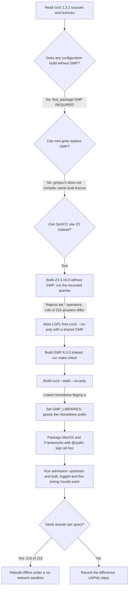
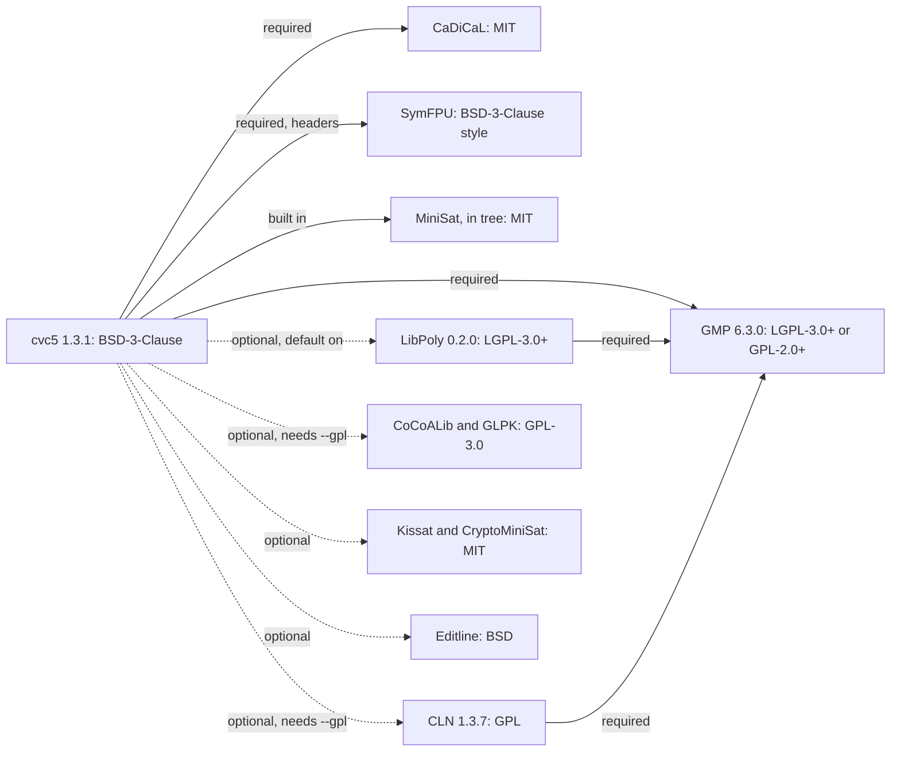
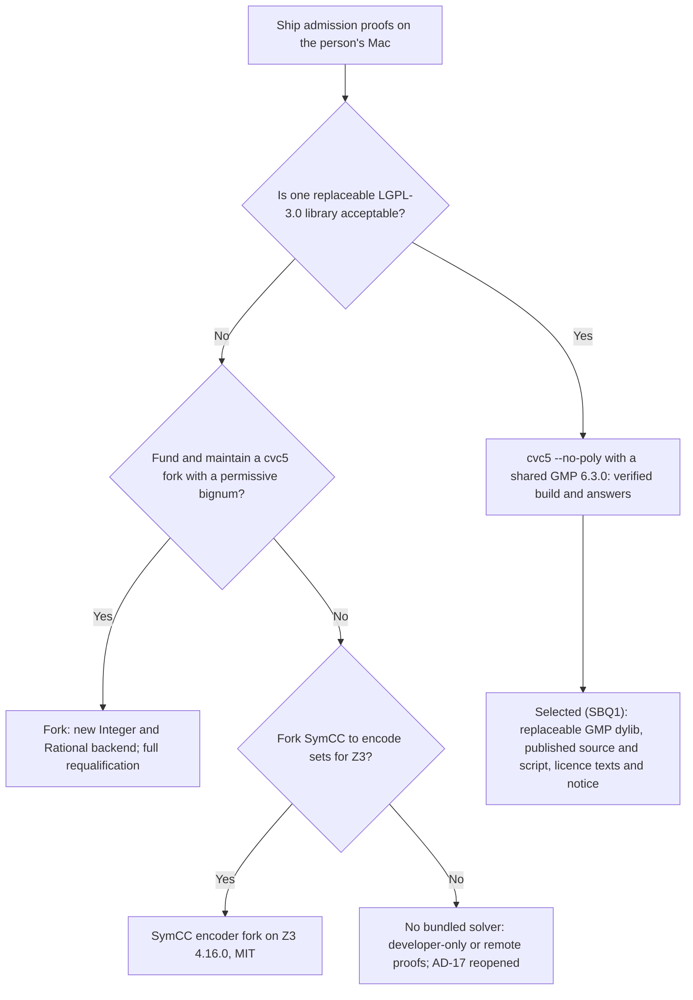

# Solver build probes: can cvc5 ship without LGPL?

Status: **Proposed. Probe record, 2026-11-03.** It records evidence for the
owner's question on OQ3 of the [security policy](security-policy.md#open-owner-questions):
can Asura build cvc5 with no LGPL component? It also gives early evidence for
probes SV-B1, SV-B2 and SV-P1 of [the solver package](security-policy.md#solver-package-ad-17).
The record itself selects nothing and authorizes no code. The owner answered
its questions on 2026-11-03 ([owner questions](#owner-questions)): ship GMP as
a replaceable dylib (SBQ1) and drop LibPoly (SBQ2).
Protocol numbering stays `0.1` and the journal format stays `1`.

Labels follow the [writing standard](../writing-standard.md#status-and-requirements).
**Verified** marks a result of a recorded check in the named environment.
**Source** marks a fact read from a named primary source. **Proposed** marks
a recommendation.

## Summary

- **No: cvc5 cannot be built without GMP.** cvc5 1.3.1 requires GMP in every
  configuration: `CMakeLists.txt` calls `find_package(GMP 6.3 REQUIRED)` with no
  condition. The only other number library is CLN, which is GPL and itself
  needs GMP. cvc5 has no mini-gmp option and no permissive bignum backend.
  GMP is "LGPL-3.0-or-later OR GPL-2.0-or-later". Both choices are copyleft.
- **Yes: LibPoly can be left out.** `--no-poly` builds and runs. On the spike
  corpus it gave the same answer to each of the 216 solver queries as the
  upstream binary. It also gave the same pass result for all 429 harness
  queries and the same coverage results. SymCC's queries use no nonlinear real
  arithmetic, and LibPoly serves only that.
- **Z3 (MIT, own bignum) is not a substitute.** SymCC 0.8.1 officially
  supports only cvc5. Z3 4.16.0 rejects SymCC's `set.*` operators. On the
  recorded queries it disagreed with cvc5 on 146 of 216 answers.
- **The remaining copyleft is GMP 6.3.0 alone,** as a separate
  `libgmp.10.dylib`. That is the mechanism AD-17 already selects.
- **Recommendation (proposed):** keep AD-17's dynamic-GMP route, build with
  `--no-poly`, and drop LibPoly from the notice. A fully LGPL-free cvc5 would
  need an Asura-maintained fork with a new permissive number backend. See
  [owner questions](#owner-questions).

## Question and scope

Owner question (2026-11-03, OQ3): can Asura avoid LGPL completely?

| ID | Question |
| --- | --- |
| Q1 | Which cvc5 1.3.1 dependencies are required and which are optional, and under which licences? |
| Q2 | Can cvc5 be built without LibPoly? What is lost, and do SymCC's queries need it? |
| Q3 | Can cvc5 avoid GMP, through a mini-gmp option or a permissive bignum backend? |
| Q4 | If not, what alternatives exist: GMP's dual licence, mini-gmp, or another SMT solver that SymCC can use? |
| Q5 | Does the most LGPL-free working build give the same admission answers as the upstream 1.3.1 binary, and how fast is it? |
| Q6 | What copyleft remains, and what must bundling do for each part? |

Non-goals: legal advice (OQ3 legal review stays open); signing, notarisation
and sandbox probes SV-P2 to SV-P5; product code; edits to the
[security policy](security-policy.md), which another change owns.

## Method and boundaries

- Read cvc5 1.3.1's `INSTALL.rst`, `COPYING`, `configure.sh`, `CMakeLists.txt`
  and `cmake/Find*.cmake` from the release source tarball. Read the licence
  files of each dependency from its own source archive.
- Read `cedar-policy-symcc` 0.8.1's source (`src/symcc/solver.rs`,
  `smtlib_script.rs`, `encoder.rs`, `decoder.rs`) for the solver interface and
  the SMT-LIB that it emits.
- Built only in a scratch directory outside the repository.
  Installed nothing system-wide and used no Homebrew install. CMake 4.4.4
  and pyparsing 3.3.3 ran from a scratch Python venv.
- Ran the spike's `admission` binary (`experiments/policy-engine-spike`, built
  into a scratch target directory) against each solver. A scratch wrapper
  replaced the solver command: it passes `--lang smt` only, as Asura's
  [process lifecycle](security-policy.md#solver-process-lifecycle) requires,
  and drops SymCC's `--tlimit=60000`. A second mode records each solver's
  standard input and output for a per-query comparison.
- No run had a time limit. Each run ended by completion, except one Z3 run.
  That run deadlocked, and the operator stopped it with `SIGINT`
  ([finding F4](#findings-for-the-solver-adapter)).
- Environment: macOS 27.0 (26A428), Apple M4 Max, 16 cores, Apple clang
  21.0.0, Rust 1.98.0. The host ran other work during the timing runs (load
  average about 60). The timings are comparative only.

### SBP-F1: probe flow

Probe method, as run. Arrows show the order of steps; labels name the result
that chose the next step.

## Downloads

Each archive went into a new, empty scratch directory. The SHA-256 is of the
downloaded file.

| Item | URL | Bytes | SHA-256 |
| --- | --- | --- | --- |
| cvc5 1.3.1 source | `https://github.com/cvc5/cvc5/archive/refs/tags/cvc5-1.3.1.tar.gz` | 9,205,045 | `ce1dce7b1ba8ade0ba7937b8ad7aa6ffa1df0dd9586963ead082baa299ef32d5` |
| GMP 6.3.0 source | `https://gmplib.org/download/gmp/gmp-6.3.0.tar.bz2` | 2,643,888 | `ac28211a7cfb609bae2e2c8d6058d66c8fe96434f740cf6fe2e47b000d1c20cb` (the same digest that cvc5 pins for its `cvc5-deps` mirror) |
| GMP 6.3.0 signature | `https://gmplib.org/download/gmp/gmp-6.3.0.tar.bz2.sig` | 374 | `2a7df8bf6f026601dec3f21e00bf5b2901d81d48e64bba33a98b74b77cd41357` (not verified: no GnuPG keyring in scratch) |
| CaDiCaL rel-2.1.3-elevate (fetched by cvc5's CMake) | `https://github.com/arminbiere/cadical/archive/rel-2.1.3-elevate.tar.gz` | 732,469 | `15e1e82f7f9a9da0e97070cb8ac41d5b32139f65d54f72d2ff84849b0466ef92` |
| SymFPU `e6ac3af9` (fetched by cvc5's CMake) | `https://github.com/cvc5/symfpu/archive/e6ac3af9c2c574498ea171c957425b407625448b.tar.gz` | 37,558 | `823aa663fcc2f6844ae5e9ea83ceda4ed393cdb3dadefce9b3c7c41cd0f4f702` |
| LibPoly 0.2.0 (licence check only) | `https://github.com/SRI-CSL/libpoly/archive/refs/tags/v0.2.0.tar.gz` | 641,486 | `146adc0d3f6fe8038adb6b8b69dd16114a4be12f520d5c1fb333f3746d233abe` |
| CLN 1.3.7 (licence check only) | `https://www.ginac.de/CLN/cln-1.3.7.tar.bz2` | 1,337,235 | `7c7ed8474958337e4df5bb57ea5176ad0365004cbb98b621765bc4606a10d86b` |
| Z3 4.16.0 source | `https://github.com/Z3Prover/z3/archive/refs/tags/z3-4.16.0.tar.gz` | 6,136,396 | `c68c3e5e4810b16126b8cb4c47eee85c1ac3e24a81914c8e371b40de9dd33ac7` |
| CMake 4.4.4 wheel (build tool, binary) | PyPI `cmake==4.4.4` | 54,404,900 | `883962a72b1b3a16ff445427f24c8caca9797dd9e563bbe208cbcd89e877f9d3` |
| pyparsing 3.3.3 wheel (build tool) | PyPI `pyparsing==3.3.3` | 126,420 | `ece8c00a69cf01b45d0b1dedabb469c90d8caf996d4fda40f147627a122849a4` |

The upstream comparison binary is the spike's digest-checked
`cvc5-macOS-arm64-static.zip`
(`a0e7f5b03b1bc4284fbfff7cdfb08c704801701cf7ece83a13f8a505e7581215`,
[spike downloads](policy-engine-spike.md#downloads-and-installed-tools)).
The CaDiCaL and SymFPU digests match the `URL_HASH SHA256` values in cvc5's
`cmake/FindCaDiCaL.cmake` and `cmake/FindSymFPU.cmake`.

The Kissat and CryptoMiniSat licences were read from
`https://raw.githubusercontent.com/arminbiere/kissat/sc2021/LICENSE` and
`https://raw.githubusercontent.com/msoos/cryptominisat/5.11.21/LICENSE.txt`.
These are the versions that cvc5 1.3.1 pins.

## Q1: dependencies and licences

Source: cvc5 1.3.1 `INSTALL.rst`, `COPYING`, `CMakeLists.txt` lines 461–630,
`configure.sh` defaults, and each dependency's licence file.

| Dependency | cvc5 1.3.1 status | Licence | Notes |
| --- | --- | --- | --- |
| GMP 6.3.0 (with `gmpxx`) | **Required in every configuration** (`find_package(GMP 6.3 REQUIRED)`, unconditional) | LGPL-3.0-or-later OR GPL-2.0-or-later | cvc5's `Integer` and `Rational` wrap `mpz_class` and `mpq_class`. The built binary links only `libgmp`; `libgmpxx` was not needed at run time |
| CaDiCaL 2.1.3 | Required (`find_package(CaDiCaL REQUIRED)`) | MIT | SAT back end, linked statically |
| SymFPU `e6ac3af9` | Required (`find_package(SymFPU REQUIRED)`), header-only | BSD-3-Clause style (Martin Brain, Oxford) | Floating-point theory |
| MiniSat | Built in (`src/prop/minisat`) | MIT | Part of the cvc5 source tree |
| LibPoly 0.2.0 | Optional, **default on** (`poly=ON`); `--no-poly` turns it off | LGPL-3.0-or-later | Also needs GMP |
| CLN 1.3.7 | Optional (`--cln --gpl`), replaces GMP for cvc5's numbers | GPL (the `COPYING` file holds the GPL-2.0 text; cvc5's `INSTALL.rst` calls it GPLv3) | **Worse than GMP:** cvc5 becomes GPL. CLN needs GMP itself, and cvc5 still requires GMP |
| CoCoALib | Optional (`--cocoa --gpl`) | GPL-3.0 | Nonlinear and finite-field reasoning |
| glpk-cut-log | Optional (`--glpk --gpl`) | GPL-3.0 | Not recommended upstream |
| CryptoMiniSat 5.11.21 | Optional (`--cryptominisat`) | MIT for the build parts (GPL only with Bliss) | Not used |
| Kissat sc2021 | Optional (`--kissat`) | MIT | Not used |
| Editline | Optional (`--editline`) | BSD (system `libedit`) | Interactive prompt only; upstream binary links `/usr/lib/libedit.3.dylib`; off in the probe build |
| ANTLR | **Not a dependency.** Removed before 1.3.1 (`NEWS.md`: "Removed support for the ANTLR parser") | — | — |
| Python ≥ 3.7 with pyparsing; CMake ≥ 3.16 | Build only | PSF, MIT, BSD-3-Clause | Not shipped |
| libc++, libSystem | Run time, from macOS | Apple system libraries | Not shipped |

cvc5's own code is BSD-3-Clause (`COPYING`). Its configure step refuses a GPL
dependency unless `--gpl` is given, and the default build has none.

### SBP-C1: dependency and licence view

Source evidence for cvc5 1.3.1. Arrows point from a component to a library it
links or includes. Labels say whether the dependency is required or optional
and give its licence. Dashed arrows are optional.

## Q2: a build without LibPoly

**Source.** `--no-poly` sets `USE_POLY=OFF`. Without LibPoly, cvc5 forces
`nl-cov` (cylindrical algebraic coverings) off. It also drops the coverings
proof checker and real algebraic numbers (`real_algebraic_number_poly_imp`,
`operator_elim.cpp`). It uses incremental linearisation (`nl-ext=full`) for
nonlinear arithmetic instead (`src/smt/set_defaults.cpp`). The features lost
are complete nonlinear real arithmetic (NRA) by coverings, ICP, and exact
algebraic-number models.

Even with LibPoly, cvc5 turns coverings off for a logic with integers. That
includes `ALL`, which SymCC sets: "logic without reals, or involving integers
or quantifiers" (`set_defaults.cpp`). So LibPoly's main feature is not used
for SymCC's queries in either build.

**Source: what SymCC emits.** `cedar-policy-symcc` 0.8.1 sends `(set-logic ALL)`
and `(set-option :produce-models true)` once per query, then `(reset)` between
queries. It encodes Cedar values with algebraic datatypes, bit-vectors
(`bvadd`, `bvmul`, `bvsdiv`, overflow predicates; Long, decimal, datetime and
IP addresses are bit-vectors), strings and regular expressions (`str.in_re`,
`re.*`, `re.++` for `like`), finite sets (`set.member`, `set.subset`,
`set.union`, `set.inter`, `set.insert`, `set.empty`) and uninterpreted
functions. It emits no `Int` or `Real` arithmetic. String lengths give cvc5
linear integer constraints internally, which need no LibPoly.

**Verified (2026-11-03, macOS 27.0, M4 Max).** The `--no-poly` build gave the
same answers as the upstream binary ([Q5](#q5-the-built-solver-against-the-upstream-binary)).
This answers probe SV-P1 for the spike corpus. The product corpus must rerun
the check (PL-I6).

## Q3: GMP cannot be avoided

**Source.** No cvc5 1.3.1 option removes GMP:

- `CMakeLists.txt` line 461: `find_package(GMP 6.3 REQUIRED)`, outside any
  condition. `USE_CLN` changes only the number implementation that cvc5 uses
  (`CVC5_USE_CLN_IMP`). GMP stays a link dependency.
- `configure.sh` and `INSTALL.rst` offer no mini-gmp, no `--no-gmp` and no
  other bignum backend. `src/util/` has exactly two backends: `*_gmp_imp` and
  `*_cln_imp`.
- `INSTALL.rst` lists GMP under "Build dependencies", which are required.

**Verified: mini-gmp is not a drop-in.** cvc5 includes `gmpxx.h` and uses
`mpz_class` (30 uses) and `mpq_class` (7 uses). mini-gmp ships no `gmpxx.h`.
A test compiled GMP 6.3.0's own `gmpxx.h` over `mini-gmp.h` and failed with 20
errors: `__GMP_GNUC_PREREQ` and `GMP_NUMB_MASK` are undefined, and there are no
`mpq_ptr` or `mpf_ptr` types. mini-gmp has the same dual licence as GMP, so it
would not remove copyleft even if it fitted.

**cvc5 has no GMP-free configuration.** The only way to remove GMP is a
fork. The fork would add a third `Integer` and `Rational` backend over a
permissive library, such as Boost.Multiprecision (BSL-1.0) or libtommath
(public domain). The GMP backend that it would replace is 1,306 lines
(`integer_gmp_imp.*`, `rational_gmp_imp.*`). The fork would also change the
CMake requirement and `gmp_util.h`, and Asura would have to qualify and
maintain it. This was not attempted.

## Q4: alternatives

### GMP's licence

**Source:** `gmp-6.3.0/README` and each source header. "You can redistribute
it and/or modify it under the terms of either: the GNU Lesser General Public
License as published by the Free Software Foundation; either version 3 of the
License, or (at your option) any later version. or the GNU General Public
License as published by the Free Software Foundation; either version 2 of the
License, or (at your option) any later version. or both in parallel."

What this means (an engineering reading, not legal advice):

- The person who distributes GMP picks the licence. SPDX:
  `LGPL-3.0-or-later OR GPL-2.0-or-later`.
- **LGPL-3.0 route:** the combined cvc5 work may stay BSD-3-Clause. GMP must
  stay replaceable (a shared library under §4(d)(1), or object files for
  relinking under §4(d)(0)). The release must also give notices, the licence
  texts and the corresponding source of GMP. AD-17 selects this route.
- **GPL-2.0 route:** the cvc5 binary would have to be distributed under
  GPL-2.0 terms as a whole. That is stricter. It gives Asura nothing.
- Neither route removes copyleft from GMP itself.

### mini-gmp

It ships inside the GMP tarball (`mini-gmp/`) under the same dual licence. It
covers only a subset of `mpn`, `mpz` and `mpq` and has no C++ interface. It
does not fit cvc5 ([Q3](#q3-gmp-cannot-be-avoided)).

### Other solvers for SymCC

**Source:** `cedar-policy-symcc` 0.8.1 `src/symcc/solver.rs`: "We officially
support cvc5, but other SMT solvers such as Z3 may also work with a subset of
SymCC's functionality." The `Solver` trait accepts any process that reads
SMT-LIB 2 on standard input. `decoder.rs` accepts some Z3 model forms, such as
bare `none`, untyped `some` and extra `define-fun` entries.

**Z3 4.16.0.** The licence is MIT (`LICENSE.txt`). By default Z3 uses its own
`mpz` code: the CMake option `Z3_USE_LIB_GMP` defaults to `OFF`. The probe
built Z3 from source with that default; the binary links only `libc++` and
`libSystem`.

**Verified (2026-11-03):** Z3 cannot run SymCC's Cedar queries.

- Z3 rejects SymCC's set theory: `unknown constant set.member (E0 (Array E0
  Bool))` and the same for `set.subset`, `set.inter` and `set.empty`. Then each
  `define-fun` that used a rejected term fails too (`unknown constant t…`).
- Through the harness, Z3 printed errors while SymCC was still writing the
  query. The harness and Z3 then deadlocked on full pipes
  ([F4](#findings-for-the-solver-adapter)).
- The recorded cvc5 transcript of all 216 queries was given to Z3 in batch
  mode. Z3 printed 1,965,368 error lines. It answered `sat` to 146 queries for
  which cvc5 answered `unsat`; the other 70 answers matched. A failed assertion
  is dropped, so the remaining formula is weaker. Each `unsat` that cvc5 proves
  becomes a false counterexample. Admission would then refuse every candidate,
  correct or not.

Using Z3 would mean changing SymCC's set encoding, for example to arrays. That
is a fork of the Cedar analyser, which Asura would maintain, and every
admission proof would then rest on it.

Other solvers were not checked in this probe. From general knowledge, not
verified here: Bitwuzla is MIT but has no strings, sets or datatypes, and it
uses GMP; Yices 2 is GPL-3.0. Neither is a supported SymCC back end.

## Q5: the built solver against the upstream binary

### Build results (SV-B1, SV-B2 evidence)

**Verified (2026-11-03, macOS 27.0, arm64, Apple clang 21.0.0):**

| Step | Result |
| --- | --- |
| GMP 6.3.0 `configure --enable-shared --disable-static --enable-cxx --with-pic` (`CFLAGS=-std=gnu99`, `MAKEINFO=true`, as cvc5 does) | Built `libgmp.10.dylib` (743,520 bytes) and `libgmpxx.4.dylib`. `make check`: 199 passed, 1 skipped, 0 failed |
| cvc5 `configure.sh production --static --no-poly --no-pyvenv --auto-download --dep-path=<GMP prefix>` | Configured as "modified BSD", LibPoly off, MP library GMP. First build: 121 s wall time at `-j16` |
| First link | **Defect:** the binary linked Homebrew's `/opt/homebrew/lib/libgmp.a` (GMP 6.3.0), not the scratch GMP. A static cvc5 build searches only `.a` files (`CMAKE_FIND_LIBRARY_SUFFIXES .a`). The scratch prefix had none, so CMake took Homebrew's archive with the scratch headers |
| Relink with `-DGMP_LIBRARIES=<prefix>/lib/libgmp.10.dylib -DGMPXX_LIBRARIES=<prefix>/lib/libgmpxx.4.dylib -DCMAKE_IGNORE_PREFIX_PATH=/opt/homebrew` | cvc5's libraries stay static. `otool -L`: the scratch `libgmp.10.dylib`, `libc++` and `libSystem` only. `--show-config`: `gmp: yes`, `poly: no`, `editline: no`, `cln: no`, `glpk: no`, `cocoa: no`; "linked against … LGPLv3: GMP" only |
| Package: `MacOS/cvc5` and `Frameworks/libgmp.10.dylib`; `install_name_tool -id @rpath/libgmp.10.dylib`, `-change` and `-add_rpath @executable_path/../Frameworks`; ad hoc `codesign -f -s -` | Runs. `MacOS/cvc5` is 24,291,776 bytes, not stripped; the upstream binary is 21.1 MB. Size reduction was not attempted |
| Replacement test (LGPL §4(d)(1) mechanism) | Copied a different `libgmp.10.dylib` (Homebrew's) into `Frameworks/`, signed it ad hoc, and ran `cvc5`. `DYLD_PRINT_LIBRARIES` shows the replacement loaded; a nonlinear integer query answered `sat` |
| Offline rebuild (SV-B2) | Pre-fetched GMP, CaDiCaL and SymFPU into one prefix. `configure.sh --no-auto-download` and `make` ran under `sandbox-exec` with `(deny network*)`. Build and install succeeded; the linkage was the same |
| Host paths | 204 build-directory strings in `cvc5` and 2 in `libgmp.10.dylib`; the upstream binary has 181 user-directory paths. The probe build used no `-ffile-prefix-map`; SV-P5 remains open |

cvc5's own CMake checks a SHA-256 for every file it downloads (`URL_HASH
SHA256=` in each `Find*.cmake`). With `--auto-download`, it fetched CaDiCaL
and SymFPU only. GMP came from the dependency prefix, and LibPoly was off.
Murxla (a fuzzer) is configured but never fetched for the default targets.

### Query results

**Verified (2026-11-03).** Both solvers ran through the same wrapper with
`--lang smt` only. The harness sends 216 `check-sat` queries to the solver in
one process, separated by `(reset)`. The harness counts 429 queries; the
other 213 did not reach the solver. This probe did not trace why.

| Check | Upstream 1.3.1 (LibPoly, static GMP) | Built 1.3.1 (`--no-poly`, shared GMP) |
| --- | --- | --- |
| Harness result | 429 queries, 0 unexpected, exit 0 | 429 queries, 0 unexpected, exit 0 |
| Solver answers (216 queries) | 7 `sat`, 209 `unsat`, 0 `unknown` | 7 `sat`, 209 `unsat`, 0 `unknown` |
| Per-query comparison | — | 216 of 216 queries match as sets of input lines; 216 of 216 answers equal |
| Model output | — | Identical except one bound-variable name (`BOUND_VARIABLE_11769272` and `…216`) |
| AQ9 coverage probes | 10 analysable; `duration and offset` can error | Identical |
| `cargo test --features admission --test admission` | Spike record: pass | Pass (1 test, 19.2 s) |

The query text sent to the two solvers was the same, but in a different order:
the harness's iteration order is not fixed. The comparison therefore matches
queries by a digest of their sorted lines.

### Timings

Five alternating rounds per solver, unlogged. The values are the median across
rounds of each round's figure, in milliseconds. The host was heavily loaded,
so these figures are comparative only. The spike's quiet-host record had a
387 ms envelope proof set median.

| Category | Queries | Upstream median / max | Built median / max |
| --- | --- | --- | --- |
| AQ1 `check_never_errors` | 206 | 0.0 / 8.2 | 0.0 / 8.3 |
| AQ3 CL-1 `implies(P, P0)` | 8 | 2.7 / 44.8 | 2.3 / 12.3 |
| AQ4 scope narrowing `implies(P, P_upper)` | 8 | 2.7 / 167.1 | 2.5 / 146.7 |
| AQ5 envelope containment | 79 | 83.8 / 279.0 | 64.4 / 208.2 |
| AQ5 envelope safety | 105 | 87.1 / 274.9 | 67.5 / 202.5 |
| AQ6 safety on `P` | 7 | 60.6 / 175.7 | 67.7 / 183.5 |
| AQ7 change difference | 3 | 73.2 / 481.0 | 74.4 / 477.6 |
| AQ8 seeded violations | 3 | 222.0 / 440.6 | 230.6 / 420.7 |
| Envelope proof set (26) | — | 628.8 / 1,373.3 | 476.9 / 763.9 |

The built solver is not slower on this corpus. All 5 rounds of each solver
gave 0 unexpected results.

## Q6: remaining copyleft and bundling duties

With `--no-poly`, only one copyleft component remains.

| Component | Exact licence | In the bundle as | What bundling requires |
| --- | --- | --- | --- |
| GMP 6.3.0 | LGPL-3.0-or-later OR GPL-2.0-or-later; Asura distributes it under LGPL-3.0 | `Frameworks/libgmp.10.dylib`, install name `@rpath/libgmp.10.dylib` | Everything in the [licence obligations](security-policy.md#licence-obligations-and-notice) table: a replaceable shared library (verified above for an ad hoc-signed copy); `COPYING.LESSERv3` and `COPYINGv3` texts; a notice; the exact GMP source and the build script published with each release; legal confirmation (OQ3) |
| LibPoly 0.2.0 | LGPL-3.0-or-later | **Not shipped** with `--no-poly` | None. The notice must not name it |
| CLN, CoCoALib, GLPK | GPL | Not shipped (default build) | None. The build must keep `--gpl` off; cvc5's configure step refuses them without it |

The permissive parts need their notices reproduced: cvc5 (BSD-3-Clause),
CaDiCaL (MIT), SymFPU (BSD-3-Clause style) and MiniSat (MIT). Editline is off
in the probe build, so it needs no notice. If PL4 turns it on, it is the system
`libedit` and is not shipped.

## Findings for the solver adapter

These findings affect designs that this record does not own. The owner of
the [security policy](security-policy.md) should take them into the solver
package and the lifecycle.

| ID | Finding | Effect |
| --- | --- | --- |
| F1 | A `--static` cvc5 build finds any `libgmp.a` on the host, here Homebrew's, before a shared GMP in `--dep-path`. The build reported no error | The PL4 script must pass `GMP_LIBRARIES` and `GMPXX_LIBRARIES` explicitly and exclude `/opt/homebrew`. The release check must require `otool -L cvc5` to list exactly `@rpath/libgmp.10.dylib`, `libc++` and `libSystem` |
| F2 | cvc5's FindGMP printed "GMP (unknown version)" for the GMP 6.3.0 prefix. For a found GMP, the only enforced check is a compile test for GMP 6.1 or later (`cmake/deps-utils/gmp-test.cpp`), not 6.3 | The PL4 script must check the GMP version itself, against the lock file |
| F3 | cvc5 links `libgmp` only; `libgmpxx.4.dylib` is not needed at run time | `Frameworks/libgmpxx.4.dylib` can be left out. The notice and the DMG manifest list one dylib |
| F4 | A solver can write to standard output while the caller is still writing a query. Z3's error stream filled the 64 KiB pipe, and SymCC's `LocalSolver` then blocked writing standard input. Both processes waited for each other | Asura's adapter must read standard output and standard error while it writes standard input. A full output buffer must refuse the candidate (`solver_failed`), never stall the admission worker. Add a stalled-solver case to PL-I6 |
| F5 | SymCC emits `(set-logic ALL)`, so cvc5 enables all theories | No effect on answers. A narrower logic is a later performance option, not part of this probe |

## Recommendation

The recommendation as written before the owner's answers; the owner chose
items 1 and 2 ([owner questions](#owner-questions)).

1. **Keep AD-17's route.** Build cvc5 1.3.1 `--static --no-poly` with GMP
   6.3.0 as the only dynamic library, under LGPL-3.0. The build works,
   gives the same answers and runs offline.
2. **Drop LibPoly** from the build, the notice and the bundle. That removes the
   second LGPL component. Rerun SV-P1 on the product corpus at PL4a.
3. **Do not switch to Z3.** It is MIT and GMP-free, but SymCC's supported
   encoding does not run on it.
4. **Treat a fully LGPL-free cvc5 as a separate decision.** It needs a fork
   with a permissive number backend (about 1,300 lines to replace, plus
   qualification and continuing maintenance). Choose it only if any LGPL
   component is unacceptable in itself, even when shipped as a replaceable
   library.

### SBP-F2: licence decision view

Proposed decision path. Arrows lead from a question to the choice that its
answer selects.

## Owner questions

The owner answered SBQ1 and SBQ2 on 2026-11-03; SBQ3 does not arise. The
canonical record is AD-30 and AD-17 in the
[owner decisions table](assurance-and-differentiation.md#owner-decisions);
the [security policy design](security-policy.md#solver-package-ad-17)
applies them.

| ID | Question | Recommendation | Owner decision, 2026-11-03 |
| --- | --- | --- | --- |
| SBQ1 | Is one LGPL-3.0 component (GMP), shipped as a replaceable `@rpath` dylib with source and notice, acceptable? This is the only copyleft left after `--no-poly` | Yes; legal review stays under OQ3 | **Yes: ship GMP after all.** cvc5 is bundled with GMP 6.3.0 as a separate, replaceable `@rpath/libgmp.10.dylib` under LGPL-3.0. Each release publishes the exact GMP source, the build script, the licence texts and a notice. History: the owner first chose an LGPL-free fork (OQ3, AD-30), then reversed that choice once the trade-off was clear; the fork prototype was stopped |
| SBQ2 | Should the build drop LibPoly (`--no-poly`)? | Yes, subject to SV-P1 on the product corpus | **Yes: drop LibPoly** (`--no-poly`), subject to re-running SV-P1 on the product corpus at PL4a |
| SBQ3 | If SBQ1 is no: fund an Asura-maintained cvc5 fork with a permissive number backend, or fork SymCC's set encoding for Z3? | Neither, unless SBQ1 is no; then the cvc5 fork, because SymCC's encoding stays upstream | Does not arise: SBQ1 is yes |

OQ3's legal part is decided, with no open legal question and no release
gate. The owner's position (2026-11-03): Asura is open source (MIT). Anyone
who wants to rebuild it and swap GMP for another library, whether in
practice or in theory, can fork it, submit a pull request, or build it
themselves. The owner is not obliged to sign their build with his key,
provided Asura complies with the licence terms. Compliance stays as
designed: GMP is a separate, replaceable `@rpath` dylib; the exact GMP
source and the build script are published with each release; the LGPL-3.0
and GPL-3.0 texts and the notice ship; Asura's own source is public, so a
person can rebuild it and sign it with their own identity.

Findings F1 to F5 are requirements of the PL4a build script and its solver
adapter ([security policy, build](security-policy.md#build)). PL4a is not
built yet.

## Reproduction

The scratch scripts are not tracked. The steps are:

1. Build GMP 6.3.0 into a scratch prefix with the options in the build table.
2. Run `configure.sh production --static --no-poly --no-pyvenv --auto-download
   --dep-path=<GMP prefix> -DGMP_LIBRARIES=<prefix>/lib/libgmp.10.dylib
   -DGMPXX_LIBRARIES=<prefix>/lib/libgmpxx.4.dylib
   -DCMAKE_IGNORE_PREFIX_PATH=/opt/homebrew`, then `make -j16` and `make install`.
3. Package with `install_name_tool` and `codesign -s -` as in the build table.
4. Point `CVC5` at a wrapper that runs `<cvc5> --lang smt`. Run
   `cargo run --locked --release --features admission --bin admission` from
   `experiments/policy-engine-spike`.

## Sources

- cvc5 1.3.1 source tarball (above): `INSTALL.rst`, `COPYING`, `NEWS.md`,
  `configure.sh`, `CMakeLists.txt`, `cmake/FindGMP.cmake`, `FindPoly.cmake`,
  `FindCaDiCaL.cmake`, `FindSymFPU.cmake`, `FindCLN.cmake`,
  `src/smt/set_defaults.cpp`, `src/util/*_gmp_imp.*`, `licenses/`.
- Upstream binary `--show-config` (cvc5 1.3.1, git `ea1b484`): GMP and LibPoly
  LGPL-3.0, linked statically; CaDiCaL, Editline and SymFPU.
- GMP 6.3.0 `README`, `COPYING.LESSERv3`, `COPYINGv2`, `COPYINGv3`, `mini-gmp/README`.
- LibPoly 0.2.0 `LICENCE` and source headers; CLN 1.3.7 `COPYING`, `README`
  and `INSTALL`; CaDiCaL and SymFPU `LICENSE` files from the cvc5 fetch.
- `cedar-policy-symcc` 0.8.1 crate source, `src/symcc/`.
- Z3 4.16.0 `LICENSE.txt` and `CMakeLists.txt` (`Z3_USE_LIB_GMP`).

## Design verification

Recorded 2026-11-03. No product code was written or run. The spike harness
ran unchanged. The checks ran as described above. Each Mermaid diagram was
rendered with the local Mermaid CLI 12.0.0 at scale 2 into a scratch directory and
inspected.

Return to the [design index](README.md).
