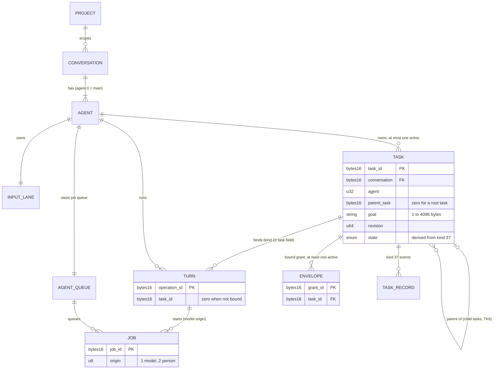
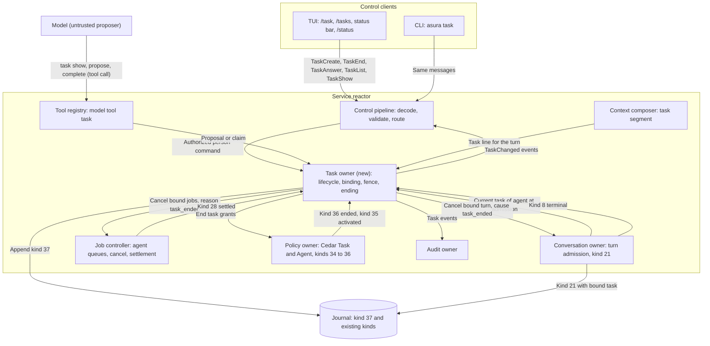
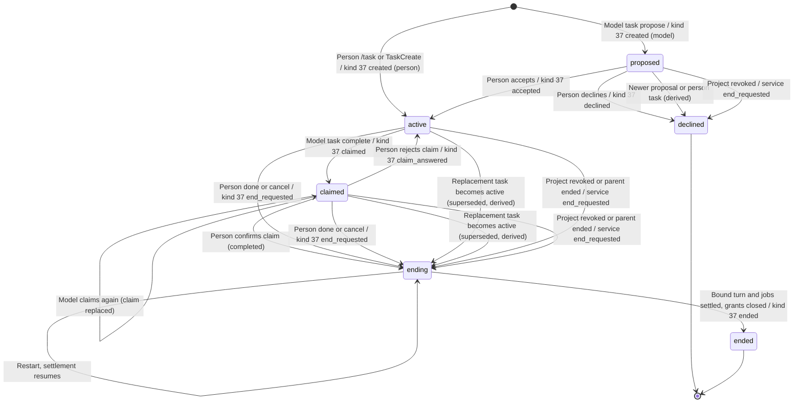
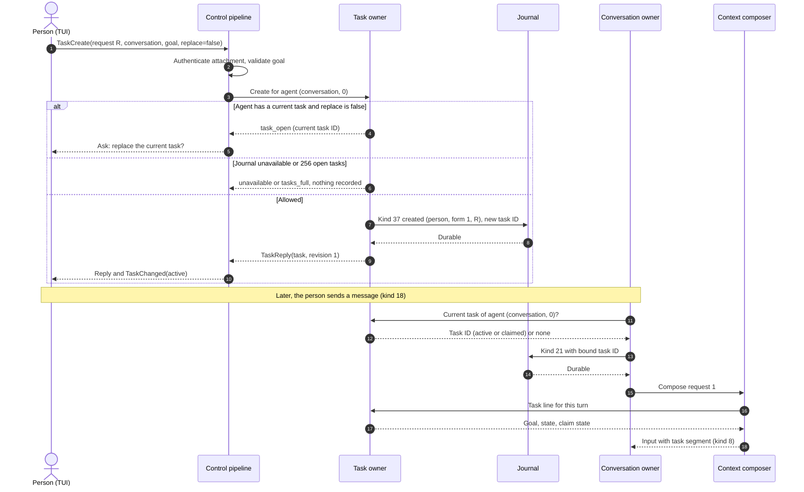
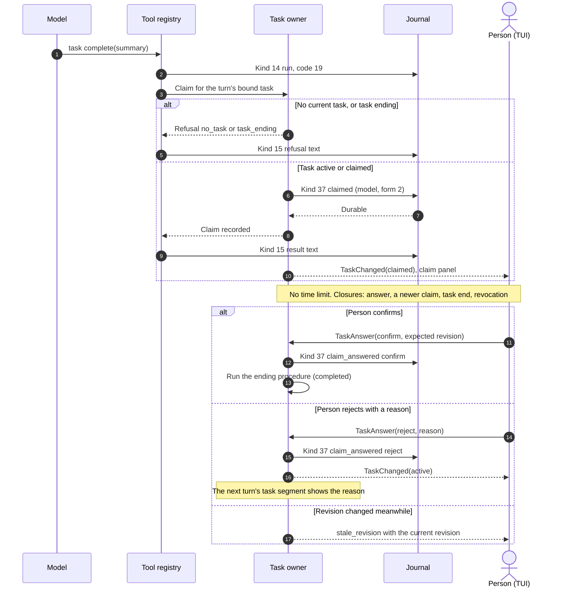
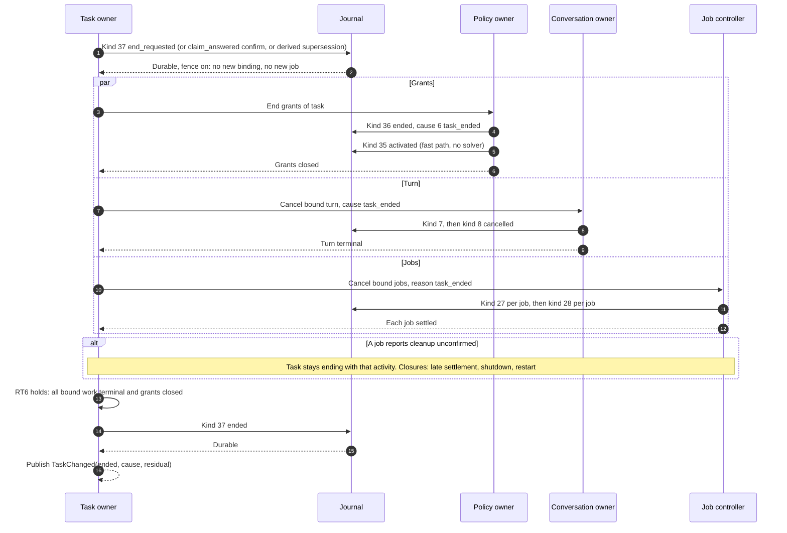
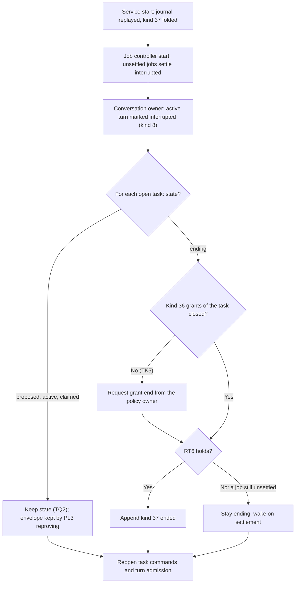
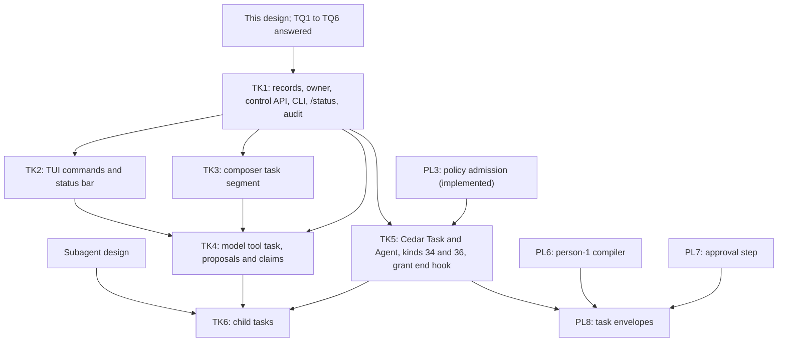

# Task entity

Status: **Proposed (draft for owner review), 2026-11-16.** No code exists for
this design. The model, records, lifecycle and interfaces below are written to
be implementation-ready for slices [TK1 to TK5](#delivery-slices) once the
owner answers the [open owner decisions](#open-owner-decisions) TQ1 to TQ6.
Each recommendation is the assumed answer in the text; a different answer
changes the sections that the decision names. Slice TK6 (child tasks) also
waits for the subagent design. Protocol numbering stays `0.1` and the journal
format stays `1`; schemas change in place, with no backward compatibility
before release 1.0.0.

Labels follow the [writing standard](../writing-standard.md#status-and-requirements):
**Required behavior** (an owner decision or a requirement), **Selected** (an
engineering choice of this design, subject to owner review), **Proposed**
(not selected) and **Open decision**. This document records no verified
behavior. Terms are in the [glossary](../glossary.md).

## Purpose and scope

### What a task is

A **task** is one unit of work that the person wants done. It has:

- a **goal**: text that the person wrote or accepted;
- an **owner agent**: one agent instance (main or sub) that does the work;
- a **lifecycle** with a definite **end**, recorded in the journal.

A task spans turns. The person states a goal once; the main agent then works
on it over many turns, jobs and approvals until the person ends it, accepts a
completion claim, replaces it, or a revocation ends it.

### Why now

Three designed features need a unit of work with an owner, a goal and an end:

| Feature | What it needs from a task | Source |
| --- | --- | --- |
| Task envelopes (PL8) | Something to bind to and a definite end that ends the envelope | AD-24, AD-28 ([OQ1](security-policy.md#open-owner-questions)) |
| Approval waits | A named piece of work that the person can cancel as a whole, so that a waiting job has a parent to end with | AD-15, [DF4-F1](assurance-and-differentiation.md#df4-f1-classifier-approval-step-for-a-model-job) |
| Subagents | A goal and limits handed from a parent agent to a child agent | AQ1 ([agents, queues and slots](tool-job-controller.md#agents-queues-and-slots)) |

The [architecture](../architecture.md#control-and-execution-boundaries)
assigns "task state, scheduling and delegation" to the orchestrator, and the
[architecture overview](architecture-overview.md) records "task lifecycle not
built". The [core harness brief](core-harness-brief.md#proposed-task-lifecycle)
proposes task states but no entity. Today the word "task" names three
different things:

1. the per-turn task ID in kind 21 ([conversation admission](conversation-admission.md#scope-and-canonical-owners):
   "one submitted turn creates one task");
2. the interim Cedar `Task` principal, which is the agent key (conversation,
   agent 0) ([security policy](security-policy.md#sp-d1-entities-actions-and-context));
3. the D0 concept "work with goals, acceptance criteria, scope and limits"
   ([domain model](domain-model.md#owners-and-records)).

This design makes the third one real, removes the first, and renames the
second to `Agent`. After it, "task" means one thing (single source of truth).

### Objectives

1. Define the task entity, its relations and its records in journal format 1.
2. Define the lifecycle with loop-closure endings only. No timer ends a task.
3. Bind envelopes to tasks so that PL8 can proceed.
4. Define the control API, CLI, TUI, `/status`, composer, policy, job
   controller and audit interfaces.
5. Define failure, recovery, limits, authority and validation, and a slice plan.

### Non-goals

- The subagent runtime: how a child agent runs, its input lane and model loop.
  The subagent design owns it. This design defines only the child task's
  records and relations (slice TK6).
- Task budgets. The [aggregate budget](core-harness-brief.md#aggregate-budget-ownership-and-admission)
  owner does not exist yet. A task is the budget node when it does; this
  design reserves no budget field.
- Plans and work items ([hybrid memory ontology](hybrid-memory-ontology.md)).
  A plan item may later link to a task ID; this design adds no link.
- Remote hosts and remote delegation.
- Envelope fields, proofs and rendering. [Task envelopes](security-policy.md#task-envelopes-ad-24)
  (PL8) own them; this design owns only the binding and the end.
- Goal revision (editing the goal of an active task). The person replaces the
  task instead. A later design may add revision.

### Dependencies

| Dependency | Use |
| --- | --- |
| [Conversation admission](conversation-admission.md) | Kind 21 binding of a turn to a task; kind 7 and kind 8 causes |
| [Segmented journal](segmented-journal.md) | Kind 37 frames, indexes and checkpoint entries |
| [Managed input queue](managed-input-queue.md) | Input lanes; steering keeps the task |
| [Tool job controller](tool-job-controller.md) | Agent keys, agent queues, job cancel and settlement |
| [Context composer](context-composer.md) | The task segment in the context block |
| [Security policy](security-policy.md) | Cedar `Task` and `Agent` entities, kinds 34 to 36, envelope end |
| [Loop closure](loop-closure.md) | Closures, interrupts, temporary and permanent endings |
| [Command system](command-system.md) | Built-in `/task` and `/tasks` commands |

## Required behavior

Owner rules this design applies:

| Rule | Source |
| --- | --- |
| No default time bound. A task, and every wait inside it, ends only by a loop closure | [AE-04](../engineering.md#asynchronous-execution-and-recovery), owner 2026-10-15 and 2026-10-16 |
| An envelope ends when its task ends, or earlier on revocation | AD-24 |
| Task envelopes wait for this design; no interim binding to a conversation | AD-28 |
| A blocked job waits in its agent's queue with a short reason; no slot is reserved | AQ1, AD-15 |
| A queue for each agent, main and sub | AQ1 (owner, 2026-10-21) |
| A model proposal is a draft; only the person's answer on a control attachment approves | [Approval text](security-policy.md#approval-text), AD-24 |
| A new message does not silently change active task goals or authorize an action | [Domain model](domain-model.md#conversations-tasks-and-model-input) |
| Task state is understandable without reconstructing it from model prose | [Architecture](../architecture.md#on-device-decisions) |
| One source of truth for each fact; no backward compatibility before 1.0.0 | Owner rules |
| Protocol `0.1` and journal format `1` stay | [Wire protocol authority](../engineering.md#wire-protocol-change-authority) |

## Model and relations

### Terms used in this design

| Term | Meaning |
| --- | --- |
| Conversation | One project's message history with one input lane per agent; agent 0 is its main agent |
| Turn | One admitted model operation of an agent: kind 21 to kind 8, with requests (kind 6, kind 33) inside |
| Agent | One model agent instance, keyed by (conversation ID, agent number); it owns an input lane, a job queue and job slots |
| Per-agent queue | The job controller's FIFO of job starts for one agent, each with a brief blocking reason (AQ1) |
| Job | One tool effect owned by the job controller (kinds 26 to 28) |
| Operation | One admitted execution attempt: a model operation or a job |
| Envelope | A person-approved effect set for one task (AD-24, kind 36 kind 2) |
| Open task | A task in `proposed`, `active`, `claimed` or `ending` |
| Bound | A turn is bound to the task that its kind 21 names. A model job is bound to the task of the turn that started it |

### Options for the model

| Option | Description | Benefits | Costs |
| --- | --- | --- | --- |
| A. Task is a turn | Keep today's per-turn task ID | No change | An envelope approved "once per task" would end after one turn. No goal spans turns. Subagent work has no parent unit |
| B. Task is a conversation (or its main agent) | The interim OQ1 binding | Simple. No new commands | The owner rejected it (AD-28). A conversation runs for days with many goals; an envelope would last until `/new`. No completion or cancel of "the work" |
| C. Explicit task inside a conversation, owned by one agent, spanning turns | A task record with a goal and lifecycle; turns bind to the agent's active task | A definite end for envelopes. Clear unit for cancel and approvals. Subagents get child tasks under the same agent key model. Chat without a task works as today | New records, commands and UI. The person must start tasks (or accept proposals) |
| D. Task independent of conversations | A task may span several conversations or none | Matches the D0 note "a task may be submitted without a conversation" | Two owners for history and context. A turn would need a task selector. Cross-conversation context has no design |

**Selected: option C.** It is the smallest model that gives an envelope a
definite end and gives subagents a parent unit. It reuses the agent key,
per-agent queues and the conversation's project scope.

### Relations

Selected design. Boxes are records or entities; lines are relations with
cardinality, read from left box to right box. `TASK` is the new entity.
`ENVELOPE` is the kind 36 envelope grant (PL8).



Rules, selected:

1. **A task belongs to exactly one conversation and one agent of it.** Its
   project is the conversation's project. The agent key never changes.
2. **One conversation holds several tasks.** For one agent they are
   sequential: at most one task in `active` or `claimed` (the agent's
   **current task**) and at most one in `proposed` at a time (TQ3b).
   Ended tasks stay listable.
3. **A task spans turns.** Each turn of agent 0 binds, at admission, to the
   agent's current task, or to none. Steering replaces a turn; the new turn
   binds to the same current task.
4. **A turn may have no task** (TQ1). It then behaves exactly as today:
   exact approvals only, no envelope.
5. **Jobs.** A model job is bound to the task of the turn that started it,
   derived through its kind 26 origin reference to the kind 21. A person job
   (`!`, `!!`) is never bound to a task: it is the person's own command and
   a task end does not stop it.
6. **Per-agent queue.** The task owns no queue. Its jobs wait in their
   agent's queue under AQ1. A task shows the waits of its bound jobs as
   derived activity.
7. **Operations.** Model operations and jobs remain the admitted units. A
   task is not an operation; it is the parent unit that operations bind to.
8. **Envelope.** An envelope names exactly one task. At most one envelope of
   a task is in `drafted`, `approved`, `proving` or `active`. A newly
   approved envelope replaces the active one when it activates (PL8 may
   refine the replacement, not the binding).
9. **Parent and child.** A child task names its parent task. Its agent is a
   subagent of the same conversation (agent number 1 or more, assigned by the
   subagent design). A child is created by its parent agent under the
   parent's authority and cannot widen it. Depth and fan-out limits are in
   [limits](#limits). Records and rules are designed here; creation waits
   for the subagent design (TK6).
10. **Standalone tasks.** The D0 note that "a task may be submitted without a
    conversation" maps to a CLI command that targets a conversation. Creating
    a conversation together with its first task is deferred (TQ6).

### Ownership

Selected design. Boxes are owners; arrows are typed requests, records or
events, labelled with what they carry. The task owner is a new module of the
orchestrator in the service. It runs on the conversation owner's reactor, as
the job controller does, so that turn admission, job admission and task
transitions are serialized by one owner.



| Owner | Owns | Does not own |
| --- | --- | --- |
| Task owner (new, `asura-service`) | Task IDs, kind 37 transitions, binding rules, the dispatch fence, the ending procedure, task events | Turns, jobs, grants, context text |
| Conversation owner | Turn admission; reads the current task and writes it into kind 21 | Task state |
| Job controller | Agent queues, job cancel and settlement | Task state; it reports settlement |
| Policy owner | Cedar entities, envelope grants, grant removal | Task lifecycle; it ends grants on request |
| Context composer | The task segment's text, from the task owner's view | Task state |
| Storage authority (`asura-storage`) | Kind 37 codec, replay rules, indexes, checkpoint | Decisions |
| Clients | Syntax, presentation, request IDs | Any task state or authority |

## Identity and records

### Task ID

Selected. A task ID is 16 random bytes, generated by the task owner and
registered in the journal's generated-ID index `G` with the existing entity
kind 3 `Task` ([SJ-D16](segmented-journal.md)). The ID must be unused. It is
shown as 8 lowercase hex characters in compact views and 32 in detail.

The per-turn task ID of kind 21 is removed. Kind 21's task field changes
meaning in place: it becomes the **bound task ID**, zero when the turn has
no task. No turn generates a task ID any more. Existing development journals
whose kind 21 records carry per-turn task IDs fail replay as `Corrupt`; this
follows the owner's rule of no backward compatibility before 1.0.0. TK1
updates the [conversation admission](conversation-admission.md#format-1-and-record-kinds)
and [segmented journal](segmented-journal.md) designs before its code.

### Kind 37: TaskRecord

Selected (engineering). New record kind 37, after kind 36, journal format 1.
One record holds one task event. Encodings follow the existing codec:
integers big-endian, an ID 16 bytes, a digest 32 bytes. Any value outside a
rule is `Corrupt`.

| # | Field | Encoding | Rule |
| --- | --- | --- | --- |
| 1 | task | 16 bytes | Nonzero |
| 2 | event | u8 | 1 `created`, 2 `accepted`, 3 `declined`, 4 `claimed`, 5 `claim_answered`, 6 `end_requested`, 7 `ended` |
| 3 | revision | u64 | The task's revision after this event: `created` is 1; each later record is the current revision + 1 |
| 4 | conversation | 16 bytes | `created`: the agent's conversation. Other events: zero |
| 5 | agent | u32 | `created`: 0 until the subagent design assigns numbers. Other events: 0 |
| 6 | parent | 16 bytes | `created`: zero for a root task. Nonzero is `Corrupt` until TK6. Other events: zero |
| 7 | actor | u8 | 1 person (control attachment), 2 model (tool call), 3 service (task owner), 4 parent agent (TK6) |
| 8 | origin form | u8 | 1 control request, 2 tool call, 3 none |
| 9 | origin reference | form 1: request ID (16), request digest (32); form 2: operation ID (16), generation (u64), ordinal (u32); form 3: absent | Form 2 names a kind 14 of the same operation |
| 10 | code | u8 | `claim_answered`: 1 confirm, 2 reject. `end_requested`: 1 `completed`, 2 `cancelled`, 3 `project_revoked`, 4 `parent_ended` (TK6). Other events: 0 |
| 11 | text | u16 length, UTF-8 | `created`: the goal, 1–4,096 bytes. `claimed`: the claim summary, 1–4,096 bytes. `claim_answered` with reject: the reason, 0–1,024 bytes. Other events: empty |

Maximum payload: 4,218 bytes. No record holds a path, a command or policy
text. The goal and summary are text that the person or the model wrote; they
pass the same secret detection and stored-value redaction as a kind 18 input
before the record is written ([secret detection](secret-detection.md)).
TK1 reuses that path; it adds no second detector.

### Who may write which event

Selected. The replay rule rejects any other combination as `Corrupt`.

| Event | Actor and origin | From state | To state |
| --- | --- | --- | --- |
| `created` | Person, form 1 | none | `active` |
| `created` | Model, form 2 | none | `proposed` |
| `created` | Parent agent, form 2 (TK6) | none | `active` |
| `accepted` | Person, form 1 | `proposed` | `active` |
| `declined` | Person, form 1 | `proposed` | `declined` |
| `claimed` | Model, form 2; the operation is bound to this task | `active`, `claimed` | `claimed` |
| `claim_answered` confirm | Person, form 1 | `claimed` | `ending` (completed) |
| `claim_answered` reject | Person, form 1 | `claimed` | `active` |
| `end_requested` `completed` or `cancelled` | Person, form 1 | `active`, `claimed` | `ending` |
| `end_requested` `project_revoked` or `parent_ended` | Service, form 3 | `active`, `claimed` | `ending` |
| `end_requested` `project_revoked` | Service, form 3 | `proposed` | `declined` (the only service-written decline) |
| `ended` | Service, form 3 | `ending` | `ended` |

### Derived transitions

Selected. These transitions have no record of their own. Replay derives them
from the record named, in the same replay step, so that each fact has one
source.

| Record | Derived transition | Derived cause |
| --- | --- | --- |
| A task becomes `active` (`created` by the person or a parent, or `accepted`) while the agent has another task in `active` or `claimed` | That task enters `ending` | `superseded` |
| A model `created` (a proposal) while the agent has another task in `proposed` | That task enters `declined` | `proposal_replaced` |
| A person `created` while the agent has a task in `proposed` | That task enters `declined` | `proposal_replaced` |
| A `claimed` while the task is already `claimed` | The earlier claim is replaced | none |

A derived transition increments the affected task's revision by 1.
The person must ask for a replacement explicitly: a `TaskCreate` or an
accept that would supersede a current task is refused with `task_open`
unless it carries `replace`. The flag is not recorded; its effect is.

### Replay rules

Selected. Storage applies these rules per frame, in order.

| Rule | Condition | Failure |
| --- | --- | --- |
| RT1 | `created`: the task ID is unused in `G`; the conversation is known; the agent is 0 (until the subagent design); the parent is zero (until TK6); the text is 1–4,096 bytes of UTF-8; at most 256 open tasks after the event | `Corrupt` |
| RT2 | Every later event names a known task, and its revision is the current revision + 1 | `Corrupt` |
| RT3 | Event, actor, origin form, from state and code match the [event table](#who-may-write-which-event) | `Corrupt` |
| RT4 | Form 1: the request ID is unused or is this record's own request in `R` | `Corrupt` |
| RT5 | Form 2: the operation's kind 21 binds it to this task (`claimed`) or to the same agent (`created`), and the kind 14 at that ordinal exists with the `task` tool's operation code | `Corrupt` |
| RT6 | `ended`: every turn bound to the task has a kind 8; every model job bound to it has a kind 28; from TK5, every kind 36 grant of the task is closed; all at earlier sequences | `Corrupt` |
| RT7 | Kind 21 with a nonzero bound task: the task exists, is `active` or `claimed`, and its agent key is (this conversation, 0) | `Corrupt` |
| RT8 | Derived transitions apply as [listed](#derived-transitions) | Not a failure; deterministic |

### Recorded and derived facts

| Fact | Recorded or derived | Source |
| --- | --- | --- |
| Task ID, conversation, agent, parent, creator, goal | Recorded once | Kind 37 `created` |
| State and revision | Derived | Fold of kind 37 records and derived transitions |
| End cause | Derived | The `end_requested` code, `claim_answered` confirm (`completed`) or the derived `superseded` |
| Bound turns | Recorded per turn | Kind 21 task field |
| Bound jobs | Derived | Kind 26 origin reference to the kind 21 |
| Residual effects | Derived | Any bound turn ended `interrupted`, or any bound job settled `interrupted` or with unknown cleanup |
| Activity (`running`, `waiting: approval needed`, `idle`) | Derived, not stored | Turn state and agent queue reasons of bound jobs |
| Envelope state | Recorded by the policy owner | Kind 36 records naming the task (TK5) |
| Durations | Derived for display only | Frame times; they never end anything |

### Indexes and checkpoint

Selected; TK1 records the entries in the [segmented journal](segmented-journal.md)
index table before its code.

| Index | Key | Value | Retention |
| --- | --- | --- | --- |
| `t` task | Task ID, 0 | Conversation, agent, parent, state, revision, end cause, `created` locator, last locator | Kept after `ended`, so that ended tasks stay listable |
| `k` conversation task | Conversation ID, kind 37 `created` sequence | Task ID | Kept with `t` |

Both letters are lowercase because every uppercase letter is in use, as
for `p`. A checkpoint stores each open task (at most 256) with its `t`
value and, for `ending` tasks, the outstanding bound turn and job IDs.

## Lifecycle

### States

| State | Meaning | Stored or derived | Binds new turns |
| --- | --- | --- | --- |
| `proposed` | A model proposal waits for the person's answer | Derived from kind 37 | No |
| `active` | The agent's current task | Derived from kind 37 | Yes |
| `claimed` | Active, and the model has claimed completion; the person has not answered | Derived from kind 37 | Yes |
| `ending` | An end is decided; the fence is on; bound work and envelope are being settled | Derived from kind 37 | No |
| `ended` | Terminal, with an end cause and residual flag | Derived from kind 37 | No |
| `declined` | Terminal for a proposal | Derived from kind 37 | No |

"Waiting" is not a stored state. A task waits when its bound work waits: a
job in its agent's queue (`waiting: approval needed`, slots, quota), a turn
waiting for the model, or no turn at all (`idle: waiting for your input`).
These reasons already have one owner each; the task shows them as derived
activity. The person's answer to a proposal or a claim is a wait of the task
itself, shown by the states `proposed` and `claimed`.

### TE-S1: task lifecycle

Selected design. Arrows are committed transitions; labels name the trigger
and, after a slash, the record. `ending` and `ended` carry the end cause.
A restart changes no state: every state is durable, and `ending` resumes its
settlement after restart.



### How a task starts

| Start | Path | Result |
| --- | --- | --- |
| The person states a goal | `/task <goal>` in the TUI, or `asura task create` | `active` at once. The person is the authority |
| The model proposes | Model tool `task` command `propose` with a goal | `proposed`. The TUI shows the proposal; the person accepts or declines |
| A command | Same as the first row: the command carries the goal text | `active` |
| A parent agent delegates (TK6) | The subagent design's delegation tool | A child task, `active`, for a new subagent |

The person's plain chat message never creates a task by itself. An on-device
classifier that detects a goal in a message may later propose a task through
the same `proposed` path; it never creates an active task.

### How a task ends

Every end is a loop closure. The table maps each closure in the
[loop-closure model](loop-closure.md#closure-operators) to its effect on a
task. No timer is attached.

| Closure | Effect on the task | End cause |
| --- | --- | --- |
| Completion: the model claims, the person confirms | `claimed` to `ending` | `completed` |
| Completion: the person ends it as done (`/task done`) | `ending` | `completed` |
| Cancel by the person (`/task cancel`) | `ending` | `cancelled` |
| Supersession: the person starts or accepts a replacement with `replace` | `ending` | `superseded` |
| Revocation: the project's identity changes or the project is unregistered | `ending` | `project_revoked` |
| Revocation: the parent task enters `ending` (child tasks, TK6) | `ending` | `parent_ended` |
| Revocation of the envelope or of a grant | None. The task stays `active`; only the grant ends | — |
| Client disconnect | None. Tasks outlive clients | — |
| Shutdown | None on the task (TQ2). Its running turn and jobs end under their own closures | — |
| Restart outcome | None on `active`, `claimed` or `proposed` (TQ2). An `ending` task completes its settlement after recovery | The recorded cause |
| Model claim rejected | `claimed` back to `active` | — |
| Known-size exhaustion of a task budget | Reserved for the budget owner; not in TK1–TK6 | — |

The model cannot end, cancel or replace a task. It can only claim
completion. This keeps the person in control of when the envelope ends and of
what "done" means (TQ4).

### Waiting for approval or input (the AD-15 wait)

Required behavior (AD-15, AQ1): a model job that needs approval waits in its
agent's queue with the reason `waiting: approval needed: <reason>`, with no
time limit. Selected for tasks:

- The wait stays with the job. The task shows it as activity:
  `waiting: approval needed (job 7f3a1c02)`.
- The wait's closures are the [existing ones](security-policy.md#the-approval-step-and-the-per-agent-queue):
  the person's answer, a cancel, revocation, shutdown and restart. A task end
  adds one: entering `ending` cancels the waiting job (reason `task_ended`);
  its kind 36 approval request closes with the existing cause 3 `job settled`.
- A task in `claimed` or `proposed` is a wait for the person. Its closures
  are the person's answer, supersession and revocation. It survives restart
  because it holds no running work.
- An `idle` task waits for the person's next input. It has no work to end.
  Its closures are the task ends above.

### The ending procedure

Selected. When a task enters `ending`, the task owner runs these steps in
one reactor step, then waits for settlement events. The fence is first, so
that no new work binds to the task while the rest settles.

1. **Fence.** The record that moves the task to `ending` is durable. From
   then on, no new turn binds to the task and no new job of it starts.
2. **Grants.** From TK5, the task owner asks the policy owner to end the
   task's open envelope grants. The policy owner uses its grant-removal fast
   path: kind 36 `ended` with cause 6 `task_ended`, then kind 35
   `activated`, without the solver.
3. **Turn.** If a bound turn runs, the task owner asks the conversation owner
   to cancel it with the new kind 7 cause `task_ended` (the next free cause
   code). Tool calls of that turn are then refused under the existing cancel
   rules.
4. **Jobs.** The task owner asks the job controller to cancel every unsettled
   job bound to the task: requester 4 service, the new reason `task_ended`
   (the next free [job reason code](tool-job-controller.md#job-reason-codes)).
   Queued jobs settle `not_started`; running jobs stop under the existing
   TERM-to-KILL wind-down bound.
5. **Settle.** On each kind 8, kind 28 and kind 36 closing commit, the task
   owner re-checks RT6. When it holds, it appends kind 37 `ended`.

Required: the same procedure runs for every end cause (TQ5). Completion and
supersession cancel the task's remaining work, as cancel does.

The `ending` wait has no time limit. It ends because each part has its own
closure: a turn ends on cancel; a job ends on cancel and wind-down, or as
`interrupted` at the next start; a grant ends by the fast path. A job in
`CleanupUnconfirmed` holds the task in `ending` with the activity
`ending: waiting for job 7f3a1c02 cleanup`. Its closures are the late
settled notice, shutdown and restart.

## Envelope binding (PL8)

Required behavior (AD-24): an envelope ends when its task ends, or earlier on
revocation. This section is the binding that [PL8](security-policy.md#task-envelopes-ad-24)
was waiting for (AD-28). PL8 still owns the grant shape, the approval text,
the proof and the rendering.

Selected binding rules:

1. **Target.** The envelope's task field is a task ID. A draft (kind 36
   `requested`, grant kind 2) requires the task to be `active` or `claimed`.
   The person's `/envelope` command targets the current task of the
   selected conversation's main agent; with no current task it is refused
   with the text "Start a task first: /task <goal>".
2. **One active envelope.** At most one envelope of a task is in
   `drafted`, `approved`, `proving` or `active`. A newly approved envelope
   replaces the active one when it activates; the old one ends with kind 36
   cause 7 `replaced`.
3. **Approval after the task ended.** If the task left `active` and
   `claimed` before the person answers, or before the proof activates, the
   draft closes with kind 36 `cancelled`, cause 6 `task_ended`. It never
   activates.
4. **End with the task.** Step 2 of the [ending procedure](#the-ending-procedure)
   ends the grant. `ended` (kind 37) cannot commit until the grant is closed
   (RT6).
5. **Revocation without task end.** The person's revocation, an expiry or a
   narrowing revision ends the grant (existing causes 2, 5 and 4). The task
   stays `active`; later effects outside the base policy ask for exact
   approval again.
6. **Restart.** An active envelope of an `active` task stays active after
   restart (TQ2), through PL3's restart reproving of the user revision. An
   `ending` task re-requests the grant end at recovery if no kind 36 `ended`
   exists.
7. **Child tasks.** Jobs of a child task are covered by an ancestor's
   envelope (TQ3a). Cedar expresses this with entity hierarchy:
   `principal.task in Asura::Task::"<id>"`.

Even if the grant removal is delayed (the policy owner busy or the journal
held), no job of the ended task can use the envelope: the fence of step 1
stops new jobs of the task, and the envelope permits match only jobs whose
`task` is this task or its descendants.

### Kind 36 changes (TK5, in place)

| Change | Rule |
| --- | --- |
| Task field | Today: (conversation, agent). Becomes: agent key (conversation, agent) and task ID (16 bytes, zero when the job has no task) |
| Cause 6 `task_ended` | `cancelled` and `ended` events; for grant kind 2 (envelope) only |
| Cause 7 `replaced` | `ended` event of an envelope replaced by a newer one |
| Replay R14 addition | A grant kind 2 `requested` names a task that is `active` or `claimed`; cause 6 requires the task in `ending` |

Kind 34 changes the same task field in place. TK5 updates the
[security policy](security-policy.md) design (SP-D1, kind 34, kind 36) before
its code.

## Interfaces

### Control API (protocol 0.1, schema change in place)

Selected. New `Envelope` body messages take the next free field numbers at
TK1 (81 or later; PL7's approval messages may take the first ones). Every
mutating command carries a request ID; a repeated request ID with the same
digest returns the original reply; a different digest returns `conflict`
(existing `R` index rule). A reply is sent only after the record is durable.

| Message | Content | Reply | Slice |
| --- | --- | --- | --- |
| `TaskCreate` | Request ID; conversation ID; goal (1–4,096 bytes UTF-8); `replace` flag | `TaskReply` | TK1 |
| `TaskEnd` | Request ID; task ID; expected revision; action 1 `done`, 2 `cancel` | `TaskReply` | TK1 |
| `TaskAnswer` | Request ID; task ID; expected revision; answer 1 `accept`, 2 `decline`, 3 `confirm`, 4 `reject`; reason (0–1,024 bytes, `reject` only); `replace` flag (`accept` only) | `TaskReply` | TK4 |
| `TaskList` | Optional project ID; optional conversation ID; `include_ended`; `after` cursor (task ID); limit 1–64 | `TaskListReply`: summaries, next cursor | TK1 |
| `TaskShow` | Task ID | `TaskDetail` | TK1 |
| `TaskReply` | Task ID; revision; error | — | TK1 |

`TaskSummary`: task ID, conversation ID, project ID, agent, parent, state,
revision, goal preview (at most 160 bytes, display-escaped), creator, end
cause, residual flag, activity text (at most 120 bytes).

`TaskDetail`: the summary, the full goal, the claim summary and any
rejection reason, the bound turn count, at most 64 bound job IDs with an
overflow count, the envelope summary (TK5: grant ID, state, cause), and the
derived residual effects.

`ConversationEvent` gains `TaskChanged`: task ID, revision, state, end
cause and activity text. It is published after each kind 37 commit and each
activity change of a bound job.

Errors:

| Error | When |
| --- | --- |
| `not_found` | Unknown task or conversation in an authorized scope |
| `stale_revision` | Expected revision is not current; the reply carries the current revision |
| `task_open` | The agent has a current task (or the accept would supersede one) and `replace` is not set |
| `invalid_state` | The action does not apply to the state, such as `confirm` on an `active` task |
| `invalid_goal` | Empty, above 4,096 bytes or not UTF-8 |
| `tasks_full` | 256 open tasks in the service |
| `conflict` | Same request ID with a different digest |
| `unavailable` | Journal unavailable or held; nothing was recorded |
| `closed` | The service is stopping |

### TUI and CLI

Selected. Built-in commands under the [command system](command-system.md);
TK2 adds their catalogue entries and the [user guide](../user/commands.md)
entries.

| TUI | CLI | Effect |
| --- | --- | --- |
| `/task <goal>` | `asura task create --conversation ID --goal TEXT [--replace]` | Create an active task for the selected conversation's main agent. With a current task, the TUI asks "Replace the current task '<goal>'? Its work will be cancelled. [Replace] [Keep]" |
| `/task` | `asura task show ID` | Show the current task: goal, state, activity, claim, envelope |
| `/task done` | `asura task end ID --done` | End as completed |
| `/task cancel` | `asura task end ID --cancel` | End as cancelled |
| `/task accept`, `/task decline` | `asura task answer ID accept|decline [--replace]` | Answer a proposal (TK4) |
| `/task confirm`, `/task reject [reason]` | `asura task answer ID confirm|reject [--reason TEXT]` | Answer a completion claim (TK4) |
| `/tasks` | `asura task list [--project ID] [--all]` | List open tasks; `--all` includes ended ones |

CLI exit status: 0 success; 1 refused (the error name on standard error);
2 usage error; 3 service unavailable. `--json` prints the reply.

The status bar shows the selected conversation's current task:
`task: <goal, at most 40 columns> · active`, or `· claimed: confirm?`,
or `· proposal: accept?`. The transcript shows one service line per task
event, for example `Task 3f9c1a2b started: <goal>` and
`Task 3f9c1a2b ended: completed (2 jobs cancelled)`.

Proposal and claim panels, fixed text (TK4):

```text
The model proposes a task:
  Goal: [goal, display-escaped, at most 4096 bytes]
  [This replaces the current task: [goal]]
[Accept]  [Decline]   (Esc leaves it waiting)
```

```text
The model says this task is complete:
  Task: [goal]
  Summary: [claim summary, display-escaped]
If you confirm, Asura ends the task, ends its envelope and cancels
its remaining jobs ([n] running).
[Confirm]  [Reject with a reason]   (Esc leaves it waiting)
```

### `/status`

`/status` adds one line from a new `ServiceObservation` field `TaskStatus`
(the next free field): the open task count, the `ending` count with the
oldest ending activity, the proposals waiting and the claims waiting.

```text
tasks: 3 open · 1 ending (waiting for job 7f3a1c02 cleanup) · 1 proposal waiting · 0 claims waiting
```

### Context composer

Selected (TK3). The context block gains one service-written **task
segment**, new manifest segment kind 8 `task`, at full fidelity. It follows
the omitted-range line and precedes the job notice (CCR9: task state after
the stable prefix). The composer revision becomes 6. The segment's source
digest is SHA-256 over the task ID, the revision and the text it shows.

```text
[Asura: task 3f9c1a2b, active. Goal set by the person:]
<goal>
[Asura: you claimed completion; the person has not answered.]
[Asura: the person rejected your completion claim: <reason>]
[Asura: your task proposal waits for the person's answer.]
```

Rules:

1. A turn with no task has no task segment. A turn's task line is fixed at
   turn start (the base of request 1). Under stage B
   ([CC4](context-composer.md#cc4-service-owned-request-loop-stage-b)),
   later requests keep the base byte-stable; a task change appears at the
   next turn. A task end cancels the running turn anyway.
2. The goal of an accepted proposal is labelled "Goal proposed by the model
   and accepted by the person:".
3. The segment is mandatory. With the goal at its 4,096-byte limit it adds
   at most about 4,400 bytes. If the mandatory input does not fit, the
   existing `context_limit` rule applies.
4. A child task's segment (TK6) adds one line with the parent task ID and its
   goal preview.

### Model tool `task`

Selected (TK4). A grouped model tool under the
[consolidated tools](consolidated-tools.md) contract; the service parses the
arguments. Kind 14 operation codes 17 to 19 (the next free codes).

| Code | Command | Arguments | Result |
| --- | --- | --- | --- |
| 17 | `show` | none | The current task's ID, state, goal and claim state, or "no task" |
| 18 | `propose` | `goal` (1–4,096 bytes) | "Proposal 3f9c1a2b waits for the person's answer." or a refusal |
| 19 | `complete` | `summary` (1–4,096 bytes) | "Completion claim recorded; the person decides." or a refusal |

Refusals are result text with decision `run` and a refusal code, not
`invalid_arguments`: `no_task` (complete without a current task),
`task_ending`, `tasks_full`, `journal_unavailable`. A `propose` while a
proposal waits replaces it (derived decline). Order of records: kind 14,
then kind 37, then kind 15.

### Policy owner (TK5)

Selected. The interim Cedar `Task` (the agent key) is renamed `Agent`, and
a real `Task` is added. The schema changes in place; the policy schema
number does not change.

```cedar
entity Agent = { project: Project };                  // uid "c-<conversation>:<agent>"
entity Task in [Task] = { project: Project, agent: Agent };  // uid: task ID hex; parent: parent task
entity Job = {
  origin: Origin, profile: Profile, project: Project,
  agent: Agent,
  task?: Task,                                        // absent for person jobs and untasked turns
  scratch: Path, cache_roots: Set<Path>, developer_dir?: Path,
};
action "context.egress" appliesTo { principal: [Agent], resource: [Destination], context: EgressContext };
```

Entity loader rules added: a `Job`'s `task.project` and `agent.project`
are its `project`; a `Task`'s parent is its kind 37 parent; the task
attribute comes only from the job controller, through kind 21 (trusted
attribute source). An envelope permit tests
`principal has task && principal.task in Asura::Task::"<id>"`. TK5
re-measures PL-B1 and PL-B2, because each request slice gains up to one
task entity per ancestor (at most 4).

### Job controller

| Point | Rule |
| --- | --- |
| Binding | A model job's task is its turn's kind 21 task, derived. Kind 26 gains no field |
| Admission | No new check: a turn of an `ending` task is already cancelled, and its calls are refused |
| Cancel | `cancel_task_jobs(task)`: requester 4 service, reason `task_ended`; idempotent per job (kind 27 at most once) |
| Settlement | Each kind 28 commit of a bound job wakes the task owner |
| Views | `JobDetail` and `JobListReply` entries gain the task ID (derived) |
| Approval wait | Unchanged; the task shows it as activity |

### Audit

New audit events (the audit schema number does not change), each with
project, conversation, task ID, revision and actor. No event holds the goal,
a summary or a reason text.

| Event | Extra fields |
| --- | --- |
| `task.created` | Creator (person, model, parent) |
| `task.answered` | Answer (accept, decline, confirm, reject) |
| `task.claimed` | Operation ID and ordinal |
| `task.ending` | End cause |
| `task.ended` | End cause, residual flag, cancelled job count |

The recent audit read (`/audit`, `AuditRead`, model `service audit`) shows
them as new `AuditEntry` kinds after the job events.

## Sequences

### TE-Q1: create a task and bind turns

Selected design. Solid arrows are requests; dashed arrows are replies or
events. Each "durable" step is a journal append acknowledged before the next
step.



### TE-Q2: completion claim and confirmation

Selected design (TK4). Arrows as in TE-Q1. The person's answer is the only
path from `claimed` to `ending`.



### TE-Q3: ending with work and an envelope

Selected design. The steps match the [ending procedure](#the-ending-procedure).
The envelope part starts in TK5 with PL8.



## Failure and recovery

### TE-F1: restart recovery

Selected design. Arrows are the order of recovery steps; labels are
conditions. It runs once at start, after the journal replay and the job
controller's start-time recovery, and before turn admission reopens.



### Failure cases

| Case | Behavior |
| --- | --- |
| Crash before a kind 37 is durable | No transition happened. The client retries with the same request ID or reads the task with `TaskShow`. It must not assume failure |
| Crash after kind 37 `end_requested`, before the cancels | Recovery finds the task `ending`; restart has already ended the turn and jobs as `interrupted`; recovery ends the grants and appends `ended` |
| Crash after kind 36 `ended`, before kind 37 `ended` | Recovery finds the grant closed and appends `ended` |
| Crash between kind 14 `task complete` and kind 37 | The turn is interrupted; no claim exists; the kind 14 has no kind 15 under existing rules. The model can claim again in a later turn |
| Envelope approved while the task ends | The policy owner checks the task state at activation; the draft closes with cause 6 `task_ended` |
| Orphaned job: bound job unsettled when the task ends | The ending procedure cancels it. A job that cannot be cancelled (cleanup unconfirmed) holds the task in `ending`, visible, until its closure |
| Late result after `ended` | Kept as evidence under the existing late-result rules; it never reopens the task |
| Kind 21 names a task that is not `active` or `claimed` | Replay `Corrupt` (RT7). The writer cannot produce it, because binding and transitions are serialized on one reactor |
| Journal held for space | Task commands return `unavailable`; an `ending` task waits, because its closure records (kinds 7, 8, 27, 28, 36, 37) are closure records under the journal's [roll rules](segmented-journal.md) |
| Policy owner unavailable during ending | The fence already stops the task's new jobs; the task stays `ending` with activity `ending: waiting for policy owner`; closures: policy owner reply, shutdown, restart |
| Project identity changes | The task owner appends `end_requested` `project_revoked` for each open task of the project. An `active` or `claimed` task enters `ending`; a `proposed` task becomes `declined` |
| Two clients act on one task at once | The reactor serializes them; the second gets `stale_revision` or `invalid_state` |

## Asynchronous execution, limits and security

### AE mapping

| Rule | Application |
| --- | --- |
| AE-01 | Task commands are reactor steps with a finite work budget: one fold update and at most one append request. The reactor never waits for the journal, the policy owner or the job controller; it continues on their events |
| AE-02 | No new blocking call. Journal appends use the existing writer; Cedar entity changes use the policy owner's existing workers |
| AE-03 | [Limits](#limits) below. A full bound refuses before any record, with a named error |
| AE-04 | No timer ends, refuses or fails a task or a wait in it. Every wait has closures, listed in [how a task ends](#how-a-task-ends) and [the ending procedure](#the-ending-procedure). The only time bounds are the existing owner-approved wind-down bounds of jobs |
| AE-05 | Request IDs make commands idempotent. Each transition is one record. Recovery continues an `ending` task; it never re-runs a turn or a job |
| AE-06 | Shutdown closes task command ingress (`closed`), lets the existing turn and job settlement run, and leaves tasks in their durable states. Startup runs TE-F1 before admission reopens |
| AE-07 | Validation below includes stalled policy owner, held journal, unconfirmed cleanup and crash at each record boundary |

### Limits

| Limit | Value | At the limit |
| --- | --- | --- |
| Open tasks in the service | 256 | `tasks_full` |
| Current tasks per agent (`active` or `claimed`) | 1 | `task_open` without `replace` |
| Proposals per agent | 1 | A newer proposal replaces the older |
| Goal and claim summary | 4,096 bytes UTF-8 | `invalid_goal` or tool refusal |
| Rejection reason | 1,024 bytes | Validation error |
| Kind 37 payload | 4,218 bytes | Codec bound |
| `TaskList` page | 64 summaries, within the 64 KiB control frame | Next cursor |
| Bound job IDs in `TaskDetail` | 64, with an overflow count | Overflow count |
| Child depth (TK6) | 3 below the root | Refused by the parent's delegation tool |
| Open child tasks per task (TK6) | 8 | Enqueued in the parent agent's queue with the reason `waiting: 8 child tasks running` (AQ1), not refused |

### Authority

Required: model output is a proposal and never grants authority. Selected
authority matrix:

| Action | Person (control attachment) | Model (tool) | Parent agent (TK6) | Service |
| --- | --- | --- | --- | --- |
| Create active task | Yes | No | Child only, inside its own task | No |
| Propose task | — | Yes | No | No |
| Accept or decline proposal | Yes | No | No | Declines only on `project_revoked` |
| Claim completion | — | Yes, for its bound task | Yes, for its own child task | No |
| Confirm or reject claim | Yes | No | Yes, for its child's claim (TK6) | No |
| End as done or cancel | Yes | No | Cancel its child | `project_revoked`, `parent_ended` |
| Approve an envelope for the task | Yes | No | No | No |

Threats and controls:

| Threat | Control |
| --- | --- |
| The model creates a task to obtain an envelope | It can only propose. An envelope also needs the person's separate approval |
| The model ends a task to escape oversight, or keeps one open | It cannot end a task. Only the person ends one; the envelope ends with it |
| Injected goal text (in a proposal or claim) misleads the person | Text is display-escaped and shown as the model's text. The goal enters model context inside a labelled, service-written segment |
| Stale answer applies to a newer claim or proposal | Every answer carries the expected revision; mismatch is `stale_revision` |
| A job of an ended task uses the envelope | The fence stops new jobs; running jobs are cancelled; envelope permits match only the task's jobs |
| Cross-project use | A task's project is its conversation's; the Cedar loader requires `task.project` to equal the job's project |
| A secret in goal text | The kind 18 secret detection and redaction run before the record |
| A remote client | Not in scope; remote hosts need their own design |

Data handling: goal, summary and reason text live only in kind 37 and in
model context of the same conversation. Telemetry and audit carry IDs and
codes only.

## Validation

Each requirement maps to unit, integration and end-to-end evidence. The
environment for integration and end-to-end tests is macOS 27 with the real
service, journal and job controller; model behavior uses the scripted
loopback model, plus one real-model journey per slice.

### Unit (TK-U)

| ID | Slice | Case |
| --- | --- | --- |
| TK-U1 | TK1 | Kind 37 codec: every event at minimum and maximum size; every invalid field `Corrupt` |
| TK-U2 | TK1 | Replay RT1–RT8: every allowed transition, every forbidden actor/state/code combination, revision gaps |
| TK-U3 | TK1 | Derived transitions: supersession, proposal replacement, claim replacement, revision increments |
| TK-U4 | TK1 | Kind 21 binding: zero, current task, `ending` task (Corrupt), wrong agent (Corrupt) |
| TK-U5 | TK1 | RT6: `ended` before a bound kind 8, before a bound kind 28, before a grant closes (TK5): each `Corrupt` |
| TK-U6 | TK1 | Limits: 256 open tasks, 4,096-byte goal, `task_open`, duplicate and conflicting request IDs |
| TK-U7 | TK1 | Checkpoint round trip with open and `ending` tasks equals genesis replay |
| TK-U8 | TK3 | Task segment text, label variants, byte-stable base under CC4, manifest digest, no segment without a task |
| TK-U9 | TK4 | Tool argument parsing, refusals, record order kind 14, 37, 15 |
| TK-U10 | TK5 | Cedar loader: `Task` hierarchy, optional `task`, project equality; envelope permit matches the task and descendants only |
| TK-U11 | TK5 | Kind 36 and kind 34 task fields; causes 6 and 7; R14 additions |

### Integration (TK-I)

| ID | Slice | Initial state | Trigger | Required result |
| --- | --- | --- | --- | --- |
| TK-I1 | TK1 | Real service, one conversation | Create, send two messages, end as done | Both kind 21 records bind the task; `ended` completed; events in order |
| TK-I2 | TK1 | Active task with a running turn and two running model jobs | `TaskEnd cancel` | Kind 7 `task_ended`, kind 27 and 28 per job, then kind 37 `ended`; no new job starts after the fence |
| TK-I3 | TK1 | As TK-I2 | Kill the service after `end_requested` | Restart: jobs `interrupted`, turn `interrupted`, task `ended`; nothing re-runs |
| TK-I4 | TK1 | Active task | Kill the service at each record boundary of create and end | Retry with the same request ID returns the original reply; state equals replay |
| TK-I5 | TK1 | Active task, a job in `CleanupUnconfirmed` | `TaskEnd` | Task stays `ending` with the cleanup activity; late settlement ends it; no timer fires |
| TK-I6 | TK1 | Journal held for space | Task commands | `unavailable`; an `ending` task completes using closure records |
| TK-I7 | TK1 | Active task | Create with `replace` | Old task `ending` superseded, new task `active`; the next turn binds the new task |
| TK-I8 | TK1 | Two clients | Concurrent `TaskEnd` and `TaskCreate replace` | One wins; the other gets `stale_revision` or `invalid_state`; journal replays to the same state |
| TK-I9 | TK1 | Active task | Project identity changes | `end_requested` `project_revoked`; turns and jobs cancelled |
| TK-I10 | TK1 | A model job waiting for approval (with PL7) | `TaskEnd cancel` | Job `not_started` reason `task_ended`; kind 36 approval closed cause 3 |
| TK-I11 | TK3 | Active task | Turn with a scripted model | Request input contains the task segment; manifest segment kind 8; restart recomposes the same digest |
| TK-I12 | TK4 | Active task, scripted model calls `task complete` | Person confirms; second run person rejects | Confirm: `ending` then `ended`; reject: `active`, next turn shows the reason |
| TK-I13 | TK4 | Proposal waiting | Restart, then accept | Proposal survives restart; accept makes it active |
| TK-I14 | TK5 | Active envelope (PL8 fixture grant) | Task ends | Kind 36 `ended` cause 6 and kind 35 before kind 37 `ended`; a new job of the same conversation without the task is outside the envelope |
| TK-I15 | TK5 | Envelope draft waiting | Task ends before approval | Draft closes `cancelled` cause 6; never activates |
| TK-I16 | TK5 | Policy owner stalled | Task ends | Fence holds; no job of the task starts; task `ending: waiting for policy owner`; the reply ends it |
| TK-I17 | TK5 | PL-B1 and PL-B2 workloads | Bench with task entities | Results recorded against AD-34 budgets |

### End-to-end (TK-E)

| ID | Slice | Journey |
| --- | --- | --- |
| TK-E1 | TK1 | CLI: `asura task create`, `list`, `show`, `end --cancel`; exit statuses; restart between steps |
| TK-E2 | TK2 | TUI in a PTY: `/task goal`, status bar, two turns, `/task done`, transcript lines, `/tasks`, `/status` line |
| TK-E3 | TK2 | TUI: `/task` with a current task asks to replace; Keep leaves it unchanged |
| TK-E4 | TK4 | TUI with the real system model: a proposal panel, accept, work, claim panel, confirm |
| TK-E5 | TK5 with PL8 | Envelope approved for a task; a job writes inside without a prompt; task done; a new job in the same conversation asks again (PL-E5) |
| TK-E6 | TK1 | Reconnect: two TUIs attached; one ends the task; the other shows `ended` |

## Delivery slices

Each slice updates the designs it changes before its code, and passes its
tests before the next slice that depends on it starts.

| Slice | Delivers | Owned paths | Depends on | Gate |
| --- | --- | --- | --- | --- |
| TK1 | Kind 37 codec and replay, `t` and `k` indexes, checkpoint; kind 21 bound-task field (per-turn task ID removed); task owner with create, end, list, show, binding, fence and ending; kind 7 cause and job reason `task_ended`; control messages; `asura task`; `/status` line; audit events. Design updates first: conversation admission, segmented journal, tool job controller reason table | `asura-storage/src/authority/**` (kinds 21, 37), new `asura-service/src/task.rs` and `task/**`, turn admission in `conversation.rs`, job cancel entry in `job_controller`, `contracts/control/v1/control.proto`, `asura-control`, `asura-client`, `asura-cli` task command | This design, TQ1–TQ6 answered | TK-U1–U7, TK-I1–I10 (I10 when PL7 exists), TK-E1, TK-E6 |
| TK2 | TUI `/task`, `/tasks`, status bar, transcript lines, replace prompt; command catalogue; user guide entries | TUI command and status files, `docs/user/commands.md` | TK1 | TK-E2, TK-E3 |
| TK3 | Composer task segment (kind 8), composer revision 6 | `asura-service/src/context/**` | TK1 | TK-U8, TK-I11 |
| TK4 | Model tool `task` (codes 17–19), proposals, claims, `TaskAnswer`, proposal and claim panels | `asura-service/src/tools/**` task tool, task owner answers, TUI panels | TK1, TK2, TK3 | TK-U9, TK-I12, TK-I13, TK-E4 |
| TK5 | Cedar `Agent` and `Task`, `Job.task`, kinds 34 and 36 task fields, causes 6 and 7, task-end grant hook, PL-B re-measure. Design update first: security policy SP-D1, kinds 34 and 36 | `asura-policy` schema and loader, `asura-service/src/policy/**` grant end, `asura-storage` kinds 34 and 36 | TK1, PL3 | TK-U10, TK-U11, TK-I14–I17 |
| PL8 | Task envelopes ([security policy](security-policy.md#delivery-packets)) | As PL8 states | PL6, PL7, TK5 | PL-U12, PL-E5, TK-E5 |
| TK6 | Child tasks: parent field, `parent_ended`, depth and fan-out, parent claims and answers | Subagent design first | TK5, TK4, the subagent design | Its own cases, added before code |

### TE-P1: slice order

Selected plan. Arrows are dependencies: a slice starts after every slice
that points to it passes its gate.



## Decisions

### Selected in this design

| ID | Decision | Alternatives and reasons |
| --- | --- | --- |
| TD1 | Option C: a task inside one conversation, owned by one agent, spanning turns | A, B, D in [options](#options-for-the-model) |
| TD2 | One kind 37 record with an event field | One kind per event: more codec and replay code for the same rules |
| TD3 | Supersession and proposal replacement are derived, not recorded | A second record: two records for one fact, and a crash between them |
| TD4 | Waiting is derived activity, not a stored state | A stored `waiting` state: a second source for the job queue's reasons |
| TD5 | The task owner runs on the conversation owner's reactor | A separate task worker: needs cross-owner locking with turn admission |
| TD6 | The per-turn task ID of kind 21 is replaced by the bound task ID | Keep both: two meanings of "task" and two IDs for one turn |
| TD7 | The fence precedes the grant end, the turn cancel and the job cancel | Grant end first: a job could start between grant end and fence and ask for approval for dead work |
| TD8 | Person jobs are never bound to a task | Bind them: a task cancel would stop the person's own commands |
| TD9 | One active envelope per task; a new one replaces it | Several: more state to show, no stated need |

### Open owner decisions

Each question below changes the behavior that the person sees. The text uses
short sentences. The recommendation is the assumed answer in this design.

#### TQ1: Must every turn belong to a task?

**Question.** Can the person chat with the model without a task?

| Option | What happens | Good | Bad |
| --- | --- | --- | --- |
| A. Tasks are optional (recommended) | The person starts a task with `/task`. Without a task, chat works as today | No change for plain chat. A task means "real work with an end" | The person must start a task to use an envelope |
| B. Each conversation always has a task | Asura opens a task for the first message. The task ends when the person ends it or starts another one | Every turn has a task | A task with no clear goal. Its envelope can stay open for a long time. This is close to the binding that you rejected for OQ1 |
| C. Each turn needs a task | Asura refuses a message when no task is open | Strict | Friction for quick questions |

**Recommendation: A.**

#### TQ2: Does a task stay after a restart?

**Question.** When the service restarts (or the Mac restarts), what happens
to an active task and its envelope?

| Option | What happens | Good | Bad |
| --- | --- | --- | --- |
| A. The task stays, with its envelope (recommended) | Running work stops as `interrupted`. The task stays active. Its envelope stays active. Nothing runs until the person sends input | Long work continues after a restart. Matches "restart ends running work, not the task" | An envelope can stay active across days |
| B. The task stays; the envelope pauses | The task stays active. The envelope stops until the person approves it again | Fresh consent after a restart | One more approval after each restart |
| C. The task ends at restart | Restart ends each open task (`interrupted`) and its envelope | Short envelope life | The person must start the work again after each restart |

**Recommendation: A.** The person can end the envelope or the task at any
time, and `/status` shows open tasks.

#### TQ3: How many tasks can one agent have, and do child tasks share the envelope?

**Question (a).** When a subagent works on a child task, does the parent
task's envelope cover the child's jobs?

| Option | What happens | Good | Bad |
| --- | --- | --- | --- |
| A. Yes, a task's envelope covers its child tasks (recommended) | The child works inside the same approved limits | One approval for the whole piece of work | A subagent can use the limits that you approved for the parent |
| B. No, each child needs its own envelope | The child asks for each effect, or you approve a new envelope | Tighter | Many prompts for delegated work |

**Question (b).** Can one agent have more than one current task at a time?

| Option | What happens | Good | Bad |
| --- | --- | --- | --- |
| A. One current task per agent (recommended) | A new task replaces the current one, after you confirm. Parallel work uses subagents | Each turn has one clear task | No parallel tasks on the main agent |
| B. Several tasks per agent | Each message must say which task it is for | Parallel goals in one conversation | Every message needs a task choice |

**Recommendation: A for both.**

#### TQ4: Who decides that a task is complete?

**Question.** The brief says "a completion claim plus the person's
confirmation". Do you also want an automatic end?

| Option | What happens | Good | Bad |
| --- | --- | --- | --- |
| A. The person always confirms (recommended) | The model claims. The task waits for you, with no time limit | You decide when the envelope ends | An unattended task stays open until you answer |
| B. The person may set "end when the model claims" for a task | The claim ends the task at once | No wait for unattended work | The model decides when its limits end |

**Recommendation: A.** Option B can come later as a setting on a task.

#### TQ5: What happens to running work when a task ends?

**Question.** When you confirm completion or replace a task, some of its
jobs may still run.

| Option | What happens | Good | Bad |
| --- | --- | --- | --- |
| A. Asura cancels them (recommended) | Every end stops the task's turn and jobs. The confirmation text shows how many | One rule for all ends. Nothing runs after its envelope ends | A useful job (for example a long test run) stops |
| B. Asura lets them finish | The task waits in `ending` until its jobs end by themselves | No lost work | The task can stay in `ending` for a long time; jobs that used the envelope are revoked anyway |

**Recommendation: A.** Cancel keeps "an ended envelope permits no new
effect" simple.

#### TQ6: Can the CLI start a task without a conversation?

**Question.** The early domain model says "a task may be submitted without a
conversation". Do you need that in the first slices?

| Option | What happens | Good | Bad |
| --- | --- | --- | --- |
| A. Not now (recommended) | `asura task create` needs a conversation. A later slice creates a conversation and its first task together | Smaller first slice. One owner creates conversations | A CLI user must open a conversation first |
| B. Yes, in TK1 | The CLI makes a new conversation for the task | Fully headless start | TK1 must also change how conversations are created |

**Recommendation: A.**

## Design verification

Recorded on 2026-11-16: written from the architecture, engineering and
design-process documents, the core harness brief, loop closure, conversation
admission, the managed input queue, the tool job controller (agent queues,
kinds 26 to 28, reason codes), the context composer (CC4, manifest segments),
product workflows W2 to W4, the domain model, the security policy (SP-D1,
kinds 34 to 36, the approval step, task envelopes, PL8, OQ1), assurance and
differentiation (DF1, DF4-F1, AD-15, AD-24, AD-28, AD-29), the segmented
journal and the record kinds in `asura-storage` (kinds up to 36 in use).
No product code or test was run. Each Mermaid diagram (relations, ownership,
TE-S1, TE-Q1 to TE-Q3, TE-F1, TE-P1) was rendered with the local Mermaid CLI
12.0.0 at scale 2 into a temporary directory outside the repository and
inspected. Rendering does not validate the mechanisms.

Return to the [design index](README.md).
