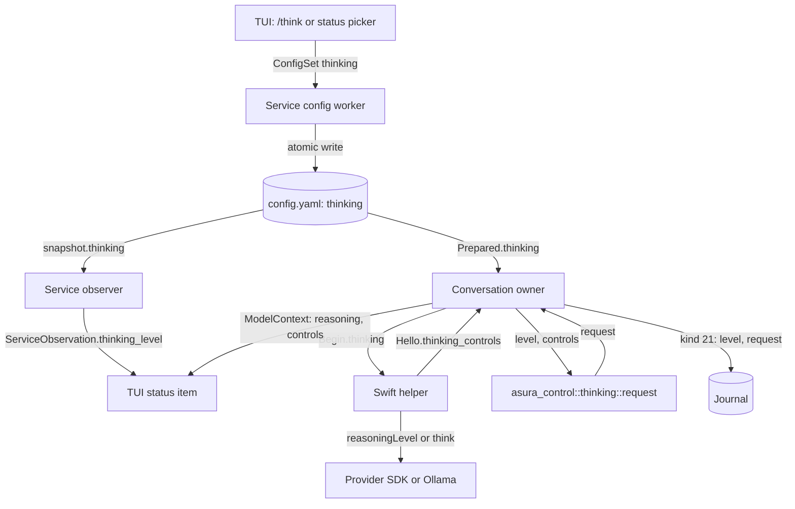
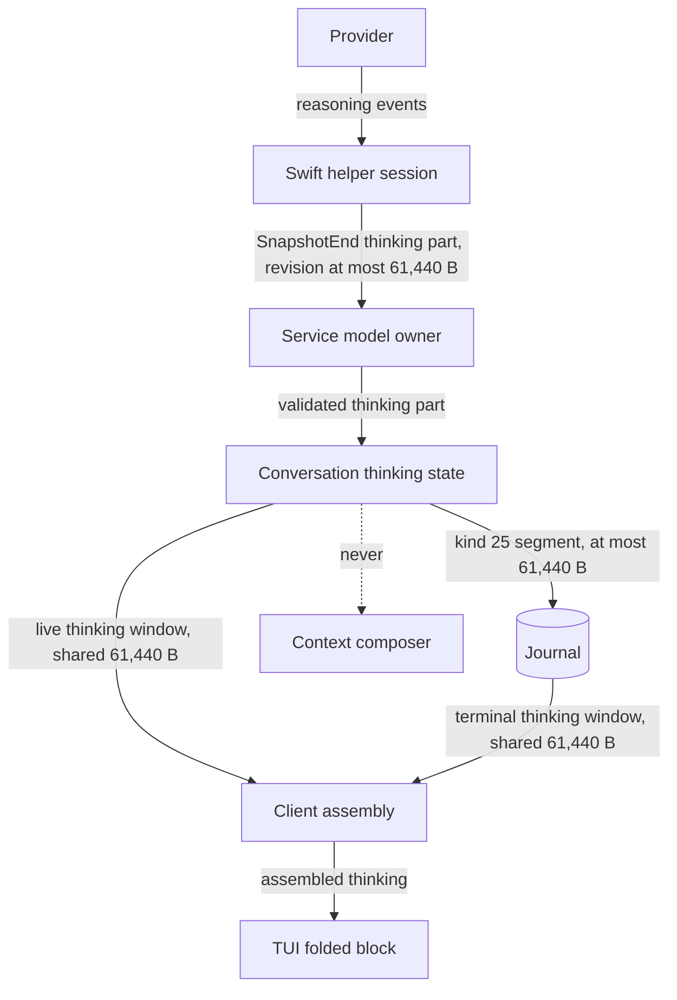
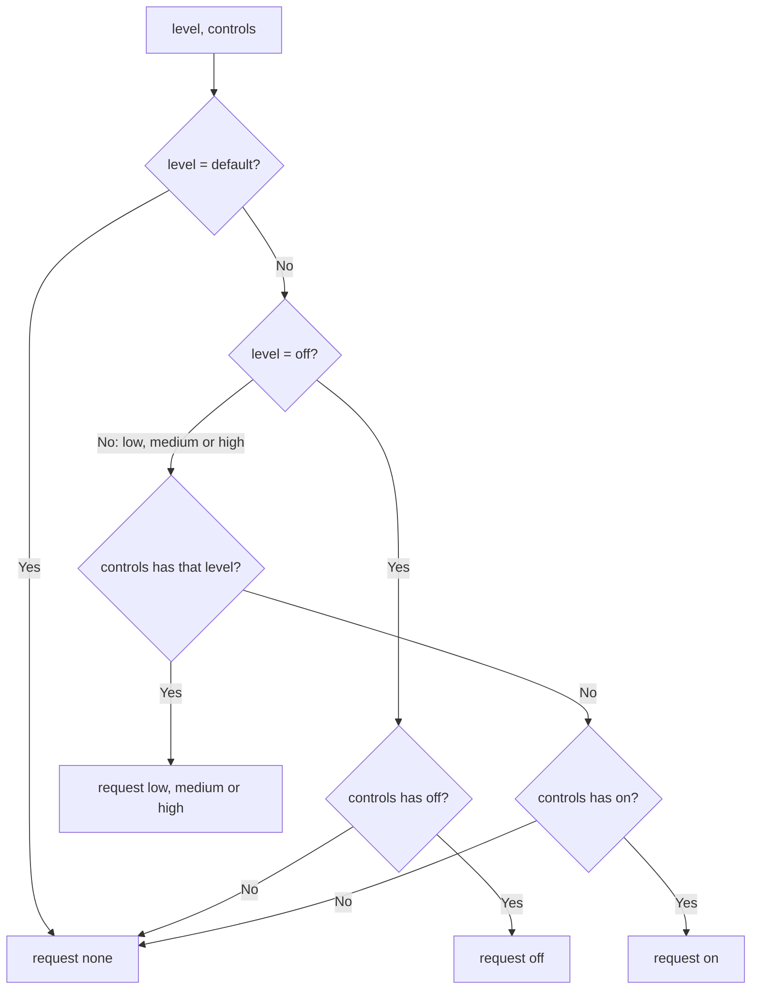
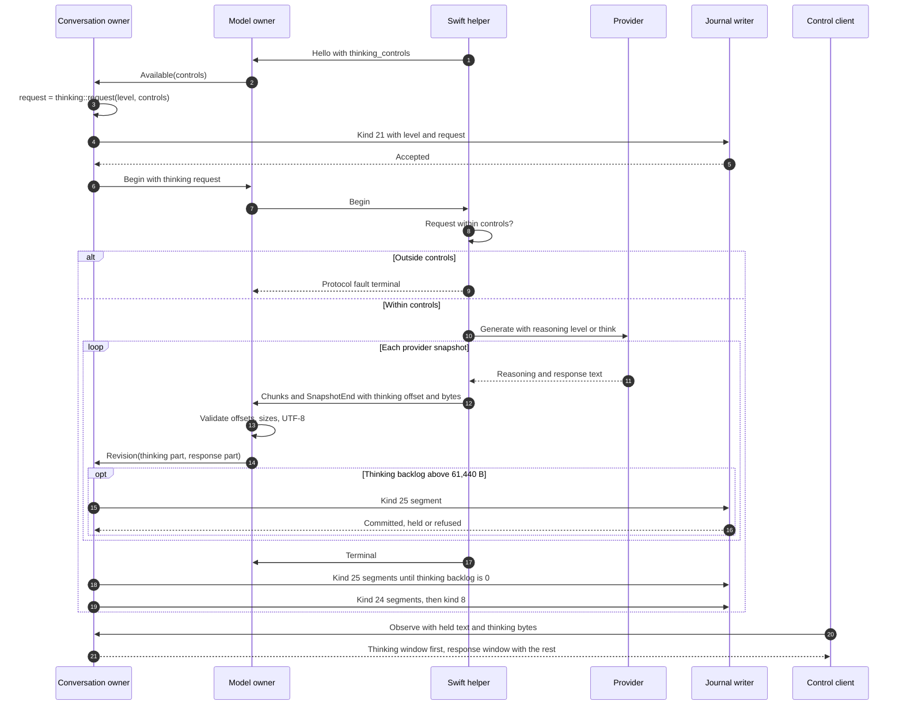
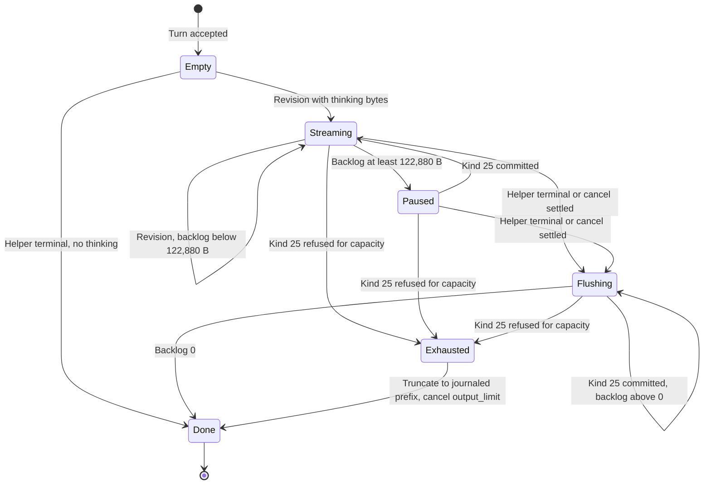
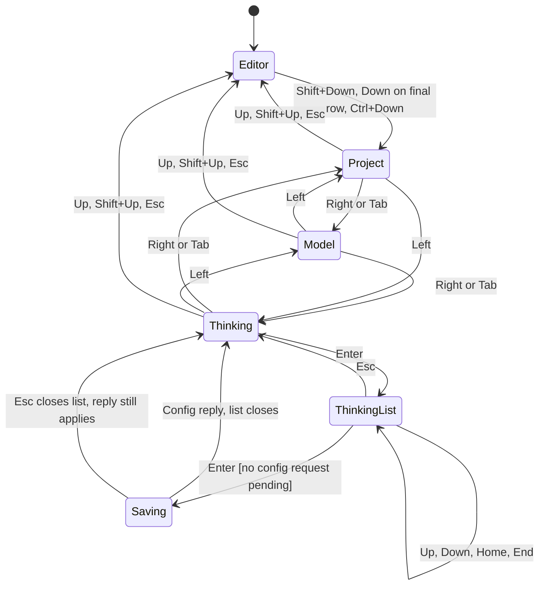
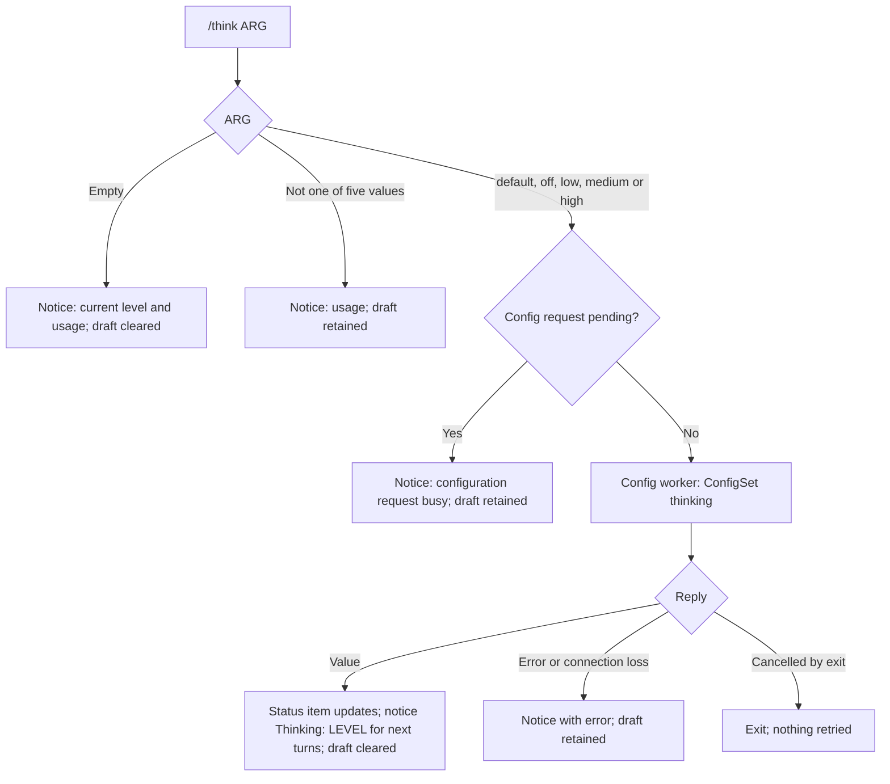

# Thinking level

Status: selected design (owner decisions, 2026-10-19), implemented 2026-10-19.
This document is the canonical contract for the model thinking level and for
thinking text. The [response text transfer](response-text-transfer.md),
[configuration commands](config-commands.md#thinking-level-key),
[conversation admission](conversation-admission.md#transition-payloads),
[segmented journal](segmented-journal.md), [context composer](context-composer.md),
[model tools](model-tool-execution.md#capability-support-and-activation) and
[command flows](command-flows.md) link here. Wire protocol 0.1 and journal
format 1 do not change.

## Owner decisions

Owner, 2026-10-19. These are required behavior.

1. The person can set a model thinking level. The TUI status bar, below the
   input box, shows it.
2. A configuration key sets the level. A command changes it for the next turns
   until it is changed again; the change persists and survives restart. Each
   turn records the level it used in the journal, so history shows it.
3. The person changes the level with `/think off|low|medium|high|default` and by
   selecting the level item in the status bar.
4. Levels are model default (Asura sends nothing; the model chooses), off, low,
   medium and high. The configured default is model default, so nothing changes
   until the person sets a level. Asura sends each level in the form the model
   accepts. A model with only on/off control gets "on" for low, medium and high.
   For a model that cannot reason, the status bar says so and Asura sends nothing.
5. Thinking text is kept in the journal and shown in the conversation log as a
   folded block that the person can open. It is never sent back to the model in
   later turns; the context composer excludes it.

6. Owner, 2026-10-20: model default sends nothing for every model, MLX
   included. The earlier forced MLX `no_think` is removed ([D4](#decisions-and-alternatives)).

Standing rules apply: no default time bounds, per-item bounds only, no backward
compatibility, one source of truth for each fact, tests never touch `~/.asura`,
and ADR-0006 asynchronous execution.

## Scope

Objectives:

- One persisted setting, `thinking`, with five values.
- Per-model thinking controls reported by the helper, and one mapping from the
  setting to the form sent.
- Thinking text carried from provider to journal to client in bounded pieces,
  separate from the response.
- The level and the sent form recorded on each accepted turn.
- TUI status-bar item, `/think` command and a folded thinking block.

Non-goals: thinking budgets in tokens, per-turn overrides, showing thinking to
the model in a tool loop, remote providers, and new providers. The removed MLX
forced disable (Hello field 19, `reasoning_disabled`) is replaced by this
design; see [D4](#decisions-and-alternatives).

## Terms

| Term | Meaning |
| --- | --- |
| Thinking level | The person's setting: `default`, `off`, `low`, `medium` or `high`. `default` means model default. |
| Thinking controls | The forms a loaded model accepts, as a bit set reported by the helper: off 1, on 2, low 4, medium 8, high 16. |
| Thinking request | The form Asura sends for one turn: none, off, on, low, medium or high. None means Asura sends nothing. |
| Thinking text | The model's reasoning output for one turn. It is untrusted model output, like the response. |

## Provider evidence

Verified behavior, recorded 2026-10-19 on macOS 27.0 (Darwin 27.0.0), Xcode
27.1 (27A9275), Swift 6.4, Ollama 0.40.5.

| Provider | Evidence | Source |
| --- | --- | --- |
| Ollama | `/api/chat` accepts `think`: `true`, `false`, or a level string. `qwen3:1.7b` streamed `message.thinking` chunks for `true`, `"low"` and `"high"`, and none for `false`. An unknown string fails with `invalid think value: "bogus" (must be "high", "medium", "low", "max", true, or false)`. | Live `curl` against the local daemon |
| Ollama | `/api/show` returns `thinking: {values, default}`: `qwen3:1.7b`, `gemma4:12b` and `ornith:9b` give `values: [false, true]`; `llama3.2:3b` gives `values: [false]` and no `thinking` capability. `granite4.2:8b` has the `thinking` capability and no `thinking` object, and honors `think: true/false`. | Live `curl`; [docs.ollama.com/capabilities/thinking](https://docs.ollama.com/capabilities/thinking) states `values` may hold booleans or named level strings |
| Ollama | `think: true` to a model without the capability fails: `"llama3.2:3b" does not support thinking`. Asura must send nothing to such a model. | Live `curl` |
| Foundation Models SDK | `ContextOptions.reasoningLevel: ReasoningLevel?` with `.light`, `.moderate`, `.deep`, `.custom(String)`. Executors receive `request.contextOptions`. A provider emits `.reasoning(entryID:action: .appendText(...))` channel events; transcripts gain `Transcript.Entry.reasoning(Transcript.Reasoning)` with text segments; `ResponseStream.Snapshot.transcriptEntries` exposes them. | `FoundationModels.swiftmodule/arm64e-apple-macos.swiftinterface`, module version 2.0.68.1.402 |
| System model | `SystemLanguageModel.default.capabilities` does not contain `.reasoning` on this host. Asura reports no thinking and sends nothing. | Compiled probe against the installed SDK |
| MLX | Pinned `mlx-swift-lm` c6446cf: `thinkingEnabled(for:)` maps `.light/.moderate/.deep` and any `.custom` other than `no_think` to on, `.custom("no_think")` to off, nil to the template default. `.templateFlag` strategies toggle; `.alwaysOn` cannot be disabled; `.none` has no control. Thinking reaches the session as `.reasoning` events only when `.reasoning` is declared. | `MLXLanguageModel.swift` lines 1015–1170, 2033–2046; `ReasoningConfig.swift` |
| CoreAI | Pinned `coreai-models` 3f109ef: the executor parses `<think>` spans into `.reasoning` events and never reads `contextOptions.reasoningLevel`. The level cannot be controlled. | `CoreAILanguageModel.swift` (no `reasoningLevel` reference), `ThinkTagParser.swift` |

### Thinking controls by provider

Selected design. Each helper reports its controls in Hello field 23.

| Provider | Reasoning support | Controls |
| --- | --- | --- |
| Ollama | `thinking` in `/api/show` capabilities | From `thinking.values`: `false` adds off, `true` adds on, `"low"`, `"medium"`, `"high"` add their bits; other strings are ignored. With the capability and no `thinking` object: off and on. Without the capability: 0. |
| MLX | Declared `reasoning` | `.templateFlag`: off and on. `.alwaysOn`: on. `.none` or no reasoning config: 0. |
| CoreAI | `.reasoning` in model capabilities | 0: the executor ignores the level. |
| System | `.reasoning` in model capabilities | Low, medium and high when supported (framework levels); 0 otherwise. Current host: not supported. |

A model with reasoning support and controls 0 thinks as it chooses. The status
bar shows the level as not applied.

## Required behavior and acceptance

| ID | Initial state | Trigger | Required result |
| --- | --- | --- | --- |
| TL-01 | No `thinking` key | Turn runs | Kind 21 records level `default` and request none. No `think` field reaches Ollama; no reasoning level reaches the SDK. |
| TL-02 | Any level | `/think high` | Config file holds `thinking: high`. The status item shows `think high`. The next turn records level high. A service restart keeps it. |
| TL-03 | Level high | `/think default` | The key is removed from the file. The next turn records `default`, request none. |
| TL-04 | Level high, model controls off+on | Turn runs | Request on; Ollama receives `think: true`; MLX receives `.custom("think")`. The status item shows `think high (on)`. |
| TL-05 | Level low, controls include low | Turn runs | Request low; Ollama receives `think: "low"`. |
| TL-06 | Level off, controls include off | Turn runs | Request off; Ollama receives `think: false`; MLX receives `.custom("no_think")`. |
| TL-07 | Level off or high, controls 0 or no reasoning | Turn runs | Request none; nothing is sent. Status shows `no thinking` (no reasoning) or the level dimmed with `(n/a)` (reasoning, no control). |
| TL-08 | Status bar focused on the thinking item | Enter, select a row, Enter | Same result as the matching `/think`. Esc closes the list without change. |
| TL-09 | Model streams thinking then answer | Turn runs | Thinking text reaches the journal in kind 25 segments and the client in event windows; the log shows `▸ Thinking · N chars` above the answer. |
| TL-10 | Turn with thinking is history | Next turn composes | The model input history holds the prompt and answer only; no thinking text. |
| TL-11 | Response selection on a turn with thinking | `t` | The block opens and shows the text; `t` again folds it. |
| TL-12 | Thinking longer than 61,440 bytes | Turn runs | Several kind 25 segments; a client assembles the whole thinking text; no frame exceeds 64 KiB. |
| TL-13 | Service restarts | Client reads history | Thinking text and the recorded level come from the journal. |
| TL-14 | Invalid value | `/think maximum` or `config set thinking 7` | Rejected; file and draft unchanged. |
| TL-15 | Helper sends a request outside its controls, a thinking offset beyond held text or invalid UTF-8 | Revision or Begin | Protocol fault; the turn fails truthfully. |

## Ownership

| Owner | Responsibility |
| --- | --- |
| Config storage (`asura-storage::config`) | The `thinking` key: validation, get/set, persistence and the admission snapshot field. |
| Control crate (`asura-control::thinking`) | The pure mapping from level and controls to request. Service and TUI both call it; there is no second copy. |
| Swift helper | Reports controls in Hello; translates the request to the provider form; extracts thinking text and sends it in revisions. |
| Service model owner | Validates controls, Begin request and combined revisions. |
| Conversation owner | Computes the request at Hello, records level and request on kind 21, holds the active thinking text, journals kind 25, serves windows. |
| Journal (`asura-storage` authority) | Kind 25 replay, thinking pieces in state, checkpoint and index (tag `H`), and window reads. |
| Context composer | Builds history from answers only. It never receives thinking text. |
| Client (`asura-client::ResponseAssembly`) | Assembles thinking windows beside the response. |
| TUI | Status item, picker, `/think`, folded block. |

Dependency direction is unchanged: TUI → client → control; service → storage,
control; helper ↔ service over the private channel.

### Setting path

Selected design. Arrows carry the level, the controls or the request. Labels
name the field or record.

### Thinking text path

Selected design. Arrows carry thinking text; labels give the per-item bound.

## Contracts

### Configuration key

`thinking` is a top-level YAML string: `default`, `off`, `low`, `medium` or
`high`. Absent means `default`. Setting `default` removes the key. Get returns
the effective value. Any other value, type, tag or null rejects with
`config_invalid_value`; the file stays unchanged. The existing 16 KiB file and
4 KiB value bounds, isolated config worker and atomic replacement apply.

`ConversationSnapshot` gains `thinking`. The writer copies it into `Prepared`.
The service observer reads it with the model and publishes it in
`ServiceObservation` field 7, `thinking_level`.

### Mapping

Selected design. `asura_control::thinking::request(level, controls)` is total
and pure.

A model without reasoning support reports controls 0, so every level maps to
none (TL-07).

### Model channel (`model.proto`)

| Message | Change |
| --- | --- |
| `enum ThinkingRequest` | New: `NONE 0, OFF 1, ON 2, LOW 3, MEDIUM 4, HIGH 5`. |
| `Hello` | Field 19 `reasoning_disabled` removed and reserved. Field 23 `thinking_controls` (uint32, at most 31): helper-only, available non-inventory Hello; nonzero requires a known capability source with reasoning bit 4. |
| `Begin` | Field 6 `thinking` (`ThinkingRequest`): present only for OFF–HIGH; absent means none. The service sends only a request within the helper's controls; the helper rejects any other as a protocol fault. |
| `SnapshotEnd` | Fields 5 `thinking_offset` and 6 `thinking_bytes` (uint64), present together or absent. When present, the first `thinking_bytes` bytes of the transfer are thinking text: the receiver keeps `thinking_offset` bytes of its committed thinking and appends them. The remaining `total_bytes − thinking_bytes` bytes revise the response as before. `thinking_bytes` is at most `total_bytes`. |

One revision still appends at most 61,440 bytes in total, so credit, chunking
and `Terminal` accounting stay unchanged; cumulative counts include thinking
bytes. Each part must be valid UTF-8 by itself and each offset a character
boundary of the committed text.

The helper keeps committed and target text for both parts. For each transfer
it computes the thinking change first, then gives the response the remaining
budget. A part with no change keeps its committed length as offset and appends
nothing. When the response gets no budget, its offset stays at its committed
length, so no needless cut occurs.

Helper translation of the request (selected):

| Request | `ContextOptions.reasoningLevel` | Ollama `think` |
| --- | --- | --- |
| none | nil | field omitted |
| off | `.custom("no_think")` | `false` |
| on | `.custom("think")` | `true` |
| low | `.light` | `"low"` |
| medium | `.moderate` | `"medium"` |
| high | `.deep` | `"high"` |

The shared engine passes the option on every inference of the turn. The
helper extracts thinking text from `ResponseStream.Snapshot.transcriptEntries`:
the text segments of every `.reasoning` entry, joined with a blank line between
entries. The Ollama executor emits `.reasoning(action: .appendText(...))` for
each nonempty `message.thinking` and drops `.reasoning` transcript entries when
it builds the next request of a tool loop.

### Journal (format 1)

Kind 21 `TurnAccepted` gains two bytes after the composition: thinking level u8
(0 default, 1 off, 2 low, 3 medium, 4 high) and thinking request u8 (0 none,
1 off, 2 on, 3 low, 4 medium, 5 high). Replay rejects other values.

Kind 25 `ThinkingText`, new. Payload fields in byte order: model-operation ID,
conversation generation u64, offset u64, text string of at most 61,440 bytes.
Replay requires an accepted, started, nonterminal operation of the current
owner generation, `offset` at most the journaled thinking length, and a change
(`text` nonempty or `offset` below the length). It is a normal record.

Replay keeps thinking as a second piece list on the operation, with the same
piece rule, the same 64-byte replay charge and the same 65,536-piece limit as
the response. The checkpoint stores the thinking length and pieces after the
response pieces. Settled operations write index entries with tag `H`
(`Thinking piece: operation, start offset`), value `kept u64, frame locator`,
the same layout as tag `P`. The thinking length of a settled operation is the
end of its last `H` piece; it is a derived value and is not stored. A restart
terminal keeps the journaled thinking prefix; kind 8 carries no thinking tail.

`ReadResponse` gains `thinking_offset` and returns the turn's level and
request from the kind 21 frame, the thinking length, and one thinking window.

### Control protocol (`control.proto`)

| Message | Change |
| --- | --- |
| `enum ThinkingLevel` | New: `DEFAULT 0, OFF 1, LOW 2, MEDIUM 3, HIGH 4`. |
| `enum ThinkingRequest` | New: same values as the model channel. |
| `ConversationObserve` | Field 5 `thinking_offset`: thinking bytes the client holds. |
| `ConversationEvent` | Fields 15 `thinking_text`, 16 `thinking_offset`, 17 `thinking_bytes`, 18 `thinking_level`, 19 `thinking_request`. |
| `ModelContext` | Fields 7 `reasoning` (bool) and 8 `thinking_controls` (uint32), from the live Hello. |
| `ServiceObservation` | Field 7 `thinking_level`: the configured level. |

Windows share one budget of 61,440 bytes per event. The thinking window comes
first; the response window gets the remaining bytes. When `thinking_text` is
present, the client truncates its thinking to `thinking_offset` and appends it;
the thinking then has `thinking_bytes` bytes. Live thinking cuts use the same
16-cut log as the response. A client holds everything when it holds both
`text_bytes` and `thinking_bytes`. The frame proof TCR-D26 still holds: the two
text fields together carry at most 61,440 bytes, and the five new scalar fields
add at most 37 bytes.

### Observation and journaling sequence

Selected design. Solid arrows are messages or journal commands, dashed arrows
are replies. The loop repeats until the helper terminal.

### Active thinking state

Selected design. The thinking text uses the response state machine of
[response text transfer](response-text-transfer.md#response-state), with these
differences: no kind 8 tail, and the terminal flush writes every remaining
byte as kind 25.

Output pauses while either the response or the thinking backlog is at least
122,880 bytes. Each part then holds at most 184,320 unjournaled bytes, and the
two together hold less than 307,200 bytes.

## TUI behavior

### Status item

The right status group becomes `{thinking} · {gauge} · {model}`. Below 40
columns the thinking item is omitted; it is at most 20 cells wide. The label
comes from the configured level and the most recent `ModelContext` that
reported reasoning support for the configured model:

| Condition | Label | Style |
| --- | --- | --- |
| No observed model context yet | `think {level}` | Muted |
| Model reports no reasoning | `no thinking` | Dim |
| Level default | `think default` | Muted |
| Request equals the level | `think {level}` | Muted |
| Request is on for low, medium or high | `think {level} (on)` | Muted |
| Request none for a non-default level | `think {level} (n/a)` | Dim |

A configured-model change clears the observed context, so the label never
describes a different model.

### Status focus and picker

The status bar items are Project, Model and Thinking. Left, Right and Tab step
between them, as they do between Project and Model today. Enter on Thinking
opens the thinking list in the existing picker panel: `model default`, `off`,
`low`, `medium`, `high`. The current level is preselected and marked
`· current`. A row shows `· not applied to this model` when the mapping gives
none for an observed reasoning model, and `· model cannot think` when the
observed model has no reasoning support.
Up/Down/Home/End select, Enter saves through the config worker exactly as
`/think` does, and Esc closes. While the save is pending the picker stays open
and keys other than Esc are ignored, like the model picker.

### `/think` command

`/think LEVEL` with one of the five values sends `ConfigSet thinking LEVEL`
through the existing config worker. `/think` alone shows the current level and
the usage in the notice. Any other argument shows
`Use /think off|low|medium|high|default; draft retained`. On success the notice reads `Thinking: LEVEL for next
turns` and the status item updates; a running turn keeps the level it recorded.
The command is local; it does not need a project.

The config worker's own retry and cancellation rules
([CF07](command-flows.md#cf07-configuration-reads-and-writes)) apply. There is
no time bound.

### Folded thinking block

A turn with thinking shows one line above its answer:
`▸ Thinking · N chars` while folded, `▾ Thinking · N chars` and the sanitized
text while open. A live turn's count grows. In response selection (F6),
`t` toggles the selected turn's block. The hint row lists `t thinking` there.
Blocks start folded and fold state is local to the session. The text is
sanitized like the response and rendered as plain italic muted text, not
Markdown.

## Failure and recovery

| Case | Required result |
| --- | --- |
| Config file invalid or unwritable | Existing config errors; level unchanged. |
| Helper reports controls without reasoning support, or above 31 | Hello rejects as protocol fault; the turn fails before acceptance. |
| Begin request outside controls | Helper protocol fault (TL-15). |
| Invalid thinking offset, size or UTF-8 | Model-owner protocol fault; the turn fails with what it holds. |
| Kind 25 held at the journal quota | Same as kind 24: output pauses and the segment is retried when the hold ends. |
| Kind 25 refused for capacity | Thinking keeps its journaled prefix; cancel cause 3 (`output_limit`); terminal as for kind 24. |
| Provider rejects the think value | Provider failure as today; the turn fails truthfully. The mapping prevents this for reported controls. |
| Service crash | Restart terminal keeps the journaled thinking prefix; at most 184,320 unjournaled thinking bytes are lost with the response tail. |
| Client disconnect | No per-client state; reconnect resumes from the held counts. |

Every wait ends through an existing closure: config reply, helper terminal,
cancel, helper exit, protocol fault, writer reply, disconnect or shutdown. This
design adds no deadline or timeout.

## Security and data handling

Thinking text is untrusted model output. It never becomes a tool request,
never enters model input, and is sanitized before display. It is stored in the
same private journal as the response; no new file, process, endpoint or
permission is added. The level is not secret. Ollama endpoints stay loopback.

## Asynchronous execution and bounds

| Rule | Application |
| --- | --- |
| AE-01 | The reactor applies revisions and selects windows without waiting; one window copies at most 61,440 bytes. Config reads and writes stay on the config worker. |
| AE-02 | No new blocking call. Journal I/O stays on the writer thread; provider I/O stays in the helper. |
| AE-03 | Revision ≤ 61,440 B combined; kind 25 ≤ 61,440 B; event windows ≤ 61,440 B combined; pause at 122,880 B per part; 16 cuts per part; 65,536 pieces per part; config value ≤ 4 KiB. |
| AE-04 | Pause ends when a segment commits; the turn ends on terminal, cancel, helper exit, protocol fault or shutdown. No time bound. |
| AE-05 | Kind 21 and kind 25 are append-only; replay rebuilds thinking; the request is recomputed from nothing at replay because it is recorded. |
| AE-06 | Shutdown cancels the helper; the terminal flush writes thinking before kind 8. |
| AE-07 | The validation cases below cover stalled journal, slow client, restart and invalid helper output. |

## Validation

| ID | Unit | Integration | End-to-end |
| --- | --- | --- | --- |
| TL-01..06 | `thinking::request` table over all levels and controls; config get/set/default removal; kind 21 encode/replay of level and request | `tool_call_flow thinking`: scripted Ollama receives no `think` for default, `"high"` for high with level controls, `true` for high with on/off controls, `false` for off | Native `--native-ollama-thinking`: `qwen3:1.7b` with `thinking: high` streams thinking and records level high, request on |
| TL-07 | Mapping gives none; TUI label `no thinking` and `(n/a)` | Scripted Ollama without the capability receives no `think` | — |
| TL-02, TL-08, TL-11 | TUI: `/think` parse, picker keys, label states, `t` toggle, render of folded and open block | — | PTY gate `--thinking`: status item, picker save, `/think`, folded block opened with `t`, value persisted in the scratch config |
| TL-09, TL-12 | Response state for thinking segments, combined windows; client assembly; model-owner combined revision split; Swift session two-part pump | `tool_call_flow thinking`: 200,000 bytes of thinking in kind 25 segments, assembled whole through windows of at most 61,440 bytes before and after restart | Native journey: thinking text journaled and observed |
| TL-10 | Composer candidates hold answers only | `tool_call_flow thinking`: the second turn's `/api/chat` messages contain no thinking text | — |
| TL-13 | Journal replay, checkpoint and index round trip with `H` pieces; `ReadResponse` thinking window | `tool_call_flow thinking` restart read | — |
| TL-14 | Config rejects invalid values; TUI usage notice | — | PTY gate invalid `/think` keeps the draft |
| TL-15 | Control and Swift `Wire` validation; model owner rejects bad thinking offset; helper rejects request outside controls | — | — |

Native CoreAI and MLX thinking are not qualified: no thinking-capable CoreAI or
MLX asset is configured on this host. Their mappings have unit coverage only.

## Recorded validation — 2026-10-19

Verified behavior on macOS 27.0, Xcode 27.1, Swift 6.4, Rust 1.98.0, Ollama
0.40.5. Mermaid diagrams rendered with Mermaid CLI 12.0.0 and inspected.

| Layer | Evidence |
| --- | --- |
| Unit (Rust) | `asura_control::thinking` mapping table; control wire for windows, controls, Begin and SnapshotEnd (and the TL-12 frame proof); config key; kind 21/25 codec and replay (`tl09_tl12_*`, `tl15_*`); response state flush, exhaust and budgeted windows; model owner split and Begin; owner with a real private journal (`tl09_tl12_thinking_segments_pause_windows_and_flush_before_terminal`, `tl15_refused_thinking_segment_*`); client assembly; TUI label, `/think`, status list, folded block and worker assembly. |
| Unit (Swift) | Controls by provider (MLX strategies, Ollama `/api/show` shapes), request-to-SDK mapping, `think` encoding, reasoning entries dropped from Ollama history, reasoning-only thinking extraction, revision planner, session two-part revisions and Begin outside controls. Cross-language fixtures exported by Rust were accepted and rejected identically by Swift. |
| Integration | `segmented_journal tl12_tl13_*`: about 10 MiB of thinking across segment files, read through `H` pieces before and after restart and rebuild. `tool_call_flow thinking`: real service and Swift helper with a scripted loopback Ollama; `think` absent, `"high"`, `true`, `false`, absent; 213,328 thinking bytes in four kind 25 segments; windows within 61,440 bytes and frames within 64 KiB; the next turn's request has the answer and no thinking; restart read from the journal. |
| End-to-end | PTY `--thinking`: `/think high` persisted, status item, `think: true` to an on/off model, folded block opened with `t`, status list saved model default. Native `--native-ollama-thinking` with `qwen3:1.7b` and `granite4.2:8b` (no `thinking.values`): thinking journaled and shown apart from the answer, high recorded as on, off recorded with no thinking, restart read. |

Not verified: CoreAI and MLX thinking with real assets (no reasoning asset on
this host); a graded Ollama model (`gpt-oss`) live, covered only by the
scripted endpoint; the system model with reasoning (this host reports none);
SDK snapshots across tool rounds with thinking (a later round may present
only its own reasoning entries, which shows as a cut of the thinking text).

## Decisions and alternatives

- **D1 Selected: one key, `thinking`.** The command writes the same key, so the
  config file is the single source of the level. Rejected: a session override,
  because the owner requires persistence.
- **D2 Selected: the service maps, the helper translates.** The mapping is one
  pure function that the TUI also uses for display. The request is recorded,
  so history needs no capability replay.
- **D3 Selected: combined revisions.** Thinking rides in the same transfer and
  credit as the response. Rejected: a second transfer stream, which doubles
  credit and ordering state for no bound gained.
- **D4 Selected: remove the forced MLX disable.** Field 19 forced `no_think` on
  every toggleable MLX model because thinking text had no path. With this design
  `default` sends nothing, so a toggleable MLX model now thinks by its template
  default. Setting `off` restores the previous behavior. The owner confirmed
  this on 2026-10-20 (owner decision 6).
- **D5 Selected: separate kind 25 and tag `H`.** Response and thinking stay
  separate facts. Rejected: interleaving thinking in kind 24, which would make
  every response reader filter it.
- **D6 Selected: drop reasoning entries in Ollama tool loops.** The composer
  rule extends to inference within a turn. Rejected: echoing `thinking` back,
  which the owner excluded for later turns and which Ollama documentation does
  not require.
- **D7 Selected: level and request on kind 21.** They are fixed at acceptance.
  Rejected: kind 8, because a crash before terminal would lose them.

No owner decision remains open for this scope.
