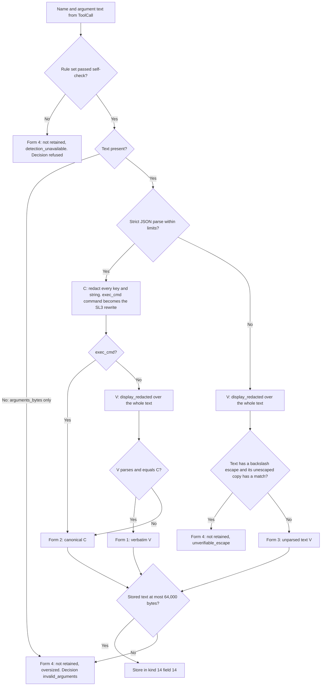
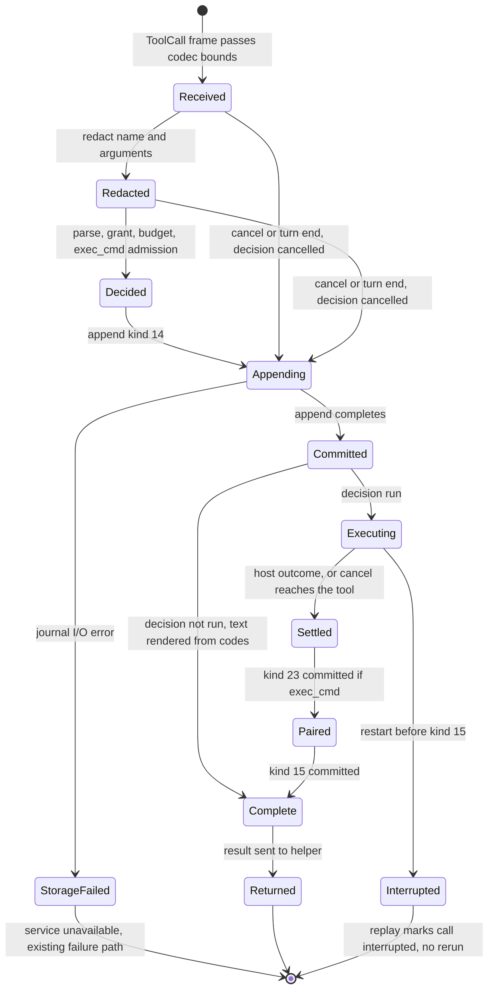
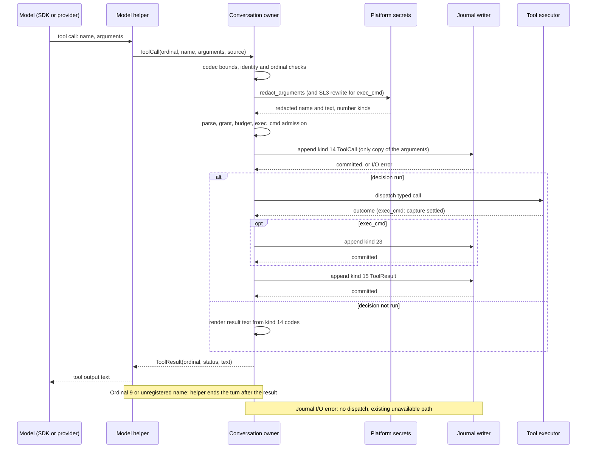

# Tool call records

Status: proposed design, 2026-10-17; not implemented. The owner reviewed it on
2026-10-17 and decided the questions in
[owner decisions](#owner-decisions-2026-10-17).

Scope: one journal record for every tool call the model proposes, including
malformed calls. The record holds the tool name and the arguments as the
service received them, after secret redaction, and the service's decision.
The record is the only place the arguments are kept.
Protocol numbering stays `0.1`. Journal format stays `1`.

## Owner rules

These rules come from the owner. Later sections apply them.

| ID | Rule | Source |
| --- | --- | --- |
| TCR-O1 | Record the tool name and the parameters in the journal. | Owner, 2026-10-17 |
| TCR-O2 | No backward compatibility. Asura is unreleased. Change record schemas in place. Do not add legacy readers, aliases or migration. Old journals are ignored. | Owner, 2026-10-17 |
| TCR-O3 | No default time bounds. Work ends only through a [loop closure](loop-closure.md). | Owner, 2026-10-15; [AE-04](../engineering.md#asynchronous-execution-and-recovery) |
| TCR-O4 | Protocol stays `0.1`. Journal format stays `1`. Schemas may change within them. | [Wire protocol change authority](../engineering.md#wire-protocol-change-authority) |
| TCR-O5 | One source for each fact. The arguments live only in the kind 14 record. A value derived from other recorded facts is recomputed on replay, not stored. | Owner review, 2026-10-17 |

## Purpose and scope

Objectives:

- The journal shows every tool call that the model proposed in an admitted
  turn: the name, the arguments and what Asura did with the call.
- A malformed call leaves the same kind of record as a valid call.
- No record holds a secret value. The service redacts secrets before the
  record, with the rule set of [secret detection](secret-detection.md).
- One record kind replaces the three intent kinds used today.
- Each fact has one source (TCR-O5).

Non-goals:

- Results of calls that run. Kind 15 keeps its layout. The
  [context composer](context-composer.md) (CCR4) and
  [tool output views](tool-output-views.md) own the change to
  reference-only results.
- Person commands (`!` mode). [Person command mode](person-command-mode.md)
  owns their records.
- Changes to authority, grants or tool behavior. A record grants nothing.
- Recovery of old journals (TCR-O2).
- Journal capacity. The single 8 MiB journal file is addressed by the
  segmented-journal backlog item
  ([journal capacity follow-up](conversation-admission.md#format-1-and-record-compatibility)),
  not by a second store.

Dependencies:

- [Secret detection](secret-detection.md) slice SL3: rule set, command
  rewrite and `display_redacted`.
- [Tool job controller](tool-job-controller.md) J1: kind 23, payload IDs for
  exec_cmd output and recovery.
- [Model tool execution](model-tool-execution.md) and
  [consolidated tools](consolidated-tools.md): the four model-facing tools
  `project`, `memory`, `service` and `exec_cmd`.
- [Conversation admission](conversation-admission.md): journal frames, the
  writer's `reserve()` and journal step J1-0 (journal waits without a time
  bound).
- [Hybrid memory ontology](hybrid-memory-ontology.md) HM3: note creation and
  its receipts.

## Current behavior

Verified behavior, read from the code on 2026-10-17. Another change is in
progress: it removes kind 14 with tool kind 16, kind 12 input records and the
ordinary-tool deadline. Line numbers can move.

| Fact | Evidence |
| --- | --- |
| The model-facing tool name and the model's argument text never reach the service. The helper decodes them into typed values. The private `ToolCall` message holds only an ordinal and a typed `oneof` (fields 10–19). | `contracts/model/v1/model.proto:86-89`; `swift/model-helper/Sources/HelperCore/Session.swift:312-367` |
| Kind 14 `ToolIntent` holds a numeric tool kind, `path`, `offset` and `limit`. Kind 22 holds exec_cmd calls. Kind 17 holds `create_note` calls. Kind 15 holds results. | `rust/crates/asura-storage/src/authority/conversation/types.rs:236-266`, `types.rs:422-439` |
| The helper rejects some malformed calls before the service sees them. Example: `project` with `read_file` and no `path` throws `BackendFailure(.inputLimit)`. The SDK turns this into a tool callback failure, and the turn fails. | `ToolBridge.swift:234-237`; `Backend.swift:38-55` |
| The helper validates every `ToolCall` before it sends it. A message with a missing required field fails validation, and the turn fails. | `Session.swift:358`; `rust/crates/asura-control/src/model.rs:392-450` |
| The service decoder applies the same validation to every helper frame. A failure is `model_protocol_fault`. | `rust/crates/asura-service/src/model_owner.rs:612-627` |
| The service converts the message to typed arguments. A missing required field returns `Rejection::InvalidArguments`. The caller then fails the turn with `model_protocol_fault`. It writes no tool record. | `rust/crates/asura-service/src/conversation.rs:245-302`, `conversation.rs:3193-3201` |
| An exec_cmd call that fails argument validation fails the turn. No record is written. | `conversation.rs:2757-2763` |
| A budget rejection (ninth call, busy, identity conflict) fails the turn. No record is written. | `conversation.rs:2785-2802`; `rust/crates/asura-service/src/tools.rs:474-498` |
| A cancel that arrives before the intent commits drops the call. No record is written. | `conversation.rs:3517-3523` |
| A typed call that decodes but fails semantic checks gets a durable rejected intent (tool kinds 4, 5, 9–11) and an empty status-3 result. | `conversation.rs:315-366`; [rejected semantic tool proposals](model-tool-execution.md#rejected-semantic-tool-proposals) |
| The SDK can give a tool its arguments as `GeneratedContent`. `GeneratedContent` conforms to `Generable`. `Tool` takes any `ConvertibleFromGeneratedContent` arguments with a separate `parameters` schema. `Transcript.ToolCall` exposes `toolName` and `arguments`. | Xcode 27.1 (27A9275) macOS SDK, `FoundationModels.swiftinterface` lines 1336, 2554-2557, 3054-3064 |

Result: today, a call with a missing required argument ends the whole turn
with a protocol fault. The journal keeps only the turn terminal. The tool
name and arguments are lost.

## Required behavior

| ID | Requirement |
| --- | --- |
| TCR-R1 | The service writes one kind 14 `ToolCall` record for every tool call that reaches the service in an admitted, started turn. This includes calls that are invalid, unknown, refused, busy, denied, over the call limit or cancelled before a decision. |
| TCR-R2 | The record holds the tool name and the argument text as the helper received them, after redaction. It also holds the operation, the decision and the reason. |
| TCR-R3 | No journal record holds an unredacted secret. Redaction happens before the record. If redaction cannot run, the service does not keep the text. |
| TCR-R4 | The record never authorizes execution. Replay and restart never run a call again. |
| TCR-R5 | A call that runs is followed by exactly one kind 15 result, unless restart interrupts the turn first. An exec_cmd call that runs also has kind 23 before kind 15. A call that does not run is complete when its kind 14 commits; no kind 15 follows. |
| TCR-R6 | A malformed call gets a status-3 result that the model can read, where the helper can still return a result. It consumes one of the turn's calls. |
| TCR-R7 | Decoding is strict. A record that breaks a field rule is `Corrupt`. A record of a retired kind is `UnsupportedFormat`. No code reads an old layout. |
| TCR-R8 | Authority checks do not change. The parser, the grant and the budget decide the outcome before any host effect. |
| TCR-R9 | The argument text exists in exactly one place: field 14 of the kind 14 record. No payload object, detail block or result repeats it. |

## Ownership

The table names the owner of each behavior. Dependencies point down: the
helper depends on the wire contract; the service depends on storage and
platform secrets.

| Behavior | Owner | Location |
| --- | --- | --- |
| Capture the tool name and argument text at the tool boundary | Model helper, tool bridge | `swift/model-helper/Sources/HelperCore/ToolBridge.swift`, `Session.swift` |
| Report an unregistered name seen by an Asura provider adapter | Model helper, Ollama adapter | `OllamaBackend.swift` |
| Bound and check the `ToolCall` frame | Model codec | `rust/crates/asura-control/src/model.rs` |
| Parse the argument text into typed arguments (the only parser) | Service tool contract | `rust/crates/asura-service/src/tools.rs` (replaces `proposed_tool`) |
| Redact the name and arguments | Platform secrets | `asura-platform/src/secrets/` (new `redact_arguments`) |
| Rewrite exec_cmd commands (SL3) | Platform secrets, called by the conversation owner | `secrets/rewrite.rs`, `conversation/exec_cmd_call.rs` |
| Decide, reserve budget, commit the record, dispatch | Conversation owner | `asura-service/src/conversation.rs` |
| Render the result text of a call that does not run | Conversation owner, from the kind 14 codes | `asura-service/src/conversation.rs` |
| Encode, decode and replay kind 14; recompute derived values | Authority codec and replay | `asura-storage/src/authority/conversation/{types,codec,state}.rs` |
| Show calls in activity and audit views | Service projection, then TUI | `conversation.rs` (`ToolProgress`), `asura-cli/src/tui/ui/activity.rs` |
| Place earlier calls in model input | Context composer | [Context composer](context-composer.md) |

Existing owners are reused. The only new code owner is the argument redactor
in platform secrets. A search found no other owner for it.

## Design overview

The helper stops reading the arguments. It forwards the name and the argument
text. The service is the one parser. Every call that reaches the service gets
a record, so a malformed call becomes an ordinary rejected call instead of a
protocol fault.

### Helper capture

Selected design (owner decision 1). Each of the four tools declares its
arguments as `GeneratedContent`. Each keeps today's generation schema as its
`parameters`. Guided generation keeps the same schema. `Tool.call` receives
the content and sends `name` and `arguments.jsonString` to the service. The
tool then returns the result text to the SDK, including the text of a
rejection.

The helper also keeps three capture rules:

1. The Ollama adapter checks each name against the four registered names. For
   another name, it sends a `ToolCall` with that name and the argument JSON.
   After the result arrives, it fails the turn with `protocolFault`, because
   the SDK cannot return a result for an unregistered tool.
2. The ninth proposal in a turn is sent with ordinal 9. After its result, the
   helper fails the turn with `outputLimit`. Ordinal 9 exists only for this
   record.
3. The helper does not log the name or the arguments. The existing diagnostic
   keeps only shape classes and sizes.

Proof limit (owner decision 2): some calls fail inside the SDK before
`Tool.call`. Examples are argument text that is not valid JSON, and an
unregistered name from the system model, Core AI or MLX executors. The helper
cannot see these calls. The turn fails as today with its diagnostic, and the
journal keeps only the turn terminal. Validation case TCR-Q1 measures which
failures reach `Tool.call`.

### Encoding choice: JSON text

Selected: the record stores the arguments as UTF-8 JSON text. Protobuf bytes
were rejected.

- The model and the providers produce JSON. Ollama sends a JSON object, and
  the SDK exposes `GeneratedContent.jsonString`.
- A protobuf message is Asura's typed reading. It cannot hold an unknown
  field, a wrong type, a duplicate key or text that is not JSON. Those are the
  calls an audit most needs.
- People and the context composer can read JSON text directly.
- One text form serves all tools. The typed decision facts stay in the
  record's code fields.

### Wire contract

Selected schema change within protocol `0.1` (owner decision 1). `ToolCall`
changes in place. The typed `oneof` (fields 10–19) and its argument messages
are removed.

| Field | Type | Rule |
| --- | --- | --- |
| 1 `ordinal` | uint32 | 1–9; 9 only for the over-limit proposal |
| 2 `name` | string | 1–256 bytes. Absent when the name was longer; then field 5 is set |
| 3 `arguments` | string | 0–64,000 bytes of UTF-8. Absent when longer; then field 4 is set |
| 4 `arguments_bytes` | uint32 | The received argument size. Required when field 3 is absent |
| 5 `name_bytes` | uint32 | The received name size. Required when field 2 is absent |
| 6 `source` | enum | 1 `generated_content`, 2 `provider_json` |

The argument limit is the same 64,000 bytes as the record limit, so the wire
and the journal apply one limit. A `ToolCall` at that size, with its envelope
and a 256-byte name, fits the 65,536-byte model frame
(`asura-control/src/model.rs:11`). Over the limit, the helper sends the size
only. This is known-size exhaustion, an allowed closure.

## Argument redaction

Required behavior (TCR-R3). The conversation owner calls
`secrets::redact_arguments` on every call before the record. The function
uses the rule set in whole-buffer mode, as `display_redacted` does. Numbers
follow the [placeholder rules](secret-detection.md#placeholders-and-numbering)
within one call: exec_cmd command secrets take 1 to k, then other values take
k+1 onward in order of first appearance. The same value gets the same number.
A per-call random key keys the number map. After 256 distinct values in one
call, a new value becomes the unnumbered placeholder `$ASURA_SECRET_0`. The
service zeroizes the key, the raw text and the typed values after the
decision.

The service scans the name, every JSON key and every JSON string value. It
does not scan numbers, booleans or null, because they cannot hold the text the
rules match.

### Redaction algorithm

Selected design. Arrows show the order of checks. Every path ends in one of
four stored forms.

Rules for the algorithm:

- **Strict parse.** RFC 8259 JSON. Duplicate keys are a parse fault. Depth is
  at most 32. Keys and values together are at most 4,096. A value outside
  these limits makes the text unparsed (fault `json_limit`).
- **Canonical form.** Member order as received. No whitespace. Number lexemes
  as received. Only `"`, `\` and U+0000–U+001F are escaped, using the short
  escapes where JSON has them.
- **Verbatim check.** The verbatim form is kept only when it parses to the
  same value as the canonical form. A replacement that crosses JSON syntax, or
  a secret hidden by an escape, makes the values differ. The canonical form
  is then kept.
- **exec_cmd.** The `command` value is the SL3 rewrite when the rewrite
  succeeds. It is the display-redacted command, cut at 8,192 bytes, when the
  rewrite refuses. The record therefore holds the command that ran, with its
  secrets moved to variables. A refused cwd is display-redacted or
  `[withheld]`, as kind 22 does today. The stored arguments are the only copy
  of the command and cwd.
- **Unparsed text.** An escape can hide a secret from the raw-text scan. When
  the text holds a backslash escape, the redactor also scans a best-effort
  unescaped copy. Any match in that copy withholds the text.
- **Name.** The name is redacted with `display_redacted`. A name over 256
  received bytes is not retained; only its size is recorded.
- **No digests.** No record holds a digest of raw text, of a secret value or
  of a note body (SD9).

## Size limits

Every limit below is a known size. Exceeding one is known-size exhaustion: the
call is recorded with the fact, and the text is not kept. No time bound
applies.

| Item | Limit | Over the limit |
| --- | --- | --- |
| Received name | 256 bytes | Name not retained; decision `invalid_arguments`, fault `name_over_limit` |
| Stored name after redaction | 512 bytes | Name not retained; same decision and fault |
| Argument text, received and stored | 64,000 bytes | Text not retained, reason `oversized`; decision `invalid_arguments`, fault `arguments_over_limit`; status-3 result |
| JSON depth / values | 32 / 4,096 | Treated as unparsed text, fault `json_limit` |
| Distinct numbered placeholders per call | 256 | Further values become `$ASURA_SECRET_0` |
| Calls per turn | 8 run or rejected, plus one ordinal-9 record | The helper ends the turn after ordinal 9 |
| Secret variables (exec_cmd) | 16 | SL3 refuses with `too_many_secrets` |

Why one limit of 64,000 bytes: the owner asked for 65,536 bytes. A journal
frame is at most 65,536 bytes including its 144-byte header and 40-byte
trailer (`asura-storage/src/authority.rs:10-13`). That leaves 65,352 bytes for
the record payload. The fixed fields and the largest name take 866 bytes
(see [the layout](#record-kind-14-toolcall)). So 64,000 bytes is the largest
round limit that fits one frame.

Why `invalid_arguments` and not `limit` for oversized text: the size belongs
to this call's arguments, and the model can correct it by sending a shorter
call. `limit` is kept for the turn's call and result-byte budget, which the
model cannot correct within the turn.

A `create_note` body holds at most 16,384 bytes
(`asura-service/src/tools.rs:165`,
`asura-storage/src/authority/writer/mod.rs:347`). JSON escaping makes it
longer. A body of ordinary text, where escapes at most double the size, gives
at most about 32.8 KiB and always fits. A body made mostly of control
characters can grow to six times its size, 98,304 bytes. Such a call is
recorded as oversized, and the model receives a status-3 result. No 64 KiB
frame can hold that worst case.

Journal growth from large arguments is bounded. One call adds at most one
64 KiB frame. A turn has at most 8 calls plus one small ordinal-9 record. A
turn therefore adds at most about 520 KiB of call records. The single 8 MiB
journal file constraint is addressed by the segmented-journal backlog item,
not by a second store.

## Record: kind 14 `ToolCall`

Selected layout. Kind 14 changes in place (TCR-O2). This is a new layout, so
the fields are numbered compactly. Encodings follow the existing codec:
big-endian integers, 16-byte IDs, 32-byte digests, strings as a 4-byte length
then UTF-8, flags as one byte 0 or 1. Any other value is `Corrupt`.

| # | Field | Encoding | Bounds and rule |
| --- | --- | --- | --- |
| 1 | operation | ID | Not zero; the active operation |
| 2 | generation | u64 | At least 1; the active generation |
| 3 | ordinal | u32 | 1–9; 9 only with decision `limit` |
| 4 | source | u8 | 1 `generated_content`, 2 `provider_json` |
| 5 | name | string | 0–512 bytes, redacted. Empty only when the name was not retained |
| 6 | name bytes | u32 | Received name size, at least 1 |
| 7 | operation code | u8 | 0 none, or the [operation table](#operation-codes) value |
| 8 | decision | u8 | The [decision table](#decisions) value |
| 9 | fault | u8 | 0, or the [fault table](#faults) value. Not 0 only with `invalid_arguments` or `unknown_tool` |
| 10 | busy reason | u8 | 0 unless `busy`; then 1 `quota`, 2 `capture_paused`, 3 `pending_full`, 4 `payload_unavailable` |
| 11 | argument form | u8 | 1 verbatim, 2 canonical, 3 unparsed text, 4 not retained |
| 12 | not-retained reason | u8 | 0 unless form 4; then 1 `oversized`, 2 `detection_unavailable`, 3 `unverifiable_escape` |
| 13 | arguments bytes | u32 | Received argument size |
| 14 | arguments | string | Forms 1–3: 0–64,000 bytes. Form 4: empty |
| 15 | number count | u16 | 0–256 distinct numbered placeholders in fields 5 and 14 |
| 16 | number kinds | count × u8 | Entry i is the secret kind (1–33) of `$ASURA_SECRET_<i>` |
| 17 | unnumbered | u32 | Occurrences of `$ASURA_SECRET_0` inserted |
| 18 | rule-set revision | u32 | The revision used. 0 only with reason `detection_unavailable` |
| 19 | rule-set digest | 32 bytes | The digest of that revision. Zero only with revision 0 |
| 20 | exec_cmd flags | u8 | Bit 0: command cut at 8,192 bytes (refused only). Other bits 0. 0 unless operation exec_cmd |
| 21 | refusal code | u8 | 0 unless exec_cmd `refused`; then 1–14 as kind 22 today |
| 22 | refusal kind | u8 | 0 or a secret kind 1–33 |
| 23 | refusal word | u16 | 0, or the 1-based word index 1–4096 |

The maximum payload is 64,866 bytes: 866 bytes of fixed fields and the
largest name and number list, plus 64,000 bytes of arguments. The maximum
frame is 65,050 bytes, below the 65,536-byte journal frame. The codec must
state this maximum and test it (TCR-U03).

Fields 20–23 are the exec_cmd facts that the stored text cannot show. They are
fixed-size, so a separate detail block or tag is not needed.

### Values recomputed on replay

These values are not stored (TCR-O5). Replay recomputes them from stored
facts and the frame's installation ID.

| Value | Recomputed from | Formerly stored in |
| --- | --- | --- |
| Tool (`project`, `memory`, `service`, `exec_cmd`, or unregistered) | Registry lookup of field 5. A name that is not retained is unregistered. | Earlier draft field 8 |
| exec_cmd job ID | The existing `asura.exec_cmd.job` derivation from operation, generation and ordinal | Kind 22 field 14 |
| stdout and stderr payload IDs | The payload ID derivation with object kinds 1 and 2 | Kind 22 fields 15–16 |
| Initial capture reservation | The constant 1,048,576 for an admitted exec_cmd call | Kind 22 field 17 |
| Secret variable count k | The distinct placeholder numbers in the stored `command`; SL3 step 1 refuses model-written placeholders, so every placeholder in an admitted command is a variable | Kind 22 field 12 |
| Secret variable kinds | Field 16 entries 1 to k | Kind 22 field 13 |
| create_note memory operation, object, version and edge IDs | `CreateNoteIdentity::derive` from the binding, operation, generation and ordinal | Kind 17 |
| create_note project | The turn's conversation | Kind 17 |
| Result status and text of a call that does not run | Fields 8–12 and 20–23, through fixed code tables | Kind 15 |

### Retired and kept kinds

| Kind | Change |
| --- | --- |
| 14 | New layout above. The old `ToolIntent` layout and its tool kinds 1–16 are gone. |
| 17 `MemoryCreateIntent` | Retired. Its IDs are derived. Its body size, body digest and command digest are dropped; the memory store is their one source. Decoding returns `UnsupportedFormat`. |
| 22 `ExecCmdIntent` | Retired. Kind 14 fields 20–23 hold its facts; the rest are derived. Decoding returns `UnsupportedFormat`. |
| 23 `CaptureSettled` | Kept. It follows a kind 14 exec_cmd record with decision `run`. Its rule-set fields 9–10 repeat kind 14 fields 18–19; the J1 design must remove them and read the rule set from kind 14. |
| 15 `ToolResult` | Layout kept. Written only after a call that runs. |

An old development journal does not open. The service reports
`UnsupportedFormat` or `Corrupt` and changes nothing. The person removes the
journal by hand. Asura does not delete or migrate it (TCR-O2; engineering
rule against deleting user data).

### Operation codes

| Code | Tool | Operation |
| --- | --- | --- |
| 1 | project | `read_file` |
| 2 | project | `list_directory` |
| 3 | service | `status` |
| 4 | service | `tools` |
| 5 | service | `audit` |
| 6 | memory | `list_notes` |
| 7 | memory | `get_note` |
| 8 | memory | `note_sources` |
| 9 | memory | `create_note` |
| 10 | exec_cmd | `exec_cmd` |

Code 0 means the service could not determine an operation: an unregistered
name, unparsed text, or a missing or unknown `command` field.

The operation code and the fault are stored, not recomputed. They are the
service's reading of the raw text, and the record keeps only the redacted
text. Reparsing the redacted text could give a different answer, and replay
must not decide a call again.

### Decisions

| Code | Decision | When | Runs | Status sent to the helper |
| --- | --- | --- | --- | --- |
| 1 | `run` | Parsed, valid, authorized, within budget; exec_cmd admitted | Yes | The outcome, from kind 15 |
| 2 | `invalid_arguments` | Any parse or validation fault, including oversized text | No | 3 |
| 3 | `unknown_tool` | Name not registered | No | 3 |
| 4 | `refused` | exec_cmd secret refusal, or rule set unavailable (any tool) | No | 3 |
| 5 | `busy` | exec_cmd busy reasons | No | 4 |
| 6 | `denied` | The grant lacks the permission, such as `create_note` without a foreground person | No | 2 |
| 7 | `limit` | Ordinal 9, or the turn's result bytes are used up | No | 7 |
| 8 | `cancelled` | Cancel or turn end before the decision was committed | No | 6 |

For a call that does not run, the conversation owner renders the result text
from the code tables, for example `invalid_arguments: missing_field`. The text
never repeats model text, so it cannot repeat a secret. A refused exec_cmd
renders today's refusal text from fields 21–23. The rendered text is not
stored; replay and the composer render it again from the same fields.

### Faults

| Code | Fault |
| --- | --- |
| 1 | `invalid_json` |
| 2 | `json_limit` |
| 3 | `not_object` |
| 4 | `duplicate_key` |
| 5 | `unknown_command` |
| 6 | `missing_field` |
| 7 | `unexpected_field` |
| 8 | `wrong_type` |
| 9 | `out_of_range` |
| 10 | `unsafe_path` |
| 11 | `invalid_version_id` |
| 12 | `arguments_over_limit` |
| 13 | `name_over_limit` |
| 14 | `invalid_text` (NUL or other forbidden byte) |
| 15 | `unregistered_name` (with `unknown_tool` only) |

The parser reports the first fault it finds, in the order of this table.

### Data model

Selected design. The diagram shows logical records and their identities.
Lines show cardinality. "Derived" lines are identities recomputed on replay;
no field stores them. Output objects and notes live in their own stores.

## Record lifecycle

Selected design. States describe one call in the conversation owner. Arrows
name the event or guard. "Committed" means the journal append completed;
a requested append is not a committed record.

Rules shown by the diagram:

- No host effect starts before `Committed`.
- A call that does not run is complete at `Committed`. Restart cannot
  interrupt it, because nothing remains to record.
- A cancel after `Committed` follows the existing cancellation path of the
  tool. A cancel before it produces decision `cancelled`, so the call still has
  a record.

## Call flow

Selected design. Solid arrows are requests or messages. Dashed arrows are
replies. The journal commit is the persistence point before any effect.

## Replay, recovery and restart

Required behavior (TCR-R4, TCR-R7).

Replay accepts kind 14 under these rules. A broken rule is `Corrupt`.

| Rule |
| --- |
| The operation is active, with the record's generation and the current owner generation. |
| The ordinal is the next ordinal. Every earlier `run` call of the operation has its kind 15. |
| Ordinal 9 has decision `limit`. |
| A record after the operation's `CancelRequested` has decision `cancelled`. No record follows the terminal. |
| The derived tool, operation code, decision, fault, form and exec_cmd fields agree with the tables above. A `run` decision needs a registered tool and a nonzero operation code. |
| Field 15 equals the highest placeholder number in fields 5 and 14. For an admitted exec_cmd call, the derived variable count is at most 16. |
| A `run` exec_cmd record needs kind 23 before kind 15. Another `run` record needs kind 15 only. A record that does not run is followed by no kind 15 or kind 23. |

The writer's `reserve()` accepts kind 14 only when the journal can still hold
the record, kind 23 when the call could be a `run` exec_cmd, kind 15 and the
terminal. This extends the J1 rule to every call.

Crash and restart:

| Crash point | State after restart | Action |
| --- | --- | --- |
| Before the kind 14 commit | No record | The turn is interrupted as today. |
| After kind 14 that does not run | Complete call | None |
| After kind 14 `run`, before kind 15 | The call is interrupted | Startup writes no tool record. The turn terminal is `Interrupted`. Nothing runs again. |
| After kind 14 `run` exec_cmd, before kind 23 | As the J1 [derived recovery](tool-job-controller.md#replay-order-and-reservation) table, with payload IDs derived from kind 14 | Unchanged |
| After kind 14 `run` create_note, before kind 15 | The memory store resolves the receipt by the derived memory operation ID | HM3 recovery, with the identity derived instead of read from kind 17 |
| After kind 15 | Complete call | None |

A helper that resends a `ToolCall` with an ordinal already seen is compared by
a keyed digest over the received name and arguments. The key is random per
turn and the digest stays in memory; it is never recorded. An equal call gets
the same result again. A different call is an identity conflict and a protocol
fault; it is a helper fault, not a model proposal, so it gets no record.

## Context composer and views

The record is evidence. It is never an instruction or a permission.

**Context composer.** The composer reads the redacted name, the operation
code, the decision and the stored text. For a `run` call it pairs them with
kind 15. For another call it renders the result text from the codes. It may
place an earlier call in model input as a tool-call entry only when the form
is 1 or 2: that text parses as JSON and can become `GeneratedContent`. For
form 3 or 4 it places a service-written line instead, for example
`[tool call 3: project, invalid_arguments: invalid_json, 812 bytes]`.
Placeholders stay as `$ASURA_SECRET_<n>`; the composer never restores a value.
Argument text is model-produced and is placed inside the untrusted-data label
(CCR8). This updates the "candidate records" row of the
[context composer](context-composer.md); today, earlier tool calls do not
enter later input.

**TUI activity.** `ToolProgress.name` carries the redacted name as the model
sent it. `ToolProgress.arguments` carries a display prefix of at most 192
bytes of the stored text, as today. `ToolProgress.policy_decision` carries the
decision code. The TUI shows a rejected call with its decision and fault, for
example `project  invalid_arguments: missing_field`. A text that was not
retained shows its size and reason, never a guess at the content. These are
projections; the record stays the one source.

**Audit inspection.** `service_read_audit` and `/audit` keep their own records.
They may cite a call by operation, generation and ordinal. They do not copy
argument text.

## Asynchronous execution

Mapping to [AE-01–AE-07](../engineering.md#asynchronous-execution-and-recovery).

| Rule | Application |
| --- | --- |
| AE-01 | Parsing and redaction run on the conversation owner's reactor. They are bounded in-memory work: at most 64,000 bytes of text, 4,096 values and depth 32. Acceptance: 99th percentile at most 5 ms per call on the development host (TCR-P1). This is an acceptance figure, not a closure. |
| AE-02 | The only blocking call is the journal append. It uses the existing writer under J1-0. This design adds no thread and no other I/O. |
| AE-03 | The conversation owner holds at most one pending call. A record is at most one 64 KiB frame. A turn adds at most 9 call records. |
| AE-04 | Each wait ends by a closure: the append by commit or I/O error; the helper's wait for a result by the result, cancel, disconnect, helper exit or shutdown. No new time bound is added. |
| AE-05 | No call runs before its record commits. Restart never runs a call again. |
| AE-06 | Shutdown follows the existing journal writer settlement. The design adds no resource to settle. |
| AE-07 | Evidence: TCR-I06 stalls the journal append and checks that controls stay usable; TCR-P1 measures the reactor cost. |

## Security

- **Untrusted input.** The name and the argument text come from the model. The
  service checks size, UTF-8 and JSON structure before any typed use. Only the
  typed reading reaches an executor, after the grant and budget checks.
- **No raw secret in storage.** Redaction runs before the record. Raw text,
  typed values and the per-call key are held in zeroizing buffers and cleared
  after the decision. Logs never hold them.
- **Fail closed.** If the rule set failed its self-check, every call is
  `refused` and no text is kept. If an escape could hide a secret in unparsed
  text, the text is not kept.
- **Egress.** The journal is local. The composer sends only redacted text to a
  model. A remote destination receives no more than a local one.
- **Authority unchanged.** The record and its replay grant nothing. The
  existing grant decides exec_cmd, memory writes and remote disclosure.
- **Residual risk.** A secret that the rules do not detect is stored as text.
  This is the same risk as exec_cmd commands and output today. A `create_note`
  body is redacted in the record, but the memory store keeps the body under
  its own design.

## Failure handling

| Failure | Result |
| --- | --- |
| Missing required field, wrong type, unknown command | Record with `invalid_arguments` and the fault; status-3 result; the model may try again within the call limit |
| Argument text over 64,000 bytes, received or stored | Record with `invalid_arguments`, `arguments_over_limit`, form 4, reason `oversized`, the received size; status-3 result |
| Argument text is not JSON | Record with form 3 or 4 and fault `invalid_json`; status-3 result |
| Unregistered name seen by the Ollama adapter | Record with `unknown_tool`; status-3 result; the helper then ends the turn |
| Failure inside the SDK before `Tool.call` | No record; turn fails with the existing diagnostic (proof limit, owner decision 2) |
| Ninth proposal | Record with `limit`; status-7 result; the helper ends the turn |
| Rule set unavailable | Record with `refused`, form 4; status-3 result |
| Journal I/O error on kind 14 | No dispatch; the existing service-unavailable path |
| Cancel before commit | Record with `cancelled`; status-6 result; then the terminal |
| Helper resends a different call at a used ordinal | Protocol fault; no new record |

## Validation

The implementation is complete only when these cases pass. Each case names its
layer. Environments: unit and integration tests run in the normal Cargo and
Swift test paths on the macOS 27 development host. End-to-end cases use the
real service, helper and TUI, with a scripted loopback provider unless named.

### Unit

| ID | Initial state, trigger and required result |
| --- | --- |
| TCR-U01 | Codec: kind 14 round trips at every bound of every field. Each out-of-range value, unknown code and inconsistent combination decodes as `Corrupt`. |
| TCR-U02 | Codec: kinds 17 and 22 return `UnsupportedFormat`. The old kind 14 layout returns `Corrupt`. |
| TCR-U03 | Codec: the largest legal record (64,000-byte arguments, 512-byte name, 256 numbers) encodes as a 65,050-byte frame. One more argument byte is refused by the encoder. |
| TCR-U04 | Parser: each fault code 1–15 from a fixed input. The first fault in table order wins when two apply. |
| TCR-U05 | Parser: every valid command of the four tools gives the same typed arguments as the current helper and service path. |
| TCR-U06 | Redactor: a secret in a key, a value, the name, and an escaped value (`\u` form). No output byte holds the value. The escaped case stores canonical form. |
| TCR-U07 | Redactor: unparsed text with an escape that hides a secret is not retained, reason `unverifiable_escape`. |
| TCR-U08 | Redactor: exec_cmd stores the SL3 rewrite in `command`; numbers 1 to k match the variables; another secret in `cwd` refuses as today. |
| TCR-U09 | Redactor: the same value in two fields gets one number. Text with no secret stores verbatim form. The 257th distinct value becomes `$ASURA_SECRET_0`. |
| TCR-U10 | Redactor: rule set unavailable gives form 4 and decision `refused` for every tool. |
| TCR-U11 | Replay: each rule in the replay table, one broken record per rule, is `Corrupt`. |
| TCR-U12 | Replay: a record after `CancelRequested` is accepted only with `cancelled`. Ordinal 9 is accepted only with `limit`. A kind 15 after a call that does not run is `Corrupt`. |
| TCR-U13 | Replay: the recomputed job ID, output payload IDs, variable count and create_note IDs equal the values the live path used for the same call. |
| TCR-U14 | Model codec: `ToolCall` with name over 256 bytes, arguments over 64,000 bytes, or field 3 and field 4 both absent fails; ordinal 10 fails. |
| TCR-U15 | Helper (Swift): each tool sends its name and `jsonString` and returns the service text; ordinal 9 is sent and the turn then fails with `outputLimit`. |
| TCR-U16 | Size: a `create_note` call with a 16,384-byte body of ordinary text, newlines and quotes is stored in full. A body of 16,384 control characters is recorded as oversized with its received size. |
| TCR-U17 | One source: a test enumerates kind 14, 15 and 23 fields and fails if a field holds argument text, a value listed under [recomputed values](#values-recomputed-on-replay), or a copy of another field. |

### Integration

| ID | Initial state, trigger and required result |
| --- | --- |
| TCR-I01 | Real conversation owner and journal. A `project` call with `read_file` and no `path`. Kind 14 has `invalid_arguments`, `missing_field` and the stored text; no kind 15; the helper receives status 3; no host read; the turn continues. This replaces today's protocol-fault outcome. |
| TCR-I02 | An exec_cmd call with a GitHub token. Kind 14 holds `"${ASURA_SECRET_1}"` in `command` and number kind 1 is `github-token`; a raw-byte sweep of the journal and payload directory finds no value. |
| TCR-I03 | A `create_note` call with a 16,384-byte body. Kind 14 holds the redacted body; the note exists in the memory store under the derived version ID; no journal record holds a body digest or a second copy. |
| TCR-I04 | Restart after kind 14 `run`, before kind 15. Replay marks the call interrupted; no executor runs; no new tool record is written. |
| TCR-I05 | Restart after kind 14 `invalid_arguments`. Replay shows a complete call with its rendered result text; nothing is written. |
| TCR-I06 | The journal append is held. The TUI and other controls stay usable; cancel produces a `cancelled` record after the append completes; no turn time limit fires. |
| TCR-I07 | Cancel arrives before the decision. Kind 14 `cancelled`, then the terminal, in that order. |
| TCR-I08 | A journal with enough space for kind 14 but not for kind 15 and the terminal. `reserve()` refuses kind 14; the existing capacity failure applies. |
| TCR-I09 | Socket-pair helper test: Ollama fixture sends an unregistered name. Kind 14 `unknown_tool`; the helper receives status 3, then fails the turn with `protocolFault`. |
| TCR-I10 | Helper resends the same ordinal with different arguments: protocol fault, one kind 14 only. |
| TCR-Q1 | SDK qualification, macOS 27 system model and Ollama: record which malformed forms reach `Tool.call` with `GeneratedContent` arguments (missing field, wrong type, unknown command, invalid JSON, unregistered name). Record the result in this design. |

### End to end

| ID | Initial state, trigger and required result |
| --- | --- |
| TCR-E01 | Scripted loopback model proposes a malformed `project` call, then a valid one. The TUI shows the rejected call with its fault, then the valid result; the model's second call succeeds; the journal holds two kind 14 records and one kind 15. |
| TCR-E02 | Scripted model runs `cat .env` through exec_cmd with a secret in the command. The TUI activity, kind 14 and kind 15 show only placeholders; a raw-byte sweep finds no value. |
| TCR-E03 | Restart the service during a running exec_cmd call. After restart the TUI shows the call as interrupted with its name and arguments; nothing runs again. |
| TCR-E04 | Native system model (Foundation Models): an ordinary tool-using conversation records name and arguments for each call. This is native qualification; it does not require the model to choose a malformed call. |

### Measurement

| ID | Measurement and acceptance |
| --- | --- |
| TCR-P1 | Parse and redact 64,000 bytes of worst-case JSON on the reactor: 99th percentile at most 5 ms. A miss is a defect to fix, not a runtime limit. |
| TCR-P2 | Journal bytes per call for the scripted E01–E02 workloads, reported against the 8 MiB journal file. |

## Alternatives considered

| Alternative | Reason rejected |
| --- | --- |
| Store protobuf bytes of the typed reading | Cannot hold malformed, unknown or extra content; records Asura's reading, not the proposal. |
| Keep parsing in the helper and add raw text beside the typed fields | Two parsers can disagree. Malformed calls would still stop in the helper. |
| Inline text up to 16 KiB and larger text in a payload object | Two sources for one fact (owner, 2026-10-17). |
| Keep kinds 22 and 17 as detail records, or a detail block in kind 14 | Most of their fields are derived or repeat the arguments. The remaining exec_cmd facts fit in four fixed fields. |
| Write kind 15 for calls that do not run | Its status and text are derived from kind 14 codes, so it would be a second copy. |
| Always store canonical JSON | Loses the received form when no redaction was needed. The verbatim check keeps it when it is safe. |
| End the turn on any malformed call | Keeps today's loss of the call and prevents the model from correcting itself. |

## Designs to update with the implementation

The design gate requires these documents to agree before code changes. This
document does not edit them.

- [Model tool execution](model-tool-execution.md): rejected semantic tool
  proposals and MT01; malformed calls are now records, not protocol faults;
  rejected calls have no kind 15.
- [Consolidated tools](consolidated-tools.md): the helper no longer rejects
  arguments before the service.
- [Tool job controller](tool-job-controller.md) J1 records: kind 22 retired;
  kind 23 follows kind 14 and drops its rule-set fields 9–10; payload IDs and
  the initial reservation are derived.
- [Secret detection](secret-detection.md): the job intent row of the
  metadata table and SL3's reference to kind 22.
- [Hybrid memory ontology](hybrid-memory-ontology.md) HM3: kind 17 retired;
  receipt resolution uses the derived memory operation ID; the journal keeps
  no body size or digest.
- [Exec_cmd tool](exec-cmd-tool.md): durable intent.
- [Conversation admission](conversation-admission.md): the kind table.
- [Context composer](context-composer.md): candidate records.

## Owner decisions (2026-10-17)

1. **Single parser.** Accepted. The service is the only parser. The helper
   forwards the name and the raw JSON. `ToolCall` fields 10–19 are removed.
2. **Calls the SDK rejects before `Tool.call`.** Accepted as a stated proof
   limit. Invalid JSON and unregistered names on the system model, Core AI
   and MLX keep the existing diagnostic and turn terminal. TCR-Q1 measures
   them.
3. **One source for the arguments.** The inline and payload split was
   rejected as two sources of truth. The arguments live only in the kind 14
   record, with one limit. The owner also directed that every other fact have
   one source; this revision removes the duplicates listed under
   [values recomputed on replay](#values-recomputed-on-replay).
4. **Limit value.** 64,000 bytes of argument text, received and stored. A
   65,536-byte journal frame also holds a 184-byte header and trailer and the
   record's fixed fields, so 64 KiB of text cannot fit. The journal frame
   contract is unchanged.

There are no open questions.
