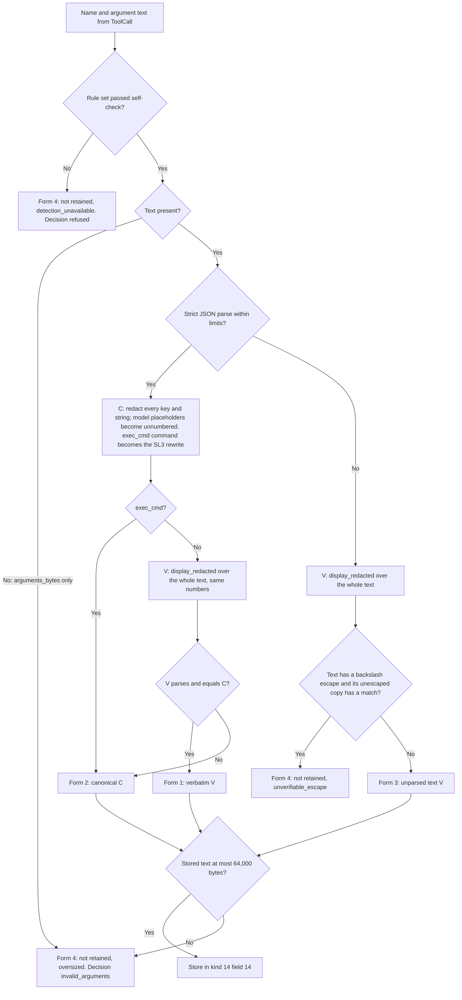
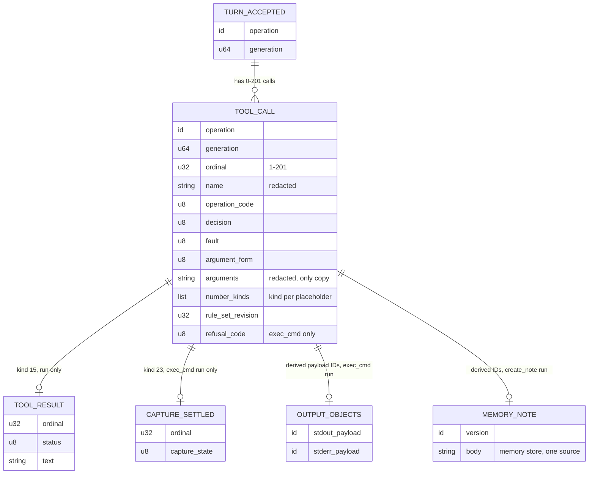
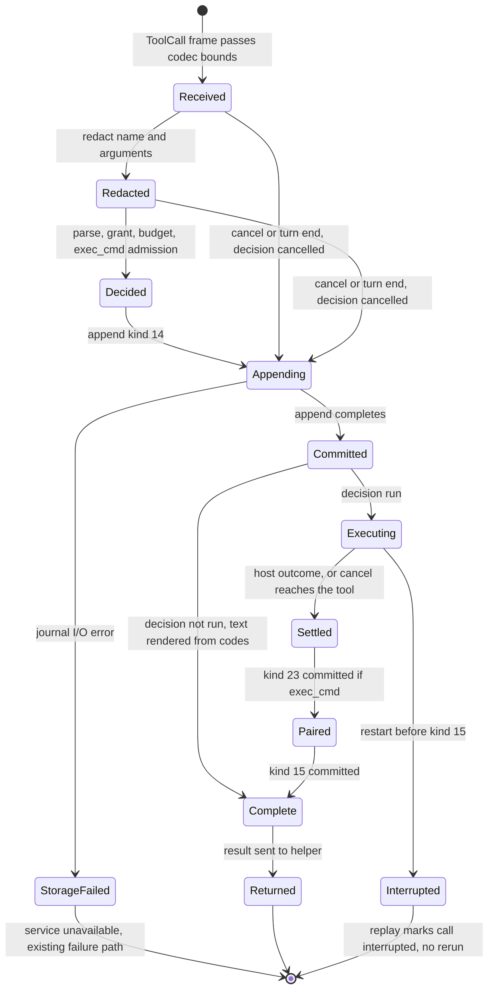

# Tool call records

Status: implemented 2026-10-18; verified for the scope and
environments in [verified evidence](#verified-evidence-2026-10-18). The
owner reviewed it on 2026-10-17 and decided the questions in
[owner decisions](#owner-decisions-2026-10-17). The
[implementation refinements](#implementation-refinements-2026-10-18) close the
gaps found while reading the code; they change no owner decision.
The [turn limit change](#turn-limit-change-owner-2026-10-18) raises the call limit
from 8 to 200 and removes the turn result-byte total (owner, 2026-10-18).

Scope: one journal record for every tool call the model proposes, including
malformed calls. The record holds the tool name and the arguments as the
service received them, after secret redaction, and the service's decision.
The record is the only place the arguments are kept.
Protocol numbering stays `0.1`. Journal format stays `1`.

## Owner rules

These rules come from the owner. Later sections apply them.

| ID | Rule | Source |
| --- | --- | --- |
| TCR-O1 | Record the tool name and the parameters in the journal. | Owner, 2026-10-17 |
| TCR-O2 | No backward compatibility. Asura is unreleased. Change record schemas in place. Do not add legacy readers, aliases or migration. Old journals are ignored. | Owner, 2026-10-17 |
| TCR-O3 | No default time bounds. Work ends only through a [loop closure](loop-closure.md). | Owner, 2026-10-15; [AE-04](../engineering.md#asynchronous-execution-and-recovery) |
| TCR-O4 | Protocol stays `0.1`. Journal format stays `1`. Schemas may change within them. | [Wire protocol change authority](../engineering.md#wire-protocol-change-authority) |
| TCR-O5 | One source for each fact. The arguments live only in the kind 14 record. A value derived from other recorded facts is recomputed on replay, not stored. | Owner review, 2026-10-17 |
| TCR-O6 | A turn may record 200 tool calls. The 64 KiB per-turn result total is removed; the 16 KiB per-result limit stays. “We found these types of tool and turn limits to be profoundly limiting in Wisp.” | Owner, 2026-10-18 |

### Turn limit change (owner, 2026-10-18)

Selected design (TCR-O6). Ordinals 1–200 are recorded calls, whether they run
or not. Ordinal 201 exists only for the single over-limit record. Its decision
is `limit`, or `cancelled` after cancel or turn end (TCR-D30). Kind 15 ordinals
are 1–200. The wire `ToolCall` ordinal is 1–201. The wire `ToolResult` ordinal
is 1–201, and 201 only with status 7. The helper fails the turn with
`outputLimit` after the result of ordinal 201.

The decision `limit` now applies only to ordinal 201. A turn has no result-byte
total, so the earlier "result bytes used up" rule and the 256-byte `create_note`
capacity rule are removed (TCR-D9). Each result keeps its 16,384-byte limit.

Each language derives the limits from one constant (TCR-D32). Swift defines
`Limits.recordedToolCalls` (200) and `Limits.toolProposals` as one more. Rust
storage defines `MAX_RECORDED_CALLS` (200) and `MAX_TOOL_CALL_ORDINAL` as one
more. The control codec, which does not depend on storage, defines
`MAX_RECORDED_TOOL_CALLS` (200) and `MAX_TOOL_ORDINAL` as one more. The service
is the only crate that depends on both; it asserts at compile time that the two
values are equal. No other code repeats 200 or 201.

A turn ends through a [loop closure](loop-closure.md#current-loops): the model
stops, the 201st proposal is recorded, the person cancels or steers, the model's
context window fills, the provider fails, the helper exits, the journal is full,
or the service shuts down or restarts. No time bound is added.

## Purpose and scope

Objectives:

- The journal shows every tool call that the model proposed in an admitted
  turn: the name, the arguments and what Asura did with the call.
- A malformed call leaves the same kind of record as a valid call.
- No record holds a secret value. The service redacts secrets before the
  record, with the rule set of [secret detection](secret-detection.md).
- One record kind replaces the three intent kinds used today.
- Each fact has one source (TCR-O5).

Non-goals:

- Results of calls that run. Kind 15 keeps its layout. The
  [context composer](context-composer.md) (CCR4) and
  [tool output views](tool-output-views.md) own the change to
  reference-only results.
- Person commands (`!` mode). [Person command mode](person-command-mode.md)
  owns their records.
- Changes to authority, grants or tool behavior. A record grants nothing.
- Recovery of old journals (TCR-O2).
- Journal capacity. The [segmented journal](segmented-journal.md) replaced the
  single 8 MiB journal file; this design adds no second store.

Dependencies:

- [Secret detection](secret-detection.md) slice SL3: rule set, command
  rewrite and `display_redacted`.
- [Tool job controller](tool-job-controller.md) J1: kind 23, payload IDs for
  exec_cmd output and recovery.
- [Model tool execution](model-tool-execution.md) and
  [consolidated tools](consolidated-tools.md): the four model-facing tools
  `project`, `memory`, `service` and `exec_cmd`.
- [Conversation admission](conversation-admission.md): journal frames, the
  writer's `reserve()` and journal step J1-0 (journal waits without a time
  bound).
- [Hybrid memory ontology](hybrid-memory-ontology.md) HM3: note creation and
  its receipts.

## Current behavior

Verified behavior, read from the code on 2026-10-17. Another change is in
progress: it removes kind 14 with tool kind 16, kind 12 input records and the
ordinary-tool deadline. Line numbers can move.

| Fact | Evidence |
| --- | --- |
| The model-facing tool name and the model's argument text never reach the service. The helper decodes them into typed values. The private `ToolCall` message holds only an ordinal and a typed `oneof` (fields 10–19). | `contracts/model/v1/model.proto:86-89`; `swift/model-helper/Sources/HelperCore/Session.swift:312-367` |
| Kind 14 `ToolIntent` holds a numeric tool kind, `path`, `offset` and `limit`. Kind 22 holds exec_cmd calls. Kind 17 holds `create_note` calls. Kind 15 holds results. | `rust/crates/asura-storage/src/authority/conversation/types.rs:236-266`, `types.rs:422-439` |
| The helper rejects some malformed calls before the service sees them. Example: `project` with `read_file` and no `path` throws `BackendFailure(.inputLimit)`. The SDK turns this into a tool callback failure, and the turn fails. | `ToolBridge.swift:234-237`; `Backend.swift:38-55` |
| The helper validates every `ToolCall` before it sends it. A message with a missing required field fails validation, and the turn fails. | `Session.swift:358`; `rust/crates/asura-control/src/model.rs:392-450` |
| The service decoder applies the same validation to every helper frame. A failure is `model_protocol_fault`. | `rust/crates/asura-service/src/model_owner.rs:612-627` |
| The service converts the message to typed arguments. A missing required field returns `Rejection::InvalidArguments`. The caller then fails the turn with `model_protocol_fault`. It writes no tool record. | `rust/crates/asura-service/src/conversation.rs:245-302`, `conversation.rs:3193-3201` |
| An exec_cmd call that fails argument validation fails the turn. No record is written. | `conversation.rs:2757-2763` |
| A budget rejection (ninth call, busy, identity conflict) fails the turn. No record is written. | `conversation.rs:2785-2802`; `rust/crates/asura-service/src/tools.rs:474-498` |
| A cancel that arrives before the intent commits drops the call. No record is written. | `conversation.rs:3517-3523` |
| A typed call that decodes but fails semantic checks gets a durable rejected intent (tool kinds 4, 5, 9–11) and an empty status-3 result. | `conversation.rs:315-366`; [rejected semantic tool proposals](model-tool-execution.md#rejected-semantic-tool-proposals) |
| The SDK can give a tool its arguments as `GeneratedContent`. `GeneratedContent` conforms to `Generable`. `Tool` takes any `ConvertibleFromGeneratedContent` arguments with a separate `parameters` schema. `Transcript.ToolCall` exposes `toolName` and `arguments`. | Xcode 27.1 (27A9275) macOS SDK, `FoundationModels.swiftinterface` lines 1336, 2554-2557, 3054-3064 |

Result: today, a call with a missing required argument ends the whole turn
with a protocol fault. The journal keeps only the turn terminal. The tool
name and arguments are lost.

## Required behavior

| ID | Requirement |
| --- | --- |
| TCR-R1 | The service writes one kind 14 `ToolCall` record for every tool call that reaches the service in an admitted, started turn. This includes calls that are invalid, unknown, refused, busy, denied, over the call limit or cancelled before a decision. |
| TCR-R2 | The record holds the tool name and the argument text as the helper received them, after redaction. It also holds the operation, the decision and the reason. |
| TCR-R3 | No journal record holds an unredacted secret. Redaction happens before the record. If redaction cannot run, the service does not keep the text. |
| TCR-R4 | The record never authorizes execution. Replay and restart never run a call again. |
| TCR-R5 | A call that runs is followed by exactly one kind 15 result, unless restart interrupts the turn first. An exec_cmd call that runs also has kind 23 before kind 15. A call that does not run is complete when its kind 14 commits; no kind 15 follows. |
| TCR-R6 | A malformed call gets a status-3 result that the model can read, where the helper can still return a result. It consumes one of the turn's calls. |
| TCR-R7 | Decoding is strict. A record that breaks a field rule is `Corrupt`. A record of a retired kind is `UnsupportedFormat`. No code reads an old layout. |
| TCR-R8 | Authority checks do not change. The parser, the grant and the budget decide the outcome before any host effect. |
| TCR-R9 | The argument text exists in exactly one place: field 14 of the kind 14 record. No payload object, detail block or result repeats it. |

## Ownership

The table names the owner of each behavior. Dependencies point down: the
helper depends on the wire contract; the service depends on storage and
platform secrets.

| Behavior | Owner | Location |
| --- | --- | --- |
| Capture the tool name and argument text at the tool boundary | Model helper, tool bridge | `swift/model-helper/Sources/HelperCore/ToolBridge.swift`, `Session.swift` |
| Report an unregistered name seen by an Asura provider adapter | Model helper, Ollama adapter | `OllamaBackend.swift` |
| Bound and check the `ToolCall` frame | Model codec | `rust/crates/asura-control/src/model.rs` |
| Parse the argument text into typed arguments (the only parser) | Service tool contract | `rust/crates/asura-service/src/tools.rs` (replaces `proposed_tool`) |
| Redact the name and arguments | Platform secrets | `asura-platform/src/secrets/` (new `redact_arguments`) |
| Parse JSON text strictly (one parser for the redactor and the argument reader) | Platform secrets | `asura-platform/src/secrets/json.rs` (new, TCR-D5) |
| Rewrite exec_cmd commands (SL3) | Platform secrets, called by the conversation owner | `secrets/rewrite.rs`, `conversation/exec_cmd_call.rs` |
| Decide, reserve budget, commit the record, dispatch | Conversation owner | `asura-service/src/conversation.rs` |
| Render the result text of a call that does not run | Conversation owner, from the kind 14 codes | `asura-service/src/conversation.rs` |
| Encode, decode and replay kind 14; recompute derived values | Authority codec and replay | `asura-storage/src/authority/conversation/{types,codec,state}.rs` |
| Show calls in activity and audit views | Service projection, then TUI | `conversation.rs` (`ToolProgress`), `asura-cli/src/tui/ui/activity.rs` |
| Place earlier calls in model input | Context composer | [Context composer](context-composer.md) |

Existing owners are reused. The only new code owners are the argument redactor
and the strict JSON parser in platform secrets. A search found no other owner
for them.

## Design overview

The helper stops reading the arguments. It forwards the name and the argument
text. The service is the one parser. Every call that reaches the service gets
a record, so a malformed call becomes an ordinary rejected call instead of a
protocol fault.

### Helper capture

Selected design (owner decision 1). Each of the four tools declares its
arguments as `GeneratedContent`. Each keeps today's generation schema as its
`parameters`. Guided generation keeps the same schema. `Tool.call` receives
the content and sends `name` and `arguments.jsonString` to the service. The
tool then returns the result text to the SDK, including the text of a
rejection.

The helper also keeps five capture rules:

1. The Ollama adapter checks each name against the four registered names. For
   another name, it sends a `ToolCall` with that name, the argument JSON and
   source `provider_json`. After the result arrives, it fails the turn with
   `protocolFault`, because the SDK cannot return a result for an unregistered
   tool. The adapter has no argument-size guard of its own; the service
   applies the 64,000-byte limit. One provider stream may hold up to 201 calls
   (TCR-D17).
2. The 201st proposal in a turn is sent with ordinal 201. After its result, the
   helper fails the turn with `outputLimit`. Ordinal 201 exists only for this
   record. The wire `ToolResult` accepts ordinal 201 only with status 7; kind 15
   ordinals stay 1–200 (TCR-D6).
3. The helper does not log the name or the arguments. The existing diagnostic
   keeps only shape classes and sizes.
4. A result that is not a success returns `Tool failed: <status>`, a newline
   and the service text to the SDK, so the model sees the rejection text
   (TCR-D18).
5. The helper keeps no argument parsing: the fixed memory-guidance path and
   its diagnostic codes are removed (TCR-D18).

Proof limit (owner decision 2): some calls fail inside the SDK before
`Tool.call`. Examples are argument text that is not valid JSON, and an
unregistered name from the system model, Core AI or MLX executors. The helper
cannot see these calls. The turn fails as today with its diagnostic, and the
journal keeps only the turn terminal. Validation case TCR-Q1 measures which
failures reach `Tool.call`.

#### TCR-Q1 measured result (2026-10-18)

Verified behavior. A scripted SDK executor sent each form to the four real
tools with `GeneratedContent` arguments (Xcode 27.1 SDK, macOS 27,
`ToolCallQualificationTests.tcrQ1MalformedFormsAgainstGeneratedContentTools`).
The system model, Core AI and MLX executors use the same SDK path; the model
itself cannot be made to emit these forms on demand.

| Form sent by the executor | Reaches `Tool.call` | `jsonString` seen by the tool |
| --- | --- | --- |
| Missing required field | Yes | The members as sent |
| Wrong type (`"offset":"zero"`) | Yes | The members as sent; member order can differ |
| Unknown command value | Yes | As sent |
| Unexpected extra member | Yes | As sent |
| Truncated JSON | Yes | Repaired by the SDK: the incomplete member is dropped |
| Duplicate key | Yes | The first value; the duplicate is dropped |
| Text that is not JSON | No | The SDK fails first (`generated_content_invalid_json`) |
| Unregistered name | No | The SDK fails first (`generated_content_invalid_json`); the Ollama adapter covers its own path (TCR-D17) |

Consequence: on the SDK path the service never sees `invalid_json` or
`duplicate_key` for text the SDK repairs; it records the repaired form
(TCR-D27).

### Encoding choice: JSON text

Selected: the record stores the arguments as UTF-8 JSON text. Protobuf bytes
were rejected.

- The model and the providers produce JSON. Ollama sends a JSON object, and
  the SDK exposes `GeneratedContent.jsonString`.
- A protobuf message is Asura's typed reading. It cannot hold an unknown
  field, a wrong type, a duplicate key or text that is not JSON. Those are the
  calls an audit most needs.
- People and the context composer can read JSON text directly.
- One text form serves all tools. The typed decision facts stay in the
  record's code fields.

### Wire contract

Selected schema change within protocol `0.1` (owner decision 1). `ToolCall`
changes in place. The typed `oneof` (fields 10–19) and its argument messages
are removed.

| Field | Type | Rule |
| --- | --- | --- |
| 1 `ordinal` | uint32 | 1–201; 201 only for the over-limit proposal |
| 2 `name` | string | 1–256 bytes. Absent when the name was longer; then field 5 is set |
| 3 `arguments` | string | 0–64,000 bytes of UTF-8. Absent when longer; then field 4 is set |
| 4 `arguments_bytes` | uint32 | The received argument size. Required when field 3 is absent |
| 5 `name_bytes` | uint32 | The received name size. Required when field 2 is absent |
| 6 `source` | enum | 1 `generated_content`, 2 `provider_json` |

The argument limit is the same 64,000 bytes as the record limit, so the wire
and the journal apply one limit. A `ToolCall` at that size, with its envelope
and a 256-byte name, fits the 65,536-byte model frame
(`asura-control/src/model.rs:11`). Over the limit, the helper sends the size
only. This is known-size exhaustion, an allowed closure.

## Argument redaction

Required behavior (TCR-R3). The conversation owner calls
`secrets::redact_arguments` on every call before the record. The function
uses the rule set in whole-buffer mode, as `display_redacted` does. Numbers
follow the [placeholder rules](secret-detection.md#placeholders-and-numbering)
within one call: exec_cmd command secrets take 1 to k, then other values take
k+1 onward in order of first appearance. The same value gets the same number.
A per-call random key keys the number map. After 256 distinct values in one
call, a new value becomes the unnumbered placeholder `$ASURA_SECRET_0`. The
service zeroizes the key, the raw text and the typed values after the
decision.

The service scans the name, every JSON key and every JSON string value. It
does not scan numbers, booleans or null, because they cannot hold the text the
rules match.

A placeholder token that the model wrote (`$ASURA_SECRET_<digits>` or
`${ASURA_SECRET_<digits>}`) in the name, a key, a string value or unparsed text
becomes the unnumbered form (`$ASURA_SECRET_0` or `${ASURA_SECRET_0}`) and is
counted in field 17. Every numbered placeholder in a record is therefore one
that the redactor inserted (TCR-D4).

The strict JSON parser lives in platform secrets (`secrets::json`). The
redactor uses it for the canonical form, and the service's typed argument
reader reads its parsed value. There is one JSON parser and one argument
parser; no crate dependency is added (TCR-D5).

### Redaction algorithm

Selected design. Arrows show the order of checks. Every path ends in one of
four stored forms.

Rules for the algorithm:

- **Strict parse.** RFC 8259 JSON. Duplicate keys are a parse fault. Depth is
  at most 32. Keys and values together are at most 4,096. A value outside
  these limits makes the text unparsed (fault `json_limit`).
- **Canonical form.** Member order as received. No whitespace. Number lexemes
  as received. Only `"`, `\` and U+0000–U+001F are escaped, using the short
  escapes where JSON has them.
- **Verbatim check.** The verbatim form is kept only when it parses to the
  same value as the canonical form. A replacement that crosses JSON syntax, or
  a secret hidden by an escape, makes the values differ. The canonical form
  is then kept.
- **exec_cmd.** The `command` value is the SL3 rewrite when the rewrite
  succeeds. It is the display-redacted command, cut at 8,192 bytes, when the
  call is refused or runs through the whole-command variable (SL7). The record
  therefore holds the command that ran, with its secrets moved to variables,
  or the display text of a whole-command run. A refused cwd is redacted like
  any other string value. The stored arguments are the only copy of the
  command and cwd.
- **Whole-text scan.** The redactor also scans the raw text as one buffer and
  replaces every detected value wherever it occurs in a key or string
  (TCR-D19). A string with withheld bytes is stored as `[withheld]` (TCR-D21).
- **Numbering.** Placeholder numbers follow first appearance over the name,
  then the stored text, after the C or V choice and after any command cut
  (TCR-D22). A placeholder token is defined in TCR-D20.
- **Unparsed text.** An escape can hide a secret from the raw-text scan. When
  the text holds a backslash escape, the redactor also scans a best-effort
  unescaped copy. Any match in that copy withholds the text.
- **Name.** The name is redacted with `display_redacted`. A name over 256
  received bytes is not retained; only its size is recorded.
- **No digests.** No record holds a digest of raw text, of a secret value or
  of a note body (SD9).

## Size limits

Every limit below is a known size. Exceeding one is known-size exhaustion: the
call is recorded with the fact, and the text is not kept. No time bound
applies.

| Item | Limit | Over the limit |
| --- | --- | --- |
| Received name | 256 bytes | Name not retained; decision `invalid_arguments`, fault `name_over_limit` |
| Stored name after redaction | 512 bytes | Name not retained; same decision and fault |
| Argument text, received and stored | 64,000 bytes | Text not retained, reason `oversized`; decision `invalid_arguments`, fault `arguments_over_limit`; status-3 result |
| JSON depth / values | 32 / 4,096 | Treated as unparsed text, fault `json_limit` |
| Distinct numbered placeholders per call | 256 | Further values become `$ASURA_SECRET_0` |
| Calls per turn | 200 run or rejected, plus one ordinal-201 record (owner, 2026-10-18) | The helper ends the turn after ordinal 201 |
| Secret variables (exec_cmd) | 16 | SL3 refuses with `too_many_secrets` |

Why one limit of 64,000 bytes: the owner asked for 65,536 bytes. A journal
frame is at most 65,536 bytes including its 144-byte header and 40-byte
trailer (`asura-storage/src/authority.rs:10-13`). That leaves 65,352 bytes for
the record payload. The fixed fields and the largest name take 866 bytes
(see [the layout](#record-kind-14-toolcall)). So 64,000 bytes is the largest
round limit that fits one frame.

Why `invalid_arguments` and not `limit` for oversized text: the size belongs
to this call's arguments, and the model can correct it by sending a shorter
call. `limit` is kept for the turn's call limit, which the model cannot correct
within the turn.

A `create_note` body holds at most 16,384 bytes
(`asura-service/src/tools.rs:165`,
`asura-storage/src/authority/writer/mod.rs:347`). JSON escaping makes it
longer. A body of ordinary text, where escapes at most double the size, gives
at most about 32.8 KiB and always fits. A body made mostly of control
characters can grow to six times its size, 98,304 bytes. Such a call is
recorded as oversized, and the model receives a status-3 result. No 64 KiB
frame can hold that worst case.

Journal growth from large arguments is bounded by known sizes. One call adds
at most one 64 KiB frame. A turn has at most 200 calls plus one small
ordinal-201 record, so it adds at most about 12.6 MiB of call records. Typical
records are a few hundred bytes. The [segmented journal](segmented-journal.md)
owns the journal capacity: a turn's call records span segment files (case
SJ-28). At the journal quota a `run` kind 14 whose result reservation does not
fit is held before execution and the turn pauses (SJ-D19); a kind 14
`cancelled` is a closure record (SJ-D18). This design adds no second store.

## Record: kind 14 `ToolCall`

Selected layout. Kind 14 changes in place (TCR-O2). This is a new layout, so
the fields are numbered compactly. Encodings follow the existing codec:
big-endian integers, 16-byte IDs, 32-byte digests, strings as a 4-byte length
then UTF-8, flags as one byte 0 or 1. Any other value is `Corrupt`.

| # | Field | Encoding | Bounds and rule |
| --- | --- | --- | --- |
| 1 | operation | ID | Not zero; the active operation |
| 2 | generation | u64 | At least 1; the active generation |
| 3 | ordinal | u32 | 1–201; 201 only with decision `limit`, or `cancelled` after cancel or turn end (TCR-D30) |
| 4 | source | u8 | 1 `generated_content`, 2 `provider_json` |
| 5 | name | string | 0–512 bytes, redacted. Empty only when the name was not retained |
| 6 | name bytes | u32 | Received name size, at least 1 |
| 7 | operation code | u8 | 0 none, or the [operation table](#operation-codes) value |
| 8 | decision | u8 | The [decision table](#decisions) value |
| 9 | fault | u8 | 0, or the [fault table](#faults) value. Not 0 only with `invalid_arguments` or `unknown_tool` |
| 10 | busy reason | u8 | 0 unless `busy`; then 1 `quota`, 2 `capture_paused`, 3 `pending_full`, 4 `payload_unavailable`. Designed change with J3: the field becomes the decision reason, with `busy` codes 1 `queue_full`, 2 `jobs_full`, 3 `closed` and `denied` code 1 `execution_off` ([J3 kind 14 changes](tool-job-controller.md#j3-kind-14-changes)) |
| 11 | argument form | u8 | 1 verbatim, 2 canonical, 3 unparsed text, 4 not retained |
| 12 | not-retained reason | u8 | 0 unless form 4; then 1 `oversized`, 2 `detection_unavailable`, 3 `unverifiable_escape` |
| 13 | arguments bytes | u32 | Received argument size |
| 14 | arguments | string | Forms 1–3: 0–64,000 bytes. Form 4: empty |
| 15 | number count | u16 | 0–256 distinct numbered placeholders in fields 5 and 14 |
| 16 | number kinds | count × u8 | Entry i is the secret kind (1–33) of `$ASURA_SECRET_<i>` |
| 17 | unnumbered | u32 | Occurrences of the unnumbered placeholder in fields 5 and 14: values past the 256th and model-written placeholder tokens (TCR-D4) |
| 18 | rule-set revision | u32 | The revision used. 0 only with reason `detection_unavailable` |
| 19 | rule-set digest | 32 bytes | The digest of that revision. Zero only with revision 0 |
| 20 | exec_cmd flags | u8 | Bit 0: command cut at 8,192 bytes (refused or bit 1). Bit 1: whole-command variable, `run` only ([SL7 amendment](#sl7-amendment-owner-2026-10-20)). Other bits 0. 0 unless operation exec_cmd |
| 21 | refusal code | u8 | 0 unless exec_cmd `refused` (then 1 or 14) or field 20 bit 1 (then a fallback reason, not 1, 12 or 14) |
| 22 | refusal kind | u8 | 0 or a secret kind 1–33 |
| 23 | refusal word | u16 | 0, or the 1-based word index 1–4096 |

The maximum payload is 64,866 bytes: 866 bytes of fixed fields and the
largest name and number list, plus 64,000 bytes of arguments. The maximum
frame is 65,050 bytes, below the 65,536-byte journal frame. The codec must
state this maximum and test it (TCR-U03).

Fields 20–23 are the exec_cmd facts that the stored text cannot show. They are
fixed-size, so a separate detail block or tag is not needed.

### SL7 amendment (owner, 2026-10-20)

Implemented on 2026-10-20 by
[slice SL7](secret-detection.md#sl7-model-whole-command-variable); evidence is
in the [SL7 implementation](secret-detection.md#sl7-implementation). Owner
decision SO5 removes the exec_cmd refusal for a secret the rewrite cannot move.
Such a call is admitted with decision `run` and runs through the
[whole-command variable](secret-detection.md#whole-command-variable):

- Field 14's `command` holds the display-redacted command, cut at 8,192 bytes
  with field 20 bit 0 set, as a refused call does today.
- Field 20 bit 1 marks the whole-command variable. It is valid only with
  operation exec_cmd and decision `run`, and the service sets it only when
  admission ends in `run`. A whole-command call that ends `busy`, `denied` or
  `cancelled` keeps its display text without bits 0 and 1 or fields 21–23, as
  a cancelled refused call already did. Bits 2–7 stay 0.
- A `run` with bit 1 may hold up to 256 numbers in field 15; the 16-number
  limit applies only to a rewritten `run`.
- Fields 21–23 hold the rewrite's reason, kind and word with decision `run`
  when bit 1 is set. With `refused` they keep their meaning.
- Decision `refused` for exec_cmd remains only for `placeholder_not_available`,
  `secret_in_cwd` and `secret_detection_unavailable`. The codec enforces it:
  fields 21–23 of a `refused` record hold code 1 or 14 (detection unavailable
  is recorded without them, as before), and of a bit 1 record any other code
  except 12.
- Replay recomputes the executable command as the fixed text
  `eval "$ASURA_SECRET_COMMAND"` when bit 1 is set, and the secret variable
  count as 1. Without bit 1 the existing rules apply. The replay projection
  `ExecCmdCall` holds them as `fixed_command` and `secret_variables`, and
  `ToolRecord.whole_command` carries bit 1 to the views.
- Control `ToolProgress` field 13 `command_filtered` is `true` for a record
  with bit 1 and absent otherwise; the control codec refuses it with any other
  decision or the value `false`.
- Unit cases: the codec rejects bit 1 with any other decision or operation;
  replay derives the fixed command. SL7's SDU-16, SDU-17, SDI-12 and SDE-06
  cover the behavior.

### Values recomputed on replay

These values are not stored (TCR-O5). Replay recomputes them from stored
facts and the frame's installation ID.

| Value | Recomputed from | Formerly stored in |
| --- | --- | --- |
| Tool (`project`, `memory`, `service`, `exec_cmd`, or unregistered) | Registry lookup of field 5. A name that is not retained is unregistered. | Earlier draft field 8 |
| exec_cmd job ID | The existing `asura.exec_cmd.job` derivation from operation, generation and ordinal | Kind 22 field 14 |
| stdout and stderr payload IDs | The payload ID derivation with object kinds 1 and 2 | Kind 22 fields 15–16 |
| Initial capture reservation | The constant 1,048,576 for an admitted exec_cmd call | Kind 22 field 17 |
| Secret variable count k | The distinct placeholder numbers in the stored `command`; SL3 step 1 refuses model-written placeholders, so every placeholder in an admitted command is a variable | Kind 22 field 12 |
| Secret variable kinds | Field 16 entries 1 to k | Kind 22 field 13 |
| create_note memory operation, object, version and edge IDs | `CreateNoteIdentity::derive` from the binding, operation, generation and ordinal | Kind 17 |
| create_note success text sent to the helper | The derived IDs: `operation=`, `object=`, `version=` lines. Kind 15 of a create stores empty text (TCR-D1). | Kind 15 text |
| create_note project | The turn's conversation | Kind 17 |
| Result status and text of a call that does not run | Fields 8–12 and 20–23, through fixed code tables | Kind 15 |

### Retired and kept kinds

| Kind | Change |
| --- | --- |
| 14 | New layout above. The old `ToolIntent` layout and its tool kinds 1–16 are gone. |
| 17 `MemoryCreateIntent` | Retired. Its IDs are derived. Its body size, body digest and command digest are dropped; the memory store is their one source. Decoding returns `UnsupportedFormat`. |
| 22 `ExecCmdIntent` | Retired. Kind 14 fields 20–23 hold its facts; the rest are derived. Decoding returns `UnsupportedFormat`. |
| 23 `CaptureSettled` | Kept and changed. It follows a kind 14 exec_cmd record with decision `run`. Its rule-set fields 9–10 are removed (they repeated kind 14 fields 18–19); replay reads the rule set from kind 14. The maximum payload is 4,066 bytes ([kind 23](tool-job-controller.md#kind-23-capturesettled), TCR-D3). |
| 15 `ToolResult` | Layout kept. Written only after a call that runs. A create_note result stores empty text (TCR-D1). From J3 (designed) exec_cmd and `job` calls resolve with kind 29 `JobResult` instead ([kind 29](tool-job-controller.md#kind-29-jobresult)). |

An old development journal does not open. The service reports
`UnsupportedFormat` or `Corrupt` and changes nothing. The person removes the
journal by hand. Asura does not delete or migrate it (TCR-O2; engineering
rule against deleting user data).

### Operation codes

| Code | Tool | Operation |
| --- | --- | --- |
| 1 | project | `read_file` |
| 2 | project | `list_directory` |
| 3 | service | `status` |
| 4 | service | `tools` |
| 5 | service | `audit` |
| 6 | memory | `list_notes` |
| 7 | memory | `get_note` |
| 8 | memory | `note_sources` |
| 9 | memory | `create_note` |
| 10 | exec_cmd | `exec_cmd` |
| 11–16 | job | `list`, `status`, `read`, `wait`, `cancel`, `note`; designed with [tool job packet J3](tool-job-controller.md#j3-kind-14-changes), not implemented |

Code 0 means the service could not determine an operation: an unregistered
name, unparsed text, or a missing or unknown `command` field.

The operation code and the fault are stored, not recomputed. They are the
service's reading of the raw text, and the record keeps only the redacted
text. Reparsing the redacted text could give a different answer, and replay
must not decide a call again.

### Decisions

| Code | Decision | When | Runs | Status sent to the helper |
| --- | --- | --- | --- | --- |
| 1 | `run` | Parsed, valid, authorized, within the call limit; exec_cmd admitted | Yes | The outcome, from kind 15 |
| 2 | `invalid_arguments` | Any parse or validation fault, including oversized text | No | 3 |
| 3 | `unknown_tool` | Name not registered | No | 3 |
| 4 | `refused` | exec_cmd kept refusal (`placeholder_not_available` or `secret_in_cwd`, SL7), or rule set unavailable (any tool) | No | 3 |
| 5 | `busy` | exec_cmd busy reasons | No | 4 |
| 6 | `denied` | The grant lacks the permission, such as `create_note` without a foreground person | No | 2 |
| 7 | `limit` | Ordinal 201 | No | 7 |
| 8 | `cancelled` | Cancel or turn end before the decision was committed | No | 6 |

For a call that does not run, the conversation owner renders the result text
from the code tables. The text never repeats model text, so it cannot repeat a
secret. The rendered text is not stored; replay and the views render it again
from the same fields (TCR-D12).

| Decision | Rendered status | Rendered text |
| --- | --- | --- |
| `invalid_arguments` | 3 | `invalid_arguments: <fault>`, for example `invalid_arguments: missing_field` |
| `unknown_tool` | 3 | `unknown_tool: unregistered_name` |
| `refused`, exec_cmd secret refusal | 3 | Today's refusal text from fields 21–23 |
| `refused`, rule set unavailable | 3 | `refused: secret_detection_unavailable` |
| `busy` | 4 | `exec_cmd_busy: <reason>` from field 10 |
| `denied` | 2 | `denied` |
| `limit` | 7 | `limit` |
| `cancelled` | 6 | `cancelled` |

A grant failure (no foreground person for `create_note`, missing read or
execute authority, or an unavailable memory binding) is decided before the
record as `denied` (TCR-D10). A turn has no result-byte total, so no call
before ordinal 201 is `limit` (TCR-D9, owner 2026-10-18).

### Faults

| Code | Fault |
| --- | --- |
| 1 | `invalid_json` |
| 2 | `json_limit` |
| 3 | `not_object` |
| 4 | `duplicate_key` |
| 5 | `unknown_command` |
| 6 | `missing_field` |
| 7 | `unexpected_field` |
| 8 | `wrong_type` |
| 9 | `out_of_range` |
| 10 | `unsafe_path` |
| 11 | `invalid_version_id` |
| 12 | `arguments_over_limit` |
| 13 | `name_over_limit` |
| 14 | `invalid_text` (NUL or other forbidden byte) |
| 15 | `unregistered_name` (with `unknown_tool` only) |
| 16 | `invalid_job_id`; designed with J3, not implemented |

The parser reports the lowest fault code that applies (TCR-D11):

- Faults 1–4 come from the strict JSON parse of present argument text.
- Faults 5–11 need a registered name.
- Fault 12 applies when the argument text is absent (over the limit).
- Fault 13 applies when the name is absent (over the limit).
- Fault 14 applies to a NUL or control byte in the name or in the exec_cmd
  `command` value. A path with such a byte is fault 10.
- Fault 15 applies when the name is retained, holds valid text and is not
  registered.

Fault 15 gives decision `unknown_tool`; faults 1–14 give `invalid_arguments`.
The operation code is 0 when the name is not registered or not retained, the
text is unparsed, or `command` is missing or unknown.

### Data model

Selected design. The diagram shows logical records and their identities.
Lines show cardinality. "Derived" lines are identities recomputed on replay;
no field stores them. Output objects and notes live in their own stores.

## Record lifecycle

Selected design. States describe one call in the conversation owner. Arrows
name the event or guard. "Committed" means the journal append completed;
a requested append is not a committed record.

Rules shown by the diagram:

- No host effect starts before `Committed`.
- A call that does not run is complete at `Committed`. Restart cannot
  interrupt it, because nothing remains to record.
- A cancel after `Committed` follows the existing cancellation path of the
  tool. A cancel before it produces decision `cancelled`, so the call still has
  a record.
- A call that reaches the service after cancel or turn end is set also gets
  decision `cancelled`. When the cancel must be recorded, kind 7 commits first,
  then kind 14 `cancelled`, then the terminal. Once cancel or turn end is set,
  the service sends no `ToolResult`; status 6 is the rendered text for replay
  and views (TCR-D8).

## Call flow

Selected design. Solid arrows are requests or messages. Dashed arrows are
replies. The journal commit is the persistence point before any effect.

## Replay, recovery and restart

Required behavior (TCR-R4, TCR-R7).

Replay accepts kind 14 under these rules. A broken rule is `Corrupt`.

| Rule |
| --- |
| The operation is active, with the record's generation and the current owner generation. |
| The ordinal is the next ordinal. Every earlier `run` call of the operation has its kind 15. |
| Ordinal 201 has decision `limit`, or `cancelled` after cancel or turn end (TCR-D30). |
| A record after the operation's `CancelRequested` has decision `cancelled`. No record follows the terminal. |
| The derived tool, operation code, decision, fault, form and exec_cmd fields agree with the tables above. A `run` decision needs a registered tool and a nonzero operation code. |
| Field 15 equals the highest placeholder number in fields 5 and 14, and every number from 1 to field 15 appears. Field 17 equals the number of unnumbered placeholder tokens in fields 5 and 14 (TCR-D4). For an admitted exec_cmd call, the derived variable count is at most 16. |
| A `run` exec_cmd record names a nonzero rule set (fields 18–19); kind 23 has no rule-set fields of its own (TCR-D3). |
| A create_note kind 15 holds empty text (TCR-D1). |
| A `run` exec_cmd record needs kind 23 before kind 15, unless a kind 26 `JobIntent` follows it (a job-mode call, designed with [J2](tool-job-controller.md#replay-order-and-the-job-reservation-ledger)); then no kind 23 follows and kind 15 follows kind 26; from J3, kind 29 replaces that kind 15 (JR11–JR13). Another `run` record needs kind 15 only. A record that does not run is followed by no kind 15 or kind 23. |

The writer's `reserve()` accepts kind 14 only when the journal can still hold
the record and the frames that must follow it (TCR-D16). After a `run` record
it holds kind 15, kind 23 for exec_cmd, and the terminal. A call that does not
run holds nothing beyond the terminal, because no kind 15 follows it. TCR-I08
uses a `run` call. An append over capacity returns the writer's existing error
and changes nothing. This extends the J1 rule to every call.

Crash and restart:

| Crash point | State after restart | Action |
| --- | --- | --- |
| Before the kind 14 commit | No record | The turn is interrupted as today. |
| After kind 14 that does not run | Complete call | None |
| After kind 14 `run`, before kind 15 | The call is interrupted | Startup writes no tool record. The turn terminal is `Interrupted`. Nothing runs again. |
| After kind 14 `run` exec_cmd, before kind 23 | As the J1 [derived recovery](tool-job-controller.md#replay-order-and-reservation) table, with payload IDs derived from the call's job ID | Unchanged |
| After kind 26 of a job-mode call (J2, designed) | The job is unsettled; the call is interrupted if kind 15 is missing | Startup writes kind 28 `interrupted` ([J2 recovery](tool-job-controller.md#j2-recovery-explicit-interrupted-settlements)) |
| After kind 14 `run` create_note, before kind 15 | The memory store resolves the receipt by the derived memory operation ID | HM3 recovery, with the identity derived instead of read from kind 17 |
| After kind 15 | Complete call | None |

A helper that resends a `ToolCall` with an ordinal already seen is compared by
a keyed digest over the received name, arguments, sizes and source. The key is
random per turn and the digest stays in memory; it is never recorded. An equal
call gets the same result again. A different call is an identity conflict and a
protocol fault; it is a helper fault, not a model proposal, so it gets no
record.

These are also helper faults with no record and `model_protocol_fault`
(TCR-D7): a `ToolCall` before StartAuthorized commits or with tools disabled;
an ordinal that is not the next one (a gap, or above 201); and a second call
while one is pending. A helper never sends that second call. It answers the
model with a busy reply and the call gets no ordinal and no record
([concurrent callback busy reply](model-tool-execution.md#concurrent-callback-busy-reply)).

## Context composer and views

The record is evidence. It is never an instruction or a permission.

**Context composer.** Not delivered in this slice (TCR-D15, proof limit):
today earlier tool calls never enter later input, and this change keeps that.
The [context composer](context-composer.md) candidate records state these
rules for the stage that places tool records. The composer reads the redacted
name, the operation code, the decision and the stored text. For a `run` call it pairs them with
kind 15. For another call it renders the result text from the codes. It may
place an earlier call in model input as a tool-call entry only when the form
is 1 or 2: that text parses as JSON and can become `GeneratedContent`. For
form 3 or 4 it places a service-written line instead, for example
`[tool call 3: project, invalid_arguments: invalid_json, 812 bytes]`.
Placeholders stay as `$ASURA_SECRET_<n>`; the composer never restores a value.
Argument text is model-produced and is placed inside the untrusted-data label
(CCR8). This updates the "candidate records" row of the
[context composer](context-composer.md); today, earlier tool calls do not
enter later input.

**TUI activity** (TCR-D13, TCR-D31). The control event carries at most 9
`ToolProgress` entries: the most recent kind 14 records of the operation, with
consecutive ordinals that end at the latest ordinal. The TUI shows the latest
ordinal as the turn's call count. `ToolProgress.name` carries a display prefix of at most
64 bytes of the stored redacted name (TCR-D26), empty when the name was not
retained.
`ToolProgress.arguments` carries a display prefix of at most 192 bytes of the
stored text, as today, or the service-written `[not retained: <reason>, <n>
bytes]` for form 4. `ToolProgress.policy_decision` carries the decision code
1–8. New field 12 `ToolProgress.fault` carries the fault code 1–15. Field 13
`ToolProgress.command_filtered` is `true` for a whole-command call (SL7). For a call
that does not run, `state` is 3 (failed), `status` is the rendered status and
`preview` is the rendered result text. The TUI shows a rejected call with its
decision and fault, for example `project  invalid_arguments: missing_field`. A
text that was not retained shows its size and reason, never a guess at the
content. These are projections; the record stays the one source.

**Audit inspection.** `service_read_audit` and `/audit` keep their own records.
They may cite a call by operation, generation and ordinal. They do not copy
argument text. The service emits a `ToolFinished` audit event for every call
with a nonzero operation code, whether it ran or not, with the rendered status
as its outcome. A call with operation code 0 emits no tool audit event, because
the audit tool table has no entry for it (TCR-D14). The `job` commands, codes
11–16, get their own audit tool values with J3
([audit of job tool calls](tool-job-controller.md#audit-of-job-tool-calls)),
so they emit `tool.finished` like every other call.

## Asynchronous execution

Mapping to [AE-01–AE-07](../engineering.md#asynchronous-execution-and-recovery).

| Rule | Application |
| --- | --- |
| AE-01 | Parsing and redaction run on the conversation owner's reactor. They are bounded in-memory work: at most 64,000 bytes of text, 4,096 values and depth 32. Acceptance: 99th percentile at most 5 ms per call on the development host (TCR-P1). This is an acceptance figure, not a closure. |
| AE-02 | The only blocking call is the journal append. It uses the existing writer under J1-0. This design adds no thread and no other I/O. |
| AE-03 | The conversation owner holds at most one pending call. A record is at most one 64 KiB frame. A turn adds at most 201 call records. Live per-turn state is bounded by the 201 ordinals: the resend cache holds at most 201 results of at most 16 KiB each (about 3.3 MiB for the one active turn), and the timing arrays hold 201 slots each. A control event carries at most 9 `ToolProgress` entries (TCR-D31). |
| AE-04 | Each wait ends by a closure: the append by commit or I/O error; the helper's wait for a result by the result, cancel, disconnect, helper exit or shutdown. No new time bound is added. |
| AE-05 | No call runs before its record commits. Restart never runs a call again. |
| AE-06 | Shutdown follows the existing journal writer settlement. The design adds no resource to settle. |
| AE-07 | Evidence: TCR-I06 stalls the journal append and checks that controls stay usable; TCR-P1 measures the reactor cost. |

## Security

- **Untrusted input.** The name and the argument text come from the model. The
  service checks size, UTF-8 and JSON structure before any typed use. Only the
  typed reading reaches an executor, after the grant and budget checks.
- **No raw secret in storage.** Redaction runs before the record. Raw text,
  typed values and the per-call key are held in zeroizing buffers and cleared
  after the decision. Logs never hold them.
- **Fail closed.** If the rule set failed its self-check, every call is
  `refused` and no text is kept. If an escape could hide a secret in unparsed
  text, the text is not kept.
- **Egress.** The journal is local. The composer sends only redacted text to a
  model. A remote destination receives no more than a local one.
- **Authority unchanged.** The record and its replay grant nothing. The
  existing grant decides exec_cmd, memory writes and remote disclosure.
- **Residual risk.** A secret that the rules do not detect is stored as text.
  This is the same risk as exec_cmd commands and output today. A `create_note`
  body is redacted in the record, but the memory store keeps the body under
  its own design.

## Failure handling

| Failure | Result |
| --- | --- |
| Missing required field, wrong type, unknown command | Record with `invalid_arguments` and the fault; status-3 result; the model may try again within the call limit |
| Argument text over 64,000 bytes, received or stored | Record with `invalid_arguments`, `arguments_over_limit`, form 4, reason `oversized`, the received size; status-3 result |
| Argument text is not JSON | Record with form 3 or 4 and fault `invalid_json`; status-3 result |
| Unregistered name seen by the Ollama adapter | Record with `unknown_tool`; status-3 result; the helper then ends the turn |
| Failure inside the SDK before `Tool.call` | No record; turn fails with the existing diagnostic (proof limit, owner decision 2) |
| 201st proposal | Record with `limit`; status-7 result; the helper ends the turn |
| Rule set unavailable | Record with `refused`, form 4; status-3 result |
| Journal I/O error or full journal on kind 14 | No dispatch; the existing service-unavailable path (`capacity_exhausted` when full) |
| Cancel before commit | Record with `cancelled`; status-6 result; then the terminal |
| Helper resends a different call at a used ordinal | Protocol fault; no new record |
| Ordinal gap, call while another is pending, or call before StartAuthorized | Protocol fault; no record (TCR-D7) |
| Grant lacks the permission | Record with `denied`; status-2 result (TCR-D10) |

## Validation

The implementation is complete only when these cases pass. Each case names its
layer. Environments: unit and integration tests run in the normal Cargo and
Swift test paths on the macOS 27 development host. End-to-end cases use the
real service, helper and TUI, with a scripted loopback provider unless named.

### Unit

| ID | Initial state, trigger and required result |
| --- | --- |
| TCR-U01 | Codec: kind 14 round trips at every bound of every field. Each out-of-range value, unknown code and inconsistent combination decodes as `Corrupt`. |
| TCR-U02 | Codec: kinds 17 and 22 return `UnsupportedFormat`. The old kind 14 layout returns `Corrupt`. |
| TCR-U03 | Codec: the largest legal record (64,000-byte arguments, 512-byte name, 256 numbers) encodes as a 65,050-byte frame. One more argument byte is refused by the encoder. |
| TCR-U04 | Parser: each fault code 1–15 from a fixed input. The first fault in table order wins when two apply. |
| TCR-U05 | Parser: every valid command of the four tools gives the same typed arguments as the current helper and service path. |
| TCR-U06 | Redactor: a secret in a key, a value, the name, and an escaped value (`\u` form). No output byte holds the value. The escaped case stores canonical form. |
| TCR-U07 | Redactor: unparsed text with an escape that hides a secret is not retained, reason `unverifiable_escape`. |
| TCR-U08 | Redactor: exec_cmd stores the SL3 rewrite in `command`; numbers 1 to k match the variables; another secret in `cwd` refuses as today. |
| TCR-U09 | Redactor: the same value in two fields gets one number. Text with no secret stores verbatim form. The 257th distinct value becomes `$ASURA_SECRET_0`. |
| TCR-U10 | Redactor: rule set unavailable gives form 4 and decision `refused` for every tool. |
| TCR-U11 | Replay: each rule in the replay table, one broken record per rule, is `Corrupt`. |
| TCR-U12 | Replay: a record after `CancelRequested` is accepted only with `cancelled`. Ordinals 1–200 are accepted with any decision; ordinal 201 is accepted only with `limit` or `cancelled`, and only after 200 records. A kind 15 after a call that does not run is `Corrupt`. |
| TCR-U13 | Replay: the recomputed job ID, output payload IDs, variable count and create_note IDs equal the values the live path used for the same call. |
| TCR-U14 | Model codec: `ToolCall` with name over 256 bytes, arguments over 64,000 bytes, or field 3 and field 4 both absent fails; ordinal 202 fails. `ToolResult` ordinal 201 passes only with status 7. |
| TCR-U15 | Helper (Swift): each tool sends its name and `jsonString` and returns the service text; ordinals 1–200 continue the turn; ordinal 201 is sent and the turn then fails with `outputLimit`. |
| TCR-U18 | Service budget: ordinals 1–200 are each recorded once, ordinal 201 is never counted, and 200 results of 16 KiB each are accepted with no turn total (owner, 2026-10-18). |
| TCR-U19 | Control event: an event with 9 entries whose ordinals end at 201 passes; 10 entries, a gap, or an ordinal above 201 fails (TCR-D31). |
| TCR-U16 | Size: a `create_note` call with a 16,384-byte body of ordinary text, newlines and quotes is stored in full. A body of 16,384 control characters is recorded as oversized with its received size. |
| TCR-U17 | One source: a test enumerates kind 14, 15 and 23 fields and fails if a field holds argument text, a value listed under [recomputed values](#values-recomputed-on-replay), or a copy of another field. |

### Integration

| ID | Initial state, trigger and required result |
| --- | --- |
| TCR-I01 | Real conversation owner and journal. A `project` call with `read_file` and no `path`. Kind 14 has `invalid_arguments`, `missing_field` and the stored text; no kind 15; the helper receives status 3; no host read; the turn continues. This replaces today's protocol-fault outcome. |
| TCR-I02 | An exec_cmd call with a GitHub token. Kind 14 holds `"${ASURA_SECRET_1}"` in `command` and number kind 1 is `github-token`; a raw-byte sweep of the journal and payload directory finds no value. |
| TCR-I03 | A `create_note` call with a 16,384-byte body. Kind 14 holds the redacted body; the note exists in the memory store under the derived version ID; no journal record holds a body digest or a second copy. |
| TCR-I04 | Restart after kind 14 `run`, before kind 15. Replay marks the call interrupted; no executor runs; no new tool record is written. |
| TCR-I05 | Restart after kind 14 `invalid_arguments`. Replay shows a complete call with its rendered result text; nothing is written. |
| TCR-I06 | The journal append is held. The TUI and other controls stay usable; cancel produces a `cancelled` record after the append completes; no turn time limit fires. |
| TCR-I07 | Cancel arrives before the decision. Kind 14 `cancelled`, then the terminal, in that order. |
| TCR-I08 | A journal with enough space for kind 14 but not for kind 15 and the terminal. `reserve()` refuses kind 14; the existing capacity failure applies. |
| TCR-I09 | Socket-pair helper test: Ollama fixture sends an unregistered name. Kind 14 `unknown_tool`; the helper receives status 3, then fails the turn with `protocolFault`. |
| TCR-I10 | Helper resends the same ordinal with different arguments: protocol fault, one kind 14 only. |
| TCR-I11 | Real conversation owner and journal. The helper sends 200 valid calls, each with a 16 KiB result, then a 201st. Every call runs; the journal holds 200 `run` records with kind 15 and one ordinal-201 `limit` record; the helper receives status 7 for ordinal 201 and the turn fails with the output limit. The total result text exceeds 64 KiB (owner, 2026-10-18). |
| TCR-Q1 | SDK qualification, macOS 27 system model and Ollama: record which malformed forms reach `Tool.call` with `GeneratedContent` arguments (missing field, wrong type, unknown command, invalid JSON, unregistered name). Record the result in this design. |

### End to end

| ID | Initial state, trigger and required result |
| --- | --- |
| TCR-E01 | Scripted loopback model proposes a malformed `project` call, then a valid one. The TUI shows the rejected call with its fault, then the valid result; the model's second call succeeds; the journal holds two kind 14 records and one kind 15. |
| TCR-E02 | Scripted model runs `cat .env` through exec_cmd with a secret in the command. The TUI activity, kind 14 and kind 15 show only placeholders; a raw-byte sweep finds no value. |
| TCR-E03 | Restart the service during a running exec_cmd call. After restart the TUI shows the call as interrupted with its name and arguments; nothing runs again. |
| TCR-E04 | Native system model (Foundation Models): an ordinary tool-using conversation records name and arguments for each call. This is native qualification; it does not require the model to choose a malformed call. |

### Measurement

| ID | Measurement and acceptance |
| --- | --- |
| TCR-P1 | Parse and redact 64,000 bytes of worst-case JSON on the reactor: 99th percentile at most 5 ms. A miss is a defect to fix, not a runtime limit. |
| TCR-P2 | Journal bytes per call for the scripted E01–E02 workloads, reported against the 8 MiB journal file. |

## Verified evidence (2026-10-18)

Verified behavior on the macOS 27 development host (Xcode 27.1 SDK, Ollama
0.40.5 with `granite4.1:8b`). Test names are the evidence; this section does
not restate their assertions.

| ID | Evidence |
| --- | --- |
| TCR-U01–U03 | `asura-storage` codec `tcr_u01_*`, `tcr_u02_*`, `tcr_u03_largest_kind_14_fits_one_frame` (64,866-byte payload, 65,050-byte frame) |
| TCR-U04, U05 | `asura-service` `tools::parse::tests::tcr_u04_*`, `tcr_u05_*` |
| TCR-U06–U09 | `asura-platform` `secrets::arguments::tests::tcr_u06_*`…`tcr_u09_*`, plus TCR-D4, D19–D22 cases |
| TCR-U10, U16 | `asura-service` `conversation::tool_tests::tcr_u10_*`, `tcr_u16_*` |
| TCR-U11–U13 | `asura-storage` `authority_conversation` `tcr_u11_*`, `tcr_u12_*`, `tcr_u13_*`; service `tcr_u13_*` and `exec_cmd_call` `tcr_u13_*` |
| TCR-U14 | `asura-control` `model::tests::tcr_u14_tool_call_bounds_and_sizes` |
| TCR-U15 | Swift `groupedToolsForwardNameAndExactJSONString`, `overLimitProposalIsSentThenTheTurnFailsWithOutputLimit` (renamed 2026-10-18; was `ninthProposalIsSentThenTheTurnFailsWithOutputLimit`), `oversizedNameAndArgumentsSendSizesOnly` |
| TCR-U17 | `asura-storage` `authority_conversation` `tcr_u17_no_fact_is_stored_twice` |
| TCR-I01–I07, I09 | `asura-service` test binary `tool_call_flow` (real service, real helper, scripted loopback provider); owner-level `tool_tests` `tcr_i01_*`, `tcr_i07_*` |
| TCR-I08 | `asura-storage` `journal_writer` `tcr_i08_run_kind_14_is_refused_when_its_result_cannot_fit` |
| TCR-I09 helper part | Swift `ollamaUnregisteredNameIsSentForItsRecordThenFailsTheTurn` |
| TCR-I10 | `tool_tests` `tcr_i10_resend_is_compared_by_keyed_digest` (conversation owner with deterministic writer acknowledgements; the real helper never resends) |
| TCR-E01–E03 | `tui_pty.py --tool-call-records` through `asura-cli` `lifecycle`; service parts in `tool_call_flow` |
| TCR-E04 | `conversation_flow --native-exec-cmd-tools` (system model): pass, one run. `--native-ollama-exec-cmd-tools` (`granite4.1:8b`): 2 of 5 runs pass; 2 runs stopped at the interrupted-call sub-case because the model did not run the command within the 60-second harness wait, 1 run because the model altered the requested command text. The exec_cmd proof part passed in all 5 runs. The two wait failures predate the added diagnostic, so their recorded calls were not captured; this remains a proof limit |
| TCR-P1 | `cargo run --release -p asura-platform --example tcr_p1`: p50 4.30 ms, p99 4.77–4.80 ms over two runs (limit 5 ms; margin about 4 percent) |
| TCR-P2 | `tool_call_flow`: E01 kind 14 frames 313 and 334 bytes (0.0077 percent of 8 MiB); E02 kind 14 358 bytes, kind 15 370 bytes |
| TCR-Q1 | [Measured result](#tcr-q1-measured-result-2026-10-18) |

Turn limit change evidence (owner change 2026-10-18; macOS 27 development
host, Swift 6.4 toolchain, `cargo test --workspace --all-features`):

| ID | Evidence |
| --- | --- |
| TCR-U12, U14 | `authority_conversation` `tcr_u11_over_limit_ordinal_has_limit`, `tcr_u12_*` with 200 recorded calls; `asura-control` `tcr_u14_*`, `tool_results_enforce_direction_bounds_and_over_limit_ordinal` |
| TCR-U15 | Swift `overLimitProposalIsSentThenTheTurnFailsWithOutputLimit` (200 results of 4,000 bytes, then ordinal 201), `overLimitResultMustBeLimit` |
| TCR-U18 | `asura-service` `tools::tests::every_recorded_call_consumes_one_ordinal_and_the_over_limit_ordinal_is_never_counted`, `full_results_for_every_call_have_no_turn_total` |
| TCR-U19 | `asura-control` `conversation::tests::maximum_activity_frame_retains_complete_response_and_signed_exit` (window ending at 201 fits one frame); CLI `long_turn_window_shows_recent_calls_and_the_full_count` |
| TCR-I11 | `tool_tests::tcr_i11_two_hundred_calls_run_and_the_next_is_limit` (real journal writer); storage `tcr_i11_replay_accepts_every_call_with_full_results_and_no_turn_total` |
| Native | `conversation_flow --native-exec-cmd-tools` and `--native-tools` (system model): pass, one run each |

Proof limits:

- No live model was driven to 200 calls; the 200-call path is proven with
  scripted proposals and the real writer.
- Context composer placement of earlier calls is not delivered (TCR-D15).
- TCR-I06 and TCR-I07 reach "cancel before commit" by holding a concurrent
  writer mutation; with an idle writer the append is submitted at once.
- The status-observation kind 15 text includes the operation ID in hex; kind
  15 layout is unchanged in this slice (CCR4 owns it).
- Malformed calls are not forced from live models; TCR-Q1 measures the SDK
  path with a scripted executor. TCR-D27 and TCR-D28 record what "received
  text" means on each path.
- The `[withheld]` path for a string is tested by injecting the flag; a real
  withheld scan needs a key block over 64 KiB, which 64,000 bytes cannot hold.
- The `ToolCall` before StartAuthorized helper fault (TCR-D7) has no unit test;
  the check is a single guard in the conversation owner's event loop.

## Alternatives considered

| Alternative | Reason rejected |
| --- | --- |
| Store protobuf bytes of the typed reading | Cannot hold malformed, unknown or extra content; records Asura's reading, not the proposal. |
| Keep parsing in the helper and add raw text beside the typed fields | Two parsers can disagree. Malformed calls would still stop in the helper. |
| Inline text up to 16 KiB and larger text in a payload object | Two sources for one fact (owner, 2026-10-17). |
| Keep kinds 22 and 17 as detail records, or a detail block in kind 14 | Most of their fields are derived or repeat the arguments. The remaining exec_cmd facts fit in four fixed fields. |
| Write kind 15 for calls that do not run | Its status and text are derived from kind 14 codes, so it would be a second copy. |
| Always store canonical JSON | Loses the received form when no redaction was needed. The verbatim check keeps it when it is safe. |
| End the turn on any malformed call | Keeps today's loss of the call and prevents the model from correcting itself. |

## Designs to update with the implementation

The design gate requires these documents to agree before code changes. Done
2026-10-18: each document below, plus
[response activity](response-activity.md), the glossary and the designs index,
now agrees with this design and its refinements.

- [Model tool execution](model-tool-execution.md): rejected semantic tool
  proposals and MT01; malformed calls are now records, not protocol faults;
  rejected calls have no kind 15.
- [Consolidated tools](consolidated-tools.md): the helper no longer rejects
  arguments before the service.
- [Tool job controller](tool-job-controller.md) J1 records: kind 22 retired;
  kind 23 follows kind 14 and drops its rule-set fields 9–10; payload IDs and
  the initial reservation are derived.
- [Secret detection](secret-detection.md): the job intent row of the
  metadata table and SL3's reference to kind 22.
- [Hybrid memory ontology](hybrid-memory-ontology.md) HM3: kind 17 retired;
  receipt resolution uses the derived memory operation ID; the journal keeps
  no body size or digest.
- [Exec_cmd tool](exec-cmd-tool.md): durable intent.
- [Conversation admission](conversation-admission.md): the kind table.
- [Context composer](context-composer.md): candidate records.

## Implementation refinements (2026-10-18)

Required behavior. These refinements close gaps found when the design was read
against the code on 2026-10-18. Each keeps the owner rules and owner decisions.
The sections above apply them.

| ID | Refinement | Reason |
| --- | --- | --- |
| TCR-D1 | Kind 15 of a `run` create_note call stores empty text. The service renders the text sent to the helper from the derived `CreateNoteIdentity`: `operation=<hex>`, `object=<hex>` and `version=<hex>` lines. The `sha256=` line is removed. Replay requires empty text for every create_note result. The 16,384-byte per-result limit applies to the rendered text sent. | TCR-I03 allows no body digest in the journal; derived IDs are not stored (TCR-O5, TCR-U17). |
| TCR-D2 | The memory store resolves a create by the derived memory operation ID alone. It checks that the receipt version equals the derived version and any receipt edge equals the derived edge. It checks the note's object and operation IDs. It recomputes the command digest from the stored note body and stored edge and compares it with the receipt's own digest. Live creation builds `PutNote` from the derived identity and the typed body and source of the service's parse. `MemoryCreate` carries the body and optional source version; `MemoryResolveCreate` carries only turn, generation and ordinal. | Kind 17, its body digest and its command digest are retired; the memory store is their one source. |
| TCR-D3 | Kind 23 loses rule-set fields 9–10; the later fields move up by two. Its maximum payload is 4,066 bytes and its maximum frame 4,250 bytes. Replay takes the rule set from kind 14 fields 18–19. A `run` exec_cmd kind 14 must name a nonzero rule set. | The fields repeated kind 14 (TCR-O5). |
| TCR-D4 | A model-written placeholder token (`$ASURA_SECRET_<digits>` or `${ASURA_SECRET_<digits>}`) in the name, a key, a string value or unparsed text becomes the unnumbered form and is counted in field 17. Replay checks: field 15 is the highest number in fields 5 and 14; every number from 1 to field 15 appears; field 17 equals the number of unnumbered tokens. SL3 still refuses a model-written placeholder in an exec_cmd command (`placeholder_not_available`); the refused command is stored display-redacted with this replacement. | Without it, replay could not tell an inserted placeholder from model text, and the number check would fail. |
| TCR-D5 | One strict RFC 8259 JSON parser (member order, number lexemes, duplicate keys, depth 32, 4,096 keys and values) lives in platform secrets as `secrets::json`. The redactor uses it for the canonical form; the service's typed argument reader in `tools.rs` reads the parsed value. No crate dependency is added. | The redactor and the argument reader both need a JSON reading; one parser prevents disagreement. |
| TCR-D6 | Wire `ToolCall` ordinal is 1–201. Wire `ToolResult` ordinal is 1–201, and 201 only with status 7. Kind 15 ordinal stays 1–200. The Swift helper sends the 201st proposal and fails the turn with `outputLimit` after its result (owner, 2026-10-18; earlier 1–9). | Ordinal 201 exists only for the over-limit record. |
| TCR-D7 | These are helper faults with no record and `model_protocol_fault`: a `ToolCall` before StartAuthorized commits or with tools disabled; an ordinal that is not the next one (a gap, a repeat while pending, or above 201); a second call while one is pending; a resend at a used ordinal whose keyed digest over the received name, arguments, sizes and source differs. An equal resend gets the same result again. | They are helper protocol faults, not model proposals. |
| TCR-D8 | A call that reaches the service after cancel or turn end is set, or whose kind 14 is not yet appended when cancel or turn end occurs, gets kind 14 `cancelled`. When the cancel must be recorded, kind 7 commits first, then kind 14 `cancelled`, then the terminal. Once cancel or turn end is set, the service sends no `ToolResult` (the existing rule); status 6 is the rendered text for replay and views. | TCR-R1 requires a record for a cancelled call; the helper is already stopping. |
| TCR-D9 | Every recorded call consumes one ordinal (1–200). Ordinal 201 is recorded only as `limit` (or `cancelled`, TCR-D30). A turn has no result-byte total; each result keeps its 16,384-byte limit. The earlier 65,536-byte turn total, its `limit` decision and the 256-byte `create_note` capacity rule are removed (owner, 2026-10-18). | Defines the budget for calls that do not run. |
| TCR-D10 | Grant failures (no foreground person for `create_note`, missing read or execute authority) are decided before the record as `denied`, status 2. A failure to prepare the memory create (binding unavailable) is also `denied`. | The decision must exist before the record commits. |
| TCR-D11 | Faults 1–4 come from the JSON parse of present text; faults 5–11 need a registered name; fault 12 applies when the text is absent; fault 13 when the name is absent; fault 14 for a NUL or control byte in the name or in the exec_cmd `command`; fault 15 when the name is retained, holds valid text and is not registered. The lowest code that applies wins (TCR-U04). Fault 15 gives `unknown_tool`; faults 1–14 give `invalid_arguments`. Operation code 0 when the name is not registered or retained, the text is unparsed, or `command` is missing or unknown. | Makes "first fault in table order" exact. |
| TCR-D12 | The rendered text of a call that does not run never holds model text: `invalid_arguments: <fault>`; `unknown_tool: unregistered_name`; a refused exec_cmd gives today's refusal text from fields 21–23; `refused: secret_detection_unavailable`; `exec_cmd_busy: <reason>`; `denied`; `limit`; `cancelled`. Status: 3 for `invalid_arguments`, `unknown_tool` and `refused`; 4 `busy`; 2 `denied`; 7 `limit`; 6 `cancelled`. | Fixes the code-to-text table so replay and views render the same text. |
| TCR-D13 | Control `ToolProgress`: up to 9 entries, the most recent ones (TCR-D31); `name` is the stored redacted name (a display prefix of at most 64 bytes, TCR-D26; empty when not retained); `policy_decision` is the decision code 1–8; new field 12 `fault` (1–15); `arguments` is a display prefix of at most 192 bytes of the stored text, or `[not retained: <reason>, <n> bytes]` for form 4; `preview` of a call that does not run is the rendered result text; its `state` is 3 with the rendered status. The TUI shows `<name>  <decision>: <fault>` for a rejected call. | The earlier name, decision and count rules could not hold model-sent names, nine calls or the new decisions. |
| TCR-D14 | `ToolFinished` audit events are emitted for every call with a nonzero operation code, run or not, with the rendered status. A call with operation code 0 emits none. No audit event holds argument text. | The audit tool table has no entry for an unknown operation. |
| TCR-D15 | This delivery does not place earlier tool calls in model input; today they never enter later input. The context composer's candidate records state the placement rules for the stage that places tool records. | Proof limit: composer placement belongs to the composer stages. |
| TCR-D16 | `reserve()` after a `run` kind 14 holds kind 15, kind 23 for exec_cmd, and the terminal. A call that does not run holds nothing more. TCR-I08 uses a `run` call. An append over capacity returns the writer's existing error and changes nothing. | A call that does not run has no kind 15 to reserve. |
| TCR-D17 | The Ollama adapter removes its 16,384-byte argument guard (the service applies the 64,000-byte limit) and allows 201 calls per stream. It sends an unregistered name as a `ToolCall` with source `provider_json`; after its result, the turn fails with `protocolFault`. | The service is the only argument parser and owns the limit. |
| TCR-D18 | A result that is not a success returns `Tool failed: <status>`, a newline and the service text to the SDK. `BoundedNativeTool`'s fixed memory-guidance path and the memory argument diagnostic codes are removed. | The model must see the rejection text; Swift does no parsing. |
| TCR-D19 | The redactor also scans the whole raw text, because some rules need the text around a value (for example a key and its value). Every value found by any scan (each key and string alone, the whole raw text, the name, the exec_cmd variables) joins one per-call value set. Every occurrence of every value in every key and string is replaced, by literal match as the job scanner does for command secrets. C and V are then built from that set. A value that crosses JSON syntax cannot appear in C and makes V differ, so C is stored. | Scanning each string alone misses context-dependent rules such as assigned secrets. |
| TCR-D20 | A placeholder token is `ASURA_SECRET_` followed by one or more ASCII digits, directly after `$` or `${`. An inserted number has no leading zero. Replay counts the tokens in fields 5 and 14 exactly; a token with a leading zero is `Corrupt`. | Makes the TCR-D4 replay check exact. |
| TCR-D21 | When the scanner withholds bytes inside a string (a key block over its limit, or a detector fault), the redactor stores that whole string as `[withheld]`. A withheld name becomes `[withheld]`. Unparsed text with withheld bytes is not retained, reason `detection_unavailable`, while the rule-set revision stays nonzero. | Withheld bytes have no span to replace; the value must not be kept. |
| TCR-D22 | Numbers are assigned in first-appearance order over the name, then the stored text. Numbering happens after the choice between C and V and after the 8,192-byte cut of a refused command. The cut never splits a placeholder; it moves back to the start of the token. A rewritten exec_cmd command keeps numbers 1 to k, because they are the variable names the command runs with. | Field 15 and the replay check need contiguous numbers. |
| TCR-D23 | Storage owns the derivations that the live path and replay both use: `exec_cmd_job_id`, `payload_id` with object kinds 1 and 2, and `CreateNoteIdentity::derive`. The service calls them and never stores their results. | One owner for each recomputed value (TCR-O5, TCR-U13). |
| TCR-D24 | Storage defines the four registered names (`project`, `memory`, `service`, `exec_cmd`). The service registry uses these constants. | Replay needs the registry lookup without a dependency on the service. |
| TCR-D25 | Kind 15 replay no longer compares a `read_file` or `get_note` result with the call's limit and offset. Those typed values are not record fields, and replay never parses the redacted text again. A success result of these two operations may carry `next_offset`; other operations may not. | Replay must not decide a call again (operation codes). |
| TCR-D26 | `ToolProgress.name` is a display prefix of at most 64 bytes of the stored redacted name, cut on a UTF-8 boundary. | Nine entries with 512-byte names would not fit the 65,536-byte control frame beside the response window ([response text transfer](response-text-transfer.md#control-observation-windows)). The journal keeps the full name. Amended 2026-10-22: the window is 60,928 bytes, so the frame proof also covers the J4 outlived-job fields; the worst case is 65,322 bytes ([window bound](response-text-transfer.md#event-window-bound-2026-10-22)). |
| TCR-D27 | On the SDK path the received argument text is `GeneratedContent.jsonString`: the SDK's own serialization, with its separators and a member order that can differ between instances. Form 1 stores that text, not the model's tokens. The SDK repairs truncated text and drops duplicate keys before `Tool.call` (TCR-Q1). | Proof limit: the model's raw tokens never reach the helper. |
| TCR-D28 | On the Ollama path the provider has already parsed the model output into a JSON value. The adapter forwards that value re-encoded by `JSONEncoder` (source `provider_json`): key order, duplicate keys and number lexemes of the provider's text are not preserved. | Proof limit: the provider API delivers a parsed object, not text. |
| TCR-D29 | The helper sends `ToolCall` on its ordered data queue, not the 4,096-byte control queue, because a call may hold 64,000 bytes. The data queue is bounded (8 frames, 65,536 + 1,024 bytes); a full queue fails the turn with `limit`, a known-size bound. | The earlier control-queue send failed every call over 4 KiB with `helper_limit`. |
| TCR-D30 | A 201st proposal that arrives after cancel or turn end is recorded as `cancelled`, like any other call at that point; otherwise ordinal 201 is `limit`. Replay accepts ordinal 201 with `limit` or `cancelled`. | "Ordinal 201 has `limit`" and "after `CancelRequested` only `cancelled`" both apply to that call; recording it keeps TCR-R1. |
| TCR-D31 | `ConversationEvent.tools` carries at most 9 entries (`MAX_TOOL_PROGRESS_ENTRIES`): the most recent kind 14 records of the operation. Their ordinals are consecutive and end at the operation's latest ordinal, at most 201. The control codec rejects more entries, a gap or an ordinal above 201. The TUI shows the last entry's ordinal as the call count. Earlier calls stay in the journal and audit views. (Owner change, 2026-10-18.) | 201 entries cannot fit the 65,536-byte control frame. Keeping 9 entries keeps the TCR-D26 frame proof. |
| TCR-D32 | Each language derives the call limits from one constant: Swift `Limits.recordedToolCalls`; Rust storage `MAX_RECORDED_CALLS`; the Rust control codec `MAX_RECORDED_TOOL_CALLS`. Each over-limit ordinal is that constant plus one. The service asserts at compile time that the two Rust constants are equal. (Owner change, 2026-10-18.) | The control codec does not depend on storage; the service depends on both. |

## Owner decisions (2026-10-17)

1. **Single parser.** Accepted. The service is the only parser. The helper
   forwards the name and the raw JSON. `ToolCall` fields 10–19 are removed.
2. **Calls the SDK rejects before `Tool.call`.** Accepted as a stated proof
   limit. Invalid JSON and unregistered names on the system model, Core AI
   and MLX keep the existing diagnostic and turn terminal. TCR-Q1 measures
   them.
3. **One source for the arguments.** The inline and payload split was
   rejected as two sources of truth. The arguments live only in the kind 14
   record, with one limit. The owner also directed that every other fact have
   one source; this revision removes the duplicates listed under
   [values recomputed on replay](#values-recomputed-on-replay).
4. **Limit value.** 64,000 bytes of argument text, received and stored. A
   65,536-byte journal frame also holds a 184-byte header and trailer and the
   record's fixed fields, so 64 KiB of text cannot fit. The journal frame
   contract is unchanged.

There are no open questions.
