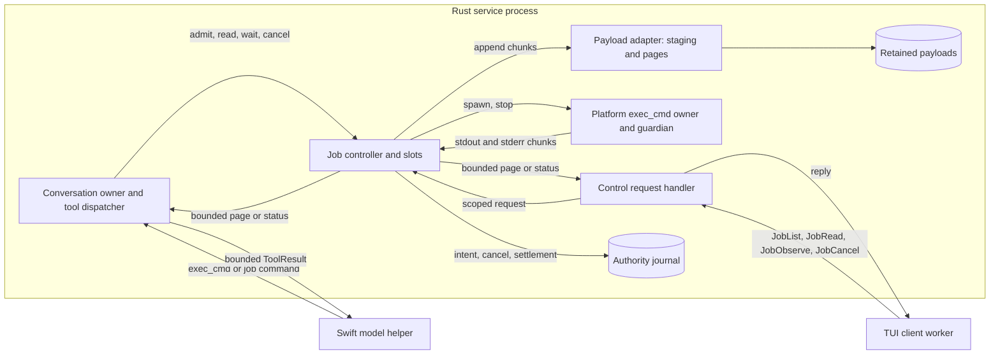
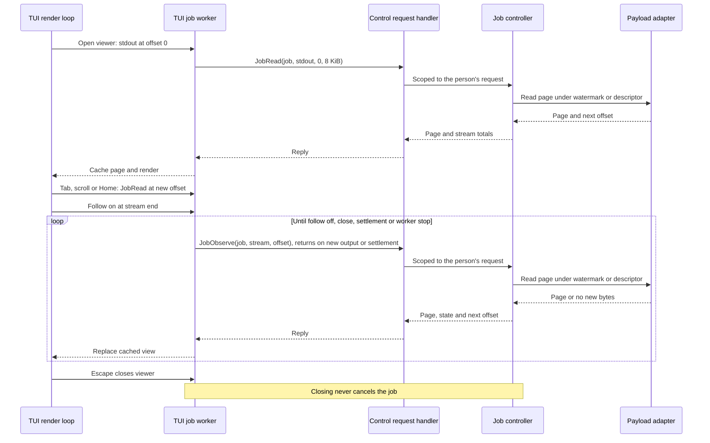
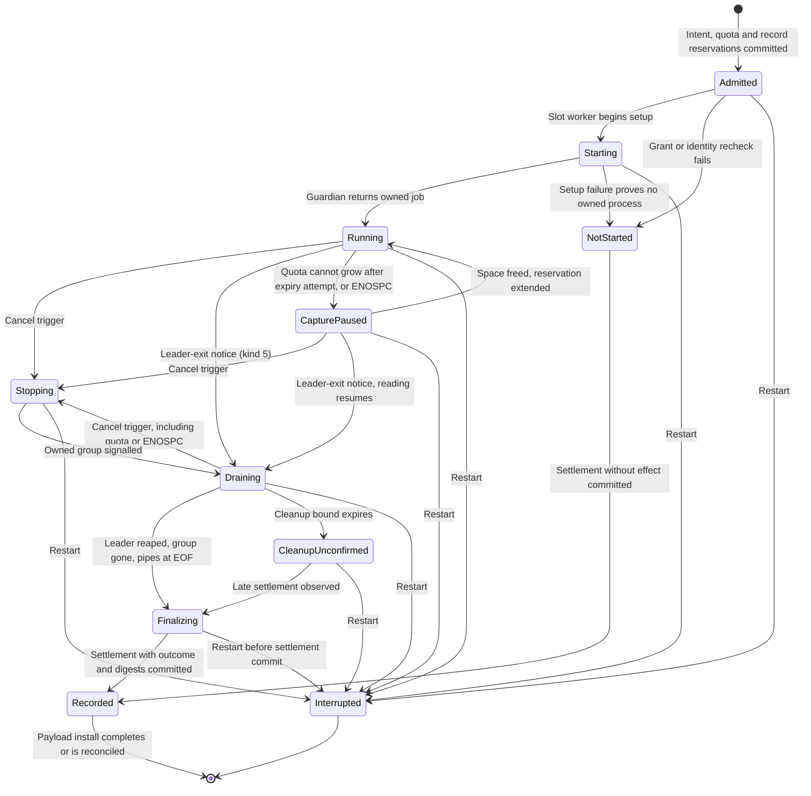
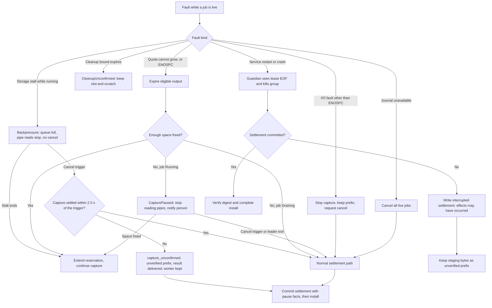
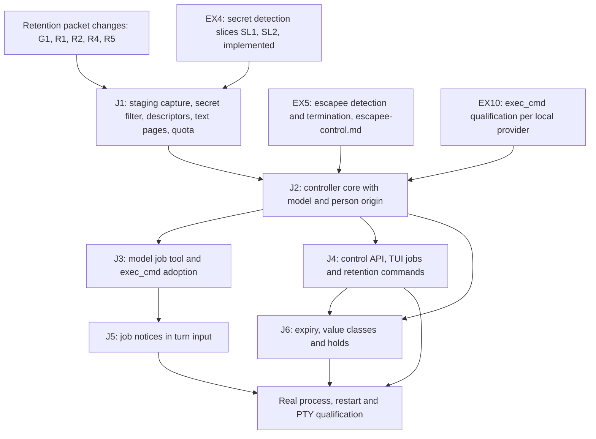
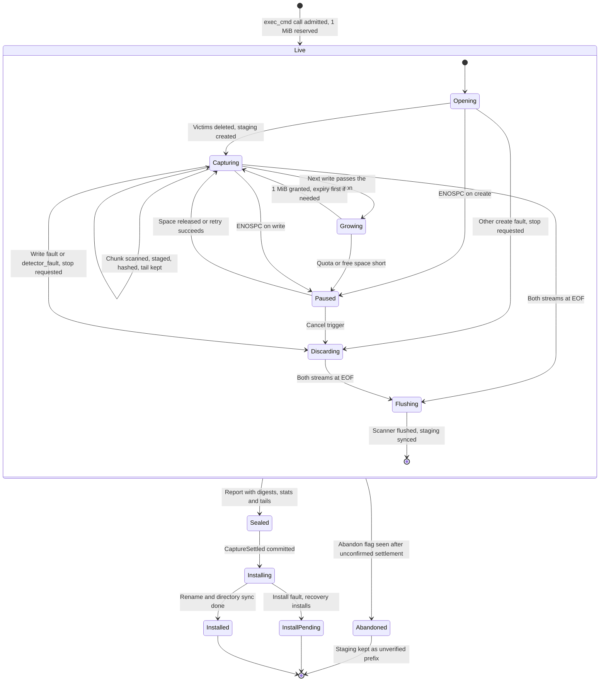
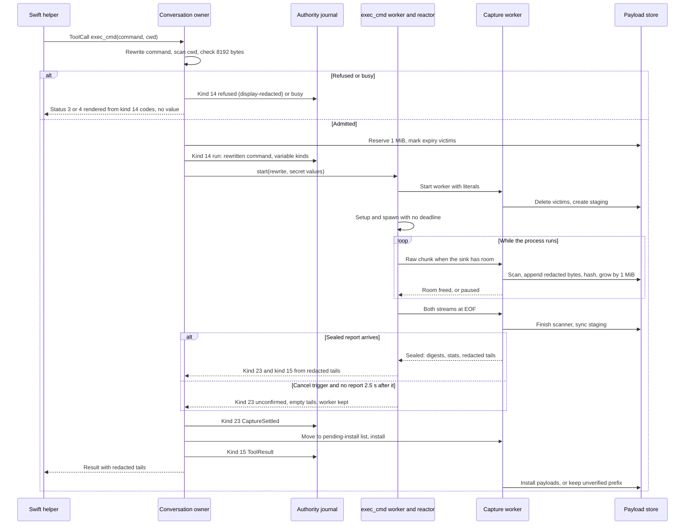

# Tool job controller

Status: design, 2026-10-12, revised 2026-10-14 and 2026-10-15; not implemented.
J1 is ready for implementation; J2 is gated as before. The owner
selected the direction and three decisions on 2026-10-12: conversation-scoped
jobs, record-only completion and a yield window with a small preview. Later owner
decisions replace the preview and add person-origin jobs; see
[amendments from later designs](#amendments-from-later-designs). On 2026-10-14
the owner resolved every blocking decision of the readiness audit; see
[owner decisions of 2026-10-14](#owner-decisions-of-2026-10-14).

Readiness: packet J1 is ready for implementation. The owner's
[execution threat model](execution-threat-model.md#owner-decisions) decision EX4
(2026-10-15) puts secret filtering into the J1 capture path. The
[secret detection design](secret-detection.md) defines it; J1's filter is its
slice SL3. Slices SL1 and SL2 are implemented and the dependencies are
approved. The owner answered J1-Q1 to J1-Q4 on 2026-10-15, and
[J1 and SL3 implementation details](#j1-and-sl3-implementation-details) is the
governing J1 design. J1 also applies the
[result retention packet](result-retention-graph-packet.md#review-decisions-and-delivery-dependencies)
changes that the 2026-10-14 decisions record. The full review of findings
EX1–EX16 (T1) was completed on 2026-10-15. J2 and the packets after it wait
for EX5 escapee detection and termination and for EX10 exec_cmd qualification of
each local provider; see [threat model review](#threat-model-review-of-2026-10-15).
Mechanisms marked "proposed" are engineering choices under the
[iteration rules](../design-process.md#iteration-and-escalation), not owner
decisions. Protocol numbering remains `0.1`; journal format remains `1`.

## Purpose and selected decisions

Required behavior: a tool's output must not flow into model input by default.
A service-owned controller runs a long-running tool as a **tool job** and retains
its complete output stream. The model receives a job handle and a short
disclosure of controller facts, and pages the streams for output
([tool output views](tool-output-views.md#required-behavior)). It can later
reconnect to the job to inspect status, read the stream or cancel it. The person
can attach to the same job from the TUI.

Required behavior (owner, 2026-10-12): jobs must be navigable by the person as
well as the model. Both must be able to examine the output and error streams
separately, from their first byte, while the job runs and after it settles.
The controller therefore retains each stream from offset 0. It never keeps only
a rolling tail. A capture that stops early keeps its contiguous prefix.

This separates three things that the current [exec_cmd tool](exec-cmd-tool.md) couples:
process lifetime, output retention and model disclosure. Today one call blocks its
turn for at most 60 seconds (`asura-service/src/tools.rs:189`), then returns up to
6144 bytes from the end of each stream into the model result
(`asura-platform/src/exec_cmd/capture.rs:72`).

| Decision | Selected by the owner, 2026-10-12 |
| --- | --- |
| Job scope | Conversation-scoped. A job can outlive the turn that started it. Later turns in the same conversation can reconnect. Restart interrupts running jobs. |
| Completion when idle | Record and surface only. The service records the outcome and shows it to clients. The next turn receives a short status notice. No model call starts automatically. |
| Default model output | Yield window. A finished job returns its outcome; a running job returns its handle and progress counts. The small preview of the original decision was replaced on 2026-10-14; see below. |

Non-goals: interactive stdin, PTY sessions, network access for model jobs, remote
hosts, jobs that survive service restart, project-scoped daemons and automatic
model reactions. Each needs a separate design. Context composition is governed
by the [context composer](context-composer.md) (conversation projections items 5–6).

### Amendments from later designs

| Source | Status | Effect on this design |
| --- | --- | --- |
| [Tool output views](tool-output-views.md#required-behavior) rules 1–4 | Owner, 2026-10-13 | One retained stream per tool output. Person and model views are chosen separately. No tool defines a fixed preview. Journal result records hold a payload reference, a digest and a short summary, never output text. Frame sizes stay fixed transport units. |
| Tool output views [required change](tool-output-views.md#required-design-changes) for this design, with [PC12](person-command-mode.md#decisions) | Owner, 2026-10-14 | Until the context composer exists, job results carry no output text. The model pages with `job read`. |
| [PCR6, PCR11](person-command-mode.md#required-behavior), [PC5, PC7, PC8, PC9, PC10](person-command-mode.md#decisions) | Owner, 2026-10-13 and 2026-10-14 | Person-origin jobs: a person execution profile and grant, stop then kill at once on a second request, a 2 s stop grace, dispatch with no active turn in the conversation, model `cancel` of a person job returns `not_permitted`, and accepted work continues when a client goes away. |
| [Person job controller amendments](person-command-mode.md#job-controller-amendments) | Proposed mechanisms | `JobCancel.kill`, `JobObserve.at_end`, origin and input ID on job records and replies, and person job ID derivation. J2 includes them. |
| [Execution threat model review](execution-threat-model.md#owner-decisions) EX4, EX5, EX10, EX11, EX12 | Owner, 2026-10-14 and 2026-10-15 | See [threat model review of 2026-10-15](#threat-model-review-of-2026-10-15). |
| [Asura state isolation](asura-state-isolation.md) (PX3, SI3) | Implemented, 2026-10-14 | Every exec_cmd profile denies `~/.asura` except the call's scratch. The guardian receives the Asura home at FD 10 (`asura-platform/src/exec_cmd/guardian.rs:199`); person extra roots use FDs 11–17. Jobs inherit this unchanged. |

### Threat model review of 2026-10-15

The owner completed the [execution threat model](execution-threat-model.md)
review (T1) on 2026-10-14 and 2026-10-15. These decisions change this design.
Each records its source; mechanisms they need are follow-up designs, not
selected here.

| ID | Decision | Effect on this design |
| --- | --- | --- |
| EX4 | Owner, 2026-10-15. All tools use jobs; there are no legacy tools. Secrets are detected with Wisp's ported rules (SD1 corrects "rules plus a classifier"; no classifier) and replaced with placeholders at capture, before storage; secrets only. A secret in a command becomes a per-execution variable such as `$ASURA_SECRET_1`; the log keeps only its name; an unsafe rewrite is refused. | Supersedes R3's "legacy tools keep kind 15". The J1 capture path filters secrets under the [secret detection design](secret-detection.md). Retained streams, pages, journal records and both views hold placeholders. Job intent records the rewritten command. How other tools adopt jobs is a follow-up design. |
| EX5 | Owner, 2026-10-14. Detect and terminate escapees reliably before J2: `setsid` and new-session escapes, pipe-holding escapees that block settlement, and false `cleanup_confirmed`. Selected: [escapee control](escapee-control.md), 2026-10-20. | J2 prerequisite. The guardian's settlement gate now confirms cleanup only when no attributed descendant remains; J2 consumes the gate and the escapee facts (see [what J2 consumes](escapee-control.md#what-j2-consumes)). Without it a pipe-holding escapee could hold a slot indefinitely, since jobs have no lifetime (J2a-1). |
| EX10 | Owner, 2026-10-14. Run SH-E1-style exec_cmd qualification for each local tool-capable provider (CoreAI, MLX, Ollama models) before J2. | J2 prerequisite. |
| EX11 | Owner, 2026-10-14. A person execution setting: global default plus a per-project override, default on. A change is a revocation trigger: turning it off refuses new execution and cancels live model jobs in scope. | Added to [revocation triggers](#security-and-authority) and TJ-14. The setting needs its own design. |
| EX12 | Owner, 2026-10-14. The client shows a visible notice whenever a job outlives its turn. | Added to [turn end](#turn-end-steering-cancellation-and-completion). Proposed placement: J4. |

### Owner decisions of 2026-10-14

The owner resolved the readiness audit's blocking decisions on 2026-10-14.
Each row names the section that applies it.

| ID | Decision (owner, 2026-10-14) | Applied in |
| --- | --- | --- |
| G1 | J1 implements retention item 3 only: capture, descriptors and pages. Graph projection (item 4) waits for a separate later review. | [Delivery](#delivery-dependencies); retention packet |
| R1 | Configurable quota: default 1 GiB total, 1 MiB initial reservation, 1 MiB growth steps, fixed 16 MiB recovery reserve. | [Limits](#arguments-and-limits) |
| R2 | Settle, then install. Hash incrementally during capture, commit the settlement with digests, then install. An uninstalled file found at recovery is an unverified prefix to clean up. | [Capture amendments](#capture-watermark-and-page-contract-amendments) |
| R3 | New record kinds for job intent, cancel and settlement, plus a reference-only result kind for job tools. Legacy tools keep kind 15 for now (superseded by EX4, owner 2026-10-15: there are no legacy tools; all tools use jobs). Kinds are allocated in delivery order, J2 before person-command packet P2; the person design moves to the next free kinds. No data effect. | [Durable records](#durable-records) |
| R4 | One capture worker per job slot, each with a 512 KiB transfer queue, plus 2 page-read workers. | [Limits](#arguments-and-limits), [async](#asynchronous-execution) |
| R5 | J1 serves text pages only, snapped to UTF-8 boundaries. Raw pages come later; retention case RG-11 is recorded as partial. | [Capture amendments](#capture-watermark-and-page-contract-amendments) |
| R6 | Disk full (ENOSPC) during capture enters `CapturePaused`, as quota does. Other I/O faults and stalls cancel. Under J2a-1 the pause has no expiry. | [Retained output lifetime](#retained-output-lifetime), [failure](#failure-handling-and-recovery) |
| T1 | Full review of threat model findings EX1–EX16 before J2. J1 is not gated. Completed on 2026-10-15; its decisions add J1 and J2 prerequisites. | [Delivery](#delivery-dependencies) |
| J1d | No per-job output cap for model jobs; the shared quota only. | [Limits](#arguments-and-limits) |
| J2a-1 | No fixed job lifetime. Fixed time limits are unpredictable and stop normal long-running processes; loop closures replace them. Jobs end by completion, model or person cancel, revocation, restart or capture fault. An unattended job holds a slot; the known-size slot limit returns `busy`, and the person cancels through `/jobs`. A stall closure for jobs comes later from tool-loop trace evidence ([tool output views rule 5](tool-output-views.md#required-behavior)). `CapturePaused` has no expiry. | [Job closures](#job-closures-and-wind-down-bounds) |
| J2a-2 | Counts are configurable, each with a fixed maximum. Defaults: 4 live jobs per service, 2 per conversation; client viewers counted per attachment, 8 per service; 1 page read reserved for the model. | [Limits](#arguments-and-limits) |
| `job wait` | `wait` returns on job end, new output or turn cancellation. The model may give an optional time; with none, only those events end it. | [Reconnecting](#reconnecting-to-a-job) |
| Wind-down bounds | Keep shutdown cleanup (2 s), page read (2 s) and TERM-to-KILL grace (500 ms model, 2 s person) as bounds on Asura's own operations, recorded separately from job closures. | [Job closures](#job-closures-and-wind-down-bounds) |
| J2b | The guardian adds a leader-exit notice, kind 5. The `Draining` rule stays. The guardian still signals the group as it does now. | [Lifecycle](#tj-s1-job-lifecycle) |
| J2c | No separate pause or resume records. The settlement records pause facts: when, duration and bytes lost. This design states the exemption from the loop-closure durability rule. | [Retained output lifetime](#retained-output-lifetime) |
| J2d | A kill is not journaled separately; the settlement reason is `person_kill`. | [Durable records](#durable-records) |
| J4a | `/new` never cancels live jobs. They stay in `/jobs` and continue to log to the prior conversation's journal; their records stay with the originating conversation. | [TUI behavior](#tui-behavior) |
| J5a | The job notice is a labelled block before the prompt, bound by the turn input digest. The helper is unchanged. No byte cap; known-size bounds of 8 notices and commands of at most 8192 bytes. The composer places it later. | [Model results](#model-results) |
| S1 | Pin, unpin, delete and note are journal records keyed by job ID, with commands `/job pin`, `/job unpin`, `/job delete` and `/job note`, and a model `job note`. Notes stay with the conversation journal. | [Retained output lifetime](#retained-output-lifetime) |
| S2 | Value classes, ages and tie-break are defined now (S2-1 to S2-3). | [Retained output lifetime](#retained-output-lifetime) |

## Terms

| Term | Meaning |
| --- | --- |
| Tool job | One admitted long-running tool effect owned by the job controller, with a stable job ID and retained output streams |
| Job handle | Opaque service-derived job ID returned to the model and clients; it is not an access token |
| Yield window | Time the starting tool call waits for the job before returning a handle instead of an outcome |
| Handle delivery | The durable ToolResult of the starting call; after it, the model knows the handle |
| Readable watermark | Byte count of a stream that storage has written and reported; reads never exceed it |
| Job notice | Service-written status block for a later turn; it never contains job output |
| Job closure | A condition that ends a job: completion, cancel, revocation, restart or capture fault |
| Wind-down bound | A fixed bound on one of Asura's own operations, such as a page read or cleanup; it never ends a job's normal run |

## Canonical ownership

Required behavior: reuse existing owners. Add no second process supervisor,
scheduler or payload store.

| Behavior | Canonical owner |
| --- | --- |
| Job admission, identity, lifecycle, slots, cancellation and notices | New job controller module inside the Rust service orchestrator, on the existing reactor |
| Process spawn, sandbox, guardian, group cleanup and reap | Existing `asura-platform` exec_cmd owner and lease guardian, one instance per job slot |
| Setup and cleanup isolation | Existing retained exec_cmd worker stages, one per job slot |
| Durable job intent, cancel request, settlement and retention records | Existing authority writer, with additive format-1 record kinds |
| Output capture, staging, verified payloads, page reads and expiry | `asura-storage` retained payload adapter from the retention packet, amended below |
| Model-facing `job` commands | Existing tool registry and grouped tool dispatcher |
| Client job list, observe, cancel and retention commands | Existing control request handler, client worker pattern and TUI cached rendering |
| Model session and native tool callbacks | Supervised Swift helper; it never receives payload paths or streams |

Ownership transfer: today the exec_cmd worker lives in the turn's active state
(`asura-service/src/conversation.rs:487`), and the conversation owner holds one
active turn (`conversation.rs:584`). Turn terminal and ToolResult publication
wait for its settlement (`conversation.rs:3466`, `conversation.rs:3486`). Under this
design, the controller owns each job slot and its worker from intent onward.
The turn waits only for handle delivery, never for job settlement.

### TJ-O1: ownership and data flow

Selected design. Arrows name calls or data delivery. Output bytes flow only to
storage. The model and the client each receive bounded pages they requested.



## User and model behavior

### Starting a job

Proposed mechanism: every `exec_cmd` call runs as a job. `exec_cmd` gains an optional
`yield_seconds` argument. It loses `timeout_seconds`, because jobs have no
lifetime (J2a-1). Model field 3 of `ExecCmd` (`contracts/model/v1/model.proto:79`)
becomes reserved, and a call that still sets it is rejected as invalid
arguments. Other tools stay synchronous until they adopt the controller.

1. The conversation owner checks arguments, grant, duplicate identity, slots and
   quota. Duplicate detection runs first, so a retry returns the existing job.
2. A missing slot or quota returns `busy` before any intent is written.
3. The controller commits a durable job intent, then rechecks grant and project
   identity and starts the process.
4. The call waits for the job to settle or for the yield window to expire.
5. The owner commits the starting call's ToolResult. This is handle delivery.
   A settled job returns its handle, outcome and byte counts. A running job
   returns its handle, state, elapsed time and byte counts. Neither carries
   output text until the context composer exists (PC12, owner, 2026-10-14).

In both cases the result states how many bytes remain unread. The model can then
continue the turn, call `job` commands, or finish its answer while the job runs.

Behavior change: today the default timeout is 30 seconds
(`conversation.rs:236`), the maximum is 60, and the result carries the end of
each stream. Under jobs a call returns after at most the 10-second default yield,
and its result carries no output text. A command that runs longer than 10
seconds returns a handle instead of its outcome. A command that today stops at
its timeout runs until it ends or is cancelled. Every command needs `job read`
for its output. Regression tests must cover short and long commands.

Proposed mechanism: a model job ID is the first 16 bytes of SHA-256 over ASCII
`asura.model.job`, one zero byte, then the operation ID, the generation as 8
big-endian bytes and the ordinal as 4 big-endian bytes. If all 16 bytes are zero,
the final byte becomes 1. The domain string separates model job IDs from
[person job IDs](person-command-mode.md#durable-records). A retried start with
the same operation, generation, ordinal and arguments derives the same ID and
returns the existing job; changed arguments conflict.

### Reconnecting to a job

Proposed mechanism: add one grouped model tool named `job` with six commands.

| Command | Result |
| --- | --- |
| `list` | Up to 8 jobs of the current conversation: handle, origin, command summary, state, exit status and unread byte counts |
| `status(job)` | One job's state, timings, byte counts, capture state and exit status |
| `read(job, stream, offset?, limit?)` | One text page from `stdout` or `stderr`, with `next_offset` and total bytes; `offset: 0` reads from the start; absent offset means the model's last cursor for that stream, which starts at 0 |
| `wait(job, seconds?)` | Returns when the job ends, new output arrives or the turn is cancelled (owner, 2026-10-14). An optional time also ends it. Returns `status`. |
| `cancel(job)` | Requests cancellation and returns the current state; it does not claim the process stopped. For a person job it returns `not_permitted` (PC10). |
| `note(job, text)` | Adds a model note to the job (S1). The note is a model assertion, attributed to the model. |

No tool call has an ordinary tool deadline; limit
[L10](tool-output-views.md#execution) is removed (owner, 2026-10-17). With no time given `wait` stays
bounded by events: job end, new output and turn cancellation. `list`, `status`,
`read` and `wait` also cover person jobs in the conversation (PC10).

The model keeps one cursor per stream. Reading `stdout` never moves the `stderr`
cursor. Job results carry no output text, so a first `read` starts at byte 0.
The cursors and "last observed" state derive from the job tools' journaled
results. Replay therefore rebuilds them after restart. Under tool output views
rule 3 and R3, those records use the reference-only result kind: stream
reference, offsets and a page digest, never page text.

### Turn end, steering, cancellation and completion

Required behavior: after handle delivery, a job survives the end of its turn,
steering, turn cancellation and a new turn generation.

Proposed mechanism: before handle delivery, the model does not know the handle.
If the turn is cancelled, steered or invalidated during the yield window, the
controller cancels the job. The owner still commits the starting call's ToolResult,
with the job's state at that moment, before the turn terminal. No orphan job is
left that the model never learned about.

When a turn is cancelled with live jobs that have delivered handles, the TUI
shows the count and the `/jobs` hint. `/cancel` itself never cancels those jobs.

Required behavior (owner, 2026-10-14, EX12): whenever a job outlives its turn,
however the turn ended, the client shows a visible notice. The EX11 execution
setting is the person's switch to stop such jobs. The notice's form needs
design with J4.

When a job settles while no turn is running, the controller records the outcome
and publishes a client event. It must not start, queue or steer a model turn.
At the start authorization of the next turn in that conversation, the service
derives one job notice from journal state. The notice lists jobs whose state
changed since the model last observed them. The turn input digest that start
authorization binds covers the notice, so replay reconstructs the same turn input.

### TUI behavior

Proposed mechanism. The client principal is the local person using the TUI.
Required behavior (owner, 2026-10-13): job commands default to the TUI's selected
project. The person can list every project's jobs on request. The service runs
for one OS account, so this view grants no new access; the confirmation below
guards against acting on the wrong project.

| Command | Behavior |
| --- | --- |
| `/jobs` | Navigable list of jobs of all conversations in the selected project, with state, age, exit status, value class and bytes per stream; Enter opens the job viewer |
| `/jobs all` | The same list for every registered project, each row labelled with its project |
| `/job ID` | Open the job viewer for one job; a job outside the selected project shows its project in the header |
| `/job cancel ID` | Request cancellation of one job; a job outside the selected project needs confirmation that names its project |
| `/job pin ID`, `/job unpin ID` | Hold or release the job's output against expiry (S1) |
| `/job delete ID` | Delete the job's retained output after confirmation; the summary and notes remain (S1). A live job's output cannot be deleted. |
| `/job note ID TEXT` | Add a person note to the job (S1) |

Each command needs a flowchart under the
[command flow requirement](../engineering.md#test-execution-and-evidence) before J4.

A job's activity row in the transcript also opens the job viewer. The person can
reach it through the existing response browser while the turn is live or later.

The job viewer is read-only. It shows one stream at a time and opens at byte 0
of `stdout`.

| Key | Action |
| --- | --- |
| Tab | Switch between `stdout` and `stderr`, keeping each stream's position |
| Up, Down, PageUp, PageDown | Scroll by line or page |
| Home, End | Go to the first byte, or to the current end of the stream |
| `f` | Toggle follow: keep the view at the end while new output arrives |
| Escape | Close the viewer; the job keeps running |

The header shows job state, exit status, the stream, the visible byte range and
the stream's total bytes. A stopped capture shows its reason and the retained
range. A paused capture shows its reason. Expired output shows the summary and
notes. Navigation uses byte offsets. A line index for "go to line" is not
proposed here.

The service rechecks project registration and retained identity on every list,
page, cancel and retention command. A job of an unregistered project returns
`not_found` to the client. The model's scope does not change: it sees only its
own conversation's jobs, and any other job ID returns `not_found`. The status row
shows the selected project's live job count. A `busy` result with reason `quota`
names the projects whose retained output holds the space.

Exit of the TUI never cancels jobs: accepted work continues when a client goes
away (PC5, owner, 2026-10-14), and any TUI can later list or cancel the jobs.
A backend launched by the TUI exits with the TUI, so its exit confirmation must
count live jobs in every conversation and state that they will stop through
shutdown.

Required behavior (owner, 2026-10-14, J4a): `/new` never cancels live jobs. They
stay listed in `/jobs` and continue to record to the prior conversation's journal.
Their records stay with the conversation that started them.

### TJ-Q1: start and reconnect sequence

Selected design. Solid arrows are requests; dashed arrows are replies or events.
The first turn ends while the job runs; a later turn reconnects.


### TJ-Q2: client attach sequence

Selected design. The viewer requests pages at any offset with `JobRead`. Follow
mode long-polls with `JobObserve`, like the conversation observer. Rendering reads
only the worker's cached pages.



## Contracts

### Job states

Selected design. A requested control action is not its completed effect. The
journal records only settled facts.

### TJ-S1: job lifecycle

Arrows name triggers. `Interrupted` and `CleanupUnconfirmed` never claim that
effects did not occur. Busy and quota rejections happen before intent and have
no state here. No transition is driven by a job lifetime (J2a-1).



Verified guardian behavior (code, commit `3cf424b`): when the leader exits, the
guardian sends TERM to the group at once and KILL 500 ms later
(`asura-platform/src/exec_cmd/guardian.rs:304-326`, `guardian.rs:37-38`). It reports
the exit only after the group is empty and the leader is reaped
(`guardian.rs:327-347`). Its notices have kinds 1–4 only
(`asura-platform/src/exec_cmd/protocol.rs:47-52`).

Required behavior (owner, 2026-10-14, J2b): the guardian adds notice kind 5,
leader exited, sent when it observes the leader's exit and before the group's
final settlement. The controller enters `Draining` on that notice. The guardian
keeps signalling the group as it does now. A paused job that receives the notice
resumes reading, because capture never pauses in `Draining`.

Cancel triggers are model or client cancel, person stop and kill for person jobs,
a capture fault other than ENOSPC, quota or ENOSPC during `Draining`, and every
revocation trigger in the [security section](#security-and-authority). A turn
ending, steering, `/new` or the TUI `/cancel` of a turn is not a trigger after
handle delivery. `CleanupUnconfirmed` keeps its slot and counts toward live job
limits. `CapturePaused` also keeps its slot; see
[retained output lifetime](#retained-output-lifetime).

### Job closures and wind-down bounds

Required behavior (owner, 2026-10-14, J2a-1): no fixed time limit ends a job.
The job closures are:

| Closure | Kind under [loop closure](loop-closure.md#closure-operators) |
| --- | --- |
| The process group settles | Completion |
| Model, client or person cancel | Interrupt |
| Revocation, journal unavailable, shutdown, restart | Interrupt |
| Capture fault other than ENOSPC | Exhaustion of Asura's capture path |

No closure guarantees that an unattended job ends. A live job holds one of the
known-size job slots, so further starts return `busy` until the person cancels
it through `/jobs`. A stall closure for jobs will come from tool-loop trace
evidence under [tool output views rule 5](tool-output-views.md#tool-loop-trace-evidence).

Required behavior (owner, 2026-10-14): these wind-down bounds limit Asura's own
operations. They never end a job's normal run and are not job closures.

| Bound | Value | Source |
| --- | --- | --- |
| TERM to KILL grace | 500 ms model jobs; 2 s person jobs (PC8) | Owner, 2026-10-14 |
| Page read storage step | 2 s | Owner, 2026-10-14 |
| Shutdown cleanup | 2 s | Owner, 2026-10-14 |

The cleanup bound before `CleanupUnconfirmed` (2.5 s, exec_cmd limit L3, kept by
the [limit review](tool-output-views.md#limit-review)) only decides when
cleanup is reported as unconfirmed after the job has already ended.

Required behavior (owner, 2026-10-15): job setup and client observation have
no time bound.

- **Setup** ends when the process is spawned, on cancel, or on a setup fault.
  The existing 2-second exec_cmd setup budget (L2) is removed in J1 (J1-Q4, owner,
  2026-10-15); see [J1 timeout and setup budget removal](#j1-timeout-and-setup-budget-removal).
- **`JobObserve`** returns on new output past the client's offset, job
  settlement, client detach or cancel. It has no polling timer.

### Capture, watermark and page contract amendments

This section amends the retention packet's
[capture contract](result-retention-graph-packet.md#capture-contract),
[ordering](result-retention-graph-packet.md#durable-ordering-and-graph-independence) and
[page contract](result-retention-graph-packet.md#authorized-page-contract).
Items 3, 4 and 6 apply owner decisions R2 and R5 (owner, 2026-10-14); the rest
are selected mechanisms of this design.

1. **Staging:** the payload adapter writes each stream to an append-only staging
   object owned by the job. The readable watermark is the written and reported
   byte count. It is not a durability claim. Pipe reads stay nonblocking reads
   on the reactor, as today: 8 KiB per stream per dispatch with a 4 KiB read
   buffer (`asura-platform/src/exec_cmd.rs:378-385`, `exec_cmd/capture.rs:24-26`).
   Staging writes run on the job slot's capture worker, never on the reactor.
2. **Live pages:** a page of a running job has state `live`. It binds job ID,
   stream and watermark, not a digest. An offset equal to the watermark returns
   an empty `live` page, not a complete page.
3. **Settlement order (R2):** the capture worker hashes each stream incrementally
   as it writes. After process settlement it syncs the staging objects. The
   controller then commits the settlement record with outcome, byte counts and
   digests. Only then does the adapter install the payloads. Installation is
   idempotent; replay completes it from staging after verifying the recorded
   digest. A known exit code is never lost to a crash during installation.
4. **Text pages only (R5):** J1 serves text pages. A request whose offset falls
   inside a UTF-8 scalar starts at the next scalar boundary and reports the
   actual start. This replaces rejection, so viewers can scroll backward by byte
   count. Raw pages are a later addition; retention case RG-11 is partial until then.
5. **Settled pages:** after installation, pages bind the descriptor digest as the
   retention contract requires. Offsets do not change, so a live cursor remains
   valid as a descriptor cursor.
6. **Interrupted capture (R2):** after restart, an interrupted job's staging
   bytes, and any staging file whose settlement was not committed, become an
   `unverified_prefix` capture. It has a size and no digest. After an OS crash,
   unsynced bytes may be zero or stale. Pages carry that label; they never claim
   verified content. Recovery cleans these files up under retention expiry.

The retention packet's acceptance cases RG-06 and RG-11 must add these states.

### Superseded clauses

When implemented, this design changes these existing contracts for jobs:

| Existing clause | Change |
| --- | --- |
| exec_cmd: command stops at turn end, steering or generation invalidation | Only before handle delivery |
| exec_cmd: `timeout_seconds` 1–60 (`tools.rs:189`); guardian rejects deadlines over 60 s (`guardian.rs:322`) | Removed. J1 removes the timeout and adds the guardian's no-deadline mode (J1-Q3); `timeout_seconds` and the guardian's numeric deadline mode are removed (owner, 2026-10-17). Jobs have no lifetime (J2a-1) |
| Helper and control validation of `timeout_seconds` 1–60 (`swift/model-helper/Sources/HelperCore/ToolBridge.swift:185`, `asura-control/src/model.rs:394`) | `timeout_seconds` removed; `yield_seconds` validated instead |
| exec_cmd: one exec_cmd worker per active turn (`conversation.rs:487`) and one active turn (`conversation.rs:584`), so one live exec_cmd job service-wide | Controller slots under the limits below |
| exec_cmd intent: ToolIntent record kind 14 with tool kind 16 stores the timeout as 1–60,000 ms and 1–60 s (`asura-storage/src/authority/conversation/codec.rs:289-305`) | J1: kind 14 `ToolCall` with no timeout (kind 22 retired 2026-10-18); J2: job intent record (R3) |
| exec_cmd result: end of each stream, at most 6144 bytes (`exec_cmd/capture.rs:72`) | No output text (PC12) |
| Model tools: ToolResult record kind 15 holds result text (`types.rs:415-423`) | All tools use jobs and the reference-only result kind (EX4, owner 2026-10-15, superseding R3's "legacy tools keep kind 15") |
| Guardian: notices of kinds 1–4 (`protocol.rs:47-52`) | Adds kind 5, leader exited (J2b) |
| Guardian: any byte on the lease pipe is a protocol fault (`guardian.rs:389-399`) | Stop-control bytes, below |
| Retention: one active capture | One capture worker per job slot (R4) |
| Retention: install payloads, then record the outcome | Record settlement with digests, then install (R2) |
| Retention: reserve a call's 64 MiB maximum before spawn | 1 MiB initial reservation in 1 MiB steps (R1) |
| Retention: 64 MiB per call | No per-job cap; the shared quota only (J1d, PC7) |
| Retention: pages always bind a descriptor digest | `live` and `unverified_prefix` page states above |
| Retention: a text offset inside a UTF-8 scalar rejects | The start snaps forward to the next boundary (R5) |

Proposed mechanism, adopted from the
[person design](person-command-mode.md#platform-changes) for every job: the lease
pipe accepts single bytes. `T` starts TERM and the profile's grace timer; `K`
sends KILL at once. EOF still means service loss and stops the group as today.
Model job cancel writes `T`. At most 2 bytes are written, below `PIPE_BUF`.

### Arguments and limits

Each count is configurable within a fixed maximum (J2a-2). Defaults are owner
decisions of 2026-10-14; the maxima are proposed values. Other retention limits
remain unless this table changes them.

| Boundary | Default and overload result | Maximum (proposed) |
| --- | --- | --- |
| `yield_seconds` | 0–30, default 10; 0 returns the handle immediately after spawn | 30 |
| Job lifetime | None (J2a-1) | — |
| Live jobs | 4 per service and 2 per conversation, including `CleanupUnconfirmed`, `CapturePaused` and person jobs; another start returns `busy` before intent | 16 per service, 8 per conversation |
| Retained output per job | No per-job cap (J1d); the shared quota applies | — |
| Quota | 1 GiB total, configurable; 1 MiB initial reservation per job; 1 MiB growth steps; 16 MiB recovery reserve, fixed (R1) | Configured total bounded by available disk at startup |
| Capture | One capture worker per job slot, each with a 512 KiB transfer queue (R4); a full queue stops reading that job's pipes until it drains | Follows live jobs |
| Preview | None; until the composer exists, results carry no output text (PC12) | — |
| `read` page | At most 8 KiB source bytes, within the existing 16 KiB result limit until the composer replaces it (L21) | 8 KiB |
| `wait` | Ends on job end, new output or turn cancellation; optional model time | — |
| `list` | At most 8 jobs | 8 |
| Job notice | At most 8 entries; command at most 8192 bytes; no byte cap (J5a) | 8 entries |
| Page reads | 2 page-read workers (R4); 1 reserved for the model | 2 |
| Client viewers | Counted per attachment; 8 pending `JobRead` or `JobObserve` requests per service; the 9th returns `busy` | 32 per service |
| Client page | `JobRead` and `JobObserve` return at most 8 KiB source bytes | 8 KiB |
| Journal reservations | Cancel request and settlement frames reserved at intent; at most one cancel request record per job | — |

Existing turn limits remain. Each `job` command counts toward the 200 tool calls
of a turn (L20; owner, 2026-10-18). Its result is subject to the 16 KiB
per-result limit (L21). The per-turn aggregate result limit (L22) is removed
(owner, 2026-10-18). See [tool call records](tool-call-records.md).

### Model results

A job result states facts from the controller, never model assertions. It includes
job handle, origin, state, exit status when known, elapsed time, bytes per stream,
unread bytes per stream and capture state. It carries no output text until the
composer exists (PC12). Output text in `read` pages is untrusted tool data, as today.

Required behavior (owner, 2026-10-14, J5a): the job notice is a separate,
labelled service-written block placed before the prompt. The turn input digest
binds it. The helper is unchanged. The notice has no byte cap; its known-size
bounds are 8 entries and commands of at most 8192 bytes. Each entry contains the
handle, origin, the command, state, exit status and unread counts, and no output.
Person entries use the labels in
[person notice](person-command-mode.md#person-notice-and-model-view). The notice
is never placed in system instructions. The context composer places it once it exists.

### Durable records

Required behavior (owner, 2026-10-14, R3): new format-1 record kinds for job
intent, cancel and settlement, and a reference-only result kind for job tools.
Kinds are allocated at integration in delivery order: J1's descriptor records,
then the J2 kinds, then the person design's queue entry. No existing record or
data changes. The job tools take the next free tool kinds after 16, one per
command, at integration.

| Record | Binds |
| --- | --- |
| Job intent | Job ID, origin, conversation, project, originating operation, generation and ordinal (model origin) or input ID (person origin), command and cwd digests, grant snapshot, quota reservation, reserved record capacity; no timeout |
| Job cancel requested | Job ID, requester (model turn, client, person or revocation), reason; at most one per job. A person kill after a stop writes no second record (J2d). |
| Job settlement | Job ID, outcome (`not_started`, exited, signalled, cancelled, `interrupted`), reason (including `person_stop`, `person_kill`, `quota`, `enospc`, `capture_fault`, `shutdown`, `revocation`), exit status, capture state, byte counts, digests and a payload reference per stream, and pause facts: first pause time, total paused duration and bytes lost (J2c) |
| Job result | Reference-only result for a `job` command: operation, generation, ordinal, job ID, stream, offsets and page digest; never page text |
| Job retention | Pin, unpin, delete or note, keyed by job ID, with author and, for a note, its text (S1) |

No record holds output text (tool output views rule 3). Under EX4 (owner,
2026-10-15) the job intent's command is the rewritten command: a detected secret
appears only as its per-execution variable name, never as its value. The person design adds
person-origin fields, line counts, elapsed time and a cleanup flag
([durable records](person-command-mode.md#durable-records)).

Records stay with the conversation that started the job (J4a). The writer
accepts cancel, settlement and retention records when no turn is active. They
bind the job ID and its originating conversation, and cancel and settlement use
capacity reserved at intent. Cancellation signals the process group immediately;
the cancel record is written asynchronously and never delays the signal. Replay
rebuilds job state from these records. A record never resumes a process.

Proposed mechanism: at recovery, the controller writes an explicit settlement
with outcome `interrupted` for each intent without a settlement, using the
reserved capacity. Notices and listings then read a recorded fact rather than an
inference from missing records.

## Retained output lifetime

Required behavior (owner, 2026-10-13): all four approaches apply together.

| Approach | Selected behavior |
| --- | --- |
| A: Automatic expiry | The service deletes settled job output that nothing references. |
| B: Growing reservation | A job reserves 1 MiB at intent and extends it in 1 MiB steps as output arrives, within the shared quota (R1). |
| C: User cleanup | The person can delete retained job output explicitly (`/job delete`, S1). |
| D: Value detection | Retention depends on the output's value. Successful build logs are usually less valuable than failed builds. A job may have a summary note, retained longer than its log, that explains what happened. |

Expiry, growth and cleanup act on the quota. Value detection decides the order
and timing of expiry. A summary note is separate from the log it describes, so
deleting a log keeps the note. The job viewer shows expired output as expired,
with the note where one exists.

Required behavior (owner, 2026-10-13): the service always writes a factual
summary from recorded facts, such as command, exit status, duration, byte counts
and stop reason. The model or the person may add notes beside it. Each note
records its author. A model note is a model assertion, not a controller fact.
Summary notes live as long as their conversation. They never expire on their own;
deleting the conversation deletes them. The summary is derived from the
settlement record; notes, pins and deletions are job retention records in the
conversation journal (S1, owner, 2026-10-14).

Required behavior (owner, 2026-10-13): four signals set value.

| Signal | Examples |
| --- | --- |
| Outcome | Exit status, stop reason, cancellation, capture stop |
| Person actions | Viewed, pinned or noted by the person |
| Model use | The model read pages or added a note |
| Content checks | Mechanical checks, such as non-empty stderr or matched error patterns |

Content checks are untrusted observations of tool output. They can raise or lower
retention priority only; they grant no authority.

Required behavior (owner, 2026-10-14, S2):

- **S2-1, classes.** The highest applicable class wins.
  - **Failed:** non-zero exit, signal, cancel, capture stop, or a content check
    found errors, such as non-empty stderr.
  - **Used:** the person viewed or noted it, or the model read or noted it.
  - **Routine:** exit 0 and nobody read it.
  - Held output never expires and is not a class.
- **S2-2, ages.** Age counts from last use: settlement, view, read or note.
  Failed 30 days, Used 14 days, Routine 3 days. Each is configurable with these
  defaults. Quota pressure can expire output earlier.
- **S2-3, quota-pressure order.** Lowest class first: Routine, then Used, then
  Failed. Within a class, oldest last use first; then largest size; then job ID.

Required behavior (owner, 2026-10-13): these references prevent expiry, including
under quota pressure.

| Reference | Hold lasts |
| --- | --- |
| Person pin | Until the person unpins it |
| Evidence link from a retained result, memory graph, plan or task | While the linking record exists |
| Open person or model read | While the read or viewer is open |
| Model reference | While the model used the handle in the current or previous turn |

Held output can fill the quota. New jobs then return `busy` with reason `quota`
until a hold ends or the person deletes output.

Required behavior (owner, 2026-10-13, extended 2026-10-14 by R6 and J2a-1): when a
running job cannot extend its reservation, the service first tries to expire
eligible output. If that frees too little, or a staging write fails with ENOSPC,
the job enters `CapturePaused`, a temporary ending under the
[loop closure](loop-closure.md#permanent-and-temporary-endings) model:

- The controller stops reading the job's pipes. The OS then blocks the tool's
  next write to stdout or stderr. Bytes already read are retained; none are dropped.
- **Resume condition:** freed quota or disk space extends the reservation and
  capture resumes.
- **Resolver:** the person, by deleting or unpinning output or freeing disk
  space, or expiry of other output.
- **Retained state:** the job, its slot and its captured prefix.
- **Expiry:** none by time (J2a-1). Every cancel trigger, a leader-exit notice
  and restart end the pause.
- The service shows the person the paused job and the reason.
- This pauses only the tool's writes to its output pipes. Files that the tool
  writes itself are a separate resource.

Required behavior (owner, 2026-10-14, J2c): pause and resume write no separate
journal records. The settlement records the first pause time, the total paused
duration and bytes lost. This is an exemption from the loop-closure rule that a
temporary ending is durable before an owner relies on it
([loop closure](loop-closure.md#ownership-and-adr-0006-rules)): a restart
interrupts the job, so no owner relies on the pause across restart.

Required behavior (owner, 2026-10-13): capture never pauses in `Draining`. If
the reservation cannot grow there after the expiry attempt, or a write fails with
ENOSPC, the controller treats it as a cancel trigger. It signals the remaining
group members, keeps the captured prefix and records the stop reason `quota` or
`enospc`. Pausing would block members from exiting and risk `CleanupUnconfirmed`.

## Failure handling and recovery

### TJ-R1: failure and restart handling

Selected design. Arrows lead to the recorded outcome. No branch respawns a job.



- **Stalled storage (J1-Q1, owner, 2026-10-15):** while the job runs, a full
  transfer queue stops pipe reads and blocks the producer. A stall is not a
  fault and never cancels the job. After a cancel trigger, the L3 bound of
  2.5 s also covers capture settlement: if capture has not settled by then,
  the settlement records `capture_unconfirmed`, the staging bytes stay an
  unverified prefix and the stuck worker stays owned.
- **I/O fault:** an I/O error other than ENOSPC stops capture, keeps the
  prefix and requests cancellation. It never drops bytes silently. ENOSPC is
  not a fault of this kind; it pauses (R6).
- **Quota cannot grow or disk full:** the controller expires eligible output,
  then pauses capture if space is still short. See
  [retained output lifetime](#retained-output-lifetime).
- **Stalled read:** a page request has a 2-second storage bound. Expiry of that
  bound returns `busy`; the retained read worker stays held until it settles.
- **Journal unavailable:** the owner enters its existing repair path and cancels
  all live jobs, as it cancels the exec_cmd job today (`conversation.rs:3155-3166`).
  Settlement records wait for repair and use their reserved capacity.
- **Quota exhausted:** new jobs return `busy` with reason `quota`. Running jobs
  keep their reservations.
- **Unattended job:** a job nobody cancels runs until it ends, holding its slot.
  When slots are full, starts return `busy`; the person cancels through `/jobs`.
- **Stale handle:** an unknown job, or a job outside the caller's conversation or
  project, returns `not_found` without revealing whether it exists elsewhere.
- **Duplicate call:** an identical retried start returns the existing job, even at
  the slot limit. Changed arguments under the same call identity conflict.
- **Restart:** a restart never reattaches to a process, signals a journaled PID or
  runs a job again. Interrupted jobs stay listable and readable.
- **Graceful shutdown:** shutdown closes job admission and cancels live jobs. A job
  that settles within the 2-second shutdown cleanup bound records `cancelled`
  with reason `shutdown`. Otherwise the next start records `interrupted`.

## Security and authority

Required behavior. The execution grant comes from the admitted foreground turn
that started the job. A job continues after that turn ends, with no lifetime
bound. This is a deliberate change: effects can now continue without an active
turn. The original grant snapshot, sandbox, environment, scratch, network denial
and descendant limits apply unchanged. The unbounded lifetime widens none of them.
A `setsid` escapee currently survives cleanup and can write the project after
settlement (threat model EX5, probe of 2026-10-14); J2 waits for its detection
and termination under the [escapee control design](escapee-control.md), which
gates cleanup confirmation on a zero-descendant scan so the escapee is killed
before `cleanup_confirmed`.
Every profile denies `~/.asura` except the call's scratch (SI3, implemented).
Person jobs use the [person profile and grant](person-command-mode.md#authority-and-grant)
instead; they have network access by owner decision (PCR7). The full threat
model review (T1) covered this and was completed on 2026-10-15.

Verified behavior (code): `read_authorized` and `execute_authorized` are constant
`true` in the turn grant (`conversation.rs:202-212`, at commit `7db114d`). The read
check below and the policy revocation trigger therefore have no person-controlled
input until the EX11 setting (owner, 2026-10-14) is built.

**Read access.** A model read, wait, status, note or cancel requires a current
admitted turn in the same conversation. That turn's existing `read_authorized`
grant must cover the job's project. The service rechecks project registration and
retained identity on every request. A client request defaults to the client's
selected project and may cover every registered project, as described in
[TUI behavior](#tui-behavior).

**Revocation triggers.** Each trigger cancels the affected live jobs:

| Trigger | Affected jobs |
| --- | --- |
| Project unregistered or retained identity changes | All jobs of that project |
| EX11 execution setting turned off, globally or for a project (owner, 2026-10-14) | Live model jobs in scope; new execution is refused. Person jobs are not affected. The setting needs its own design. |
| Execution grant revoked for a project or principal | Jobs started under that grant |
| Journal unavailable | All live jobs |
| Service shutdown, including exit of a TUI-launched backend | All live jobs |

`/new` and client exit are not revocation triggers (J4a, PC5).

A job handle is not a bearer credential. Background reconciliation and classifiers
receive no execution grant and cannot start jobs. Audit records job start, cancel,
settlement and retention-command metadata; it never stores output or note text.

## Asynchronous execution

| Rule | How this design meets it |
| --- | --- |
| AE-01 | The reactor handles readiness, bounded state changes and page dispatch. `wait` and `JobObserve` park replies; `JobRead` is one bounded page; they never block the reactor. |
| AE-02 | Blocking calls: spawn and setup, filesystem writes, hashing, sync, install, page reads and expiry deletion. Each slot uses the existing retained setup and cleanup worker stages and one capture worker; page reads use 2 retained page-read workers (R4). Pipe reads are nonblocking reactor reads with an 8 KiB quantum per stream. |
| AE-03 | Limits in the table above. Every overload returns `busy`, pauses capture or stops capture with an explicit reason. The model keeps a reserved page-read worker. |
| AE-04 | Jobs have no deadline (J2a-1). Their cancellation owners are model, client and person cancel, revocation, shutdown and lease EOF. Asura's own operations keep the [wind-down bounds](#job-closures-and-wind-down-bounds). `wait` ends on events or the optional model time. Turn cancellation ends waits and reads, and jobs only before handle delivery. A paused capture has no time expiry; the same cancellation owners end it. |
| AE-05 | No respawn after an unknown outcome. Replay rebuilds state, writes `interrupted` settlements and completes installs. Duplicate starts return the existing job. |
| AE-06 | Shutdown closes admission, cancels live jobs and follows existing guardian cleanup within the 2-second shutdown bound. Unsettled cleanup keeps its ownership. |
| AE-07 | Acceptance cases below require real process, storage-stall, journal-fault and restart evidence, with typing and Inspect within 100 ms under load, as retention case RG-03 requires. |

## Validation

Required test layers. Unit tests use deterministic controller and storage fixtures.
Integration tests use real processes and scratch storage. End-to-end tests use a
real model provider and the TUI PTY harness.

| ID | Case | Unit | Integration | End-to-end |
| --- | --- | --- | --- | --- |
| TJ-01 | Job settles within yield window | Result shape; no output text | Real command, exact byte counts | Native model reads the output with `job read` |
| TJ-02 | Job outlives yield and turn | State after turn end | Process continues after turn settles | Later turn reads full output by pages |
| TJ-03 | Steer or cancel after handle delivery | No stop transition | Job survives | PTY steer keeps job live |
| TJ-04 | Steer or cancel during yield window | Job cancelled, start result committed first | Real process stopped | PTY cancel during yield |
| TJ-05 | Read while running | Watermark bound, `live` pages, cursor after install | Live flood, offsets stable across install | TUI attach shows growing output |
| TJ-06 | Model and client cancel | Request versus settled state, one cancel record; `T` lease byte | TERM then KILL, cleanup evidence | `/job cancel` and model `cancel` |
| TJ-07 | Idle completion | No turn started, notice bound by the input digest | Settlement without active turn | Next turn receives notice only |
| TJ-08 | Limits, busy and duplicates | Busy before intent, duplicate first, model job ID vectors; configured counts above their maxima reject | Third job per conversation, fifth per service | Visible busy result |
| TJ-09 | Quota limits | Capture stop and pause reasons | Quota fill from retained jobs; no per-job cap stops a model job | Paused and stopped captures labelled |
| TJ-10 | Stalled storage and observer saturation | Read `busy`, reserved model read | Blocked writer and reader, 8 pending client reads | Controls stay responsive within 100 ms |
| TJ-11 | Restart at each checkpoint | Replay of intent-only, running, finalizing, settled-not-installed; `interrupted` settlement written once | Crash at each point; guardian cleanup; uninstalled staging becomes an unverified prefix | Interrupted job listed and readable |
| TJ-12 | Cross-conversation and cross-project access | Model `not_found` without disclosure | Model denied other conversations and projects; client denied unregistered projects | — |
| TJ-13 | `/new` and exit with live jobs | Neither cancels; records stay with the originating conversation | Jobs survive `/new` and client exit and keep recording to the prior conversation; TUI-launched backend exit stops them through shutdown | PTY: `/new`, then `/jobs` lists the jobs; exit and reattach lists them |
| TJ-14 | Revocation triggers | Each trigger cancels the right jobs | Unregister, identity change; EX11 setting off globally and per project once it exists | — |
| TJ-15 | Journal unavailable and full | Reserved settlement capacity | Writer fault during live job | Repair then settlement recorded |
| TJ-16 | Graceful shutdown | Shutdown reason recorded | Settle within and beyond the 2 s bound | TUI-owned backend exit |
| TJ-17 | Default exec_cmd behavior change | Short commands and commands over 60 s; `timeout_seconds` rejected | A command over 60 s runs to completion | Native model handles both |
| TJ-18 | Person navigates both streams from the start | Viewer state: Tab keeps positions, Home, End, follow | Pages from byte 0 of each stream while running and after settlement | PTY: open from `/jobs` and from an activity row, read both streams |
| TJ-19 | Model reads both streams from the start | Separate cursors; the starting result does not advance them | `read` at 0 for `stdout` and `stderr`, running and settled | Native model reads `stderr` after `stdout` |
| TJ-20 | Prefix retained after capture stop | Retained range reported | Capture fault keeps bytes from 0 | Viewer shows stop reason and range |
| TJ-21 | Value-ordered expiry | Class from outcome, person, model and content signals; ages 30, 14 and 3 days from last use; tie-break order | Quota pressure expires Routine, then Used, then Failed; held output survives | Viewer shows expired output with its summary |
| TJ-22 | Expiry holds | Each hold type blocks expiry and ends correctly | Pin, evidence link, open read and model reference under quota pressure | Held quota returns `busy` until cleanup |
| TJ-23 | Summary and attributed notes | Service summary fields; note author recorded | Notes survive log expiry | Person and model notes shown with authors |
| TJ-24 | Growing reservation and capture pause | 1 MiB steps; `CapturePaused` transitions; pause facts in settlement | Expiry attempted first; pipes not read while paused; resume on freed space; cancel ends the pause; no time expiry | PTY: paused job shown with reason, then resumes |
| TJ-25 | Person's all-projects view | Project labels; cross-project cancel confirmation state | `/jobs all` lists every registered project; quota `busy` names holders | PTY: list all, open another project's job, confirm and decline cancel |
| TJ-26 | No output text in records or results (tool output views TV1, TV2) | Result and record codecs have no output field | Output larger than every former limit is retained whole; each record's reference and digest match the stream | Person sees all output; model sees only pages it requested |
| TJ-27 | Person-origin job amendments | Stop then kill; `K` lease byte; no second cancel record; model `cancel` returns `not_permitted` | Shared with PC-I7, PC-I8, PC-I9 and PC-I21 in [person command mode](person-command-mode.md#integration) | Shared with PC-E3 |
| TJ-28 | Disk full during capture | ENOSPC maps to `CapturePaused`, other I/O faults to cancel | Constrained filesystem fills while running; capture pauses and resumes when space returns; in `Draining` it cancels with `enospc` | Paused job shown with reason |
| TJ-29 | Leader exit with members left | Notice kind 5 decoding; paused job resumes reading on it | Leader exits while a member writes; guardian signals the group; `Draining` entered on the notice | — |
| TJ-30 | `wait` semantics | Ends on job end, new output, turn cancel or optional time | Long `wait` with no time ends on new output | Native model waits on a slow job |
| TJ-31 | Retention commands | Pin, unpin, delete and note records; delete refused for a live job | Delete keeps summary and notes; records stay in the originating conversation | PTY: `/job pin`, `/job note`, `/job delete` |

Environments: macOS 27 development host with the native process harness, scratch
installation, the system model and verified local Ollama. Release qualification is
not claimed by these cases.

## Delivery dependencies

### TJ-P1: delivery order

Selected plan. Arrows mean prerequisites. Each packet needs its unit, integration
and end-to-end tests before the next starts.



| Packet | Delivers | Decisions it uses |
| --- | --- | --- |
| J1 | Retention item 3 under the existing exec_cmd tool: secret filtering at capture and command rewrite (EX4, SL3), incremental hashing, staging, settle-then-install, kinds 14 and 23 (kind 22 retired 2026-10-18), `live` and `unverified_prefix` text pages, quota and growing-reservation accounting with interim expiry, capture and page-read workers, and removal of the exec_cmd timeout and setup budget. The model result keeps its shape with redacted tails; full output is retained. Graph projection is excluded. See [J1 and SL3 implementation details](#j1-and-sl3-implementation-details). | G1, R1, R2, R3 (kinds 14, 23), R4, R5, R6, EX4, J1-Q1 to J1-Q4 |
| J2 | Controller core: slots, job records, no lifetime, lease stop-control bytes, leader-exit notice, `CapturePaused` for quota and ENOSPC, revocation, journal outage, restart and shutdown, and the person-origin amendments. Driven by integration tests; the exec_cmd tool is not yet switched. | T1 (done), EX5, EX10, R3, J1d, J2a-1, J2a-2, J2b, J2c, J2d |
| J3 | `exec_cmd` adoption with yield and no output text, removal of `timeout_seconds`, the `job` tool including `wait` and `note`, and reference-only results. Shipped together, because results carry no output text. | R3, R5, `job wait`, S1 |
| J4 | Control messages, `/jobs`, the viewer, cancel and kill, `at_end`, and `/job pin`, `unpin`, `delete` and `note`, with their command flowcharts | J2a-2, J4a, S1 |
| J5 | Job notices before the prompt, bound by the turn input digest | J5a |
| J6 | Automatic expiry with value classes, ages, tie-break and holds | S2 |

## J1 and SL3 implementation details

Status: implemented, 2026-10-16; see [J1 implementation](#j1-implementation).
Ready for implementation since 2026-10-15. This section is the governing
design for packet J1 and secret detection slice
[SL3](secret-detection.md#delivery). It resolves the readiness gaps of the J1
plan (G1–G21) with the owner decisions J1-Q1 to J1-Q4 below. Mechanisms not
marked as owner decisions are engineering choices under the
[iteration rules](../design-process.md#iteration-and-escalation). Protocol
numbering remains `0.1`; journal format remains `1`.

### J1 scope

J1 runs under today's exec_cmd tool: one exec_cmd call at a time, inside the turn
that made it. It adds retained capture and secret filtering behind that call.
It does not add the job controller, job handles or job tools.

| Area | J1 delivers | Model-visible |
| --- | --- | --- |
| Command rewrite | SL3: the conversation owner rewrites the exec_cmd command at `ToolCall`, before any record. Since SL7 (owner, 2026-10-20; implemented the same day) a form the rewrite cannot move runs through the whole-command variable; only `placeholder_not_available`, `secret_in_cwd` and `secret_detection_unavailable` refuse. | Yes: refusal results for the three kept codes; the command runs through secret variables; a whole-command result says `command filtered: run from a secret variable` |
| Capture | Scan, then stage, then hash each stream on a capture worker, with backpressure and the 512 KiB transfer queue | No |
| Model result | Kind 15 keeps today's shape. Its tails come from the redacted stream, and its header gains the capture state. | Yes: placeholders in tails; `capture=` field |
| Durable records | Kind 14 `ToolCall` (replaced kind 22 on 2026-10-18) and kind 23 (CaptureSettled); kind 15 unchanged | No |
| Settle, then install (R2) | Kind 23 commits before kind 15; payloads install after kind 23 | No |
| Quota (R1, J1d) | Ledger, 1 MiB initial reservation, 1 MiB steps, interim quota-pressure expiry (J1-Q2), no 64 MiB stop | Yes: `busy` results |
| Time bounds | The exec_cmd 1–60 s timeout (L1, J1-Q3) and the 2 s setup budget (L2, J1-Q4) are removed | Yes: commands run until they end or the turn is cancelled |
| Pages | Text pages with `live`, `complete`, `incomplete` and `unverified_prefix` states; 2 page-read workers | No: no consumer until J3 and J4 |
| Recovery | Derived from kinds 14 and 23 and the payload directories; no recovery record | No |

What later packets keep or replace:

- **J2** adds job slots, job records, `CapturePaused` as a job state, the
  `CleanupUnconfirmed` state and the leader-exit notice. It reuses the J1
  capture worker, payload store, ledger and page pool unchanged. Kinds 22 and
  23 stay valid; J2 allocates its job records at the next free kinds.
- **J3** switches
  results to the reference-only kind, removes the J1 tails (L13, L17) and
  exposes pages to the model through `job read`.
- **J4** exposes pages to the person through `JobRead`, `JobObserve` and the
  job viewer.
- **J6** replaces the J1 interim expiry with value classes, ages and holds
  (S2), and adds durable retention records.

### Owner decisions of 2026-10-15 for J1

| ID | Decision (owner, 2026-10-15) | Applied in |
| --- | --- | --- |
| J1-Q1 | While a command runs, a slow or stalled capture only backpressures the producer. After a cancel trigger, the existing L3 bound of 2.5 s also covers capture settlement. If capture has not settled by then, the call records `capture_unconfirmed`, keeps its staging bytes as an unverified prefix, delivers its result, and retains the stuck capture worker. | [Settlement](#service-exec_cmd-worker-phases-and-settlement), [failure handling](#j1-failure-handling) |
| J1-Q2 | When quota or disk space runs short, capture pauses: the service stops reading the pipes, and new calls return `busy`. An interim quota-pressure expiry deletes settled, unheld output, oldest last use first, as one class until J6. No output expires by age. The 64 MiB per-call stop is removed (J1d). | [Quota ledger](#quota-ledger) |
| J1-Q3 | The exec_cmd 1–60 s timeout is removed in J1. A command ends on completion or turn cancel. `timeout_seconds` was accepted and ignored; it is removed from the wire and helper ahead of J3 (owner, 2026-10-17). | [Timeout and setup removal](#j1-timeout-and-setup-budget-removal) |
| J1-Q4 | The 2 s setup budget (L2) is removed in J1. Setup ends on spawn, cancel or a setup fault. | [Timeout and setup removal](#j1-timeout-and-setup-budget-removal) |
| J1 retry | A paused capture retries with backoff starting at 1 s, with Fibonacci-increasing delays: 1, 1, 2, 3, 5, 8 s and so on, at most 60 s apart (owner, 2026-10-19; the 2026-10-15 rule had no cap). It also retries at once, and restarts the sequence, on an event that may free space: a call settles, output expires, or the person acts. The retry never ends or refuses work. | [Quota ledger](#quota-ledger) |
| J1-0 | Journal waits have no time bound: append, append observation, startup replay and the queue worker. An append waits for its write and sync; only an actual I/O error fences the journal. The service waits for the writer's real reply; a cancelled turn stops waiting and the late reply is applied. Queued jobs run in order. Beyond the 8-slot queue, requests get `busy`. Replay answers Inspect with a loading state. | [Prerequisite](#j1-prerequisite-journal-step-j1-0) |
| Discard | Output after a cancel trigger that the full sink cannot take is dropped, counted and recorded as `discarded_after_cancel`. | [Output sink](#platform-output-sink-and-redacted-tail) |

Required behavior (owner rule): no time bound applies by default. Only these
wind-down bounds remain in J1. No other timer ends or refuses J1 work.

| Bound | Value | Applies to |
| --- | --- | --- |
| TERM to KILL grace (L4) | 500 ms | Model exec_cmd process group |
| Cleanup until unconfirmed (L3) | 2.5 s from the cancel trigger | Process and scratch cleanup, as today; capture settlement after a cancel trigger (J1-Q1) |
| Page read storage step | 2 s | One page read on a page-read worker |
| Shutdown cleanup | 2 s | Pending installs and live captures at shutdown |

Retry delays and poll ticks are not bounds: they never end or refuse work.
J1 keeps the guardian's 100 ms poll tick (L5) and adds the Fibonacci retry
backoff for a paused capture (owner, [quota ledger](#quota-ledger)).

### J1 prerequisite: journal step J1-0

J1 depends on [journal step J1-0](conversation-admission.md#journal-step-j1-0-journal-waits-without-a-time-bound)
(owner, 2026-10-15), which is implemented first with its own tests J1-0-01 to
J1-0-08. It removes the time bounds on journal appends, append observation,
startup replay and the queue worker. A slow append of kind 14, 23 or 15
therefore never fences the journal and never fails the turn; only an actual
I/O error does.

Risk (owner, 2026-10-15): J1 adds at most about 5 KiB of journal bytes per
exec_cmd call over today: kind 23 (a frame of at most 4,250 bytes since
2026-10-18). The kind 14 `ToolCall` record that replaced kind 22 holds the
argument text once; its growth is bounded in
[tool call records](tool-call-records.md#size-limits). This counts
against the journal quota of the [segmented journal](segmented-journal.md)
(implemented 2026-10-19); kind 23 and the pending call's kind 15 are closure
records there (SJ-D18).

### J1 ownership

| Behavior | Owner in J1 | Code |
| --- | --- | --- |
| Command rewrite and refusal | Conversation owner at `ToolCall`, using `secrets::rewrite_command` | `asura-service/src/conversation.rs`, `asura-platform/src/secrets/rewrite.rs` |
| exec_cmd process, guardian, no-deadline mode | Platform exec_cmd owner | `asura-platform/src/exec_cmd.rs`, `exec_cmd/guardian.rs` |
| Pipe reads and the reactor side of the sink | Platform `ExecCmdJob` on the reactor | `exec_cmd.rs`, `exec_cmd/capture.rs` |
| Scan, stage, hash, tail, growth, flush, install | One capture worker per exec_cmd call (new) | `asura-service/src/capture_worker.rs` |
| File primitives on held descriptors | Platform payload I/O (new) | `asura-platform/src/payload_io.rs` |
| Payload IDs, ledger, staging, pages, recovery | Storage payload store (new) | `asura-storage/src/payload/` |
| Kinds 22 and 23, replay, `reserve()` | Authority codec, replay state and writer | `asura-storage/src/authority/conversation/{types,codec,state}.rs` |
| Settlement order and the pending-install list | Conversation owner | `conversation.rs` |
| Setup, running, finalizing and cleanup phases | exec_cmd worker | `asura-service/src/exec_cmd_worker.rs` |

Search for an existing owner found none for payload files, a quota ledger or
pages. The journal I/O module (`asura-platform/src/journal_io.rs`) is the
pattern for `payload_io.rs`: held directory descriptors, an APFS and local
check, and ordinary-file validation.

### J1 records: kinds 14 and 23

Required behavior (R3, EX4; revised by [tool call records](tool-call-records.md),
2026-10-18): every exec_cmd call is a kind 14 `ToolCall` record with
operation code 10. Kind 22 `ExecCmdIntent` is retired; replay returns
`UnsupportedFormat` for it. Kind 23 follows a kind 14 exec_cmd record with
decision `run`. Kind 15 is unchanged and follows kind 23. No record holds
output text, a secret value or a digest of either (owner, 2026-10-17: no
compatibility with older journals).

Encodings follow the existing codec: integers are big-endian, an ID is 16
bytes, a digest is 32 bytes, a string is a 4-byte length then UTF-8 bytes, and
a flag is one byte, 0 or 1. Any other value is `Corrupt`.

#### Kind 14 exec_cmd facts (formerly kind 22)

The [kind 14 layout](tool-call-records.md#record-kind-14-toolcall) holds the
exec_cmd call. The stored arguments are the only copy of the command and cwd:
the `command` value is the SL3 rewrite, or the display-redacted command cut at
8,192 bytes when the rewrite refuses. Kind 14 fields 20–23 hold the facts that
the stored text cannot show:

| Kind 14 field | Former kind 22 field | Rule |
| --- | --- | --- |
| 8 decision | 4 disposition | `run` (formerly admitted), `refused`, `busy` |
| 10 busy reason | 11 busy reason | 1 `quota`, 2 `capture_paused`, 3 `pending_full`, 4 `payload_unavailable` |
| 16 number kinds | 13 variables | Entries 1 to k are the kinds of the secret variables |
| 18–19 rule set | 18–19 rule set | The revision and digest used; 0 and zero only when the rule set is unavailable |
| 20 exec_cmd flags | 5 flags | Bit 0: command cut at 8,192 bytes (refused only) |
| 21–23 refusal code, kind, word | 8–10 | As before |

Replay recomputes the other former kind 22 fields; no record stores them:

| Value | Derivation |
| --- | --- |
| Job ID | The `asura.exec_cmd.job` derivation from operation, generation and ordinal |
| stdout and stderr payload IDs | The [payload ID](#storage-payload-ids-ledger-staging-pages-and-recovery) derivation with object kinds 1 and 2 and the frame's installation ID |
| Initial reservation | The constant 1,048,576 for a `run` exec_cmd call |
| Variable count k | The distinct placeholder numbers in the stored `command` |
| Variable kinds | Kind 14 field 16 entries 1 to k |

Refusal codes are the `RefusalCode` values of `secrets/rewrite.rs:63-76` in
this order, then two J1 codes: 1 `placeholder_not_available`, 2
`unparsed_command`, 3 `secret_in_heredoc`, 4 `secret_in_substitution`, 5
`secret_in_inner_script`, 6 `secret_single_quoted`, 7 `secret_ansi_quoted`, 8
`secret_mixed_quoting`, 9 `secret_with_shell_syntax`, 10 `too_many_secrets`,
11 `residual_secret`, 12 `secret_detection_unavailable`, 13
`rewritten_command_too_long`, 14 `secret_in_cwd`. Secret kind codes are the
positions 1–33 of `SecretKind::ALL` (`secrets.rs:59`). The codec holds both
tables explicitly, so reordering an enum cannot change a stored code. A new
secret kind needs a new rule-set revision and a new code.

#### Kind 23: CaptureSettled

| # | Field | Encoding | Bounds and rule |
| --- | --- | --- | --- |
| 1–3 | operation, generation, ordinal | ID, u64, u32 | Equal to a kind 14 exec_cmd record with decision `run` and no kind 23 or 15 yet |
| 4 | capture state | u8 | 1 `complete`, 2 `incomplete`, 3 `unconfirmed`, 4 `not_started` |
| 5 | capture reason | u8 | 0 none, 1 `storage_fault`, 2 `quota`, 3 `enospc`, 4 `detector_fault`, 5 `discarded_after_cancel`, 6 `settlement_unconfirmed` |
| 6 | exit kind | u8 | 0 unknown, 1 exited, 2 signalled |
| 7 | exit value | u32 | 0 when unknown; 0–255 exited; 1–127 signalled |
| 8 | redaction ran | u8 | Always 1 (SD9) |
| 9 | stdout facts | stream block | Below |
| 10 | stderr facts | stream block | Below |
| 11 | distinct numbers | u32 | 0–16,384 |
| 12 | number count | u16 | 0–256, at most field 11 |
| 13 | numbers | count × (u16 number, u8 kind, u8 origin) | Number 1–16,384 increasing; kind 1–33; origin 1 command, 2 output |
| 14 | pause count | u32 | Pauses during the call (J2c facts) |
| 15 | first pause | u64 | Milliseconds from capture start to the first pause; 0 if none |
| 16 | paused total | u64 | Milliseconds paused in total; 0 if none |
| 17 | final reservation | u64 | Bytes reserved at settlement; a multiple of 1 MiB |

Kind 23 holds no rule-set revision or digest (2026-10-18). The former fields
9–10 repeated kind 14 fields 18–19. Replay reads the rule set of the capture
from the kind 14 record, which must name a nonzero rule set for a `run`
exec_cmd call (TCR-O5).

Each stream block holds, in order: observed bytes (u64), stored bytes (u64),
digest present (flag), digest (32 bytes, zero when absent), replacements,
unnumbered replacements and literal replacements (u64 each), kind entry count
(u8, 0–33) then entries of kind (u8) and count (u64) in increasing kind with
non-zero counts, loss span count (u64), withheld bytes (u64), span entry count
(u8, equal to the smaller of the loss span count and 64) then entries of stored
offset (u64), withheld bytes (u64) and reason (u8: 1 `line_over_limit`, 2
`key_block_over_limit`, 3 `detector_error`), degraded (flag), discarded bytes
(u64) and EOF observed (flag).

Field rules: `complete` needs reason 0, both digests present, both EOF flags
set and zero discarded bytes. `incomplete` needs reason 1–5 and both digests
present. `unconfirmed` needs reason 6 and no digest. `not_started` needs
reason 0 or 1, exit kind 0, zero observed and stored bytes and no digest.
Unnumbered and literal replacements never exceed replacements.

"Propagated" values are not a number origin. The scanner gives each value its
first origin, command or output, and counts later exact matches as literal
replacements (`secrets/stream.rs:91`, `stream.rs:129-132`). This refines the
[secret detection metadata](secret-detection.md#digests-and-metadata) (G17).

The maximum payload is 4,066 bytes: 36 fixed before the streams, 1,486 per
stream (101 fixed, 297 kind entries, 1,088 span entries), 1,030 for numbers,
20 for pause facts and 8 for the reservation. The maximum frame is 4,250
bytes. Removing the rule-set fields removed 36 bytes (a 4-byte revision and a
32-byte digest).

#### Replay order and reservation

Required behavior (R2): the records of one exec_cmd call with decision `run`
appear in the order kind 14, kind 23, kind 15. An exec_cmd call that does not
run (`refused`, `busy`, or any other decision) is complete at its kind 14; no
kind 23 or kind 15 follows it (TCR-R5).

| Rule | Replay result when broken |
| --- | --- |
| Kind 14 follows the [kind 14 replay rules](tool-call-records.md#replay-recovery-and-restart): active operation and generation, next ordinal, no tool pending | `Corrupt` |
| A `run` exec_cmd kind 14 needs kind 23 before kind 15 | `Corrupt` |
| A refused or busy exec_cmd kind 14 is followed by no kind 23 and no kind 15 | `Corrupt` |
| Kind 23 matches a pending `run` exec_cmd kind 14 and appears once | `Corrupt` |
| Kind 23 or kind 15 for the call after the operation's terminal | `Corrupt` |
| A terminal while a `run` exec_cmd kind 14 lacks kind 23 | Accepted: the capture is interrupted |

The writer's `reserve()` (`conversation/state.rs`) adds one frame of
`HEADER + TRAILER + 4,066` bytes (4,250) while the active operation's last tool
is a `run` exec_cmd kind 14 without kind 23. The existing result reservation of
`HEADER + TRAILER + 43 + 16,384` bytes stays until kind 15. A `run` exec_cmd
kind 14 is therefore accepted only when the journal can still hold kinds 23,
15 and the terminal (TCR-D16).

Derived recovery (proposed): restart writes no new record for an exec_cmd call.
Replay and the payload store derive its state:

| Journal state | Payload files | Derived capture | Startup action |
| --- | --- | --- | --- |
| `run` exec_cmd kind 14, no kind 23 | Staging may exist | Interrupted; pages `unverified_prefix` | None; eligible for interim expiry |
| Kind 23 `complete` or `incomplete`, object installed | Object | `complete` or `incomplete` | Check the object's length |
| Kind 23 `complete` or `incomplete`, staging only | Staging | Same, after the check | Verify length and digest, then install. A mismatch makes the payload `corrupt`; the file stays for expiry. |
| Kind 23 `complete` or `incomplete`, no file | None | `missing` | None |
| Kind 23 `unconfirmed` | Staging may exist | Pages `unverified_prefix` | None; eligible for interim expiry |
| Kind 23 `not_started` | None expected | No payload | Delete a stray staging file |
| No `run` exec_cmd kind 14 derives the payload ID | Orphan file | None | Delete (identity violation) |

Format stays `1`. No compatibility with older binaries is required
(owner, 2026-10-17).

### J1 timeout and setup budget removal

Required behavior (J1-Q3, J1-Q4): the service passes no deadline to an exec_cmd
call. Setup checks only cancellation. These code sites change; the line
numbers are at commit `41eebfb`.

| Site | Today | J1 |
| --- | --- | --- |
| `exec_cmd.rs:97` `ExecCmdRequest::deadline` | `Instant` | `Option<Instant>`. The service always passes `None`. `Some` remains only for platform qualification tests of the bounded guardian mode, and J3 removes it. |
| `exec_cmd.rs:115-123` `check` | Cancel or deadline | Cancel only when the deadline is `None` |
| `exec_cmd.rs:184-186`, `:229`, `:274`, `:349` | 2 s setup deadline | Removed (J1-Q4); cancel checks stay |
| `exec_cmd.rs:304-320` guardian argument | Monotonic deadline nanoseconds | The ASCII token `none` when the deadline is `None` |
| `exec_cmd.rs:390`, `:420-431`, `:439-441` `ExecCmdJob` | Stops at the deadline | `Option`; with `None` only the 100 ms poll tick remains |
| `exec_cmd.rs:458-460` | 64 MiB combined stop | Removed (J1-Q2). `StopReason::OutputLimit` stays for decoding; nothing produces it. |
| `guardian.rs:309-323` | Rejects a deadline over 60 s | Accepts `none` (no-deadline mode). A numeric deadline keeps the 60 s rule. |
| `guardian.rs:345` | Setup deadline check | Skipped in no-deadline mode |
| `guardian.rs:145-166`, `:430` `CleanupSafety` | Seeds the clock-fault fallback with the deadline | Seeds it with the guardian's first clock sample; a failed sample advances 100 ms from the last one |
| `guardian.rs:457-461` | Stops with reason 1 at the deadline | No-deadline mode never sets reason 1; lease closure and leader exit still stop the group |
| `exec_cmd_worker.rs:97-137` `start` | Takes a deadline; compares `intent.limit` with `timeout_seconds`; rejects an expired deadline; computes a 2 s setup deadline | No deadline argument. Compares the stored kind 14 command with the call's rewrite (G8). No expiry or setup deadline. |
| `exec_cmd_worker.rs:146`, `:159` | Setup closure deadline checks | Removed; cancel checks stay |
| `exec_cmd_worker.rs:205-240` | `next_deadline` and `poll` stop the job with `Deadline` | Removed. `cleanup_deadline` (L3, 2.5 s after a stop) stays. |
| `conversation.rs:233` | `timeout_seconds` defaults to 30 | Parsed and kept in the call for identity; no effect. Removed with the field (owner, 2026-10-17) |
| `conversation.rs:2958-2975` | Builds the deadline and kind 14 from the timeout | Builds kind 14 from the rewrite (kind 22 until 2026-10-18); the exec_cmd tool's deadline is `None` |
| `conversation.rs:388-398` `LiveTool::deadline` | `Instant` | `Option<Instant>`; `None` for exec_cmd |
| `conversation.rs:2336` | `model_timeout` when `now >= tool.deadline` | Applied only to a tool with a deadline; never to exec_cmd. Later removed for every tool with L10 (owner, 2026-10-17) |
| `conversation.rs:3357-3367` | Passes `tool.deadline` to the exec_cmd worker | No deadline |
| `tools.rs:176-195`, `asura-control/src/model.rs:408`, `ToolBridge.swift:193-199` | Validate 1–60 | Unchanged until J3, so the protocol 0.1 contract is unchanged; the value has no effect |
| `ToolBridge.swift:208` guide text | "Maximum command seconds, 1 through 60; omit for 30." | "Ignored. The command runs until it ends or the turn is cancelled." |

Follow-up (owner, 2026-10-17): the bounded guardian mode that the table keeps
for platform tests is removed before J3. `ExecCmdRequest` has no deadline, the
guardian has no numeric deadline argument, and `StopReason::Deadline` (status
reason 1, `timeout`) is removed; reason 1 stays unassigned. The exec_cmd tool
schema drops `timeout_seconds` (model ExecCmd field 3 is reserved), so the
service and helper no longer parse, validate or default it.

J1 did not change the ordinary 2 s tool deadline (L10) (G21). A later owner
decision (2026-10-17) removes it for every tool: a non-exec tool call ends on
completion, turn cancel, steering, shutdown or helper exit, and the service no
longer fails a turn as `model_timeout`. Page reads do not use `tools::Executor`.

### J1 interfaces

#### Platform: output sink and redacted tail

Proposed mechanism (G10). `ExecCmdJob` stops keeping the 8 KiB raw ring
(`exec_cmd/capture.rs:44-50`). Each stream's reader sends raw bytes to a sink
that the service supplies when it spawns the job:

```rust
pub trait OutputSink: Send {
    /// Raw bytes the sink accepts now without blocking; 0 when full.
    fn room(&self) -> usize;
    /// Takes at most `room()` raw bytes read from one stream.
    fn accept(&mut self, stream: Stream, bytes: &[u8]);
    /// The stream reached EOF.
    fn end(&mut self, stream: Stream);
}
```

- **Interest-based backpressure.** `ExecCmdJob::interests()` omits a stream's
  read interest while `room()` is below 4 KiB, the read buffer. The status pipe
  interest stays, so exit notices still arrive. `poll` drains at most
  `min(8 KiB, room())` per stream per dispatch (L14 unchanged). The capture
  worker wakes the reactor when it frees room.
- **After a cancel trigger.** The reactor keeps reading both pipes. Bytes the
  sink has no room for are counted as discarded and dropped in memory
  (accepted by the owner, 2026-10-15). From the
  first discarded byte, every later byte of that stream is discarded too, so a
  gap is never joined to a later tail. This lets the killed group reach EOF and
  settle while capture is stalled (J1-Q1).
- **Raw tails removed.** `ExecCmdJob::result()` returns process facts only. The
  pure function `render_tail(redacted: &[u8]) -> (String, bool)` keeps the
  current tail rule (last 6,144 bytes, control characters replaced,
  `exec_cmd/capture.rs:54-79`) and runs over redacted bytes only.
  `render_text` takes the two rendered tails and the capture state and adds
  `capture=<state>` to its header line.

#### Platform: payload I/O primitives

Proposed mechanism (G14). `asura-platform/src/payload_io.rs` performs every
payload file operation on held descriptors. It is called only on capture,
page-read and recovery workers, never on the reactor.

| Primitive | Behavior |
| --- | --- |
| `PayloadRoot::open(runtime, create)` | Holds `~/.asura/payloads`, `staging/` and `objects/` (mode 0700). Requires APFS and a local mount, as `journal_io.rs:46-60` does. |
| `create_staging(id)` | `openat` with `O_CREAT`, `O_EXCL`, `O_WRONLY`, `O_APPEND`, `O_NOFOLLOW` and `O_CLOEXEC`, mode 0600 |
| `StagingFile::append(bytes)` | Writes all bytes or returns an error. `ENOSPC` maps to a distinct `NoSpace` result. |
| `StagingFile::sync()` | `fsync` of the file (not `F_FULLFSYNC`) |
| `install(id)` | `renameatx_np` with `RENAME_EXCL` from `staging/` to `objects/`, then `fsync` of `objects/` |
| `open_object(id)`, `open_staging(id)` | Read-only open with `O_NOFOLLOW`; checks a regular file, owner and mode |
| `read_at(offset, buffer)` | One `pread` |
| `remove_object(id)`, `remove_staging(id)` | `unlinkat` |
| `free_bytes()` | `fstatfs` on the held root |
| `list(directory, after, 128)` | One batch of at most 128 names after a cursor |

The payload directories are inside `~/.asura`, which every exec_cmd profile
denies (SI3), so a job cannot read or replace them.

#### Storage: payload IDs, ledger, staging, pages and recovery

Proposed mechanism. A new module `asura-storage::payload` owns the payload
store. It is the only caller of `payload_io.rs`.

- **Payload ID.** The first 16 bytes of SHA-256 over ASCII `asura.payload`,
  one zero byte, the installation ID, the operation ID, the generation (8 bytes)
  and ordinal (4 bytes), and an object kind byte: 1 `stdout`, 2 `stderr`, 3
  `result` (reserved for typed tool results, SL6). An all-zero result becomes
  1 in its final byte. The object kind makes the ID generic, as the context
  composer's CC2 page request needs (G20).
- **Append gate.** `Capture::append(stream, secrets::Redacted)` is the only
  write path. `Redacted` has no public constructor (`secrets/stream.rs:41`),
  so raw bytes cannot be staged.
- **Watermark.** Each stream has an atomic stored-byte count, raised after a
  write returns. Page reads never read past it.
- **Pages.** `read_page(payload, offset, limit ≤ 8 KiB)` returns state, actual
  start, text, next offset, total bytes, and a digest or watermark. A start
  inside a UTF-8 scalar moves forward to the next boundary; the end trims back
  to a boundary; invalid UTF-8 becomes U+FFFD at read (R5, SD6). An offset equal
  to the total returns an empty page; a larger offset is rejected. States are
  `live`, `complete`, `incomplete`, `unverified_prefix`, `expired`, `missing`,
  `corrupt`, `busy`, `denied` and `stale_cursor`, as the
  [composer interface](context-composer.md#interfaces-to-the-job-controller-and-journal)
  lists.
- **Page-read pool.** Two retained workers, one reserved for model requests,
  and a queue of 8. A ninth queued request returns `busy`. A read that has not
  returned within its 2 s step returns `busy`; its worker stays held until the
  call returns, and no replacement worker starts. J1 has no page consumer; J3
  and J4 add the model and client callers.

##### Quota ledger

The ledger is in memory. A mutex guards it and is held only for arithmetic,
never across I/O.

- **Configuration (G13).** The configuration key `retention.quotaBytes` is an
  integer number of bytes. The default is 1,073,741,824 (1 GiB, R1), and the
  minimum is 67,108,864 (64 MiB, proposed). The service reads it at start. The
  effective quota is the configured value or retained bytes plus free disk
  space minus the 16 MiB recovery reserve, whichever is smaller. The
  [configuration commands design](config-commands.md) must list the key before
  it is implemented.
- **Accounting.** Used space is retained bytes (objects and staging files,
  including unverified prefixes) plus reservations. A reservation starts at
  1 MiB at admission and grows in 1 MiB steps (R1). At settlement the
  reservation is released and the stored bytes are counted as retained.
- **Admission.** On the reactor, before kind 14, the conversation owner asks
  the ledger for 1 MiB. If free space is short, the ledger may count expirable
  bytes as available and mark those calls for deletion. The new capture worker
  deletes them before it creates its staging files. Otherwise the call is
  `busy` with reason `quota`.
- **Growth.** The capture worker asks for 1 MiB more before a write that would
  pass its reservation. If free space is short, the worker deletes expirable
  output in the order below. It also requires `free_bytes()` to stay above
  16 MiB after the write. If either check fails, capture pauses.
- **Interim expiry (J1-Q2).** Expirable output is the output of a settled call
  (installed, or verified staging), or an unverified prefix whose operation has
  ended, that nothing holds. Holds in J1 are the current call's capture, a
  pending-install entry and an open page read. The order is oldest last use
  first, with the journal sequence of kind 23 (or of the `run` kind 14 for an
  unverified prefix) as last use; then larger size; then payload ID. Both streams of a
  call expire together. Nothing expires by age. J1 writes no expiry record; a
  page of output that expired in the same service run returns `expired`, and
  after a restart `missing`. J6 replaces this with value classes and durable
  records.
- **Pause and resume (owner, 2026-10-15).** A paused worker stops taking
  chunks. The queue fills, the reactor stops reading the pipes, and the
  producer blocks in the kernel. The worker retries growth or the failed write
  after delays of 1, 1, 2, 3, 5, 8 s and so on, each the sum of the two before,
  at most 60 s apart (owner, 2026-10-19). It retries at once and restarts the sequence when an event may
  free space: a call settles, output expires or is deleted, a pending install
  ends, or the person acts. The retry never ends or refuses work. While any capture is paused, admission returns `busy` with reason
  `capture_paused`.

##### Recovery

At service start a retained recovery worker rebuilds the ledger. It lists
`staging/` and `objects/` in batches of 128 names, compares them with replay,
and applies the [derived recovery](#replay-order-and-reservation) actions.
Recovery has no time bound. Until it finishes, exec_cmd admission returns `busy`
with reason `payload_unavailable`. When the journal writer's queue is full, the
worker waits for queue room without polling; shutdown's cancel wakes that wait
([J1-0 queue room wait](conversation-admission.md#j1-0-queue-room-wait)). An unsafe object, such as a symbolic link,
another owner or a non-regular file, makes the payload store unavailable; the
same `busy` reason then applies.

#### Service: capture worker

Proposed mechanism. `asura-service/src/capture_worker.rs` runs one retained
thread per admitted exec_cmd call. The exec_cmd worker starts it before setup; if
the thread cannot start, the call settles as `not_started` with
`exec_cmd_unavailable`.

- **Transfer queue (R4).** At most 8 chunks of at most 64 KiB and 512 KiB in
  total, including the reactor-side bytes that wait to form a chunk. The sink
  sends with `try_send` and never blocks. `room()` is 512 KiB minus the queued
  and waiting bytes, or 0 when 8 chunks wait.
- **Loop.** For each chunk the worker scans with `JobRedaction::scan`
  (`secrets/stream.rs:820`), appends the redacted bytes to staging, updates the
  stream's SHA-256 and keeps the last 8 KiB of redacted bytes as the tail. The
  digest covers exactly the bytes written, so a write fault leaves a prefix and
  its digest.
- **Detector panic.** The worker runs `scan` inside `catch_unwind`. After a
  panic it calls `JobRedaction::detector_error` for the chunk
  (`stream.rs:833`), marks the stream degraded and sends every later chunk of
  that stream to `detector_error` too. A panic inside `detector_error` is a
  capture fault with reason `detector_fault`. No path stages unchecked bytes.
- **Faults.** A write, sync or create error other than `NoSpace` is a capture
  fault (`storage_fault`). The worker asks the exec_cmd worker to stop the job,
  keeps the written prefix and counts later chunks as discarded.
- **Finish.** When both streams reach EOF, the worker calls
  `JobRedaction::finish` for each stream and stages the result, syncs both
  staging files, and sends a sealed report. The report holds stored bytes,
  digests, stream statistics, the job summary and both rendered tails. Then
  the worker calls `JobRedaction::settle` and drops the literals, numbers and
  key (SD4).
- **Install.** After kind 23 commits, the worker installs both payloads and
  exits. An install fault leaves the staging file for recovery to install.
- **Abandon.** After an `unconfirmed` settlement the worker's abandon flag is
  set. When its blocked call returns, the worker stops, keeps its staging as an
  unverified prefix, and exits without installing.

Messages from the worker reach the reactor through a bounded channel of 8
messages plus a reactor wake, as `Completion` does today
(`asura-service/src/completion.rs`): `Room`, `Paused(reason)`, `Resumed`,
`Fault(reason)`, `Sealed(report)`, `Installed` and `Abandoned`.

A test-support feature of `asura-service` adds a gate and a throttle before
each scan, for SDI-04 and SDI-05 (G18). Production builds do not contain them.

##### TJ-S2: capture worker states

Selected design. Arrows name the event that moves the worker. The `Live`
state groups the states in which an `unconfirmed` settlement can abandon the
worker. Restart loses every state; recovery then derives the capture from the
journal.



#### Service: exec_cmd worker phases and settlement

Proposed mechanism. The exec_cmd worker keeps one call per active turn. Its
phases become:

| Phase | Ends when |
| --- | --- |
| `Setup` | The process is spawned, setup fails, or the turn is cancelled (no deadline, J1-Q4) |
| `Running` | `ExecCmdJob` settles: leader reaped, group gone, both pipes at EOF, cleanup notice received |
| `Cleanup` | Scratch cleanup runs; the capture worker flushes at the same time |
| `Finalizing` | Scratch cleanup is done and the worker waits for the sealed report |

The worker returns its output when scratch cleanup has succeeded and one of
these holds:

- The capture worker sent its sealed report. The capture state is `complete`
  or `incomplete`.
- A cancel trigger occurred, the L3 bound of 2.5 s from that trigger has
  passed, and no report has arrived. The capture state is `unconfirmed`
  with reason `settlement_unconfirmed` (J1-Q1).

The output is a pair: the kind 23 record and the kind 15 result. The kind 15
text uses `render_text` with the redacted tails from the report; an
`unconfirmed` capture has empty tails. Process or scratch cleanup that passes
its L3 bound keeps today's repair path (`exec_cmd_worker.rs:239-240`,
`conversation.rs:3068-3074`); J2 replaces it with `CleanupUnconfirmed`.

Cancel triggers in J1 are turn cancel, steering, turn failure, journal
unavailability, shutdown and a capture fault. Normal completion has no bound:
if storage stalls after the process ends, the turn waits until the storage
call returns or the person cancels the turn.

#### Service: conversation owner

Proposed mechanism for the exec_cmd path of `ModelEvent::ToolCall`
(`conversation.rs:2901-2990`):

1. Parse the call with the service's single argument parser
   ([tool call records](tool-call-records.md#design-overview)). The call has no
   `timeout_seconds` (removed, owner, 2026-10-17). A call that fails parsing
   is a kind 14 record with decision `invalid_arguments`, not a protocol fault.
2. Rewrite the command with `secrets::rewrite_command`. Scan the cwd in
   whole-buffer mode; a detected span refuses with `secret_in_cwd`. A rewritten
   command over 8,192 bytes refuses with `rewritten_command_too_long` (G6). The
   rewrite planner owns that check, so the person path reuses it. The check
   runs before encoding, so an oversized command can never fail the journal
   append and make the service storage-unavailable.
3. On refusal, build kind 14 with decision `refused` and refusal fields 21–23.
   Its stored `command` is `display_redacted` (`secrets/rewrite.rs`); if that
   text exceeds 8,192 bytes, it is cut at the last UTF-8 boundary at or below
   8,192 bytes and flag bit 0 of field 20 is set. No kind 15 follows. The
   service renders status 3 and the refusal's display text from fields 21–23;
   the text never holds a value (G9).
4. Otherwise check admission: a free pending-install slot, no paused capture,
   a ready payload store and a 1 MiB reservation. A failure builds kind 14
   with decision `busy` and busy reason field 10. No kind 15 follows. The
   service renders status 4 and `exec_cmd_busy: <reason>`.
5. Otherwise build kind 14 with decision `run`, the rewritten command in the
   stored arguments and the variable kinds in field 16. Replay derives the
   job ID, payload IDs and reservation.

Raw command handling (G8). The raw command is never retained after step 2:

- `LiveTool` holds the rewritten call and the secret variables in `Zeroizing`
  memory. `tool_cache` holds the rewritten call.
- Duplicate detection for a repeated ordinal compares the rewritten command,
  the cwd and a keyed SHA-256 of the secret values. The key is 32 random bytes
  per turn, held in `Zeroizing` memory and dropped at turn end. The digest never
  leaves memory. This follows the person design's keyed digest for retries
  (SO2).
- `exec_cmd_worker::start` compares the stored command and cwd with the
  `LiveTool` rewrite, not with the raw arguments.
- The variables move into the `ExecCmdRequest`; spawn zeroizes them as SL2
  implemented.

Settlement order. After the exec_cmd worker returns its pair, the owner appends
kind 23. When kind 23 commits, the owner moves the capture worker to the
pending-install list and sends `Install`. It then appends kind 15 and delivers
the result to the helper. The turn never waits for installation.

Install ownership (G11). The owner keeps a pending-install list of at most 4
capture workers that outlive their call: installing, or abandoned after an
`unconfirmed` settlement. An entry leaves the list when its worker exits.
While the list is full, admission returns `busy` with reason `pending_full`.
At shutdown the owner waits for the list within the 2 s shutdown cleanup
bound; recovery completes any install that has not finished.

##### TJ-Q3: J1 capture and settlement sequence

Selected design. Solid arrows are calls, records or data; dashed arrows are
replies or reports. The outer `alt` block separates refusal and busy from
admission; the inner `alt` block shows the J1-Q1 path after a cancel trigger.



### J1 failure handling

| Case | Result | Record |
| --- | --- | --- |
| Turn cancelled after kind 14 `run`, before spawn | Setup stops; reservation released | Kind 23 `not_started`, kind 15 status 6 |
| Rewrite refuses, including `rewritten_command_too_long` and `secret_in_cwd` | Nothing runs; model sees the reason | Kind 14 refused; status 3 rendered, no kind 15 |
| Detection self-check failed | Every exec_cmd call refused with `secret_detection_unavailable` | Kind 14 refused, argument form 4, rule-set revision 0 |
| Quota short at admission and nothing expirable | `busy`, reason `quota` | Kind 14 busy; status 4 rendered, no kind 15 |
| Pending-install list full, capture paused, or payload store not ready | `busy` with that reason | Kind 14 busy; status 4 rendered, no kind 15 |
| Scanner or storage slower than the producer while running | Backpressure; nothing lost; no cancel (J1-Q1) | None until settlement |
| Quota cannot grow, or free space under 16 MiB, while running | Pause; pipes not read; retry on a space event or after the Fibonacci delay (J1-Q2, J1 retry) | Pause facts in kind 23 |
| `ENOSPC` on create or write | Pause, as above (R6) | Pause facts in kind 23 |
| Turn cancelled while paused | Queued chunks and later bytes discarded and counted | Kind 23 `incomplete`, reason `quota` or `enospc` |
| I/O fault other than `ENOSPC` | Capture fault: stop requested; prefix kept | Kind 23 `incomplete`, `storage_fault` |
| Scanner panic | `detector_error` loss marker; stream degraded; capture continues | Loss span in kind 23 |
| Panic inside `detector_error` | Capture fault: stop requested | Kind 23 `incomplete`, `detector_fault` |
| Sink full after a cancel trigger | Later bytes of that stream discarded and counted | Kind 23 `incomplete`, `discarded_after_cancel` |
| No sealed report 2.5 s after a cancel trigger | Result delivered; worker kept in the pending-install list; staging is an unverified prefix | Kind 23 `unconfirmed` |
| Process or scratch cleanup passes its L3 bound | Today's repair path, `authority_repair_required` | Unchanged |
| Install fault | Staging kept; recovery installs after the digest check | None |
| Journal append slow for kind 14, 23 or 15 | The append and its observation wait; no fence and no turn failure (J1-0). New writer requests beyond 8 slots get `busy` | None until it commits |
| Journal quota reached | The turn pauses before the next `run` kind 14; a running call's kind 23 and kind 15 still commit ([segmented journal](segmented-journal.md#holding-and-resuming)) | None written while held |
| Journal append I/O error for kind 14, 23 or 15 | Journal fenced; today's storage-unavailable path; turn fails | Unchanged |
| Crash or restart at any point | No rerun; [derived recovery](#replay-order-and-reservation) | None written at recovery |
| Page read stalls | `busy` after the 2 s step; worker held until it returns | None |
| Unsafe payload object at startup | Payload store unavailable; exec_cmd `busy` | Kind 14 busy |

### J1 asynchronous execution

| Rule | How J1 meets it |
| --- | --- |
| AE-01 | The reactor reads pipes without blocking, sends chunks with `try_send`, and does only in-memory ledger arithmetic and rewriting of at most 8,192 bytes. Scanning, file I/O, hashing, sync, install, expiry deletion and page reads never run on it. |
| AE-02 | Blocking calls: `openat`, `write`, `fsync`, `renameatx_np`, `unlinkat`, `fstatfs`, `pread` and directory listing. They run on the capture worker (one per call, at most 5 alive: 1 active and 4 pending), 2 page-read workers and 1 recovery worker. Setup and cleanup keep their retained workers. |
| AE-03 | Known-size limits in the [table below](#j1-numeric-limits). Overload gives backpressure, a pause, `busy`, or a recorded discard after cancel; never an unbounded queue. |
| AE-04 | J1 adds no time bound (owner), and J1-0 removes the journal append, observation, replay and queue-worker bounds. A paused capture retries on space events and on the uncapped Fibonacci backoff, which never ends work. Cancellation owners: turn cancel, steering, turn failure, journal unavailability, shutdown and capture faults. After a cancel trigger, the L3 bound decides `unconfirmed`; it states that the worker may still be running and keeps it. The page step returns `busy` and states that the read continues. |
| AE-05 | No call reruns. Replay derives capture state from kinds 14 and 23; recovery completes installs after a digest check and keeps unverified prefixes labelled. |
| AE-06 | Shutdown is a cancel trigger. Pending installs and live captures get the 2 s shutdown bound; unfinished installs complete at the next start. Abandoned workers keep their ownership until they exit. |
| AE-07 | The [J1 tests](#j1-validation) run real processes, real storage on a constrained disk image, a gated and a throttled scanner, crash injection, and the TUI PTY harness with typing within 100 ms. |

### J1 numeric limits

Only known-size limits apply.

| Resource | Limit | Overload result |
| --- | --- | --- |
| exec_cmd calls | 1 per active turn, 1 active turn (unchanged) | Existing turn rules |
| Capture workers | 1 active plus 4 in the pending-install list | `busy`, `pending_full` |
| Transfer queue | 8 chunks, 64 KiB each, 512 KiB in total per worker | Pipe reads stop |
| Pipe reads | 8 KiB per stream per dispatch, 4 KiB buffer (L14, L15) | Next dispatch |
| Redacted tail | 8 KiB per stream in memory; 6,144 bytes rendered (L13, L17 until J3) | Older bytes leave the tail only |
| Worker messages | 8 per worker | The worker waits for the reactor to drain |
| Command after rewrite | 8,192 bytes | `rewritten_command_too_long` |
| Secret variables | 16 per command, 8,192 value bytes | `too_many_secrets`, `Invalid` |
| Kind 14 | 64,866-byte payload, 65,050-byte frame ([tool call records](tool-call-records.md#record-kind-14-toolcall)) | Text over 64,000 bytes is not retained |
| Kind 23 | 4,066-byte payload, 4,250-byte frame, reserved at a `run` kind 14 | Not reachable |
| Kind 15 text | 16,384 bytes (unchanged) | Existing status 7 |
| Quota | 1 GiB default, 64 MiB minimum, effective value bounded by disk at start | `busy`, `quota`; pause |
| Reservation | 1 MiB initial, 1 MiB steps | Pause |
| Recovery reserve | 16 MiB of free disk space | Pause, reason `enospc` |
| Pause retry | Delays 1, 1, 2, 3, 5, 8 s …, at most 60 s (owner, 2026-10-19); reset on a space event | Never ends or refuses work |
| Expiry deletions | Calls chosen until the step is covered; at most 128 per attempt (proposed) | Pause if still short |
| Page | 8 KiB source bytes | Shorter page |
| Page-read pool | 2 workers, 1 model-reserved, 8 queued | `busy` |
| Recovery batch | 128 names | Next batch |
| Scanner memory | 6 MiB per call (SDM-04) | Measured, not enforced |

### J1 validation

Required test layers follow [engineering](../engineering.md#required-test-layers).
Each integration and end-to-end case ends with the
[raw-byte sweep](secret-detection.md#validation).

| ID | Case | Unit | Integration | End-to-end |
| --- | --- | --- | --- | --- |
| J1T-01 | Codecs (SDU-14) | Kinds 22 and 23 round trip at every bound and maximum size; each invalid field is `Corrupt`; no value or value digest field; code tables fixed | Real journal open after append | — |
| J1T-02 | Replay order matrix | Each disposition with and without kinds 23 and 15 and a terminal; every invalid order; derived states; `reserve()` sizes | Writer refuses a `run` exec_cmd kind 14 when the reservation cannot fit | — |
| J1T-03 | Rewrite length (G6) | Rewrites to 8,192 and 8,193 bytes; display-redacted text over 8,192 is cut with the flag | Real owner records the refusal; the service stays available | SDE-02 uses an admitted rewrite |
| J1T-04 | Raw command not retained (G8, G9) | Duplicate ordinal with a different secret value conflicts; equal values match | Memory inspection hook: `LiveTool` and `tool_cache` hold no raw command | — |
| J1T-05 | Timeout removed (J1-Q3) | Guardian `none` parsing; `CleanupSafety` without a deadline; `model_timeout` never applies to exec_cmd | A command that runs 65 s completes with its exit code; turn cancel stops it | Native model run of a command longer than 60 s |
| J1T-06 | Setup budget removed (J1-Q4) | Setup checks cancel only | A gated setup held over 2 s still spawns; cancel ends it | — |
| J1T-07 | No 64 MiB stop (J1-Q2) | No `OutputLimit` producer | 80 MiB of output is retained whole under a 1 GiB quota | — |
| J1T-08 | Quota race (RG-04) | Admission and growth race on the ledger; no over-reservation; victims held by reads skipped | Two calls in sequence fill a small quota; interim expiry order | Visible `busy` result |
| J1T-09 | `ENOSPC` and retry | `NoSpace` maps to pause; delay sequence 1, 1, 2, 3, 5, 8, 13 s, at most 60 s; a space event retries at once and restarts the sequence | A constrained APFS disk image fills while running; capture pauses; freeing space outside Asura resumes it at the next delay; an expiry or settlement event resumes it at once; cancel while paused records `enospc` | — |
| J1T-10 | Page snapping and states | Offsets inside 2-, 3- and 4-byte scalars; end trim; invalid UTF-8; offset at and past the total; each state | `live` page under the watermark during a flood; offsets stable across install | — (J3, J4) |
| J1T-11 | Page pool | Reserved model worker; 9th queued request `busy` | A blocked read returns `busy` after 2 s; the worker stays held | — |
| J1T-12 | Split secrets (SDI-01) | — | A writer prints a secret in pieces; `live` pages never show a piece | — |
| J1T-13 | Key, long line, binary (SDI-02) | — | Stored bytes as SDU-06, SDU-07, SDU-09; digest matches | — |
| J1T-14 | Command secret (SDI-03) | — | Kind 14 holds the rewrite in its stored `command`; `ps` holds no value; the command uses the real value | — |
| J1T-15 | Gated and throttled scanner (SDI-04, SDI-05) | Sink `room()` and interests | Queue fills, pipe reads stop, producer blocks, nothing lost, no cancel; controls respond within 100 ms | — |
| J1T-16 | `set` redacted (SDI-07 re-run) | — | `set` output stores the placeholder, not the value | — |
| J1T-17 | Echo on both streams (SDI-08) | — | Both map to the variable's number | — |
| J1T-18 | Concurrent workers (SDI-11, SDM-04) | — | Four capture workers at the worker layer, each fed by a real process; independent numbers; memory within 6 MiB each (G19) | — |
| J1T-19 | Full capture (RG-01) | Offsets, hashing, stream identity | Interleaved streams larger than the rings; stored bytes equal the redacted source | — |
| J1T-20 | Partial capture (RG-02) | Each capture reason and state rule | Injected write fault, cancel, discard after cancel | — |
| J1T-21 | Overload (RG-03, J1-Q1) | Bound decision after a cancel trigger | A stalled write while running only backpressures; after cancel, `unconfirmed` at 2.5 s, result delivered, worker kept, list full gives `busy` | TUI typing within 100 ms |
| J1T-22 | Crash points (RG-05) | Derived recovery table | Child-process abort after kind 14 `run`, while running, after sealing, after kind 23, between rename and directory sync, after kind 15; recovery installs once, never reruns | Restart and inspect the call |
| J1T-23 | Detector panic | `catch_unwind` path; second panic | Test-support panic hook | — |
| J1T-24 | Model exec_cmd result (SDE-01 exec_cmd part) | — | — | A fixture model endpoint issues `cat .env`; the result and TUI activity show placeholders |
| J1T-25 | Rewritten command shown (SDE-02) | — | — | Native model command with a secret; TUI shows the rewrite; the command succeeds |
| J1T-26 | Flood while typing (SDE-04 typing part) | — | — | Typing responds within 100 ms during a secret flood; the viewer part waits for J4 |

Environments: the macOS 27 development host with `sandbox-exec`, a scratch
installation, a constrained APFS disk image made with `hdiutil` for J1T-09,
the system model and verified local Ollama. Release qualification is not
claimed.

### J1 proof limits

- Pages have no consumer until J3 and J4. J1 proves them at the storage and
  worker layers only.
- Tool output views check TV2 cannot pass in J1: kind 15 still carries the
  redacted tail. J3 removes it.
- Staging sync uses `fsync`, not `F_FULLFSYNC`. After a power loss a recorded
  digest can disagree with the staging file; recovery then reports `corrupt`
  or keeps an unverified prefix and never claims verified content.
- One development host. `/bin/sh`, APFS and `sandbox-exec` behavior on other
  hosts is not claimed.
- Concurrency above one live exec_cmd call is proven only at the worker layer
  (J1T-18), because J1 runs one call per turn and one active turn.
- SDE-01 with a fixture model endpoint proves the transport and records, not
  a model's choice of commands.
- A page of output expired by interim expiry reads `missing` after a restart
  until J6 adds durable retention records.

### J1 implementation

Implemented behavior, 2026-10-16, with secret detection slice SL3. Code:

| Owner | Code |
| --- | --- |
| Rewrite planner: `rewrite_exec_cmd_call` (rewrite, cwd scan, 8,192-byte check), refusal codes 13 and 14 | `asura-platform/src/secrets/rewrite.rs` |
| `OutputSink`, interest-based backpressure, discard after cancel, `render_tail`; no raw ring; no 64 MiB stop; `ExecCmdRequest::deadline: Option` | `asura-platform/src/exec_cmd.rs`, `exec_cmd/capture.rs` |
| Guardian no-deadline mode (`none`), `CleanupSafety` seeded by the first clock sample | `asura-platform/src/exec_cmd/guardian.rs` |
| Payload file primitives on held descriptors, test-support fault gate | `asura-platform/src/payload_io.rs` |
| `payloads/` accepted as a named root entry by the installation census | `asura-platform/src/authority.rs` |
| Kinds 22 and 23: codec, replay order, `reserve()`, shared `exec_cmd_job_id` | `asura-storage/src/authority/conversation/{types,codec,state}.rs` |
| Payload IDs, ledger and interim expiry, staging, pages, page-read pool, derived recovery | `asura-storage/src/payload/` |
| `retention.quotaBytes` | `asura-storage/src/config.rs`, audit setting `retention.quotaBytes` |
| Capture worker, transfer queue, pause and Fibonacci retry, detector panic path | `asura-service/src/capture_worker.rs` |
| exec_cmd worker phases with `Finalizing`, settlement after the L3 bound | `asura-service/src/exec_cmd_worker.rs` |
| Rewrite at `ToolCall`, refusal and `busy` records, keyed duplicate digest, settle-then-install | `asura-service/src/conversation.rs`, `conversation/exec_cmd_call.rs` |
| Recovery worker, ready store, page pool, pending-install list | `asura-service/src/payload_owner.rs` |
| Worker-layer harness (feature `test-support` only) | `asura-service/src/test_support.rs` |
| Guide text for `timeout_seconds` | `swift/model-helper/Sources/HelperCore/ToolBridge.swift` |

Refinements made during J1 (engineering choices under the iteration rules):

- **Kind 22 size.** Superseded: kind 22 is retired (2026-10-18). The variables took 16 × 2 = 32 bytes, not 33. The maximum
  payload is 9,384 bytes and the maximum frame 9,568 bytes, as stated above;
  tests assert both.
- **Sink.** `OutputSink` gained `discard(stream, bytes)` and `flush()`. The
  platform reader counts discarded bytes and tells the sink; the sink sends
  each stream's discard count with its EOF marker. The service keeps a handle
  to the sink's waiting bytes, so bytes that wait on the reactor keep moving to
  the worker after `ExecCmdJob` settles and before the producer side closes.
- **Chunks.** Bytes that wait on the reactor merge into one chunk per stream
  of at most 64 KiB. With 8 chunks queued, `room()` is 0 as designed, so a
  stalled worker holds at most 8 chunks plus the pipe buffers.
- **Free-space check.** Growth requires at least 16 MiB plus the 1 MiB step
  free before it reserves; a write that still gets `ENOSPC` also pauses.
  Low free space pauses with reason `enospc`; a short quota with `quota`.
- **Refused records.** The cwd of every refused record is display-redacted
  (identity when it holds no span) and cut to 1,024 bytes. If the rule set
  failed its self-check, nothing can be redacted, so the refused record holds
  the fixed text `[withheld]` for both command and cwd (G9). Since 2026-10-18 a
  refused or busy call is complete at its kind 14 and has no kind 15; its
  status 3 or 4 is rendered from the kind 14 codes.
- **Invalid exec_cmd arguments.** Superseded (2026-10-18): the service parses
  the argument text and records an invalid call as kind 14
  `invalid_arguments`; it is no longer a `model_protocol_fault`.
- **Duplicate digest.** The keyed SHA-256 covers the secret values of an
  admitted or busy call, and the raw command of a refused call. It never
  leaves memory; the per-turn key is zeroized at turn end. The raw command
  string is zeroized after the rewrite.
- **Capture states.** A capture whose producer ended without both EOF markers
  is never `complete`; it is `incomplete` with `storage_fault`. A sealed
  report clamps loss-span offsets to the stored bytes after a write fault.
  `not_started` is decided by the worker: no input arrived and the producer
  closed. Its staging files are removed at once.
- **Unconfirmed facts.** An `unconfirmed` kind 23 records the raw bytes the
  sink accepted as observed bytes, its discard counts and EOF flags, no
  digests and stored bytes 0; the ledger counts the abandoned worker's prefix
  when the worker exits.
- **Abandonment.** A dropped capture handle (owner unavailable or shut down)
  abandons its worker; staging stays an unverified prefix.
- **Recovery.** The conversation owner extracts the admitted calls' facts
  from replay on the reactor (bounded by the journal) and passes them to the
  recovery worker, which never holds a replay snapshot: the journal writer
  answers `busy` while more than one snapshot is retained. The recovery
  worker also warms the rule set off the reactor.
  If an object and a staging file both exist for one recorded payload, the
  object is checked and the staging file is deleted. After a restart every
  recovered call is expirable, since its operation has ended.
- **Pages.** A page that would be empty after trimming keeps its first whole
  scalar (up to 3 bytes over the limit) so a reader always progresses. An I/O
  error other than a missing or unsafe file reads `busy`.
- **Root entry.** `payloads/` exists once recovery runs for an installation
  with a journal; the census accepts it as a named entry.
- **Logs.** Recovery completion is a debug event; a store that is unavailable
  outside shutdown is a warning.
- **Configuration.** `retention` is persisted only when set away from its
  default; `get retention` and `get retention.quotaBytes` show the effective
  value.
- **Test-support gates.** Files in a scratch home drive the gates:
  `capture-hold-scan`, `capture-throttle-scan` (microseconds per chunk),
  `capture-panic-scan` (`twice` also fails `detector_error`),
  `exec-cmd-hold-setup`, `payload-fault-{create,write,sync,install}` and
  `payload-free-bytes`. Production builds contain none of them.

Verified behavior on the macOS 27 development host, Rust 1.98. These results
predate the [tool call records](tool-call-records.md) change of 2026-10-18,
which replaced kind 22 with kind 14 and shrank kind 23; the tool call records
validation section records the evidence after that change.

| ID | Evidence (unit; integration; end to end) | Result |
| --- | --- | --- |
| J1T-01 | `codec.rs` `j1t_01_*`; `journal_writer` `j1t_01_real_writer_appends_kinds_22_23_15_and_reopens` | Pass: every bound, 9,384/9,568 and 4,102/4,286 bytes, each invalid field `Corrupt`, fixed code tables |
| J1T-02 | `authority_conversation` `j1t_02_*`; `journal_writer` `j1t_02_real_writer_refuses_kind_22_when_the_capture_reservation_cannot_fit` | Pass: 34 invalid orders `Corrupt`; `reserve()` adds 4,286 bytes until kind 23 |
| J1T-03 | `secrets` `j1t_03_rewritten_command_length_limit`, `exec_cmd_call` `j1t_03_refused_display_is_cut_with_the_flag`; owner `tool_tests` `j1t_03_overlong_rewrite_is_a_recorded_refusal` | Pass at unit and owner layers. Through the fixture helper an 8 KiB command exceeds the helper's 8,192-token window before it reaches the service, so the service-level case uses the owner fixture |
| J1T-04 | `exec_cmd_call` `j1t_04_*`; owner `tool_tests` `j1t_04_live_tool_and_cache_hold_no_raw_command` | Pass |
| J1T-05 | `guardian` `j1t_05_*`, `exec_cmd` `j1t_05_no_deadline_checks_cancel_only`, owner `j1t_05_model_timeout_never_applies_to_exec_cmd`; `exec_cmd_process` (65 s, exit 3), `capture_flow timeout` (65 s through the owner, exit 7; turn cancel); `capture_flow native` (system model, 65 s) | Pass |
| J1T-06 | `exec_cmd_worker` `j1t_06_setup_has_no_deadline`; `capture_flow setup` (setup held 2.6 s still spawned; cancel during setup gives `not_started`) | Pass |
| J1T-07 | `exec_cmd` `j1t_07_no_output_limit_producer`; `exec_cmd_process` (70,000,000 bytes), `capture_flow big` (80 MiB stored whole) | Pass |
| J1T-08 | `store.rs` `j1t_08_*` (race, order, holds, 128 cap); `capture_worker quota` (64 MiB quota, expiry, `expired` page); `capture_flow busy`; `tui_pty.py --exec-cmd-capture` | Pass |
| J1T-09 | `capture_worker` `j1t_09_*` unit; `capture_worker disk` (160 MB APFS image from `hdiutil`), `capture_worker enospc` | Pass: paused under the reserve, resumed at the retry delay and at once on a space event, cancel while paused gives `enospc` |
| J1T-10 | `pages.rs` and `payload_store` `j1t_10_*`; `capture_worker pages` | Pass |
| J1T-11 | `payload_store` `j1t_11_*`; `capture_worker pages` (busy after 1.9–2 s, worker held) | Pass |
| J1T-12 | `capture_worker split` | Pass |
| J1T-13 | `capture_worker klb` | Pass |
| J1T-14 | `capture_flow secrets` (kind 22 rewrite, ten `ps` samples, real value used) | Pass |
| J1T-15 | `exec_cmd` `j1t_15_*`, `capture_worker` `j1t_15_sink_room_*`; `capture_worker gate`, `throttle`; `capture_flow overload` (Inspect and cancel under 100 ms) | Pass |
| J1T-16, J1T-17 | `capture_worker cmd` | Pass |
| J1T-18 | `capture_worker conc` | Pass |
| J1T-19 | `payload_store` `j1t_19_*`; `capture_worker full` | Pass |
| J1T-20 | codec state rules; `capture_worker partial` (write fault, discard after cancel) | Pass |
| J1T-21 | `exec_cmd_worker` `j1t_21_bound_decision_after_a_cancel_trigger`; `capture_worker overload`, `capture_flow overload` (unconfirmed 2.52 s after the cancel, `pending_full`, list drains after release); `tui_pty.py --exec-cmd-capture` (typing during a stalled capture) | Pass |
| J1T-22 | `payload_store` `j1t_22_*`; `capture_flow crash` (five crash points); `tui_pty.py --exec-cmd-capture` (restart and inspect) | Pass |
| J1T-23 | `capture_worker panic` | Pass |
| J1T-24 | `capture_flow secrets`; `tui_pty.py --exec-cmd-capture` | Pass with the scripted loopback model |
| J1T-25 | `tui_pty.py --exec-cmd-capture` (fixture model); `capture_flow native` (system model) | Pass. The native run proves the rewrite was recorded and run; the TUI part used the fixture model |
| J1T-26 | `tui_pty.py --exec-cmd-capture` | Pass |

Commands: `cargo test -p asura-service --all-features --test capture_worker`
and `--test capture_flow` (each takes case names; `capture_flow native` runs
only when named), `cargo test -p asura-platform --all-features --test
exec_cmd_process`, and `python3 rust/crates/asura-cli/tests/tui_pty.py
<lifecycle fixture> --exec-cmd-capture` with a fixture built by
`cargo test --all-features` and the helper beside it. The `--exec-cmd-capture`
PTY mode runs in the default lifecycle gate; the CLI's
test build enables the service `test-support` gates it needs. Only
`capture_flow native` stays opt-in: it needs the host's system model, whose
replies vary, so it cannot be a deterministic gate. The fixture model covers
the same J1T-05 and J1T-25 behaviour in the gate.

Measurements (acceptance figures only, never runtime closures):

- SDM-04: four concurrent workers raised the process maximum RSS by 7.5 MiB,
  about 1.9 MiB per worker (acceptance 6 MiB each).
- Typing echo in the PTY harness: 4 ms during a secret flood, 6 ms during a
  stalled capture (acceptance 100 ms).
- `unconfirmed` settled 2.52–2.56 s after the cancel trigger (L3 2.5 s).
- A gated scanner held the producer at about 60 KB: eight small chunks and the
  pipe buffer.
- Helper reassembly: `asura-model` rebuilt for the guide text; helper SHA-256
  `bb5a4218bb40e22b96b61215087ff0a4d02c153107e01a5498e07d138efab3fe` in
  `.build/model-tools/package-identity.txt`; build ID and schema digest
  unchanged.

Proof limits added by the implementation:

- Native runs used the system model only. A local Ollama model
  (`granite4.2:8b`) failed the existing native tool journeys for model
  reasons unrelated to J1.
- The ledger can count more than the quota for a moment when restored victims
  or a failed deletion add bytes back; the files are on disk, so this is
  reported rather than hidden.
- The persistence recovery design does not yet list `payloads/` as a named
  root entry, which the census now accepts.

### Plan gap resolution

| Gap | Resolved in |
| --- | --- |
| G1 stall detection, G3 quota closure, G4 exec_cmd timeout, G5 setup budget | Owner decisions J1-Q1 to J1-Q4, the J1 retry decision and journal step J1-0 |
| G2, G16 stale bounds and readiness text | [Design verification](#design-verification) of 2026-10-15 |
| G6 rewrite length, G8 identity and raw command, G9 refused intents | [Conversation owner](#service-conversation-owner) |
| G7 record shapes, G15 `reserve()` | [Kinds 14 and 23](#j1-records-kinds-14-and-23) |
| G10 ring and sink, G14 payload I/O | [Platform interfaces](#platform-output-sink-and-redacted-tail) |
| G11 install ownership | Pending-install list |
| G12 pages without consumer, TV2 | [Proof limits](#j1-proof-limits) |
| G13 quota key | [Quota ledger](#quota-ledger) |
| G17 propagated values | Kind 23 literal replacement counts |
| G18 scanner gate, G19 concurrency | [Capture worker](#service-capture-worker), J1T-18 |
| G20 CC2 interface | Payload ID object kinds and page states |
| G21 L10 and page reads | [Timeout removal](#j1-timeout-and-setup-budget-removal) |

## Open decisions

No open owner decision blocks J1–J6. J1 is ready for implementation; SL1 and
SL2 of the [secret detection design](secret-detection.md#delivery) are
implemented. J2 waits for the EX5 and EX10 prerequisites. These remain for
later designs:

1. **Other tools:** EX4 (owner, 2026-10-15) states that all tools use jobs. The
   earlier assumption that short typed tools remain synchronous no longer holds.
   A follow-up design must assign how project, memory and service tools adopt
   the controller. The 2-second ordinary tool deadline (L10) is already removed
   (owner, 2026-10-17): a tool call ends on completion, cancel or a fault, not on
   a fixed time.
2. **Job stall closure:** derived from tool-loop trace evidence under
   [tool output views rule 5](tool-output-views.md#tool-loop-trace-evidence).
3. **Raw pages:** their encoding and the remaining RG-11 coverage (R5).
4. **Maxima:** the proposed fixed maxima in [arguments and limits](#arguments-and-limits)
   need measured qualification.

## Alternatives considered

- **Turn-scoped jobs:** smaller change, but the model could not reconnect after
  its turn. Rejected by the owner.
- **Automatic follow-up turns:** the model would react to completions without
  being asked and would spend budget. Rejected by the owner.
- **Handle-only results:** minimal context use, but short commands would need extra
  calls. The yield window keeps short commands to one call.
- **Fixed job lifetime** (1–3600 s, default 600, guardian-enforced): rejected by
  the owner on 2026-10-14. Fixed time limits are unpredictable and stop normal
  long-running processes.
- **Per-job 64 MiB output cap for model jobs:** rejected by the owner on 2026-10-14
  in favor of the shared quota.
- **Interactive sessions:** stdin and PTY support need a separate authority design.

## Design verification

Recorded on 2026-10-12: an independent read-only review found nine blocking and
several minor gaps. This revision addresses each one or records it as an open
decision. Mermaid CLI 12.0.0 rendered all six diagrams; each was visually inspected.
Local links and whitespace checks passed. This is design evidence only.

Recorded on 2026-10-14: a readiness audit folded in the owner decisions of
[tool output views](tool-output-views.md) and
[person command mode](person-command-mode.md), and rechecked code facts by
read-only inspection at commit `3cf424b`. It corrected the exec_cmd intent record
citation, which is tool kind 16 inside ToolIntent record kind 14, not record
kind 16. The owner then resolved the audit's blocking decisions the same day;
this revision records them and removes the job lifetime, the per-job cap and the
fixed `wait` range. TJ-Q1, TJ-S1, TJ-R1 and TJ-P1 changed and were re-rendered
with Mermaid CLI 12.0.0 and inspected. No code or test was run.

Recorded on 2026-10-15: this revision records the completed threat model review
(T1) and its decisions EX4, EX5, EX10, EX11 and EX12. J1 is no longer ready; it
waits for the secret detection design. TJ-P1 changed and was re-rendered with
Mermaid CLI 12.0.0 and inspected. No code or test was run. Later the same day
the [secret detection design](secret-detection.md) was selected; the readiness
note, the EX4 row, TJ-P1 and the open decisions now link it. TJ-P1 was
re-rendered with Mermaid CLI 12.0.0 and inspected.

Recorded later on 2026-10-15: the owner answered J1-Q1 to J1-Q4, and
[J1 and SL3 implementation details](#j1-and-sl3-implementation-details) was
added from the J1 plan, with code citations checked by read-only inspection
at commit `41eebfb`. J1 is now ready for implementation. Stale text was fixed:
the readiness note, the setup bullet, two superseded-clause rows, the TJ-R1
stall branch (J1-Q1), the J1 delivery row and the open decisions. The retention
packet's per-step 2 s write, install and recovery deadlines were removed and
RG-03 updated to J1-Q1. Later the owner decided the paused-capture retry
backoff, accepted discarding after cancel, and removed the journal append,
observation, replay and queue-worker bounds as [journal step J1-0](conversation-admission.md#journal-step-j1-0-journal-waits-without-a-time-bound),
a J1 prerequisite. New diagrams TJ-S2 and TJ-Q3, and changed diagrams
TJ-R1 and TJ-P1, were rendered with Mermaid CLI 12.0.0 and inspected. No code
or test was run.

Return to the [design index](README.md).
