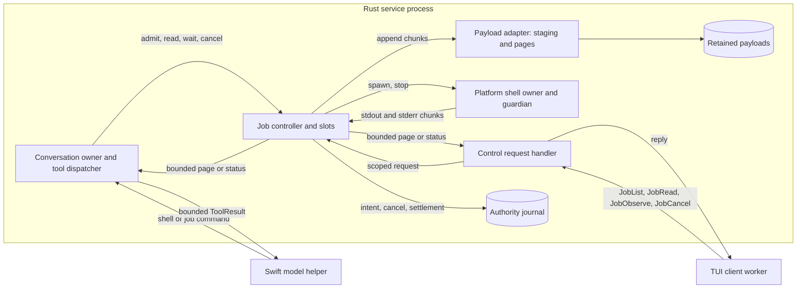
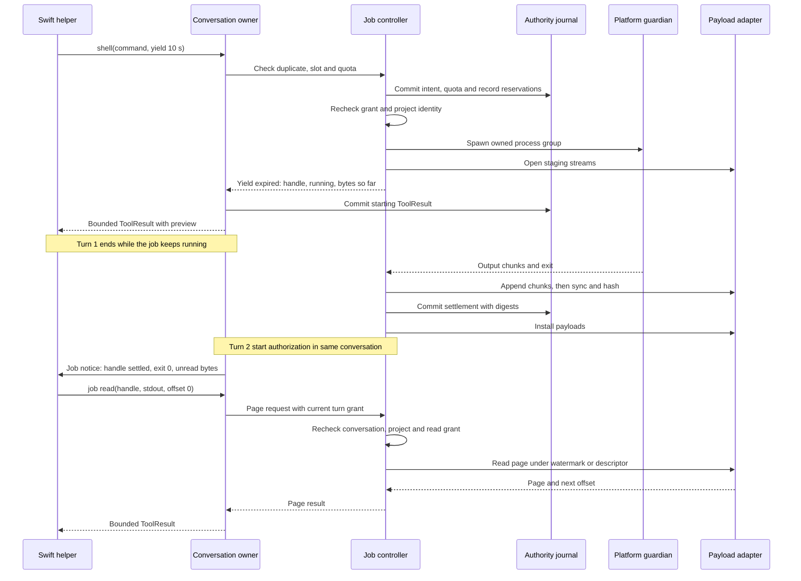
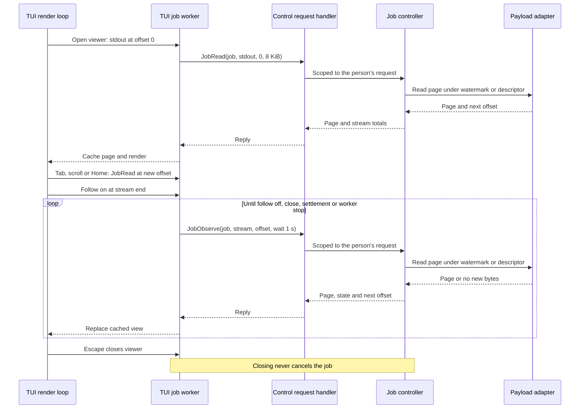
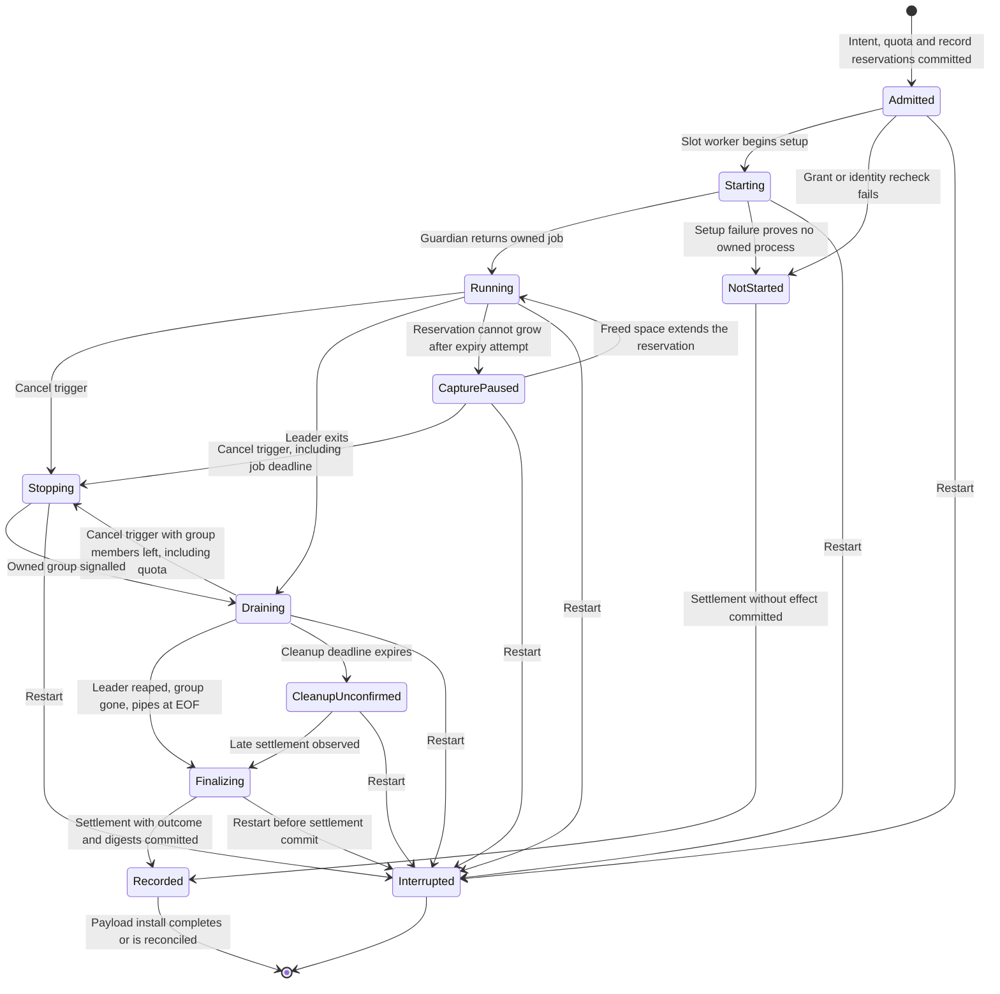
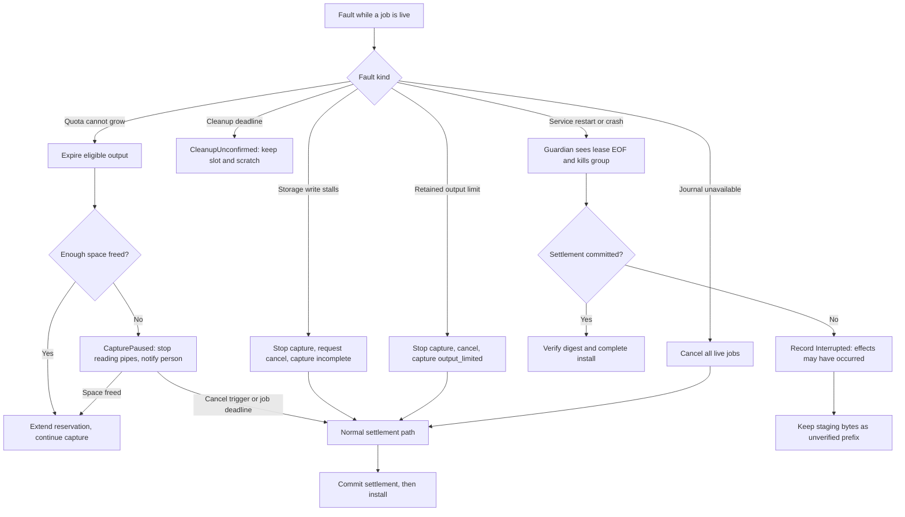
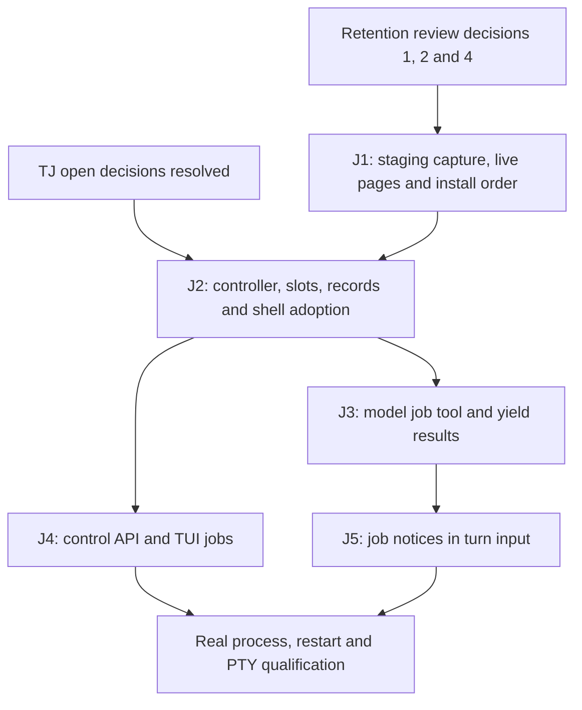

# Tool job controller

Status: proposed design, 2026-10-12. The owner selected the direction and three
decisions: conversation-scoped jobs, record-only completion and a yield window
with a small preview. An independent review on 2026-10-12 found authority,
durability and contract gaps; this revision addresses them. Mechanisms and numeric
limits remain proposals until the open decisions below are resolved. This design
is not implemented. It depends on the open review decisions of the
[result retention packet](result-retention-graph-packet.md#review-decisions-and-delivery-dependencies).
Protocol numbering remains `0.1`; journal format remains `1`.

## Purpose and selected decisions

Required behavior: a tool's output must not flow into model input by default.
A service-owned controller runs a long-running tool as a **tool job** and retains
its complete output stream. The model receives a bounded preview and a job handle.
It can later reconnect to the job to inspect status, read the stream or cancel it.
The person can attach to the same job from the TUI.

Required behavior (owner, 2026-10-12): jobs must be navigable by the person as
well as the model. Both must be able to examine the output and error streams
separately, from their first byte, while the job runs and after it settles.
The controller therefore retains each stream from offset 0. It never keeps only
a rolling tail. A capture that stops early keeps its contiguous prefix.

This separates three things that the current [shell tool](shell-tool.md) couples:
process lifetime, output retention and model disclosure. Today one call blocks its
turn for at most 60 seconds, then returns bounded tails into the model result.

| Decision | Selected by the owner, 2026-10-12 |
| --- | --- |
| Job lifetime | Conversation-scoped. A job can outlive the turn that started it. Later turns in the same conversation can reconnect. Restart interrupts running jobs. |
| Completion when idle | Record and surface only. The service records the outcome and shows it to clients. The next turn receives a short status notice. No model call starts automatically. |
| Default model output | Yield window with a small preview. A finished job returns its outcome and a bounded preview. A running job returns its handle and progress counts. |

Non-goals: interactive stdin, PTY sessions, network access, remote hosts, jobs that
survive service restart, project-scoped daemons and automatic model reactions.
Each needs a separate design. Context composition remains
[conversation projections](conversation-projections.md) items 5–6.

## Terms

| Term | Meaning |
| --- | --- |
| Tool job | One admitted long-running tool effect owned by the job controller, with a stable job ID and retained output streams |
| Job handle | Opaque service-derived job ID returned to the model and clients; it is not an access token |
| Yield window | Time the starting tool call waits for the job before returning a handle instead of an outcome |
| Handle delivery | The durable ToolResult of the starting call; after it, the model knows the handle |
| Readable watermark | Byte count of a stream that storage has written and reported; reads never exceed it |
| Job notice | Service-written status summary for a later turn; it never contains job output |

## Canonical ownership

Required behavior: reuse existing owners. Add no second process supervisor,
scheduler or payload store.

| Behavior | Canonical owner |
| --- | --- |
| Job admission, identity, lifecycle, slots, deadlines, cancellation and notices | New job controller module inside the Rust service orchestrator, on the existing reactor |
| Process spawn, sandbox, guardian, group cleanup and reap | Existing `asura-platform` shell owner and lease guardian, one instance per job slot |
| Setup and cleanup isolation | Existing retained shell worker stages, one per job slot |
| Durable job intent, cancel request and settlement records | Existing authority writer, with additive format-1 record kinds |
| Output capture, staging, verified payloads and page reads | `asura-storage` retained payload adapter from the retention packet, amended below |
| Model-facing `job` commands | Existing tool registry and grouped tool dispatcher |
| Client job list, observe and cancel | Existing control request handler, client worker pattern and TUI cached rendering |
| Model session and native tool callbacks | Supervised Swift helper; it never receives payload paths or streams |

Ownership transfer: today the shell worker lives in the turn's active state.
Turn terminal and ToolResult publication wait for its settlement. Under this
design, the controller owns each job slot and its worker from intent onward.
The turn waits only for handle delivery, never for job settlement.

### TJ-O1: proposed ownership and data flow

Proposed design. Arrows name calls or data delivery. Output bytes flow only to
storage. The model and the client each receive bounded pages they requested.

## User and model behavior

### Starting a job

Proposed mechanism: every `shell` call runs as a job. `shell` gains an optional
`yield_seconds` argument and a longer optional `timeout_seconds`. Other tools stay
synchronous until they adopt the controller.

1. The conversation owner checks arguments, grant, duplicate identity, slots and
   quota. Duplicate detection runs first, so a retry returns the existing job.
2. A missing slot or quota returns `busy` before any intent is written.
3. The controller commits a durable job intent, then rechecks grant and project
   identity and starts the process.
4. The call waits for the job to settle or for the yield window to expire.
5. The owner commits the starting call's ToolResult. This is handle delivery.
   A settled job returns its outcome, byte counts and preview. A running job
   returns its handle, state, elapsed time and byte counts.

In both cases the result states how many bytes remain unread. The model can then
continue the turn, call `job` commands, or finish its answer while the job runs.

Behavior change: the current default returns up to 16 KiB of tails after at most
30 seconds. Jobs return a smaller preview after 10 seconds by default. A command
that runs between 10 and 30 seconds now returns a handle instead of its outcome.
Regression tests must cover both short and long commands.

### Reconnecting to a job

Proposed mechanism: add one grouped model tool named `job` with five commands.

| Command | Result |
| --- | --- |
| `list` | Up to 8 jobs of the current conversation: handle, command summary, state, exit status and unread byte counts |
| `status(job)` | One job's state, timings, byte counts, capture state and exit status |
| `read(job, stream, offset?, limit?)` | One text page from `stdout` or `stderr`, with `next_offset` and total bytes; `offset: 0` reads from the start; absent offset means the model's last cursor for that stream, which starts at 0 |
| `wait(job, seconds)` | Waits up to the given seconds for settlement or new output, then returns `status` |
| `cancel(job)` | Requests cancellation and returns the current state; it does not claim the process stopped |

The model keeps one cursor per stream. Reading `stdout` never moves the `stderr`
cursor. A preview does not advance a cursor, so a first `read` starts at byte 0.
The cursors and "last observed" state derive from journaled `job` ToolResults.
Replay therefore rebuilds them after restart.

### Turn end, steering, cancellation and completion

Required behavior: after handle delivery, a job survives the end of its turn,
steering, turn cancellation and a new turn generation.

Proposed mechanism: before handle delivery, the model does not know the handle.
If the turn is cancelled, steered or invalidated during the yield window, the
controller cancels the job. The owner still commits the starting call's ToolResult,
with the job's state at that moment, before the turn terminal. No orphan job is
left that the model never learned about.

When a turn is cancelled with live jobs that have delivered handles, the TUI
shows the count and the `/jobs` hint. `/cancel` itself never cancels those jobs.

When a job settles while no turn is running, the controller records the outcome
and publishes a client event. It must not start, queue or steer a model turn.
At the start authorization of the next turn in that conversation, the service
derives one job notice from journal state. The notice lists jobs whose state
changed since the model last observed them. The start authorization record binds
the notice digest, so replay reconstructs the same turn input.

### TUI behavior

Proposed mechanism. The client principal is the local person using the TUI.
Required behavior (owner, 2026-10-13): job commands default to the TUI's selected
project. The person can list every project's jobs on request. The service runs
for one OS account, so this view grants no new access; the confirmation below
guards against acting on the wrong project.

| Command | Behavior |
| --- | --- |
| `/jobs` | Navigable list of jobs of all conversations in the selected project, with state, age, exit status and bytes per stream; Enter opens the job viewer |
| `/jobs all` | The same list for every registered project, each row labelled with its project |
| `/job ID` | Open the job viewer for one job; a job outside the selected project shows its project in the header |
| `/job cancel ID` | Request cancellation of one job; a job outside the selected project needs confirmation that names its project |

A job's activity row in the transcript also opens the job viewer. The person can
reach it through the existing response browser while the turn is live or later.

The job viewer is read-only. It shows one stream at a time and opens at byte 0
of `stdout`.

| Key | Action |
| --- | --- |
| Tab | Switch between `stdout` and `stderr`, keeping each stream's position |
| Up, Down, PageUp, PageDown | Scroll by line or page |
| Home, End | Go to the first byte, or to the current end of the stream |
| `f` | Toggle follow: keep the view at the end while new output arrives |
| Escape | Close the viewer; the job keeps running |

The header shows job state, exit status, the stream, the visible byte range and
the stream's total bytes. A stopped capture shows its reason and the retained
range. Navigation uses byte offsets. A line index for "go to line" is not
proposed here.

The service rechecks project registration and retained identity on every list,
page and cancel. A job of an unregistered project returns `not_found` to the
client. The model's scope does not change: it sees only its own conversation's
jobs, and any other job ID returns `not_found`. The status row shows the selected
project's live job count. A `busy` result with reason `quota` names the projects
whose retained output holds the space.

`/new` and exit open a confirmation while the current conversation has live jobs.
Confirmation cancels those jobs; declining keeps the conversation and its jobs.
A backend launched by the TUI exits with the TUI, so its exit confirmation must
also count live jobs in other conversations and state that they will stop.

### TJ-Q1: proposed start and reconnect sequence

Proposed design. Solid arrows are requests; dashed arrows are replies or events.
The first turn ends while the job runs; a later turn reconnects.

### TJ-Q2: proposed client attach sequence

Proposed design. The viewer requests pages at any offset with `JobRead`. Follow
mode long-polls with `JobObserve`, like the conversation observer. Rendering reads
only the worker's cached pages.

## Contracts

### Job states

Proposed design. A requested control action is not its completed effect. The
journal records only settled facts.

### TJ-S1: proposed job lifecycle

Arrows name triggers. `Interrupted` and `CleanupUnconfirmed` never claim that
effects did not occur. Busy and quota rejections happen before intent and have
no state here.

Cancel triggers are model or client cancel, job deadline, capture stop, quota
exhaustion during `Draining` and every revocation trigger in the
[security section](#security-and-authority). A turn
ending, steering or the TUI `/cancel` of a turn is not a trigger after handle
delivery. `CleanupUnconfirmed` keeps its slot and counts toward live job limits.
`CapturePaused` also keeps its slot; see [retained output lifetime](#retained-output-lifetime).

### Capture, watermark and page contract amendments

Proposed mechanism. This section amends the retention packet's
[capture contract](result-retention-graph-packet.md#capture-contract),
[ordering](result-retention-graph-packet.md#durable-ordering-and-graph-independence) and
[page contract](result-retention-graph-packet.md#authorized-page-contract).

1. **Staging:** the payload adapter writes each stream to an append-only staging
   object owned by the job. The readable watermark is the written and reported
   byte count. It is not a durability claim.
2. **Live pages:** a page of a running job has state `live`. It binds job ID,
   stream and watermark, not a digest. An offset equal to the watermark returns
   an empty `live` page, not a complete page.
3. **Settlement order:** after process settlement, the adapter syncs and hashes
   the staging objects. The controller then commits the settlement record with
   outcome, byte counts and digests. Only then does the adapter install the
   payloads. Installation is idempotent; replay completes it from staging after
   verifying the recorded digest. A known exit code is never lost to a crash
   during installation.
4. **Text boundaries:** a text page request whose offset falls inside a UTF-8
   scalar starts at the next scalar boundary and reports the actual start. This
   replaces rejection, so viewers can scroll backward by byte count.
5. **Settled pages:** after installation, pages bind the descriptor digest as the
   retention contract requires. Offsets do not change, so a live cursor remains
   valid as a descriptor cursor.
6. **Interrupted capture:** after restart, an interrupted job's staging bytes
   become an `unverified_prefix` capture. It has a size and no digest. After an
   OS crash, unsynced bytes may be zero or stale. Pages carry that label; they
   never claim verified content.

The retention packet's acceptance cases RG-06 and RG-11 must add these states.

### Superseded clauses

When implemented, this design changes these existing contracts for jobs:

| Existing clause | Change |
| --- | --- |
| Shell: command stops at turn end, steering or generation invalidation | Only before handle delivery |
| Shell: `timeout_seconds` 1–60, guardian rejects longer deadlines | 1–3600 in job mode; guardian accepts the job deadline |
| Shell: one live shell job service-wide in the turn's retained slot | Controller slots under the limits below |
| Shell durable record kind 16 timeout range 1–60,000 ms | Job intent record carries up to 3,600,000 ms |
| Retention: one active capture | Up to 4 concurrent captures |
| Retention: install payloads, then record the outcome | Record settlement with digests, then install |
| Retention: pages always bind a descriptor digest | `live` and `unverified_prefix` page states above |
| Retention: a text offset inside a UTF-8 scalar rejects | The start snaps forward to the next boundary |

### Arguments and limits

Proposed values for review. Other retention limits remain unless this table
changes them.

| Boundary | Proposed limit and overload result |
| --- | --- |
| `yield_seconds` | 0–30, default 10; 0 returns the handle immediately after spawn |
| `timeout_seconds` (job lifetime) | 1–3600, default 600; the guardian enforces it |
| Live jobs | 4 per service and 2 per conversation, including `CleanupUnconfirmed`; another start returns `busy` before intent |
| Retained output | 64 MiB combined streams per job; reaching it stops capture and cancels the job. The reservation grows with output under [retained output lifetime](#retained-output-lifetime); the initial size is open |
| Preview | Head 1 KiB and tail 2 KiB per stream, at most 6 KiB in one result |
| `read` page | At most 8 KiB source bytes, within the existing 16 KiB result limit |
| `wait` | 1–30 seconds per call; turn cancellation ends the wait, not the job |
| `list` and job notice | At most 8 jobs; notice at most 2 KiB with no job output |
| Page reads | Retention's 2 active reads; 1 is reserved for model and cancel paths |
| Client viewers | 4 open viewers per service; each has one pending `JobRead` or `JobObserve`, sharing the other read |
| Client page | `JobRead` and `JobObserve` return at most 8 KiB source bytes |
| Journal reservations | Cancel request and settlement frames reserved at intent; at most one cancel request record per job |

Existing turn limits remain. Each `job` command counts toward the eight tool calls
of a turn and the 64 KiB aggregate result limit.

### Model results

A job result states facts from the controller, never model assertions. It includes
job handle, state, exit status when known, elapsed time, bytes per stream, unread
bytes per stream, capture state and preview truncation. Output text in previews and
pages is untrusted tool data, as today.

The job notice is a separate service-written block. It contains handle, a sanitized
command summary of at most 64 bytes, state, exit status and unread counts. It is
never placed in system instructions. Exact placement is an open decision.

### Durable records

Proposed mechanism: additive format-1 record kinds, allocated at integration.

| Record | Binds |
| --- | --- |
| Job intent | Job ID, conversation, project, originating operation, generation and ordinal, command and cwd digests, effective timeout, grant snapshot, quota reservation, reserved record capacity |
| Job cancel requested | Job ID, requester (model turn, client or revocation), reason; at most one per job |
| Job settlement | Job ID, outcome (`not_started`, exited, signalled, cancelled), exit status, capture state, byte counts, digests |

The writer accepts cancel and settlement records when no turn is active. They bind
the job ID and its originating operation, and use capacity reserved at intent.
Cancellation signals the process group immediately; the cancel record is written
asynchronously and never delays the signal. Model reads remain ordinary tool
intents and results. Replay rebuilds job state from these records. A record never
resumes a process.

## Retained output lifetime

Required behavior (owner, 2026-10-13): all four approaches apply together.

| Approach | Selected behavior |
| --- | --- |
| A: Automatic expiry | The service deletes settled job output that nothing references. |
| B: Growing reservation | A job reserves a small amount at intent and extends it as output arrives, up to the per-job limit. |
| C: User cleanup | The person can delete retained job output explicitly. |
| D: Value detection | Retention depends on the output's value. Successful build logs are usually less valuable than failed builds. A job may have a summary note, retained longer than its log, that explains what happened. |

Expiry, growth and cleanup act on the quota. Value detection decides the order
and timing of expiry. A summary note is separate from the log it describes, so
deleting a log keeps the note. The job viewer shows expired output as expired,
with the note where one exists.

Required behavior (owner, 2026-10-13): the service always writes a factual
summary from recorded facts, such as command, exit status, duration, byte counts
and stop reason. The model or the person may add notes beside it. Each note
records its author. A model note is a model assertion, not a controller fact.
Summary notes live as long as their conversation. They never expire on their own;
deleting the conversation deletes them.

Required behavior (owner, 2026-10-13): four signals set value.

| Signal | Examples |
| --- | --- |
| Outcome | Exit status, stop reason, cancellation, timeout, capture stop |
| Person actions | Viewed, pinned or noted by the person |
| Model use | The model read pages or added a note |
| Content checks | Mechanical checks, such as non-empty stderr or matched error patterns |

Content checks are untrusted observations of tool output. They can raise or lower
retention priority only; they grant no authority. How signals combine into value
classes is a proposed mechanism for the integration review.

Required behavior (owner, 2026-10-13): expiry uses both age and quota pressure.
Each value class has a retention age. When the quota needs space before then,
the service expires the lowest-value eligible output first. The classes, ages
and tie-breaking order are open.

Required behavior (owner, 2026-10-13): these references prevent expiry, including
under quota pressure.

| Reference | Hold lasts |
| --- | --- |
| Person pin | Until the person unpins it |
| Evidence link from a retained result, memory graph, plan or task | While the linking record exists |
| Open person or model read | While the read or viewer is open |
| Model reference | While the model used the handle in the current or previous turn |

Held output can fill the quota. New jobs then return `busy` with reason `quota`
until a hold ends or the person deletes output.

Required behavior (owner, 2026-10-13): when a running job cannot extend its
reservation, the service first tries to expire eligible output. If that frees too
little, the job enters `CapturePaused`, a temporary ending under the
[loop closure](loop-closure.md#permanent-and-temporary-endings) model:

- The controller stops reading the job's pipes. The OS then blocks the tool's
  next write to stdout or stderr. Bytes already read are retained; none are dropped.
- Freed space resumes capture. The job deadline and every other cancel trigger
  still apply, and the deadline makes the ending permanent.
- The service shows the person the paused job and the reason.
- This pauses only the tool's writes to its output pipes. Files that the tool
  writes itself are a separate resource.

Required behavior (owner, 2026-10-13): capture never pauses in `Draining`. If
the reservation cannot grow there after the expiry attempt, the controller treats
it as a cancel trigger. It signals the remaining group members, keeps the captured
prefix and records the stop reason `quota`. Pausing would block members from
exiting and risk `CleanupUnconfirmed`.

Open decisions for this section:

1. The initial reservation and growth step sizes.
2. The value classes, their retention ages and the eviction tie-break order.

## Failure handling and recovery

### TJ-R1: proposed failure and restart handling

Proposed design. Arrows lead to the recorded outcome. No branch respawns a job.

- **Stalled storage:** the controller stops accepting output when transfer queues
  are full, then requests cancellation. It never drops bytes silently.
- **Quota cannot grow:** the controller expires eligible output, then pauses
  capture if space is still short. See [retained output lifetime](#retained-output-lifetime).
- **Stalled read:** a page request has a 2-second storage deadline. Expiry returns
  `busy`; the retained read slot stays held until the worker settles.
- **Journal unavailable:** the owner enters its existing repair path and cancels
  all live jobs, as it cancels the shell today. Settlement records wait for repair
  and use their reserved capacity.
- **Quota exhausted:** new jobs return `busy` with reason `quota`. Running jobs
  keep their reservations. Expiry and user cleanup free space under
  [retained output lifetime](#retained-output-lifetime); behavior when a growing
  job cannot extend its reservation is open there.
- **Stale handle:** an unknown job, or a job outside the caller's conversation or
  project, returns `not_found` without revealing whether it exists elsewhere.
- **Duplicate call:** an identical retried start returns the existing job, even at
  the slot limit. Changed arguments under the same call identity conflict.
- **Restart:** a restart never reattaches to a process, signals a journaled PID or
  runs a job again. Interrupted jobs stay listable and readable.
- **Graceful shutdown:** shutdown closes job admission and cancels live jobs. A job
  that settles within the shutdown cleanup deadline records `cancelled` with reason
  `shutdown`. Otherwise the next start records `Interrupted`.

## Security and authority

Required behavior. The execution grant comes from the admitted foreground turn
that started the job. A job continues after that turn ends. This is a deliberate
change: effects can now continue without an active turn. The original grant
snapshot, sandbox, environment, scratch, network denial and descendant limits
apply unchanged. The longer lifetime widens none of them.

**Read access.** A model read, wait, status or cancel requires a current admitted
turn in the same conversation. That turn's existing `read_authorized` grant must
cover the job's project. The service rechecks project registration and retained
identity on every request. A client request defaults to the client's selected
project and may cover every registered project, as described in
[TUI behavior](#tui-behavior).

**Revocation triggers.** Each trigger cancels the affected live jobs:

| Trigger | Affected jobs |
| --- | --- |
| Project unregistered or retained identity changes | All jobs of that project |
| Shell policy change disables execution | All jobs started under the old policy |
| Execution grant revoked for a project or principal | Jobs started under that grant |
| Journal unavailable | All live jobs |
| Conversation closed by confirmed `/new` or exit | Jobs of that conversation |
| Service shutdown | All live jobs |

A job handle is not a bearer credential. Background reconciliation and classifiers
receive no execution grant and cannot start jobs. Audit records job start, cancel
and settlement metadata; it never stores output.

## Asynchronous execution

| Rule | How this design meets it |
| --- | --- |
| AE-01 | The reactor handles readiness, bounded state changes and page dispatch. `wait` and `JobObserve` park replies; `JobRead` is one bounded page; they never block the reactor. |
| AE-02 | Blocking calls: spawn and setup, pipe reads, filesystem writes, sync, hash, install and page reads. Each slot uses the existing retained setup and cleanup worker stages; storage uses retained payload workers. |
| AE-03 | Limits in the table above. Every overload returns `busy` or stops capture with an explicit reason. Model and cancel paths keep a reserved read slot. |
| AE-04 | The guardian enforces job lifetime. `wait` and observe have their own deadlines. Turn cancellation ends waits and reads, and jobs only before handle delivery. |
| AE-05 | No respawn after an unknown outcome. Replay rebuilds state and completes installs. Duplicate starts return the existing job. |
| AE-06 | Shutdown closes admission, cancels live jobs and follows existing guardian cleanup. Unsettled cleanup keeps its ownership. |
| AE-07 | Acceptance cases below require real process, storage-stall, journal-fault and restart evidence. |

## Validation

Required test layers. Unit tests use deterministic controller and storage fixtures.
Integration tests use real processes and scratch storage. End-to-end tests use a
real model provider and the TUI PTY harness.

| ID | Case | Unit | Integration | End-to-end |
| --- | --- | --- | --- | --- |
| TJ-01 | Job settles within yield window | Result shape, preview bounds | Real command, exact byte counts | Native model reads preview |
| TJ-02 | Job outlives yield and turn | State after turn end | Process continues after turn settles | Later turn reads full output by pages |
| TJ-03 | Steer or cancel after handle delivery | No stop transition | Job survives | PTY steer keeps job live |
| TJ-04 | Steer or cancel during yield window | Job cancelled, start result committed first | Real process stopped | PTY cancel during yield |
| TJ-05 | Read while running | Watermark bound, `live` pages, cursor after install | Live flood, offsets stable across install | TUI attach shows growing output |
| TJ-06 | Model and client cancel | Request versus settled state, one cancel record | TERM then KILL, cleanup evidence | `/job cancel` and model `cancel` |
| TJ-07 | Idle completion | No turn started, notice digest bound | Settlement without active turn | Next turn receives notice only |
| TJ-08 | Limits, busy and duplicates | Busy before intent, duplicate first | Third job per conversation, fifth per service | Visible busy result |
| TJ-09 | Output and quota limits | Capture stop reasons | 64 MiB flood, quota fill from retained jobs | Partial capture labelled |
| TJ-10 | Stalled storage and observer saturation | Read `busy`, reserved model read | Blocked writer and reader, 4 observers | Controls stay responsive |
| TJ-11 | Restart at each checkpoint | Replay of intent-only, running, finalizing, settled-not-installed | Crash at each point; guardian cleanup | Interrupted job listed and readable |
| TJ-12 | Cross-conversation and cross-project access | Model `not_found` without disclosure | Model denied other conversations and projects; client denied unregistered projects | — |
| TJ-25 | Person's all-projects view | Project labels; cross-project cancel confirmation state | `/jobs all` lists every registered project; quota `busy` names holders | PTY: list all, open another project's job, confirm and decline cancel |
| TJ-13 | `/new` and exit with live jobs | Confirmation state | Cancel on confirm only | PTY confirmation journeys |
| TJ-14 | Revocation triggers | Each trigger cancels the right jobs | Unregister, identity change, policy change | — |
| TJ-15 | Journal unavailable and full | Reserved settlement capacity | Writer fault during live job | Repair then settlement recorded |
| TJ-16 | Graceful shutdown | Shutdown reason recorded | Settle within and beyond deadline | TUI-owned backend exit |
| TJ-17 | Default shell behavior change | Short and 10–30 s commands | Real commands of each length | Native model handles both |
| TJ-18 | Person navigates both streams from the start | Viewer state: Tab keeps positions, Home, End, follow | Pages from byte 0 of each stream while running and after settlement | PTY: open from `/jobs` and from an activity row, read both streams |
| TJ-19 | Model reads both streams from the start | Separate cursors; preview does not advance them | `read` at 0 for `stdout` and `stderr`, running and settled | Native model reads `stderr` after `stdout` |
| TJ-20 | Prefix retained after capture stop | Retained range reported | Output limit flood keeps bytes from 0 | Viewer shows stop reason and range |
| TJ-21 | Value-ordered expiry | Value from outcome, person, model and content signals; age per class | Quota pressure expires lowest value first; held output survives | Viewer shows expired output with its summary |
| TJ-22 | Expiry holds | Each hold type blocks expiry and ends correctly | Pin, evidence link, open read and model reference under quota pressure | Held quota returns `busy` until cleanup |
| TJ-23 | Summary and attributed notes | Service summary fields; note author recorded | Notes survive log expiry | Person and model notes shown with authors |
| TJ-24 | Growing reservation and capture pause | Growth steps; `CapturePaused` transitions | Expiry attempted first; pipes not read while paused; resume on freed space; deadline cancels | PTY: paused job shown with reason, then resumes |

Environments: macOS 27 development host with the native process harness, scratch
installation, the system model and verified local Ollama. Release qualification is
not claimed by these cases.

## Delivery dependencies

### TJ-P1: proposed delivery order

Arrows mean prerequisites. Each packet needs its tests before the next starts.

## Open decisions

1. **Notice placement:** the helper message contract must define where the job
   notice sits and how providers receive it.
2. **Record kinds and tags:** the integration packet allocates journal kinds,
   control tags and model fields within protocol `0.1` and format `1`.
3. **Numeric limits:** the table values need measured qualification, especially
   the 3600-second lifetime and 4 live jobs.
4. **Retained job output and quota:** the owner selected automatic expiry, growing
   reservations, user cleanup and value detection on 2026-10-13. Their detailed
   decisions are listed under [retained output lifetime](#retained-output-lifetime).
5. **Client scope:** selected by the owner on 2026-10-13: the selected project by
   default, `/jobs all` on request and confirmation for cross-project cancel.
   See [TUI behavior](#tui-behavior).
6. **Other tools:** which future tools adopt the controller. Short typed tools
   remain synchronous.

## Alternatives considered

- **Turn-scoped jobs:** smaller change, but the model could not reconnect after
  its turn. Rejected by the owner.
- **Automatic follow-up turns:** the model would react to completions without
  being asked and would spend budget. Rejected by the owner.
- **Handle-only results:** minimal context use, but short commands would need extra
  calls. The yield window keeps short commands to one call.
- **Interactive sessions:** stdin and PTY support need a separate authority design.

## Design verification

Recorded on 2026-10-12: an independent read-only review found nine blocking and
several minor gaps. This revision addresses each one or records it as an open
decision. Mermaid CLI 12.0.0 rendered all six diagrams; each was visually inspected.
Local links and whitespace checks passed. This is design evidence only.

Return to the [design index](README.md).
