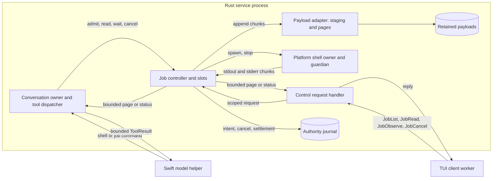
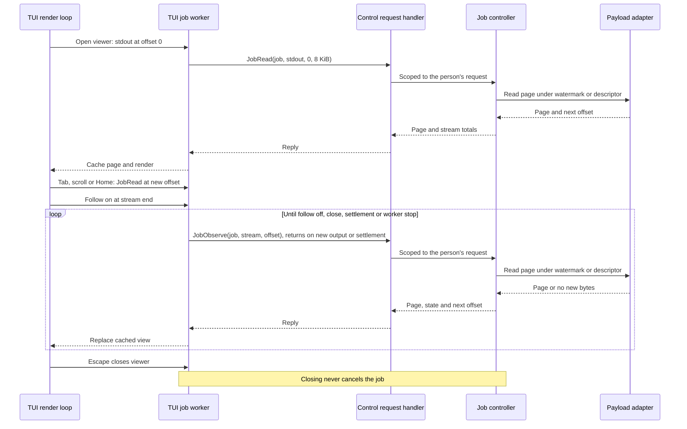
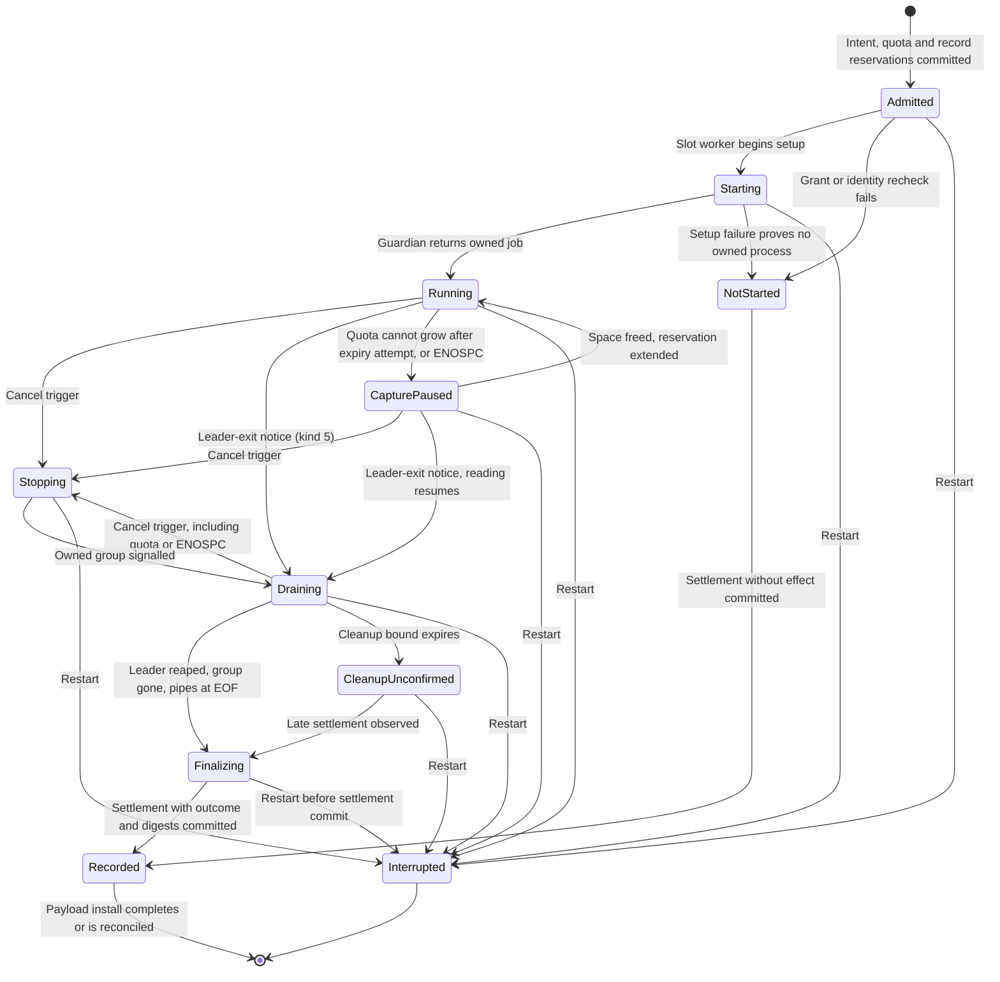
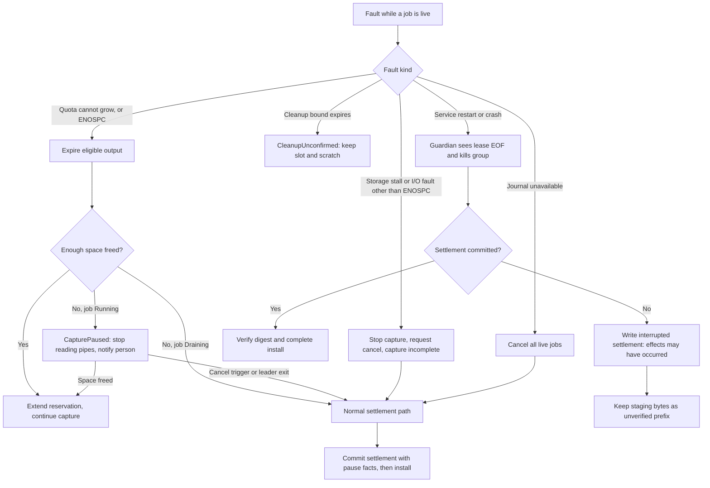
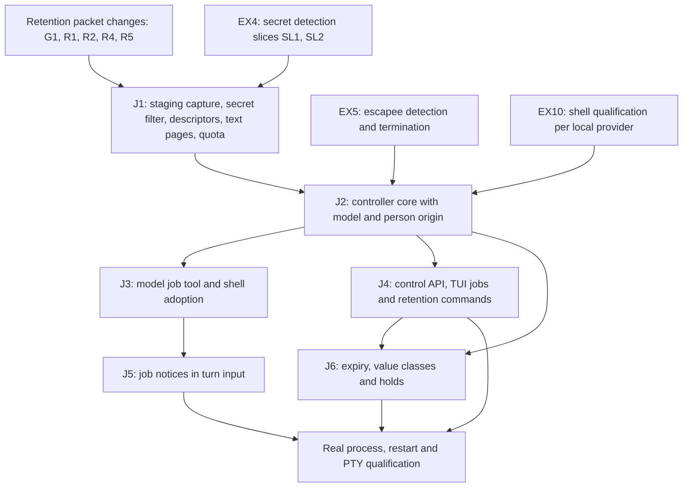

# Tool job controller

Status: design, 2026-10-12, revised 2026-10-14 and 2026-10-15; not implemented. The owner
selected the direction and three decisions on 2026-10-12: conversation-scoped
jobs, record-only completion and a yield window with a small preview. Later owner
decisions replace the preview and add person-origin jobs; see
[amendments from later designs](#amendments-from-later-designs). On 2026-10-14
the owner resolved every blocking decision of the readiness audit; see
[owner decisions of 2026-10-14](#owner-decisions-of-2026-10-14).

Readiness: packet J1 is not ready. The owner's
[execution threat model](execution-threat-model.md#owner-decisions) decision EX4
(2026-10-15) puts secret filtering into the J1 capture path. The
[secret detection design](secret-detection.md) (selected 2026-10-15, SD1–SD9)
defines it; J1's filter is its slice SL3, which needs slices SL1 and SL2 and
the dependency approval that design lists. J1 is also subject to the
[result retention packet](result-retention-graph-packet.md#review-decisions-and-delivery-dependencies)
changes that the 2026-10-14 decisions record. The full review of findings
EX1–EX16 (T1) was completed on 2026-10-15. J2 and the packets after it now wait
for EX5 escapee detection and termination and for EX10 shell qualification of
each local provider; see [threat model review](#threat-model-review-of-2026-10-15).
Mechanisms marked "proposed" are engineering choices under the
[iteration rules](../design-process.md#iteration-and-escalation), not owner
decisions. Protocol numbering remains `0.1`; journal format remains `1`.

## Purpose and selected decisions

Required behavior: a tool's output must not flow into model input by default.
A service-owned controller runs a long-running tool as a **tool job** and retains
its complete output stream. The model receives a job handle and a short
disclosure of controller facts, and pages the streams for output
([tool output views](tool-output-views.md#required-behavior)). It can later
reconnect to the job to inspect status, read the stream or cancel it. The person
can attach to the same job from the TUI.

Required behavior (owner, 2026-10-12): jobs must be navigable by the person as
well as the model. Both must be able to examine the output and error streams
separately, from their first byte, while the job runs and after it settles.
The controller therefore retains each stream from offset 0. It never keeps only
a rolling tail. A capture that stops early keeps its contiguous prefix.

This separates three things that the current [shell tool](shell-tool.md) couples:
process lifetime, output retention and model disclosure. Today one call blocks its
turn for at most 60 seconds (`asura-service/src/tools.rs:189`), then returns up to
6144 bytes from the end of each stream into the model result
(`asura-platform/src/shell/capture.rs:72`).

| Decision | Selected by the owner, 2026-10-12 |
| --- | --- |
| Job scope | Conversation-scoped. A job can outlive the turn that started it. Later turns in the same conversation can reconnect. Restart interrupts running jobs. |
| Completion when idle | Record and surface only. The service records the outcome and shows it to clients. The next turn receives a short status notice. No model call starts automatically. |
| Default model output | Yield window. A finished job returns its outcome; a running job returns its handle and progress counts. The small preview of the original decision was replaced on 2026-10-14; see below. |

Non-goals: interactive stdin, PTY sessions, network access for model jobs, remote
hosts, jobs that survive service restart, project-scoped daemons and automatic
model reactions. Each needs a separate design. Context composition is governed
by the [context composer](context-composer.md) (conversation projections items 5–6).

### Amendments from later designs

| Source | Status | Effect on this design |
| --- | --- | --- |
| [Tool output views](tool-output-views.md#required-behavior) rules 1–4 | Owner, 2026-10-13 | One retained stream per tool output. Person and model views are chosen separately. No tool defines a fixed preview. Journal result records hold a payload reference, a digest and a short summary, never output text. Frame sizes stay fixed transport units. |
| Tool output views [required change](tool-output-views.md#required-design-changes) for this design, with [PC12](person-command-mode.md#decisions) | Owner, 2026-10-14 | Until the context composer exists, job results carry no output text. The model pages with `job read`. |
| [PCR6, PCR11](person-command-mode.md#required-behavior), [PC5, PC7, PC8, PC9, PC10](person-command-mode.md#decisions) | Owner, 2026-10-13 and 2026-10-14 | Person-origin jobs: a person execution profile and grant, stop then kill at once on a second request, a 2 s stop grace, dispatch with no active turn in the conversation, model `cancel` of a person job returns `not_permitted`, and accepted work continues when a client goes away. |
| [Person job controller amendments](person-command-mode.md#job-controller-amendments) | Proposed mechanisms | `JobCancel.kill`, `JobObserve.at_end`, origin and input ID on job records and replies, and person job ID derivation. J2 includes them. |
| [Execution threat model review](execution-threat-model.md#owner-decisions) EX4, EX5, EX10, EX11, EX12 | Owner, 2026-10-14 and 2026-10-15 | See [threat model review of 2026-10-15](#threat-model-review-of-2026-10-15). |
| [Asura state isolation](asura-state-isolation.md) (PX3, SI3) | Implemented, 2026-10-14 | Every shell profile denies `~/.asura` except the call's scratch. The guardian receives the Asura home at FD 10 (`asura-platform/src/shell/guardian.rs:199`); person extra roots use FDs 11–17. Jobs inherit this unchanged. |

### Threat model review of 2026-10-15

The owner completed the [execution threat model](execution-threat-model.md)
review (T1) on 2026-10-14 and 2026-10-15. These decisions change this design.
Each records its source; mechanisms they need are follow-up designs, not
selected here.

| ID | Decision | Effect on this design |
| --- | --- | --- |
| EX4 | Owner, 2026-10-15. All tools use jobs; there are no legacy tools. Secrets are detected with Wisp's ported rules (SD1 corrects "rules plus a classifier"; no classifier) and replaced with placeholders at capture, before storage; secrets only. A secret in a command becomes a per-execution variable such as `$ASURA_SECRET_1`; the log keeps only its name; an unsafe rewrite is refused. | Supersedes R3's "legacy tools keep kind 15". The J1 capture path filters secrets under the [secret detection design](secret-detection.md). Retained streams, pages, journal records and both views hold placeholders. Job intent records the rewritten command. How other tools adopt jobs is a follow-up design. |
| EX5 | Owner, 2026-10-14. Detect and terminate escapees reliably before J2: `setsid` and new-session escapes, pipe-holding escapees that block settlement, and false `cleanup_confirmed`. | J2 prerequisite. Without it a pipe-holding escapee could hold a slot indefinitely, since jobs have no lifetime (J2a-1). |
| EX10 | Owner, 2026-10-14. Run SH-E1-style shell qualification for each local tool-capable provider (CoreAI, MLX, Ollama models) before J2. | J2 prerequisite. |
| EX11 | Owner, 2026-10-14. A person execution setting: global default plus a per-project override, default on. A change is a revocation trigger: turning it off refuses new execution and cancels live model jobs in scope. | Added to [revocation triggers](#security-and-authority) and TJ-14. The setting needs its own design. |
| EX12 | Owner, 2026-10-14. The client shows a visible notice whenever a job outlives its turn. | Added to [turn end](#turn-end-steering-cancellation-and-completion). Proposed placement: J4. |

### Owner decisions of 2026-10-14

The owner resolved the readiness audit's blocking decisions on 2026-10-14.
Each row names the section that applies it.

| ID | Decision (owner, 2026-10-14) | Applied in |
| --- | --- | --- |
| G1 | J1 implements retention item 3 only: capture, descriptors and pages. Graph projection (item 4) waits for a separate later review. | [Delivery](#delivery-dependencies); retention packet |
| R1 | Configurable quota: default 1 GiB total, 1 MiB initial reservation, 1 MiB growth steps, fixed 16 MiB recovery reserve. | [Limits](#arguments-and-limits) |
| R2 | Settle, then install. Hash incrementally during capture, commit the settlement with digests, then install. An uninstalled file found at recovery is an unverified prefix to clean up. | [Capture amendments](#capture-watermark-and-page-contract-amendments) |
| R3 | New record kinds for job intent, cancel and settlement, plus a reference-only result kind for job tools. Legacy tools keep kind 15 for now (superseded by EX4, owner 2026-10-15: there are no legacy tools; all tools use jobs). Kinds are allocated in delivery order, J2 before person-command packet P2; the person design moves to the next free kinds. No data effect. | [Durable records](#durable-records) |
| R4 | One capture worker per job slot, each with a 512 KiB transfer queue, plus 2 page-read workers. | [Limits](#arguments-and-limits), [async](#asynchronous-execution) |
| R5 | J1 serves text pages only, snapped to UTF-8 boundaries. Raw pages come later; retention case RG-11 is recorded as partial. | [Capture amendments](#capture-watermark-and-page-contract-amendments) |
| R6 | Disk full (ENOSPC) during capture enters `CapturePaused`, as quota does. Other I/O faults and stalls cancel. Under J2a-1 the pause has no expiry. | [Retained output lifetime](#retained-output-lifetime), [failure](#failure-handling-and-recovery) |
| T1 | Full review of threat model findings EX1–EX16 before J2. J1 is not gated. Completed on 2026-10-15; its decisions add J1 and J2 prerequisites. | [Delivery](#delivery-dependencies) |
| J1d | No per-job output cap for model jobs; the shared quota only. | [Limits](#arguments-and-limits) |
| J2a-1 | No fixed job lifetime. Fixed time limits are unpredictable and stop normal long-running processes; loop closures replace them. Jobs end by completion, model or person cancel, revocation, restart or capture fault. An unattended job holds a slot; the known-size slot limit returns `busy`, and the person cancels through `/jobs`. A stall closure for jobs comes later from tool-loop trace evidence ([tool output views rule 5](tool-output-views.md#required-behavior)). `CapturePaused` has no expiry. | [Job closures](#job-closures-and-wind-down-bounds) |
| J2a-2 | Counts are configurable, each with a fixed maximum. Defaults: 4 live jobs per service, 2 per conversation; client viewers counted per attachment, 8 per service; 1 page read reserved for the model. | [Limits](#arguments-and-limits) |
| `job wait` | `wait` returns on job end, new output or turn cancellation. The model may give an optional time; with none, only those events end it. | [Reconnecting](#reconnecting-to-a-job) |
| Wind-down bounds | Keep shutdown cleanup (2 s), page read (2 s) and TERM-to-KILL grace (500 ms model, 2 s person) as bounds on Asura's own operations, recorded separately from job closures. | [Job closures](#job-closures-and-wind-down-bounds) |
| J2b | The guardian adds a leader-exit notice, kind 5. The `Draining` rule stays. The guardian still signals the group as it does now. | [Lifecycle](#tj-s1-job-lifecycle) |
| J2c | No separate pause or resume records. The settlement records pause facts: when, duration and bytes lost. This design states the exemption from the loop-closure durability rule. | [Retained output lifetime](#retained-output-lifetime) |
| J2d | A kill is not journaled separately; the settlement reason is `person_kill`. | [Durable records](#durable-records) |
| J4a | `/new` never cancels live jobs. They stay in `/jobs` and continue to log to the prior conversation's journal; their records stay with the originating conversation. | [TUI behavior](#tui-behavior) |
| J5a | The job notice is a labelled block before the prompt, bound by the turn input digest. The helper is unchanged. No byte cap; known-size bounds of 8 notices and commands of at most 8192 bytes. The composer places it later. | [Model results](#model-results) |
| S1 | Pin, unpin, delete and note are journal records keyed by job ID, with commands `/job pin`, `/job unpin`, `/job delete` and `/job note`, and a model `job note`. Notes stay with the conversation journal. | [Retained output lifetime](#retained-output-lifetime) |
| S2 | Value classes, ages and tie-break are defined now (S2-1 to S2-3). | [Retained output lifetime](#retained-output-lifetime) |

## Terms

| Term | Meaning |
| --- | --- |
| Tool job | One admitted long-running tool effect owned by the job controller, with a stable job ID and retained output streams |
| Job handle | Opaque service-derived job ID returned to the model and clients; it is not an access token |
| Yield window | Time the starting tool call waits for the job before returning a handle instead of an outcome |
| Handle delivery | The durable ToolResult of the starting call; after it, the model knows the handle |
| Readable watermark | Byte count of a stream that storage has written and reported; reads never exceed it |
| Job notice | Service-written status block for a later turn; it never contains job output |
| Job closure | A condition that ends a job: completion, cancel, revocation, restart or capture fault |
| Wind-down bound | A fixed bound on one of Asura's own operations, such as a page read or cleanup; it never ends a job's normal run |

## Canonical ownership

Required behavior: reuse existing owners. Add no second process supervisor,
scheduler or payload store.

| Behavior | Canonical owner |
| --- | --- |
| Job admission, identity, lifecycle, slots, cancellation and notices | New job controller module inside the Rust service orchestrator, on the existing reactor |
| Process spawn, sandbox, guardian, group cleanup and reap | Existing `asura-platform` shell owner and lease guardian, one instance per job slot |
| Setup and cleanup isolation | Existing retained shell worker stages, one per job slot |
| Durable job intent, cancel request, settlement and retention records | Existing authority writer, with additive format-1 record kinds |
| Output capture, staging, verified payloads, page reads and expiry | `asura-storage` retained payload adapter from the retention packet, amended below |
| Model-facing `job` commands | Existing tool registry and grouped tool dispatcher |
| Client job list, observe, cancel and retention commands | Existing control request handler, client worker pattern and TUI cached rendering |
| Model session and native tool callbacks | Supervised Swift helper; it never receives payload paths or streams |

Ownership transfer: today the shell worker lives in the turn's active state
(`asura-service/src/conversation.rs:487`), and the conversation owner holds one
active turn (`conversation.rs:584`). Turn terminal and ToolResult publication
wait for its settlement (`conversation.rs:3466`, `conversation.rs:3486`). Under this
design, the controller owns each job slot and its worker from intent onward.
The turn waits only for handle delivery, never for job settlement.

### TJ-O1: ownership and data flow

Selected design. Arrows name calls or data delivery. Output bytes flow only to
storage. The model and the client each receive bounded pages they requested.

## User and model behavior

### Starting a job

Proposed mechanism: every `shell` call runs as a job. `shell` gains an optional
`yield_seconds` argument. It loses `timeout_seconds`, because jobs have no
lifetime (J2a-1). Model field 3 of `Shell` (`contracts/model/v1/model.proto:79`)
becomes reserved, and a call that still sets it is rejected as invalid
arguments. Other tools stay synchronous until they adopt the controller.

1. The conversation owner checks arguments, grant, duplicate identity, slots and
   quota. Duplicate detection runs first, so a retry returns the existing job.
2. A missing slot or quota returns `busy` before any intent is written.
3. The controller commits a durable job intent, then rechecks grant and project
   identity and starts the process.
4. The call waits for the job to settle or for the yield window to expire.
5. The owner commits the starting call's ToolResult. This is handle delivery.
   A settled job returns its handle, outcome and byte counts. A running job
   returns its handle, state, elapsed time and byte counts. Neither carries
   output text until the context composer exists (PC12, owner, 2026-10-14).

In both cases the result states how many bytes remain unread. The model can then
continue the turn, call `job` commands, or finish its answer while the job runs.

Behavior change: today the default timeout is 30 seconds
(`conversation.rs:236`), the maximum is 60, and the result carries the end of
each stream. Under jobs a call returns after at most the 10-second default yield,
and its result carries no output text. A command that runs longer than 10
seconds returns a handle instead of its outcome. A command that today stops at
its timeout runs until it ends or is cancelled. Every command needs `job read`
for its output. Regression tests must cover short and long commands.

Proposed mechanism: a model job ID is the first 16 bytes of SHA-256 over ASCII
`asura.model.job`, one zero byte, then the operation ID, the generation as 8
big-endian bytes and the ordinal as 4 big-endian bytes. If all 16 bytes are zero,
the final byte becomes 1. The domain string separates model job IDs from
[person job IDs](person-command-mode.md#durable-records). A retried start with
the same operation, generation, ordinal and arguments derives the same ID and
returns the existing job; changed arguments conflict.

### Reconnecting to a job

Proposed mechanism: add one grouped model tool named `job` with six commands.

| Command | Result |
| --- | --- |
| `list` | Up to 8 jobs of the current conversation: handle, origin, command summary, state, exit status and unread byte counts |
| `status(job)` | One job's state, timings, byte counts, capture state and exit status |
| `read(job, stream, offset?, limit?)` | One text page from `stdout` or `stderr`, with `next_offset` and total bytes; `offset: 0` reads from the start; absent offset means the model's last cursor for that stream, which starts at 0 |
| `wait(job, seconds?)` | Returns when the job ends, new output arrives or the turn is cancelled (owner, 2026-10-14). An optional time also ends it. Returns `status`. |
| `cancel(job)` | Requests cancellation and returns the current state; it does not claim the process stopped. For a person job it returns `not_permitted` (PC10). |
| `note(job, text)` | Adds a model note to the job (S1). The note is a model assertion, attributed to the model. |

`wait` is exempt from the 2-second ordinary tool deadline
([limit L10](tool-output-views.md#execution)). With no time given it stays
bounded by events: job end, new output and turn cancellation. `list`, `status`,
`read` and `wait` also cover person jobs in the conversation (PC10).

The model keeps one cursor per stream. Reading `stdout` never moves the `stderr`
cursor. Job results carry no output text, so a first `read` starts at byte 0.
The cursors and "last observed" state derive from the job tools' journaled
results. Replay therefore rebuilds them after restart. Under tool output views
rule 3 and R3, those records use the reference-only result kind: stream
reference, offsets and a page digest, never page text.

### Turn end, steering, cancellation and completion

Required behavior: after handle delivery, a job survives the end of its turn,
steering, turn cancellation and a new turn generation.

Proposed mechanism: before handle delivery, the model does not know the handle.
If the turn is cancelled, steered or invalidated during the yield window, the
controller cancels the job. The owner still commits the starting call's ToolResult,
with the job's state at that moment, before the turn terminal. No orphan job is
left that the model never learned about.

When a turn is cancelled with live jobs that have delivered handles, the TUI
shows the count and the `/jobs` hint. `/cancel` itself never cancels those jobs.

Required behavior (owner, 2026-10-14, EX12): whenever a job outlives its turn,
however the turn ended, the client shows a visible notice. The EX11 execution
setting is the person's switch to stop such jobs. The notice's form needs
design with J4.

When a job settles while no turn is running, the controller records the outcome
and publishes a client event. It must not start, queue or steer a model turn.
At the start authorization of the next turn in that conversation, the service
derives one job notice from journal state. The notice lists jobs whose state
changed since the model last observed them. The turn input digest that start
authorization binds covers the notice, so replay reconstructs the same turn input.

### TUI behavior

Proposed mechanism. The client principal is the local person using the TUI.
Required behavior (owner, 2026-10-13): job commands default to the TUI's selected
project. The person can list every project's jobs on request. The service runs
for one OS account, so this view grants no new access; the confirmation below
guards against acting on the wrong project.

| Command | Behavior |
| --- | --- |
| `/jobs` | Navigable list of jobs of all conversations in the selected project, with state, age, exit status, value class and bytes per stream; Enter opens the job viewer |
| `/jobs all` | The same list for every registered project, each row labelled with its project |
| `/job ID` | Open the job viewer for one job; a job outside the selected project shows its project in the header |
| `/job cancel ID` | Request cancellation of one job; a job outside the selected project needs confirmation that names its project |
| `/job pin ID`, `/job unpin ID` | Hold or release the job's output against expiry (S1) |
| `/job delete ID` | Delete the job's retained output after confirmation; the summary and notes remain (S1). A live job's output cannot be deleted. |
| `/job note ID TEXT` | Add a person note to the job (S1) |

Each command needs a flowchart under the
[command flow requirement](../engineering.md#test-execution-and-evidence) before J4.

A job's activity row in the transcript also opens the job viewer. The person can
reach it through the existing response browser while the turn is live or later.

The job viewer is read-only. It shows one stream at a time and opens at byte 0
of `stdout`.

| Key | Action |
| --- | --- |
| Tab | Switch between `stdout` and `stderr`, keeping each stream's position |
| Up, Down, PageUp, PageDown | Scroll by line or page |
| Home, End | Go to the first byte, or to the current end of the stream |
| `f` | Toggle follow: keep the view at the end while new output arrives |
| Escape | Close the viewer; the job keeps running |

The header shows job state, exit status, the stream, the visible byte range and
the stream's total bytes. A stopped capture shows its reason and the retained
range. A paused capture shows its reason. Expired output shows the summary and
notes. Navigation uses byte offsets. A line index for "go to line" is not
proposed here.

The service rechecks project registration and retained identity on every list,
page, cancel and retention command. A job of an unregistered project returns
`not_found` to the client. The model's scope does not change: it sees only its
own conversation's jobs, and any other job ID returns `not_found`. The status row
shows the selected project's live job count. A `busy` result with reason `quota`
names the projects whose retained output holds the space.

Exit of the TUI never cancels jobs: accepted work continues when a client goes
away (PC5, owner, 2026-10-14), and any TUI can later list or cancel the jobs.
A backend launched by the TUI exits with the TUI, so its exit confirmation must
count live jobs in every conversation and state that they will stop through
shutdown.

Required behavior (owner, 2026-10-14, J4a): `/new` never cancels live jobs. They
stay listed in `/jobs` and continue to record to the prior conversation's journal.
Their records stay with the conversation that started them.

### TJ-Q1: start and reconnect sequence

Selected design. Solid arrows are requests; dashed arrows are replies or events.
The first turn ends while the job runs; a later turn reconnects.

### TJ-Q2: client attach sequence

Selected design. The viewer requests pages at any offset with `JobRead`. Follow
mode long-polls with `JobObserve`, like the conversation observer. Rendering reads
only the worker's cached pages.

## Contracts

### Job states

Selected design. A requested control action is not its completed effect. The
journal records only settled facts.

### TJ-S1: job lifecycle

Arrows name triggers. `Interrupted` and `CleanupUnconfirmed` never claim that
effects did not occur. Busy and quota rejections happen before intent and have
no state here. No transition is driven by a job lifetime (J2a-1).

Verified guardian behavior (code, commit `3cf424b`): when the leader exits, the
guardian sends TERM to the group at once and KILL 500 ms later
(`asura-platform/src/shell/guardian.rs:304-326`, `guardian.rs:37-38`). It reports
the exit only after the group is empty and the leader is reaped
(`guardian.rs:327-347`). Its notices have kinds 1–4 only
(`asura-platform/src/shell/protocol.rs:47-52`).

Required behavior (owner, 2026-10-14, J2b): the guardian adds notice kind 5,
leader exited, sent when it observes the leader's exit and before the group's
final settlement. The controller enters `Draining` on that notice. The guardian
keeps signalling the group as it does now. A paused job that receives the notice
resumes reading, because capture never pauses in `Draining`.

Cancel triggers are model or client cancel, person stop and kill for person jobs,
a capture fault other than ENOSPC, quota or ENOSPC during `Draining`, and every
revocation trigger in the [security section](#security-and-authority). A turn
ending, steering, `/new` or the TUI `/cancel` of a turn is not a trigger after
handle delivery. `CleanupUnconfirmed` keeps its slot and counts toward live job
limits. `CapturePaused` also keeps its slot; see
[retained output lifetime](#retained-output-lifetime).

### Job closures and wind-down bounds

Required behavior (owner, 2026-10-14, J2a-1): no fixed time limit ends a job.
The job closures are:

| Closure | Kind under [loop closure](loop-closure.md#closure-operators) |
| --- | --- |
| The process group settles | Completion |
| Model, client or person cancel | Interrupt |
| Revocation, journal unavailable, shutdown, restart | Interrupt |
| Capture fault other than ENOSPC | Exhaustion of Asura's capture path |

No closure guarantees that an unattended job ends. A live job holds one of the
known-size job slots, so further starts return `busy` until the person cancels
it through `/jobs`. A stall closure for jobs will come from tool-loop trace
evidence under [tool output views rule 5](tool-output-views.md#tool-loop-trace-evidence).

Required behavior (owner, 2026-10-14): these wind-down bounds limit Asura's own
operations. They never end a job's normal run and are not job closures.

| Bound | Value | Source |
| --- | --- | --- |
| TERM to KILL grace | 500 ms model jobs; 2 s person jobs (PC8) | Owner, 2026-10-14 |
| Page read storage step | 2 s | Owner, 2026-10-14 |
| Shutdown cleanup | 2 s | Owner, 2026-10-14 |

The cleanup bound before `CleanupUnconfirmed` (2.5 s, shell limit L3, kept by
the [limit review](tool-output-views.md#limit-review)) only decides when
cleanup is reported as unconfirmed after the job has already ended.

Required behavior (owner, 2026-10-15): job setup and client observation have
no time bound.

- **Setup** ends when the process is spawned, on cancel, or on a setup fault.
  The existing 2-second shell setup budget (L2) is removed for jobs; the shell
  code that applies it changes when the shell adopts jobs (J3).
- **`JobObserve`** returns on new output past the client's offset, job
  settlement, client detach or cancel. It has no polling timer.

### Capture, watermark and page contract amendments

This section amends the retention packet's
[capture contract](result-retention-graph-packet.md#capture-contract),
[ordering](result-retention-graph-packet.md#durable-ordering-and-graph-independence) and
[page contract](result-retention-graph-packet.md#authorized-page-contract).
Items 3, 4 and 6 apply owner decisions R2 and R5 (owner, 2026-10-14); the rest
are selected mechanisms of this design.

1. **Staging:** the payload adapter writes each stream to an append-only staging
   object owned by the job. The readable watermark is the written and reported
   byte count. It is not a durability claim. Pipe reads stay nonblocking reads
   on the reactor, as today: 8 KiB per stream per dispatch with a 4 KiB read
   buffer (`asura-platform/src/shell.rs:378-385`, `shell/capture.rs:24-26`).
   Staging writes run on the job slot's capture worker, never on the reactor.
2. **Live pages:** a page of a running job has state `live`. It binds job ID,
   stream and watermark, not a digest. An offset equal to the watermark returns
   an empty `live` page, not a complete page.
3. **Settlement order (R2):** the capture worker hashes each stream incrementally
   as it writes. After process settlement it syncs the staging objects. The
   controller then commits the settlement record with outcome, byte counts and
   digests. Only then does the adapter install the payloads. Installation is
   idempotent; replay completes it from staging after verifying the recorded
   digest. A known exit code is never lost to a crash during installation.
4. **Text pages only (R5):** J1 serves text pages. A request whose offset falls
   inside a UTF-8 scalar starts at the next scalar boundary and reports the
   actual start. This replaces rejection, so viewers can scroll backward by byte
   count. Raw pages are a later addition; retention case RG-11 is partial until then.
5. **Settled pages:** after installation, pages bind the descriptor digest as the
   retention contract requires. Offsets do not change, so a live cursor remains
   valid as a descriptor cursor.
6. **Interrupted capture (R2):** after restart, an interrupted job's staging
   bytes, and any staging file whose settlement was not committed, become an
   `unverified_prefix` capture. It has a size and no digest. After an OS crash,
   unsynced bytes may be zero or stale. Pages carry that label; they never claim
   verified content. Recovery cleans these files up under retention expiry.

The retention packet's acceptance cases RG-06 and RG-11 must add these states.

### Superseded clauses

When implemented, this design changes these existing contracts for jobs:

| Existing clause | Change |
| --- | --- |
| Shell: command stops at turn end, steering or generation invalidation | Only before handle delivery |
| Shell: `timeout_seconds` 1–60 (`tools.rs:189`); guardian rejects deadlines over 60 s (`guardian.rs:186`) | Removed. Jobs have no lifetime (J2a-1); the guardian runs without a job deadline |
| Helper and control validation of `timeout_seconds` 1–60 (`swift/model-helper/Sources/HelperCore/ToolBridge.swift:185`, `asura-control/src/model.rs:394`) | `timeout_seconds` removed; `yield_seconds` validated instead |
| Shell: one shell worker per active turn (`conversation.rs:487`) and one active turn (`conversation.rs:584`), so one live shell job service-wide | Controller slots under the limits below |
| Shell intent: ToolIntent record kind 14 with tool kind 16 stores the timeout as 1–60,000 ms and 1–60 s (`asura-storage/src/authority/conversation/codec.rs:289-305`) | Job intent record (R3) with no timeout |
| Shell result: end of each stream, at most 6144 bytes (`shell/capture.rs:72`) | No output text (PC12) |
| Model tools: ToolResult record kind 15 holds result text (`types.rs:415-423`) | All tools use jobs and the reference-only result kind (EX4, owner 2026-10-15, superseding R3's "legacy tools keep kind 15") |
| Guardian: notices of kinds 1–4 (`protocol.rs:47-52`) | Adds kind 5, leader exited (J2b) |
| Guardian: any byte on the lease pipe is a protocol fault (`guardian.rs:389-399`) | Stop-control bytes, below |
| Retention: one active capture | One capture worker per job slot (R4) |
| Retention: install payloads, then record the outcome | Record settlement with digests, then install (R2) |
| Retention: reserve a call's 64 MiB maximum before spawn | 1 MiB initial reservation in 1 MiB steps (R1) |
| Retention: 64 MiB per call | No per-job cap; the shared quota only (J1d, PC7) |
| Retention: pages always bind a descriptor digest | `live` and `unverified_prefix` page states above |
| Retention: a text offset inside a UTF-8 scalar rejects | The start snaps forward to the next boundary (R5) |

Proposed mechanism, adopted from the
[person design](person-command-mode.md#platform-changes) for every job: the lease
pipe accepts single bytes. `T` starts TERM and the profile's grace timer; `K`
sends KILL at once. EOF still means service loss and stops the group as today.
Model job cancel writes `T`. At most 2 bytes are written, below `PIPE_BUF`.

### Arguments and limits

Each count is configurable within a fixed maximum (J2a-2). Defaults are owner
decisions of 2026-10-14; the maxima are proposed values. Other retention limits
remain unless this table changes them.

| Boundary | Default and overload result | Maximum (proposed) |
| --- | --- | --- |
| `yield_seconds` | 0–30, default 10; 0 returns the handle immediately after spawn | 30 |
| Job lifetime | None (J2a-1) | — |
| Live jobs | 4 per service and 2 per conversation, including `CleanupUnconfirmed`, `CapturePaused` and person jobs; another start returns `busy` before intent | 16 per service, 8 per conversation |
| Retained output per job | No per-job cap (J1d); the shared quota applies | — |
| Quota | 1 GiB total, configurable; 1 MiB initial reservation per job; 1 MiB growth steps; 16 MiB recovery reserve, fixed (R1) | Configured total bounded by available disk at startup |
| Capture | One capture worker per job slot, each with a 512 KiB transfer queue (R4); a full queue stops reading that job's pipes until it drains | Follows live jobs |
| Preview | None; until the composer exists, results carry no output text (PC12) | — |
| `read` page | At most 8 KiB source bytes, within the existing 16 KiB result limit until the composer replaces it (L21) | 8 KiB |
| `wait` | Ends on job end, new output or turn cancellation; optional model time; exempt from the 2 s ordinary tool deadline (L10) | — |
| `list` | At most 8 jobs | 8 |
| Job notice | At most 8 entries; command at most 8192 bytes; no byte cap (J5a) | 8 entries |
| Page reads | 2 page-read workers (R4); 1 reserved for the model | 2 |
| Client viewers | Counted per attachment; 8 pending `JobRead` or `JobObserve` requests per service; the 9th returns `busy` | 32 per service |
| Client page | `JobRead` and `JobObserve` return at most 8 KiB source bytes | 8 KiB |
| Journal reservations | Cancel request and settlement frames reserved at intent; at most one cancel request record per job | — |

Existing turn limits remain. Each `job` command counts toward the eight tool calls
of a turn (L20, kept until trace evidence selects a closure) and the 64 KiB
aggregate result limit (L22, kept until the composer replaces it).

### Model results

A job result states facts from the controller, never model assertions. It includes
job handle, origin, state, exit status when known, elapsed time, bytes per stream,
unread bytes per stream and capture state. It carries no output text until the
composer exists (PC12). Output text in `read` pages is untrusted tool data, as today.

Required behavior (owner, 2026-10-14, J5a): the job notice is a separate,
labelled service-written block placed before the prompt. The turn input digest
binds it. The helper is unchanged. The notice has no byte cap; its known-size
bounds are 8 entries and commands of at most 8192 bytes. Each entry contains the
handle, origin, the command, state, exit status and unread counts, and no output.
Person entries use the labels in
[person notice](person-command-mode.md#person-notice-and-model-view). The notice
is never placed in system instructions. The context composer places it once it exists.

### Durable records

Required behavior (owner, 2026-10-14, R3): new format-1 record kinds for job
intent, cancel and settlement, and a reference-only result kind for job tools.
Kinds are allocated at integration in delivery order: J1's descriptor records,
then the J2 kinds, then the person design's queue entry. No existing record or
data changes. The job tools take the next free tool kinds after 16, one per
command, at integration.

| Record | Binds |
| --- | --- |
| Job intent | Job ID, origin, conversation, project, originating operation, generation and ordinal (model origin) or input ID (person origin), command and cwd digests, grant snapshot, quota reservation, reserved record capacity; no timeout |
| Job cancel requested | Job ID, requester (model turn, client, person or revocation), reason; at most one per job. A person kill after a stop writes no second record (J2d). |
| Job settlement | Job ID, outcome (`not_started`, exited, signalled, cancelled, `interrupted`), reason (including `person_stop`, `person_kill`, `quota`, `enospc`, `capture_fault`, `shutdown`, `revocation`), exit status, capture state, byte counts, digests and a payload reference per stream, and pause facts: first pause time, total paused duration and bytes lost (J2c) |
| Job result | Reference-only result for a `job` command: operation, generation, ordinal, job ID, stream, offsets and page digest; never page text |
| Job retention | Pin, unpin, delete or note, keyed by job ID, with author and, for a note, its text (S1) |

No record holds output text (tool output views rule 3). Under EX4 (owner,
2026-10-15) the job intent's command is the rewritten command: a detected secret
appears only as its per-execution variable name, never as its value. The person design adds
person-origin fields, line counts, elapsed time and a cleanup flag
([durable records](person-command-mode.md#durable-records)).

Records stay with the conversation that started the job (J4a). The writer
accepts cancel, settlement and retention records when no turn is active. They
bind the job ID and its originating conversation, and cancel and settlement use
capacity reserved at intent. Cancellation signals the process group immediately;
the cancel record is written asynchronously and never delays the signal. Replay
rebuilds job state from these records. A record never resumes a process.

Proposed mechanism: at recovery, the controller writes an explicit settlement
with outcome `interrupted` for each intent without a settlement, using the
reserved capacity. Notices and listings then read a recorded fact rather than an
inference from missing records.

## Retained output lifetime

Required behavior (owner, 2026-10-13): all four approaches apply together.

| Approach | Selected behavior |
| --- | --- |
| A: Automatic expiry | The service deletes settled job output that nothing references. |
| B: Growing reservation | A job reserves 1 MiB at intent and extends it in 1 MiB steps as output arrives, within the shared quota (R1). |
| C: User cleanup | The person can delete retained job output explicitly (`/job delete`, S1). |
| D: Value detection | Retention depends on the output's value. Successful build logs are usually less valuable than failed builds. A job may have a summary note, retained longer than its log, that explains what happened. |

Expiry, growth and cleanup act on the quota. Value detection decides the order
and timing of expiry. A summary note is separate from the log it describes, so
deleting a log keeps the note. The job viewer shows expired output as expired,
with the note where one exists.

Required behavior (owner, 2026-10-13): the service always writes a factual
summary from recorded facts, such as command, exit status, duration, byte counts
and stop reason. The model or the person may add notes beside it. Each note
records its author. A model note is a model assertion, not a controller fact.
Summary notes live as long as their conversation. They never expire on their own;
deleting the conversation deletes them. The summary is derived from the
settlement record; notes, pins and deletions are job retention records in the
conversation journal (S1, owner, 2026-10-14).

Required behavior (owner, 2026-10-13): four signals set value.

| Signal | Examples |
| --- | --- |
| Outcome | Exit status, stop reason, cancellation, capture stop |
| Person actions | Viewed, pinned or noted by the person |
| Model use | The model read pages or added a note |
| Content checks | Mechanical checks, such as non-empty stderr or matched error patterns |

Content checks are untrusted observations of tool output. They can raise or lower
retention priority only; they grant no authority.

Required behavior (owner, 2026-10-14, S2):

- **S2-1, classes.** The highest applicable class wins.
  - **Failed:** non-zero exit, signal, cancel, capture stop, or a content check
    found errors, such as non-empty stderr.
  - **Used:** the person viewed or noted it, or the model read or noted it.
  - **Routine:** exit 0 and nobody read it.
  - Held output never expires and is not a class.
- **S2-2, ages.** Age counts from last use: settlement, view, read or note.
  Failed 30 days, Used 14 days, Routine 3 days. Each is configurable with these
  defaults. Quota pressure can expire output earlier.
- **S2-3, quota-pressure order.** Lowest class first: Routine, then Used, then
  Failed. Within a class, oldest last use first; then largest size; then job ID.

Required behavior (owner, 2026-10-13): these references prevent expiry, including
under quota pressure.

| Reference | Hold lasts |
| --- | --- |
| Person pin | Until the person unpins it |
| Evidence link from a retained result, memory graph, plan or task | While the linking record exists |
| Open person or model read | While the read or viewer is open |
| Model reference | While the model used the handle in the current or previous turn |

Held output can fill the quota. New jobs then return `busy` with reason `quota`
until a hold ends or the person deletes output.

Required behavior (owner, 2026-10-13, extended 2026-10-14 by R6 and J2a-1): when a
running job cannot extend its reservation, the service first tries to expire
eligible output. If that frees too little, or a staging write fails with ENOSPC,
the job enters `CapturePaused`, a temporary ending under the
[loop closure](loop-closure.md#permanent-and-temporary-endings) model:

- The controller stops reading the job's pipes. The OS then blocks the tool's
  next write to stdout or stderr. Bytes already read are retained; none are dropped.
- **Resume condition:** freed quota or disk space extends the reservation and
  capture resumes.
- **Resolver:** the person, by deleting or unpinning output or freeing disk
  space, or expiry of other output.
- **Retained state:** the job, its slot and its captured prefix.
- **Expiry:** none by time (J2a-1). Every cancel trigger, a leader-exit notice
  and restart end the pause.
- The service shows the person the paused job and the reason.
- This pauses only the tool's writes to its output pipes. Files that the tool
  writes itself are a separate resource.

Required behavior (owner, 2026-10-14, J2c): pause and resume write no separate
journal records. The settlement records the first pause time, the total paused
duration and bytes lost. This is an exemption from the loop-closure rule that a
temporary ending is durable before an owner relies on it
([loop closure](loop-closure.md#ownership-and-adr-0006-rules)): a restart
interrupts the job, so no owner relies on the pause across restart.

Required behavior (owner, 2026-10-13): capture never pauses in `Draining`. If
the reservation cannot grow there after the expiry attempt, or a write fails with
ENOSPC, the controller treats it as a cancel trigger. It signals the remaining
group members, keeps the captured prefix and records the stop reason `quota` or
`enospc`. Pausing would block members from exiting and risk `CleanupUnconfirmed`.

## Failure handling and recovery

### TJ-R1: failure and restart handling

Selected design. Arrows lead to the recorded outcome. No branch respawns a job.

- **Stalled storage or I/O fault:** the controller stops accepting output when
  the job's transfer queue is full, then requests cancellation. It never drops
  bytes silently. ENOSPC is not a fault of this kind; it pauses (R6).
- **Quota cannot grow or disk full:** the controller expires eligible output,
  then pauses capture if space is still short. See
  [retained output lifetime](#retained-output-lifetime).
- **Stalled read:** a page request has a 2-second storage bound. Expiry of that
  bound returns `busy`; the retained read worker stays held until it settles.
- **Journal unavailable:** the owner enters its existing repair path and cancels
  all live jobs, as it cancels the shell today (`conversation.rs:3155-3166`).
  Settlement records wait for repair and use their reserved capacity.
- **Quota exhausted:** new jobs return `busy` with reason `quota`. Running jobs
  keep their reservations.
- **Unattended job:** a job nobody cancels runs until it ends, holding its slot.
  When slots are full, starts return `busy`; the person cancels through `/jobs`.
- **Stale handle:** an unknown job, or a job outside the caller's conversation or
  project, returns `not_found` without revealing whether it exists elsewhere.
- **Duplicate call:** an identical retried start returns the existing job, even at
  the slot limit. Changed arguments under the same call identity conflict.
- **Restart:** a restart never reattaches to a process, signals a journaled PID or
  runs a job again. Interrupted jobs stay listable and readable.
- **Graceful shutdown:** shutdown closes job admission and cancels live jobs. A job
  that settles within the 2-second shutdown cleanup bound records `cancelled`
  with reason `shutdown`. Otherwise the next start records `interrupted`.

## Security and authority

Required behavior. The execution grant comes from the admitted foreground turn
that started the job. A job continues after that turn ends, with no lifetime
bound. This is a deliberate change: effects can now continue without an active
turn. The original grant snapshot, sandbox, environment, scratch, network denial
and descendant limits apply unchanged. The unbounded lifetime widens none of them.
A `setsid` escapee currently survives cleanup and can write the project after
settlement (threat model EX5, probe of 2026-10-14); J2 waits for its detection
and termination.
Every profile denies `~/.asura` except the call's scratch (SI3, implemented).
Person jobs use the [person profile and grant](person-command-mode.md#authority-and-grant)
instead; they have network access by owner decision (PCR7). The full threat
model review (T1) covered this and was completed on 2026-10-15.

Verified behavior (code): `read_authorized` and `execute_authorized` are constant
`true` in the turn grant (`conversation.rs:202-212`, at commit `7db114d`). The read
check below and the policy revocation trigger therefore have no person-controlled
input until the EX11 setting (owner, 2026-10-14) is built.

**Read access.** A model read, wait, status, note or cancel requires a current
admitted turn in the same conversation. That turn's existing `read_authorized`
grant must cover the job's project. The service rechecks project registration and
retained identity on every request. A client request defaults to the client's
selected project and may cover every registered project, as described in
[TUI behavior](#tui-behavior).

**Revocation triggers.** Each trigger cancels the affected live jobs:

| Trigger | Affected jobs |
| --- | --- |
| Project unregistered or retained identity changes | All jobs of that project |
| EX11 execution setting turned off, globally or for a project (owner, 2026-10-14) | Live model jobs in scope; new execution is refused. Person jobs are not affected. The setting needs its own design. |
| Execution grant revoked for a project or principal | Jobs started under that grant |
| Journal unavailable | All live jobs |
| Service shutdown, including exit of a TUI-launched backend | All live jobs |

`/new` and client exit are not revocation triggers (J4a, PC5).

A job handle is not a bearer credential. Background reconciliation and classifiers
receive no execution grant and cannot start jobs. Audit records job start, cancel,
settlement and retention-command metadata; it never stores output or note text.

## Asynchronous execution

| Rule | How this design meets it |
| --- | --- |
| AE-01 | The reactor handles readiness, bounded state changes and page dispatch. `wait` and `JobObserve` park replies; `JobRead` is one bounded page; they never block the reactor. |
| AE-02 | Blocking calls: spawn and setup, filesystem writes, hashing, sync, install, page reads and expiry deletion. Each slot uses the existing retained setup and cleanup worker stages and one capture worker; page reads use 2 retained page-read workers (R4). Pipe reads are nonblocking reactor reads with an 8 KiB quantum per stream. |
| AE-03 | Limits in the table above. Every overload returns `busy`, pauses capture or stops capture with an explicit reason. The model keeps a reserved page-read worker. |
| AE-04 | Jobs have no deadline (J2a-1). Their cancellation owners are model, client and person cancel, revocation, shutdown and lease EOF. Asura's own operations keep the [wind-down bounds](#job-closures-and-wind-down-bounds). `wait` ends on events or the optional model time. Turn cancellation ends waits and reads, and jobs only before handle delivery. A paused capture has no time expiry; the same cancellation owners end it. |
| AE-05 | No respawn after an unknown outcome. Replay rebuilds state, writes `interrupted` settlements and completes installs. Duplicate starts return the existing job. |
| AE-06 | Shutdown closes admission, cancels live jobs and follows existing guardian cleanup within the 2-second shutdown bound. Unsettled cleanup keeps its ownership. |
| AE-07 | Acceptance cases below require real process, storage-stall, journal-fault and restart evidence, with typing and Inspect within 100 ms under load, as retention case RG-03 requires. |

## Validation

Required test layers. Unit tests use deterministic controller and storage fixtures.
Integration tests use real processes and scratch storage. End-to-end tests use a
real model provider and the TUI PTY harness.

| ID | Case | Unit | Integration | End-to-end |
| --- | --- | --- | --- | --- |
| TJ-01 | Job settles within yield window | Result shape; no output text | Real command, exact byte counts | Native model reads the output with `job read` |
| TJ-02 | Job outlives yield and turn | State after turn end | Process continues after turn settles | Later turn reads full output by pages |
| TJ-03 | Steer or cancel after handle delivery | No stop transition | Job survives | PTY steer keeps job live |
| TJ-04 | Steer or cancel during yield window | Job cancelled, start result committed first | Real process stopped | PTY cancel during yield |
| TJ-05 | Read while running | Watermark bound, `live` pages, cursor after install | Live flood, offsets stable across install | TUI attach shows growing output |
| TJ-06 | Model and client cancel | Request versus settled state, one cancel record; `T` lease byte | TERM then KILL, cleanup evidence | `/job cancel` and model `cancel` |
| TJ-07 | Idle completion | No turn started, notice bound by the input digest | Settlement without active turn | Next turn receives notice only |
| TJ-08 | Limits, busy and duplicates | Busy before intent, duplicate first, model job ID vectors; configured counts above their maxima reject | Third job per conversation, fifth per service | Visible busy result |
| TJ-09 | Quota limits | Capture stop and pause reasons | Quota fill from retained jobs; no per-job cap stops a model job | Paused and stopped captures labelled |
| TJ-10 | Stalled storage and observer saturation | Read `busy`, reserved model read | Blocked writer and reader, 8 pending client reads | Controls stay responsive within 100 ms |
| TJ-11 | Restart at each checkpoint | Replay of intent-only, running, finalizing, settled-not-installed; `interrupted` settlement written once | Crash at each point; guardian cleanup; uninstalled staging becomes an unverified prefix | Interrupted job listed and readable |
| TJ-12 | Cross-conversation and cross-project access | Model `not_found` without disclosure | Model denied other conversations and projects; client denied unregistered projects | — |
| TJ-13 | `/new` and exit with live jobs | Neither cancels; records stay with the originating conversation | Jobs survive `/new` and client exit and keep recording to the prior conversation; TUI-launched backend exit stops them through shutdown | PTY: `/new`, then `/jobs` lists the jobs; exit and reattach lists them |
| TJ-14 | Revocation triggers | Each trigger cancels the right jobs | Unregister, identity change; EX11 setting off globally and per project once it exists | — |
| TJ-15 | Journal unavailable and full | Reserved settlement capacity | Writer fault during live job | Repair then settlement recorded |
| TJ-16 | Graceful shutdown | Shutdown reason recorded | Settle within and beyond the 2 s bound | TUI-owned backend exit |
| TJ-17 | Default shell behavior change | Short commands and commands over 60 s; `timeout_seconds` rejected | A command over 60 s runs to completion | Native model handles both |
| TJ-18 | Person navigates both streams from the start | Viewer state: Tab keeps positions, Home, End, follow | Pages from byte 0 of each stream while running and after settlement | PTY: open from `/jobs` and from an activity row, read both streams |
| TJ-19 | Model reads both streams from the start | Separate cursors; the starting result does not advance them | `read` at 0 for `stdout` and `stderr`, running and settled | Native model reads `stderr` after `stdout` |
| TJ-20 | Prefix retained after capture stop | Retained range reported | Capture fault keeps bytes from 0 | Viewer shows stop reason and range |
| TJ-21 | Value-ordered expiry | Class from outcome, person, model and content signals; ages 30, 14 and 3 days from last use; tie-break order | Quota pressure expires Routine, then Used, then Failed; held output survives | Viewer shows expired output with its summary |
| TJ-22 | Expiry holds | Each hold type blocks expiry and ends correctly | Pin, evidence link, open read and model reference under quota pressure | Held quota returns `busy` until cleanup |
| TJ-23 | Summary and attributed notes | Service summary fields; note author recorded | Notes survive log expiry | Person and model notes shown with authors |
| TJ-24 | Growing reservation and capture pause | 1 MiB steps; `CapturePaused` transitions; pause facts in settlement | Expiry attempted first; pipes not read while paused; resume on freed space; cancel ends the pause; no time expiry | PTY: paused job shown with reason, then resumes |
| TJ-25 | Person's all-projects view | Project labels; cross-project cancel confirmation state | `/jobs all` lists every registered project; quota `busy` names holders | PTY: list all, open another project's job, confirm and decline cancel |
| TJ-26 | No output text in records or results (tool output views TV1, TV2) | Result and record codecs have no output field | Output larger than every former limit is retained whole; each record's reference and digest match the stream | Person sees all output; model sees only pages it requested |
| TJ-27 | Person-origin job amendments | Stop then kill; `K` lease byte; no second cancel record; model `cancel` returns `not_permitted` | Shared with PC-I7, PC-I8, PC-I9 and PC-I21 in [person command mode](person-command-mode.md#integration) | Shared with PC-E3 |
| TJ-28 | Disk full during capture | ENOSPC maps to `CapturePaused`, other I/O faults to cancel | Constrained filesystem fills while running; capture pauses and resumes when space returns; in `Draining` it cancels with `enospc` | Paused job shown with reason |
| TJ-29 | Leader exit with members left | Notice kind 5 decoding; paused job resumes reading on it | Leader exits while a member writes; guardian signals the group; `Draining` entered on the notice | — |
| TJ-30 | `wait` semantics | Ends on job end, new output, turn cancel or optional time | Long `wait` with no time ends on new output | Native model waits on a slow job |
| TJ-31 | Retention commands | Pin, unpin, delete and note records; delete refused for a live job | Delete keeps summary and notes; records stay in the originating conversation | PTY: `/job pin`, `/job note`, `/job delete` |

Environments: macOS 27 development host with the native process harness, scratch
installation, the system model and verified local Ollama. Release qualification is
not claimed by these cases.

## Delivery dependencies

### TJ-P1: delivery order

Selected plan. Arrows mean prerequisites. Each packet needs its unit, integration
and end-to-end tests before the next starts.

| Packet | Delivers | Decisions it uses |
| --- | --- | --- |
| J1 | Retention item 3 under the existing shell: secret filtering at capture (EX4), incremental hashing, staging, settle-then-install, descriptors, `live` and `unverified_prefix` text pages, quota and growing-reservation accounting, capture and page-read workers. The model result is unchanged; full output is retained. Graph projection is excluded. | G1, R1, R2, R3 (descriptor kinds), R4, R5, R6, EX4 |
| J2 | Controller core: slots, job records, no lifetime, lease stop-control bytes, leader-exit notice, `CapturePaused` for quota and ENOSPC, revocation, journal outage, restart and shutdown, and the person-origin amendments. Driven by integration tests; the shell is not yet switched. | T1 (done), EX5, EX10, R3, J1d, J2a-1, J2a-2, J2b, J2c, J2d |
| J3 | `shell` adoption with yield and no output text, removal of `timeout_seconds`, the `job` tool including `wait` and `note`, and reference-only results. Shipped together, because results carry no output text. | R3, R5, `job wait`, S1 |
| J4 | Control messages, `/jobs`, the viewer, cancel and kill, `at_end`, and `/job pin`, `unpin`, `delete` and `note`, with their command flowcharts | J2a-2, J4a, S1 |
| J5 | Job notices before the prompt, bound by the turn input digest | J5a |
| J6 | Automatic expiry with value classes, ages, tie-break and holds | S2 |

## Open decisions

No open owner decision blocks J1–J6. J1 waits for slices SL1 and SL2 of the
[secret detection design](secret-detection.md#delivery); J2 waits for the EX5
and EX10 prerequisites. These remain for later
designs:

1. **Other tools:** EX4 (owner, 2026-10-15) states that all tools use jobs. The
   earlier assumption that short typed tools remain synchronous no longer holds.
   A follow-up design must assign how project, memory and service tools adopt
   the controller. It must also replace the 2-second ordinary tool deadline
   (L10), which ends a call that has not finished within 2 seconds of its start
   (`asura-service/src/tools.rs:1026`, `tools.rs:1139-1178`). The owner judged
   it far too short (2026-10-15); under the owner's loop-closure rule a tool call
   ends on completion, cancel or a fault, not on a fixed time.
2. **Job stall closure:** derived from tool-loop trace evidence under
   [tool output views rule 5](tool-output-views.md#tool-loop-trace-evidence).
3. **Raw pages:** their encoding and the remaining RG-11 coverage (R5).
4. **Maxima:** the proposed fixed maxima in [arguments and limits](#arguments-and-limits)
   need measured qualification.

## Alternatives considered

- **Turn-scoped jobs:** smaller change, but the model could not reconnect after
  its turn. Rejected by the owner.
- **Automatic follow-up turns:** the model would react to completions without
  being asked and would spend budget. Rejected by the owner.
- **Handle-only results:** minimal context use, but short commands would need extra
  calls. The yield window keeps short commands to one call.
- **Fixed job lifetime** (1–3600 s, default 600, guardian-enforced): rejected by
  the owner on 2026-10-14. Fixed time limits are unpredictable and stop normal
  long-running processes.
- **Per-job 64 MiB output cap for model jobs:** rejected by the owner on 2026-10-14
  in favor of the shared quota.
- **Interactive sessions:** stdin and PTY support need a separate authority design.

## Design verification

Recorded on 2026-10-12: an independent read-only review found nine blocking and
several minor gaps. This revision addresses each one or records it as an open
decision. Mermaid CLI 12.0.0 rendered all six diagrams; each was visually inspected.
Local links and whitespace checks passed. This is design evidence only.

Recorded on 2026-10-14: a readiness audit folded in the owner decisions of
[tool output views](tool-output-views.md) and
[person command mode](person-command-mode.md), and rechecked code facts by
read-only inspection at commit `3cf424b`. It corrected the shell intent record
citation, which is tool kind 16 inside ToolIntent record kind 14, not record
kind 16. The owner then resolved the audit's blocking decisions the same day;
this revision records them and removes the job lifetime, the per-job cap and the
fixed `wait` range. TJ-Q1, TJ-S1, TJ-R1 and TJ-P1 changed and were re-rendered
with Mermaid CLI 12.0.0 and inspected. No code or test was run.

Recorded on 2026-10-15: this revision records the completed threat model review
(T1) and its decisions EX4, EX5, EX10, EX11 and EX12. J1 is no longer ready; it
waits for the secret detection design. TJ-P1 changed and was re-rendered with
Mermaid CLI 12.0.0 and inspected. No code or test was run. Later the same day
the [secret detection design](secret-detection.md) was selected; the readiness
note, the EX4 row, TJ-P1 and the open decisions now link it. TJ-P1 was
re-rendered with Mermaid CLI 12.0.0 and inspected.

Return to the [design index](README.md).
