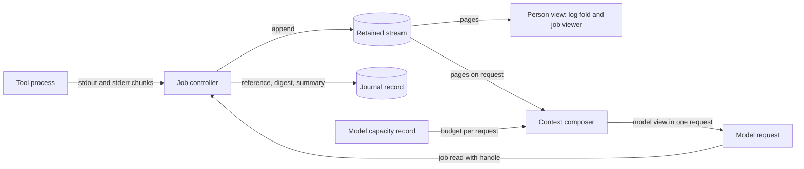

# Tool output views and limits

Status: selected principles, 2026-10-13. The owner selected the principles in
[Required behavior](#required-behavior). The [limit review](#limit-review)
classifies every tool-handling limit found on 2026-10-13 against them. Nothing
here is implemented. Changes to each limit belong to the design that owns it,
listed in [Required design changes](#required-design-changes). Protocol
numbering remains `0.1`; journal format remains `1`.

Owner change, 2026-10-18: “We found these types of tool and turn limits to be
profoundly limiting in Wisp.” L20 becomes 200 calls, L34 becomes 1–201, L22 and
L25 are removed and L24 loses its turn total. L23 is removed with L22. The
[tool call records](tool-call-records.md#turn-limit-change-owner-2026-10-18) and
[request caps](turn-usage-helper.md#request-caps-and-admission) own the details.

## Purpose

Asura's tool limits were set when tool output was copied whole into model
input and into the journal. Under the [tool job controller](tool-job-controller.md),
output is retained as a stream and read through a handle. Under
[loop closure](loop-closure.md), loops end through closures over their own
streams, and token capacity comes from the selected model. Most fixed limits
were standing in for those mechanisms. This document records which limits stay,
which move to another owner, and which are removed.

## Required behavior

Required behavior (owner, 2026-10-13):

1. **One retained stream.** A tool's complete output is held once, as a retained
   stream in the payload store. It is the only complete copy.
2. **Two views.** The person view and the model view of a stream differ and are
   chosen independently.
   - The **person view** is a display rule: the log folds output, and the job
     viewer pages through all of it.
   - The **model view** is what the context composer places in one model
     request. The composer chooses it per request from the model's capacity
     record and the other content competing for context.
   - No tool defines a fixed preview size. A tool result gives the model a
     handle and a short disclosure; the model pages the stream for more.
3. **Journal references, not text.** The journal stops holding tool result text.
   A result record keeps a payload reference, a digest and a short summary.
4. **Fixed transport units.** Wire and journal frame sizes stay fixed. They are
   transport units, not content limits; large content streams across frames.
5. **Evidence before a turn backstop.** The closure that guarantees a turn's
   tool loop ends is not chosen yet. Asura first logs real tool-loop traces,
   builds a classifier over them, and derives stall and timing closures from
   that evidence. Until then the existing 8-call exhaustion closure stays in
   force unchanged.
6. **Ollama context from configuration.** The helper's hard-coded
   `min(capacity, 8192)` context clamp is removed. Context comes from the
   model's capacity record under [model-sized limits](loop-closure.md#model-sized-limits).

A fixed numeric limit remains valid only as a
[known-size exhaustion closure](loop-closure.md#model-sized-limits): a quantity
whose size Asura knows and fixes, such as a buffer, a frame or a process bound.

## Views of one stream

Selected principle. Arrows show data flow from the producing process to each
reader. The composer and the job viewer read the same retained stream.

## Limit review

The 2026-10-13 inventory found 49 limits. Each row names its current value and
its classification under the principles above.

| Class | Meaning |
| --- | --- |
| Keep | A known-size bound; unchanged |
| Replace | Superseded by a job or composer mechanism, named in the row |
| Remove | Not a limit under the principles; its role moves to the named owner |
| Model-sized | Derived from the model capacity record |
| Evidence | Waits for the trace classifier in rule 5; current value stays meanwhile |

### Execution

| ID | Limit | Current value | Class | Owner after review |
| --- | --- | --- | --- | --- |
| L1 | exec_cmd timeout | 1–60 s, default 30 | Remove | Removed in J1 (owner, 2026-10-15, J1-Q3): a command ends on completion or turn cancel; `timeout_seconds` is removed (owner, 2026-10-17). Then the job yield window only; jobs have no fixed lifetime (owner, 2026-10-14, J2a-1). Job closures are completion, cancel, revocation, restart and capture fault |
| L2 | Setup budget | 2 s | Remove (owner, 2026-10-15) | Job setup ends on spawn, cancel or setup fault ([job closures](tool-job-controller.md#job-closures-and-wind-down-bounds)) |
| L3 | Cleanup until unconfirmed | 2.5 s | Keep | exec_cmd tool |
| L4 | TERM to KILL grace | 500 ms | Keep | exec_cmd tool; the person profile sets its own |
| L5 | Guardian lease poll and clock step | 100 ms each | Keep | Platform guardian |
| L6 | Group-membership scan | 256 process IDs | Keep | Platform guardian |
| L7 | Scratch cleanup | 4096 entries, 32 levels | Keep | exec_cmd tool |
| L8 | Live exec_cmd jobs | 1 per active turn | Replace | Job slots per service and per conversation |
| L9 | Pending tool calls and executors | 1 each | Keep | Model tools |
| L10 | Ordinary tool deadline | 2 s | Removed (owner, 2026-10-17) | A non-exec tool call ends on completion, cancel, steering, shutdown or helper exit ([model tool execution](model-tool-execution.md#mt3-activation-completion)) |
| L11 | Command and cwd | 8192 B and 1024 B | Keep | exec_cmd tool |
| L12 | Private argv payload | 8704 B | Keep | exec_cmd tool |

### Capture and output

| ID | Limit | Current value | Class | Owner after review |
| --- | --- | --- | --- | --- |
| L13 | Tail ring | 8 KiB per stream | Replace | Retained stream |
| L14 | Drain quantum | 8 KiB per stream per dispatch | Keep | Reactor fairness |
| L15 | Read buffer | 4 KiB | Keep | Capture |
| L16 | Combined output cap | 64 MiB | Replace | One retention quota with pause and expiry in the job controller |
| L17 | Rendered stream | 6144 B, most recent end | Remove | Model view by the composer; person view by display rules |
| L18 | Metadata envelope | 512 B | Keep | exec_cmd tool |
| L19 | Status channel | 128 B buffer, 32 B notices, 3 notices | Keep | Platform guardian |

### Result delivery to the model

| ID | Limit | Current value | Class | Owner after review |
| --- | --- | --- | --- | --- |
| L20 | Calls per turn | 200, plus one over-limit record (owner, 2026-10-18; was 8) | Evidence | Trace classifier; turn closure mapping |
| L21 | Per-result bytes | 16,384 | Remove | Composer for the model view; journal references for records |
| L22 | Result bytes per turn | None (removed, owner, 2026-10-18; was 65,536) | Removed | — |
| L23 | Memory-create headroom | None (removed with L22, owner, 2026-10-18; was 256 B) | Removed | — |
| L24 | Request caps | Per request: 1024 first, then 512, or the caller's cap (2048 ceiling); no turn total (owner, 2026-10-18; the 2048 turn reservation is removed) | Model-sized | Capacity record |
| L25 | Inference requests per turn | None (removed, owner, 2026-10-18; was 64) | Removed | — |
| L26 | Ollama context clamp | min(capacity, 8192) | Model-sized | Capacity record (rule 6) |
| L27 | Model input, history, prompt | 64 KiB; 32 entries; 32 KiB | Remove | Composer; transfer chunking stays fixed |
| L28 | Ollama parser bounds | 16 KiB arguments; 128 B name; 64 KiB line; 4 MiB stream | Keep | Helper parser |

### Journal and records

| ID | Limit | Current value | Class | Owner after review |
| --- | --- | --- | --- | --- |
| L29 | Frame | 64 KiB | Keep | Journal transport unit |
| L30 | Journal capacity | 8 MiB, 32,768 frames | Replace (owner, 2026-10-15): the single 8 MiB file must not be the limit | Required follow-up journal design: known-size segment files with checkpoint snapshots and compaction, total size from a configurable quota and disk space ([conversation admission](conversation-admission.md#format-1-and-record-kinds)). Current values stay until it lands |
| L31 | Tool result text record | 16,384 B | Replace | Reference, digest and summary record |
| L32 | exec_cmd intent payload | 9217 B | Keep | exec_cmd tool |
| L33 | exec_cmd intent timeout | 1–60,000 ms | Remove | J1's ExecCmdIntent kind 22 records no timeout (owner, 2026-10-15, J1-Q3); the job intent records none either (owner, 2026-10-14, J2a-1). Older kind 14 records keep theirs. |
| L34 | Record ordinal | 1–200; 201 for the over-limit record (owner, 2026-10-18; was 1–8 and 9) | Evidence | Follows L20 |
| L35 | Journal owner memory | 16 MiB; writer 64 MiB | Keep | Journal owner |

### Protocol, file, memory, audit and inventory tools

| ID | Limit | Current value | Class | Owner after review |
| --- | --- | --- | --- | --- |
| L36 | Control and model frame, chunk, credit | 64 KiB; 16 KiB; 64 KiB | Keep | Transport units (rule 4) |
| L37 | `read_file` page | 1–16,384, default 4096 | Keep ceiling; default becomes a composer choice | Model tools |
| L38 | Path | 1024 B | Keep | Model tools |
| L39 | `list_directory` | 128 entries, 16 KiB | Keep | Model tools |
| L40 | `list_notes` | 1–8, default 8 | Keep | Memory tools |
| L41 | Note preview | 256 B | Keep | Memory tools |
| L42 | `get_note` page | 1–16,384, default 4096 | Keep ceiling; default becomes a composer choice | Memory tools |
| L43 | Note sources | 32 | Keep | Memory tools |
| L44 | Note body | 1–16,384 | Keep | Memory tools |
| L45 | Store response and deadline | 32 records or 64 KiB; 2 s | Keep the response size; remove the 2 s store deadline (owner, 2026-10-16) | Memory store: queries and transactions end on completion, an engine error or the caller's cancel ([journal step J1-0](conversation-admission.md#journal-step-j1-0-journal-waits-without-a-time-bound)). L10 is removed, so the caller's wait has no deadline either |
| L46 | `read_audit` | 1–16 records | Keep | Audit tools |
| L47 | Audit reply bytes | 16,384 in design; 15,000 in code | Keep | Audit tools |
| L48 | Audit window, record, hydrate | 256; 4096 B; 256 KiB | Keep | Audit |
| L49 | `list_tools` | 32 entries, 16 KiB | Keep | Model tools |

### Design and code mismatches

| Mismatch | Design | Code |
| --- | --- | --- |
| exec_cmd job scope (L8) | One service-wide job (`exec-cmd-tool.md`) | One job per active turn (`conversation.rs:487`); the owner holds one active turn (`conversation.rs:584`), so both statements hold |
| Truncation fields (L18) | `stdout_truncated` and `stderr_truncated` | One `truncated` field (`exec_cmd.rs:51`) |
| Audit reply bytes (L47) | 16,384 | Stops at 15,000 (`audit_tools.rs:60`) |
| Ollama context (L26) | No design | `min(capacity, 8192)` (`OllamaBackend.swift:130`) |

The job designs also disagreed among themselves. Rules 1–3 resolve the three
preview sizes (job head and tail, rendered stream, `!` notice tail) and the three
meanings of 64 MiB (emitted-output stop, per-call retention, per-job quota).

## Tool-loop trace evidence

Required behavior (rule 5): the turn backstop is derived from evidence.

Proposed mechanism: the service records a bounded trace for each turn's tool
loop. Each entry holds the call kind, a digest of the arguments, a digest of the
result, new retained bytes, timing and the turn's eventual ending. The trace
holds no argument or output text. A classifier over these traces separates
productive loops from stalls and cycles, and proposes the stall fingerprint,
cycle window and timing bounds for the [closure mapping](loop-closure.md#decisions).
The trace design, its retention and the classifier belong to a later design.
Until it selects closures, L20 and L34 keep their current values. The owner
raised them on 2026-10-18 and removed L25.

## Required design changes

Each owner design must adopt these principles before implementing its part.

| Design | Change |
| --- | --- |
| [Tool job controller](tool-job-controller.md) | Replace its fixed preview with a disclosure the composer sizes; until the composer exists, results carry no output text and the model pages with `job read` (owner, 2026-10-14, with PC12); hold one retention quota; result records carry references |
| [Result retention packet](result-retention-graph-packet.md) | Align its 64 MiB per-call limit and capture concurrency with the single job quota |
| [Model tools](model-tool-execution.md) | Move the per-result byte budget to the composer; keep page ceilings. The per-turn byte budget is removed (owner, 2026-10-18) |
| [exec_cmd tool](exec-cmd-tool.md) | Replace the tail ring, rendered size and 60 s timeout under jobs; fix the truncation-field mismatch |
| [Loop closure](loop-closure.md) | Record the trace-classifier direction for the tool-loop backstop |
| [Person command mode](person-command-mode.md) | Drop its fixed notice and record sizes; use the two views |
| [Execution threat model](execution-threat-model.md) | Update statements about journaled output size once records hold references |
| Model provider and helper | Remove the Ollama clamp once the capacity record exists |

## Validation

Each owner design defines the tests for its change. This review requires two
cross-cutting checks when the changes land:

| ID | Check |
| --- | --- |
| TV1 | A tool result larger than any former fixed limit is retained whole, shown in full to the person, and reaches the model only as the composer's chosen view plus a handle that pages the rest. |
| TV2 | No journal record contains tool output text; each result record's reference and digest match the retained stream. |
