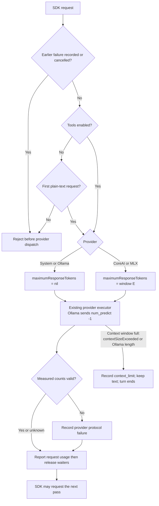
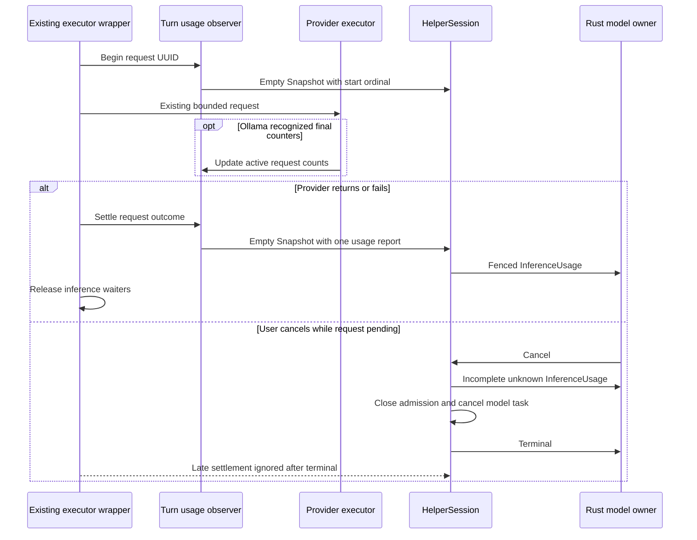

# Per-request inference usage in the Swift helper

Status: reviewed scoped design and integrated implementation. The Swift helper
suite and Rust/Swift fixture exchange have passed. Parent-owned final service,
terminal and native qualification are recorded in the response activity design.
The parent owns canonical schema, generated bindings, Rust collection, client
display, documentation indexes and serial validation.

Owner requirement, 2026-10-13: token limits must not be hard-coded. The fixed
token figures in this design describe the current implementation and will be
replaced by [model-sized limits](loop-closure.md#model-sized-limits).

Owner decision, 2026-10-18: “We found these types of tool and turn limits to be
profoundly limiting in Wisp.” The helper no longer limits the number of requests
in a turn and no longer keeps a turn output-token budget. The 64-request cap, the
2,048-token turn total, its refunds and the durable turn reservation are removed.

Owner decision, 2026-10-19: “Model's own limit.” No request has an Asura output
cap. Each inference request writes until the model stops or its context window
is full. The 1,024 first-request cap, the 512 later-request cap, the caller's
`Begin` cap and the 2,048 per-request ceiling are removed. See
[request admission](#request-admission).

## Scope and ownership

The Swift helper observes actual SDK executor requests in `BoundedToolModel`.
One turn-local observer assigns consecutive request ordinals and settles reports.
Provider adapters supply measured counters from the request they execute.
`HelperSession` publishes each report through the existing private transport.
It does not coalesce reports with replacement response text.

This packet adds no scheduler, model invocation, tokenization call, provider probe,
filesystem read, dependency or public tool. Context occupancy, request token
caps and differences between session totals cannot supply usage counters.
The protocol remains 0.1; the journal remains format 1.

## Installed API evidence

The installed macOS 27 FoundationModels Swift interface exposes executor request
identity and asynchronous dispatch. `LanguageModelExecutorGenerationChannel.Event`
is opaque: its public interface provides factories without readable action fields.
The helper cannot inspect generic executor token usage through that channel.
`LanguageModelSession.Usage` supplies session-level data; this packet does not use
that data to infer individual request costs.

The pinned MLX adapter's readable generation observer is internal and test-only.
The pinned CoreAI adapter emits usage through the opaque SDK channel.
Neither adapter exposes a supported per-request usage callback in this packet.
System, CoreAI and MLX therefore report unknown counters. Changing dependencies
or using private APIs is outside this packet.

The Ollama adapter owns each HTTP request and its final decoded record.
`prompt_eval_count` measures input; `eval_count` measures output.
Each counter must come from the final recognized record for that request.
Ollama does not report cached input tokens here. The adapter must preserve unknown
cached usage rather than use its existing synthetic SDK cached count of zero.

## Request and report contract

Each executor invocation that [request admission](#request-admission) admits receives one ordinal,
starting at 1. The observer holds at most one active UUID, ordinal and counter tuple.
Overlapping invocations fail with the existing protocol failure; no second lane
or unbounded map is created. No request count or turn token total limits admission
(owner, 2026-10-18). The 200-call tool limit of
[tool call records](tool-call-records.md#size-limits) still applies.

`Snapshot` gains an optional usage report and an optional request-start ordinal.
These callbacks carry empty text and no text usage or context measurement.
`HelperSession` routes them before the replacement-text path. A start callback
records the active request but emits no wire message. This marker lets cancellation
settle an active request before the terminal frame.

The parent adds private envelope field 23, `InferenceUsage`, with:

| Field | Meaning |
| --- | --- |
| request_ordinal | Consecutive request identity within the operation, starting at 1; any `uint32` value |
| input_tokens | Optional actual request input count, at most 1,000,000,000 |
| output_tokens | Optional actual request output count, at most 1,000,000,000 |
| cached_input_tokens | Optional measured cached input count; requires input and cannot exceed it |
| complete | True only when successful request settlement has both input and output counts |

Zero is a measured value. Absence means unknown. Cached input may remain unknown
on an otherwise complete report. Missing counts or failed requests require
`complete = false`. Failed requests retain available valid counts and never invent
missing counts. Invalid provider counts cause provider protocol failure and an
incomplete report with those invalid counts omitted.

Reports carry the existing operation and generation fence. The session enforces
consecutive ordinals and at most one unsettled request. The ordinal is a `uint32`.
A request after ordinal 4,294,967,295 fails with the protocol failure; this is a
known-size exhaustion that a turn does not reach in practice. The session rejects
duplicates, missing start markers, invalid bounds and reports after terminal.
A normally completed request emits exactly one report before the next request
starts. No additional inference runs to collect missing statistics.

## Request admission

Selected design (owner, 2026-10-18; output caps removed by the owner,
2026-10-19). The request wrapper admits any number of requests in a tool-enabled
turn. It keeps no turn output-token total, no per-request output cap and no
remaining-budget check. A turn ends by [loop closure](loop-closure.md#current-loops):
the model completes, the 201st tool proposal is recorded, the person cancels or
steers, the context window fills, the provider fails, the helper exits or the
service stops.

`Begin` carries no output-token value; field 4 is reserved. The executor wrapper
sets `GenerationOptions.maximumResponseTokens` on each request so that no Asura
value can stop the model before its context window is full:

| Provider | Request option | Reason |
| --- | --- | --- |
| System (Apple FoundationModels) | `nil` | The framework then writes until the model stops or reports `contextSizeExceeded`. |
| Ollama | The adapter ignores the option and sends `num_predict: -1` | Ollama documents −1 as “infinite generation” and as the default. Asura sends it explicitly so that a Modelfile `PARAMETER num_predict` cannot add a cap. |
| CoreAI and MLX | The model's effective context window `E`, from Hello | With `nil`, the pinned adapters substitute their own defaults: CoreAI 512 tokens (2,048 for reasoning models) and MLX 4,096. A value of `E` cannot stop output before the window is full, because the input also occupies the window. |

- **Tool-enabled generation:** every request is admitted while no earlier
  failure is recorded and no other request is active.
- **Plain text:** one request is admitted. A plain-text turn has no tool
  continuation, so a second dispatch can only be an SDK retry that repeats the
  answer. The second dispatch fails with the output-limit result before provider
  I/O. This rule did not exist only for the removed cap, so it stays.

A full context window ends the run cleanly with `context_limit`. The received
text stays as the response prefix:

- FoundationModels `LanguageModelError.contextSizeExceeded` maps to `context_limit`.
- Ollama `done_reason: "length"` maps to `context_limit`. With `num_predict: -1`,
  `shift: false` and `truncate: false`, a length stop can only mean a full window.
  Ollama 0.40.5 was checked on 2026-10-19: with `num_ctx` 256 and no
  `num_predict`, the stream ended with `done_reason: "length"`,
  `prompt_eval_count` 30 and `eval_count` 226 (sum 256).
- CoreAI and MLX end at their own window behavior. This design adds no check for
  them; native qualification of that end state is not recorded.

The usage observer checks each measured count only against the 1,000,000,000
counter bound. No count can exceed a request cap, because none exists. The
plain-text terminal usage uses the same 1,000,000,000 validity bound. The Ollama
adapter also rejects an `eval_count` above the request's `num_ctx`, because
output cannot exceed the window. Per-request usage reports remain; the service
sums them for the turn statistics display. Unknown counters stay unknown.

The [context composer](context-composer.md#per-request-budget-algorithm) leaves
room for the answer with its output reservation `R`. That reservation is a
composition target, not an output cap: the model is not stopped at `R`. When a
token counter exists (system model), the helper fails with `context_limit` only
when the exact input count leaves no room for one output token.

### Request admission — selected design

Arrows show admission decisions within the existing executor. No path counts
requests or tokens across the turn, and no path applies an output cap.

## Settlement and cancellation

The existing executor wrapper marks request start before calling the provider.
After provider return or failure, it settles usage before releasing inference
waiters. This prevents a host tool or later inference overtaking that report.
Ollama only updates the observer's current counter tuple; it does not emit a
second report from its completion callback.

On user cancellation, helper failure or shutdown with an active request,
`HelperSession` emits one incomplete report before Terminal and stops admission.
This fallback contains unknown counters because the provider has not settled.
The session then cancels the existing model task. Late callbacks cannot emit
another report after terminal. Channel loss can prevent delivery; the service
must retain unknown usage instead of manufacturing a settled report.

### Usage lifecycle — selected design

Arrows name asynchronous callbacks and state transitions. The session marker is
internal; only settled reports cross the private channel.

## Async and resource obligations

All added work uses existing actors and awaited callbacks. One executor request,
one usage observer and one session usage tuple are active per admitted turn.
There are no detached reporting tasks or new callback waiter collections.
Each callback performs constant-size validation and one bounded transport enqueue.
The transport retains its eight control frames, 4096-byte control-frame maximum
and nonblocking socket owner. Queue saturation fails explicitly; it does not drop
usage silently or block the service reactor.

Inference retains cancellation-driven lifetime. Preparation, handoff and
transport waits have no time limit (owner, 2026-10-16); see
[helper and provider waits](model-provider-integration.md#helper-and-provider-waits-without-time-limits--owner-2026-10-16).
Cleanup keeps its wind-down bounds. Counter reporting adds no external call and
no time bound.
Cancellation and terminal delivery retain existing ordering and cleanup ownership.
A pending native model cannot prevent the client or service processing controls.

## Security and recovery

Reports contain integers and existing operation identities only. They cannot
include prompts, tool arguments, output text, model metadata or provider errors.
Counter observations grant no tool authority and release no tokens. The service
keeps no durable token reservation (owner, 2026-10-18).
The service owns persistence and reconnect semantics. This helper packet has no
cross-session usage cache. A helper crash leaves unfinished usage unknown.

## Required validation

| ID | Initial state and trigger | Required observable result |
| --- | --- | --- |
| UH01 | One successful Ollama request reports zero input/output | Ordinal 1 retains both zeros and complete true; cached input remains absent |
| UH02 | SDK performs several admitted tool passes | One ordered report per executor request; counts are request-local |
| UH03 | Provider lacks supported request usage API | One report with absent counters and complete false; no counting call |
| UH04 | Recognized Ollama completion omits one count | Available count retained, missing count absent, complete false |
| UH05 | Pending request receives user cancellation | Exactly one incomplete report before cancelled Terminal; late settlement emits nothing |
| UH06 | Provider fails after measured counts | One incomplete report, original failure retained and no new request |
| UH07 | Duplicate report, overlapping start or invalid counter arrives | Existing protocol failure; no duplicated or invented statistics |
| UH08 | Text streams before usage settlement | Full replacement response retained; report is delivered without replacing text |
| UH09 | Slow reader saturates existing transport | Explicit bounded failure; no additional task, queue or hidden drop |
| UH10 | Tool-enabled turn dispatches 100 requests | Every request dispatches with no Asura output cap; ordinals 1–100 are reported in order; no request-count or turn-total failure |
| UH11 | Output count exceeds 1,000,000,000, Ollama `eval_count` exceeds `num_ctx`, or a count belongs to another request | Provider protocol failure; no later request reaches the provider |
| UH12 | Cancellation occurs while a request is admitted | No later request reaches the provider |
| UH13 | Requests reach the executor wrapper | System and Ollama requests carry `maximumResponseTokens = nil`; CoreAI and MLX requests carry the window `E`; the Ollama body has `num_predict: -1`; `Begin` has no output-token field |
| UH14 | Plain-text turn requests a second dispatch | Second dispatch fails with the output-limit result before provider I/O |
| UH15 | A later tool-turn request finds the context window full | The executor records `context_limit`; the turn fails with the context limit and no further request dispatches |
| UH16 | Ollama ends a stream with `done_reason: "length"` | Delivered text is kept; the request fails with `context_limit`, not output-limit |
| UH17 | Plain-text answer longer than 2,048 tokens, or tool-turn answer longer than 512 tokens after a tool call | The answer completes whole with a natural stop; usage records the actual count |

Unit checks exercise observer request identity, zero, partial counts, invalid
bounds, multiple passes and failure. Real-socket helper integration checks UH05,
UH07 and UH08 through actual protobuf frames and terminal ordering.
Existing transport tests cover queue limits; root must run those checks as part
of the serial helper suite. The parent owns service/process and PTY integration
for event collection, persistence, user display and cancellation responsiveness.

Native qualification must observe an actual Ollama request and tool continuation
through the packaged service, verifying independently reported input/output.
System/CoreAI/MLX checks can establish unknown-report behavior; they cannot claim
measured per-request usage. Mock success does not establish provider statistics.
All model runs and builds remain serial under the parent owner.
