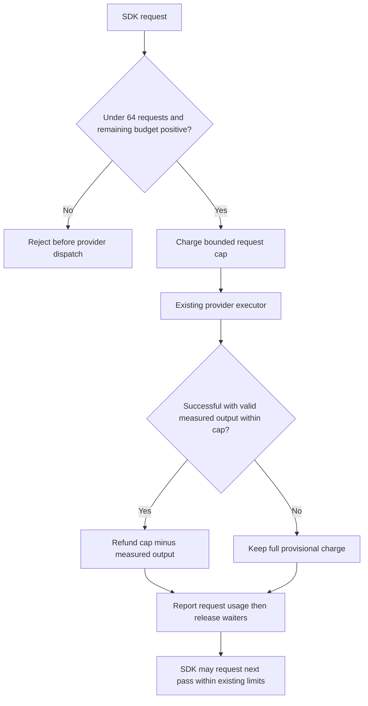
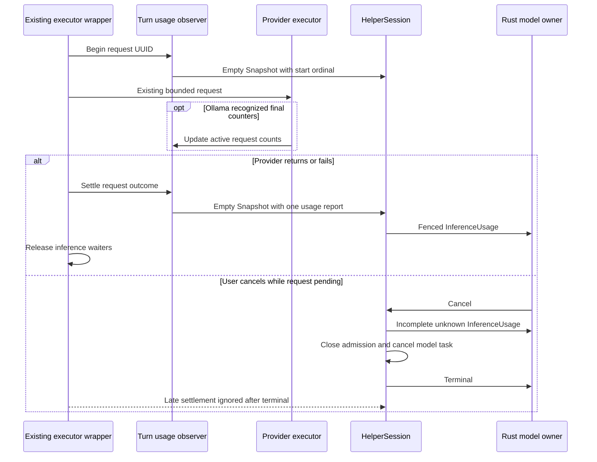

# Per-request inference usage in the Swift helper

Status: reviewed scoped design and integrated implementation. The Swift helper
suite and Rust/Swift fixture exchange have passed. Parent-owned final service,
terminal and native qualification are recorded in the response activity design.
The parent owns canonical schema, generated bindings, Rust collection, client
display, documentation indexes and serial validation.

Owner requirement, 2026-10-13: token limits must not be hard-coded. The fixed
token figures in this design describe the current implementation and will be
replaced by [model-sized limits](loop-closure.md#model-sized-limits).

## Scope and ownership

The Swift helper observes actual SDK executor requests in `BoundedToolModel`.
One turn-local observer assigns consecutive request ordinals and settles reports.
Provider adapters supply measured counters from the request they execute.
`HelperSession` publishes each report through the existing private transport.
It does not coalesce reports with replacement response text.

This packet adds no scheduler, model invocation, tokenization call, provider probe,
filesystem read, dependency or public tool. Context occupancy, reserved token
budgets and differences between session totals cannot supply usage counters.
The protocol remains 0.1; the journal remains format 1.

## Installed API evidence

The installed macOS 27 FoundationModels Swift interface exposes executor request
identity and asynchronous dispatch. `LanguageModelExecutorGenerationChannel.Event`
is opaque: its public interface provides factories without readable action fields.
The helper cannot inspect generic executor token usage through that channel.
`LanguageModelSession.Usage` supplies session-level data; this packet does not use
that data to infer individual request costs.

The pinned MLX adapter's readable generation observer is internal and test-only.
The pinned CoreAI adapter emits usage through the opaque SDK channel.
Neither adapter exposes a supported per-request usage callback in this packet.
System, CoreAI and MLX therefore report unknown counters. Changing dependencies
or using private APIs is outside this packet.

The Ollama adapter owns each HTTP request and its final decoded record.
`prompt_eval_count` measures input; `eval_count` measures output.
Each counter must come from the final recognized record for that request.
Ollama does not report cached input tokens here. The adapter must preserve unknown
cached usage rather than use its existing synthetic SDK cached count of zero.

## Request and report contract

Each executor invocation admitted by the existing budget receives one ordinal,
starting at 1. The observer holds at most one active UUID, ordinal and counter tuple.
Overlapping invocations fail with the existing protocol failure; no second lane
or unbounded map is created. The independent three-pass limit is removed under the budget contract below.
The 2048-token turn reservation and eight native proposals remain mandatory.

`Snapshot` gains an optional usage report and an optional request-start ordinal.
These callbacks carry empty text and no text usage or context measurement.
`HelperSession` routes them before the replacement-text path. A start callback
records the active request but emits no wire message. This marker lets cancellation
settle an active request before the terminal frame.

The parent adds private envelope field 23, `InferenceUsage`, with:

| Field | Meaning |
| --- | --- |
| request_ordinal | Consecutive request identity within the operation, 1–64 |
| input_tokens | Optional actual request input count, at most 1,000,000,000 |
| output_tokens | Optional actual request output count, at most 1,000,000,000 |
| cached_input_tokens | Optional measured cached input count; requires input and cannot exceed it |
| complete | True only when successful request settlement has both input and output counts |

Zero is a measured value. Absence means unknown. Cached input may remain unknown
on an otherwise complete report. Missing counts or failed requests require
`complete = false`. Failed requests retain available valid counts and never invent
missing counts. Invalid provider counts cause provider protocol failure and an
incomplete report with those invalid counts omitted.

Reports carry the existing operation and generation fence. The session enforces
consecutive ordinals, at most 64 reports and at most one unsettled request.
It rejects duplicates, missing start markers, invalid bounds and reports after
terminal. A normally completed request emits exactly one report before the next
request starts. No additional inference runs to collect missing statistics.

## Turn budget and request admission

The former three fixed allocations prevented a fourth request even when earlier
requests used few tokens. The request wrapper removes that independent pass cap.
It retains the 2048-token turn budget and eight native tool proposals.
One turn can produce at most 64 request reports; a 65th request fails with the
existing output-limit result before provider dispatch.

For tool-enabled generation, the first request has a cap of at most 1024 tokens.
Each later request has a cap of at most 512 tokens. The actual cap is the minimum
of that value, the caller's requested cap and the remaining turn budget.
Plain text retains one full requested allocation and cannot dispatch twice.
An empty remaining budget rejects further requests.

Admission provisionally subtracts the actual cap. After successful settlement,
a validated provider output count can refund `cap - measured output`.
The output count must be nonnegative, at most the admitted cap and associated
with this active request. This preserves the invariant that measured charged
output plus active and unknown reservations cannot exceed 2048.
A missing output count, failed request, cancellation, malformed count or count
above the request cap grants no refund. No text-length estimate, context count,
session-total difference or caller promise can release tokens.

The observer returns the validated successful output count to the existing budget
owner before `finishInference` releases tool waiters. It creates no second budget
owner. A report can be incomplete because input is unknown while output still
permits a validated refund. The reserved 2048-token service grant is unchanged;
this packet does not add tokens or silently issue a new reservation.

### Budget decision — selected design

Arrows show admission and settlement decisions within the existing executor.

## Settlement and cancellation

The existing executor wrapper marks request start before calling the provider.
After provider return or failure, it settles usage before releasing inference
waiters. This prevents a host tool or later inference overtaking that report.
Ollama only updates the observer's current counter tuple; it does not emit a
second report from its completion callback.

On user cancellation, helper failure or shutdown with an active request,
`HelperSession` emits one incomplete report before Terminal and stops admission.
This fallback contains unknown counters because the provider has not settled.
The session then cancels the existing model task. Late callbacks cannot emit
another report after terminal. Channel loss can prevent delivery; the service
must retain unknown usage instead of manufacturing a settled report.

### Usage lifecycle — selected design

Arrows name asynchronous callbacks and state transitions. The session marker is
internal; only settled reports cross the private channel.

## Async and resource obligations

All added work uses existing actors and awaited callbacks. One executor request,
one usage observer and one session usage tuple are active per admitted turn.
There are no detached reporting tasks or new callback waiter collections.
Each callback performs constant-size validation and one bounded transport enqueue.
The transport retains its eight control frames, 4096-byte control-frame maximum
and nonblocking socket owner. Queue saturation fails explicitly; it does not drop
usage silently or block the service reactor.

Inference retains cancellation-driven lifetime. Preparation, handoff and
transport waits have no time limit (owner, 2026-10-16); see
[helper and provider waits](model-provider-integration.md#helper-and-provider-waits-without-time-limits--owner-2026-10-16).
Cleanup keeps its wind-down bounds. Counter reporting adds no external call and
no time bound.
Cancellation and terminal delivery retain existing ordering and cleanup ownership.
A pending native model cannot prevent the client or service processing controls.

## Security and recovery

Reports contain integers and existing operation identities only. They cannot
include prompts, tool arguments, output text, model metadata or provider errors.
Counter observations grant no tool authority. The service retains its durable
2048-token reservation; validated output counts can release unused provisional
allocations within the helper's existing turn-local budget.
The service owns persistence and reconnect semantics. This helper packet has no
cross-session usage cache. A helper crash leaves unfinished usage unknown.

## Required validation

| ID | Initial state and trigger | Required observable result |
| --- | --- | --- |
| UH01 | One successful Ollama request reports zero input/output | Ordinal 1 retains both zeros and complete true; cached input remains absent |
| UH02 | SDK performs several admitted tool passes | One ordered report per executor request; counts are request-local |
| UH03 | Provider lacks supported request usage API | One report with absent counters and complete false; no counting call |
| UH04 | Recognized Ollama completion omits one count | Available count retained, missing count absent, complete false |
| UH05 | Pending request receives user cancellation | Exactly one incomplete report before cancelled Terminal; late settlement emits nothing |
| UH06 | Provider fails after measured counts | One incomplete report, original failure retained and no new request |
| UH07 | Duplicate report, overlapping start or invalid counter arrives | Existing protocol failure; no duplicated or invented statistics |
| UH08 | Text streams before usage settlement | Full replacement response retained; report is delivered without replacing text |
| UH09 | Slow reader saturates existing transport | Explicit bounded failure; no additional task, queue or hidden drop |
| UH10 | Three small measured tool passes precede a fourth final response | Fourth request dispatches; total charged output remains within 2048 and native proposals within eight |
| UH11 | Output count is unknown, exceeds cap or belongs to another request | No refund; unknown reservation retains full charge; invalid counts fail |
| UH12 | Cancellation occurs after reservation | No refund; no later request reaches provider |

Unit checks exercise observer request identity, zero, partial counts, invalid
bounds, multiple passes and failure. Real-socket helper integration checks UH05,
UH07 and UH08 through actual protobuf frames and terminal ordering.
Existing transport tests cover queue limits; root must run those checks as part
of the serial helper suite. The parent owns service/process and PTY integration
for event collection, persistence, user display and cancellation responsiveness.

Native qualification must observe an actual Ollama request and tool continuation
through the packaged service, verifying independently reported input/output.
System/CoreAI/MLX checks can establish unknown-report behavior; they cannot claim
measured per-request usage. Mock success does not establish provider statistics.
All model runs and builds remain serial under the parent owner.
